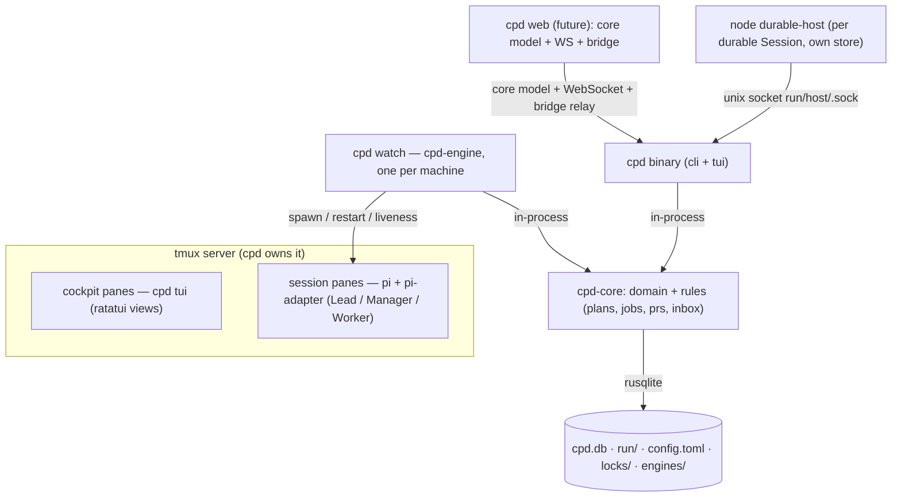

# cpd's architecture — parts and edges

This document maps cpd's parts and every edge between them: what each part is,
what it is **not** (the corrections of the Plan web-ui draft map), where it lives,
and how it runs. Every fact below was verified against the working tree at commit
`3178fdba9` and its live docs; where the Plan draft or the docs disagree with the
code, **the code wins** and this document says so. Anything not verified is
labelled `unverified` or `guess:`.

The normative sources are at the end (§7). One binary, `cpd`, is the CLI, the
engine and the cockpit (a terminal UI).

## 1. The parts

One subsection per part, in the order the User named them — engine, the store,
the pi adapter, the cli, the tui, the webui — with **core**, **tmux** and the
**durable host** where they belong.

### 1.1 core

**What it is.** The shared domain: every area of plans, jobs, attempts, prs,
sessions, policy, inbox, events, ask, merge, secret, config — "everything except
the root command tree, the engine and the cockpit" (`core/src/lib.rs:1-6`). It is
the crate that owns the store (`core/src/store/`), the paths under `$CPD_HOME`
(`core/src/home.rs`) and the three seams a test fakes, `Ports` = clock, runner,
spawn (`core/src/ports.rs:18-25`).

**What it is NOT.** Not the engine's loop (the rules live here; the *loop* is the
engine, §1.2). Not the cockpit. Not a process: it is a library that runs inside
every `cpd` process.

**Where it lives.** `core/`, package `cpd-core` (`Cargo.toml`; the module map under
`docs/implementing.md`, `Layout` — "one module per area" plus the shared modules).

**Lifecycle.** A library, no process identity of its own; it is linked into the cli
binary, the engine and the tui.

### 1.2 engine

**What it is.** The loop, one per machine: `cpd watch`, which wakes, polls and
sleeps across the E-steps, spawns and checks the liveness of sessions, polls PRs,
fills the Inbox, auto-merges, and restarts the tmux server — plus `cpd doctor`,
the machine's health check (`engine/src/lib.rs:1-7`; the loop's lifecycle and
steps in `engine/src/watch/engine.rs:1-6`). It depends on `cpd-core` and never on
the tui (`engine/src/lib.rs:7`).

**What it is NOT.** Not "the heart, all logic and rules": the rules are core's;
the engine is only the watcher that runs them, one per machine under
`locks/watch.lock` (contract §3.7).

**Where it lives.** `engine/`, package `cpd-engine`: `engine/src/watch/`,
`engine/src/doctor/`.

**Lifecycle.** One process per machine. The cockpit and the engine do not depend
on each other: `cli` passes the engine's tmux restart to the cockpit
(`engine/src/lib.rs:7`; `cli/src/cli.rs:190`).

### 1.3 the store (SQLite)

**What it is.** The ledger, one piece of the state: `cpd.db` at `$CPD_HOME`, read
and written **only through core**. Each `cpd` command opens it in its own write
transaction (`core/src/events/append.rs:1-2`); the events table is the append-only
event log, written by the one function every command calls
(`core/src/events/append.rs:174`).

**What it is NOT.** Not the whole state: `$CPD_HOME` also holds `run/`,
`config.toml`, `locks/` and `engines/` (§4). And not an agent's memory — it is the
command ledger the agents and the cockpit read.

**Where it lives.** `core/src/store/`, `core/src/home.rs`. The one source of
truth for the layout is `core/src/home.rs` (`$CPD_HOME`: where it is and what is
in it, contract §1.4; `core/src/home.rs:1-4`).

**Lifecycle.** Files, not a process: `cpd.db` plus its `-wal`/`-shm` beside it
(`cpd.db: the database (contract §4); -wal and -shm live beside it`,
`core/src/home.rs:116-118`).

### 1.4 the pi adapter and the durable host

**What it is.** The **agent side of the wire**: TypeScript loaded into every pi
process — `pi/extension.ts` — that renders the chat (one renderer for every cpd
customType, `pi/lib/adapter.ts:38`), runs the guards, writes the first message and
handles host approvals (`pi/lib/adapter.ts`). Beside it, in the same workspace
area:

- **`pi/durable-host/`**: a headless Node process that runs one durable Lead's or
  Manager's Session with no tmux pane, owning its own SQLite store and serving a
  unix socket `$CPD_HOME/run/host/<session>.sock` (contract §6.13, §6.14;
  `pi/durable-host/server.ts:1-2`).
- **`pi/durable-worker/`**: the Node Worker runner (contract §6.12).

**What it is NOT.** Not an agent itself (it is what pi loads and what a durable
host runs). Not a Rust crate: it never links into the `cpd` binary
(maintained in the TS workspace under `pi/`, not `Cargo.toml`).

**Where it lives.** `pi/` — `pi/extension.ts`, `pi/lib/`, `pi/durable-host/`,
`pi/durable-worker/`.

**Lifecycle.** One adapter instance per pi process; one durable host per durable
Session (its own store, its own socket).

### 1.5 cli

**What it is.** The main interface, agent first: the root command tree. Every
command prints exactly one JSON value on stdout; without a command, in a
terminal, it opens the cockpit (commands.md §13.3; `cli/src/cli.rs:26-29`).

**What it is NOT.** Not "the whole binary, for humans": it is the agent-facing
tree, and the tui is a client of `cli` (a "one client of the core", §6), not the
other way round (`cli/src/cli.rs:273-280`).

**Where it lives.** `cli/`, package `cpd`, the binary: `cli/src/main.rs` and
`cli/src/cli.rs`.

**Lifecycle.** One process per invocation; it owns build, parser and dispatch
(`cli/src/cli.rs:141`, `run_with`).

### 1.6 tui, and tmux

**What it is.** The user interface, ssh first: the cockpit — ratatui views in
tmux panes; the StatusBar is tmux's status line; its actions run cpd commands,
mostly in-process through the runner `cli` hands it (`tui/src/lib.rs:1-12`;
`cli/src/cli.rs:273`). `cpd tui` builds and attaches the cockpit (`cpd tui
[--attach] [--respawn]`, §13.1).

**tmux, where it belongs.** tmux is the cockpit's medium and the pi Sessions'
medium: cpd builds and owns its tmux session (contract §6.1, "One tmux server per
machine: tmux -L <tmux.socket>", `docs/contract.md:2776`). The tui is what draws
into it; the engine restarts it (via `cli`, §1.2).

**What it is NOT.** Not the engine, not the rules; not "the whole state" —
it renders what core reads. A read model and the dirtiest part of the cockpit
(`tui/src/read/`, §5 edge 2).

**Where it lives.** `tui/`, package `cpd-tui` (`tui/src/`, views and read model
in `tui/src/read/`).

**Lifecycle.** `cpd tui` and the cockpit run in the one `cpd` process; the tmux
server is a separate process cpd owns (contract §6.1).

### 1.7 webui

**What it is.** The user interface, experience first; **not built**. Decided
(§6): a `cpd web` subcommand in the one binary, a sync tiny_http-class server, a
Vite+React+shadcn/ui front end, a WebSocket live path, a host-socket bridge
relay, a unix socket in a 0700 directory behind `tailscale serve` (Context
records hs-d768..hs-d779, hs-n599; §6).

**What it is NOT.** Not a second interface of the engine: like the tui, the web is
**one client of the core** — CLI-first (hs-d753; §6).

**Where it lives.** Nowhere yet; the decided new `cpd-web` crate.

## 2. The process map on one machine

One machine, one `$CPD_HOME`. Agents run `cpd` commands as subprocesses; the one
engine per machine spawns and watches the sessions; the store is read and written
only through core.

```
                          one machine, $CPD_HOME
 ┌────────────────────────────────────────────────────────────────┐
 │  tmux server                                                     │
 │   ├── cockpit panes   (ratatui views, cpd tui)                  │
 │   └── session panes   (pi + pi-adapter: Lead / Manager / Worker)│
 │                              ▲                                  │
 │                              │ spawn / restart / liveness       │
 │  ┌───────────────┐  ┌───────┴────────┐                          │
 │  │ cpd binary    │  │ cpd watch      │                          │
 │  │ (cli + tui)   │  │ cpd-engine     │  one per machine         │
 │  └──────┬────────┘  └───────┬────────┘                          │
 │         │                   │                                   │
 │         │    ┌──────────────▼───────────────┐                   │
 │         │    │  cpd-core: domain + rules    │                   │
 │         └───►│  (plans, jobs, prs, inbox…)  │                   │
 │              └──────────────┬───────────────┘                   │
 │  agent processes run        │ rusqlite                          │
 │  cpd commands (JSON)        ▼                                   │
 │  ┌───────────────────────────────────────────────┐              │
 │  │ cpd.db · run/ · config.toml · locks/ · engines/│             │
 │  └───────────────────────────────────────────────┘              │
 │  node durable-host (per durable Session, own store)             │
 │   └─ unix socket run/host/<session>.sock (protocol v1)          │
 │  ── future ── cpd web (cpd-web crate): core model + WS          │
 │       + socket bridge → browser (React + shadcn)                │
 └────────────────────────────────────────────────────────────────┘
```

The same, as a Mermaid flowchart:



## 3. The in-process layering (workspace crates)

The workspace has four Rust crates, with dependencies pointing one way:
**cli → core, engine, tui; engine → core; tui → core; core → none**
(`docs/implementing.md`, `Layout`). `tui` does not depend on `engine`, and nor on
`cli`: `cli` owns the root command tree and hands the cockpit the runner and the
engine restart explicitly (`docs/implementing.md`, `Layout`, "The command
runner", "The engine restart").

| Crate | Depends on | Holds |
|---|---|---|
| `core` `cpd-core` | none | every area except tui/watch/doctor, and the store (`core/src/store/`) and shared modules |
| `engine` `cpd-engine` | `core` | `watch` (the loop) and `doctor` |
| `tui` `cpd-tui` | `core` | the cockpit: views + read model (`tui/src/read/`) |
| `cli` `cpd` (binary) | `core`, `engine`, `tui` | the root `Command` tree and `run`/`main_with` |
| `pi/` (TypeScript) | — | the pi adapter, the durable host, the durable worker (not a Rust crate) |
| `cpd-web` (future) | `core` | the decided web server (§6) |

Inside the one binary: `cli` calls the tui's `run_with`, handing it the runner
(`cli/src/cli.rs:190`), and the cockpit runs commands in-process through that
runner (`cli/src/cli.rs:273-280`); `run_with(ports, argv)` is the test seam, with
`Ports` = clock, runner, spawn faked for tests (`core/src/ports.rs:18-25`).

**The dependency rule** (`docs/implementing.md:383`): every workspace dependency
is declared once in the root `Cargo.toml` `[workspace.dependencies]`; **a new
workspace dependency lands only by a recorded decision** — the web plan's sync
HTTP server will (hs-d769). No unplanned dependency may be added.

## 4. The store

`$CPD_HOME` is `cpd.db` plus directories; every path under it is built by
`core/src/home.rs` (one source of truth, `core/src/home.rs:1-4`).

- **`cpd.db`** (+ `-wal`/`-shm` beside it): the ledger. `core/src/home.rs:116-118`;
  the events table is the append-only event log (`core/src/events/append.rs:174`).
- **`run/`**: transient state — markers (e.g. `run/tmux-restart.pending`,
  `core/src/home.rs:202-204`), per-plan render/`specs`/`reviews`/`logs`
  (`core/src/home.rs:232-299`), and the durable host's sockets and stores
  (`run/host/<session>.sock` and `.sqlite`, contract §6.13, §6.14).
- **`config.toml`**: the machine config (contract §8; `core/src/home.rs:111-113`).
- **`locks/`**: flock files — `watch.lock` for the one engine, driver locks,
  `check-<plan>--<attempt>.lock`, `pr-poll.lock` and the rest
  (`core/src/home.rs:147-172`).
- **`engines/`**: the (holographic) context engine's data directory —
  `$CPD_HOME/engines/holographic`, one `<context>.db` per Context searched,
  default of the `context_engine_dir` config key (`core/src/config/file.rs:66,423`;
  contract §8's `context_engine_dir` row, `:4587`). This is the engine that serves
  Context memory, not the `cpd watch` engine, which leaves no directory of its own.

The **durable host owns a separate per-Session store** besides `cpd.db`: one
SQLite store per durable Session (`run/host/<session>.sqlite`) and its socket
(`run/host/<session>.sock`), owned and flocked by the host process (contract
§6.13; durable-leads section 4 "Host and protocol").

## 5. The edge table

Every edge of the Plan draft's section 4, with a path:line cite verified against
the working tree; where the draft's cite moved or was wrong, it is corrected here.

| # | Edge | Mechanism | Payload | Evidence (verified) |
|---|---|---|---|---|
| 1 | cli → core | in-process call | command → Output | `cli/src/cli.rs:141-190` (`run_with`/`dispatch`) |
| 2 | tui → core | in-process read | snapshots (`read/*`) | `tui/src/read/` (`mod.rs` declares the reads) |
| 3 | tui → commands | in-process runner + `cpd tui action` (internal) | argv, JSON out | `cli/src/cli.rs:273`; commands.md §13.2 (`:3318`) |
| 4 | tui ↔ tmux | escapes, display-popup, status line | cells, popups, clicks | docs/contract.md §6.1 (`:2774`) |
| 5 | engine → core | in-process | store, spawn, flock | `engine/src/lib.rs:1-7` |
| 6 | engine → sessions | spawn tmux windows, node durables as children; SIGTERM/SIGKILL; ps liveness | processes | `core/src/host/spawn.rs` (`command`, `:121`) |
| 7 | agent → cpd | subprocess `cpd <cmd>` | commands, JSON stdout | `pi/lib/adapter.ts` (the adapter's host) |
| 8 | cpd → agent | session files, Events (store) | events, prompts | `core/src/events/append.rs:174` |
| 9 | durable-host ↔ clients | unix socket, newline JSON frames, seq/epoch ring | frames | `pi/durable-host/server.ts:1-2`; docs/contract.md §6.14 (`:3859`) |
| 10 | cpd → git/gh | subprocess | repos, PRs, checks | `core/src/git/` (`run.rs`, `worktree.rs`) |
| 11 | cpd → 1Password | `op` subprocess | secrets | docs/commands.md §23 (`secret`, `:5275`) — the draft's cite "§24" was wrong: §24 is `mcp` |
| 12 | cpd → Slack | HTTP via slack.rs | posts | `core/src/slack.rs` |
| 13 | future web → core | in-process | Serialize model | hs-d771 (§6) |
| 14 | future web → host socket | bridge relay (WS to browser) | frames | hs-d772, hs-d773 (§6) |

Legend on edge 11: the draft pointed to commands.md §24, which is `mcp`; the
`op`/secret wire is commands.md §23 `secret` (`:5275`), enforced by the adapter's
raw-`op` guard (§15.11; `commands.md:4352`).

## 6. The web node (decided)

Context records hs-d768..hs-d779 and hs-n599, all readable with
`cpd context show --record <id>` (Context `building-cpd`), and the research
`docs/research/web-ui.md` (on main at this commit). The web is framed by the
durable-leads decision hs-d753: **cpd is CLI-first** — the CLI is the first-class
interface, meant for agents; the TUI (the cockpit) is one client of the core, and
**a web UI is another** (hs-d753).

| Record | Decision |
|---|---|
| hs-d768 | a `cpd web` subcommand, a new `cpd-web` crate the cli calls, in the one binary (web-ui Q1) |
| hs-d769 | a synchronous tiny_http-class HTTP server in the binary; a new Rust dependency by recorded decision (Q2) |
| hs-d770 | front end is Vite + React + shadcn/ui, with SSE for live updates (superseding the doc's htmx, 5.3); a bundler build joins the Gate (Q3) |
| hs-d771 | the shared read model moves to core with `Serialize`; the CLI commands print it; gaps close as CLI commands first (Q6/O1) |
| hs-d772 | the chat bridge relays host-socket frames to the browser, which folds them (a TS fold) (Q4) |
| hs-d773 | live views over a WebSocket — in-process commit watcher + Event cursor — superseding the SSE of the Q3 answer; POST commands (Q5) |
| hs-d774 | a unix socket in a 0700 directory behind `tailscale serve`; identity headers trusted only while the socket is reachable solely through the proxy (Q7) |
| hs-d775 | any attached client may answer approvals (Plan review, secret, host-repair, ask_user_question) via `ui_response`, once durable-leads P1.6 lands (Q8) |
| hs-d776 | no Escalation-answer UI in the web; the Lead answers with `cpd answer`, the web shows the count (Q9) |
| hs-d777 | read-only and send-only web chat for Sessions without a socket (pi leads from session-file transcript + `cpd session send`; a stopped durable host shows the last transcript with a host-not-running banner) (Q10) |
| hs-d778 | build order: read-only tree + Inbox first, then actions, then chat with approvals after durable-leads P1.6 (Q11) |
| hs-d779 | parity over time = a parity test pinning the one shared read model plus the rule that a new cockpit read or action lands in core with a CLI command first (Q12) |
| hs-n599 | Q5 (hs-d773) is the WebSocket option C of `docs/research/web-ui.md` §8 — the in-process commit watcher + Event cursor over a WebSocket (tungstenite family, +10-15 packages, `guess`); "tumblerite-style" in hs-d773 is a typo (lead note) |

**The decided stack, one line.** `cpd web` (new `cpd-web` crate) in the one
binary; sync tiny_http-class server; Vite + React + shadcn/ui front end; live
views over a WebSocket (commit watcher + Event cursor), POST commands; a chat
bridge relaying host-socket frames to the browser (TS fold); access on a unix
socket in a 0700 directory behind `tailscale serve`, identity headers trusted
only while the socket is reachable solely through the proxy; approvals via
`ui_response` after durable-leads P1.6; parity by moving the read model to core
with `Serialize` plus a parity test and the CLI-first rule (hs-d768..hs-d779;
the build is a later Plan).

## 7. Normative sources

- `docs/contract.md` — the normative text: tmux (§6.1), the durable session host
  (§6.13) and the host socket protocol (§6.14); the engine's loop (§3.7).
- `docs/commands.md` — the command reference: `watch` (§12), the cockpit
  (`tui`, `tui view` §13, `cpd tui action` §13.2), the secrets wire (§23) and the
  pi adapter's raw-`op` guard (§15.11).
- `docs/interface.md` — the CLI tree.
- `docs/implementing.md` — the layout, the one-area rule, the dependency rule
  (`:383`), and the ports/`run_with` seam.
- `docs/research/web-ui.md` (on main at this commit) and durable-leads
  (`docs/research/durable-leads.md`, in contract §6.13) — the web node and the
  durable host.