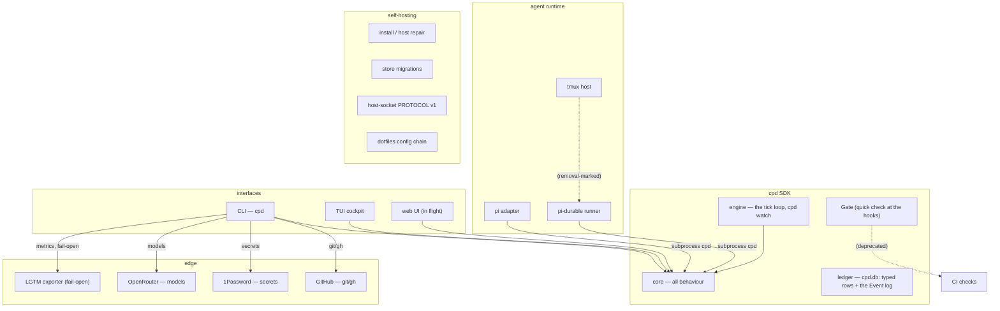

# Architecture vault

This vault documents cpd's architecture as decided in `hs-d802` (a record of machine `hs`), and [architecture-verification.md](../research/architecture-verification.md) is the verification behind every note in it: that note maps each `hs-d802` claim to the section of [contract.md](../contract.md), [commands.md](../commands.md) or [CONTEXT.md](../CONTEXT.md) that owns it and records every disagreement. Vocabulary follows [CONTEXT — How to read this glossary](../CONTEXT.md): the object is a **Workflow**, and PR means only the **pull request** on GitHub — until the rename lands, the CLI still says `cpd pr add`, `--pr` and the `prs` table. Context records are machine-local ([contract §4.6](../contract.md), [CONTEXT — Context store](../CONTEXT.md)): `hs-*` ids belong to machine `hs` and are not readable with `cpd context show --record` elsewhere (that fails `record_not_found` with `details.record_machine`), so [architecture-verification.md](../research/architecture-verification.md) is the in-repo record of each `hs-d802` claim and the contract, commands and CONTEXT section that owns it.

The component map — the five subgraphs of the decided model, with the removed and deprecated parts dashed:

## Map

- **Foundations**: [[sdk]], [[job-lifecycle]]
- **Agents**: [[roles]], [[agent-runtime]]
- **Interfaces**: [[interfaces]], [[clocks]]
- **Operation**: [[verification]], [[workspace]], [[knowledge-plane]], [[message-board]], [[attention-inbox]]
- **Edges**: [[edge-and-self-hosting]], [[boundaries]]

## How to read

Start at [[sdk]] and [[job-lifecycle]], follow the map into the note that owns the question, and trust the citations: every behavioural claim links the contract, commands or CONTEXT section that owns it, and where the docs and `hs-d802` disagree the verification note is the record.

## Sources

- [contract.md](../contract.md)
- [commands.md](../commands.md)
- [CONTEXT.md](../CONTEXT.md)
- [architecture-verification.md](../research/architecture-verification.md)
