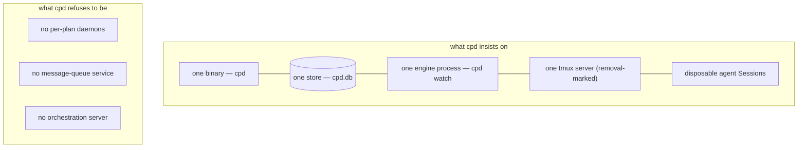

# The boundaries

cpd is defined as much by what it refuses to be as by what it is. This note states each deliberate non-entity — one line, the thing cpd is not — and then the shape it insists on instead. The verification behind it is [architecture-verification.md](../research/architecture-verification.md) (its section 11, "What cpd deliberately is not (the boundaries)", and its disagreements 7, 18 and 19).

## What cpd is not

- **No per-plan daemons.** The engine is one `cpd watch` per machine, not one scheduler per Plan or per Workflow. [CONTEXT — Engine](../CONTEXT.md) lists `daemon`, `scheduler` and `one watcher per Workflow` as the words to avoid, and [contract §1.1](../contract.md) fixes one engine per machine (D5).
- **No message-queue service.** There are no queue directories, no cache directories and no tmux user options carrying state; Events are the single channel, and no external broker sits between the parts ([contract §1.1](../contract.md)). This is true of an external *service*: cpd does keep small internal, SQLite-backed queues — `slack_reactions` and `jira_transitions` ([contract §4.4](../contract.md)) and the board posts ([commands §10a](../commands.md)) — which are tables in the one store, not a broker ([architecture-verification.md §11](../research/architecture-verification.md), disagreement 19).
- **No orchestration server.** The control plane is the `cpd` CLI, not a resident server: every deterministic part of a Workflow (Ledger writes, scheduling, the concurrency cap, timeouts, the retry ladder, worktrees, the merge queue, the Gate, metrics, PR polling) is a command any agent or script can call, so the path stays open to Claude Code and Hermes ([ADR-0005](../adr/0005-cpd-cli-control-plane.md)). The one durable server-like process is the engine tick loop, and it is not a service others call.

## What cpd is

- **One binary.** cpd is one Rust binary, `cpd`; the workspace's crates (`core/`, `cli/`, `tui/`, and the engine) are linked into it, and the cockpit is `cpd tui` rather than a second program ([contract §1.1](../contract.md), [ADR-0010](../adr/0010-one-rust-binary-in-steps.md)). The pi adapter stays TypeScript because pi loads extensions as TS/JS, but it is code loaded into pi, not a second cpd ([ADR-0010](../adr/0010-one-rust-binary-in-steps.md)).
- **One store.** State is one SQLite database per machine, `$CPD_HOME/cpd.db`, with SQLite bundled into the binary; the typed rows and the append-only Event log live in it together ([contract §1.1](../contract.md), [contract §4.1](../contract.md)). The ADR lineage contradicts itself and the live one wins: [ADR-0001](../adr/0001-sqlite-workflow-state.md) chose one SQLite database per Workflow but is **superseded by [ADR-0004](../adr/0004-beads-ledger.md)**, which is accepted and says each Workflow's state lives in a **beads (`bd`) workspace** outside the product repo — a design cpd 2 no longer uses ([contract §1.1](../contract.md): "No `bd`, no `wt` (worktrunk), no `herdr`"; [architecture-verification.md §11](../research/architecture-verification.md), disagreement 18). The current contract and [architecture §1.3](../architecture.md) say SQLite, so "one store" holds today; the live decision is SQLite, and ADR-0004's beads lineage is history.
- **One engine process.** One `cpd watch` per machine schedules every Plan under one concurrency limit, watches liveness and timeouts, polls pull requests, starts a Workflow once the Workflows it needs are merged, and curates Context records ([CONTEXT — Engine](../CONTEXT.md), [contract §3.7](../contract.md)). The concurrency cap is one machine-wide pool, not one per Plan ([contract §3.4](../contract.md)).
- **One tmux server, removal-marked.** One tmux server per machine (`tmux -L <socket>`, default socket `cpd`) hosts the cockpit, the Leads, the Workers and the engine ([contract §6.1](../contract.md)). The removal-mark is not a mark in the docs: "tmux is the only host" today ([contract §1.1](../contract.md)), and dropping tmux (P3) is a future decision out of scope until durable Leads have run a while (`hs-d752`, `cpd context show --record hs-d752`; [architecture-verification.md §11](../research/architecture-verification.md), disagreement 7). The decision behind this note calls the server "removal-marked" (`hs-d802`, `cpd context show --record hs-d802`); the docs call the removal a future Plan step.
- **Disposable agent sessions.** A Session is a record and a pane, not durable state to preserve: engine step E12 archives a stopped Worker's Session, and the Session's pi conversation is a file, not a service ([contract §3.7](../contract.md), [CONTEXT — Session](../CONTEXT.md)). Workers run fresh; the durable runner resumes an interrupted Worker in place but is still a second runner beside pi, not a replacement ([contract §6.12](../contract.md)).

## The shape as one picture

## See also

- [[sdk]] — the core, ledger and engine the "one binary" boundary is made of.
- [[edge-and-self-hosting]] — the external boundaries cpd leans on.
- [[interfaces]] — the CLI, cockpit and web UI, clients of the one core.

## Sources

- [contract §1.1](../contract.md), [§3.4](../contract.md), [§3.7](../contract.md), [§4.1](../contract.md), [§4.4](../contract.md), [§6.1](../contract.md), [§6.12](../contract.md)
- [commands §10a](../commands.md)
- [CONTEXT — Engine](../CONTEXT.md), [CONTEXT — Session](../CONTEXT.md)
- [ADR-0001](../adr/0001-sqlite-workflow-state.md), [ADR-0004](../adr/0004-beads-ledger.md), [ADR-0005](../adr/0005-cpd-cli-control-plane.md), [ADR-0010](../adr/0010-one-rust-binary-in-steps.md)
- [architecture §1.3](../architecture.md)
- [architecture-verification.md](../research/architecture-verification.md)
- `hs-d752`, `hs-d802` (`cpd context show --record <id>`)
