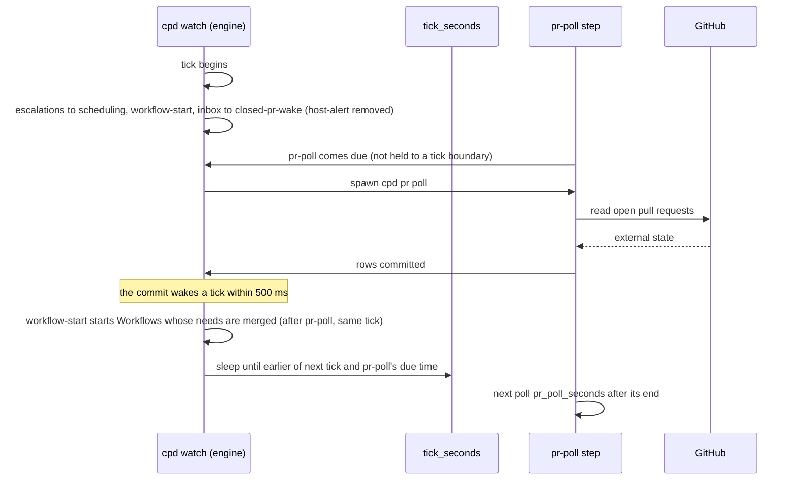

# The clocks

cpd runs two clocks, not one (`hs-d802` (a record of machine `hs`), item 5): the **engine loop clock** (`watch.tick_seconds`) and the **GitHub poll clock** (engine step `pr-poll`, `watch.pr_poll_seconds`). They are decoupled on purpose: the engine sleeps until the earlier of its next tick and `pr-poll`'s due time, so the poll is never held to a tick boundary ([contract §3.7](../contract.md)). Both keys live in the `[watch]` domain of `$CPD_HOME/config.toml` ([contract §8.2](../contract.md)); the loop they belong to is the one `cpd watch` per machine ([CONTEXT — Engine](../CONTEXT.md), [commands §12](../commands.md)).

This note documents the model in hs-d802 against today's docs. Where the model and the docs disagree, the discrepancy is named in place and sourced to [architecture-verification.md](../research/architecture-verification.md), which verified `hs-d802` claim by claim.

## The engine loop clock: `tick_seconds`

The engine runs its loop every `tick_seconds` — a decimal, minimum `0.1`, default `5` ([contract §3.7](../contract.md), [contract §8.2](../contract.md)). Each tick runs the engine's numbered steps in order: **`escalations` to `closed-pr-wake`**, with **`host-alert` removed** and `closed-pr-wake` (the closed-pull-request wake) right after `parked-drafts` ([contract §3.7](../contract.md)); the command reference lists the same set ([commands §12](../commands.md)). A tick starts at the earliest of three things ([contract §3.7](../contract.md)):

- `tick_seconds` after the previous tick began (the longest wait);
- **`pr-poll`'s due time**, when the poll comes due;
- **500 ms after the previous tick began** when another process other than the engine committed to the store — the engine sees this by comparing SQLite's `PRAGMA data_version` at each 100 ms nap.

So ticks come at most twice a second, and the Inbox (`inbox`) and the Workflow starts (`workflow-start`) follow another process's commit within 500 ms plus the tick's own time; `tick_seconds` stays the longest wait ([contract §3.7](../contract.md)).

The engine clock is **purely internal**: it is the `cpd watch` tick loop ([contract §3.7](../contract.md), [CONTEXT — Engine](../CONTEXT.md)). The loop schedules every Plan's Jobs under one concurrency limit (`scheduling`), watches liveness and timeouts (`liveness`), starts a Workflow once the Workflows it needs are merged (`workflow-start`), reads and writes the Inbox (`inbox`), curates Context records (`curation`) and titles Sessions (`session-titles`) ([CONTEXT — Engine](../CONTEXT.md), [contract §3.7](../contract.md)).

> **Model vs docs.** hs-d802 calls the loop "`escalations` to `closed-pr-wake` except `pr-poll`" and says it "moves work from the Context phase to Dispatch." The docs put `pr-poll` *in* the step set (it is an E-step that runs at its own due time), remove `host-alert`, and describe the Context → Plan → Dispatch progression as the Manager's and the Lead's work, not the tick's ([architecture-verification.md](../research/architecture-verification.md), item 2). The step range is also stale in [CONTEXT — engine step](../CONTEXT.md), which says "`escalations` to `merge-reaction`" ([architecture-verification.md](../research/architecture-verification.md), item 2). This note follows the contract.

```mermaid
sequenceDiagram
    participant Clock as tick_seconds
    participant Eng as cpd watch (engine)
    participant Store as cpd.db (the ledger)
    Clock->>Eng: tick begins (every tick_seconds, min 0.1, default 5)
    Eng->>Store: escalations to closed-pr-wake in order (host-alert removed; closed-pr-wake after parked-drafts)
    Store-->>Eng: rows and Events committed
    Note over Eng,Store: liveness · scheduling Jobs · open-jobs<br/>workflow-start · inbox · curation · session-titles
    Eng->>Eng: sleep until next tick or pr-poll's due time
    Note over Eng: a tick starts at the earliest of the next tick,<br/>pr-poll's due time, and 500 ms after another process's commit
```

## The GitHub poll clock: `pr_poll_seconds` (`pr-poll`)

Engine step `pr-poll` runs `cpd pr poll` (with no `--plan`) as a **subprocess** — a process boundary — `pr_poll_seconds` after the **end** of the previous poll, **never overlapping**, and **at its due time, not at the next tick**, or at once when a cpd action has requested a poll (the file `run/pr-poll-now`, removed as the poll starts and again before it reads GitHub: [contract §1.4](../contract.md), [contract §3.7](../contract.md) `pr-poll`) ([contract §3.7](../contract.md), [contract §8.2](../contract.md), [commands §9.2](../contract.md)). `pr_poll_seconds` defaults to `5` ([contract §8.2](../contract.md)). A poll of 1.3 s with `pr_poll_seconds = 5` and `tick_seconds = 5` runs every 6.3 s, not every 10 s, whether or not any Plan is in `deploy` ([contract §3.7](../contract.md)).

One poll covers **every open pull request of the User**, any repo on github.com ([contract §7.6](../contract.md), [commands §9.2](../contract.md)); [CONTEXT — PR poll](../CONTEXT.md) calls it "the engine's poll, every 5 s, of the open pull requests of the User on GitHub, one search through `gh`." It watches the **external GitHub state after dispatch** and drives cpd's response ([contract §3.7](../contract.md) `pr-poll`, [contract §7.6](../contract.md)):

- it stores each pull request in the `pull_requests` table and appends `pr-feedback` for the Workflow that owns it (checks failed, changes requested, closed, approved, comments) ([contract §7.6](../contract.md), [commands §9.2](../commands.md));
- when a pull request's `mergeable` becomes `conflicting` — or a merged base repoints it — it inserts an `update` Job for the Workflow ([contract §3.7](../contract.md) `pr-poll`, [contract §7.6](../contract.md), [commands §9.2](../commands.md));
- it records a merge (`pr-merged`), unstacking and base follows, and the Plan's `done` ([contract §7.6](../contract.md), [commands §9.2](../commands.md));
- it reads the rate limit from the search and pauses polls on it, with the `gh_rate_limited` error Event for a below-100 pause ([contract §3.7](../contract.md) `pr-poll`);
- a transient `gh` failure is tolerated for `watch.pr_poll_transient_minutes` (default `10`) before `pr-poll` raises an error ([contract §3.7](../contract.md) `pr-poll`, [contract §8.2](../contract.md), [commands §9.2](../commands.md)).

The Lead can also run `cpd pr poll` by hand, and a Workflow's Lead does so right after `pr open`; the tolerance above is the **engine's**, not the command's — a hand poll fails at once ([commands §9.2](../commands.md)).

> **Model vs docs.** hs-d802 says the two clocks have "different timings on purpose." The docs give both keys the same default (`5`), so what differs is the *clock* (`pr-poll` runs `pr_poll_seconds` after the end of the previous poll, not at the next tick), not the default interval ([architecture-verification.md](../research/architecture-verification.md), item 2; [contract §8.2](../contract.md), [contract §3.7](../contract.md)).

```mermaid
sequenceDiagram
    participant Eng as cpd watch (engine pr-poll)
    participant Poll as cpd pr poll (subprocess)
    participant GH as GitHub
    participant Store as cpd.db
    Eng->>Poll: spawn at pr-poll's due time (pr_poll_seconds after the last poll ended)
    Poll->>GH: gh api graphql — every open pull request of the User
    GH-->>Poll: state, checks, reviews, mergeable, base
    Poll->>Store: pull_requests rows · pr-feedback · update Jobs · merges
    Poll-->>Eng: output (rate_limit.remaining, reset_at)
    Note over Eng,Poll: rate limit → pause (contract §3.7 pr-poll)<br/>transient failures tolerated for pr_poll_transient_minutes
    Note over Eng,Poll: never overlapping; a 1.3 s poll + 5 s/5 s runs every 6.3 s
```

## The overdue post clock: 86 400 s (`inbox`; `overdue-bump` is retired)

A post whose pull request stays unreviewed for 24 hours is **overdue** (pro-d382, pro-d386, pro-d388; [contract §4.4](../contract.md) "The overdue post and the RePost"; [contract §2.2](../contract.md) "The authored pull request rule"). `inbox` reads the clock and relabels the pull request's Inbox row `review overdue`; **nothing is sent automatically**. The User's RePost action (`cpd pr repost`, commands §9.8b2) sends the one reminder and sets `last_posted_at`, which restarts the clock. **`overdue-bump`, the Step that was to send the bump, is retired** (pro-d388): the number is not reused. It is a fixed clock: `BUMP_INTERVAL_SECS` = 86 400 is a constant in the code, not a `[watch]` key, and no config changes it. A post is overdue when `COALESCE(last_posted_at, posted_at)` is at most 86 400 seconds before now, compared as text in the format `posted_at` has, and its pull request is still unreviewed (`posts::overdue`). Only `cpd pr post` and `cpd pr repost` write `last_posted_at`.

## How the two clocks interleave

The clocks are independent by construction. The engine sleeps until the **earlier** of its next tick and `pr-poll`'s due time, so `pr-poll` is not held back to a tick boundary ([contract §3.7](../contract.md)). The two meet at two seams:

- **`workflow-start` runs after `pr-poll` in the same tick** ([commands §12](../commands.md), [contract §3.7](../contract.md)): a pull request starts in the tick after `pr-poll`'s poll result is applied, within `EARLY_GAP` (500 ms) of the poll's commit ([contract §3.7](../contract.md) `workflow-start`).
- **A commit wakes a tick**: when another process (the poll child, a CLI command) commits to the store, the engine starts its next tick within 500 ms, so `inbox`'s Inbox and `workflow-start`'s Workflow starts react to a poll's writes promptly ([contract §3.7](../contract.md)).

The engine's time-only rules (a Job stuck, a snooze's end, liveness) still wait for `tick_seconds` ([contract §3.7](../contract.md)). This is the deliberate interleave: an internal loop pacing cpd's own work, and a separate poll pacing cpd's view of GitHub ([contract §3.7](../contract.md), hs-d802).



## Related notes

The engine loop and the poll are served by the same core and the same store: [[sdk]]. Who acts on each clock is [[roles]]; what the poll drives on GitHub is [[verification]]; and the interfaces that read the store are [[interfaces]]. The agent processes these clocks start are [[agent-runtime]].

## Sources

- [contract §3.7](../contract.md) — the engine, `cpd watch`, the E-steps, `pr-poll`'s due time
- [contract §8.2](../contract.md) — `tick_seconds`, `pr_poll_seconds`
- [contract §7.6](../contract.md) — the PR poll
- [commands §12](../commands.md) — `watch`
- [commands §9.2](../commands.md) — `pr poll`
- [CONTEXT — Engine](../CONTEXT.md), [CONTEXT — PR poll](../CONTEXT.md)
- hs-d802 (records of machine `hs`; see [INDEX](INDEX.md)).
- [architecture-verification.md](../research/architecture-verification.md) — items 2 and the disagreements on the two clocks
