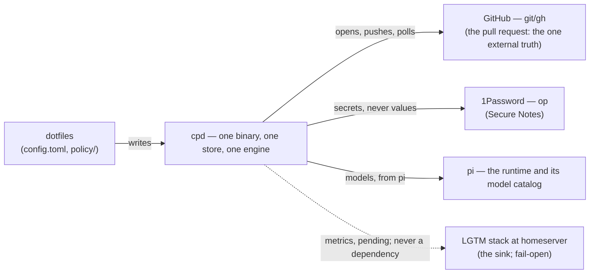

# The edge and self-hosting

cpd is one binary, one store and one engine process ([contract §1.1](../contract.md); see [[boundaries]]). It is not self-contained: it leans on a small number of external boundaries for the things it deliberately does not own — the pull request on GitHub, the secrets in 1Password, the models in pi, and the machine's own installation and configuration. This note names each boundary, says what cpd owns and what the edge owns, and states the fail-open rule. The verification behind it is [architecture-verification.md](../research/architecture-verification.md) (its section 10, "The edge and self-hosting", and its disagreements 14–17 and 21).

## GitHub — the PR plane

GitHub is the pull request plane: the **pull request** is the one external truth cpd mirrors, and cpd owns its own side of it — the PR object and its row, the Lead Branch, the Lead worktree, the Gate and the push ([contract §7.6](../contract.md), [contract §7.1](../contract.md)). `git` and, for pull requests only, `gh` are system dependencies ([contract §1.1](../contract.md)). cpd reads GitHub through the PR poll (engine step E5): it searches the User's open pull requests, stores what it read, and appends `pr-feedback`/`update` as the state moves ([contract §3.7](../contract.md), [contract §7.6](../contract.md)). cpd never edits the pull request's base itself — a pull request whose base moved on GitHub is followed with `pr-base-changed`, and a merge conflict queues an `update` Job ([contract §7.6](../contract.md)). Every push goes through cpd (`cpd pr open`, `cpd pr push`, `cpd pr rebase`), never a bare `git push` ([contract §8.3](../contract.md)). The object is a **Workflow** in this vault, but today's identifiers are still the CLI's: the commands `cpd pr add`, the flag `--pr` and the `prs` table ([CONTEXT — How to read this glossary](../CONTEXT.md)).

What cpd owns: the local work (branches, worktrees, the Gate, the merge queue). What GitHub owns: the pull request itself, its checks, reviews, mergeability and merge. `cpd pr view` reads the details the poll does not store ([contract §7.6](../contract.md)).

## 1Password — the secrets edge

1Password is the secrets edge: `cpd secret` wraps 1Password's CLI `op` to manage secrets in Secure Notes. cpd enforces who may do what, in which vault and when; agents never call `op` directly (the pi adapter refuses it) ([contract §8.4](../contract.md), [commands §23.0](../commands.md)). cpd holds no token and never signs in, and the 1Password app's per-use prompt is the approval. Only the vaults `cpd` and `homeserver` pass, every `op` call carries `--account my.1password.com`, and an approval lasts 10 minutes ([contract §8.4](../contract.md)). **Values never appear in argv, output, Events, logs, files or the store**: the code refuses a value in the store, and the grant files (`$CPD_HOME/run/secret/allow/`, `approve/`, directories 0700, files 0600) hold names only ([contract §8.4](../contract.md), [commands §23.0](../commands.md)).

What cpd owns: the role and vault checks, the grants, and the refusal to hold a credential. What the edge owns: the value, the vault, and the per-use confirmation.

## OpenRouter — one provider, not the model plane

The decision behind this note says OpenRouter is "the model plane" (`hs-d802`, `cpd context show --record hs-d802`), and [architecture-verification.md §10](../research/architecture-verification.md) records the disagreement: the docs say cpd **names no provider and no key variable** — the providers are found by the helper, from pi — and `cpd does not know the name` of a custom provider ([contract §3.7](../contract.md) E15, [contract §9](../contract.md)). OpenRouter appears in the docs only as one example model ref in `[presets.<name>]` (`openrouter/deepseek/deepseek-v4-pro`) ([contract §8.2](../contract.md)).

So the model plane is **pi plus the `[model]` policy domain**, not OpenRouter: pi is a hard system dependency and carries its own catalog and runtime, and `[model]` is a domain of the Policy that sets a model ref per Tier letter and role ([contract §1.1](../contract.md), [contract §8.3](../contract.md), [CONTEXT — Policy](../CONTEXT.md)). cpd resolves a ref like `github-copilot/claude-opus-5.5` and hands pi `--model <model>:<level>`; it never keeps a provider list of its own ([contract §9](../contract.md)). OpenRouter is one of the providers a ref may name.

## The LGTM exporter — pending, fail-open

The LGTM stack at homeserver (Loki, Grafana, Prometheus) is the sink for cpd's metrics, and it is **not a dependency**: nothing in cpd may depend on the exporter being up — **fail-open** (`hs-d798`, `cpd context show --record hs-d798`). The decision adds a `cpd metrics` query with a Prometheus text output format, and the dashboards and pipelines live in the homelab config, not in cpd; it is the Plan `metrics`, still pending ([architecture-verification.md §10](../research/architecture-verification.md)). No occurrence of `LGTM`, `Loki`, `Grafana` or `Prometheus` exists in [contract.md](../contract.md) or [commands.md](../commands.md) today, so the exporter is **unverified against the cpd docs** and sourced only to the record ([architecture-verification.md §10](../research/architecture-verification.md)).

What cpd owns: emitting the metrics and a fail-open query. What the edge owns: scraping, storing and drawing them; an exporter that is down costs cpd nothing.

## Install and host repair — self-hosting the binary

**`cpd install`** is the User's command at a shell, run by `scripts/install-cpd.sh` and, through it, by the dotfiles' install and sync; no agent runs it and no cockpit action does ([commands §14.4](../commands.md)). It installs the binary and the pi adapter and then restarts what runs the old binary, in order: preflight, the migration check (every file of `core/src/store/migrations/` must be on `origin/main` with the same content, else refused), the built binary's verdict, the config migration and validation, the adapter packages, the binary swap, the adapter swap, the follow-ups on the new binary, and the version tag ([commands §14.4](../commands.md)). It writes only `~/.local/bin`, `~/.local/share/cpd` and what the follow-ups write, and appends no row and no Event; it is idempotent and safe to rerun ([commands §14.4](../commands.md)).

When the install cannot run safely it is **skipped**, and the host Manager repairs the checkout by hand: `cpd host approve` writes a private approval valid 10 minutes for one repair, and `cpd host repair` resets `~/projects/cpd`'s main branch to `origin/main`, saving the diff and the old HEAD (`$CPD_HOME/run/cpd-install-backups/<ts>.patch`, ref `refs/cpd-host/<ts>`) ([commands §9.11](../commands.md), [contract §3.7](../contract.md)). Untracked files, other branches and stashes are never touched; the approval is consumed only after the reset succeeds ([commands §9.11](../commands.md)).

What cpd owns: the artefact, the swap and the repair. What the edge owns: the machine that runs the install and the checkout it builds from.

## Store migrations — the store's self-hosting

The store migrates itself by **named migrations** at start-up: the schema's version is a file `core/src/store/migrations/<name>.sql`, ordered bytewise, each declared `additive` or `breaking after <n>` ([contract §4.5](../contract.md)). Every `cpd` process that opens the database computes the verdict, and a process that finds migrations pending runs one `BEGIN IMMEDIATE` transaction: it applies them, reconciles the derived triggers, checks the foreign keys, records each migration in `schema_migrations`, and runs the schema check before it commits — a mismatch rolls the whole transaction back (`migration_failed`, exit 1) ([contract §4.5](../contract.md)). Rerunning is safe; the store records a checksum of every migration's text, and a store that applied one the binary no longer carries is refused `migration_changed` ([contract §4.5](../contract.md)). The install is the other half of the boundary: it refuses to install a binary whose migrations are not all on `origin/main` ([commands §14.4](../commands.md)). cpd keeps no schema hash in the store; the trusted hash is pinned in code ([contract §4.5](../contract.md)).

What cpd owns: the migration list, the transaction and the schema check. What the edge owns: nothing — migrations run inside the one binary and the one store.

## The host-socket PROTOCOL — the durable host protocol

`PROTOCOL` is ambiguous, and this note disambiguates it ([architecture-verification.md §10](../research/architecture-verification.md), disagreement 17):

- the **events protocol number** is reported by `cpd --version` as `protocol`, an integer that starts at 1 and is raised by one whenever an Event kind, an adapter-read `data` field, or the output of a command the adapter runs changes; **today it is 19** ([contract §5.2](../contract.md)). [versioning.md](../versioning.md) still says "13" and is stale ([architecture-verification.md §10](../research/architecture-verification.md), disagreement 21).
- the **host socket protocol v1** is how a client (`cpd chat`, a CLI, an agent) talks to the durable session host over a Unix socket at `$CPD_HOME/run/host/<session>.sock` ([contract §6.14](../contract.md)). Its wire is a cpd-native envelope: `hello` negotiates `PROTOCOL_VERSIONS = [1]`, `attach`/`submit`/`abort` go to the host, and `welcome`/`attached`/`snapshot`/`events`/`result`/`error` come back; the first snapshot is the whole history and a client is caught up at `head_seq` ([contract §6.14](../contract.md)).

What cpd owns: the protocol, its versions and the one socket. What the edge owns: the client that speaks it — same-user trust, no other authentication ([contract §6.14](../contract.md)).

## The dotfiles config chain — chezmoidata → config.toml

`config.toml` is the machine config at `$CPD_HOME/config.toml`, and it **is managed by the User's dotfiles** ([contract §8.1](../contract.md)). The chain `chezmoidata → config.toml` — the dotfiles' data rendered by chezmoi into the live file — is not carried by any cpd doc; cpd knows only that the file is the User's and is written by cpd in two places (the install's migrations and the runner-pill click), everything atomic ([contract §8.1](../contract.md)). The chain is therefore **unverified against the cpd docs** and sourced to the dotfiles and the record ([architecture-verification.md §10](../research/architecture-verification.md), disagreement 15). The same holds for the policy files under `$CPD_HOME/policy/`: they are written by hand or by the User's dotfiles, never by a command — `cpd policy show` only reads ([commands §22](../commands.md), [CONTEXT — Policy](../CONTEXT.md)). cpd reads nothing from a repo's tree, ever ([contract §1.1](../contract.md), [contract §8.3](../contract.md)).

**The drift, `hs-d795`.** The cautionary example is `hs-d795` (`cpd context show --record hs-d795`), where the decision raises `hs worker concurrency` from 5 (hs-d529) to 8 and, in the same record, fixes a drift: `machines.yaml` on the `hs` machine still said 6, **so a chezmoid re-render would have silently reverted hs-d529's 5**; the dotfiles now carries 8. The config file is one hop of a rendered chain, so a value changed in the live file and not in the chain is undone at the next render.

What cpd owns: parsing, validating and (in two places) writing `config.toml`, and reading only `$CPD_HOME/policy/`. What the edge owns: the dotfiles chain that renders the file.

## What cpd owns versus what the edge owns

| Boundary | cpd owns | the edge owns | fail behaviour |
|---|---|---|---|
| GitHub | branches, worktrees, the Gate, pushes, the poll's stored rows | the pull request, its checks, reviews and merge | one PR's resolve/poll failure is an `error` Event and no `pr-feedback`; every other PR is polled ([contract §7.6](../contract.md)) |
| 1Password | role/vault checks, grants | the value, the vault, the per-use prompt | typed refusals (`secret_*`); no silent default ([contract §8.4](../contract.md)) |
| pi / `[model]` | the ref and the Tier, the policy domain | the provider list, the catalog, the runtime | an unknown model is an error, never a fallback ([contract §9](../contract.md)) |
| LGTM exporter | the metrics and a query | scraping, storage, dashboards | **fail-open**: nothing depends on the exporter being up (`hs-d798`) |
| install / host repair | the artifact, swap, repair | the machine and checkout | every refusal is `install_failed`, exit 1; nothing replaced ([commands §14.4](../commands.md)) |
| store migrations | the list, the transaction, the schema check | nothing | `migration_failed` rolls back; `migration_changed` refuses ([contract §4.5](../contract.md)) |
| host socket | the protocol, the one socket | the client | a coded `error` frame; a mismatch is `protocol_mismatch` ([contract §6.14](../contract.md)) |
| dotfiles chain | parsing; two atomic writes | the rendered chain | an invalid config is `config_invalid`; a stale chain silently reverts (`hs-d795`) |

**The fail-open rule.** The LGTM exporter is the one boundary cpd deliberately tolerates being absent: the metrics are emitted and the query is answered locally, and nothing in cpd waits on the sink (`hs-d798`). Everywhere else the posture is the opposite — validate at the boundary and fail loud: a config that is not TOML or names an unknown key is `config_invalid` ([contract §8.1](../contract.md)), a scope file that does not parse is `policy_invalid` ([contract §8.3](../contract.md)), and a `gh` failure is `gh_failed`, never "no pull requests" ([contract §7.6](../contract.md)).

## See also

- [[sdk]] — the core, ledger and engine whose edges these are.
- [[boundaries]] — what cpd deliberately refuses to be.
- [[interfaces]] — the CLI, cockpit and web UI that call across these boundaries.
- [[job-lifecycle]] — the work one Job does inside the binary.

## Sources

- [contract §1.1](../contract.md), [§3.7](../contract.md), [§4.5](../contract.md), [§5.2](../contract.md), [§6.14](../contract.md), [§7.6](../contract.md), [contract §8](../contract.md) ([§8.1](../contract.md), [§8.2](../contract.md), [§8.3](../contract.md), [§8.4](../contract.md)), [§9](../contract.md)
- [commands §9.11](../commands.md), [§14.4](../commands.md), [§22](../commands.md), [§23](../commands.md)
- [CONTEXT — Policy](../CONTEXT.md), [CONTEXT — How to read this glossary](../CONTEXT.md)
- [versioning.md](../versioning.md)
- [architecture-verification.md](../research/architecture-verification.md)
- `hs-d795`, `hs-d798` (`cpd context show --record <id>`)
