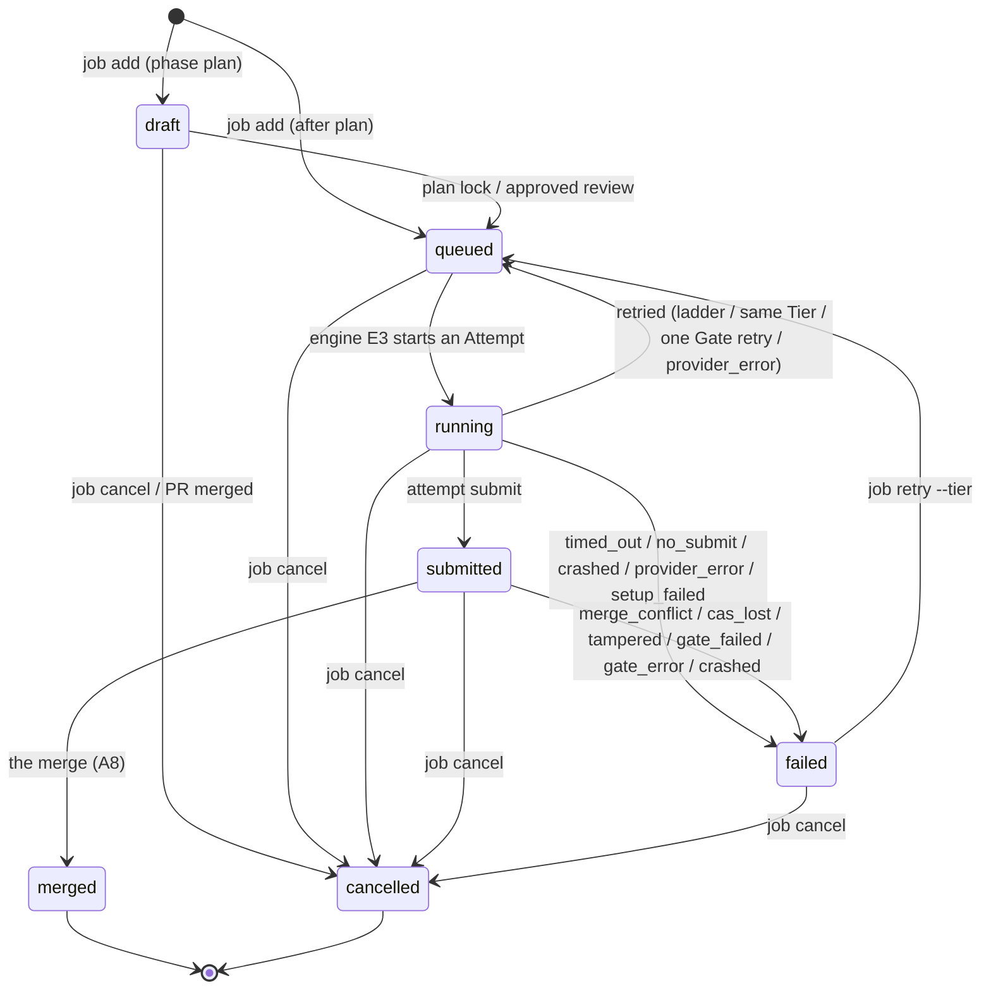

# The attempt lifecycle

One Job moves from `draft` through `queued` and `running` to `merged`, with
`failed` and `cancelled` as the other ways out ([contract §3.2](../contract.md);
[CONTEXT — Attempt](../CONTEXT.md)). The work itself is one **Attempt**: an
Attempt is `starting`, `running` then `merging`, and it ends `merged`, `failed`
or `cancelled` ([contract §3.4](../contract.md)). The diagram below (the vault's
diagram **d**) is the attempt lifecycle; the tables and the cause list after it
name each transition and each failure cause. The verification behind this note
is [architecture-verification.md](../research/architecture-verification.md).

`submitted` is the moment between `running` and `merged`: after `attempt submit`
passes its checks the Attempt is `merging`, while the Job stays `running`
([contract §3.4](../contract.md), [contract §7.7](../contract.md)). The diagram
names it to separate "a Worker is working" from "the checks and the merge run".

## Transitions

| Transition | Moved by | Cited at |
|---|---|---|
| (none) → `draft` | `job add` in phase `plan`, or `job add --draft` later; an appended draft | [contract §3.2](../contract.md) |
| (none) → `queued` | `job add` after plan with no `--draft`, or an explore Job | [contract §3.2](../contract.md) |
| `draft` → `queued` | `plan lock`, or the approval of a review of the drafts | [contract §3.2](../contract.md) |
| `queued` → `running` | engine E3 (or `job dispatch`) starts an Attempt | [contract §3.2](../contract.md), [contract §3.7](../contract.md) |
| `running` → `submitted` | `attempt submit` passes its preconditions; the Attempt becomes `merging` | [contract §3.4](../contract.md), [contract §7.7](../contract.md) |
| `submitted` → `merged` | the merge, driver A8; an `open` Job's merge also opens the pull request and moves its PR to `open` | [contract §3.4](../contract.md), [contract §7.4](../contract.md), [contract §3.8](../contract.md) |
| `running` → `failed` | an Attempt ends `failed` with a cause that is not retried: `timed_out`, `no_submit` at the top rung, `crashed`, `provider_error`, `setup_failed` | [contract §3.2](../contract.md), [contract §3.4](../contract.md) |
| `submitted` → `failed` | the merge ends the Attempt `failed`: `merge_conflict`, `cas_lost`, `tampered`, `gate_failed`, `gate_error`, `crashed` | [contract §3.4](../contract.md), [contract §7.4](../contract.md) |
| `running` → `queued` | a retried Attempt: `no_submit` climbs a Tier, `crashed` and `merge_conflict` retry at the same Tier, a first `gate_failed` is retried once, a `provider_error` requeues at the same Tier | [contract §3.2](../contract.md), [contract §3.4](../contract.md) |
| `failed` → `queued` | `job retry --tier` | [contract §3.2](../contract.md) |
| `draft` / `queued` / `running` / `submitted` / `failed` → `cancelled` | `job cancel` (the engine honours a request at the Attempt's next safe point); a Job it needs was cancelled; the PR was recorded merged (drafts) | [contract §3.2](../contract.md), [contract §3.8](../contract.md) |
| `merged` / `cancelled` → `[*]` | terminal | [contract §3.2](../contract.md) |

## Failure causes

Every cause the Attempt's `ended` transition can carry ([contract §3.4](../contract.md)):

- `setup_failed` — the worktree or `pre-start` failed before the Worker started
  (the Attempt ends from `starting`).
- `timed_out` — the Attempt ran past `attempt_minutes`; no ladder.
- `crashed` — the Worker died (a dead pane, a bad last stop reason, a `durable`
  runner's restart limit), or the driver was killed.
- `provider_error` — pi stopped on a provider error (connection, timeout, HTTP
  5xx); requeued at the same Tier, at most 3 times per Job retry window.
- `no_submit` — the Worker went idle without submitting, was nudged once, and
  went idle again; the only cause that climbs the ladder.
- `merge_conflict` — the rebase conflicted, or the Lead Branch's base check
  conflicted; retried at the same Tier ([contract §7.4](../contract.md)).
- `cas_lost` — the merge's compare-and-swap on the Lead Branch lost
  ([contract §7.4](../contract.md)).
- `tampered` — the Attempt branch's tip is not `submitted_sha`, or the tamper
  check fired ([contract §7.4](../contract.md)).
- `gate_failed` — the Gate (the `pre-commit` or `pre-merge` hook) failed at the
  merge; retried once at the same Tier ([contract §7.4](../contract.md),
  [contract §7.7](../contract.md)).
- `gate_error` — the Gate could not be judged, or an `open` / `update` Job's
  merge was refused before anything was pushed ([contract §7.4](../contract.md)).
- `cancelled` — a cancel request was honoured at the Attempt's next safe point
  ([contract §3.2](../contract.md)).

## See also

- [[sdk]] — the core, ledger and engine this lifecycle runs inside.
