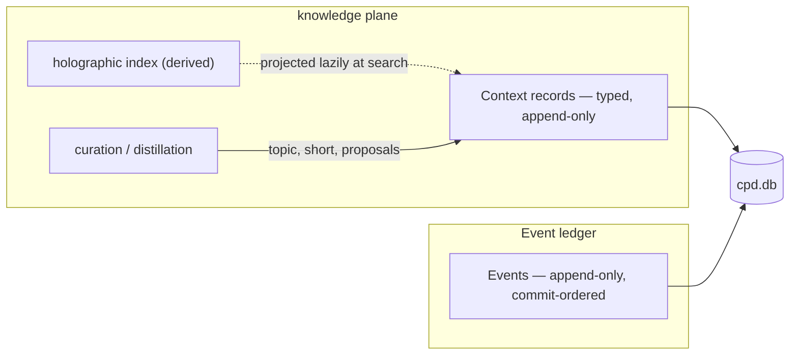

# Knowledge plane

The knowledge plane is cpd's memory of what the teams have learned: the **Context records**, the **holographic search index** built over them, and the **curation and distillation** that classify, compress and propose them. It is deliberately separate from the **Event ledger**, which records what happened. State (the ledger) answers "what is true now"; knowledge (the plane) answers "what do we know". The split is the decision of `hs-d802` (`cpd context show --record hs-d802`), verified in [architecture-verification.md §8](../research/architecture-verification.md).

## Two planes, one database

"Separate plane" means separate tables and a derived index, **not a second store**: both the Context records and the Events live in the one `cpd.db` file ([contract §4.1](../contract.md), the database; [contract §4.6](../contract.md), "cpd.db stays the source of truth"). The ledger is the `events` table and the append-only Event log ([CONTEXT — Event](../CONTEXT.md)); the plane is the `contexts` and `context_records` tables ([CONTEXT — Context store](../CONTEXT.md)) plus the per-Context index that is projected from them.

| | Knowledge plane | Event ledger |
|---|---|---|
| Holds | what the teams know: decisions, notes, Plans, briefs | what happened: every state change, in commit order |
| Shape | typed, append-only **Context records** ([contract §2.2](../contract.md) "Context record") | append-only **Events** ([contract §2.2](../contract.md) "Event") |
| Written by | `cpd context …` commands and `plan new` | every state change, in the same transaction ([contract §5.1](../contract.md)) |
| Address | a Context, machine-local | a Plan, Job, Attempt, Session or Context |
| Read by | Leads and Managers on demand (`cpd context show`, `cpd context search`) | the pi adapter, the cockpit and agent states ([contract §5.3](../contract.md)) |

## Context records

A Context is the shared knowledge of two or more Plans ([CONTEXT — Context](../CONTEXT.md)); its records are the plane's unit. A **Context record** is one typed, append-only row of `context_records`, the Context's only store ([contract §4.6](../contract.md), "Context record" in [contract §2.2](../contract.md); [CONTEXT — Context record](../CONTEXT.md)):

- kinds `decision`, `note`, `plan` and `brief`, each with a letter in its id ([contract §2.2](../contract.md) "Context record");
- written only by `cpd context decide` and `context note` ([commands §3.5](../commands.md)), plus `plan new` for the `plan` and `brief` kinds — each in one database transaction that validates, inserts the row and appends `context-record`;
- **recency wins**: a later record supersedes an earlier one, which leaves force but stays queryable; a `note` may supersede only a `note` ([contract §2.2](../contract.md) "Context record", [contract §4.6](../contract.md) "Records in force");
- a record may also leave force by **retirement**, proposed by the distiller and decided only by the User ([contract §4.6](../contract.md) "Retirement");
- Contexts are machine-local: nothing copies them to another machine, so there is no sync and no conflict ([contract §4.6](../contract.md); [CONTEXT — Context store](../CONTEXT.md)).

The old digest-writing run and the git store are gone; records are rendered on demand, not stored ([contract §4.6](../contract.md)).

## The holographic search index

`cpd context search` does not scan records directly: it reaches the **holographic memory engine** through a small bridge spawned per operation ([contract §4.6](../contract.md), "The holographic engine rail"; [commands §3.4](../commands.md)). The index is:

- **derived**, one per Context, at `<context_engine_dir>/<context>.db`, projected lazily at search time and **never on writes** — `cpd.db` stays the source of truth ([contract §4.6](../contract.md));
- fed by the bridge `contrib/holographic/bridge.py`, which speaks JSON lines and indexes `topic`, `short` and `text` against cpd's record id ([contract §4.6](../contract.md));
- rebuilt incrementally when it is stale, before each search ([contract §4.6](../contract.md) "Watermark in Index and staleness");
- optional: missing software is `engine_missing`, and `context_engine_enabled = false` disables it (`engine_disabled`), never a silent no-hit ([contract §4.6](../contract.md)).

Because the index is derived from the records, deleting it loses nothing: the records are the truth.

## Curation and distillation

Curation is the plane's maintenance, done by an **auxiliary** one-shot agent — the **distiller** — not by a Lead or a Manager ([CONTEXT — Distilled Context](../CONTEXT.md)). For each uncurated record in force the distiller classifies a `topic`, compresses a `short` form for machines, and may propose a `retirement` (duplicate, superseded or documented) ([contract §4.6](../contract.md), "The distiller curates"). The distiller flags no documentation candidates: that feature is removed (pro-d327). The proposals are written by the core function `propose`, checked structurally by cpd, and applied **only by the User** through the Inbox item `curate-retire` ([contract §4.6](../contract.md) "Retirement", [commands §3.13](../commands.md)).

- `cpd context distill` curates **one batch** of at most 60 uncurated records, one batch per run ([commands §3.13](../commands.md)).
- The engine starts it detached as **engine step E9**, when a Context has uncurated records in force and the newest is 10 minutes old, or 20 or more exist; a non-curable Context (archived, deleted or under the floor) is skipped with no run and no Event ([contract §3.7](../contract.md); [commands §3.13](../commands.md)).
- The records stay the truth; the distillation is checkable output, not a replacement for them ([CONTEXT — Distilled Context](../CONTEXT.md)).

## What the plane is not

The plane is not the state: a Context record is knowledge that outlives the Jobs and Sessions it guided, while an Event is a fact about a transition ([CONTEXT — Event](../CONTEXT.md)). It is not a message bus: cpd keeps internal, SQLite-backed queue tables (the board posts, `slack_reactions`, `jira_transitions`) beside the "no queue directories" rule, but those are not the knowledge plane ([architecture-verification.md §11](../research/architecture-verification.md)). And it is not a wiki: the Context is a shared working memory, retired by the distiller, not an archive ([contract §4.6](../contract.md)).

## Related notes

- [[sdk]] — the crates and the one store the plane lives in.
- [[clocks]] — the engine loop whose E9 runs the distiller, and the poll it is separate from.
- [[message-board]] — how a Session passes a message to another without touching the registry.
- [[attention-inbox]] — how curation proposals reach the User.

## Sources

- [contract.md](../contract.md) — §2.2 "Context record" and "Event", §3.7 (engine, E9), §4.1 (the database), §4.6 (the Context store, retirement, the holographic engine rail, the distiller), §5 (Events).
- [commands.md](../commands.md) — §3.5 (`context decide`, `note`), §3.13 (`context distill`).
- [CONTEXT.md](../CONTEXT.md) — Context record, Context store, Distilled Context, Event.
- [architecture-verification.md](../research/architecture-verification.md) — §8 (the knowledge plane), §11 (the boundaries).
- Model: `hs-d802` (`cpd context show --record hs-d802`).
