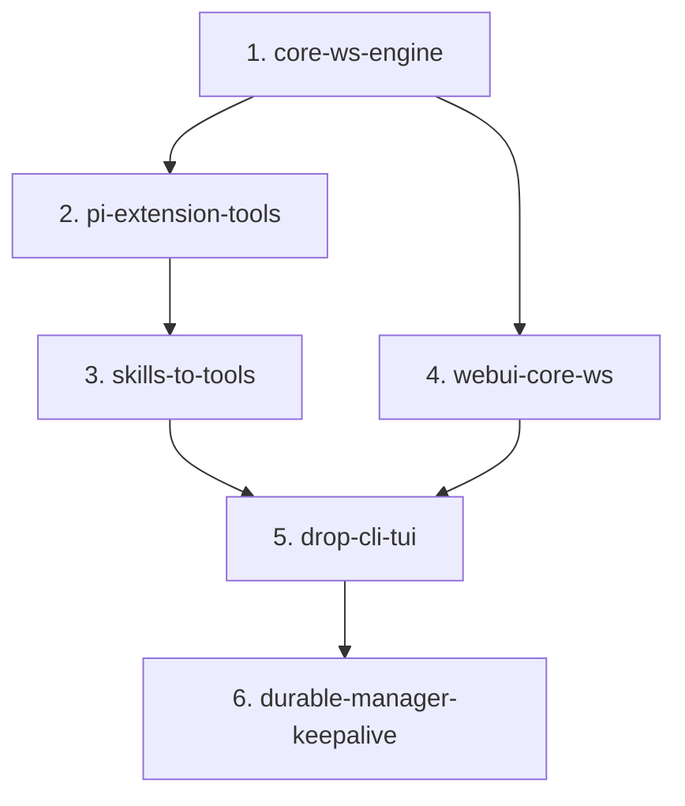

# Architecture Design: CPD as Core + pi Extension + WebSocket Clients

**Status:** Approved Design (pro-d520, pro-d521, pro-d522, pro-d526, pro-d527, pro-d528, pro-d529, pro-d530, pro-d531, pro-d532, pro-d533, pro-d534, pro-n418)  
**Author:** Plan Lead (`pi-native-core`)  
**Context:** `cpd`  

---

## 1. Executive Summary & Principles

CPD is transitioning from an agent-agnostic CLI wrapper that drives pi from its edges (shell processes, tmux panes, and CLI shell-outs) to an integrated architecture:
1. **Core**: The Rust engine daemon (`cpd watch`), SQLite ledger, state machine, and WebSocket/IPC event hub. Single source of truth for framework state (pro-d513, pro-d520).
2. **pi Extension**: The primary agent client interface. Delivers typed tools, hooks, and skills inside the pi agent kernel. pi owns chats, transcripts, and model interaction (pro-d520, pro-d521).
3. **WebUI**: The primary client for the User (pro-d522). Directly consumes core WebSockets and streams pi sessions. All User actions occur here.
4. **Dropped**: The `cpd` CLI client surface and `cpd tui` (pro-d521, pro-d522).
5. **Recovery Mode**: pi's native TUI inside tmux serves as the recovery mode during WebUI or core daemon incidents (pro-d522).
6. **Prompt Cache Stability**: Per-turn system prompt stays byte-stable to preserve model prompt caching (pro-n418).
7. **Clean Communication Hierarchy**: A dedicated message bus with `delegate` and `escalate` replaces legacy `board post` and `session send` (pro-d533, pro-d534).

---

## 2. Gap Inventory (Grounding Evidence)

Based on empirical exploration in `scout-cli-skills`, `scout-session-tmux`, `scout-webui-surface`, `scout-headless-ci`, and `scout-inflight-plans`:

### 2.1 The 82 CLI Subcommands Used by Skills
Skill files (`cpd-lead`, `cpd-manager`, etc.) invoke 82 distinct subcommand forms through bash:
- **`plan` (12)**: `new`, `show`, `list`, `phase`, `lock`, `outline`, `render`, `lint`, `review`, `decide`, `archive`, `unarchive`.
- **`job` (11)**: `add`, `edit`, `show`, `cancel`, `retry`, `dispatch`, `approve-touches`, `approve-tests`, `start`, `submit`, `abandon`.
- **`workflow` (5)**: `add`, `edit`, `describe`, `cancel`, `restack`.
- **`session` (9)**: `show`, `open`, `close`, `fork`, `park`, `send`, `run`, `archive`, `unarchive`.
- **`context` (8)**: `show`, `search`, `decide`, `note`, `archive`, `unarchive`, `distill`, `status`.
- **`policy` (1)**: `show`.
- **`pr` (10)**: `open`, `view`, `push`, `rebase`, `rerun`, `adopt`, `comment`, `reply`, `post`, `close`.
- **`protocol bug` (5)**: `report`, `mitigate`, `close`, `show`, `list`.
- **`secret` (6)**: `get`, `list`, `create`, `edit`, `delete`, `allow`.
- **`attempt` (3)**: `show`, `read`, `run`.
- **`answer/ask` (2)**: `ask`, `answer`.
- **`events/watch/tui` (4)**: `events follow`, `watch`, `watch --ensure`, `tui`.
- **`tiers/resource/mcp/host/board` (6)**: `tiers`, `resource run`, `resource list`, `mcp attach`, `host approve`, `board post`.
- *Internal pi/lib calls*: ~30 internal invocations for state sync and checks.

### 2.2 Registered pi Tools (4 Tools)
Defined in `pi/lib/`:
1. `cpd_plan_review` (`review.ts:170`, `startup.ts:190`): Interactive Plan review dialog.
2. `cpd_secret_approve` (`secret.ts:12`, `startup.ts:191`): Vault access approval dialog.
3. `cpd_host_approve` (`hostapprove.ts:28`, `startup.ts:192`): Host checkout repair approval dialog.
4. `cpd_external_approve` (`externalapprove.ts:60`, `startup.ts:196`): External pull request / Slack write approval dialog.

### 2.3 Bash-Text Guards
In `pi/lib/`:
- `noblock.ts:72`: Intercepts bash tool calls waiting > 30s.
- `testguard.ts:78`: Protects red test files from unauthorized edits.
- `electronguard.ts:27`: Intercepts desktop/electron execution.
- `mainguard.ts:228`: Refuses branch switches, resets, or edits in primary checkout.
- `secretguard.ts:8`: Intercepts direct `op` calls and mandates `cpd secret`.
- `externalguard.ts:67,83,92`: Intercepts raw git push, gh writes, and Slack calls.
- `hostapprove.ts:9`: Enforces human approval before host repair.

### 2.4 Follower (`cpd events follow`)
Currently implemented as a polling loop over SQLite `PRAGMA data_version` every 200ms (`events.poll_ms`), querying batches of 500 rows (`select.rs:60-135`, `events/mod.rs:171-256`). With multiple concurrent sessions, this generates constant polling load on the database.

### 2.5 Core Process Launch, tmux, and Adopt Logic
- **Process Launch**: `plan/lead.rs:36` triggers `cpd session run <id>`. `run.rs:452` checks tmux pane, acquires flock, and spawns `pi --model M --no-mcp --tools +codemode -e <adapter> --session-id <id>` with environment variables (`launch.rs:119-215`). tmux socket is `cpd` (`tmux.rs:847`, `file.rs:498`).
- **Adopt Logic**:
  - `session run --adopt <pid>` retains pi process execution across binary self-exec reloads during install/upgrade (`reload.rs:116`, `run.rs:110-113`).
  - Engine adopts durable hosts via `run/host/<id>.pid` if alive (`hosts.rs:285-293`).

### 2.6 WebUI Reads & Sockets
- **CLI Shell-outs**: `toArgv` in `web/src/server/cpd-argv.ts:68`, executed via `plugin.ts:245-281` (`execFile`, `follow`, `stream`). Also git (`plugin.ts:361`), tmux (`status.ts:38`), classifier (`completion-classify.ts:91`).
- **Cockpit Stream**: Child process running `cpd cockpit serve` returning NDJSON (`cockpit/stream.ts:174`, `core/src/cockpit/mod.rs:323`). Ledger fallback via `events follow --since <cursor>`.
- **File Reads**: pi transcripts (`pi/window.ts:58,81`, `watch.ts:64`), costs (`cost.ts:49-51`), durable sqlite read-only (`plugin.ts:116-124`), install status (`status.ts:49`), attachments (`pi/jsonl.ts:163`).
- **Sockets**: `run/pi/<id>.sock` (`pi/live.ts:198`); `run/host/<id>.sock` (`hub/registry.ts:13-14`, `durable/client.ts:97`). WebSocket served on `/cpd-ws` (`ws.ts:22`).
- **Server**: Embedded inside Electron main process on `127.0.0.1:0` (`electron/main.ts:223-262`); Vite plugin proxies during dev (`vite.config.ts:4-7`).

### 2.7 Headless hs Machines & GitHub CI Runners
- `hs` runs the cpd engine daemon (`pro-n54`) and human TUI (`pro-d390`). GitHub Actions workflow runs (`ci.yml:18`) execute `scripts/gate-run.sh` -> `cpd gate finish` (`core/src/gate/mod.rs:1-2`).
- CI/hs requires only: `watch`, `gate finish`, `install`, `host`, `doctor`.
- Droppable client surface: `tui` (`cli.rs:98`), bare `cpd` (`cli.rs:205`), `desktop` (`cli.rs:119`), `argv-check` (`cli.rs:196`), `cockpit serve` (`cli.rs:263`), tmux `cpd tui view|action` (`moves.rs:82`), and `cpd-tui` crate dependency.

### 2.8 Code Drift from Context & Message Board Decisions
- Today's code allows `cpd context delete` and `cpd context retire`, violating append-only persistence (pro-d530).
- Board posts today never wake sessions (`board post` is passive), while `session send` arbitrarily restarts or interrupts without structured hierarchy (pro-d533).
- Manager digest today repeatedly renders the entire Pending work block into context on every turn, burning tokens and polluting cache (pro-d532, pro-n418).
- Timestamps injected into the system prompt break Anthropic's 5-minute prompt cache TTL (pro-n418).

---

## 3. Core / Extension Boundary

### 3.1 IPC Mechanism: Unix Domain Socket vs NAPI (Decision pro-d526)
- **Trade-off Analysis**:
  - *NAPI (in-process library)*: Zero serialization cost, but fatal Rust panics take down pi; Node ABI version coupling; prevents hot binary reload without restarting pi; cannot serve WebUI or external clients.
  - *Unix Domain Socket (Selected - pro-d526)*: Dedicated local socket at `$CPD_HOME/run/core.sock`. Uses JSON-RPC 2.0 / length-delimited NDJSON. Strict process isolation: core reloads and crashes do not crash pi sessions. Supports multiple simultaneous clients (pi extension, WebUI, recovery tools).
- **Protocol**:
  - Request/Response: `{ "id": 1, "method": "domain.verb", "params": { ... } }` -> `{ "id": 1, "result": { ... }, "error": null }`.
  - Notification/Subscription: `{ "method": "events.subscribe", "params": { "cursor": 157200, "filter": { "session": "..." } } }`.

### 3.2 Event Delivery Replacing Per-Session Follower
- The core engine daemon maintains an in-memory broadcast channel (`tokio::sync::broadcast`).
- When a ledger transaction commits, the engine immediately broadcasts the event row to connected socket subscribers matching Plan or session filters.
- Eliminates the 200ms SQLite polling loop and file lock contention.
- Reconnection sends last-seen cursor to replay missed events seamlessly.

### 3.3 Session Startup & Lifecycle
- **Interim**: tmux keep-alive is retained for Context Managers and as the recovery entry point. Core launches pi with the cpd extension registered.
- **Target**: pi-durable / pi SDK host runs agent sessions as supervised background processes without tmux.

---

## 4. Typed pi Tools, Context & Messaging Architecture

### 4.1 Schema Generation (pro-d514)
Rust domain types in `core` derive `ts_rs::TS` and `schemars::JsonSchema`. A build step generates TypeScript tool definitions and schemas into `pi/lib/generated/tools.ts`.

### 4.2 Tool Domain Mapping
CLI subcommands map directly to typed tool namespaces:
1. `cpd_plan`: `new`, `show`, `phase`, `lock`, `outline`, `render`, `lint`, `review`.
2. `cpd_job`: `add`, `edit`, `show`, `cancel`, `retry`, `approve_touches`, `approve_tests`.
3. `cpd_workflow`: `add`, `edit`, `describe`, `cancel`.
4. `cpd_session`: `show`, `fork`, `park`, `open`, `close`.
5. `cpd_context`: `search`, `show`, `decide`, `note`.
6. `cpd_pr`: `open`, `view`, `push`, `rebase`, `rerun`, `adopt`, `comment`, `reply`.
7. `cpd_secret`: `get`, `list`, `create`, `edit`, `delete`, `allow`.
8. `cpd_protocol`: `bug_report`, `bug_mitigate`, `bug_close`, `bug_show`, `bug_list`.
9. `cpd_policy`: `show`.
10. `cpd_resource`: `list`, `run`.
11. `cpd_mcp`: `attach`.
12. `cpd_message`: `delegate`, `escalate`.

### 4.3 Context Persistence & Write-Time Curation (pro-d530, pro-d531, pro-d532)
- **Persistent Facts Only**: The cpd context holds only decisions and lasting facts; progress and status go exclusively to Plan events (pro-d530). Only Managers and Leads write; Workers read.
- **No Deletion**: `cpd context delete` and `retire` are permanently removed (pro-d530). Records are superseded (`--supersedes`) or marked documented (`--documented-in <pr>`). Superseded/documented records are excluded from default queries.
- **Write-Time Curation Hook**: When a record is written via `cpd_context.decide` or `note`, a synchronous pre-write hook scans for semantic near-duplicates, enforces `--supersedes` or requires explicit novelty rationale, and caps character length (pro-d531). Background curation acts only as an auditor.
- **Retrieval by ID & Layered Digest**: Context reaches chats solely as record IDs, never inlined text (pro-d532). The Manager's turn digest selects IDs in prioritized layers (Plan/topic/bug links first, vector search fallback, tuned by citation rate). No pinned set. Leads receive IDs directly from Managers upon delegation.

### 4.4 Message Bus: Delegate & Escalate (pro-d533, pro-d534)
- **Hierarchical Bus**: Replaces legacy `board post` and `session send` with directional primitives:
  - `delegate`: Downward (`Manager -> Lead -> Worker`), supports 1 or more recipients.
  - `escalate`: Upward (`Worker -> Lead -> Manager -> User`), exactly 1 recipient.
- **Urgency Modes**: `fyi` (queued for next turn, no wake) or `wake` (immediately starts a turn).
- **Notices**: System notifications originate from sender `cpd`, never disguised as User messages. Plan status changes send a single diff message to Manager, never a repeated inventory.
- **Escalation Context Pre-Check**: Before dispatching an escalation, `escalate` queries the context. Strong semantic matches bounce back with the matched record ID. The sender can resend with rationale for why the record does not apply (pro-d534).
- **10-Minute Escalation Ladder**: An escalation left unanswered for 10 minutes climbs one tier up the hierarchy; once at the User level, it remains open (pro-d534).

### 4.5 System Prompt Byte-Stability (pro-n418)
- Per-turn timestamps and changing timezones are removed from the system prompt block to guarantee exact byte-level stability.
- Dynamic temporal context (current time, zone) is passed exclusively in user turns or ephemeral clock blocks, preserving Anthropic's 5-minute prompt cache.

### 4.6 Guard Migration
- Text regex scanning of bash tool calls is eliminated for cpd commands.
- Guards become typed pre-call validation hooks inside pi:
  - `noblock`: Enforced naturally by async pi tool execution; bash commands still bounded by timeout.
  - `mainguard`: Core rejects git operations modifying primary checkout; tools enforce worktree boundaries.
  - `secretguard`: Secrets accessible solely via `cpd_secret` tool; raw `op` blocked.
  - `testguard`: Test file immutability verified directly by core upon `job submit`.
  - `approvals`: Tools return structured confirmation dialogs (`cpd_plan_review`, `cpd_secret_approve`).

---

## 5. WebUI & Incident Recovery Mode

### 5.1 WebUI as Primary Client (pro-d522, pro-d527)
- WebUI connects directly to core's WebSocket server (`ws://127.0.0.1:<port>/cpd-ws` or local IPC).
- Replaces `cpd cockpit serve`, `toArgv`, and all Node `execFile` shell-outs.
- Initial connection fetches snapshot of active contexts, plans, and jobs; streams subsequent ledger events via cursor.
- All User actions (plan reviews, decision logging, prompt composer, PR review, bug tracking) execute through WebSocket commands.

### 5.2 pi Session Streaming (pro-d520, pro-d528)
- pi owns chats and transcripts.
- WebUI establishes streaming connection to pi's live session socket (`run/pi/<id>.sock`) or durable host socket (`run/host/<id>.sock`).
- Chat turns, tool calls, and streaming markdown deltas render natively in WebUI.

### 5.3 Fate of WebUI's Node Server
- Electron main process acts as a lightweight window container and asset server.
- The Node `cpd-argv.ts` bridge and cockpit stream child processes are deleted.
- Web client talks directly to core Rust daemon.

### 5.4 Recovery Mode for Incidents (pro-d522, pro-d528)
- **Definition**: Terminal-based operational mode used strictly when WebUI or core WebSocket is down or unreachable.
- **Entry Points**:
  1. Attach to tmux session: `tmux -u -L cpd attach -t cpd:<manager-or-lead>`.
  2. Launch direct session: `pi --session-id <id>` with cpd extension.
- **Capabilities in Recovery Mode**:
  - Full conversational interaction with Manager or Lead in pi's native TUI.
  - Full framework state inspection and management via typed pi tools.
  - Standalone recovery utility (`cpd doctor`) directly inspects SQLite ledger, clears stale flocks, and restarts `cpd watch`.

---

## 6. What Remains of the Binary (pro-d529)

### 6.1 Dropped Surfaces
- `cpd tui` and the entire `tui/` crate (`cli/Cargo.toml:23`).
- Interactive terminal client commands: bare `cpd`, `desktop`, `argv-check`, `cockpit serve`, tmux `cpd tui view|action`.
- Human CLI commands duplicating WebUI.

### 6.2 Retained Binary Footprint
1. `cpd watch`: Core engine daemon, ledger processor, WebSocket & IPC server.
2. `cpd watch --ensure`: Keep-alive supervisor.
3. `cpd install` / `cpd upgrade`: Self-updating binary installer and migration runner (hot-reloading WebUI via watchdog per pro-d524).
4. `cpd gate finish`: CI hook runner for GitHub Actions and hs runner.
5. `cpd host`: Host machine configuration, repair, and approval.
6. `cpd doctor`: Incident diagnostics and ledger recovery.
7. Worker commands (`cpd ask`, `cpd attempt`) during worker runner transition.

---

## 7. Staged Migration Plan

The migration is divided into 6 ordered, independently shippable Plans:

### Plan 1: `core-ws-engine` (Core Engine WebSocket & Event Push)
- **Scope**: Add WebSocket listener (`/cpd-ws`) and Unix domain socket (`run/core.sock`) to `cpd watch`. Implement tokio broadcast ledger event stream.
- **Removals**: Deprecate `cpd cockpit serve`.
- **Tests**: WebSocket connection, snapshot handshake, cursor resume, and live event push tests.
- **Contract**: [docs/contract.md §5.8](../contract.md) (endpoints, handshake, cursor, live stream).

### Plan 2: `pi-extension-tools` (Typed pi Tools from Core Schemas)
- **Scope**: Use `ts-rs` / `schemars` from `core-ts-types` (pro-d514) to generate TypeScript tool definitions. Implement pi extension connecting to `run/core.sock`. Export 12 domain tools (`cpd_plan`, `cpd_job`, `cpd_context`, `cpd_message`, etc.). Implement write-time curation hook (pro-d531) and escalation context bounce check (pro-d534). Ensure system prompt byte-stability (pro-n418).
- **Removals**: Remove legacy `context delete` and `retire` commands from CLI schemas (pro-d530).
- **Tests**: Tool invocation tests against mock core socket; schema contract verification; prompt cache stability verification.

### Plan 3: `skills-to-tools` (Migrate Skills to Typed Tools)
- **Scope**: Rewrite `cpd-lead` and `cpd-manager` skills to instruct agents to call typed pi tools (`cpd_context`, `cpd_message.delegate`, `cpd_message.escalate`) instead of bash CLI subcommands and board posts. Migrate bash guards (`noblock`, `testguard`, etc.) to tool-call hooks.
- **Removals**: Delete bash-text guard regexes in `pi/lib/`. Remove `board post` and `session send` instructions.
- **Tests**: Skill execution tests; tool guard refusal and approval tests; escalation climbing test.

### Plan 4: `webui-core-ws` (WebUI Direct WebSocket Migration)
- **Scope**: Point WebUI directly at core WebSocket endpoint (`/cpd-ws`). Connect pi session streaming directly to WebUI reactive store.
- **Removals**: Delete `web/src/server/cpd-argv.ts`, `cockpit/stream.ts`, and Node shell-out layer.
- **Tests**: WebUI state sync tests, reactive store updates, session stream rendering.

### Plan 5: `drop-cli-tui` (Drop CLI Client Surface and TUI)
- **Scope**: Delete `tui/` crate and remove `cpd-tui` from `cli/Cargo.toml`. Remove client CLI subcommands (`tui`, bare `cpd`, `desktop`, `argv-check`, `cockpit serve`). Document pi TUI recovery mode.
- **Removals**: `tui/` crate, `cpd-tui` dependency, CLI client commands.
- **Tests**: Binary build without TUI; verify recovery entry point via pi TUI.

### Plan 6: `durable-manager-keepalive` (Durable Managers & Final tmux Retirement)
- **Scope**: Complete durable Manager rollout (following `eval-durable-leads` / `pro-p190`). Engine supervises durable Managers directly.
- **Removals**: Remove tmux session creation and keep-alive hooks from `cpd watch`.
- **Tests**: Manager crash resume, ledger wake without tmux.

---

## 8. Coordination with In-Flight Plans
- **`core-ts-types`**: Provides `ts-rs` derivations on core types. Plan 2 directly imports generated types and extends them for tool input/output schemas.
- **`webui-router`**: Landed in #1041. WebUI routes connect cleanly to core WebSocket data streams in Plan 4.
- **`inbox-pr-truth`**: Updates PR truth contracts (`pro-d518`, `pro-d519`). Plan 2's `cpd_pr` tools bind to these exact core state contracts without client duplication (pro-d513).
- **`eval-durable-leads` / `pro-p190`**: Durable Leads already operate without tmux panes. Managers stay on tmux keep-alive through Plan 5; Plan 6 finalizes durable Managers and eliminates tmux entirely.
