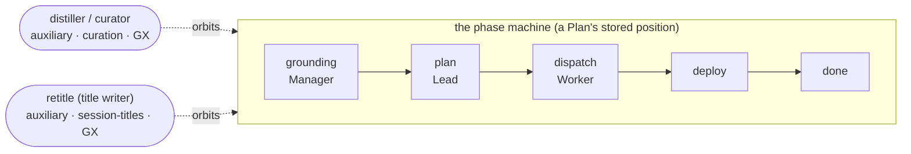

# Roles

This note documents cpd's agent population as decided in `hs-d802` (a record of machine `hs`): **exactly four roles — manager, lead,
worker, auxiliary** — of which the first three are attached to the phases of the
CPD flow, and the auxiliary one-shots sit outside that attachment. It carries the
phase-machine diagram (diagram c). The verification behind it, and every place
the decided model disagrees with cpd's current docs, is in
[the architecture verification note](../research/architecture-verification.md).

## The four roles

The fourth role is `auxiliary`, not the User: `auxiliary` is not a Session but a
category of one-shot pi runs (`hs-d802`).

### Manager

The higher-level Lead of a Context, one live per Context per machine
(`cpd context manager`): it holds the Context's records and Requirements, splits
them into Plans, starts each Plan's Lead with a Brief, and knows where each is.
Its memory is the Context records, not its chat. It acts only when the User or a
Lead talks to it, and never answers for the User
([CONTEXT — Manager](../../CONTEXT.md); [contract §3.1](../contract.md),
"The Context's Manager").

### Lead

The agent that translates User intent into Specs and orchestrates the Plan; it
never writes code itself ([CONTEXT — Lead](../../CONTEXT.md)). One Lead is
started per Plan by `plan new` ([contract §3.1](../contract.md), "`plan new`
always starts a fresh Lead").

### Worker

An agent that executes one Attempt of one Job in its own worktree
([CONTEXT — Worker](../../CONTEXT.md)). It is the only role that writes code
([contract §1.1](../contract.md), "Workers write all the code; the Lead never
writes code"). The Worker runner that runs it is `pi` today, with `durable` as a
second runner ([CONTEXT — Worker runner](../../CONTEXT.md);
[contract §6.12](../contract.md)).

### Auxiliary

The union of the manager, lead and worker roles is what a Session's `role` field
stores; `auxiliary` is not one of those values
([contract §3.6](../contract.md), [CONTEXT — Session](../../CONTEXT.md)). An
auxiliary agent is a one-shot pi run that is no Session and writes no code, and
it is `GX` only ([contract §9](../contract.md), "Auxiliary Tiers (hs-d562)"). The
two named auxiliaries are:

- **the distiller / curator** — the curator of a Context's records, run by engine
  step `curation` (`cpd context distill`) or by `cpd context distill` on demand
  ([contract §3.7](../contract.md) `curation`; [CONTEXT — Distilled Context](../../CONTEXT.md));
- **retitle (the title writer)** — the Session-title writer run by engine step `session-titles`
  ([contract §3.7](../contract.md) `session-titles`).

## The levels table

The levels are Jira's words, used as an analogy; the table is the mapping of cpd
objects to roles ([CONTEXT — Work units](../../CONTEXT.md)):

| Level (Jira analogy) | cpd object | Role |
|---|---|---|
| Epic | Context | Manager |
| Ticket | Plan | Lead |
| (none) | Workflow | Lead |
| Task | Job | Worker |

A Workflow is also worked by a Lead, so the four objects map onto three roles;
only `auxiliary` has no row, because no object owns it.

## The phase machine

A Plan's stored position is one of five phases, in this order:
`grounding` → `plan` → `dispatch` → `deploy` → `done`
([contract §3.1](../contract.md)). Per `hs-d802` the first three phases carry a role:
`grounding` the Manager, `plan` the Lead, `dispatch` the Worker. The two auxiliary
one-shots orbit the machine; they are attached to no phase.

`deploy` and `done` add no role of their own. They are reached inside the
Dispatch **stage**, whose last step, Deploying, spans the phases `dispatch` →
`deploy` → `done` and is partly owned by the Lead ([contract §3.9](../contract.md);
[contract §3.1](../contract.md)).

## The attachment, and what the docs actually say

The decided model attaches the three roles to cpd's phases as **Context →
Manager, Plan → Lead, Dispatch → Worker** (`hs-d802`). The current docs say two things the model
does not:

- **Context, Plan and Dispatch are stages, not phases.** A **stage** is one of the
  three cockpit columns (Context, Plan, Dispatch); a **phase** is one of the five
  stored positions above ([CONTEXT — Phase, stage and step](../../CONTEXT.md);
  [contract §3.9](../contract.md)). The model rides the roles on the *phases*
  `grounding`, `plan` and `dispatch`, which is what the diagram draws.
- **The levels table attaches the Worker to the Job, not to Dispatch.** The
  levels table above gives `Task | Job | Worker`
  ([CONTEXT — Work units](../../CONTEXT.md)); the model's `Dispatch → Worker` is
  the stage the Work happens in, not the object the Worker is attached to.

Both mismatches are reported in
[the verification note, item 4](../research/architecture-verification.md).

## The User is not an agent role

The model's fourth role is `auxiliary`. cpd's [CONTEXT — Roles](../../CONTEXT.md)
section, however, lists **User** as a role — "the human who owns the ticket and
talks only to the Lead (or the Manager)" — so CONTEXT.md presents four roles whose
fourth entry is the human, and `auxiliary` is not a role there. The verification
note found this disagreement
([verification note, item 4](../research/architecture-verification.md); its
Disagreements list, entry 8).

**The User is the human**, not one of the four agent roles. A User is never a
Session and has no `role` value; the Session roles are Lead, Worker and Manager
([CONTEXT — Session](../../CONTEXT.md); [contract §3.6](../contract.md)). The
contract itself lists the roles as "User, Manager (Plan manager B3, §3.1), Lead
and Worker", where User is the person the whole flow serves
([contract §1.1](../contract.md)).

## Related notes

The runtime the roles run in is [[agent-runtime]]; the interfaces they act through
are [[interfaces]]; the object they create and move is the [[sdk]]; the loop that
schedules them is in [[clocks]]; the life of one Job is [[job-lifecycle]].
