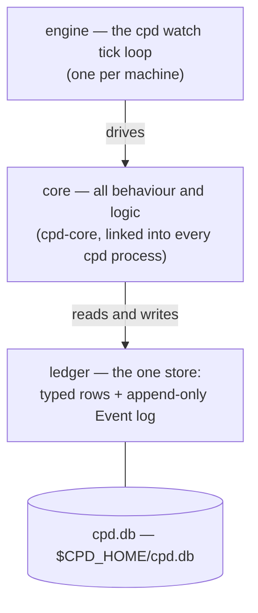

# The SDK

`cpd SDK` names the whole of cpd as one programmable thing: the **core**, the
**ledger** and the **engine** ([contract §1.1](../contract.md); `hs-d802` (a record of machine `hs`)). This note says what each part is and how
they sit together. The vault's
[architecture-verification.md](../research/architecture-verification.md) maps
the claim to the contract sections that own it and records where the name does
not match the docs: `contract.md` names four Rust crates
(`cpd-core`, `cpd`, `cpd-tui`, `cpd-engine`) and no `SDK` string
([contract §1.1](../contract.md)), so `SDK` is a name for the concept, not a
fifth thing to build.

## What the SDK is — and is not

The SDK is the programmable whole — the library, the store and the loop that
together run cpd's work. It is **not the interfaces**: the CLI (`cpd`), the
cockpit (`cpd tui`) and the web UI are clients of the SDK, not parts of it
([contract §1.1](../contract.md); see [[interfaces]]). It is also not a
separate product to install: cpd ships one binary, and the SDK is how that
binary's internals are named ([contract §1.1](../contract.md)).

## Core

Core is all of cpd's behaviour and logic: the objects (Context, Plan, Workflow
and PR, Job, Attempt, Session) and the rules that move them
([contract §2.2](../contract.md)), the store, the driver, and every area except
the cockpit and the engine loop. It is the `cpd-core` library, linked into every
cpd process — the `cpd` binary, the engine, and the Attempt drivers
([contract §1.1](../contract.md)). Nothing writes or decides outside the core:
a command, the engine and the pi adapter all call into it.

## Ledger

The ledger is cpd's one store: one SQLite database per machine at
`$CPD_HOME/cpd.db` ([contract §4.1](../contract.md); [CONTEXT — Ledger](../CONTEXT.md)).
It holds two things at once:

- the **typed rows** — the stored state of every object (Plans, Jobs, PRs,
  Attempts, Sessions, the Inbox, Context records and so on)
  ([contract §2.2](../contract.md), [contract §4.1](../contract.md));
- the **append-only Event log**, with the `history` and `txns` tables: every
  state change appends an Event, and Events are the single channel to Leads, the
  cockpit and agent states ([contract §3.7](../contract.md), [contract §4.1](../contract.md),
  [contract §4.3](../contract.md)).

The ledger is written under a **single-writer discipline**:

- **one engine process** per machine writes the scheduled work
  ([contract §3.7](../contract.md); [CONTEXT — Engine](../CONTEXT.md));
- **short-lived CLI transactions**: every write goes through cpd (a connection
  that is not a cpd process cannot write, because triggers call `cpd_txn()`),
  and one command is one write transaction for its state change, its `history`
  rows and its Events together ([contract §4.3](../contract.md));
- **re-read races resolved in the transaction**: a step reads, acts outside the
  transaction, then writes with a compare-and-swap on the state it read, and a
  `job edit --spec` re-reads the Job's status and Attempts, so the engine's
  Attempt and the edit win or lose as a whole — never both
  ([ADR-0014](../adr/0014-edit-a-queued-job.md); [contract §3.2](../contract.md)).
  A lost compare-and-swap is `cas_lost` ([contract §3.4](../contract.md)).

## Engine

The engine is the tick loop: the one `cpd watch` per machine
([contract §3.7](../contract.md); [CONTEXT — Engine](../CONTEXT.md)). Every
`tick_seconds` it runs its ordered steps, E1–E23 — scheduling Jobs under one
concurrency limit, watching liveness and timeouts, polling pull requests,
reconciling the Inbox, curating Context records, and the rest (E23 holds the
repeat bump of unreviewed posted pull requests, which sends nothing, pro-d386)
([contract §3.7](../contract.md)). One per machine is the rule (D5): the engine
is not a daemon per Plan or a scheduler per Workflow
([CONTEXT — Engine](../CONTEXT.md)).

## The three parts and the store

The engine drives the core; the core reads and writes the ledger; the ledger is
backed by the one `cpd.db`
([contract §3.7](../contract.md), [contract §4.1](../contract.md)).

## See also

- [[job-lifecycle]] — one Job's states and the Attempt that executes it.
- [[interfaces]] — the CLI, cockpit and web UI that are the SDK's clients.
