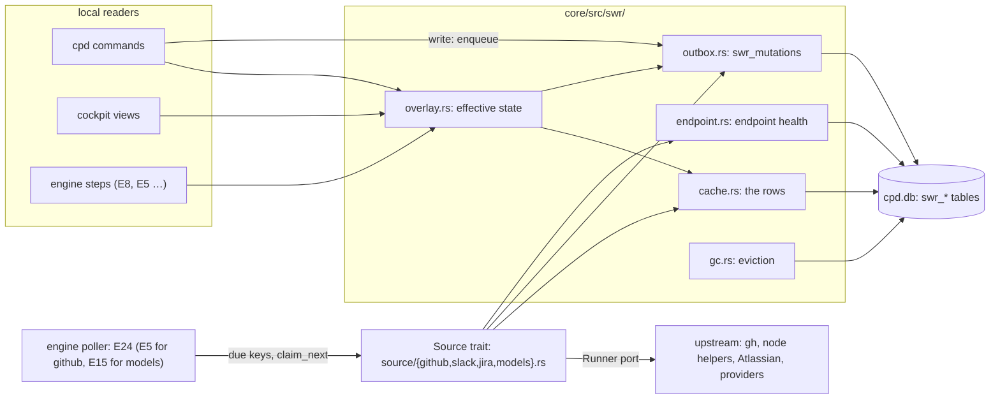
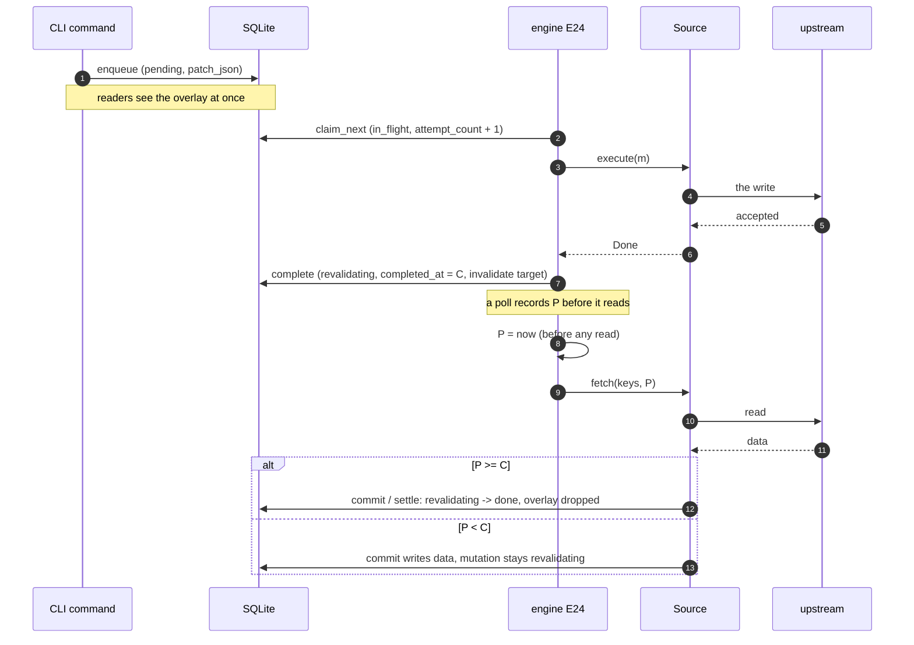

# Stale-while-revalidate (SWR)

Status: **normative for the SWR Jobs** (Plan `external-sync-arch`: `swr-core`, then one Workflow per datasource). Where merged code later differs from this page, the code wins; the names here are the contract the next Jobs build on. Vocabulary: [CONTEXT.md — Data](../../CONTEXT.md). The schema is [contract §4.4](../contract.md); the engine step E24 is [contract §4.7](../contract.md); the commands are [commands §32](../commands.md).

Decisions: pro-d440 (architecture), pro-d441 (GitHub), pro-d443 (Jira), pro-d444 (Slack), pro-d446 (name `swr`), pro-d447 (check-level `excused_labels` kept), pro-d448 (all sources, one DAG), pro-d449 (cpd is the backend; clients call cpd).

## 1. The idea

SWR is stale-while-revalidate. cpd holds the **last confirmed upstream truth** in SQLite. **One** engine poller revalidates it. **Every** local reader (a CLI command, a cockpit view, an engine step) reads SQLite and never waits on the network. **Every** external write goes through **one** outbox, which the engine drains.

Three consequences follow, and each is a rule of §16:

- A read never fails because upstream is slow or down: it returns the cached row, with its status.
- A failed or paused fetch never overwrites or deletes cached data.
- An external write is visible at once as an overlay on the cached row, and it is settled only by a fetch that proves upstream has it.



## 2. Module layout

```
core/src/swr/
  mod.rs            the public surface; re-exports the APIs below
  cache.rs          swr_queries: commit, fail, invalidate, is_fresh, mark_inactive, touch
  endpoint.rs       swr_endpoints: record_ok, record_failure, due_report, record_rate, pause_until, is_paused
  outbox.rs         swr_mutations: enqueue, claim_next, complete, fail
  overlay.rs        active, the effective state
  gc.rs             sweep: deletes rows past gcTime with no observer
  source/mod.rs     the Source trait, Cx, registry()
  source/github.rs  stub until the github Workflow (its file)
  source/slack.rs   stub until the slack Workflow
  source/jira.rs    stub until the jira Workflow
  source/models.rs  stub until the models Workflow
```

Each stub's `due` returns nothing and `execute` returns `Failed { error: "not implemented" }`. Each datasource Workflow edits only its own `source/<name>.rs` (and its own design page, §14), so two datasource Workflows never touch the same file. `registry()` in `source/mod.rs` lists the four sources; a new source is one line there.

The shared rule of the modules: each function that reads or writes takes its store and its time as arguments. No function reads the clock.

## 3. Tables

Every table below is created by **one** additive migration, `core/src/store/migrations/<YYYYMMDDTHHMM>-swr.sql`, written by swr-core (accepted assumption A1). The DDL is in [contract §4.4](../contract.md). These are **data tables**: like `jira_transitions` they carry no history triggers and no Event kind. Their writes go through `Store::write` like every other write (contract §4.2).

Column names and types are as the DDL gives them. "Meaning" says what the column holds.

### 3.1 `swr_queries`

One row per query key. The key is `<system>:<kind>:<id>` (§4).

| Column | Type and constraint | Meaning |
|---|---|---|
| `key` | TEXT PRIMARY KEY | the query key, e.g. `github:pr:owner/repo#12`, `slack:channel:C123`, `jira:issue:EEC-1`, `models:provider:openai` |
| `system` | TEXT NOT NULL | the datasource that owns the key: `github`, `slack`, `jira`, `models` or `classifier` |
| `status` | TEXT NOT NULL DEFAULT `'pending'`, CHECK `pending`, `success`, `error` | the status axis of the query (§5) |
| `data_hash` | TEXT | hash of the last confirmed upstream data; `commit` compares the new hash with it |
| `fetched_at` | TEXT | the time of the last **Changed** commit. An Unchanged fetch writes nothing (D5), so this is the time the data last changed, not the last fetch |
| `invalidated` | INTEGER NOT NULL DEFAULT 0, CHECK 0 or 1 | 1 when a caller asked for a fresh read (`cache::invalidate`); the next pass fetches the key whatever its freshness |
| `stale_after` | TEXT | the instant the query becomes stale, written by a Changed commit from its staleTime (§4); NULL means never stale (Infinity) |
| `last_error` | TEXT | the text of the last failed fetch of the key; cleared by a Changed commit |
| `error_count` | INTEGER NOT NULL DEFAULT 0 | failures recorded for the key. A repeat of the same error is not recorded (§6), so it is not counted |
| `inactive_at` | TEXT | when the key lost its last observer (`mark_inactive`); NULL while it has one. Cleared by `touch` |

### 3.2 `swr_endpoints`

One row per endpoint: `github`, `slack`, `jira`, `ollama.lab`, `bifrost`. It is the endpoint-health axis (§5, §7).

| Column | Type and constraint | Meaning |
|---|---|---|
| `endpoint` | TEXT PRIMARY KEY | the endpoint name |
| `status` | TEXT, CHECK `pending`, `success`, `error` | the outcome of the endpoint's last call |
| `fetch_status` | TEXT NOT NULL DEFAULT `'idle'`, CHECK `idle`, `fetching`, `paused` | whether a pass may call the endpoint now (§5) |
| `paused_until` | TEXT | the instant the pause ends; NULL when not paused |
| `failing_since` | TEXT | the instant of the first transient failure of the current outage; NULL when there is none |
| `reported_at` | TEXT | the instant the outage's `error` Event was raised; one report per outage |
| `last_error` | TEXT | the text of the last failure |
| `error_count` | INTEGER NOT NULL DEFAULT 0 | failures since the last success |
| `last_ok_at` | TEXT | the instant of the last successful call |
| `rate_remaining` | INTEGER | the calls the endpoint's rate limit still allows, as last reported |
| `rate_reset_at` | TEXT | when that rate limit resets |

### 3.3 `swr_mutations`

The **mutation outbox**: every external write, one row each (§8).

| Column | Type and constraint | Meaning |
|---|---|---|
| `id` | INTEGER PRIMARY KEY AUTOINCREMENT | the mutation id that `cpd` returns as `mutation_id` |
| `system` | TEXT | the datasource that executes the write |
| `target_key` | TEXT | the query key the write changes; `complete` invalidates it |
| `op_kind` | TEXT | the operation, named by the datasource (for example `merge`, `auto_merge`, `reaction`, `transition`) |
| `vars_json` | TEXT NOT NULL | the inputs `execute` needs, as JSON |
| `patch_json` | TEXT | the optimistic overlay patch applied to the effective state while the mutation is active; NULL when it carries none |
| `status` | TEXT NOT NULL, CHECK `pending`, `in_flight`, `revalidating`, `done`, `failed`, `superseded` | the lifecycle of §8 |
| `submitted_at` | TEXT | when it was enqueued; the overlay applies patches in this order |
| `started_at` | TEXT | when `claim_next` took it (`in_flight`) |
| `completed_at` | TEXT | when the write landed upstream (`complete`); the fence compares a poll's start with it (§10) |
| `next_attempt_at` | TEXT | the earliest time `claim_next` may take it again; NULL means at once |
| `attempt_count` | INTEGER NOT NULL DEFAULT 0 | the number of claims |
| `error` | TEXT | the text of the last failure |
| `context_json` | TEXT | the correlation: plan, Workflow and pull request the write belongs to |

Index: `swr_mutations (system, target_key, op_kind, status)`, which the active-key lookups of §8 and §9 use.

### 3.4 `swr_viewer`

| Column | Type and constraint | Meaning |
|---|---|---|
| `id` | INTEGER PRIMARY KEY, CHECK `id = 1` | one row: the User's GitHub identity |
| `login` | TEXT | the GitHub login |
| `fetched_at` | TEXT | when it was read |

### 3.5 `swr_repos`

One row per repository the User's pull requests live in.

| Column | Type and constraint | Meaning |
|---|---|---|
| `repo` | TEXT PRIMARY KEY | `owner/name` |
| `default_branch` | TEXT | the repository's default branch |
| `is_archived` | INTEGER, CHECK 0 or 1 | 1 when GitHub reports it archived |
| `auto_merge_allowed` | INTEGER, CHECK 0 or 1 | the repository allows auto-merge |
| `squash_merge_allowed` | INTEGER, CHECK 0 or 1 | squash merges are allowed |
| `merge_commit_allowed` | INTEGER, CHECK 0 or 1 | merge commits are allowed |
| `rebase_merge_allowed` | INTEGER, CHECK 0 or 1 | rebase merges are allowed |
| `delete_branch_on_merge` | INTEGER, CHECK 0 or 1 | the repository deletes head branches on merge |
| `fetched_at` | TEXT | when it was read |
| `inactive_at` | TEXT | when no observer needs it (`mark_inactive`) |

### 3.6 `swr_pr_detail`

The heavy part of a pull request. The light header stays in `pull_requests` (A2).

| Column | Type and constraint | Meaning |
|---|---|---|
| `repo` | TEXT, PRIMARY KEY (`repo`, `number`) | `owner/name` |
| `number` | INTEGER, PRIMARY KEY (`repo`, `number`) | the pull request number |
| `head_oid` | TEXT | the head commit the detail was read at |
| `updated_at` | TEXT | GitHub's `updatedAt` when it was read |
| `hydrated_at` | TEXT | when the detail was last read |
| `detail_json` | TEXT NOT NULL | `latestReviews`, `reviewThreads`, `comments` and the check runs |
| `detail_hash` | TEXT NOT NULL | hash of `detail_json` |

An unchanged `(updated_at, head_oid)` pair is an unchanged detail: a merged or closed pull request with an unchanged detail is never stale (§4).

### 3.7 `swr_deploys`

| Column | Type and constraint | Meaning |
|---|---|---|
| `repo` | TEXT, PRIMARY KEY (`repo`, `run_id`) | `owner/name` |
| `run_id` | INTEGER, PRIMARY KEY (`repo`, `run_id`) | the GitHub Actions run id |
| `updated_at` | TEXT | the run's `updated_at` when it was read |
| `run_json` | TEXT | the run as GitHub reports it |
| `pending_json` | TEXT | the approval the run waits for, when it waits |
| `inactive_at` | TEXT | when no observer needs it |

It replaces `run/deploy-runs.json` (§15).

### 3.8 `gh_issues`

Created now and **unused** until a later Plan polls issues (accepted assumption A1).

| Column | Type and constraint | Meaning |
|---|---|---|
| `repo` | TEXT, PRIMARY KEY (`repo`, `number`) | `owner/name` |
| `number` | INTEGER, PRIMARY KEY (`repo`, `number`) | the issue number |
| `state` | TEXT | GitHub's state |
| `title` | TEXT | the title |
| `updated_at` | TEXT | GitHub's `updatedAt` |
| `data_json` | TEXT | the rest of the issue |
| `fetched_at` | TEXT | when it was read |
| `inactive_at` | TEXT | when no observer needs it |

### 3.9 `swr_slack_posts`

One row per Slack message that announces a pull request in the team channel.

| Column | Type and constraint | Meaning |
|---|---|---|
| `channel` | TEXT, PRIMARY KEY (`channel`, `ts`) | the Slack channel id |
| `ts` | TEXT, PRIMARY KEY (`channel`, `ts`) | the message timestamp |
| `repo` | TEXT | the pull request's `owner/name` |
| `number` | INTEGER | the pull request number |
| `author_is_me` | INTEGER | 1 when the User posted it |
| `reply_count` | INTEGER | the thread's replies |
| `latest_reply` | TEXT | the time of the latest reply |
| `reactions_json` | TEXT | the reactions on the message |
| `eyes_me` | INTEGER | 1 when the User's `:eyes:` is on it (a claim) |
| `claim` | TEXT | who claimed it |
| `thread_tags_me` | INTEGER | 1 when the thread tags the User |
| `fetched_at` | TEXT | when it was read |
| `inactive_at` | TEXT | when no observer needs it |

It replaces `run/team-review.json` (§15).

### 3.10 `swr_jira_issues`

| Column | Type and constraint | Meaning |
|---|---|---|
| `ticket` | TEXT PRIMARY KEY | the Jira key, e.g. `EEC-1` |
| `cloud_id` | TEXT | the Atlassian cloud id the ticket belongs to |
| `summary` | TEXT | the summary |
| `status_name` | TEXT | the workflow status's name |
| `status_category` | TEXT | the status category |
| `estimates_json` | TEXT | the estimates |
| `synced_at` | TEXT | when it was read |
| `inactive_at` | TEXT | when no observer needs it |

### 3.11 `swr_atlassian`

| Column | Type and constraint | Meaning |
|---|---|---|
| `id` | INTEGER PRIMARY KEY, CHECK `id = 1` | one row |
| `cloud_id` | TEXT | the Atlassian cloud id |
| `fetched_at` | TEXT | when it was read (its staleTime is 24 h, §4) |

### 3.12 `swr_models`

One row per provider whose model list the engine keeps.

| Column | Type and constraint | Meaning |
|---|---|---|
| `provider` | TEXT PRIMARY KEY | the provider, e.g. `openai` |
| `catalog_json` | TEXT | the model ids the provider offered at its last good list |
| `changes_json` | TEXT | the changes since the previous list (the `models-changed` Inbox item reads them) |
| `polled_at` | TEXT | when the list was read |
| `last_error` | TEXT | the text of the last failed read |
| `inactive_at` | TEXT | when no observer needs it |

It replaces `run/models-<provider>.json` (§15).

### 3.13 `swr_badges`

One row per Session's classifier badge.

| Column | Type and constraint | Meaning |
|---|---|---|
| `session_id` | TEXT PRIMARY KEY | the Session |
| `entry_id` | TEXT NOT NULL | the entry the badge is about |
| `label` | TEXT | the badge's label |
| `score` | REAL | the classifier's score |
| `text` | TEXT | the badge's text |
| `tone` | TEXT | the badge's tone |
| `others_json` | TEXT | the other completion scores (the hover card) |
| `synced_at` | TEXT | when it was computed |
| `inactive_at` | TEXT | when no observer needs it |

## 4. The two clocks

**staleTime** is freshness. It is a per-query rule in code, not configuration (A4): a query is fresh until `stale_after`, and a stale query is due for a revalidation. Freshness never evicts anything.

| Query | staleTime |
|---|---|
| open pull request | 5 s |
| repository, viewer, Atlassian cloud id | 24 h |
| Slack channel | 30 min |
| models | 7 d |
| merged or closed pull request, and an unchanged `(updated_at, head_oid)` detail | never (`stale_after` NULL) |

A Changed commit sets `stale_after` to its time plus the query's staleTime. An Unchanged fetch writes no query row (D5), so the poller keeps the fresh-until instant of each key **in memory**. After a restart a key has no in-memory instant, so every query is due once. That is the one stale-after-restart rule, and it is the reason `is_fresh` reads `stale_after` and the poller's memory together.

**gcTime** is eviction. It is 7 days by default, set by config key `swr.gc_days` ([contract §8.2](../contract.md)). A row whose `inactive_at` is older than gcTime, and that has no active observer, is deleted by `gc::sweep`. An **observer** is a reason the row is still wanted: an open or waiting Workflow, an open Inbox item, or an active mutation (`pending`, `in_flight` or `revalidating`) on the row's key. A row with an observer is never deleted, whatever its age.

`inactive_at` is set by `mark_inactive` when the last observer of a key goes, and cleared by `touch` when one comes back.

## 5. The two status axes

Two axes, never one column:

- **Query status** (`swr_queries.status`): `pending` until the first successful fetch, `success` after a successful one, `error` after a failed one. `last_error` and `error_count` describe the failure. A failed fetch sets `error` and **keeps the data**. Leaving `error` is a write even when the data is unchanged (§6).
- **Endpoint fetch status** (`swr_endpoints.fetch_status`): `idle` (a pass may call it), `fetching` (a pass is calling it now) or `paused` (no call until `paused_until`, for a rate limit or an outage). A paused endpoint is not called, and its sources are skipped (§12).

A failed or paused fetch never overwrites or deletes cached data. That is the rule every fetch path obeys, and the tests pin it (§16).

## 6. The cache API (`cache.rs`)

```text
commit(store, key, new_hash, now, poll_started_at, apply: FnOnce(&Txn) -> Result<()>) -> Committed::{Changed, Unchanged}
fail(store, key, now, error)
invalidate(store, key)
is_fresh(row, now) -> bool
mark_inactive(store, key, now)
touch(store, key)
settle(store, key, now, poll_started_at)
```

- **`commit`** compares `new_hash` with `swr_queries.data_hash`.
  - **Unchanged** (equal): no write transaction is opened (D5), and no `data_version` moves. Two exceptions write, and neither changes data. **Recovery:** when `status` is `error`, a write sets it `success` and clears `last_error`, so a query never stays in `error` after a good fetch. **Settling:** when a `revalidating` mutation of the key has `completed_at <= poll_started_at` (§10), a write sets it `done`.
  - **Changed** (different): one `Store::write` runs `apply`, stores `data_hash`, sets `fetched_at` = `now`, `status` = `success`, `stale_after` from the key's staleTime, clears `last_error`, and settles every `revalidating` mutation of the key whose `completed_at <= poll_started_at` (§10). `apply` writes the datasource's own rows (for example `pull_requests`).
- **`fail`** sets `status` = `error`, `last_error` and `error_count` + 1 **only when the error text or the state differs** from the stored one. A repeated identical failure opens no write. It never touches the data.
- **`invalidate`** sets `invalidated` = 1. It is a write. The engine wakes (`engine/src/watch/wake.rs`) so the next pass fetches the key (§16).
- **`is_fresh(row, now)`** is `stale_after` is NULL, or `now < stale_after`.
- **`mark_inactive`** sets `inactive_at` = `now`; **`touch`** sets it NULL.
- **`settle`** sets the `revalidating` mutations of the key whose `completed_at <= poll_started_at` to `done` (overlay dropped). It is the write Unchanged uses (above) and is also called by a Changed commit through `commit`.

`poll_started_at` is an argument of `commit`, `settle` and `Source::fetch`. It is the instant the poll recorded **before** it read upstream (§10).

## 7. The endpoint API (`endpoint.rs`)

```text
record_ok(store, endpoint, now)
record_failure(store, endpoint, now, error, kind: Kind::{Transient, Permanent})
due_report(store, endpoint, now) -> bool
record_rate(store, endpoint, remaining, reset_at)
pause_until(store, endpoint, reset_at)
is_paused(row, now) -> bool
```

- **`record_ok`** clears the outage: `failing_since`, `reported_at`, `last_error`, `error_count` = 0, sets `last_ok_at` = `now`, `status` = `success`, and `fetch_status` = `idle` when the pause has ended. (Assumption: a success ends a pause only once `paused_until` has passed, so a success never lifts a rate-limit pause early.)
- **`record_failure`** with `Kind::Transient` sets `failing_since` on the first failure of the outage and increments `error_count`. With `Kind::Permanent` the report is due at once.
- **`due_report`** is true **once**: for a transient outage, once `now - failing_since >= 10 minutes` and `reported_at` is NULL; for a permanent failure, at once and once only. A `true` answer sets `reported_at`, so one outage raises one report. The report is the existing `error` Event, raised through `engine/src/watch/report.rs`. No new Event kind (A3).
- **`record_rate`** stores `rate_remaining` and `rate_reset_at`. When `remaining` is 0 it also pauses the endpoint until `reset_at`, as `pause_until` does. (Assumption, stated because the design names both calls as pausing: a spent limit pauses; a healthy one does not.)
- **`pause_until`** sets `paused_until` = `reset_at` and `fetch_status` = `paused`.
- **`is_paused(row, now)`** is `fetch_status` = `paused` and `now < paused_until`.

An endpoint's outage replaces `run/pr-poll-failing.json` (the GitHub poll) and `run/classifier-unreachable.json` (the classifier, §15).

## 8. The outbox API (`outbox.rs`)

```text
enqueue(store, now, op: Op, coalesce: Coalesce) -> mutation id
claim_next(store, now, system) -> Option<Mutation>
complete(store, id, now)
fail(store, id, now, error, retry: Retry::{After(Duration), Never})
```

`Op` is `{system, target_key, op_kind, vars, patch, context}`. An **active** mutation is one with status `pending`, `in_flight` or `revalidating`. The active key of a mutation is `(system, target_key, op_kind)`.

Lifecycle: `pending` → `in_flight` → `revalidating` → `done`, with `failed` and `superseded` as the other ends. `failed` and `superseded` never revalidate.

- **`enqueue`** inserts a `pending` row and then applies the coalesce rule:
  - **`Coalesce::LatestWins`**: every `pending` (not started) mutation with the same active key becomes `superseded`. An `in_flight` one is never superseded: the new one waits behind it.
  - **`Coalesce::Forward(rank)`**: when an unstarted mutation with the same active key and a **higher** rank exists, the new one is dropped itself (`superseded` at once). Otherwise every unstarted one with a lower rank is superseded. Each row keeps its rank in `vars_json`, so the comparison reads the table alone. Jira's ranks are `in_progress` < `in_review` < `done` (A5).
  - **`Coalesce::Dedupe(key)`**: when an active mutation with the same active key and the same canonical `vars_json` exists, `enqueue` returns its id and writes nothing. Slack reactions dedupe on `(channel, ts, emoji)` (A5). The canonical `vars_json` is the datasource's, so two equal keys produce equal strings.
  - The new row's id is returned in every case (the existing id for `Dedupe`).
- **`claim_next`** takes the oldest `pending` row of `system` whose `next_attempt_at` is NULL or `<= now`, sets `in_flight`, `started_at` = `now`, `attempt_count` + 1, and returns it. It is the only way a mutation is started.
- **`complete`** sets `revalidating`, `completed_at` = `now`, and invalidates `target_key` (`cache::invalidate`). The overlay stays until §10 settles it.
- **`fail`** with `Retry::After(d)` puts the mutation back to `pending` with `next_attempt_at` = `now + d` and records `error`. With `Retry::Never` it sets `failed` and `error`; the caller raises the `error` Event. A failed mutation's overlay is dropped at once.

`cpd` never calls `enqueue` from a datasource: a CLI write calls it and returns `{queued, mutation_id}` (A6); the engine drains with `claim_next` and `execute` (§12).

## 9. The overlay (`overlay.rs`)

```text
active(store, system, target_key) -> Vec<Mutation>
```

`active` returns the mutations whose status is `pending`, `in_flight` or `revalidating` for the key, in `submitted_at` order.

**The effective state** of a row is the raw cached row with the `patch_json` of each active mutation applied in `submitted_at` order. Each datasource owns its merge: `apply(raw, patches)` is a function of its own module, and no other module knows its shape. A `failed` or `superseded` mutation contributes nothing, so a failed write's overlay disappears at once.

Readers read the effective state. A CLI write returns the effective state with its own patch applied, so the caller sees its write before upstream has it (A6).

## 10. The fence

A poll answers "is upstream's state at least as new as this write?" only if it knows **when it looked**. So:

1. A poll records `poll_started_at` **before** it reads upstream.
2. It passes `poll_started_at` to `Source::fetch`, and from there to `cache::commit` and `cache::settle`.
3. A `revalidating` mutation becomes `done` (its overlay is dropped) **only** by a fetch of its target whose `poll_started_at >= completed_at`.
4. A poll that started earlier can never settle it. The mutation waits for the next poll that started after `completed_at`.
5. Settling happens on a Changed commit, and also when the fetched data is Unchanged (the status-only write of §6).
6. A failed or paused fetch settles nothing.



## 11. The Source trait (`source/mod.rs`)

```rust
trait Source {
    fn system(&self) -> &'static str;
    fn endpoints(&self) -> &'static [&'static str];
    fn due(&self, cx: &Cx, now: OffsetDateTime) -> Result<Vec<QueryKey>>;
    fn fetch(&self, cx: &mut Cx, keys: &[QueryKey], poll_started_at: OffsetDateTime) -> Result<()>;
    fn execute(&self, cx: &mut Cx, m: &Mutation) -> ExecOutcome; // Done | Retry { after } | Failed { error }
    fn coalesce(&self, op_kind: &str) -> Coalesce;
}

struct Cx { store: Store, ports: Ports /* Runner, Clock */, home: CpdHome, config: Config }
```

- `due` lists the keys that are stale or invalidated, from the rows and the in-memory fresh-until instants (§4).
- `fetch` makes **at most one call per endpoint per pass** (read coalescing): a pass that needs twenty pull requests of one repository makes one `gh` call for them. It calls `cache::commit` or `cache::fail` for each key and `endpoint::record_*` for each endpoint.
- `execute` performs one claimed mutation and returns its outcome. The engine then calls `complete` (Done), `fail` with `Retry::After` (Retry) or `fail` with `Retry::Never` (Failed).
- `coalesce` gives the rule `enqueue` applies to the op kind.
- Node helpers do I/O only and run on the `Runner` port (A7). Datasource logic is Rust.
- `registry()` returns the four sources as `&'static dyn Source`.

## 12. The engine step E24 and gc

Step E24 (contract §4.7) runs every tick. It runs every source **except `github`** and **`models`**: E5's own thread runs `github` through the same trait, and E15 runs `models` through it (`swr-models.md` §1, §3). For each source it:

1. skips the source while any of its endpoints is paused (`is_paused`);
2. calls `fetch` for the keys `due` returns;
3. drains the outbox: `claim_next` and `execute` until nothing is claimable or an endpoint pauses;
4. runs `gc::sweep` at most once an hour (the last run is kept in engine memory, as E16 keeps the janitor's).

A CLI write that needs fresher data calls `cache::invalidate` and wakes the engine (`engine/src/watch/wake.rs`); the engine then runs E24 without waiting for its tick.

## 13. Commands

`cpd swr` (commands §32) reads the cache and invalidates a key. Every command prints one JSON value.

| Command | Reads or writes | Shows |
|---|---|---|
| `cpd swr list [--system s]` | reads | the queries: key, system, status, age, `invalidated` |
| `cpd swr show <key>` | reads | one query row and its active mutations |
| `cpd swr invalidate <key>` | writes (`cache::invalidate`, then wake) | the key's new `invalidated` |
| `cpd swr endpoints` | reads | every endpoint row: status, `fetch_status`, pause, outage, rate |
| `cpd swr mutation show <id>` | reads | one mutation row |
| `cpd swr mutation list [--status s]` | reads | the mutations, filtered by status |

No `swr` command reads upstream. A write command is `cpd`'s `enqueue` (A6), which returns `{queued, mutation_id}`.

## 14. Datasources

| Source (`system`) | File in `core/src/swr/source/` | Design page (created by its Workflow) | Tables | Endpoints | Query key examples | Mutation `op_kind`s |
|---|---|---|---|---|---|---|
| `github` | `github.rs` | `docs/architecture/swr-github.md` | `swr_queries`, `swr_repos`, `swr_viewer`, `swr_pr_detail`, `swr_deploys`, `gh_issues`, and the raw `pull_requests` | `github` | `github:pr:owner/repo#12`, `github:repo:owner/repo` | `merge`, `auto_merge` |
| `slack` | `slack.rs` | `docs/architecture/swr-slack.md` | `swr_slack_posts` | `slack` | `slack:channel:C123` | `reaction` (dedupe on `(channel, ts, emoji)`), `post` |
| `jira` | `jira.rs` | `docs/architecture/swr-jira.md` | `swr_jira_issues`, `swr_atlassian` | `jira` | `jira:issue:EEC-1` | `transition` (`Forward`: `in_progress` < `in_review` < `done`) |
| `models` | `models.rs` | `docs/architecture/swr-models.md` | `swr_models` (no `swr_queries` row: `swr-models.md` §3.1) | one per provider: `github-copilot`, or the `host:port` of a custom `base` (`swr-models.md` §4) | `models:discovery` (the run) | none |
| `classifier` (badge) | none in swr-core; the classifier Workflow adds its file | `docs/architecture/swr-classifier.md` | `swr_badges` | `ollama.lab`, `bifrost` | `classifier:badge:<session id>` (the form the classifier Workflow confirms) | none |

Each Workflow writes its design page and nothing else of this one. Until a page exists, its row is the whole specification.

## 15. What this replaces

Each row is removed in the same PR as the datasource's cutover: its old file, queue or side-door read goes with it, and no flag or dual write stays (§16).

| Today | Replaced by | Cut over by |
|---|---|---|
| the static GITHUB memo | `swr_queries` rows of the `github` system, read through the overlay | `github` |
| `run/team-review.json` | `swr_slack_posts` | `slack` |
| `run/deploy-runs.json` | `swr_deploys` | `github` |
| `run/models-<provider>.json` | `swr_models` | `models` |
| `run/pr-poll-failing.json` | `swr_endpoints` (`failing_since`, `reported_at`) | `github` |
| `run/classifier-unreachable.json` | `swr_endpoints` for `ollama.lab` and `bifrost` | `classifier` |
| `slack_reactions` | `swr_mutations` (`system` `slack`, `op_kind` `reaction`) | `slack` |
| the `pr_posts.auto_merge` queue | `swr_mutations` (`system` `github`, `op_kind` `auto_merge`) | `github` |
| `jira_transitions` | `swr_mutations` (`system` `jira`, `op_kind` `transition`) | `jira` |
| the TUI Posting set | the active mutations of the outbox (the overlay) | `github` (the first to post) |
| the merge marker file | the `merge` mutation's status (`in_flight`, `revalidating`) | `github` |

## 16. Rules

- **Time is an argument.** Every `swr` function takes `now: OffsetDateTime` (or `poll_started_at`). No function reads the clock. Tests advance time with `ManualClock`.
- **A read never waits on upstream.** A local reader reads SQLite (through the overlay). When cached data exists, the CLI never reads upstream; a caller that needs fresher data calls `cache::invalidate` and the engine wakes. A query with no row yet is `pending` with no data until E24 fills it (assumption: the design gives no first-read path for the CLI).
- **A failed or paused fetch never overwrites or deletes cached data.** Tests pin it for each source.
- **No external read or write outside SWR** ([contract §4.7](../contract.md)). A datasource's external calls happen only in its `Source`, and every external write is an outbox mutation.
- **Cutover is one PR.** A datasource's cutover deletes its old cache file, queue and side-door reads together. No dual write, no flag.
- **`fetching` is not persisted across a crash.** A pass sets `fetch_status` = `fetching` for the duration of one endpoint's call and sets it back. A `fetching` value found at engine start is reset to `idle` (assumption, stated so the Job can test it).
- **Tests mock every external dependency.** Tests run `gh`, the node helpers and time through `FakeRunner` and `ManualClock` (`core/src/ports.rs`), with no real process, network, sleep or tmux. Unit tests sit beside each module as `<name>_tests.rs`, declared `#[cfg(test)] mod <name>_tests;` in the parent.

## 17. Accepted assumptions

The design rests on these. Each is cited where it applies.

| # | Assumption |
|---|---|
| A1 | One additive migration in swr-core creates every new table of §3 and adds columns to `pull_requests`. A datasource Workflow adds only a breaking migration, which copies open rows and drops a table it retires. |
| A2 | `pull_requests` stays the raw pull request cache, extended and not replaced. `swr_pr_detail` holds the heavy part. |
| A3 | No new Event kind, and the protocol number is unchanged. An outage raises the existing `error` Event once, after 10 minutes. |
| A4 | gcTime is 7 days, set by `swr.gc_days`. The other staleTimes are code constants. |
| A5 | Outbox statuses are `pending`, `in_flight`, `revalidating`, `done`, `failed` and `superseded`. The active key is `(system, target_key, op_kind)`. A newer pending mutation supersedes an unstarted one. Jira coalesces by forward progression. Slack reactions dedupe on `(channel, ts, emoji)`. |
| A6 | A CLI write enqueues, returns `{queued, mutation_id}` with the optimistic effective state, and the engine drains the outbox. |
| A7 | Datasources are Rust modules behind one trait in `core/src/swr/source/`. Node helpers do I/O only and run on the `Runner` port. |
| A8 | Tests mock `gh`, the helpers and time. |
| A9 | `ChecksSummary::of` keeps the check-level `excused_labels` reduction of pro-d447. SWR stores the check runs as GitHub reports them (§3.6), and the reduction stays on the read. |

## 18. Open items

Not decided by this design. Each is recorded so no Job guesses it.

- **Columns added to `pull_requests`.** Accepted assumption A1 has the swr-core migration add columns to `pull_requests`, but this design does not name them. The swr-core Job names them when it writes the migration, and they must be additive (nullable, or with a constant default).
- **The `classifier` source file.** The module list has no `source/classifier.rs`. The classifier Workflow decides its file and its key kind.
- **Lifetime of `swr_pr_detail` rows.** The table has no `inactive_at`, so `gc::sweep` cannot age it. Its removal rule is for the github Workflow.
- **The position of E24 in the tick.** Contract §4.7 says it runs every tick and does not place it among E1 to E22. The engine order is set when the step lands.
