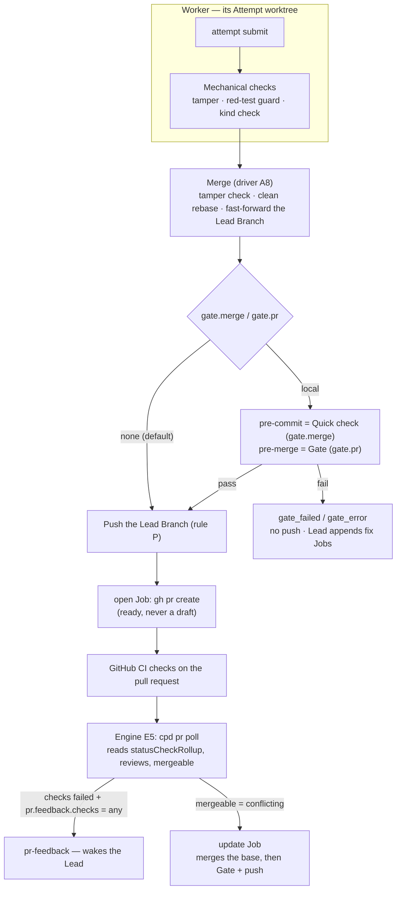
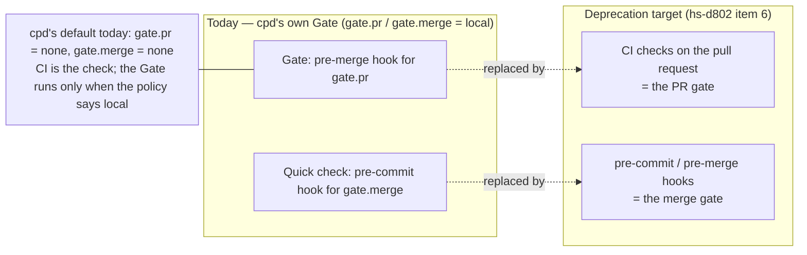

# Verification

This note documents how cpd verifies work today — the checks at `attempt submit`, the
Gate at the merge, and the GitHub round-trip that carries a Lead Branch to a merged
pull request — and the deprecation path the model states for it (`hs-d802` (a record of machine `hs`), item 6). The verification behind every claim is
[architecture-verification.md](../research/architecture-verification.md), section 6 and
its disagreement 11 and 12; where the model and the docs differ this note reports both.
Related notes: [[job-lifecycle]] (the states the checks move a Job through), [[sdk]] (the
engine that polls), [[workspace]] (the worktrees the checks run in).

## What runs today

**Mechanical checks at submit** ([contract §7.7](../contract.md), [contract
§7.3](../contract.md) precondition 5, [CONTEXT — Mechanical checks](../CONTEXT.md)). Every
`attempt submit` runs, in the Attempt worktree: the tamper check ([contract
§7.5](../contract.md)), the red-test guard for an `impl` Job, and the kind's check — a
`test` Job must build and go red, an `impl` Job must build and go green, an `open` or
`update` Job must resolve its policy. These are the checks a Worker fixes; the Lead runs
none ([CONTEXT — Mechanical checks](../CONTEXT.md)).

**The Gate at the merge** ([contract §7.4](../contract.md) step 6, [contract
§7.3](../contract.md), [CONTEXT — Gate](../CONTEXT.md)). At an Attempt's merge the driver
runs the repo policy's hooks in the Attempt worktree — which, for a linear Job, is the
Lead worktree ([contract §7.2](../contract.md)). One hook per gate:

| Hook | Gate | Key | Default |
|---|---|---|---|
| `pre-commit` | the **Quick check** for the merge (`gate.merge`) | `[hooks]` in the repo policy | `none` |
| `pre-merge` | the **Gate** for the pull request (`gate.pr`), for `open` and `update` Jobs only | `[hooks]` in the repo policy | `none` |

A hook that fails ends the Attempt `failed`/`gate_failed` (exit 3) or `gate_error`
(exit 1), nothing is pushed, and the Lead appends fix Jobs ([contract
§7.3](../contract.md), [contract §7.4](../contract.md)). With `gate.pr` or `gate.merge`
`none` — cpd's shipped default, `core/src/policy/default.toml` — no hook runs and, where
CI exists, the repo's CI is the check ([contract §8.3](../contract.md), [CONTEXT —
Gate](../CONTEXT.md), [CONTEXT — CI](../CONTEXT.md)). **CI is not the Gate**: CI is the
GitHub checks on a pull request, and `pr.feedback.checks` decides whether a failing check
raises `pr-feedback`; Gate, Quick check, Mechanical checks and CI are four distinct terms
([CONTEXT — CI](../CONTEXT.md), [CONTEXT — Gate](../CONTEXT.md)).

**The GitHub round-trip.** `pr open` pushes the Lead Branch (rule P, plain, never forced —
[contract §7.4](../contract.md)), creates the pull request ready, never a draft ([contract
§7.6](../contract.md)), and the pull request gets GitHub's own CI checks. Engine E5 (`cpd
pr poll`, every `pr_poll_seconds`) reads each open pull request's rollup, review decision
and mergeability ([contract §3.7](../contract.md) E5, [contract §7.6](../contract.md),
[commands §9.2](../commands.md)); a Lead reads the detail with `cpd pr view` ([commands
§9.8](../commands.md)). When the checks become `failed` and `pr.feedback.checks` is `any`,
the poll raises `pr-feedback` and wakes the Lead ([contract §7.6](../contract.md), [commands
§9.2](../commands.md)). When `mergeable` becomes `conflicting`, the poll queues an `update`
Job; its Worker merges the base and cpd runs the Gate and pushes ([contract
§3.7](../contract.md) E5, [contract §7.4](../contract.md) "An `open` or `update` Job's
merge", [contract §7.7](../contract.md)).



## The deprecation path

The model says the Gates are marked for deprecation: the **PR gate is replaced by CI
checks**, and the **merge gate by pre-commit/pre-merge hooks** (`hs-d802`; [architecture-verification.md
§6](../research/architecture-verification.md)). Two parts of that are already the shipped
default, and one part the docs do not say the way the model does — reported here, not
silently resolved ([architecture-verification.md §6 disagreements
11 and 12](../research/architecture-verification.md)):

- **The deprecation is already the default.** [contract §8.3](../contract.md) sets
  `gate.merge = "none"` and `gate.pr = "none"`, and [CONTEXT — Gate](../CONTEXT.md) says
  "Where `gate.pr` is `none`, CI is the check where it exists." There is a *deprecated
  alias* (`[pr] gate`, [contract §8.3](../contract.md)), but no "marked for deprecation"
  state for the mechanism itself.
- **The hook pairing.** The docs give one hook per gate — `pre-commit` is the **merge**
  gate and `pre-merge` is the **pre-PR** Gate ([contract §7.3](../contract.md), [CONTEXT —
  Quick check](../CONTEXT.md), [CONTEXT — Gate](../CONTEXT.md)); the model's one line
  collapses the two.



## The GitHub round-trip (diagram e)

The full loop — push the Lead Branch, the Gate or CI checks, the pull-request review, the
engine's poll (E5), and the `update` Job that merges the base and pushes:

```mermaid
sequenceDiagram
  autonumber
  participant W as Worker
  participant C as cpd (driver / engine / command)
  participant GB as GitHub
  participant L as Lead

  W->>C: attempt submit (mechanical checks pass)
  C->>C: merge into the Lead Branch (tamper check, clean rebase)
  C->>C: Gate if gate.pr / gate.merge = local (pre-merge / pre-commit); else none
  C->>GB: push the Lead Branch (rule P, plain, never forced)
  C->>GB: gh pr create — ready, never a draft (open Job)
  GB->>GB: CI checks on the pull request
  L->>GB: pull-request review (approve / request changes)
  C->>GB: E5 cpd pr poll, every pr_poll_seconds (never overlapping)
  GB-->>C: statusCheckRollup, reviews, mergeable
  C->>L: pr-feedback (checks failed / changes_requested / comments)
  GB-->>C: mergeable = conflicting
  C->>C: queue an update Job (once per transition)
  W->>C: the update Job merges the base
  C->>C: Gate + fast-forward the Lead Branch
  C->>GB: push the update (rule P)
  GB-->>C: next poll sees the new head
```

Every arrow above is a documented claim: push by rule P and the merge at [contract
§7.4](../contract.md); the ready-not-draft pull request and the Gate on a snapshot at
[contract §7.6](../contract.md); the poll's read and its reactions at [contract
§7.6](../contract.md) steps 1–3 and 6, [contract §3.7](../contract.md) E5 and [commands
§9.2](../commands.md); the review decision at [contract §7.6](../contract.md) step 2 and
`cpd pr view` ([commands §9.8](../commands.md)); the `update` Job on a conflict at
[contract §3.7](../contract.md) E5 and its Worker's merge at [contract
§7.4](../contract.md) and [contract §7.7](../contract.md).

## Sources

- [contract §3.7](../contract.md) — the engine, E5
- [contract §7.3](../contract.md) — the hooks from the repo policy file
- [contract §7.4](../contract.md) — the merge and the Gate at it
- [contract §7.5](../contract.md) — the tamper check
- [contract §7.6](../contract.md) — pull requests, the Gate on a snapshot, the poll's reads
- [contract §7.7](../contract.md) — the checks at submit and the `open`/`update` Job checks
- [contract §8.3](../contract.md) — the `gate` policy domain and its default
- [commands §9.2](../commands.md) — `pr poll`
- [commands §9.8](../commands.md) — `pr view`
- [CONTEXT — Gate](../CONTEXT.md), [CONTEXT — Quick check](../CONTEXT.md), [CONTEXT —
  Mechanical checks](../CONTEXT.md), [CONTEXT — CI](../CONTEXT.md)
- [docs/research/architecture-verification.md](../research/architecture-verification.md) —
  the verification of `hs-d802`, section 6
- `hs-d802` — the model
