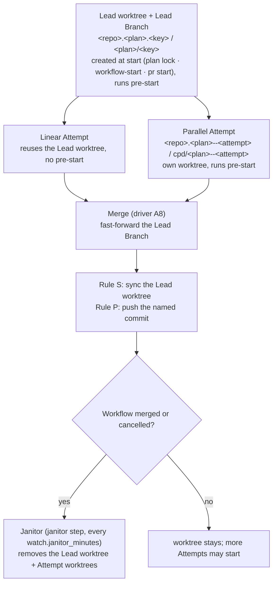

# Workspace

This note documents the worktree lifecycle cpd uses to run work: the **Lead Branch** and
**Lead worktree** of one Workflow, the worktree of an Attempt, and the two clean-up paths
— the `janitor` and `prune`. It documents the model's item 7 (`hs-d802` (a record of machine `hs`)), verified in
[architecture-verification.md §7](../research/architecture-verification.md), which also
records where the model's "per-attempt worktrees" is only partly true. Related notes:
[[sdk]] (the engine that starts and cleans worktrees), [[job-lifecycle]] (the states a Job
passes through while its worktree lives), [[clocks]] (the engine clock that schedules the
janitor). Vocabulary: today's CLI and tables still say `pr`/`prs`; this note uses
**Workflow** where it points at the target words and quotes today's identifiers where it
documents current behaviour ([CONTEXT — How to read this glossary](../CONTEXT.md)).

## One Workflow: the Lead Branch and the Lead worktree

Each Workflow gets one long-lived **Lead worktree** and the **Lead Branch** checked out in
it ([contract §7.1](../contract.md), [CONTEXT — Lead worktree](../CONTEXT.md)). It is
created at the Workflow's start — by `plan lock` for a Workflow with no needs and no base
Workflow, or by engine `workflow-start` / `cpd pr start` for the others ([contract
§7.1](../contract.md), [contract §3.8](../contract.md)).

| What | Path | Branch |
|---|---|---|
| Lead worktree (one per Workflow) | `<repo-parent>/<repo-name>.<plan>.<key>` | `<plan>/<key>` (or `cpd/<plan>/<key>` for legacy PRs, [contract §4.5](../contract.md)) |
| Parallel Attempt worktree | `<repo-parent>/<repo-name>.<plan>--<attempt>` | `cpd/<plan>--<attempt>` |

The repo's **main checkout is never touched**: Workflow and Attempt worktrees are siblings
of it ([contract §7.1](../contract.md)). The Lead worktree is a *view* of its Lead Branch:
cpd touches its files only at the Workflow's start (checkout and `pre-start`) and by rule
S, and its local changes belong to the Lead or the User and are never overwritten; a Gate
normally runs in the Attempt worktree, which for a linear Attempt is this same Lead
worktree ([contract §7.1](../contract.md), [contract §7.4](../contract.md) "Rule S"). At the start, cpd fetches `origin/<base>` and either creates the Lead Branch from the
base or reuses the branch already on the remote when it does not conflict with the base; a
Lead Branch absent from the remote is pushed at once, after `pre-start` ([contract
§7.2](../contract.md)).

The Lead Branch accumulates the Workflow's Merged Jobs and becomes its pull request. Its
moves are compare-and-swaps: a merge fast-forwards the Lead Branch and then syncs the Lead
worktree by rule S; every push names its commit (rule P) ([contract §7.4](../contract.md)).
Rule S brings the Lead worktree up to date after any mover, in any order, and stops with
`lead_worktree_stale` rather than overwrite local changes ([contract §7.4](../contract.md)).

## One Attempt: linear reuses the Lead worktree, parallel gets its own

An **Attempt** is one execution of a Job by one fresh Worker session ([CONTEXT —
Attempt](../CONTEXT.md)). Its worktree depends on whether it is linear or parallel
([contract §7.2](../contract.md), [contract §7.4](../contract.md) "Linear vs parallel
Attempts"):

- **Linear Attempt** — the Workflow's only live Attempt. It **reuses the Lead worktree**
  and runs on the Lead Branch, reads `L = git rev-parse refs/heads/<lead branch>`, records
  `base_sha = L`, and runs no `pre-start` (the Lead worktree already ran it) ([contract
  §7.2](../contract.md)).
- **Parallel Attempt** — when another Attempt of the Workflow is live, or two or more
  Ready Jobs start together. It **gets its own worktree** `cpd/<plan>--<attempt>` at `L`,
  records `base_sha = L`, and runs `pre-start` in it ([contract §7.2](../contract.md)).

So the model's "per-attempt worktrees" is exact for a parallel Attempt, not for a linear
one ([architecture-verification.md §7](../research/architecture-verification.md)). A
parallel Attempt's worktree and branch are removed after its merge, by the janitor, by a
failed start or a failed `pre-start`, through one idempotent procedure: rename aside,
`git worktree prune`, `git branch -d` (or `-D` forced), delete the aside ([contract
§7.2](../contract.md) "Removal"). The `pre-start` hook comes from the Workflow's policy and
is blocking, so a Worker never starts before setup finished ([contract §7.3](../contract.md)).

## Clean-up: the janitor and prune

**The janitor** (`cpd janitor`, engine step `janitor`) removes the worktrees and branches of
merged and cancelled Workflows, and of the ended Attempts of merged Jobs on live Workflows
([commands §29](../commands.md), [contract §3.7](../contract.md) `janitor`, [contract
§7.2](../contract.md)). One pass, then exit; the engine starts one every
`watch.janitor_minutes` (default 60) and the User may run it by hand ([commands
§29](../commands.md)). Per pending Workflow it checks idleness (every Attempt `ended` and
its driver lock free — else `pending`, nothing touched), kills the Attempt windows,
discards parallel Attempt worktrees, runs rule S, then removes the Lead worktree ([commands
§29](../commands.md)). A Lead worktree that is **dirty or unpushed is kept untouched**, with
one `cleanup_failed` `error` Event from the first pass that sees it; an uncontaminated one
is renamed aside, pruned, branch-deleted and deleted, idempotently ([contract
§7.2](../contract.md), [commands §29](../commands.md)). A cancelled Workflow's
`lead_worktree` is cleared and its worktrees and branches are removed by the next pass
([contract §7.1](../contract.md)).

**The prune** (pro-d378, the same pass, before that clean-up) removes two whole directories, idempotently and with no Event: the `target` directory of the Lead of each `open`, `merged` or `cancelled` Workflow that has no queued or running Job and no Attempt starting, running or merging (the Lead worktree, its branch and its sources stay), and `run/<plan>/durable` of each archived or deleted Plan whose Attempts are all ended ([commands §29](../commands.md) §4a, [contract §3.7](../contract.md) `janitor`, [contract §7.2](../contract.md)). Each removal is one `pruned` entry of the pass's output and one line in `run/janitor.log`.

**`prune`** is the by-hand clean-up of leftover worktrees whose work already reached
`origin/main`, run by the Manager after a Plan ([commands §23](../commands.md)). Its rules
are `keep active / keep dirty / remove dropped / remove (HEAD an ancestor of origin/main, or
a merged pull request's head) / keep not merged`; without `--apply` it prints what it would
do ([commands §23](../commands.md)). It is the successor of
[scripts/prune-worktrees.sh](../../scripts/prune-worktrees.sh), and the script now only
`exec cpd prune "$@"` ([commands §23](../commands.md)). The janitor's worktree clean-up acts only on merged and
cancelled Workflows (and swept Attempts); `prune` decides by what reached `origin/main` and
takes `--drop` ([commands §29](../commands.md), [commands §23](../commands.md)). `prune` acts on
worktrees and branches only; neither it nor the janitor touches a remote branch ([commands §23](../commands.md),
[commands §29](../commands.md)).

## Sources

- [contract §7.1](../contract.md) — worktrees and branches, and the paths of cancelled Workflows
- [contract §7.2](../contract.md) — creating worktrees, the linear/parallel rule and removal
- [contract §7.4](../contract.md) — the merge, rule S and rule P
- [contract §3.7](../contract.md) — the engine, step `janitor`
- [contract §3.8](../contract.md) — Workflow statuses and the start
- [commands §29](../commands.md) — `janitor`
- [commands §23](../commands.md) — `prune`
- [scripts/prune-worktrees.sh](../../scripts/prune-worktrees.sh) — now only `exec cpd prune`
- [CONTEXT — Lead worktree](../CONTEXT.md), [CONTEXT — Attempt](../CONTEXT.md)
- [docs/research/architecture-verification.md](../research/architecture-verification.md) —
  the verification of `hs-d802`, section 7
- `hs-d802` (a record of machine `hs`; see [INDEX](INDEX.md)) — the model
