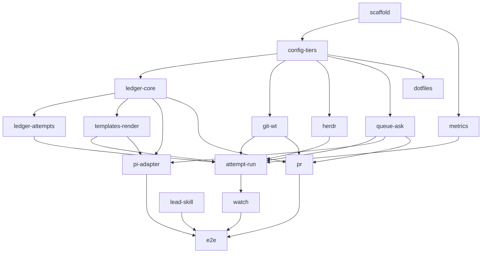

# CPD v0: plan

Status: **Stage 1 complete** (2026-10-12; outcomes in [trials/summary.md](trials/summary.md)). **Stage 2 approved; reordered for self-hosting; dispatching increment 1.** Requirements: [requirements.md](requirements.md).

## Why two stages

The v0 stack is decided except for Worker spawning, and every chosen dependency is unverified at runtime (nothing has been installed or run yet). Specifying build Jobs now would bake guesses into Locked Specs. Stage 1 is a short Workflow of trials that turns those unknowns into facts. Stage 2 then specifies the build from evidence.

## How Stage 1 runs (bootstrap)

CPD does not exist yet, so the Lead runs Stage 1 by hand.
- **Workers.** One fresh headless pi Worker per Job, at the Job's Tier, each with a self-contained Spec in `docs/trials/specs/`, writing its report to `docs/trials/<job>.md`.
- **Review.** The Lead checks every report against its acceptance criteria. A rejected report gets one more Attempt one Tier step higher.
- **Ledger.** This file plus git history (beads is not adopted yet).
- **Concurrency.** This machine is the MacBook Air (M1, 8 GB), so the cap is **3**: batch 1 = t1, t2, t3; batch 2 = t4, t5, t6.
- **Specs:** [`docs/trials/specs/`](trials/specs/) (`_common.md` plus one per Job).
- **Isolation rules** (in every Spec):
  - **herdr:** only the named session `cpd-trial` (`herdr --session cpd-trial …`, a separate server). Never touch, stop or reconfigure the default session.
  - **pi:** load packages per run with `pi -e <source>`. Never `pi install`, never edit `~/.pi/agent/settings.json`.
  - **Installs:** worktrunk 0.80.0 and beads 1.3.1 are declared in the dotfiles (`home/.chezmoidata/packages.yaml`, dotfiles commit `612c840`) so they travel to every Mac, and are installed here. Trials install nothing else. The only global, non-dotfiles change is t1's temporary herdr plugin link for modem-dev, unlinked at the end.
  - **Scratch only:** repos under `/tmp/cpd-trials/<job>/`. No pushes, no changes to dotfiles or real repos.
  - **Evidence:** every claim is backed by a command transcript excerpt. Untested claims are labelled.

## Stage 1: Workflow `cpd-v0-trials`

| Job | Tier | Needs | Question | Acceptance (summary) |
|---|---|---|---|---|
| t1 spawn | S4 | — | How do we start Workers and Reviewers? (A) `cpd`-native: `herdr agent start <name> --kind pi --pane <id> -- --model … --tools …`, plus a ~30-line test extension that wakes the Lead with `pi.sendMessage`; (B) giuseppecrj/pi-herdr-agents; (C) modem-dev/pi-herdr-subagents. | For each option, measured: 10/10 launches; per-spawn model + thinking honoured (read from the child's session file); child runs in a given worktree; read-only forked Reviewer (no `bash` in its tools); completion arrives in the Lead's session as a custom message; a half-typed Lead draft is still intact afterwards; a killed child is detected; escalation path works; cleanup. A recommendation with the evidence table. |
| t2 ledger | S3 | — | How does CPD's Ledger map onto beads? | `BEADS_DIR` outside the repo, init without touching it (repo byte-identical, no `AGENTS.md`). Mapping of Workflow, Job, Dependency, Attempt, review, Escalation, Tier and metrics onto beads (types, dependencies, metadata, statuses, comments); "ready" = blockers closed = Merged; atomic claim; history/audit read-back; behaviour of two concurrent writers; latency per command; whether beads' freeze marker can protect Locked Jobs. A proposed `cpd`↔`bd` contract. |
| t3 worktrees + merge | S3 | — | What are the exact worktrunk recipes? | Create a Job worktree from the Lead Branch HEAD with a blocking setup hook; register it in herdr (`worktree open`); rebase + fast-forward merge keeping commits (`wt merge --no-squash`). Failure modes, each demonstrated: Gate (`pre-merge` verify) fails; rebase conflict; two concurrent merges (compare-and-swap); dirty Lead Branch worktree. Cleanup semantics; non-interactive hook approval; rebasing the Lead Branch onto the default branch for the PR. Copy-paste recipes. |
| t4 plan approval | S3 | — | Can `cpd` drive plannotator for plan approval? | A test extension emits `plannotator:request` (`plan-review`) with a Markdown plan; the decision (approve and deny, simulated through plannotator's local HTTP API) returns as an event and a follow-up message; plan mode stays off (model, thinking and tools unchanged); state survives `/reload`. A recipe plus the integration surface. |
| t5 questions + escalation | S3 | — | How does the User answer structured questions, and how does a Worker ask the Lead? | `rpiv-ask-user-question` driven in a pi TUI pane via `herdr pane send-keys`, answers returned structured. `pi-intercom` `ask`/`reply` between two pi panes: blocking, timeout, Lead busy, Lead idle with a draft, Lead restarted. Compared with a `cpd`-native file-based blocking `ask` stub. A recommendation. |
| t6 tier catalog | H2 | — | What is a supported way to read each model's valid thinking levels? | Compare a pi-ai export, the pi CLI and `models-store.json` for stability across `pi update`. A generator snippet that reproduces the Tier table in requirements §3. |

Stage 1 is done when all six reports are accepted. The findings are then folded into `requirements.md` and ADRs. **Done:** requirements §5, ADR-0004 (amended), ADR-0007, ADR-0008.

## Stage 2: Workflow `v0` (build `cpd` v0, self-hosting)

Status: **approved by the User 2026-10-12**, with the order changed so that `cpd` builds itself as early as possible. Interface: [cli-contract.md](cli-contract.md) (normative for every Job). Specs: [`docs/build/specs/`](build/specs/) (`_common.md` plus one per Job).

### Increments: each one hands the next a better tool

| # | Jobs (Tier) | Dispatched by | New capability used from then on |
|---|---|---|---|
| 1 | `scaffold` (S2), then `config-tiers` (S3) | the Lead, by hand | `cpd tiers` gives the exact model argument for each Worker |
| 2 | `ledger-core` (S3), `git-wt` (S3), `herdr` (S3), `queue-ask` (S2), `metrics` (S2) | the Lead, by hand | `cpd lead attach` + `cpd ask/answer`: later Workers can escalate to the Lead instead of guessing |
| 3 | `ledger-attempts` (S3), `templates-render` (S3) | the Lead, by hand | `cpd plan render` renders plans for the User |
| 4 | `attempt-run` (S4) | the Lead, by hand | **self-hosting:** `cpd job dispatch` runs an Attempt end to end (worktree, Worker in a herdr pane, Gate, Reviewer, rebase merge, Ledger) |
| 5 | `watch` (S4), `pi-adapter` (S3), `lead-skill` (S4) | **`cpd job dispatch`** (the Lead picks the Job and cpd does the rest) | `cpd watch` schedules everything; the pi adapter delivers `cpd` messages to the Lead |
| 6 | `pr` (S2), then `e2e` (S4) | **`cpd watch`** | full Dispatch; `e2e` proves the whole flow and lists defects (fixes are appended as Jobs and run the same way) |
| — | `dotfiles` (S2) | the Lead, by hand, last | works in `~/dotfiles`; a second repo is post-MVP for `cpd` |

The remaining jobs move into `cpd`'s own Ledger at the self-hosting point, right after `attempt-run` lands:
- `cpd workflow init --wf v0 --repo ~/projects/cpd` (the Lead Branch `cpd/v0` already exists), then `cpd lead attach`;
- `cpd job add` for every Job not yet merged, without Dependencies on merged ones;
- the User's chat approval recorded with `cpd plan decision`;
- Jobs locked with the ledger-core `lockPlan` function (the `plan lock` command arrives with `watch`).

From then on, everything the build does is recorded where `cpd` records any Workflow.

### Dependencies (unchanged except: `watch` needs `attempt-run` instead of `pr`, and `pr` moved after `watch`)

`lead-skill` has no code Dependency; it waits until increment 5 so that `cpd` dispatches it. File ownership is disjoint: one file per command (contract §1), one module directory per Job, and only `scaffold` touches `package.json`, `tsconfig.json`, `src/cli.ts`, `verify.sh` and `.config/wt.toml`.

### How the hand-dispatched increments (1–4) run

- **Lead Branch:** `cpd/v0` in its own worktree (`wt switch --create cpd/v0 --base main`). Attempt branches: `cpd/v0--<job>-a<n>`.
- **Worker:** headless `pi -p --approve` at the Job's Tier, cwd = Attempt worktree, with the Spec as its prompt.
- **Gate:** `./verify.sh`, run again by the Lead before each merge.
- **Reviewer:** a fresh read-only session (`--tools read,grep,find,ls`, S4) with the Spec, the diff and the Gate output. This was approved by the User for this build: this Lead session is too long to fork per review. `cpd`-dispatched increments use `reviewMode: "fresh"` for the same reason. The fork path is exercised by `e2e`.
- **Merge:** rebase and fast-forward into `cpd/v0` with `wt merge --no-squash`.
- **Retries:** rejected Attempts retry one Tier higher.
- **Concurrency:** cap 3 (this machine).
- **Finish:** `cpd/v0` goes to GitHub (`clayton-duarte/cpd`) as a PR into `main`, where the User's reviewer bot reviews it.
