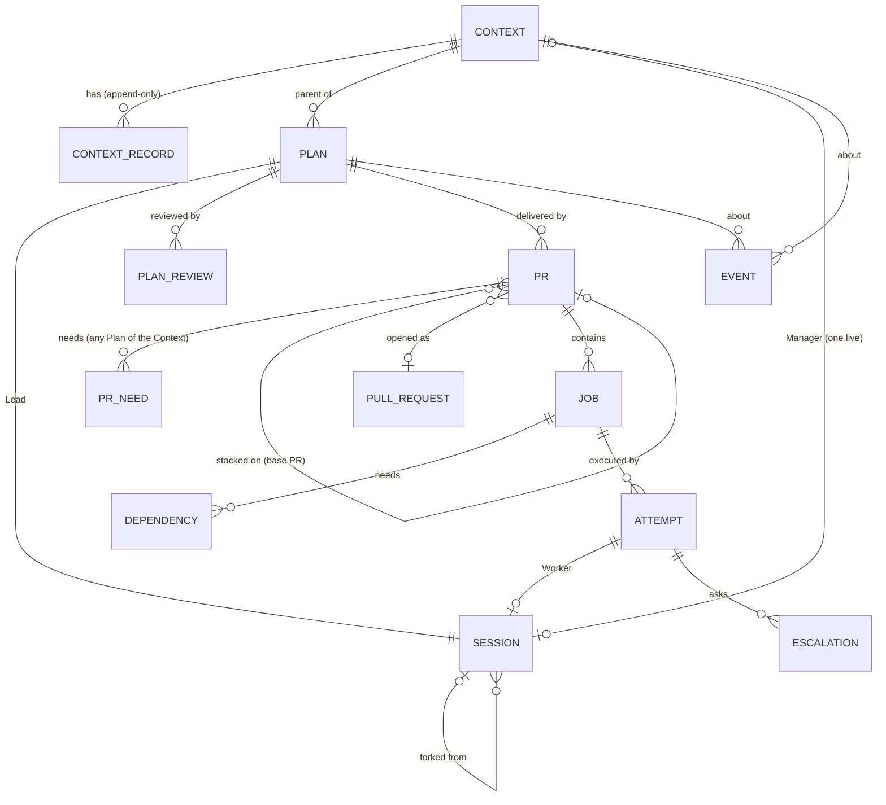
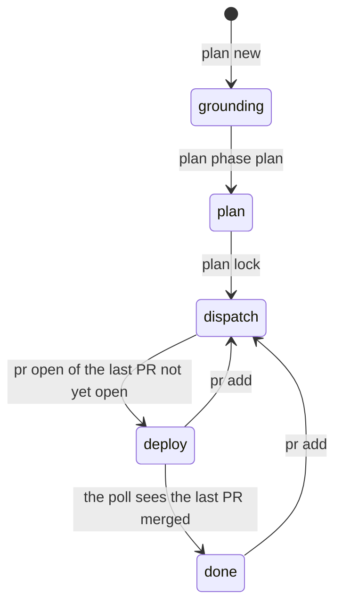
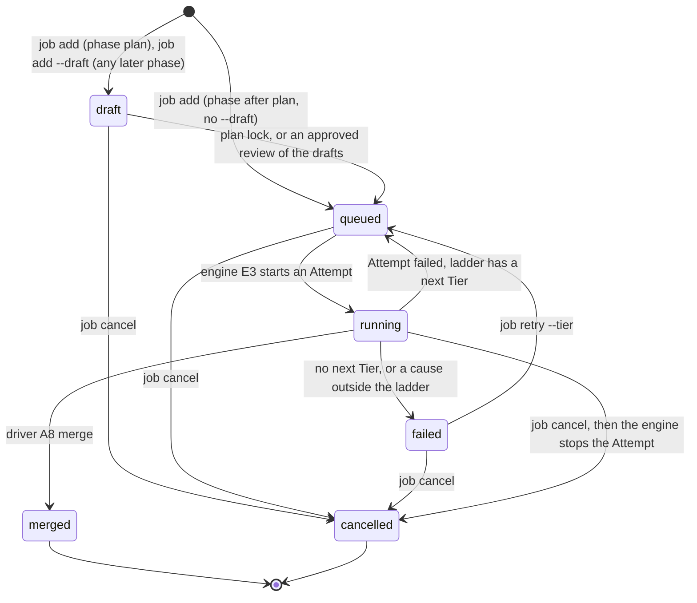
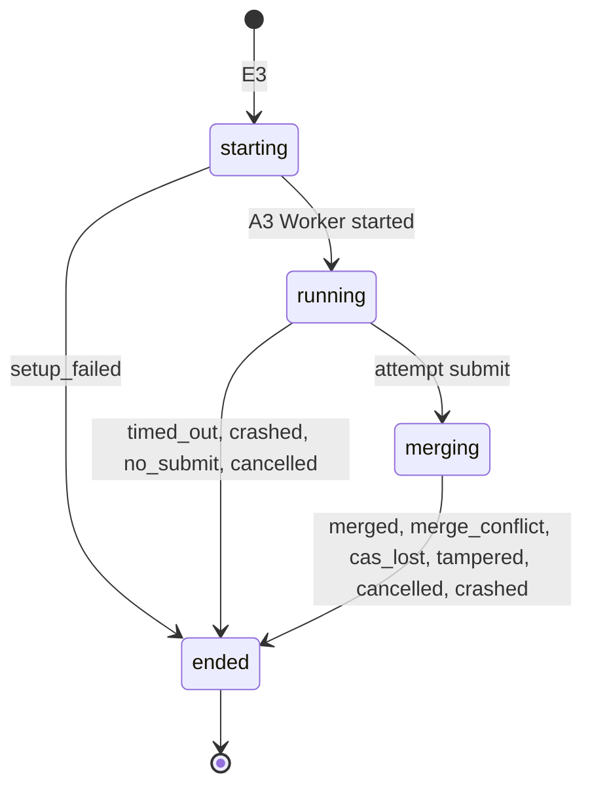
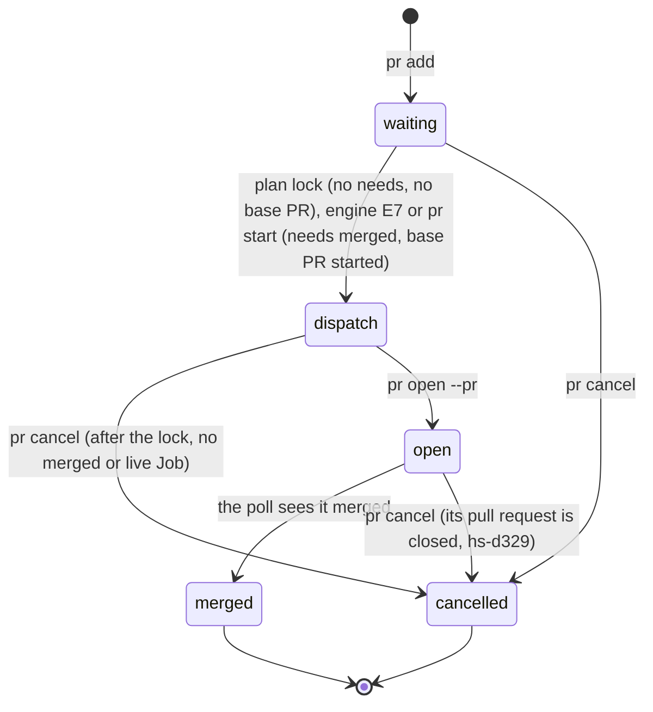

# cpd 2: contract (core)

Status: **normative for every cpd 2 implementation Job.** A Plan is one deliverable over one or more PRs (R34). Vocabulary: [CONTEXT.md](../CONTEXT.md). Command-by-command reference (synopses, flags, every refusal, JSON examples, the pi adapter protocol, the Worker contract, what the TUI reads): `docs/commands.md`, written by Job `contract-commands` after this document. Where the two disagree, this document wins and `commands.md` is fixed.

Sources: the User's decisions R1–R14 and R19–R20 (applied by Job `contract-gate-pr`, §10), R34 (a Plan is one deliverable over one or more PRs, each with its own repo, base, Lead Branch, Lead worktree, Gate and GitHub pull request; Job `r34-contract`, §10), R35 (§10) and the approved outline with D1–D5 (`~/.cpd/plans/cpd-rust/`), ADR-0009 to ADR-0012 (`docs/adr/`; ADR-0012 is superseded by hs-d23 and hs-a1, Plan manager B1, §4.6), the cockpit vision and research (`~/.cpd/plans/cpd-ui/`). cpd 1 (`docs/archive/cpd1/cli-contract.md`, cited below as "cpd 1 §n") is reference only: where its behaviour is kept, the section is cited; where it changes, the change and its reason are stated.

Evidence labels, as in the research notes: **verified** means run on the homeserver on 2026-10-14 (tmux 3.4, git 2.43.0, gh 2.45.0, pi 1.2.0, worktrunk 0.80.0); **docs** means read in the named tool's documentation; **unverified** means a design assumption the implementation Job must check.

## Contents

1. [Principles](#1-principles)
2. [Model and identifiers](#2-model-and-identifiers)
3. [State machines](#3-state-machines)
4. [Storage](#4-storage)
5. [Events](#5-events)
6. [The tmux host](#6-the-tmux-host)
7. [git and the Gate](#7-git-and-the-gate)
8. [Configuration](#8-configuration)
   - [8.3 Policies](#83-policies)
9. [Tiers](#9-tiers)
10. [Traceability](#10-traceability)

## 1. Principles

### 1.1 What cpd 2 is

- **CLI first.** Every capability is a command. Agents, the pi adapter, scripts and the TUI all use the same commands; the TUI (`cpd tui`) is the human view onto them, never a second way to change state.
- **One binary, written in Rust.** The Cargo workspace at the root of the repo has three crates: `core/` (`cpd-core`, the library), `cli/` (`cpd`, the binary) and `tui/` (`cpd-tui`, the cockpit) (R6, switch-over; `implementing.md`). The binary is `cpd`, and this contract writes every command as `cpd …`. Until the switch-over the binary was installed as `cpd2` beside the TypeScript cpd (R12); the switch-over replaced cpd 1 and renamed the binary everywhere, including in rendered Specs and the pi adapter.
- **System dependencies:** `git`, `tmux` **>= 3.6** (§6.1), `pi` and, for pull requests only, `gh`. No `bd`, no `wt` (worktrunk), no `herdr`, and no Node.js of cpd's own. pi brings its own Node runtime; cpd uses it only to read pi's model catalog (§9).
- **State in SQLite inside the binary** (R1): one database per machine, `$CPD_HOME/cpd.db`, in WAL mode, with SQLite bundled into the binary (no system SQLite). Reads never wait for writers. Every write is recorded in the append-only `history` table (§4).
- **Context records in the database.** A Context's records (decisions, notes, questions and answers, Plans) live only in the database tables `contexts` and `context_records`; Contexts are machine-local (hs-d23, hs-a1; Plan manager B1, §4.6). ADR-0012's git store is superseded.
- **tmux is the only host.** Leads run in the cockpit; Workers and the engine run in a hidden session of the same tmux server (§6).
- **The repo owns its setup and its Gate,** in `.config/wt.toml`, read by cpd itself so that repos set up for worktrunk work unchanged (R4, R5, §7).
- **Events are the single channel** to Leads, the TUI and agent states (D4, §5). There are no queue directories, no cache directories and no tmux user options carrying state.
- **One engine per machine** (D5): one `cpd watch` schedules every Plan under one concurrency limit.
- **A Plan is one deliverable over one or more PRs** (R34): each PR is the Plan's part in one repo, with its own base, Lead Branch, Lead worktree, Gate and GitHub pull request; one repo may hold several PRs of one Plan. A Plan of one PR behaves exactly as a Plan did before R34.
- **Kept from cpd 1:** the vocabulary (Job, Spec, Dependency, Attempt, Escalation, Tier, Gate, Lead Branch, Merged, Locked); the roles User, Manager (Plan manager B3, §3.1), Lead and Worker (cpd 1's Reviewer is removed by R19, §10); Workers write all the code; the Lead never writes code.

### 1.2 Output: one JSON value (D1)

Every command prints exactly one JSON value on stdout, always, except the three that own their terminal (below); there is no `--json` flag and no human format.

- Success: `{"ok": true, …}`, with the command's fields at the top level.
- Failure: `{"ok": false, "error": {"code": "<snake_case>", "message": "<one sentence>", "details": {…}}}`.
- Progress and debug text goes to stderr only.
- **The one streaming command** is `cpd events follow`: it prints one complete JSON value per line, each line an Event (§5.4), as the approved outline specifies. If it fails, its last line is a failure value as above.
- **Commands that own their terminal** print no JSON value on success: `cpd session run` and `cpd tui view` (internal) run pi or draw a ratatui view in their pane, and `cpd tui --attach` and bare `cpd` (no arguments; commands.md §13.3) replace themselves with `tmux attach` (the outline's "builds and attaches the cockpit"). If one fails before taking the terminal, it prints the failure value and exits with its code. `cpd tui` without `--attach` prints one JSON value like every command.

Exit codes (kept from cpd 1 §2):

| Exit | Meaning | Examples of codes |
|---|---|---|
| `0` | ok | |
| `1` | failure: an external tool or something unexpected | `git_failed`, `tmux_failed`, `store_tampered`, `store_failed` (the database cannot be opened, is not cpd's, or a statement fails through a bug; Escalation `rs-store-a1-q1`; SQLite failures only), `internal` (a bug in cpd itself, for example a malformed Event built by a command; also a failed write to stdout other than EPIPE, because no I/O error code exists), `config_invalid` |
| `2` | usage error | `usage`, `plan_required`, `invalid_plan_id` |
| `3` | refused by an invariant: Locked, an illegal transition, a precondition | `job_locked`, `illegal_transition`, `dirty_tree`, `cas_lost` |
| `4` | not found | `plan_not_found`, `job_not_found`, `session_not_found` |
| `5` | timeout | `store_busy`, `lock_timeout` (`pr poll`'s `locks/pr-poll.lock`, §7.6; no git operation waits for a cpd lock since hs-d243, §7), `tool_timeout`, `ask_timeout`, `cancel_timeout` |

**`tool_timeout`** (exit 5): a subprocess cpd started ran past its deadline (the deadlines are listed in §7 for `git`, §6.3 for `tmux`, §9 for `node`, §3.7 for the engine's `cpd pr poll` child, `commands.md` §14.1 for `doctor`). `details`: `tool` (`git`, `tmux`, `node`, `cpd`, …), `argv` (the full argument vector) and `deadline_seconds`. Every subprocess cpd starts has a deadline (except tmux's `display-popup`, §6.3), a constant in the code with its reason, not a config key; `gh` keeps its own timeouts (§7.6) and hooks theirs (§7.3). At the deadline cpd kills the process **group** (`SIGTERM`, then `SIGKILL` after 5 s to those still alive) and the command fails with `tool_timeout`; it replaces `git_failed`, `tmux_failed` and the like for that call.

**Test overrides.** Tests need not wait for cpd's real limits: a debug build (the one `cargo test` and `cargo nextest` build; never the installed release build, which ignores them) reads `CPD_TEST_<NAME>=<seconds>`, a decimal (`0.2`), in place of these constants of the code. A value that is not a number of seconds ≥ 0 fails loud (a panic naming the variable). They exist only for the tests; nothing else sets them.

| Variable | Replaces (release value) |
|---|---|
| `CPD_TEST_DEADLINE_<TOOL>` | the deadline of every call of `<TOOL>` (upper-cased: `GIT`, `TMUX`, `NODE`, `CPD`, `GH`, …) through the deadline runner, above any caller's deadline; `deadline_seconds` is then the decimal set |
| `CPD_TEST_DOCTOR_DEADLINE` | `doctor`'s probe deadline (10 s, `commands.md` §14.1) |
| `CPD_TEST_ADAPTER_WATCHDOG` | the adapter watchdog's limit (60 s, §6.7) |
| `CPD_TEST_WATCHDOG_POLL` | how often `session run` reads the Session's state for the watchdog (2 s) |
| `CPD_TEST_FILE_POLL` | `session run`'s loop while pi runs (0.5 s) |
| `CPD_TEST_SOURCE_POLL` | how often a fork looks at its source (2 s, §6.7 step 1) |
| `CPD_TEST_DRIVER_POLL` | how often A4 looks at the Worker (0.5 s, §3.4) |
| `CPD_TEST_LEAD_POLL` | how often a review Job's driver looks at its Lead (2 s, §3.4) |
| `CPD_TEST_KILL_PAUSE` | the pause between A9's `kill-window` tries (1 s, §3.4) |
| `CPD_TEST_BACKOFF_UNIT` | the unit of E3's spawn back-off, `min(2^k, 300)` units (1 s, §3.7) |
| `CPD_TEST_PR_POLL` | E5's `watch.pr_poll_seconds`, the time from the end of one PR poll to the next (§3.7, §8.2) |

`commands.md` introduces more codes, most of them cpd 1's (cpd 1 §11 and its `src/`); each is specified at the command that returns it, under the same exit meanings:

| Exit | Codes |
|---|---|
| `1` | `gate_error`, `migration_changed` and `migration_order` (§4.5; hs-d178), `policy_invalid`, `owner_unknown` and `repo_unkeyed` (§8.3; hs-d288), `watch_start_failed`, `spawn_failed`, `session_malformed`, `driver_lock_missing`, `doctor_failed`, `pi_not_found`, `catalog_failed`, `cleanup_failed` (only as an `error` Event's code, source `pr poll`, never a command's failure; §7.2), `distill_invalid` and `distill_failed` (`context distill`'s failure and, the same, its `error` Event's code; §4.6), `slack_failed`, `slack_unparseable` and `slack_helper_failed` (the Slack helper's refusal and, the same, E11's `error` Event's code; commands.md §21.5, §21.6), `title_failed` (`session retitle`'s failure, writes nothing, and, the same, the code of the `error` Event engine E10 reports for it; §3.7 E10, commands.md §10.14) |
| `2` | `context_required`, `session_required`, `invalid_review_id`, `invalid_session_id`, `invalid_record_id`, `spec_invalid`, `tier_invalid`, `nothing_to_edit`, `file_unreadable`, `invalid_name`, `pr_required`, `invalid_pr_id` (R34) |
| `3` | `distill_running` (§4.6), `push_rejected` (hs-d139, §7.6), `session_ambiguous` (hs-a3, commands §1.3), `pr_exists`, `pr_in_use`, `pr_empty`, `pr_locked`, `pr_not_ready`, `pr_ended`, `pr_closed` (§7.6), `pr_title_required` (hs-d285, §7.6), `pr_not_closed` (§7.6, §3.8), `base_behind` (§7.6, hs-d329), `needs_other_pr`, `branch_exists` (R34, §3.8), `base_pr_unknown`, `base_pr_unavailable`, `base_pr_other_repo`, `pr_other_context` (hs-d324, §2.2) and `stacked_rebase` (hs-d325, §7.6), `context_exists`, `question_answered`, `supersedes_invalid` (§4.6 "A write"), `not_a_git_repo`, `plan_exists`, `illegal_phase`, `no_draft_jobs`, `review_decided`, `dependency_cycle`, `worktree_exists`, `job_key_exists`, `draft_incomplete` (hs-d241, commands §4.6, §4.8), `needs_unknown`, `needs_unavailable`, `review_commits`, `review_missing`, `job_merged`, `job_not_failed`, `job_not_ready`, `attempt_not_running`, `no_port`, `jobs_not_done`, `gate_failed`, `rebase_conflict` (a stop, §7.6), `rebase_in_progress`, `no_rebase_in_progress`, `lead_worktree_dirty` (§7.6), `not_a_lead`, `no_cockpit`, `wrong_pane`, `in_chat_slot`, `cursor_ahead`, `not_a_terminal`, `merge_not_clean` (hs-d272, commands.md §9.10), `owner_mismatch`, `owner_unset`, `owner_set` (§8.3; hs-d288), `slack_auth` and `slack_not_configured` (the team review's helper, commands.md §21.6) |
| `4` | `base_not_found` (also a stacked PR's base branch missing from the remote, §7.6), `pr_not_found` (R34) |

**Adapter-only codes.** `protocol_mismatch` is never a command's failure and never an `error` Event's code: it appears only in the pi adapter's message to its Session (`cpd adapter: …`, commands.md §15.2), when `cpd --version`'s `protocol` is not the number the adapter was built for (§5.2 "The protocol number"). It has no exit code.

### 1.3 Conventions every command follows

- **Selecting a Plan.** `--plan <id>`, else the environment variable `CPD_PLAN`, else usage error `plan_required` (exit 2). cpd sets `CPD_PLAN` in every pane it starts for a Plan (§6.5). This replaces cpd 1's `--wf` / `CPD_WF`.
- **Selecting a PR** (R34). `--pr <key>`. It may be omitted when the Plan has exactly one PR that is not `cancelled`, which is then selected; with two or more it is the usage error `pr_required` (exit 2), and with none `pr_required` too, whose message names `cpd pr add`. A key that is not one of the Plan's PRs is `pr_not_found` (exit 4). Used by `job add`, `pr open`, `pr rebase` and `pr view` (§2.5); `pr poll` has no `--pr`: it polls every open pull request of the User (§7.6, hs-d96); `pr add`, `pr edit`, `pr cancel` and `pr start` take the key as their argument.
- **Validation at the boundary.** Every external input (arguments, `config.toml`, Spec files, `.config/wt.toml`, `.config/cpd.toml`, the policy files and a repo's `origin` URL (§8.3), Context record files, `gh` and `git` output, pi session lines) is parsed into types once, at the edge. Unknown flags and unknown config keys are errors. Nothing falls back silently.
- **Subprocesses** run from argv arrays (never a shell string, except the repo's own hook commands, which are shell by definition, §7.3), with stdin from `/dev/null` unless stated, an explicit `cwd` and an explicit environment. The exit code is checked before any output is parsed.
- **Times** are RFC 3339 UTC strings with milliseconds, `2026-10-14T21:10:00.000Z`.
- **Idempotence.** A command that finds its effect already in place returns `ok` with `"already": true` instead of failing, unless `commands.md` says otherwise for that command.

### 1.4 `$CPD_HOME`

`$CPD_HOME` defaults to `~/.cpd`. cpd 1 uses the same directory; cpd 2 never reads or writes cpd 1's files (`config.json`, `leads/`, `slots/`, `workflows/`, `locks/merge-*.lock`), and none of its own names collide with them.

```
$CPD_HOME/
  config.toml                     machine config (§8)
  policy/                         the owner and repo scopes of the policies (§8.3); any file may be a symlink
    owners/<owner>.toml           an owner's policy; required for every owner a Context uses
    repos/<owner>/<name>.toml     a repo's policy; optional
  bin/git                         the `git` wrapper first on every Session's `PATH`: refuses `git stash` (§6.5, hs-d310); an executable `sh` script
  cpd.db, cpd.db-wal, cpd.db-shm  the database (§4)
  archive/contexts/<context>/     an old git store of a Context, moved here by migration 0007 (§4.5); nothing reads it
  locks/
    watch.lock                    held by the one `cpd watch` (§6.6)
    watch-ensure.lock             held by every `watch --ensure` (plain or `--wait`) while it checks and starts the engine (§6.6)
    attempt-<plan>--<attempt>.lock  the driver lock: taken by the Attempt's starter, inherited by its driver, removed when the Attempt ends (§3.4)
    pr-poll.lock                  held by `pr poll` for the whole poll (§7.6, hs-d96)
    tmux-restart.lock             held by the one run of the tmux server's restart (§6.1, hs-d294)
    distill-<context>.lock        held by the Context's one distill run, `context distill`, for its whole life (§4.6)
    title-<session>.lock          held by the Session's one retitle run, `session retitle`, for its whole life (§3.7 E10)
    plannotator-ports.lock        held while a Plan's review port is assigned (§6.5)
    store.lock                    held by every open of `cpd.db` during its one-time setup only: the WAL switch, the migrations and the conversion of a legacy store (§4.1, §4.5); waited for at most `store_busy_ms`, then `lock_timeout`, except while its holder is migrating: then until the holder releases it, at most `MIGRATION_WAIT_CEILING` (§4.2, §4.5); a migrating holder writes a JSON marker into it and keeps it until it releases the lock (below)
  run/
    watch.log                     the engine's stderr
    pr-poll-failing.json          `{call, since}`: the engine's record of when E5's `gh` call first failed with an HTTP 5xx or a timeout, deleted by the first poll that succeeds (§3.7 E5, hs-d354)
    tui/plan-scroll.json          the `plan` view's scroll offsets, `{"<plan id>": [x, y]}`, written by the view itself (a file a view writes, commands.md §13.2, hs-d254); read at its start
    tui/tree-folds.json           the `tree` view's folds, `{"collapsed": ["<context id>", …], "expanded": [["<context id>"], …]}`: the live Contexts the User collapsed and the archived ones the User expanded; written by the view itself, under the same exception as `tui/plan-scroll.json` (commands.md §13.2, hs-d260); read at its start
    tmux-restart.pending          a restart of the tmux server is pending (§6.1, hs-d294): JSON `{at, server, installed, failed}`; not in the store
    tmux-restart.log              the output of the detached tmux restart (§6.1)
    team-review.json              the pull requests posted in the team Slack channel as the helper last read them, `{version, polled_at, channel, read, posts}` (commands.md §21.5, §21.6), written by E11 (§3.7) and read for the Inbox kind `review-requested` (§2.2); derived, not in the store, rewritten whole by rename; a failed run leaves the last good copy
    test-<i>.lock                 the machine-wide test slot <i>, for i in 0..`test_concurrency` (§7.6 "The test slot", §8.2, hs-d336); held while a Gate's `pre-start` and `pre-merge` run, or while a command run by `cpd slot` (commands.md §23) runs; created empty by the first holder that tries it and never removed
    tmux-restart.pid              the pid of the detached tmux restart the engine started, one line; removed when the engine reaps it (an engine that dies first leaves it, its pid perhaps reused); what finds that process, which is in no process group of the engine's
    <plan>/plan.md                the last `plan render`
    <plan>/lead-message.md        the Lead's first message, written by `plan new`
    <plan>/plannotator-port       the Plan's plannotator port, one line, assigned by `session run` (§6.5)
    <plan>/plan-<review>.md       the Plan review's content, written by `plan review`, opened in plannotator by the pi adapter
    <plan>/feedback-<review>.md   plannotator's feedback on a Plan review, written by the pi adapter and overwritten on a retry; passed to `plan decide --feedback-file`
    <plan>/messages/<session>.md  a forked Session's first message, copied by `session fork --message-file`
    <plan>/specs/<attempt>.md     rendered Worker Spec
    <plan>/reviews/<k>.md         a review Job's findings, written by its Worker (B2, §3.4); the directory R19 removed, reused for this
    <plan>/logs/attempt-<attempt>.log      the Attempt driver's stderr
    <plan>/logs/<attempt>.<hook>.log       full output of a hook run (§7.3)
    <plan>/logs/pr-<key>.pre-merge.log     full output of the last Gate run by `pr open`, `pr rebase` or `pr push` on PR <key> (§7.6)
    <plan>/logs/pr-<key>.pre-start.log     full output of the last `pre-start` in a gate worktree of PR <key>, run before that Gate (§7.6, hs-d243)
    <plan>/logs/lead-<key>.<hook>.log      full output of a hook run in PR <key>'s Lead worktree: `pre-start` at the PR's start (§7.2)
    context-digests/<context>/<upto_seq>.md      the Context digest (§4.6): derived, never a Context record; the latest is the highest <upto_seq>
    context-digests/<context>/<upto_seq>.md.tmp  the distiller's text before it is validated; with cpd's index appended and renamed to <upto_seq>.md when valid, else renamed to <upto_seq>.md.invalid or removed (§4.6)
    context-digests/<context>/<upto_seq>.md.invalid  the last digest that failed validation (after a repair turn, the repaired text), kept to inspect the prompt's failures; one per Context, replaced by the next (§4.6)
    context-digests/<context>/runs.jsonl         one JSON line per distiller run, appended: what it cost (§4.6)
    context-digests/<context>/prompt.md          the distiller's prompt, written by each run (§4.6)
    context-digests/<context>/repair-prompt.md, digest.md, missing.md, problem.md   the inputs of a repair turn, written by it (§4.6 step 5)
    context-digests/<context>/records.md         the records in force a run gives the distiller (§4.6)
    context-digests/<context>/distill.log        every distill run's stderr, appended; the engine's runs also their stdout (§3.7 E9)
    context-digests/<context>/distill.pid        the pid of the distill run the engine started (§3.7 E9), one line, as `tmux-restart.pid`
    titles/<session>.log          the output of every retitle run the engine starts for that Session, appended (§3.7 E10)
```

**The migration marker** (hs-n278). The process that takes `locks/store.lock` and finds a migration or the conversion of a legacy store to run, writes into the lock file, before it starts migrating and while it holds the `flock`, one JSON object `{"migrating": true, "pid", "started_unix_ms", "from", "to", "command"}` (`from` and `to`: the schema versions or the count of applied migrations before and after; `command`: its `argv[0..]` as `txns.command` would name it). It keeps the marker until it releases the `flock`: it truncates the file as the last step of its setup, immediately before it releases `locks/store.lock`, on success and on failure alike, not when the migration commits (the rest of the setup, the connection and the schema check, still holds the lock). A waiter that has read a live marker during its wait keeps waiting while the `flock` stays held by that holder, also when the file is empty in the instants before the release (§4.2). A file that is empty, or whose `pid` is not the holder's, is not a marker: the lock file is a marker only while the `flock` is held and `migrating` is true. A holder that dies releases the `flock` by itself (below) and its marker is ignored; the next opener takes the lock and overwrites it.

Locks are `flock(2)` locks on these files: the kernel releases them when the holder dies, so there are no stale-lock takeovers (a change from cpd 1 §4, whose pid files needed them).

There is **no per-repo lock** (hs-d243): merges, `pr open`, `pr rebase`, `pr push` and the clean-up after a PR's merge take no lock shared by two PRs or two Plans; §7 says what replaces it. A file `locks/repo-<sha1>.lock` left by an earlier cpd is inert: nothing opens it, and nothing needs to delete it.

## 2. Model and identifiers

### 2.1 Identifiers

| Thing | Format | Unique within | Example |
|---|---|---|---|
| Context id | `^[a-z][a-z0-9-]{1,39}$` | this machine (Contexts are machine-local, §4.6) | `building-cpd` |
| Machine name | `^[a-z][a-z0-9]{0,7}$`, set in `config.toml` (§8) | the User's machines | `hs` |
| Context record id | `<machine>-<letter><n>`; letter `d` decision, `n` note, `q` question, `a` answer, `p` plan; `n` from 1, sequential per machine, Context and letter | the Context | `hs-d3` |
| Plan id | `^[a-z][a-z0-9-]{1,23}$` (cpd 1's Workflow id) | the machine; `pr add` and every PR start (§3.8) also refuse a PR whose Lead Branch `cpd/<plan>/<key>`, or the branch `cpd/<plan>` itself (git cannot hold `cpd/<plan>` and `cpd/<plan>/…` at once), already exists in the PR's repo (`branch_exists`), so cpd 1 Workflows and cpd 2 Plans on one repo never share a branch. The one exception is the legacy branch `cpd/<plan>` of a `merged` PR, which `pr add` first moves to `cpd/<plan>/<that PR's key>` (§3.8, hs-d118) | `pay-4521` |
| Owner login (hs-d288) | a GitHub login, `^[a-z0-9](-?[a-z0-9])*$`, 1–39 characters (GitHub's rules, read in its docs; unverified beyond them), ASCII-lowercased when parsed (GitHub compares logins without case), so a policy file name is lowercase | GitHub | `clayton-duarte` |
| Repo name (hs-d288) | a GitHub repository name without its owner, `^[a-z0-9._-]{1,100}$`, ASCII-lowercased when parsed, as a login | its owner | `cpd` |
| PR key (R34) | `^[a-z][a-z0-9-]{0,23}$`, chosen by the Lead (`pr add`); invalid: `invalid_pr_id` (exit 2) | the Plan (a `cancelled` PR keeps its key) | `schema`, `web` |
| Job key | `^[a-z][a-z0-9-]{0,31}$` | the Plan | `api-schema` |
| Attempt id | `<job>-a<n>`, `n` from 1 per Job | the Plan | `api-schema-a2` |
| Escalation id | `<attempt>-q<k>`, `k` from 1 per Attempt | the Plan | `api-schema-a2-q1` |
| Plan review id | `r<k>`, `k` from 1 per Plan | the Plan | `r3` |
| Session id | pi's session id. cpd chooses it for every session it starts (`pi --session-id`): a lowercase UUID v4. Accepted on input: `^[A-Za-z0-9][A-Za-z0-9_-]{0,127}$` | the machine | `596d007f-6775-4134-b77a-b356cc523842` |
| Event id | positive integer, assigned by SQLite, strictly increasing in commit order, never reused | the machine | `48213` |
| Lead Branch | `cpd/<plan>/<key>`, one per PR (R34); a PR migrated from a Plan made before R34 keeps `cpd/<plan>` (§4.5) | the repo | `cpd/pay-4521/api` |
| Attempt branch | `cpd/<plan>--<attempt>`, in the repo of the Job's PR (unchanged by R34: flat, a sibling of `cpd/<plan>/` and never inside it; t3) | the repo | `cpd/pay-4521--api-schema-a2` |
| Lead worktree | `<repo-parent>/<repo-name>.<plan>.<key>`, one per PR, `<repo>` the PR's repo (R34); a migrated PR keeps `<repo-parent>/<repo-name>.<plan>` | the filesystem | `~/projects/pay.pay-4521.api` |
| Attempt worktree | `<repo-parent>/<repo-name>.<plan>--<attempt>`, `<repo>` the repo of the Job's PR | the filesystem | `~/projects/pay.pay-4521--api-schema-a2` |

Within a Plan, Jobs, Attempts and Escalations are addressed by their id plus the Plan; across Plans, by the pair. An invalid id is a usage error (`invalid_<thing>_id`, exit 2).

### 2.2 Objects

Types: `text`, `int`, `bool`, `time` (§1.3), `json` (a JSON value of the stated shape), `?` = nullable. The storage of each field is the DDL in §4.4.

#### Context

The knowledge several Plans share, optionally a Jira Epic. Not a session (ADR-0011).

| Field | Type | Meaning |
|---|---|---|
| `id` | text | Context id (§2.1) |
| `title` | text | the visible label; editable (`context rename`). The id is immutable and need not be readable |
| `jira` | text? | Jira Epic key, stored only |
| `created_at`, `created_on` | time, text | when and on which machine `context new` ran |
| `owner` | text? | the GitHub login (§2.1) of the Context's owner, its policy key (§8.3, hs-d288): every PR of its Plans is in a repo of this owner. Set by `context new --owner`, or once by `context owner` when it is null; null only for a Context created before the migration that added it (§4.5) |
| `archived_at` | time? | null, or when the Context was archived (migration 3, §4.5); see "Archived" below |
| records | [Context record] | append-only, below |
| Manager | Session? | not a field: the Context's one live (not archived) Session of role `manager` (§3.1), if any |

#### Context record

One typed, append-only row of `context_records`, a Context's only store (§4.6). Written only by `cpd context …` commands and by `plan new` (the `plan` kind, and the `brief` kind with `--brief-file`), each in one database transaction.

| Field | Type | Meaning |
|---|---|---|
| `id` | text | `<machine>-<letter><n>` (§2.1) |
| `kind` | text | `decision`, `note`, `question`, `answer`, `plan` or `brief` |
| `at`, `machine` | time, text | when and where it was written |
| `by` | json `{session: text?, plan: text?}` | the writing Session (`CPD_SESSION`, else `PI_SESSION_ID`, else null) and its Plan |
| `text` | text | the decision, note, question or answer; for `plan`, the Plan's title; for `brief`, the Plan's brief (B3-A4) |
| `supersedes` | text? | `decision` or `note` only: the id of the record it replaces (must exist in this Context). A decision may replace an earlier decision or note; a note may replace an earlier note only (a fact never overrules a decision). cpd checks the pairing at write (§4.6 "A write") |
| `question` | text? | `answer` only, required: the id of the question it answers (must exist) |
| `plan` | json? | `plan` and `brief` only, required: `{id, machine, jira?}` (a `brief` has `{id, machine}`); references the Plan by id and machine. R34 (A12): no `repo`, because a Plan has one or more PRs and none when it is created; a record written before R34 may still carry `repo`, which migration 0007's import drops (§4.5) |

The User's rule is **recency wins**: when two records of a Context contradict each other, the later one stands and the earlier one is removed from force, which is supersession. A decision or note is **active** unless a later decision or note supersedes it (a note is superseded only by a later note or decision; a decision only by a later decision, §4.6). A question is **open** until an answer names it. The rendering Leads read (`context show`) lists, in order: title and Jira key; Plans, each with the repos of its PRs that are not `cancelled`, read from this machine's database (a Plan of another machine shows none); briefs, each listed short (its id and first line) under its Plan, never in full (`context show --record <id>` prints one record in full); active decisions; superseded decisions, each naming its successor; open questions; answered questions with their answers; active notes; superseded notes, each naming its successor. Each item shows its id and date. Commands (detail in `commands.md`): `context new`, `list`, `show`, `decide`, `note`, `ask`, `answer`, `manager`, `distill`. The letter of a `brief` is `b`. The **Context digest** (§4.6, hs-d194) is not a record: it is a file derived from the records in force, rebuilt from them at any time.

#### Plan

One deliverable over one or more PRs (R34), optionally a Jira task. This was cpd 1's Workflow (D3). Before R34 a Plan was one repo, one Lead Branch and one PR; the per-repo fields moved to the PR (below, A6).

| Field | Type | Meaning |
|---|---|---|
| `id` | text | Plan id |
| `context` | text | its Context (required: every Plan belongs to one) |
| `title`, `jira` | text, text? | `title` is the visible label and editable (`plan rename`); the id is immutable |
| `phase` | text | `grounding`, `plan`, `dispatch`, `deploy`, `done` (§3.1) |
| `lead_session` | text | the Plan's Lead Session; its `cwd` is the directory `plan new` ran from (A12), not a repo |
| prs | [PR] | one or more, below; none until the Lead adds one (`pr add`, §3.8) |
| `created_at`, `locked_at`, `done_at` | time, time?, time? | |
| `archived_at` | time? | null, or when the Plan was archived (migration 3, §4.5); see "Archived" below |

#### PR

The part of a Plan in one repo (R34, A4): one repo, one base, one Lead Branch and Lead worktree, its Jobs, its Gate run and one GitHub pull request opened from its Lead Branch. No other term names it (hs-d36). One repo may hold several PRs of one Plan, for example a contract change in repo A, then repo B, then A's integration: three PRs `a-contract`, `b`, `a-integration`, where `b` needs `a-contract` and `a-integration` needs `b`.

| Field | Type | Meaning |
|---|---|---|
| `plan`, `key` | text | the PR key (§2.1), unique in its Plan |
| `repo` | text | realpath of the repo's main worktree |
| `name` | text? | the repo's GitHub name without its owner (§2.1), parsed from its `origin` by `pr add` (and `pr edit --repo`); with its Context's `owner`, the PR's policy key (§8.3, hs-d288). Null only for a PR added before the migration that added it (§4.5) |
| `base` | text | the branch the pull request targets. Unstacked: the repo's `origin` HEAD branch, else `main`, or the branch `pr add --base` names (cpd 1 §11 `workflow init`). **Stacked**: the Lead Branch of another PR of the same repo, its **base PR** (hs-d324, hs-d325; below): `pr add --base <plan>/<key>` copies the base PR's `lead_branch` into `base`, so every reader of `base` (§7.2 start, §7.6 `pr open`, the Gate's `target`) reads the branch the pull request targets and needs no case. **The stacking is not a second column**: it is derived from `base` (below), so there is one source of truth and no state in which `base` and a stacking field disagree. When the base PR merges, GitHub repoints the pull request and the poll sets `base` to what GitHub says; the PR is then unstacked without any other write (§3.8 "Stacked PRs") |
| `needs` | [text] | PR references (below) of other PRs that must be `merged` before this one starts (A7, A9): a bare key is a PR of the same Plan, `<plan>/<key>` one of another Plan of the same Context (hs-d324); acyclic, together with the base PRs (§2.2, §3.8 "Stacked PRs"); none may be `cancelled` when the need is recorded. `pr add` defaults them, in phase `deploy` or `done`, to every `merged` PR of the Plan, unless `--needs` or `--no-needs` is given |
| `status` | text | `waiting`, `dispatch`, `open`, `merged`, `cancelled` (§3.8) |
| `lead_branch` | text | `cpd/<plan>/<key>` (§2.1); set by `pr add` |
| `lead_worktree` | text? | `<repo-parent>/<repo-name>.<plan>.<key>`; set when the PR starts (§3.8, §7.2), null while `waiting` or `cancelled` |
| `title` | text? | the PR's own title (hs-d285): it names the PR's change, is written by the Lead (`pr add --title`, `pr edit --title`), and is 1–72 characters on one line with no control characters (the boundary type `PrTitle`, else `usage`). Null only for a PR that existed before migration `pr-title` (§4.5); `pr open` refuses such a PR (`pr_title_required`, §7.6). `pr open` gives it to GitHub as the pull request's title (through one seam, §7.6), and the squash merge makes it the commit subject on `main`. Not a Locked field (§2.3, §4.4 `prs_locked`) |
| `pr` | json? | `{number, url, opened_at}`, set by `pr open`; `opened_at` is when the PR became `open` |
| `pull_request` | integer? | the id of its Pull request row (below; hs-d96, migration 6, §4.5): set by `pr open`, non-null exactly when the status is `open` or `merged`. What the poll last read from the pull request (title, review decision, checks, state) is in that row, not here |
| `all_merged_at` | time? | when this PR's `all-merged` was last appended; `job add` clears it when it appends a Job to the PR (hs-d140, §3.7 E4), so `all-merged` is sent once per completion, not once per PR |
| `start_failed_at` | time? | set when the engine failed to start the PR (A9); while set, the engine does not try again and `pr start` retries; cleared when the PR starts |
| `created_at`, `started_at`, `merged_at` | time, time?, time? | `started_at` when it became `dispatch`, `merged_at` when `pr poll` saw it merged |

The PR object is the cpd record; "pull request" names the object on GitHub that its `pr` field points to.

**The base PR** (hs-d324, hs-d325) of a PR `P` is the PR `Q`, in the same repo as `P`, whose `lead_branch` equals `P.base`: at most one, since a Lead Branch names its Plan (§2.1) and Plan ids are unique. `P` is **stacked** on `Q` exactly when `Q` exists; `Q` is `P`'s **base PR**. It is derived, never stored: `plan show` and `pr view` print it as `base_pr` (`<plan>/<key>`, or null), and no field can disagree with `base`. It is not a need: a need must be `merged` before `P` starts, `Q` must only have **started**, because `P` starts from `Q`'s head (§3.8). A PR `R` is stacked *above* `P` when `P` is `R`'s base PR.

**A PR reference** (hs-d324) names a PR in a field or a flag: a bare `<key>` (§2.1) is a PR of the same Plan; `<plan>/<key>` is a PR of that Plan, the Plan's own included. A PR key has no `/`, so the forms never clash in `needs`. **`--base` names a base PR only as `<plan>/<key>`**, because it also takes a branch name and a branch may contain `/`: `pr add` and `pr edit` read the value of `--base` as a PR reference exactly when it has the form `<plan>/<key>` (one `/`, both parts valid by §2.1) **and** a Plan `<plan>` exists; any other value is a branch name (`base_not_found` when it does not exist). A value that names an existing Plan with no such PR is `base_pr_unknown`, not a branch: a branch whose first segment is the id of a Plan therefore cannot be a `--base` (accepted; the refusal names the reading). cpd's own branches `cpd/<plan>/<key>` have two `/` and are never read as a reference, and a `--base` that is already a Lead Branch of a PR of the same repo is stacked all the same (it is the derivation above), so the refusals below apply to it too. Views and Events print a reference as the bare key when it is of the Plan they are about, qualified otherwise.

**Validation of a reference** (`pr add`, `pr edit`; the codes are in `commands.md` §9.4), the same for a need of another Plan and for a base PR unless said: the PR exists (`needs_unknown`, `base_pr_unknown`); it is in a Plan of **the same Context** (`pr_other_context`: owners, policies and the Manager's view are per Context, §8.3); it is not `cancelled` (`needs_unavailable`, `base_pr_unavailable`); a **base PR** is also not `merged` (`base_pr_unavailable`: there is nothing to stack on, name its base branch instead, which is the base PR's `base`) and is in **the same repo**, the same realpath (`base_pr_other_repo`, `details.repo`, `details.base_repo`: a Lead Branch is a branch of one repo, and a PR of another repo is never a base PR by the derivation above); and the graph of **needs and base PRs together** (an edge from a PR to each PR it needs and to its base PR) stays acyclic across every Plan (`dependency_cycle`, `details.cycle` lists the references): the base PR must only have started, but a PR that needs, directly or not, the PR stacked on it would never start (`A` stacked on `B`, `B` needs `A`: `A` waits for `B` to start, `B` for `A` to merge). A PR may not name the same PR as base and as need (`usage`, exit 2). **An archived Plan's PR** (§2.2 "Archived") can be named only as a need and only when it is `merged`: a PR that cannot move may not be waited for or stacked on; any other reference to it is refused `archived` (`details.plan`, `details.next` `cpd plan unarchive <plan>`).

#### Pull request

What the PR poller (hs-d65, hs-d72, hs-d96, hs-d97, hs-d98, hs-d107, §7.6) last read of one of the User's GitHub pull requests: one row per pull request, kept for the Dispatch column (commands.md §13.2). A PR (above) points to its row; the User's other pull requests have a row and no PR. Table `pull_requests`, migration 6; `mergeable` and `merge_state` come with migration 11, `authored` and `review_requested` with migration 0013 (§4.4, §4.5). A row is there because the User wrote the pull request, because it requests the User's review, or both.

| Field | Type | Meaning |
|---|---|---|
| `id` | integer | the row's id; `prs.pull_request` refers to it |
| `repo` | text | GitHub's `owner/name` (`nameWithOwner`), not a path |
| `number` | integer | the pull request's number; `(repo, number)` is unique |
| `url` | text | its URL |
| `title` | text | its title |
| `draft` | bool | whether it is a draft |
| `state` | text | `open`, `closed` or `merged` |
| `review_decision` | text | `none`, `approved` or `changes_requested` (§7.6 maps gh's value) |
| `checks` | text | `none`, `passed`, `pending` or `failed` (§7.6 maps gh's value) |
| `mergeable` | text | `mergeable`, `conflicting` or `unknown`: GitHub's `PullRequest.mergeable` (`MERGEABLE`, `CONFLICTING`, `UNKNOWN`), lowercased (§7.6). Stored as each poll reads it, `unknown` included: GitHub computes it lazily after the base moves. `pr open` inserts `unknown` |
| `merge_state` | text | `behind`, `blocked`, `clean`, `dirty`, `draft`, `has_hooks`, `unknown` or `unstable`: GitHub's `mergeStateStatus`, lowercased (§7.6). Stored as each poll reads it. `pr open` inserts `unknown` |
| `authored` | bool | 1 when the User wrote it: the pull request is in the `author:@me` search (§7.6). Set by each poll |
| `review_requested` | bool | 1 when the User's review is requested: the pull request is in the `review-requested:@me` search (§7.6). Set by each poll. **Read by nothing** since the Context decision 'Team review Inbox' (User, 2026-10-19): the Inbox kind `review-requested` no longer reads it (§2.2 Inbox item); the column and the search alias that fills it stay until a later change removes them |
| `created_at` | time | when GitHub created it (GitHub's time, not cpd's) |
| `merged_at` | time? | when it was merged; set exactly when `state` is `merged` |
| `changed_at` | time | cpd's time of the last change of any other field (`mergeable`, `merge_state`, `authored` and `review_requested` included); a poll that finds nothing changed writes nothing (§7.6) |

A row is deleted when its pull request leaves both open searches and no PR points to it; a row a PR points to is never deleted (§4.4). The row appends no Event of its own (§5.1); `pr-feedback` and `pr-merged` come from the transitions it causes (§5.2).

#### Plan review

One request for the User's approval of the draft Jobs, through plannotator (cpd 1 §11 `plan decision`, §15).

In phase `plan` it covers every draft Job (all of them are drafts) and the PRs, and its approval is what `plan lock` needs. In every phase after `plan` it covers **exactly the draft Jobs** the Plan has at that moment: a Lead that plans several batches adds the later ones as drafts (`job add --draft`, §3.2), and the User approves each batch through a review of its own. Its approval queues those drafts (§3.2) and there is no `plan lock` in these phases; the Jobs already Locked are shown to the User as context, not for approval. Reason: every planned batch must be visible in the Plan view before it is approved, and approved only by the User (User, hs-d173, hs-d174, hs-d179). A Job that only carries out a recorded User decision, with no open design choice, is added queued, not as a draft (User, hs-d301); drafts and their review are for undecided design, and when unsure it is a draft.

| Field | Type | Meaning |
|---|---|---|
| `plan`, `id` | text | `r<k>` |
| `fingerprint` | text | the plan fingerprint (§2.3) the review was rendered from |
| `title` | text? | what the drafts under review do (hs-d291): 1–72 characters, one line, no control characters, the same rule as a PR's title. It is the heading of the review document (`commands.md` §4.6). Null only on a review made before it existed |
| `status` | text | `pending`, `approved`, `rejected` |
| `feedback` | text? | the User's feedback |
| `requested_at`, `decided_at` | time, time? | |

#### Job and Spec

A self-contained unit of work. Its **Spec** is the fields `goal`, `context`, `touches`, `acceptance` and `out_of_scope`; with `title`, `tier`, `pr`, `review` and the Job's Dependencies, they are the Job's **Locked fields**. A Job runs in its PR's repo: its Attempts' worktrees are cut from, and merged into, its PR's Lead Branch (§7).

| Field | Type | Meaning |
|---|---|---|
| `plan`, `key` | text | |
| `pr` | text | the key of the Job's PR (R34, A7): every Job belongs to exactly one PR; set by `job add --pr` (§1.3), changed only by `job edit --pr` while `draft`; a Locked field |
| `review` | bool | a **review Job** (B2, below): set by `job add --review`, never changed (`job edit` has no such flag); default 0 (every Job before B2 is 0); a Locked field |
| `seq` | int | machine-wide creation order (scheduling order, §3.2) |
| `urgent` | bool | the **urgent** flag (User, Context record "Urgent Jobs", hs-d238): set by `job add --urgent`, or by `job urgent` on a Job that is `queued` or `draft`; default 0; engine E3 starts urgent Ready Jobs first and may run one beyond `concurrency` (§3.7). **Not a Locked field** and not in any fingerprint (§2.3): it changes no Spec, so a Locked Job may become urgent. A Lead or Manager marks a Job urgent **only when the User explicitly asks**, usually for something that blocks all work or for an incident |
| `title` | text | |
| `tier` | text? | Tier (§9); null only while `draft` or `cancelled` (a stub draft) |
| `goal`, `context` | text? | Spec; null only while `draft` or `cancelled` |
| `touches` | json [text]?, ≥ 1 | Spec: files or globs the Job may touch; null only while `draft` or `cancelled` |
| `acceptance` | json [text]?, ≥ 1 | Spec: checks that must hold; null only while `draft` or `cancelled` |
| `out_of_scope` | json [text]? | Spec; null only while `draft` or `cancelled` |
| `status` | text | §3.2 |
| `appended` | bool | added after `plan lock`; a draft added in a later phase (`job add --draft`, §3.2) is appended too, from the add |
| `fingerprint` | text? | Locked-Job fingerprint (§2.3); null exactly while `draft` (and for a draft that was cancelled), in every phase |
| `retry_tier` | text? | the Tier `job retry` chose for the next Attempt |
| `cancel_reason`, `cancel_requested_at` | text?, time? | set by `job cancel` |
| `failed_cause` | text? | the cause that failed the Job (§3.4); set exactly while `failed` |
| `merged_sha` | text? | the Lead Branch commit after the merge; set exactly when `merged` |
| `created_at` | time | |

**Stub draft** (hs-d241, R1). A `draft` Job may lack its Tier, its Spec, or both: `job add <k> --draft --title <t>` needs neither `--tier` nor `--spec` (commands §5.1), so a Lead can register planned work the moment it is planned (hs-d239). The five Spec fields are null together (all given by `--spec`, or none) and the Tier is null or valid. A draft is editable, so `job edit <k> --tier <T> --spec <f>` completes it (commands §5.2). A draft that lacks its Spec or Tier is **incomplete**: it can be neither approved (`plan review` and `plan lock` are refused `draft_incomplete`, exit 3, `details.jobs` listing each key and what it lacks) nor queued or run (§3.2). The nulls hold only while `status` is `draft` or `cancelled` (§4.4 CHECK): a stub can be cancelled (`job cancel`) and keeps its nulls; a Job that is queued, running, merged or failed has every field.

**Review Job** (B2, hs-d70). A Job with `review = 1`: its Worker is a **fork of the Plan's Lead Session**, so it knows the intention, instead of a fresh session (§3.4, §6.5). It reads its PR's Lead Branch diff against the PR's base and the Plan's Specs, and writes its findings to `run/<plan>/reviews/<k>.md` (§1.4). It commits nothing: `attempt submit` without commits is allowed only for a review Job, which then ends `merged` with no change to the Lead Branch (§3.4, §7.4). Its Dependencies are set by `job add --review` to every Job of **its PR** that exists at that moment and is not `cancelled`; Jobs appended later (CI or PR-feedback fixes) do not become its Dependencies. The Lead turns the findings into fix Jobs before `pr open`; a final review Job is optional, and the Lead adds one only when it makes sense (B3); no local review is required before the Gate (§3.9). It belongs to a PR like every Job (A7). This is not cpd 1's Reviewer (removed by R19): it is an ordinary Job of the Plan, once, where the Lead wants it, and no Gate or verdict belongs to it.

*Decided where B2 is silent:* (1) "every Job of the Plan" is read as every Job **of its PR**, because Dependencies stay inside one PR (A7); a review of another PR is a review Job of that PR. (2) A review Job is its own Job, so a later review Job of the same PR depends on an earlier one.

#### Dependency

`(plan, job, needs)`: Job `job` may start only after Job `needs` is Merged. Both are in the same Plan **and the same PR** (R34, A7: `needs_other_pr`, exit 3); order across PRs is the PRs' `needs`. The graph is acyclic; `needs` may not be `cancelled` or `failed` when the Dependency is created (cpd 1 §11 `job add`). Dependencies are Locked with their Job.

#### Attempt

One execution of a Job by one fresh Worker session, in its own worktree.

| Field | Type | Meaning |
|---|---|---|
| `plan`, `id`, `job`, `number` | text, text, text, int | `id = <job>-a<number>` |
| `tier` | text | §9 |
| `origin` | text | `ladder` (created by the engine) or `retry` (after `job retry`) |
| `status` | text | §3.4 |
| `outcome`, `cause` | text?, text? | set together, exactly when `status = ended` (§3.4) |
| `branch`, `worktree` | text | §2.1 |
| `base_sha` | text? | Lead Branch HEAD the worktree was cut from |
| `driver_pid` | int? | pid of `cpd attempt run` |
| `worker_session` | text? | the Worker's Session |
| `spec_path` | text? | rendered Worker Spec |
| `submitted_sha`, `submitted_at` | text?, time? | set by `attempt submit` |
| `check_tail` | text? | last 60 lines of the quick check at submit (§7.3) |
| `merged_sha` | text? | set exactly when the outcome is `merged` |
| `nudged` | bool | the "you ended your turn without submitting" message was sent (§3.4) |
| `stop_request` | text? | `timed_out` or `cancelled`, set by the engine for the driver to act on |
| `metrics` | json? | cpd 1 §14, kept: `{turns, tokens_in, tokens_out, cache_read, cache_write, cost_usd, duration_s, model, thinking_level, stop_reason}` |
| `started_at`, `ended_at` | time, time? | |

#### Escalation

A question from a Worker to its Lead (`cpd ask`).

| Field | Type | Meaning |
|---|---|---|
| `plan`, `id`, `attempt`, `number` | | `id = <attempt>-q<number>` |
| `question` | text | |
| `status` | text | `open`, `answered`, `expired` (§3.5) |
| `answer` | text? | set exactly when `answered` |
| `asker_pid` | int | pid of the blocking `cpd ask` |
| `asked_at`, `answered_at`, `expired_at` | time, time?, time? | |

#### Session

A pi session cpd knows about: every Manager, Lead and Worker is one.

| Field | Type | Meaning |
|---|---|---|
| `id` | text | pi session id |
| `role` | text | `manager`, `lead`, `worker`. A Manager is the Context's higher-level Lead (hs-d83..d86, §3.1); at most one live (not archived) per Context |
| `context` | text | every Session belongs to a Context (vision: "a new session must belong to a Context") |
| `plan` | text? | null exactly for a Context's Manager |
| `attempt` | text? | set exactly for Workers |
| `name` | text | pi display name (`-n`); 1–80 characters, no control characters |
| `file` | text? | absolute path of the session JSONL, known once pi has created it |
| `forked_from` | text? | the Session it was forked from. A fork is never drawn under its source or a Plan: §6.8 (B1) |
| `cwd`, `tier` | text | a Manager's `tier` is the config key `manager_tier` (§8.2); its `cwd` is the directory `context manager` ran from |
| `tmux_pane` | text? | `%<n>` pane id on the cpd tmux server; null when it has no pane |
| `state` | text | `working`, `waiting`, `blocked`, `idle`, `stopped` (§3.6) |
| `state_label` | text? | why it is waiting or blocked (for example `cpd: Worker question` while `waiting`, `dialog` while `blocked`); set exactly while `waiting` or `blocked` |
| `state_at`, `created_at` | time | |
| `title` | text? | the **dynamic title** (hs-d257): what the Session's conversation is about now, 1–60 characters, written by `session retitle` (an auxiliary agent, §3.7 E10) for a Lead or a Manager; null until the first one is written, and always null for a Worker. It is not `name`: `name` is what the User or cpd chose (`session rename`), `title` is what the conversation currently is about. The chat slot's pane header shows it when set (§6.1); the tree keeps showing ids (hs-d101) |
| `titled_at` | time? | when `title` was last written; `session retitle` writes `title` and `titled_at` together, so both are null or both set (`ALTER TABLE` cannot add a check across columns, §4.5) |
| `archived_at` | time? | null, or when the Session was archived (migration 3, §4.5); see "Archived" below |

#### Archived

Context, Plan and Session carry `archived_at`. Archiving hides an object from the cockpit's tree (it collapses into a `…` row); it deletes nothing and changes no phase, status or state. Ids are unique and immutable; the **title** (Context, Plan) or **name** (Session) is the visible label.

- **Refused while live** (`archive_blocked`, exit 3, `details.blockers` lists each): a Session in state `working`, `waiting` or `blocked`; a Job `queued` or `running`; an open Escalation; a pending Plan review; a PR of the Plan that is not `merged` or `cancelled` and that a PR of **another** Plan outside the cascade (a Context's archive archives all its Plans together, so it never blocks itself), itself not `merged` or `cancelled`, names as its base PR or a need (hs-d324: archiving would leave that PR waiting on, or stacked on, a Plan that is hidden). The Lead in the chat slot is refused with `in_chat_slot`. A Plan's own Lead (`plans.lead_session`) is archived only with its Plan. Phases do not matter: a Plan in `deploy` is archivable, and the engine keeps polling its PR.
- **Cascade, all or nothing:** a Context archives with its Plans, all their Sessions and its Manager; a Plan with its Lead and side forks. Every object is checked first (nothing is written if any blocks); then every live Lead pane is closed as `session close` does (§6.4: pi stops, the session files stay); then `archived_at` is set and the Events appended in one transaction, which re-checks the rule. Unarchiving clears `archived_at` with the same cascade and touches no pane; `session open` resumes a Lead later. Unarchiving a Plan or Session whose Context (or Plan) is archived is refused with `archived`.
- **Refused on an archived object** (`archived`, exit 3, `details.next` is the unarchive command): `session open` and `session fork` of an archived Session, `plan new` in an archived Context.

#### Event

An append-only record of something that happened (D4, §5).

| Field | Type | Meaning |
|---|---|---|
| `id` | int | §2.1 |
| `at` | time | |
| `kind` | text | §5.2 |
| `context`, `plan`, `job`, `attempt`, `session` | text? | what it is about; which are set depends on the kind |
| `text` | text | one short paragraph for the Lead, ending with the exact `cpd` command(s) it may want to run (cpd 1 §10, kept) |
| `data` | json object | kind-specific fields (§5.2) |

#### Inbox item

One thing that needs the User: the **single source of "needs you"** (hs-d165), shown by `cpd inbox` and the cockpit. The engine opens it when its condition starts and closes it when the condition ends (E8, §3.7); nobody else does. Its identity is (`kind`, `subject`, `urgency`): when the urgency changes (a Plan locks while a dialog is open), the item closes and a new one opens. A closed item is kept forever (hs-d168).

| Field | Type | Meaning |
|---|---|---|
| `id` | int | |
| `kind` | text | the table below |
| `urgency` | text | `red` (blocked work), `yellow` (review or merge due), `magenta` (a decision before the work runs), `white` (an unread turn) |
| `subject` | text | the identity key: `session:<uuid>`, `review:<plan>/<id>`, `job:<plan>/<key>`, `error:<step>/<scope>/<code>`, `record:<context>/<id>`, `pr:<owner>/<repo>#<n>` (review ids are per Plan and record ids repeat across Contexts, so both are qualified) |
| `context`, `plan`, `job`, `session`, `record` | text? | what it is about, when it has one |
| `event` | int? | the Event that caused it (the `session-state`, `job-failed` or `error` Event), for "jump to the cause" |
| `label` | text | the short text of the table below |
| `url` | text? | a page that shows it (plannotator's for a Plan review, `http://<review host>:<port>/` with the review host of §6.5 (`PLANNOTATOR_URL_HOST`, else the primary IPv4, else `localhost`; hs-d264), not a fixed `localhost`; the pull request's page for the `pr-*` and `review-requested` kinds; for `review-requested`, `https://github.com/<owner>/<repo>/pull/<n>` built from the item's pull request) |
| `opened_at` | time | |
| `closed_at` | time? | null while open |
| `snoozed_until` | time? | hidden until then; the item returns at its rank, `opened_at` kept |
| `dismissed_at` | time? | hidden for the rest of its life; a new cause is a new item and shows again |

A hidden (snoozed or dismissed) item fills no dot and is not counted. Escalations from Workers go to their Lead, not to the User, so they are not items; nor is a stuck Job, which goes to the Context's Manager as a message (§3.7 "A stuck Job"; hs-d318); nor are the errors addressed to a Lead (`pr_start_failed`, `push_failed`, driver errors), nor the engine's own step errors, which go to the Context's Manager as a message (§3.7 "A step's failure"; hs-d314). There is no `engine-error` kind any more: the User cannot act on a log line, so E8 computes none, and an item an older engine opened for one closes at the next reconcile (the kind stays in the type and in the `inbox_items` check for those old rows).

| Kind | Condition (subject) | Urgency | Label (`<who>`: the tree's label of the Session: its Plan id, `<plan>·<suffix>` for a fork, the Context id for a Manager) |
|---|---|---|---|
| `dialog` | a Lead, side fork or Manager Session (never a Worker) is `blocked` with a label other than `cpd: plan review` (the Session); a Lead that waits for a Worker's answer is `waiting`, not `blocked` (§3.6), so it is no dialog | red when its Plan is in `dispatch` or `pr`; magenta in `grounding`, `plan`, `done` or with no Plan | `<who> asks you` |
| `plan-review` | the Plan's latest Plan review is `pending` (the review) | magenta | `<plan> plan review: <review title>` (hs-d291); `<plan> plan review` for a review with no title |
| `unread` | a Lead, side fork or Manager Session is `idle`, not in the chat slot, and its latest `session-state` Event from `working`, `waiting` or `blocked` to `idle` **with `data.reply` true** is newer than its latest `session-moved` with `place: chat` (the Session); only a finished turn that answered a message the User wrote to that Session is a reply (hs-d278, refining hs-d242): a turn started by an engine Event or by another Session's message (the Manager, a Lead, a Worker) is not, and a later turn that is not a reply does not hide an unread reply; a start or reload (`stopped` → `idle`) is not a finished turn (hs-d242) | white | `<who> replied` |
| `job-stuck` | **no longer opened** (hs-d318, the User's confirmation 2026-10-19, after hs-d303's rule, *blocked means it needs the human*): a failed Job that nobody has retried or cancelled is the Manager's to handle first, so E8 computes no `job-stuck` condition, and the engine sends the stuck Job to the Context's live Manager as a message instead (§3.7 "A stuck Job"). The kind stays in the type and in the `inbox_items` check for the rows an older engine opened: such a row closes at the next reconcile, as any item whose condition no longer holds, is read as before until then (§17), and has no click (commands.md §13.2) | red | `<plan>/<job> failed` (an old row's) |
| `engine-error` | **only** E8 could not resolve the policy of one pull request row (§8.3 "Validation"; subject `error:E8/pr:<owner>/<repo>#<n>/<code>`, no Event): the User fixes the policy file; **or** E8 could not read the team review (subject `error:E8/team-review/<code>`, no Event; "The team review rule" below). An error the engine reports for one of its steps opens no item: it goes to the Context's Manager as a message (hs-d314, §3.7) | red | `policy of <repo>#<n>: <code> (<file>)`; `team review: <code>` |
| `engine-down` | `locks/watch.lock` is free **and no live Manager Session exists on the machine** (a Session with role `manager` that is not archived; hs-d318: with a Manager, the tree restarts the engine itself and a failure goes to the Manager, §3.7 "Who restarts a stopped engine"). **Not stored**: the engine cannot report its own absence, so `cpd inbox list` adds it, first, with `id: null` | red | `engine is down` |
| `pr-failing` | an open pull request the User authored (`authored` 1) that no cpd PR points to (`prs.pull_request`; hs-d302, hs-d303) has `checks` `failed` and its policy's `pr.feedback.checks` is `any` (§8.3, hs-d292: the row's key, "Keys and resolution"), **or** `mergeable` `conflicting` (hs-d188 (3): a conflicting pull request counts as failing, with the same restriction: for a pull request a cpd PR points to, a conflict opens no item) (`pr:<owner>/<repo>#<n>`) | red | `<repo>#<n> checks failed`; `<repo>#<n> merge conflict` when only the conflict holds when it opens |
| `pr-changes` | an open pull request the User authored that no cpd PR points to (`prs.pull_request`; hs-d302, hs-d303) has `review_decision` `changes_requested` (the pull request) | red | `<repo>#<n> changes requested` |
| `pr-ready` | an open, non-draft pull request the User authored has `mergeable` `mergeable`, no `changes_requested` and, only where the row's `pr.feedback.checks` is `any`, `checks` `passed` (with `none` its checks are not looked at, §8.3) (the pull request) | yellow | `<repo>#<n> ready to merge` |
| `review-requested` | a pull request **posted in the team Slack channel** (`inbox.team_channel`, §8.2) in the last 7 days that hermes' rule classifies `NEEDS_REVIEW`: reason `no review yet`, `AI review only`, `you claimed this — approve or request changes` or `you were tagged in the thread` (the team review rule below) (`pr:<owner>/<repo>#<n>`) | yellow | `review <repo>#<n>` |

The three kinds `pr-failing`, `pr-changes` and `pr-ready` read the `pull_requests` row the poll last wrote (§7.6): `url` is the row's `url`, the pull request's page, and `<repo>` is the row's `repo` without the owner. When a Plan's PR points to the row, the item also links that Plan and its Context; but a pull request a Plan owns opens no `pr-failing` or `pr-changes` item (hs-d302): its conflict, failed checks and `changes requested` reach its Lead as `pr-feedback`, and only the Lead's own escalation (`dialog`) reaches the User (a stuck Job and an engine error go to the Manager, §3.7). `pr-ready` and `review-requested` are unchanged. `mergeable` and `merge_state` are only read here; the PR poll's mergeable state defines them (§2.2 Pull request, §7.6). Labels are short, for a column of 20 % of 215 columns; the cockpit truncates with `…`. `review-requested` reads `run/team-review.json` (below), not a row, and links no Plan.

**The team review rule** (`review-requested`; Context decisions hs-d320 'Team review Inbox' and hs-d330, User, 2026-10-19). GitHub review requests alone no longer open the item: it opens only for a pull request that someone **posted in Slack #team-private-external-experience** (channel `C02JU6C2Z1D`, key `inbox.team_channel`) and that hermes' cockpit would call `NEEDS_REVIEW`. The rule is a port of hermes-config `plugins/cockpit/` (`slack_fetch.py`, `refresh.py`, `classify.py`), read-only; each part cites its function:

- **The posts.** `slack_read_channel` `{channel_id, limit: 200}` through pi's MCP client (`slack_fetch._call_tool`, `refresh.MSG_LIMIT`); the PR URLs of each message (`classify.extract_prs`); the newest posting of a pull request wins, so a bump brings it back (`refresh.parse_messages`); the poster, the primary PR (the first URL) and the reactions ride along (`parse_messages`, `classify.parse_reactions`). **Window: 7 days** from the posting's `ts` (`refresh.RETAIN_DAYS`, `refresh.main` `--since-hours`). The payload must parse into at least one message before anything is replaced, and a failed read keeps the last good copy (`refresh.fetch_slack`).
- **The status** of each pull request is GitHub's, with Slack for attention only (`classify` docstring): draft, the User's own PR, merged or closed, approved, changes requested and "a human (not a bot reviewer) reviewed" all keep it from being `NEEDS_REVIEW` (`classify.classify`, `BOT_REVIEWERS` = `inbox.bot_reviewers`, `ME` = the GitHub login of the User). A bot-only review is `AI review only` and no review is `no review yet`, both `NEEDS_REVIEW`.
- **Slack overrides** (`refresh.build`): a claim in Slack, the reaction `:eyes:` or a mention of someone else without the User (`classify.slack_claim`, `CLAIM_REACTIONS`, `SLACK_ME_ID` = `inbox.slack_user_id`), makes a `NEEDS_REVIEW` pull request `IN_REVIEW`, unless the User's own `:eyes:` is the only claim (`refresh.claimed_by_me`); a mention of the User in the post's thread makes `IN_REVIEW` or `NEEDS_REVIEW` `NEEDS_REVIEW` again (`classify.mentions_me`, `refresh.thread_replies_text`).
- **Only `NEEDS_REVIEW` is the User's move**: DONE, IN_REVIEW, CHANGES_REQUESTED, DRAFT and the User's own pull requests open nothing and close an open item.
- **Where it is computed.** E11 (§3.7) reads Slack through the helper (commands.md §21.6), detached, and caches the posts in `run/team-review.json` (commands.md §21.5); **E8 computes the item** from that file, with no Slack call. For the **primary** posts of the file whose `ts` is within 7 days of now (a post leaves the window and so closes its item 7 days after its posting, as it does when its pull request leaves the file), E8 asks GitHub for the pull requests' state in **one `gh api graphql` call** (`viewer { login }` is `ME`, and per pull request `isDraft`, `state`, `reviewDecision`, `author.login` and `latestReviews`; 15 s, `tool_timeout`), then applies `classify` and the Slack overrides above with the post's `claim`, `eyes_me` and `thread_tags_me`. It does not use the PR poll's `pull_requests` rows (§7.6): they hold the User's authored and review-requested pull requests, not the team's, and no reviewer logins. The answer is **reused for 5 minutes while the posts are the same** (one GraphQL point per query; the posts change every `watch.team_review_seconds`, the five-second tick must not repeat it), and a failure is reused the same time. A pull request GitHub cannot find is dropped from the run (`refresh.build`); a repo name that is no `owner/name` is one of them. An item is open while its pull request's status is `NEEDS_REVIEW`: its `url` is `https://github.com/<owner>/<repo>/pull/<n>`, it links no Plan, and `status` of anything else (`DONE`, `IN_REVIEW`, `CHANGES_REQUESTED`, `DRAFT`, hidden) closes it. **Unknown is not empty**: with **no file**, an **unreadable file** (not JSON, not `version` 1: `store_failed`), a **GitHub call that fails** (`gh_failed`, `tool_timeout`) or **every post unreadable on GitHub** (hermes `main`: a run where every pull request is unreadable refuses to replace the queue), E8 re-emits the open `review-requested` items as they are, so none opens and none closes; the last three add one `engine-error` condition (`error:E8/team-review/<code>`, label `team review: <code>`, red) until the cause is gone, and no file adds none (E11 has not run, or reports its own failures). With `inbox.team_channel` unset the kind never opens (§8.2) and its open items close.
- **Failures are loud, never an empty queue**: a Slack sign-in that is missing (`slack_auth`: `pi mcp login slack`) or any other failure of the helper is E11's `error` (§3.7), so the Inbox shows `engine E11: <code>` in red, and the last good file keeps the items as they were.

**Dropped kind** (hs-d306 (1)): E8 opens no `question` item: an unanswered Context question raises nothing, since questions to the User go only through `ask_user_question`. The kind stays in the table's `CHECK` for closed history rows, and an open `question` item an older engine left closes at the next reconcile.

**Order** (hs-d167): red, then yellow, magenta, white; within one urgency the oldest `opened_at` first. `engine-down` is always first.

**Snooze and dismiss.** `inbox snooze` hides an item until a time (15 minutes, 1 hour, or tomorrow 09:00 local time); `inbox dismiss` hides it for the rest of its life (commands.md §21).

### 2.3 Fingerprints

- **Locked-Job fingerprint:** `sha256` of the canonical JSON (keys sorted, no whitespace) of `{goal, tier, context, touches, acceptance, out_of_scope, needs}` with `needs` sorted. Stored at `plan lock`, at append, and, for a draft added after the lock, when its Plan review is approved (§3.2). Every engine step that reads a Job recomputes it; a mismatch is `locked_job_tampered` (exit 3) and the Job is not scheduled (cpd 1 §8, kept).
- **Plan fingerprint:** `sha256` of the canonical JSON object `{jobs, prs}` (R34): `jobs` is the array of the Locked fields of every `draft` Job, `pr` included, ordered by key (cpd 1 §11 `plan render`, kept), a stub draft with its missing fields as JSON `null`, as it is (title only, hs-d241), so completing it changes the fingerprint; `prs` is the array of `{key, repo, base, needs}` of every PR that is not `cancelled`, `needs` sorted, ordered by key, so adding, editing or cancelling a PR changes it (A13). A PR's `title` (hs-d285) is **not** in `{key, repo, base, needs}`: editing it never changes the fingerprint, so it never invalidates a review or a lock. A need of another Plan is its qualified reference `<plan>/<key>` in `needs` (§2.2), a same-Plan need stays the bare key, so the fingerprint of every PR with no cross-Plan need is what it was; a stacked PR's `base` is its base PR's Lead Branch (§2.2), so the stacking is in the fingerprint without a new member (a new member would void every Plan review stored before it). In a phase after `plan` the Plan review covers the drafts only (§2.2), so the fingerprint is the same object with `prs` the empty array: the PRs added after the lock are appended and not reviewed, so adding one must not void a review of drafts. `plan lock` requires the latest Plan review to be `approved` for the current plan fingerprint. A Plan in phase `plan` when migration 4 runs (§4.5) therefore needs a new review before it can be locked.
- `urgent` is in **neither** fingerprint: it is not a Locked field (§2.2), so `job urgent` on a Locked Job leaves its fingerprint as stored and `jobs_locked` (§4.4) does not list it.
- The Locked-Job fingerprint does **not** include `pr`: adding it would invalidate every fingerprint stored before R34. A Locked Job's `pr` is guarded by the trigger `jobs_locked` instead (§4.4). The same holds for `review` (B2): it is not in the fingerprint, which would invalidate every fingerprint stored before it, and `jobs_locked` guards it.

### 2.4 Relations



- A Context has many Plans; a Plan has exactly one Context and one Lead Session.
- A new Plan's Lead is always a fresh Lead that starts from its brief and the Context's records (§3.1); there is no fork of D2 any more (hs-d92). A Context has at most one live Manager (§3.1).
- A Plan has one or more PRs once the Lead adds them (R34; none right after `plan new`, and `plan lock` requires one, §3.1). A PR belongs to exactly one Plan.
- A PR points to **0..1 Pull request** (§2.2): none while `waiting` or `dispatch`, exactly one when `open` or `merged` (hs-d96). A Pull request has 0..n PRs pointing to it: none for the User's other pull requests, which the poller still stores.
- A PR **needs** zero or more other PRs, of its own Plan or of another Plan of the same Context (hs-d324); the graph of needs and base PRs together is acyclic across the Plans (`dependency_cycle`, exit 3). A PR starts only when every PR it needs is `merged` (§3.8).
- A PR is **stacked on** at most one other PR, its base PR, in the same repo, of its own Plan or of another Plan of the same Context (hs-d324, hs-d325); it starts from that PR's Lead Branch head once the base PR has started, and its pull request targets that branch until GitHub repoints it (§3.8 "Stacked PRs").
- A PR has one or more Jobs by `plan lock` (`pr_empty`, exit 3); a Job belongs to exactly one PR of its Plan (A7). Dependencies link Jobs of the same PR only; order across PRs is the PRs' needs.
- A Job has zero or more Attempts, at most one of them not `ended`.
- An Attempt has one Worker Session. An Escalation belongs to one Attempt.
- An Inbox item links to at most one Context, Plan, Job, Session, Context record and Event (§2.2): the ones its condition is about, all optional.
- Every Event about a Context or a Plan names the Context, and the Plan, Job, Attempt or Session it is about, when there is one. Events about neither, such as `watch-started` and `watch-stopped`, name no Context (§5.2).

### 2.5 PRs in commands and views (R34)

The command surface of PRs; `commands.md` specifies each command in full.

| Command | Phases | What it does |
|---|---|---|
| `plan new <id> --context <c> --title <t> …` | | no `--repo` and no `--base` any more (A12): the Plan has no repo; the Lead starts in the directory `plan new` runs from (usually `~`, §6.4) |
| `pr add <key> --repo <path> [--base <b>] [--needs <r1,r2>]` | `grounding`, `plan`, `dispatch`, `deploy`, `done` | adds a PR, `waiting` (§3.8). `--base` is a branch or, as `<plan>/<key>`, a base PR to stack on, and `--needs` takes PR references of any Plan of the Context (§2.2, hs-d324). In `grounding` and `plan` it is part of the plan fingerprint (§2.3); in `dispatch`, `deploy` and `done` it is **appended**, like `job add`, and the engine starts it when its needs are merged (E7). In `deploy` and `done` it also moves the Plan back to `dispatch` (§3.1). Refused on an archived Plan (`archived`) |
| `pr edit <key> [--repo <path>] [--base <b>] [--needs <r1,r2>]` | `grounding`, `plan` | changes a `waiting` PR; `--needs` replaces the whole list; `--base` and `--needs` take what `pr add`'s do. A PR that another PR is stacked on keeps its repo (`pr_in_use`, §3.8 "Stacked PRs" step 2). After the lock: `pr_locked` (exit 3) |
| `pr cancel <key>` | every phase | `waiting → cancelled` in `grounding` and `plan`; after the lock also `dispatch → cancelled` (§3.8). Both refused `pr_in_use` (exit 3) while a Job of the PR is not `cancelled` (a `merged` Job included) or a PR that is not `cancelled`, of any Plan, needs it or is stacked on it. `open → cancelled` (hs-d329), in `dispatch` and `deploy`, only when the PR's pull request is stored `closed` (`pr_not_closed`, exit 3 otherwise), and refused `pr_in_use` while a PR that is not `cancelled`, of any Plan, needs it or is stacked on it (§3.8). A `merged` PR: `illegal_transition` |
| `pr start <key>` | `dispatch` | starts a `waiting` PR whose needs are all `merged` (`pr_not_ready`, exit 3): the retry after a failed start (A9) |
| `job add --draft` | `plan`, `dispatch`, `deploy`, `done` | adds the Job as a `draft` in any phase (§3.2); the Plan review of a later phase approves the drafts (§2.2) |
| `job add --pr <key>` | as `job add` | the Job's PR, selected by the rule of §1.3; the PR must not be `merged` or `cancelled` (`pr_ended`, exit 3) |
| `pr open --pr <key>`, `pr rebase --pr <key>`, `pr view --pr <key>` | as §7.6 | one PR, selected by the rule of §1.3 |
| `pr poll [--plan <id>]` | any | the PR poller (hs-d96): one poll of every open pull request of the User, run by engine E5 or a Lead (§7.6); no `--pr` |
| `plan show` | any | lists the Plan's PRs, each with its fields (§2.2) and its Jobs |

**The plan view** (`PlanView`, the cockpit's centre top; A15): one box per PR that is not `cancelled`, showing its key, its repo's directory name, its base, and its pull request's number and state (or its status before it is open), with the chart of its Jobs and their Dependencies inside. The boxes are laid out left to right in the order of the needs graph and the base PRs of the Plan (a PR to the right of every PR it needs or is stacked on) and linked by arrows for the needs and, dashed, for a base PR. A reference to a PR of another Plan has no box here: it shows as a label in the box, `needs <plan>/<key>` or `on <plan>/<key>` (the base PR; hs-d324). A Plan of one PR shows one box.

## 3. State machines

Every transition below is the only way its state changes. Anything else is refused with `illegal_transition` (exit 3) by the command, and also by a trigger in the database (§4.4), so a bug cannot write it either. "Engine" steps are those of `cpd watch` (§3.7, E1–E8) and of the Attempt driver `cpd attempt run` (§3.4, A1–A9). Each row names the Event its transaction appends (§5.2).

### 3.1 Plan phases

The phases are the cpd side of the CPD flow, whose three stages are Context, Plan and Deploy: §3.9 maps each step of the flow to a phase and its commands.



Before migration 0008 the phase `deploy` was called `pr` (hs-d76); old Events and migration entries above 0008 may still say `pr`.

| From | To | Moved by | Preconditions | Event |
|---|---|---|---|---|
| (none) | `grounding` | `plan new --context X`, run from any directory: it has no `--repo` (A12) | Context exists; its `owner` is set (`owner_unset`, §8.3); Plan id free | `plan-created`, `session-registered` |
| `grounding` | `plan` | `plan phase plan` (the Lead) | none | `plan-phase` |
| `plan` | `dispatch` | `plan lock` | latest Plan review `approved` for the current plan fingerprint (`plan_not_approved`); at least one `draft` Job; at least one PR that is not `cancelled`, and each such PR has at least one `draft` Job (`pr_empty`); acyclic Dependency graph and acyclic graph of PR needs and base PRs (`dependency_cycle`); for every PR with no needs and no base PR, its Lead Branch absent from its repo, and on the remote either absent or reusable, i.e. `origin/<base>` is its ancestor (`branch_exists`, §7.2) | `plan-phase`, and `pr-started` for each PR started. All `draft` Jobs of every PR become `queued` with their fingerprints at once (A8). Every PR with no needs and no base PR **starts** (§3.8): its Lead worktree is created, reusing or creating and pushing its Lead Branch on the remote (§7.2), and it becomes `dispatch`; every other PR stays `waiting`, a stacked PR included even when its base PR is in the same Plan and starts at the lock (engine E7 starts it, in the tick after the lock, §3.8 "Stacked PRs"). `watch` is started if it is not running (§6.6) |
| `dispatch` | `deploy` | `pr open --pr <key>` (§7.6), in the transaction that makes that PR `open` | afterwards every PR that is not `cancelled` is `open` or `merged` (A10) | `pr-opened`, then `plan-phase` |
| `deploy` | `done` | `pr poll` (engine E5), in the transaction that makes a PR `merged` (it sees the pull request `merged`, §7.6; hs-d96, D7); or `pr cancel` of an `open` PR (§3.8, hs-d329), in the transaction that cancels it | afterwards every PR that is not `cancelled` is `merged`, and at least one PR is (a Plan whose PRs are all `cancelled` stays in `deploy`: `pr add` reopens it, D1) | `pr-merged` (poll) or `pr-cancelled` (cancel), then `plan-done`, appended once each time the Plan reaches `done` |
| `deploy` or `done` | `dispatch` | `pr add` (§3.8, D1), in the transaction that appends the PR | the Plan is not archived (`archived`); the other preconditions of `pr add` (§3.8) | `plan-phase` `{from: "deploy"\|"done", to: "dispatch"}`, then `pr-added` (`appended: true`). `plans.phase = 'dispatch'` and `done_at = NULL` in the same transaction |

**PRs across the phases** (R34, A8–A10). `grounding` and `plan`: the Lead adds, edits and cancels PRs (`pr add`, `pr edit`, `pr cancel`), all `waiting`; they are part of the plan fingerprint (§2.3). `dispatch`: from the lock until every PR that is not `cancelled` is `open` (or already `merged`): the PRs start as their needs are merged and their base PRs started (§3.8, E7), their Jobs run, and each is opened by its own `pr open`; the poll (E5) runs in this phase too and handles every `open` PR, so a prerequisite PR merged during `dispatch` starts its dependents, and the PRs of other Plans that need it. `deploy`: every PR is `open` or `merged`; Jobs appended to an `open` PR reach its pull request through `pr rebase --pr <key>`. `done`: every PR that is not `cancelled` is `merged`. `deploy` and `done` take appended PRs too (hs-d87): a merged PR can hold a bug or a regression, so `pr add` in `deploy` or `done` appends the PR `waiting` and moves the Plan back to `dispatch` (the table above); engine E7 then starts it like any PR appended in `dispatch`, at once when it has no needs. When its last PR is opened the Plan goes `dispatch → deploy`, and when the last is merged `deploy → done`, as before; each arrival at `done` appends `plan-done` again. A reopened Plan has no Plan review of its own (D4): its appended PRs and Jobs work as appended work does in `dispatch`; only draft Jobs (`job add --draft`, §3.2) are reviewed, by a review of the drafts (§2.2). After the lock, `pr cancel` still cancels a `waiting` or `dispatch` PR that has no `merged` and no live Job (§3.8), and the Plan then moves on as if that PR had never been needed. Only deleting or editing committed (Locked) Jobs stays forbidden. The lock is all or nothing across PRs: if any started PR's worktree or `pre-start` fails, every worktree and branch the lock created is removed, nothing is pushed and nothing in the database changes (§7.2).

**Grounding.** The phase in which the Lead grounds itself on the Context: it reads its first message (its brief and the rendered Context records), the material the User gives, and interviews the User (cpd 1 requirements §2 "Context", kept). The phase is always entered; a Lead whose brief and records already say enough adds to the Context with `context decide`, `note` or `ask` if it learns something, or moves on to `plan` at once. That is how "skipped or appended to" (ADR-0011) is represented: one phase name, `grounding`, and no special case. `plan phase plan` writes the phase and `plan-phase` and nothing else.

**`plan new` always starts a fresh Lead** (hs-d92): a Session registered `forked_from` null, whose first message is the Plan header, the full brief and the Context: its latest digest and at most 20 records written after it, or every Context record when the Context has no digest yet (§4.6 "Consumers", `commands.md` §4.1). With `--brief-file` it also writes the brief as a Context record of kind `brief` (§2.2, B3-A4).

**The Context's Manager** (hs-d83..d86, hs-d92, hs-d133; Plan manager B3). The higher-level Lead of a Context: it works at the Epic level, holds the Context's records and Requirements, splits the User's requirements into Plans, starts their Leads and knows where each is. Its memory is the records (records first; the chat is disposable). It acts only when the User talks to it; at each turn start the adapter gives it a digest (§5.3, `commands.md` §15.7). Leads keep asking the User directly; the Manager never answers for the User.
- **One live Manager per Context**: a Session with `role = manager`, `plan` null, `tier` = `manager_tier` (§8.2, default `O5`), name `<context>-manager`, `cwd` = the caller's directory (usually `~`). A unique index allows one non-archived Manager per Context (§4.4).
- **`cpd context manager [--context <c>]`** registers it when the Context has none live (`session-registered`), then creates its parked window `ctx-<context>` running `cpd session run <id>` and appends `session-moved` in a second transaction after the commit, as `plan new` starts a Lead (§6.5). When the Manager is `stopped` with no pane, it starts it again on its session file (resume); otherwise it changes nothing. It never moves the chat slot (hs-d103) and is idempotent. An archived Context is refused with `archived`, an unknown one with `context_not_found`.
- **First message**: `You are the Manager of Context <c> "<title>". Follow the cpd-manager skill.` followed by the Context as `plan new` gives it (§4.6 "Consumers"): its latest digest and at most 20 records written after it, or `context show` rendered as markdown (every record) when it has no digest yet.
- It follows only Events addressed to it (§5.3), so it is never woken by Plan Events (hs-d86).

**The grounded Lead is retired** (hs-d92, hs-d129). Until Plan manager B3 a Context's grounded Lead was a parked fork that every new Plan forked (D2, ADR-0011, R15), created by `plan phase plan` with the Event `context-grounded`. Migration 0010 (§4.5) dropped `contexts.lead_session` and `contexts.grounded_seq` and archived every grounded Lead Session. The Manager replaces its role.

### 3.2 Job statuses



| From | To | Moved by | Event |
|---|---|---|---|
| (none) | `draft` | `job add --pr <key>` in phase `plan`, into a PR that is `waiting` | `job-added` |
| (none) | `draft` | `job add --draft --pr <key>` in a phase after `plan` (`done` included; there every PR is `merged` or `cancelled`, so the add is refused `pr_ended` until a `pr add` has reopened the Plan, §3.1), into a PR that is `waiting`, `dispatch` or `open` (`merged` or `cancelled`: `pr_ended`): an **appended** draft (`appended = 1`), no fingerprint; the engine never runs it | `job-added` |
| (none) | `queued` | `job add --pr <key>` in a phase after `plan` without `--draft`, into a PR that is `waiting`, `dispatch` or `open` (`merged` or `cancelled`: `pr_ended`): an **appended** Job, fingerprint stored at once (cpd 1 §11 `job add`, kept); it may not need a `draft` Job (`needs_unavailable`: it could start before its need exists) | `job-added` |
| `draft` | `draft` | `job edit`, in any phase (Locked fields may change only here) | `job-edited` |
| `draft` | `queued` | `plan lock`; or, in a phase after `plan`, `plan decide --approve` of a review of the drafts (§2.2): in one transaction every draft becomes `queued`, gets its Locked-Job fingerprint (§2.3) and keeps `appended = 1`, as an appended Job has at `job add` | `plan-phase` (one Event for the whole lock); `plan-review` with `jobs: [key]` (one Event for the whole batch) |
| `queued` | `running` | engine E3, or `job dispatch` by hand: creates the Attempt (§3.4) | `attempt-started` |
| `running` | `merged` | driver A8: the merge succeeded; or R (§7.4) when the driver died after A8's compare-and-swap | `job-merged` |
| `running` | `queued` | driver or engine: the Attempt ended `failed` with a ladder cause (§3.4), the ladder has a next Tier and the automatic Attempts are fewer than `1 + retry_cap` (§9); or the Attempt's driver never started (`driver_pid` null, §3.4): the Job goes back to `queued` at the **same** Tier and the Attempt is not counted | `attempt-retry` |
| `running` | `failed` | driver or engine: no next Tier, the cap is reached (never for an Attempt whose driver never started), or the cause is outside the ladder | `job-failed` |
| `failed` | `queued` | `job retry <job> --tier <T>` (the Lead's decision; sets `retry_tier`) | `job-retried` |
| `draft`, `queued` | (unchanged; `urgent` set) | `job urgent` (§2.2): a flag, not a status change; a `queued` Job may be Locked | `job-edited` with `fields: ["urgent"]` |
| `draft`, `queued`, `failed` | `cancelled` | `job cancel --reason` with no active Attempt (a `draft` in any phase) | `job-cancelled` |
| `running` | (unchanged; `cancel_requested_at` set) | `job cancel --reason` with an active Attempt | `job-cancel-requested` |
| `running` | `cancelled` | engine E2 or the driver honours the request at its next safe point (§3.4) | `job-cancelled` |

A Job stays `running` from the start of its Attempt until it is `merged`, `queued` again, `failed` or `cancelled`; the Attempt's status (§3.4) says whether it is still being worked on or is being merged. Change (R19): there is no Job status `in_review`, because there is no Job-level review.

**Ready.** A `queued` Job whose every Dependency is `merged`, whose PR is `dispatch` or `open` (R34: a Job of a `waiting` PR waits for its PR to start, §3.8), in a Plan whose phase is `dispatch` or `deploy`.

**Review Job** (B2). `job add --review` sets its Dependencies to every non-`cancelled` Job of its PR at that moment, so it is Ready only when all of them are `merged` (a `failed` Job of the PR makes the add refuse `needs_unavailable`: retry or cancel it first). Its Attempt is §3.4's "A review Job's Attempt"; it ends `merged` like any Job and its `merged_sha` is the Lead Branch tip.

**Drafts in a running Plan** (User, hs-d173, hs-d174, hs-d179). A `draft` Job exists in every phase, not only in `plan`: `job add --draft` adds one after the lock, so that the Plan view shows every planned batch before it is approved. A draft is drawn as the draft pill (`◌`, grey) and the engine never schedules it (a Ready Job is `queued`). Drafts stay editable and cancellable in every phase (`job edit`, `job cancel`), and Dependencies may point at drafts; a `queued` Job may not need one (`needs_unavailable`). A draft becomes `queued` only at the approval of a review (§2.2), or at `plan lock` in phase `plan`; a rejected review leaves the drafts as they are, editable.

**Stubs are never queued** (hs-d241, R1). A `draft` that lacks its Spec or its Tier (§2.2) is never moved to `queued`: no review of it can be approved and `plan lock` refuses it (`draft_incomplete`, exit 3), so no transition above applies to it, and the engine never schedules a draft in any case. It leaves `draft` only by being completed with `job edit` and then approved, or by `job cancel`. The `jobs` CHECK refuses `draft → queued` on a Job with a null Tier or Spec field (§4.4).

**Locked.** Every Job that is not `draft` is Locked: its Locked fields and Dependencies can never change. It can only be re-attempted (the ladder, `job retry`) or cancelled, and new Jobs can be appended (ADR-0003, cpd 1 requirements §2, kept). `job edit` on a Locked Job is refused with `job_locked` (exit 3); a database trigger refuses the same write (§4.4).

**Cancel.** Kept from cpd 1 §11 `job cancel`, with one change: a cancel request is honoured even after the Worker submitted, up to the compare-and-swap of the merge; after it, the Job is Merged and the request is reported as too late in `job-merged`'s data (`cancel_too_late: true`). (cpd 1 could not cancel an Attempt once it was approved for merge: Workflow lead-fork's `session-rename-2` and `review-off-lead` stayed in cpd 1's `in_review` and were merged by hand with the Gate bypassed; `~/.cpd/plans/cpd-ui/fork-note.md`.) Dependents of a `cancelled` or `failed` Job cannot start (they stay `queued`).

`merged` and `cancelled` are terminal.

### 3.3 Escalations in the Job's life

While an Escalation of the active Attempt is `open`, the Attempt's timeout clock is paused (§3.4) and the Worker Session is `waiting` (§3.6: for its Lead, not for the User).

### 3.4 Attempt statuses, outcomes and causes

Statuses: `starting` → `running` → `merging` → `ended`. Outcome and cause are set exactly when the status becomes `ended`. Outcomes: `merged`, `failed`, `cancelled`. Change (R19): the statuses `reviewing` and `awaiting_lead`, the outcome `rejected` and the cause `review_rejected` are gone, and the success outcome is named `merged` (it was `approved`), because nothing approves an Attempt any more: a submitted Attempt goes straight to the merge.



| From | To | Outcome / cause | Moved by | Event |
|---|---|---|---|---|
| (none) | `starting` | | E3 or `job dispatch`: takes the driver lock, inserts the Attempt with its Tier (§9), and starts the driver `cpd attempt run` detached, handing it the lock (below) | `attempt-started` |
| `starting` | `running` | | A3: Worker pane started | `attempt-status` |
| `starting` | `ended` | `failed` / `setup_failed` | A1–A2: worktree creation or `pre-start` failed (cpd 1 §12 step 2, kept: no ladder) | `job-failed` |
| `running` | `merging` | | `attempt submit` passes its preconditions (§7.3) | `attempt-status` |
| `running` | `ended` | `failed` / `timed_out` | A5 after E2 set `stop_request = timed_out` (cpd 1 §12 step 7, kept: no ladder) | `job-failed` |
| `running` | `ended` | `failed` / `crashed` | A5: the Worker pane is dead, or pi stopped with a last assistant `stopReason` other than `stop` | `attempt-retry` or `job-failed` |
| `running` | `ended` | `failed` / `no_submit` | A5: the Worker went idle without submitting, was nudged once (`attempt-nudge`), and went idle again without submitting (cpd 1 §12 step 7, kept) | `attempt-retry` or `job-failed` |
| `merging` | `ended` | `merged` / `merged` | A8: compare-and-swap succeeded | `job-merged` |
| `merging` | `ended` | `failed` / `merge_conflict` | A8: rebase conflict | `attempt-retry` or `job-failed` |
| `merging` | `ended` | `failed` / `cas_lost`, `tampered` | A8 (§7.4). The cause `dirty_target` is no longer produced (hs-d243: the merge has no Lead worktree check, §7.4 step 3); the schema keeps it for the Attempts that ended with it before; `tampered` also when the Attempt branch's tip is not `submitted_sha` (§7.4 step 0) | `job-failed` |
| any but `ended` | `ended` | `cancelled` / `cancel_requested` | the driver at its next safe point (before A3, before A8's rebase, before A8's compare-and-swap); or, when the driver is dead, E2 (any status but `merging`) or the merge recovery R (`merging`, commits not on the Lead Branch, §7.4) | `job-cancelled` |
| any but `ended` and `merging` | `ended` | `failed` / `crashed` | E2: the driver's lock is free (the driver died) | `attempt-retry` or `job-failed` |
| `merging` | `ended` | `merged` / `merged` | R (§7.4): the driver's lock is free and the Attempt branch's tip is already on the Lead Branch (the driver died after A8's compare-and-swap); `merged_sha` = that tip | `job-merged` |
| `merging` | `ended` | `failed` / `crashed` | R (§7.4): the driver's lock is free and the tip is not on the Lead Branch | `attempt-retry` or `job-failed` |

**A review Job's Attempt** (B2; every row of the tables above holds, except as stated here).
- **A3, the Worker.** A review Job's Worker is a fork of the Plan's Lead Session (`plans.lead_session`), not a fresh session. The driver first **waits until the Lead is idle**, by §6.7 step 1 (every 2 seconds, with no limit; the Attempt stays `starting`, so the Attempt timeout, which counts from `running`, does not run, and a cancel request is honoured at the next safe point), then starts the Worker with the argv of §6.5 "Worker (review Job)": pi `--fork <lead session file>` plus the Worker's exclusions (`--approve --no-skills --exclude-tools …`). Its Session row is a Worker's (`role = worker`, `attempt` set, hidden in `cpd-work`, never in the tree), with `forked_from` = the Lead's Session, and `session-registered` carries that. The Lead is never interrupted and never takes a turn for it.
- **The Spec.** The rendered Worker Spec (`commands.md` §16.1) tells it to read the diff of the PR's Lead Branch against the PR's base and the Plan's Specs, to write its findings to `$CPD_HOME/run/<plan>/reviews/<k>.md`, to commit nothing, and then to submit.
- **Submit.** `attempt submit` for a review Job: the `no_commits` precondition is replaced by two (`commands.md` §6.1): the Attempt branch has **no** commits ahead of `base_sha` (`review_commits`, exit 3), and `run/<plan>/reviews/<k>.md` exists and is not empty (`review_missing`, exit 3). The quick check does not run (nothing was changed to check; `check_tail` stays null). A non-review Job submitted without commits is refused `no_commits`, as before.
- **The merge, A8.** `merging` → `ended` as usual, but with no rebase, no fast-forward, no push and no worktree sync (§7.4 "A review Job's merge"): the Lead Branch is unchanged, the Attempt ends `merged` / `merged` and the Job `merged` with `merged_sha` = the Lead Branch tip at that moment.
- **Everything else is a Worker's:** the ladder (a `crashed` or `no_submit` review Attempt is followed by a new Attempt, a new fork of the Lead), the nudge, Escalations (`cpd ask`), cancel, timeout and A9.

**A driver ended by an install or a migration is not the Worker's failure** (hs-n278; hs-d160's rule extended). An Attempt that ended `failed` / `crashed` because its driver died while an install or a store migration was in progress (the driver's own `lock_timeout` on `locks/store.lock`, which §4.2 now makes a wait, or a kill by the install) is not counted among the automatic Attempts of `retry_cap` (§9) and does not raise the Tier: the Job goes back to `queued` with the same Tier (`attempt-retry` with `n` unchanged, as for a driver that never started). The marker (a design left to the code, which adds its column by a migration and §4.4 then names it) is recorded by the process that ends the Attempt (E2, or the driver itself) when `locks/store.lock` holds a live migration marker (§1.4), or one that ended within `MIGRATION_WAIT_CEILING` before the driver died, or when the driver was killed by SIGTERM or SIGKILL while the installed executable's identity differs from the one the driver recorded (§3.4 "Reload on install"). The ladder never climbs for it, so an install never costs a Worker a Tier.

**Ladder causes** are `crashed`, `no_submit` and `merge_conflict`: the next Attempt starts from the newer Lead Branch HEAD and its Spec carries the previous outcome and the conflict list. **An Attempt whose driver never started does not use up a try.** The marker is `attempts.driver_pid` (§4): the starter sets it only after a successful spawn, so an Attempt that ended `failed` / `crashed` with `driver_pid` null never had a driver. Such an Attempt is not counted among the automatic Attempts of `retry_cap` (§9) and does not raise the Tier: the Job goes back to `queued` (`attempt-retry` with `next_tier` = the same Tier; the next Attempt has `origin = ladder`). No schema change and no new cause. Every other cause fails the Job, and the Lead decides (`job retry`, `job cancel`). Change (R19): the merge runs no Gate, so `gate_failed` and `gate_error` are no longer Attempt causes; the Gate runs at `pr open` and `pr rebase` (§7.6), and a failure there is fixed by Jobs the Lead appends.

**The driver, `cpd attempt run`** (internal; started detached by E3 or `job dispatch` with `setsid`, stderr to `run/<plan>/logs/attempt-<attempt>.log`; holds the driver lock, below, for its whole life). Steps, adapted from cpd 1 §12:

| Step | What it does |
|---|---|
| A1 | Check that fd 3 is the driver lock (below); load the Attempt and Job; recompute the Locked-Job fingerprint (§2.3) |
| A2 | Create the worktree from the HEAD of the Lead Branch of the Job's PR, in that PR's repo, and run `pre-start` (§7.2, §7.3); record `base_sha` |
| A3 | Render the Worker Spec to `run/<plan>/specs/<attempt>.md` (content: `commands.md`); start the Worker in the hidden session (§6.5); register its Session. A review Job's Worker is a fork of the Lead (below) |
| A4 | Wait. Active time is counted from the Attempt's `running` transition (never from `starting`, so a review Job's wait for its Lead does not count) and is wall time minus time with an `open` Escalation. The driver logs one line (`run/<plan>/logs/attempt-<attempt>.log`) every 10 minutes it waits, with no Event. At each tick, while the Worker's pi is alive and `timeouts.stall_seconds` is not `0`, the driver also checks for a **stall** (hs-d195): the Worker's session file (§6.5) has not been modified for `stall_seconds` **and** its last entry is an assistant message whose last content is a tool call with no tool result after it (pi is inside that tool call). It then kills the processes pi started for the call: every descendant process of the Worker's pi process, never pi itself (`SIGTERM`, then `SIGKILL` after 10 s to those still alive). pi gets the tool's failure, writes it to the session and the Worker continues. The Attempt stays `running`, and its active-time clock is unchanged. One line per kill goes to the driver log (`run/<plan>/logs/attempt-<attempt>.log`): the pids, their command lines and the idle time. No Event, no cause, no row is written; a second stall in the same Attempt is handled the same way |
| A5 | Decide the end of `running`: submitted (the Attempt is `merging`) → A8; `stop_request` → end; pane dead or bad stop reason → `crashed`; Worker `idle` without a submit → append `attempt-nudge` once (its `data.turns` is the Worker's assistant-turn count when nudged, §5.2), then `no_submit` if idle again without a submit. A driver that resumes after a reload reads the nudge baseline (that `turns`) from the Attempt's `attempt-nudge` Event, not from its own memory. A Worker's idleness is read from its Session state and confirmed from its session file (the last assistant `stopReason`), never from the state alone (t1 F7, kept) |
| A6 | Removed by R19 (no Job-level Reviewer). |
| A7 | Removed by R19 (no Job-level Reviewer). |
| A8 | Merge (§7.4); a review Job's Attempt has no commits to merge (below) |
| A9 | End: record `metrics` (parsed from the Worker's session file, cpd 1 §14) in the transaction that ends the Attempt; kill the Attempt's tmux window (`kill-window` is tried 3 times, 1 s apart, before the `error` Event); remove the driver lock file `locks/attempt-<plan>--<attempt>.lock` (a missing file is fine; the merge recovery R does the same after it commits an Attempt's end, G13); on `merged`, remove the worktree and branch; otherwise keep them for debugging until their PR is merged, when the PR's clean-up removes them (§7.2) |

**The driver lock** `locks/attempt-<plan>--<attempt>.lock` is held without a gap from before the Attempt row exists until its driver exits, so a free lock always means a dead driver, and E2 never ends a healthy Attempt whose driver has not started running yet. Chosen fix: the starter takes the lock and hands it to the driver at the spawn. Rejected alternative: an E2 grace period for young `starting` Attempts, which rests on a timing guess and needs a new key.

1. The starter (E3 or `job dispatch`) opens the lock file and takes `flock(LOCK_EX | LOCK_NB)` **before** the transaction that inserts the `starting` Attempt. If the lock is held, another starter is creating the same Attempt: `cas_lost`.
2. It commits the insert, then spawns the driver with that descriptor inherited as fd 3 (not close-on-exec).
3. It closes its own copy, without `LOCK_UN`. A `flock` lock belongs to the open file description, which the driver now shares, so the lock stays held by the driver with no gap; an explicit unlock on any copy would release it for both (docs: flock(2)).
4. At A1 the driver checks that fd 3 is that file (same device and inode as the path), else it exits at once without writing, and E2 ends the Attempt `crashed`. A1's refusal ("already has a driver") stays for an Attempt whose status is not `starting`, `running` or `merging`.

**A busy store** (hs-n212, hs-n213). A transient store error (`store_busy`, or `store_failed` for SQLite `SQLITE_BUSY` or `SQLITE_LOCKED`) at any step never ends the Attempt `crashed`: the driver waits for the write lock and tries again, 0.5 s doubling to 5 s, for as long as it lasts, and logs one line per error code and a line when the store is clear. A migration in progress on the setup lock is waited out the same way, with no ceiling shorter than `MIGRATION_WAIT_CEILING` (§4.2; hs-n278). Errors that are not transient behave as before. The safe points and the lock stay as above.

**Reload on install** (hs-d33, hs-d38). Installing cpd replaces the binary (§3.7); a running driver reloads itself:

- **Detection.** At start the driver records the (device, inode, mtime) of its own executable path (`host::exe`, `std::env::current_exe()` read once at process start). At each safe point it stats that path again; a different identity, or a path that exists again after being replaced, means a new install. Works on Linux and macOS; no new command.
- **Safe points:** each A4 tick (status `running`) and the point before A8's rebase (status `merging`). Never inside another step.
- **Check before reload:** before the `exec` the driver runs `<path> --version` (the new binary, with its own `CPD_HOME`) and reloads only when that succeeds and `store` is `null` or `store.opens` is `true` (commands.md §1.2; §4.5 "The window"), so a binary that cannot open the store is never `exec`ed (hs-d151). Otherwise it does not `exec`: it logs once per installed file (identity) `reload skipped: <path> cannot open the store: <store.refusal.message>` (in its log) and keeps running its old code; a later install (another identity) is checked again.
- **Reload:** `exec` of the same path with the same argv. Before the `exec` the driver clears close-on-exec on fd 3 (A1 sets it, so the lock is not leaked to children), so the lock stays held with no gap; the new process takes its state from the store.
- **Resume.** The new driver's A1 checks fd 3 as above, then resumes: at A4 for `running` (the Worker's Session and pane from the store; the nudge-once state and the nudge baseline `turns` from the Attempt's `attempt-nudge` Event), at A8 for `merging`.
- A Worker's pi is never touched by a driver reload; it is replaced only between Attempts (a new Attempt starts the installed pi adapter).

If the insert fails (`no_slot`, `cas_lost`), the starter closes the descriptor and no Attempt exists. If the spawn fails, the starter ends the Attempt `failed` / `crashed` itself, as E2 would, with `driver_pid` still null (the marker of a driver that never started; §3.4 "Ladder causes"), and then closes the descriptor. E2 probes a lock by opening the file afresh and trying `flock(LOCK_EX | LOCK_NB)`. The lock file is removed when the Attempt ends: by the driver at A9, and by E2 when it ends a dead driver's Attempt. E2's probe never creates the file (it opens without `O_CREAT`): a missing file means no driver.

The concurrency slot is implicit: an Attempt holds one from `starting` until `ended`. E3 and `job dispatch` insert an Attempt only inside a write transaction that counts the Attempts not `ended` on the machine and refuses at `concurrency` (`no_slot`, exit 3); an urgent Job is refused only at `concurrency + 1` (§3.7 E3; `job dispatch` applies the same rule to an urgent Job). This replaces cpd 1's slot files (§9).

### 3.5 Escalation states

| From | To | Moved by | Event |
|---|---|---|---|
| (none) | `open` | `cpd ask <attempt> <question>` (the Worker; blocks, polling the row) | `escalation` |
| `open` | `answered` | `cpd answer <escalation> <answer>` (the Lead) | `escalation-answered` |
| `open` | `expired` | `cpd ask` itself at `ask_minutes` (exit 5 `ask_timeout`), or engine E1 when `asker_pid` is no longer alive | `escalation-expired` |

`answered` and `expired` are terminal; ids are never reused (cpd 1 §11 "Escalation", kept). `answer` on a non-`open` Escalation is refused: `escalation_answered` or `escalation_expired` (exit 3).

### 3.6 Session states

`working`, `waiting`, `blocked`, `idle`, `stopped`. A Session is created `stopped` (registered, pi not yet running).

**`blocked` means the User has to act; `waiting` means another agent has to** (hs-d303). `blocked` is for the human reasons only: a dialog (`dialog`), a pending Plan review (`cpd: plan review`). `waiting` is for an agent that waits for another agent: a Worker for its Lead's answer (`cpd: question to the Lead`, set by `cpd ask`) and a Lead for the answer a Worker waits for (`cpd: Worker question`). Both carry a label that says why; `state_label` is set exactly in these two states. Nothing an agent handles is `blocked`: it shows as `waiting` or `working`.

| From | To | Moved by | Event |
|---|---|---|---|
| (none) | `stopped` | `plan new`, `context manager`, `session fork`, A3: the Session is registered before pi starts | `session-registered` |
| `stopped` | `idle` | `session state idle`, called by the pi adapter at pi's `session_start` | `session-state` |
| `idle`, `waiting`, `blocked` | `working` | `session state working`, at pi's `agent_start` (and from `waiting` or `blocked` when the last reason closes while a turn runs); `cpd ask` for the asking Worker's own Session, when the Escalation is answered or expires | `session-state` |
| `working`, `waiting`, `blocked` | `idle` | `session state idle`, at pi's `agent_settled` with pi idle (and from `waiting` or `blocked` when the last reason closes while idle); **with `--reply` when the run that ended was a reply to the User** (hs-d278; commands.md §15.4), which the Event carries as `data.reply: true` | `session-state` |
| `working`, `idle`, `waiting` | `blocked` | `session state blocked --label <text>` by the adapter while any human reason is open (a dialog to the User, a pending Plan review) | `session-state` |
| `working`, `idle`, `waiting`, `blocked` | `waiting` | `session state waiting --label <text>` by the adapter while an Escalation to this Lead is open and no human reason is (from `blocked`, the last human reason closed while the Escalation is still open; from `waiting`, a changed label); `cpd ask` for the asking Worker's own Session | `session-state` |
| any | `stopped` | `session state stopped` at pi's `session_shutdown`; engine E2 when the Session's pane is dead or gone; or `session close` | `session-state` |

The adapter counts blocking reasons, of two kinds, and reports `blocked` while a human reason is open, else `waiting` while an agent reason is open, else `working` or `idle`: a human reason always wins, so a Worker's question never hides a dialog the User has to answer. It is the model of `tmux-agent-state.ts` (spike, verified), now written to the database instead of tmux options. `session state` writes nothing and appends nothing when the state and label are unchanged.

**A pane that is gone.** Engine E2 records a Session's pane as gone (Escalation `e2e-a1-q1`), and so does `session close` (commands.md §10.9), which kills the pane itself and writes the same rows. E2: when the pane in `tmux_pane` is dead or missing, one transaction sets `state = stopped` (with `session-state` if it was not `stopped`), `tmux_pane = NULL`, and appends `session-moved` `{pane: null, window: null, place: "none"}`. **Dead Lead panes are cleaned up** (G2): when E2 records a Lead's pane as gone it also kills that pane's window, unless the window is `<cockpit>:main` (a park or ctx window is only that pane's). A dead Lead pane in the chat slot (in `main`) is replaced by the placeholder instead: `respawn-pane -k` running `cpd tui view chat`, with `@cpd_view chat` set and `@cpd_session` unset. `stopped` alone does not mean the pane is gone: a Session gets its pane while still `stopped` (registered before pi starts), and `session run` keeps its pane after pi exits, so `session state stopped` leaves `tmux_pane` alone.

### 3.7 The engine, `cpd watch`

One per machine (D5). Every `tick_seconds` (a decimal, for example `0.2`; minimum `0.1`), the **tmux restart's drain** (below), then E1–E11 in order. The engine sleeps until the earlier of its next tick and E5's due time, so E5 is not held back to a tick boundary:

| Step | What it does |
|---|---|
| E1 | **Escalations:** expire `open` Escalations whose `asker_pid` is dead |
| E2 | **Liveness:** for every Attempt not `ended` whose driver lock is free (the driver died; §3.4): in `merging`, run the merge recovery R (§7.4), which ends it `merged` when its commits are already on the Lead Branch, and otherwise `cancelled` if a cancel was requested, else `crashed`. R runs per orphaned Attempt with no repo lock (hs-d243): two runs of R, or R and a live driver, are kept apart by that Attempt's driver lock, which R takes, and by the compare-and-swap on `status = 'merging'` that ends it (§7.4); in any other status, end it `cancelled` if a cancel was requested, else `crashed`. For every Attempt with a live driver: active time over `attempt_minutes` → set `stop_request = timed_out`; Job `cancel_requested_at` set → set `stop_request = cancelled`. For every Session not `stopped` or with a pane: pane dead or missing (`tmux list-panes -a`) → `stopped` with no pane, and a Lead's dead pane's window is killed, or the chat slot's pane is replaced by the placeholder (§3.6) |
| E3 | **Scheduling:** for each Ready Job, **urgent Jobs first** (`jobs.urgent = 1`), then by `jobs.seq`, across all Plans, while a slot is free: a non-urgent Job needs fewer than `concurrency` Attempts not `ended`; an urgent Job may start **one** beyond that, needing fewer than `concurrency + 1`, so the Attempts not `ended` are at most `concurrency + 1` and the extra slot is never used by a non-urgent Job: verify the fingerprint, take the driver lock, create the Attempt, start its driver with the lock inherited (§3.4). **Back-off:** E3 does not start a Job whose latest `k >= 1` Attempts in a row ended with `driver_pid` null (the driver never started) until `min(2^k, 300)` seconds after the last one's `ended_at`; an Attempt whose driver started resets `k`. So a permanent spawn failure does not start an Attempt at every tick. The `error` Event rule is unchanged (once until the step clears, at most once per `watch.error_repeat_seconds`) |
| E4 | **Completion**, per PR (R34): for each PR in status `dispatch` with no Job `draft`, `queued` or `running`, at least one `merged`, and `all_merged_at` null: append `all-merged` (`data.pr` = its key) and set the PR's `all_merged_at`. A PR with a `draft` Job (an unapproved batch, §3.2) therefore never opens by itself: it waits until the batch is approved and merged, or cancelled (User, hs-d173, hs-d174, hs-d179). The Event's `text` is `No Job of PR <key> of Plan <p> is draft, queued or running. Open the pull request now: it waits for no slot and no other work. Next: cpd pr open --pr <key>`, and it is **steered** to the Plan's Lead (§5.3, hs-d334): injected after the Lead's current tool call, not queued behind its turn. The Lead answers with `pr open --pr <key>`. **Again** (hs-d140): `job add` clears `all_merged_at` of the Job's PR in its own transaction, when it was set (the Job is `queued` or a `draft`, so the PR has a Job that is not `merged` or `cancelled` and E4 waits); when that PR's Jobs are all `merged` or `cancelled` once more, E4 appends `all-merged` again and sets `all_merged_at` again. **Unopened after 10 minutes** (hs-d334): in the same step, for each PR still in status `dispatch` (it has not become `open`, `merged` or `cancelled`: any of the three, `pr open` or its adoption of a merged pull request included, is "opened" for this check) whose **escalation clock start** is at least `pr_open_escalate_minutes` (§8.2, default `10`) old, with no Job `draft`, `queued` or `running`, and for which **no escalation Event of this moment exists** (below): escalate it to the Context's Manager. The Event is a `session-message` (§5.2) to the Context's one live Manager (§3.1), `session` = the Manager, `plan` null, `data.from` = the Plan's `lead_session`, `data.wake` true, `data.plan` and `data.pr` the Plan's id and the PR's key, `data.minutes` the age of `all_merged_at` in whole minutes, `data.escalation` `pr_unopened`; `text`: `Plan <p> (<title>): PR <key> has had all its Jobs merged for <n> minutes and its pull request is not opened. The Lead was told to run cpd pr open --pr <key> and has not. Look at the Lead: cpd session show <lead session>, and tell it or the User.` With no live Manager nothing is sent to one: E4 appends one `error` Event (`source` `watch`, code `pr_unopened`, `plan` set, `details: {pr, minutes}`; the Lead gets it, §5.3) under the step rule below. **The clock start of a stacked PR** (hs-d301, the Manager's routing of 2026-10-20; PR opennow of Plan pr-links was escalated while its base PR treefix was not open): a stacked PR (§3.8 "Stacked PRs") cannot open before its base PR does, because `pr open` targets the base PR's Lead Branch, which must be on the remote (`base_not_found`, §7.6), so the 10 minutes start only once its base PR is `open` or `merged`. The clock start is the **later** of the PR's `all_merged_at` and the moment the base PR became ready: the base PR's `pr_opened_at` (the base PR is `open` or `merged`; either carries `pr_opened_at`, by the `prs` table's CHECK); a PR whose base PR is `waiting`, `dispatch` or `cancelled` has no clock start and E4 does not escalate it. A PR **unstacked** because its base PR merged (§3.8 step 7: its base is no longer a PR's Lead Branch) takes as a third candidate the `at` of its latest `pr-base-changed` Event with `from_pr` set, so the 10 minutes never count the time it waited for its base PR. A PR that was never stacked has `all_merged_at` alone, as before. The test reads rows and Events only: no column is added, and `minutes` in the Event is the age of the clock start, not of `all_merged_at`. **Once per all-merged moment**: an escalation of this moment exists when a `session-message` with `data.escalation = pr_unopened` and this `data.plan` and `data.pr` has an id above that of the PR's latest `all-merged` Event (a `job add` that re-arms E4 and a later `all-merged` make a new moment and a new 10 minutes, counted from the new `all_merged_at`). The test reads Events only: no column is added, the step is idempotent and an engine restart repeats nothing |
| E5 | **PR poll** (hs-d96, hs-d97): run `cpd pr poll` (no `--plan`) as a subprocess (a process boundary, cpd 1 §11 step 5), `pr_poll_seconds` after the **end** of the previous poll (never overlapping), **at its due time**, not at the next tick: a poll of 1.3 s with `pr_poll_seconds = 5` and `tick_seconds = 5` runs every 6.3 s, not every 10 s, whether or not any Plan is in `deploy`. One poll covers every open pull request of the User (§7.6); it also reads each pull request's base branch and, when GitHub changed it, sets the PR's `base` to it (**cpd follows GitHub**, §3.8 "Stacked PRs", hs-d325). When the output's `rate_limit.remaining` is below 100, E5 skips polls until `rate_limit.reset_at` and reports one `error` Event with code `gh_rate_limited` (`details`: `remaining`, `reset_at`); the error clears when polling resumes. **A transient `gh` failure** (hs-d354; the machine-wide search met GitHub `HTTP 502` with nginx's HTML page 1–4 times an hour, 56 between 2026-10-18 and 2026-10-20, each an `error` Event the next poll healed): a `cpd pr poll` child that failed with `gh_failed` whose `details.transient` is true (§7.6 step 4) is not yet an error: E5 appends no `error` Event and sends no message, writes one `watch.log` line `pr poll: gh <call> failed transiently (<reason>), failing since <time> (<n> s): retrying at the next poll` (`<call>` `search` or `lookup`; `<reason>` `HTTP <status>` or `timeout`), and polls again at the next due time. It keeps when the call first failed in **`run/pr-poll-failing.json`**, `{"call": "search"|"lookup", "since": <time>}`, written by E5 (the child stays stateless, so a Lead's `pr poll` by hand neither reads nor writes it): created at the first transient failure, **left as it is** while the same call keeps failing transiently, **replaced** when the other call fails transiently (a new 10 minutes), and **deleted** at the first poll that succeeds and at any failure that is not transient. A file, not a row or Events, because the fact is the engine's own, short-lived and clears by itself: a row needs a migration (§4.5), an Event kind needs a migration and shows in every Event list and in the Plans' digests, and memory alone loses the first time at an engine restart (an install restarts it, §3.7), so a 502 spread over a restart would never reach 10 minutes; the file costs nothing and is safe to delete (the 10 minutes then start again). A file that is not that JSON is deleted and written again, with one `watch.log` line. **After `watch.pr_poll_transient_minutes` (§8.2, default `10`) of the same call failing** (`now − since` at least that, at the failure being handled) E5 raises the error: one `error` Event, `source` `watch`, `code` `gh_failed`, no Plan, `details: {call, since, minutes, reason, argv, exit, stderr}` (the child's, `stderr` its last 60 lines), reported to the Manager by the step-failure rule below with the message `pr poll: gh <call> has failed for <n> minutes (<reason>): <the last stderr line>`, so the Manager's text is `Engine error at pr poll for the machine: pr poll: gh <call> has failed for <n> minutes (<reason>): <line>. It tries again at every tick. See: cpd events list --kind error` (the machine's error: every live Manager gets it). **It fires again** only by that rule: once while the failure stays (the polls go on, the file keeps `since`, the `watch.log` lines go on), and again only after a poll succeeded (the failure "cleared") and the same call later fails for 10 more minutes, and then at most once per `watch.error_repeat_seconds`. Every other `gh` failure of the poll (a 4xx, a rate-limit answer, an authentication failure, an empty or non-JSON body, `errors` in the search response, `gh` not found) is not transient and stays an `error` Event at once, by the same rule, as before A poll whose `cpd pr poll` child failed on a busy store (`store_busy`, `store_failed` for SQLite busy or locked, or `lock_timeout` of `locks/store.lock`, §4.2) did not happen: no `error` Event, one `watch.log` line, and the poll is tried again at the next tick |
| E6 | *Removed by Plan manager B1 (hs-a1): Contexts are machine-local, so there is nothing to sync. The number stays.* |
| E7 | **PR start** (R34, A9): for each Plan in `dispatch`, each PR in status `waiting` whose needs are all `merged` (a need of another Plan too, hs-d324) and whose `start_failed_at` is null: **when it is stacked** (§2.2 "The base PR") and its base PR is `waiting`, it waits, as for a need; when its base PR is `merged`, it is **unstacked** first (§3.8 "Stacked PRs", step 7); a stacked PR whose base PR is `dispatch` or `open` is ready: start it (§3.8, §7.2), from the base PR's Lead Branch head. E7 runs after E5 in the same tick, so a PR starts in the tick in which E5's poll sees its last prerequisite merged, and a stacked PR in the first tick after its base PR started; it also starts a PR appended in `dispatch` with no needs. A failed start sets `start_failed_at` and appends one `error` Event with code `pr_start_failed` for the Plan's Lead; E7 does not try that PR again, the Lead retries with `cpd pr start <key>` |
| E8 | **Inbox** (hs-d168): after E7, compute the conditions of the Inbox kinds (§2.2, the three PR-poll kinds from the `pull_requests` rows, `review-requested` from `run/team-review.json` as E11's last good run wrote it and one memoised `gh` GraphQL read of its pull requests, hs-d320) from the store, that file, the config (`inbox.stuck_job_minutes`) and the clock; compare them with the open `inbox_items`; and in **one transaction** insert the new items, set `closed_at` on the gone ones, and append `inbox-opened` and `inbox-closed` (§5.2). Nothing is written when nothing changed (idempotent). **A stuck Job is not an item:** after it reconciles, E8 sends each stuck Job to its Context's Manager as a message, once (hs-d318; "A stuck Job", below), so a tick with nothing new still writes nothing. A failure of E8 is reported like any step's (to the Manager, below). An open `engine-error` or `job-stuck` item (a row an older engine wrote, hs-d314, hs-d318) is closed here as any item whose condition no longer holds. `engine-down` is not computed here: it is not stored |
| E9 | **Context digests** (hs-d194, D4): for each Context that is not archived, has at least one record in force (§4.6), and whose highest record `seq` is above its latest digest's `upto_seq` (or which has no digest), when its newest record's `at` is at least **10 minutes** old, **or 20 or more records are newer than the latest digest** (all of them, or the Context's every record when it has no digest: a first message carries the digest plus at most 20 newer records, §4.6 "Consumers"; hs-d252), and `locks/distill-<context>.lock` is free (no run of that Context is alive): start `cpd context distill --context <c>` detached (`setsid`, stdin `/dev/null`, stdout and stderr appended to `run/context-digests/<c>/distill.log`), as E3 starts a driver, with no lock handed over (the run takes its own; one that loses the race exits `distill_running`, harmlessly). **At most one start per Context and highest `seq`** in the engine's life: the engine remembers, in memory, the highest `seq` it started a run for, and starts no other run of that Context until a newer record arrives or the engine restarts. So a run that fails (`distill_invalid`, `distill_failed`: the run appended its own `error` Event) or crashes (its lock is free and no digest reached that `seq`; its log says why) is not repeated at every tick. E9 itself appends nothing; its failure to spawn is an `error` with code `spawn_failed` under the step rule below |
| E10 | **Session titles** (hs-d257, hs-n95): after E9, in every tick, for each Session of role `lead` or `manager` that is not archived, whose `state` is `idle`, whose latest `session-state` Event with `from: "working"` and `to: "idle"` (a **finished turn**; a start or reload, `stopped` → `idle`, is not one, so a Session just started is never picked) is newer than its `titled_at` (or that has no `title`), and whose `titled_at` is null or at least **10 minutes** old: start `cpd session retitle <id>` as a detached process (`setsid`, stdin `/dev/null`, stdout and stderr appended to `run/titles/<session>.log`), as E9 starts a distill run. **At most one in flight per Session**: the retitle process holds `locks/title-<session>.lock` for its whole life, and E10 starts none while it is held (a retitle that loses the race exits `title_failed`, harmlessly: the lock is its first step, before pi). **At most 2 in flight machine-wide**: E10 counts the held `title-*.lock` files and starts no more while two are held (the Sessions it left over wait for a later tick). The 10 minutes is measured from `titled_at`, which only a successful retitle sets, so a **failed retitle** (`title_failed`: it wrote nothing) is retried no sooner than 10 minutes after the last success, and at the next tick when there was none, at most once per tick, at most 2 at a time; the failure is reported **once per Session** as an `error` Event with code `title_failed` (the engine's `report`: once until the step clears for that Session, at most once per `watch.error_repeat_seconds`; `details: {session, tail, log}`, `tail` the last lines of pi's stderr; the Event sets no `context`, `plan` or `session`, so no Lead gets a turn for it). A run that finds no `user` or `assistant` text in the Session's file succeeds as a no-op (`"skipped": "no_messages"`, commands.md §10.14: no pi, no Event, nothing written), so `titled_at` stays as it was and E10 may start it again at a later tick; that costs no pi run and is rare, since a finished turn leaves messages. The retitle itself is `commands.md` §10.14; E10 itself appends nothing, and its failure to spawn is an `error` with code `spawn_failed` under the step rule below |
| E11 | **Team review poll** (Context decision 'Team review Inbox', §2.2): when `inbox.team_channel` is set (§8.2), start the Slack helper (commands.md §21.6) **detached from the tick**: `node <pi_adapter>/lib/slack-channel.ts --coding-agent <pi-coding-agent dist/index.js> --channel <inbox.team_channel> --me <inbox.slack_user_id>` with `PI_CODING_AGENT_DIR` (both from §9's `locate_pi`), cwd `$CPD_HOME`, under pi's Node, on its own thread with a deadline of 120 s (below); a later tick collects its answer, so E11 never holds the tick and the engine's other steps never wait for Slack. A run starts `watch.team_review_seconds` (default 1800) after the **end** of the previous one (never overlapping); the first starts with the engine, and E11 is only looked at at each tick. The helper reads Slack through pi's own MCP client and token store, so cpd holds no credential and has no HTTP client (hs-d107). Its `ok` answer is written, whole, to `run/team-review.json.tmp` and renamed to `run/team-review.json` (`{version: 1, polled_at, channel, read, posts}`, §1.4): the cache. An answer without `posts` and `read` is refused (`slack_helper_failed`). A failure (the helper's own refusal with its code, `slack_auth`: run `pi mcp login slack`; `slack_not_configured`, `slack_failed`, `slack_unparseable`, `slack_helper_failed`; or `pi_not_found`, `spawn_failed`, `tool_timeout`) is the step's failure (below): **one `error` Event per code** (`source` `watch`, reported again only when the code changes or `watch.error_repeat_seconds` has passed, and so to the Manager, hs-d314; no Inbox item); **the last good file is kept**, so the items stay as they were. It writes no row and appends no Event of its own. With `inbox.team_channel` empty E11 does nothing |

**The tmux restart's drain** (hs-d294; §6.1). Before E1 each tick, when `run/tmux-restart.pending` exists: with a `failed` that the engine has not reported (`reported` false), it appends one `error` Event (`source: "watch"`, `code` and `message` of the failure, `details: {at, server, installed, log}`) and rewrites the file with `reported: true`; with no `failed`, when no Attempt is `starting`, `running` or `merging` and no Lead or Manager Session is `working` or `blocked`, it starts `cpd watch --restart-tmux` **detached** (`setsid`, stdin `/dev/null`, stdout and stderr appended to `run/tmux-restart.log`), as E3 starts a driver, and not again for 60 s: the restart kills the server the engine runs in. It appends nothing else and changes no row.

**Deadline of the engine's own subprocesses.** E5's `cpd pr poll` child has a deadline of 120 s (above `pr poll`'s own 15 s per `gh` call, §7.6), and E11's helper the same 120 s (above its 45 s channel read plus its 30 s thread reads, eight at a time); past it the child's process group is killed (§1.2 `tool_timeout`) and the poll counts as failed like any step's failure (below). The `git` and `tmux` calls the steps make have the deadlines of §7 and §6.3.

`watch` holds `locks/watch.lock` (a second one exits with `watch_running`, exit 3), appends `watch-started` and `watch-stopped`, and never exits on its own: unlike cpd 1, it serves every Plan.

**The engine is supervised, and the Managers hear its downtime** (User, hs-d328, after incident hs-n288: reliability first, the engine never stays down). However the engine stops (a crash, `SIGTERM`, `SIGKILL`, `kill-window` of `cpd-work:watch`, an install's restart that fails to start the new one, a tmux restart), it runs again within seconds with no human; §6.6 says how and what each path does not depend on. **On each start after a previous engine** (the home has a `watch-started` Event), the new engine says how long none ran, before its first tick: `watch-started`'s `text` carries the sentence (`The engine was down for <s> s: it stopped at <time>.` when the previous engine appended `watch-stopped`, whose `at` is the time; `it was last alive (it left no watch-stopped: a crash or a kill) at <time>` when it did not), the log line `run/watch.log` is the same sentence, and **each Manager Session that is not archived gets one `session-message` Event** with `wake` false, as `cpd session send` (commands.md §10.13) appends it (`from` null, `session` and `context` the Manager's; text `From cpd's engine, not the User: <sentence> A new engine runs (pid <n>).`): the Manager holds it at its next turn and never wakes for it. A Context with no Manager hears nothing: the `watch-started` text is the error-free record. A message that cannot be written is logged and never stops the engine. The time a crashed engine was last alive is the **modification time of `locks/watch.lock`**, which the engine sets at the start of every tick (no row, no Event; a previous engine that never set it, one from before this rule, is dated by its `watch-started`, so the downtime is then too long, never too short). The first engine of a home tells nobody.

**Who restarts a stopped engine** (hs-d318, hs-n288: the engine was down 50 minutes after an install and nobody acted). The engine cannot restart itself once it is gone, and cpd can start it, so the User does not wait on it: the **`tree` view** (commands §13.2), which already reads whether `locks/watch.lock` is free at least every 2 s, runs `cpd watch --ensure` when it sees the engine down, at most once a minute. If that fails, it sends the failure to the live Manager of every Context (the message of the previous paragraph's path: `from` null, no `--wake`), at most once per failure code per hour. The Inbox's `engine-down` item (§2.2) exists only while no live Manager exists to receive that message.

A step's failure appends an `error` Event once until it clears, and the same `error` (step, scope and code) at most once per `watch.error_repeat_seconds` even if it clears in between (R31, finding 4). **In the same transaction as that Event, the report sends one message per error to the Manager of the error's Context** (hs-d314; the Inbox shows no engine error): the Context is the error's `context`, or the Context of its Plan or Session; an error with no Context (the machine's) goes to **every** live Manager (role `manager`, not archived). It is the write of `cpd session send` with no sender (a `session-message` Event with `data.from` null and `wake` false, commands.md §10.13), so it starts no turn, and is sent exactly when the `error` Event is appended: never again at the next ticks while the error stays, and again only with a new `error` Event. The text is `Engine error at <step> for <scope>: <message>. It tries again at every tick. See: cpd events list --kind error`. With no Manager nothing is sent; the `error` Event and the log keep it. A transient store error (`store_busy`, `store_failed` for SQLite busy or locked) never ends the engine or loses an Event: every step, `watch-started` and `watch-stopped` included, waits for the store as the driver does (§3.4 "A busy store"), logging to `run/watch.log`; a step stops waiting only when the engine is told to stop, and then `watch-stopped` still waits. E5's `cpd pr poll` child opens the store itself, so it can meet the same errors, and the setup lock's `lock_timeout` (§4.2) counts as one: E5 logs it and tries the poll again at the next tick instead of reporting it. A step's store error that is not transient stays an `error` Event once the store is reachable again. The engine opens the store through the same wait as every process (§4.2): a migration by a newer binary in progress on the setup lock is waited out (not a `lock_timeout` error), and an Attempt that E2 finds ended by an install or a migration is ended `crashed` with the marker of §3.4 "A driver ended by an install", so E3 starts the Job again at the **same Tier**, not counted (hs-n278). E3's back-off and the retry count do not count it either. `scripts/install-cpd.sh` restarts a running engine after installing (kills the `watch` window, then `cpd watch --ensure`), because an engine keeps running the binary it started with (finding 5).

**A stuck Job** (hs-d318, the User's confirmation 2026-10-19; hs-d303: red is for what only the human can do). A Job is *stuck* when it is `failed`, its latest `job-failed` Event is at least `inbox.stuck_job_minutes` (§8.2) old, **and its Plan's Lead Session is not `working`** (a working Lead is handling the failure, so the Job is stuck from the first tick after the Lead stops, if it is still `failed`; audit Q1). After it reconciles the Inbox, E8 sends **one message per stuck Job** to the live Manager of the Plan's Context (role `manager`, not archived), by the path of a step's failure above: the write of `cpd session send` with no sender, a `session-message` Event with `data.from` null and `wake` false (commands.md §10.13), so it starts no turn. The text is `Job <plan>/<key> failed <n> min ago (<cause>) and its Lead has not retried or cancelled it. Retry it (cpd job retry <key> --plan <plan> --tier <T>), nudge the Lead, or ask the User.`: `<n>` is the whole minutes since that `job-failed` Event, `<cause>` is the Job's `failed_cause` (§2.2), and `<T>` stays as written, for the Manager to choose (`job retry` requires the Tier, commands.md §5.4). It is sent **once until the Job leaves `failed`**: a `session-message` Event to that Manager with `from` null, newer than the Job's latest `job-failed` Event, whose text begins `Job <plan>/<key> failed ` is the record that it was sent, so the next ticks and a restarted engine send nothing, while a Job that is retried and fails again has a newer `job-failed` Event and is sent again. With no live Manager nothing is sent and nothing is written (the next tick looks again, so a Manager started later, or one that replaces an archived Manager, is told). E8 opens no `job-stuck` item for any of this (§2.2).


**Which executable starts a driver** (hs-d151). The engine (E3) and `job dispatch` start each driver from the executable path the process recorded at its start (`host::exe`), never from `std::env::current_exe()` at spawn time: on Linux that reads `<path> (deleted)` once an install has replaced the file, and every new Attempt would fail with `cannot run`. **`scripts/install-cpd.sh` refuses**, before replacing anything (exit 1, nothing replaced), in two cases (hs-d151, hs-d178 D4), so that a build whose migrations are not all on `origin/main` is never installed:

- **The store check (the install guard, hs-d151).** `<build> --version` (with the caller's `CPD_HOME`) reports `store.opens` false. The script prints `cpd install refused: this build cannot open <CPD_HOME>/cpd.db: <store.refusal.message>` and a fix by `store.refusal.code` (§4.5): `store_too_new`, which includes a build that lacks a breaking migration the store has: `merge main into this branch, then install again`; `migration_changed`: `the branch's migration <name> differs from the one this store applied; restore it from origin/main or wait for the store to be repaired`; `migration_order`: `rename the branch's breaking migration to a newer name with scripts/new-migration.sh, then install again`; any other code: the message alone. A `--version` that fails, or that has no `store` field, is refused too.
- **The branch check (the preview guard, D4).** The script runs `git fetch --quiet origin main` (a failed fetch refuses: it cannot know) and compares the files of `core/src/store/migrations/` in the working tree it builds from with the same paths on `origin/main`. A file that is added, modified or untracked refuses with `cpd install refused: this build carries migration <names> that is not on origin/main, and a preview would apply it to <CPD_HOME>/cpd.db before the PR merges. Merge main into this branch, or wait until the PR merges, then install again.` A file of `origin/main` that the tree lacks is not this case: the store check (above) decides it. The check is git only, runs before the build replaces anything, and needs nothing from the new binary. This keeps hs-d151's rule "a preview of a Lead Branch must contain main" and enforces it: the store check refuses a build that lacks a breaking migration of the store, the branch check refuses a build that adds a migration `main` does not have. A build that lacks only additive migrations that the store applied installs (the window, §4.5).

**What an install reloads** (hs-d33, hs-d38): the engine and the views, by the script (as above and `cpd tui --respawn`, commands §13); each Lead's `session run` wrapper, by itself at once like a driver, re-execing the new cpd and adopting its running pi, so a cpd install never restarts a Lead's pi and never ends a Lead (hs-n141, hs-n148; §6.7 "Reload on install"); each Attempt driver, by itself between its steps (§3.4 "Reload on install"); a Lead's pi, when pi itself changes, by the same rule (a new pi from dotfiles' pin or a manual `pi update` restarts each Lead's pi, §6.7 "Reload on install"); a Worker's pi only between Attempts, so Workers get a new pi at their next Attempt.
### 3.8 PR statuses (R34)



| From | To | Moved by | Preconditions | Event |
|---|---|---|---|---|
| (none) | `waiting` | `pr add <key> --repo <path> --title <text> [--base <b>] [--needs <r,…>]` (`--title` required, hs-d285: a bad title is `usage`), phase `grounding`, `plan`, `dispatch`, `deploy` or `done`; the Plan is not archived (`archived`) | key valid (`invalid_pr_id`) and free in the Plan (`pr_exists`, unless every flag matches: `already`); `--repo` inside a git repository (`not_a_git_repo`); the Plan's Context has an `owner` (`owner_unset`); the repo keyed from its `origin` (`repo_unkeyed`), of the Context's owner (`owner_mismatch`), whose owner file exists (`owner_unknown`) (§8.3, hs-d288); `<base>` is a branch that exists as `origin/<base>`, or as a local branch when the repo has no `origin` (`base_not_found`), or a base PR `<plan>/<key>` (§2.2) whose Lead Branch becomes `base`; every need is a PR (`needs_unknown`) that is not `cancelled` (`needs_unavailable`), and the references of §2.2 "Validation of a reference" hold for needs of another Plan and for a base PR (`pr_other_context`, `base_pr_unknown`, `base_pr_unavailable`, `base_pr_other_repo`, `archived`), and the graph of needs and base PRs stays acyclic (`dependency_cycle`); `refs/heads/cpd/<plan>/<key>` does not exist in the repo, and neither does `refs/heads/cpd/<plan>`, except the legacy branch of a `merged` PR, which is moved first (below); the legacy branch of a PR that is not `merged` is `branch_exists` (§2.1); the move's `git push origin --delete` fails: `push_failed` | in phase `deploy` or `done`, `plan-phase` (`deploy` or `done` → `dispatch`, §3.1), then `pr-added` |
| `waiting` | `waiting` | `pr edit <key>`, phase `grounding` or `plan` (after: `pr_locked`) | as `pr add` for the fields given | `pr-edited` |
| any status but `merged` and `cancelled` | the same | `pr edit <key> --title <text>` alone, in every phase (hs-d285; a `merged` or `cancelled` PR: `pr_ended`) | the title is a `PrTitle` (`usage`); with an open pull request, `gh api -X PATCH` retitles it first (`gh_failed`: nothing changes) | `pr-edited` |
| `waiting` | `cancelled` | `pr cancel <key>`, in any phase | every Job of the PR is `cancelled` (none is `merged` or live), and no PR that is not `cancelled`, of any Plan, needs it or is stacked on it (`pr_in_use`) | `pr-cancelled` |
| `dispatch` | `cancelled` | `pr cancel <key>`, after the lock (hs-n271: a PR whose Jobs were all cancelled, or that never had one, would keep the Plan out of `done` forever) | as `waiting → cancelled`, the stacked PRs included; an `open` or `merged` PR is not cancelled (`illegal_transition`): its pull request is out of scope. The Locked Jobs are never edited or deleted: only the PR's status moves. `lead_worktree` and `started_at` are cleared (the table's checks allow neither on a `cancelled` PR; the earlier values stay in `history`), but **nothing is removed on disk**: the Lead worktree and the local Lead Branch stay where they are, because the clean-up of §7.2 runs only at a merge, and the clean-up of a cancelled PR is not done yet (G5) | `pr-cancelled`; and, when no PR of the Plan is then `waiting` or `dispatch` and one is not `cancelled`, `plan-phase` (`dispatch → deploy`) and, when every PR that is not `cancelled` is `merged`, `plan-done` (`deploy → done`), as `pr open` and the poll move it |
| `dispatch` | `cancelled` | `pr cancel <key> --superseded-by <plan>/<key>`, after the lock (hs-d301: the PR's work was merged into the Plan's branches and then carried by another PR, so it will never open) | as `dispatch → cancelled` above, except that its `merged` Jobs no longer hold it: every Job is `merged` or `cancelled`, none live (`pr_in_use`, `details.jobs`: the live ones); the superseding PR exists (`pr_not_found`), is of the Plan's Context (`pr_other_context`), is not the PR itself (`usage`) and is not `cancelled` (`illegal_transition`); the flag on a PR that is not `dispatch` is `illegal_transition` (a `waiting` PR has no work, an `open` PR is ended by its closed pull request, a `merged` one is not cancelled) | `pr-cancelled` with `superseded_by`; and the Plan's moves as for `dispatch → cancelled` |
| `waiting` | `dispatch` | **the PR's start**: `plan lock` for every PR with no needs and no base PR; engine E7 for a PR whose needs are all `merged` and whose base PR, if any, has started; or `pr start <key>` by the Lead | Plan phase `dispatch` (or the lock's own transaction; `pr start` in another phase: `illegal_phase`); the PR `waiting` (`pr start` on a started PR: `already`; on a `cancelled` one: `illegal_transition`); every need `merged`, a need of another Plan too, and the base PR, if any, `dispatch` or `open` (`pr_not_ready`; a `merged` base PR is first unstacked, "Stacked PRs" step 7); its Lead worktree created and `pre-start` passed, R35's rules applied to its Lead Branch (§7.2) | `pr-started` |
| `waiting` | `waiting`, `start_failed_at` set | engine E7, when the start fails (worktree, remote check or `pre-start`, §7.2) | | `error` with code `pr_start_failed` |
| `dispatch` | `open` | `pr open --pr <key>` (§7.6) | every Job of the PR `merged` or `cancelled`, at least one `merged` (`jobs_not_done`); a base PR that is `merged` is first unstacked ("Stacked PRs" step 7); a stacked PR's base branch is on the remote (`base_not_found`, §7.6); `origin/<base>`, freshly fetched, is an ancestor of the Lead Branch's head and of the gated commit (`base_behind`, hs-d329, §7.6), under `pr.gate` `ci` as under `local`; the Gate passes, when the PR's `pr.gate` is `local` (§8.3) | `pr-opened`; and `plan-phase` (`dispatch → deploy`) when every PR that is not `cancelled` is now `open` or `merged` (§3.1) |
| `dispatch` | `merged` | `pr open --pr <key>` (§7.6 step 0), when the newest pull request of the Lead Branch is already `merged` on GitHub: in one transaction `dispatch → open → merged`, no Gate | every Job of the PR `merged` or `cancelled`, at least one `merged` (`jobs_not_done`); the pull request `merged` (`closed`: `pr_closed`) | `pr-merged`, no `pr-opened`; `plan-phase` (`dispatch → deploy`) when every PR that is not `cancelled` is now `open` or `merged`, then `plan-done` (`deploy → done`) when every one is `merged` |
| `open` | `cancelled` | `pr cancel <key>`, phase `dispatch` or `deploy` (hs-d329) | the PR's `pull_requests` row is `state = closed`, as the last poll stored it (`open` or `merged`: `pr_not_closed`); no PR that is not `cancelled`, of any Plan, needs it or is stacked on it (`pr_in_use`) | `pr-cancelled`; and `plan-done` (`deploy → done`) when every PR that is not `cancelled` is now `merged` and at least one is |
| `open` | `merged` | `pr poll` (E5, §7.6), in phase `dispatch` or `deploy` | the poll sees the PR's pull request `merged` (hs-d96, D7: the open search no longer lists it and the lookup answers `MERGED`) | `pr-merged`; and `plan-done` when every PR that is not `cancelled` is now `merged` (§3.1) |

`merged` and `cancelled` are terminal. A PR can be cancelled while it is `waiting` (A13), and after the lock also while it is `dispatch` (above); never when `merged`, and when `open` only as below (hs-d329). A PR that is neither cancelled nor opened keeps the Plan in `dispatch` until it starts and opens, or is cancelled. A Plan whose PRs are all `cancelled` stays in `dispatch`.

**Ending a `dispatch` PR whose work was superseded** (hs-d301; the Manager's request, seen: release's PR `busyfix` had merged Jobs, was never opened, and its work was carried by another PR, `storefix`; `pr cancel` refused it, `pr_in_use`, and the Plan could not reach `done`). A PR whose Jobs are all `merged` or `cancelled` must be opened (`pr open`) or cancelled, or it keeps the Plan out of `done` (hs-d334); when its work was carried by another PR there is nothing left to open. The Lead runs `pr cancel <key> --superseded-by <plan>/<key>` (a bare `<key>` is a PR of the Plan itself, §2.2 "A PR reference"), which differs from `dispatch → cancelled` only so:
- the PR must be `dispatch` and the Plan locked; the PR's `merged` Jobs stay as they are and do not hold it; a live Job (`draft`, `queued`, `running`, …: not `merged`, not `cancelled`) does (`pr_in_use`), and so does a PR that needs it or is stacked on it. Without the flag a PR with a `merged` Job is still refused `pr_in_use`;
- the superseding PR is **any PR of the Context, in any Plan, that is not `cancelled`**, whatever its status (`waiting`, `dispatch`, `open` or `merged`): cpd cannot know where the work went and does not check it, only that the reference points at a PR that has not itself been given up. It is not checked that the work is there;
- **recorded**: the Event `pr-cancelled` has `data.superseded_by`, the superseding PR as a reference (the bare key in the Plan itself, else `<plan>/<key>`, §2.2), and its `text` names it. The Jobs are untouched, the history rows keep the old `lead_worktree` and `started_at`;
- the Lead worktree and the Lead Branch stay on disk, as for every cancel (G5): cpd removes nothing;
- the Plan moves as for `dispatch → cancelled`, so a Plan whose other PRs are all `merged` reaches `done`;
- idempotent: a PR already `cancelled` is `already`, with or without the flag, and nothing is written.

**Ending an `open` PR whose pull request was closed** (hs-d329; the Lead's design within the Manager's request; seen: a pull request superseded by another and closed on GitHub while cpd kept its PR `open`). The poll never ends a PR because it sees `CLOSED`: a Lead may close a pull request on GitHub and reopen it once it is ready again (§7.6 "Ready, never a draft"), so the poll only tells the Lead (`pr-feedback` with reason `closed`, §5.2) and the Lead decides. To give the PR up the Lead runs `pr cancel <key>`, which, for an `open` PR:
- reads the stored `pull_requests` row (no `gh` call: the row is what the last poll wrote, so the Lead runs `pr poll` first; a pull request reopened on GitHub after that poll is cancelled all the same: accepted, the window is one poll) and refuses `pr_not_closed` (exit 3; `details`: `{pr, number, url, state}`, the row's `state`, `open` or `merged`) unless it is `closed`. A pull request `open` or `merged` on GitHub is never given up this way; a `merged` one is the poll's to record;
- refuses `pr_in_use` (exit 3) when a PR that is not `cancelled`, of any Plan, needs it or is stacked on it (`details.prs`, qualified references): its dependents would wait for a merge that cannot come, and a pull request stacked on its branch would target a branch that never lands. The PR's own Jobs are `merged` or `cancelled` already and are not checked. A `waiting` dependent of a PR in that state cannot be cancelled or edited after the lock (`pr_locked`, A13): that limit is unchanged and not solved here;
- in one transaction, with a compare-and-swap on `status = 'open'` (`cas_lost`): the PR `cancelled`, with `lead_worktree`, `started_at`, `pr_number`, `pr_url`, `pr_opened_at` and `pull_request` set to null in the same `UPDATE`, because the table's checks tie them to the status (§4.4: a `waiting` or `cancelled` PR has none, an `open` or `merged` one has them all), so no table is rebuilt; the old values stay in the PR's history rows (§4.4) and the Event's `text` names the pull request, the Lead worktree and the Lead Branch. cpd removes nothing: the Lead worktree and the Lead Branch stay for the Lead to remove by hand (as for any pull request closed unmerged, G5). The key stays used (`pr_exists`), and the work moves to a new PR (`pr add`) if it moves at all. Its `pull_requests` row, no longer pointed to by any PR, is the poll's to delete once the pull request is in neither open search (§7.6 step 5);
- appends **`pr-cancelled`** `{pr}` as for a `waiting` PR, and, when every PR that is not `cancelled` is now `merged` and at least one is, the Plan `deploy → done` with `done_at` and `plan-done` (§3.1) in the same transaction. In every other case the phase stays: in `dispatch` PRs remain to start or open, and in `deploy` another PR is still `open`. The fingerprint is unchanged, as after the lock it covers drafts only (§2.3).
- is idempotent: a PR already `cancelled` is `already`, in any phase.

The trigger `prs_status` allows `open>cancelled` for this (§4.4); the migration is §4.5's `pr-cancel-open`.

**The legacy Lead Branch** (D3, hs-d118). Every Plan locked before R34 stored `prs.lead_branch = 'cpd/<plan>'`, and git cannot hold both `cpd/<plan>` and `cpd/<plan>/<key>` (a ref file and a directory clash, locally and on `origin`). When the Plan has a PR whose `lead_branch` is `cpd/<plan>` and whose status is `merged`, `pr add` (in any allowed phase) first moves it to `cpd/<plan>/<that PR's key>`, in this order:

1. locally, `git branch -m cpd/<plan> cpd/<plan>/<key>`, when `refs/heads/cpd/<plan>` exists (a worktree that has the branch checked out follows the rename; unverified on git 2.43, the code Job tests it);
2. on the remote, `git push origin --delete cpd/<plan>`, when the repo has `origin` and `origin` has the branch (`git ls-remote --heads origin cpd/<plan>`). If it fails, `pr add` is refused `push_failed` (exit 1; `details`: `branch`, `repo`, `stderr`) and the database is unchanged (A3);
3. in the same transaction as the new PR's insert, `UPDATE prs SET lead_branch = 'cpd/<plan>/<key>'` for that PR (the one change `prs_locked` allows, §4.4).

Each step is idempotent: a rerun after a crash between the local rename and the transaction finds `cpd/<plan>/<key>` and no `cpd/<plan>`, skips what is done and completes (A3). A legacy branch of a PR that is not `merged` still refuses `branch_exists`.

**The start** (A8, A9) creates the PR's Lead worktree from a fresh `fetch origin <base>`, so a PR that needs another PR in the same repo and on the same base starts from a base that already contains it (A1 → B → A2: A2 is cut after A1 merged). A **stacked** PR is the other case, cut from its base PR's Lead Branch head before that PR merges (below, §7.2). It applies R35 to the PR's Lead Branch (§7.2), runs `pre-start` from the PR's repo, then writes, in one transaction with a compare-and-swap on `status = 'waiting'`: `status = dispatch`, `lead_worktree`, `started_at`, `start_failed_at = null`, and `pr-started`. The PR's `queued` Jobs then become Ready (§3.2).

**A failed start** (A9). At `plan lock`, the lock fails as a whole (§3.1). From engine E7, the worktree and branch it created are removed, the PR stays `waiting`, and one transaction sets `start_failed_at` and appends one `error` Event (`code: pr_start_failed`, `details: {pr, step, tail?, log?}`) addressed to the Plan's Lead (§5.3). The Lead fixes the cause (or asks the User) and runs `cpd pr start <key>`, which starts the PR as E7 would; if it fails again, `pr start` returns `setup_failed` (exit 1) with the same details and changes nothing.

**A PR closed without a merge** (A11, hs-d96). The poll sees the pull request `closed` (it leaves the open search and the lookup answers `CLOSED`; the row then holds `closed` and the pull request is looked up once, not on every later poll, until a search lists it again): one `pr-feedback` with `reasons: ["closed"]` (§5.2); the PR stays `open` in cpd, every PR that needs it stays `waiting`, and the Plan cannot reach `done`. The Lead asks the User what to do. Reopening the pull request on GitHub puts it back in the open search, and the poll continues from the row; it sends no feedback for the reopening.

### Stacked PRs and needs across Plans (hs-d324, hs-d325, hs-d326)

The User's decision (Context hs-d324, the Manager's routing; decided work): overlapping PRs are ordered by the Manager and **stacked**, across Plans: a PR's base may be another PR (`pr add --base <plan>/<key>`), and a PR may need a PR of another Plan (`--needs <plan>/<key>`). Until this contract is implemented Leads stack by hand (hs-d325): a stacked Lead takes the previous branch's new commits with a merge and publishes with `pr push`, never `pr rebase`; the rules below make that the only way (step 4). The decided details, in the order a stacked PR lives:

1. **Naming and storage** (§2.2, §4.4). A base PR is named `<plan>/<key>` in `--base`; cpd copies its `lead_branch` into the PR's `base` and stores nothing else: the base PR is **derived** from `base` (§2.2 "The base PR"), so no stacking field can disagree with `base`. A need of another Plan is a row of `pr_needs` that carries the Plan of the needed PR (`needs_plan`, §4.4, migration `stacked-prs`, §4.5), written as the reference `<plan>/<key>` in every view, Event and fingerprint (§2.2, §2.3).
2. **Validation** (§2.2 "Validation of a reference"): the PR exists; same Context; not `cancelled`; a base PR also not `merged` and in the same repo; no cycle in the graph of needs and base PRs across every Plan; an archived Plan's PR only as a `merged` need. `pr edit` applies the same rules to the fields it changes, and a PR that another PR is stacked on keeps its repo (`pr_in_use`): the derivation compares repos, so changing it would silently unstack the PR above it. The refusals' codes and exits are in `commands.md` §9.4 and §9.5.
3. **Waiting and starting** (E7, `pr start`, §3.7). A PR with needs and a base PR starts only when **both** hold: every need is `merged` (a need of another Plan too: E7 reads the PR whatever its Plan, and E5's merge of that PR starts it in the same tick, §3.7) and its base PR has **started**, that is, is `dispatch` or `open`. A base PR that is `waiting` is waited for exactly as a need is: the stacked PR stays `waiting`, with `start_failed_at` untouched and no Event; `pr start` is refused `pr_not_ready` (`details.needs` the needs not `merged`, `details.base_pr` the base PR's reference when it has not started). `plan lock` starts only PRs with no needs **and no base PR** (§3.1): a stacked PR of the same Plan is started by E7 in the tick after the lock, so the lock never has to order its own worktrees. A `merged` base PR is not waited for: step 7.
4. **E7's start point** (§7.2). The stacked PR's Lead Branch is created from the base PR's Lead Branch **head** (its last commit, the local `refs/heads/<base>` of the repo, which merges move by compare-and-swap; the remote copy may lag it after a failed push), never in parallel from `origin/<default branch>`, so it contains the base PR's work and the Gate runs on top of it (step 5). After the start the base PR goes on and the stacked Lead Branch does not follow by itself. The stacked Lead takes the base PR's new commits by `git -C <lead worktree> merge --no-edit origin/<base>` and publishes with `pr push` (§7.6; `base_behind` says so at `pr open`, §7.6 step 1). **`pr rebase` of a stacked PR is refused `stacked_rebase`** (exit 3, `details.next` those two commands): `git rebase origin/<base>` would replay the base PR's commits, which the base PR's own `pr rebase` rewrites, and conflict with itself (hs-d325). `pr rebase --continue` and `--abort` are unaffected, and an unstacked PR rebases as before.
5. **The Gate and the tamper check** (§7.3, §7.5, §7.6). The gated commit of a stacked PR contains the base PR's work. The Gate's `target` is the PR's `base`, so the base PR's Lead Branch (`target_worktree_path`: the base PR's Lead worktree while it exists), and the tamper check's `<base>` and base-merge exception read the same branch (plus the root base, §7.5). The Gate's `branch` is unchanged, the PR's own Lead Branch. Reading of the task: "the Gate's `branch` and the tamper check's base use the base PR's Lead Branch" is `target` for the Gate (`branch` has to keep naming the branch under test, §7.3) and the base for the tamper check.
6. **`pr open`** (§7.6): `gh pr create --base <its base>`, that is, the base PR's Lead Branch, so GitHub merges the stacked pull request into the base PR's branch and will not land it before the base PR does. The base branch must be on the remote (`base_not_found`, exit 4, before the Gate); a stacked PR is opened ready and never as a draft, like every PR (hs-d329, hs-d326: stacking replaces drafts for ordering).
7. **A merged base PR, no pull request yet** (`waiting`, `dispatch`): the base PR merged while this PR waited or ran, GitHub deleted its branch ('Automatically delete head branches' is on) and there is no pull request of this PR for GitHub to repoint. E7 (for a `waiting` PR), `pr start` and `pr open` (for a `dispatch` PR) **unstack** it first, in one transaction: `base` := the base PR's own `base` (when that is the Lead Branch of a PR still unmerged, this PR stays stacked on that one, as GitHub would repoint it), and `pr-base-changed` with `by` `engine`, `pr start` or `pr open`. The refusal order of `pr open` is unchanged after it, so a started PR whose base was squash-merged meets `base_behind` and merges the new base in. `prs_locked` allows it (§4.4: a stacked PR's `base` may change after the lock).
8. **When the base PR merges, cpd follows GitHub, it does not retarget** (hs-d325, the Manager's routing of 2026-10-19). GitHub deletes the merged base PR's branch and repoints the stacked pull request to `main` (or to the base PR's own base) itself. Engine E5's poll reads each pull request's base branch, `baseRefName` (§7.6 step 1), and, for a PR whose status is `open`, and whose pull request is in one of the searches as `OPEN`, when `baseRefName` differs from the PR's `base`: in the transaction that writes the poll's other changes it sets the PR's `base` to `baseRefName` and appends **`pr-base-changed`** (§5.2) for the PR's Plan. The poll does this for any `open` PR whose base changed, a stacked one or not (a base retargeted by hand on GitHub is followed the same way): it is cpd learning what GitHub did. The PR is unstacked by it, or stacked on the next PR when `baseRefName` is that PR's Lead Branch (the derivation). **Nothing else changes** (hs-d326: a pull request does not go back to draft when its base moves): no Gate, no `pr-feedback` (a conflict the new base causes is the poll's usual `conflict` feedback, §7.6 step 6), no status change, no draft, no push; the tree is unchanged, so a ready PR stays ready and the Lead gets an informational Event (message, no turn, §5.3). cpd **never edits a pull request's base itself**: no cpd command runs `gh pr edit --base`, no automatic retarget exists, and `pr rebase`'s onto-base work is about commits, not the pull request's target.
9. **A base PR closed unmerged, or never merged**: GitHub repoints nothing, because it deleted no branch (it deletes the head branch of a merged pull request only). The poll sees `closed` as always (`pr-feedback` `closed` to the base PR's Lead, §7.6) and changes nothing about the stacked PR: its `base` stays the base PR's Lead Branch and `pr open` of a PR stacked above one still adopts or opens against it. A base PR cannot be `cancelled` while a PR is stacked on it (`pr_in_use`, §3.8 `pr cancel`), so **cancelled** never meets a stacked PR. The way out is the Lead's, by hand and on GitHub: retarget the stacked pull request (`gh pr edit <n> --base <branch>`), which E5 then follows (step 8); a stacked PR with no pull request yet cannot be edited after the lock (`pr_locked`) and the Lead asks the Manager or the User: the same limit as for a need that cannot be met (§3.8, `pr cancel`), "not solved here".
10. **PR needs across Plans** (`--needs <plan>/<key>`). Stored in `pr_needs` with the needed PR's Plan; validated as step 2; E7 waits for them as for a same-Plan need (step 3): a PR needs a PR whose merge is recorded by the poll of the other Plan, and starts in the tick of that merge. `pr cancel` of the needed PR is refused `pr_in_use`, and so is `plan archive` of its Plan while the needing PR is not `merged` or `cancelled` (§2.2 "Archived"). The needing Plan's `plan-done` is unaffected: a Plan is done when its own PRs are merged.

### 3.9 The CPD flow

**CPD** is Continuous Parallel Delivery (hs-d245). Its flow has three stages, Context, Plan and Deploy: the cockpit's three columns, read as past, present and future. The flow below names each stage's steps and maps them to the phases of §3.1 and to commands; it adds no state of its own.

| Stage | Step | cpd phase | What happens | Commands |
|---|---|---|---|---|
| Context | Grounding | `grounding` | read the Context's records and the User's material | `context show`, `context note` |
| Context | Clarifying | `grounding` | the interview: unknowns are minimised | `context ask`, `context decide` |
| Context | Specifying | `grounding` | Requirements, assumptions and records are written; ends with the move to `plan` | `context decide`, `context note`, `plan phase plan` |
| Plan | Dividing | `plan` | the work is split into PRs and Jobs | `pr add`, `job add` |
| Plan | Sequencing | `plan` | order: Dependencies and PR needs; parallel versus serial | `job add --needs`, `pr add --needs` |
| Plan | Approving | `plan` | the Plan review: the User reads and decides | `plan render`, `cpd_plan_review` (adapter), `plan lock` |
| Plan | Dispatching | `dispatch` | the engine runs the Jobs; Workers merge them into the Lead Branches | `watch` (engine), `job list` |
| Deploy | Mechanical checks | end of `dispatch` | all Jobs of a PR are merged and its Lead Branch contains its base (`base_behind`, hs-d329); the Gate runs when the PR's `pr.gate` is `local`, else the repo's CI is the check (§8.3, hs-d292) | `pr open` (the base check and the Gate, §7.6) |
| Deploy | PR | `dispatch` → `deploy` | the pull request is opened | `pr open` |
| Deploy | Reviewing and Monitoring | `deploy` | people, the User's review bot review the open pull request; the engine polls it | `pr poll` (engine E5), `pr view`, Event `pr-feedback` |
| Deploy | Addressing | `deploy` → `dispatch` → `deploy` | feedback Jobs are appended and run (back to Dispatching), then pushed | `job add --pr`, `pr rebase` |

The Deploy stage runs from the end of `dispatch` (all Jobs merged, `pr open`) and through phase `deploy` until `done`.

**Who does the Context steps.** At the Epic level the Manager does Grounding, Clarifying and Specifying for the Context (§3.1, "The Context's Manager"); each Lead does them for its Plan, in phase `grounding`.

**No local review before the Gate** (hs-d171, supersedes hs-d77). A PR is reviewed after it opens by people and the User's review bot (Reviewing and Monitoring). Nothing requires a review before the Gate. A final review Job (`job add --review`, §2.2) stays optional (hs-d70, B3).

## 4. Storage

### 4.1 The database

- One file per machine: `$CPD_HOME/cpd.db` (R1), created on first use with `PRAGMA journal_mode = WAL` (persistent) and `PRAGMA application_id = 1668310066` (`0x63706432`, "cpd2").
- Every connection sets `PRAGMA foreign_keys = ON`, `PRAGMA synchronous = NORMAL`, `PRAGMA busy_timeout = <store_busy_ms>`, and registers the SQL function `cpd_txn()` (§4.3) before it runs any statement. The function must not be flagged `SQLITE_DIRECTONLY`, because triggers call it.
- `synchronous = NORMAL` with `journal_mode = WAL` (decision of 2026-10-19): SQLite documents this pair as never corrupting the database, but a power loss or OS crash can lose the last committed transactions (a process crash loses nothing). Why: `synchronous = FULL` made each commit wait for a WAL fsync, and under disk load that held the write lock for seconds (measured in `run/store-slow.log`: a 7902 ms hold was a 7861 ms commit, the work 0-5 ms).
- SQLite is bundled into the binary (rusqlite's `bundled` feature), at least 3.45, so `STRICT` tables and the JSON functions are always present.
- Nothing is ever deleted (§4.4). The database grows; there is no pruning in this contract.

### 4.2 Transactions and concurrency

- **Who writes:** any `cpd` process: commands, `watch`, Attempt drivers, `ask`. Nothing else can (§4.3).
- **Readers never block.** Reads run in deferred read transactions on the WAL snapshot and never wait for a writer. A reader keeps its transaction short (one query or one command's reads), so checkpoints are not starved; `events follow` opens a new read transaction for every poll (§5.4).
- **Writers** begin with `BEGIN IMMEDIATE`, so at most one write transaction is open on the machine at any moment. A writer that cannot get the write lock within `store_busy_ms` fails with `store_busy` (exit 5), and `SQLITE_LOCKED` is reported as `store_busy` too; an Attempt driver and the engine wait and try again instead (§3.4, §3.7).
- **Who holds the lock** (hs-n212). A process that begins a write transaction records itself in `locks/store-writer-<pid>.json` (`pid`, `command` (the `txns.command`), `argv`, `session`, `attempt`, `since_unix_ms`), written atomically right after `BEGIN IMMEDIATE` and removed when the transaction ends (one small file write per transaction; one file per process, so none removes another's). `store_busy` reads the records, takes the newest of a live process and adds `holder: {pid, command, argv, session, attempt, since_ms}` to its `details` and the same to the end of its message (`holder: null` and "holder is unknown" when none is recorded). A transaction that held the lock for 1 s or more appends a line to `run/store-slow.log` with `phases` (`waited_ms` for the lock, `begin_ms`, `closure_ms`, `commit_ms`, `held_ms`), so a long hold can be traced to its commit's sync or to its work.
- **The setup lock.** `Store::open` takes `locks/store.lock` (§1.4) for the one-time setup. It waits for it at most `store_busy_ms`, then fails `lock_timeout` (exit 5) with a message naming what it waited for (the lock file, `locks/store.lock`, and the time waited). It never waits without a limit: a holder that hangs does not hang every other `cpd` command. **Except a migration in progress** (hs-n278): when the holder's marker (§1.4) says it is migrating, every waiter, in every process (the Attempt driver, `events follow`, `config`, `watch`, the views and plain commands) keeps waiting for as long as the `flock` stays held by that holder (the marker's `pid`, alive), until the holder releases it: a waiter that has read a live marker during this wait keeps waiting also after the marker is gone, since the holder truncates it only as the last step before the release (§1.4); at most `MIGRATION_WAIT_CEILING` (a named constant of `core/src/store/`, **10 minutes**, not a config key) counted from the marker's `started_unix_ms`; past it, `lock_timeout` as above, its message also naming the holder's `pid`, `command`, `from`, `to` and the seconds it has migrated. On its first wait it prints one line on stderr, `waiting for cpd pid <pid> to migrate the store <from> -> <to> (<command>)`, and nothing more until it proceeds (a JSON command still prints exactly one JSON value on stdout, at the end, §1.2; `events follow` prints the line on stderr, never on stdout). A waiter that has read a live marker during its wait also waits for SQLite, in its own setup under the lock (the connection's pragmas, the migration check), at least `MIGRATION_SETTLE_MS` (a named constant of `core/src/store/`, **5000 ms**, not a config key), whatever its `store_busy_ms`, because the migrating holder may still be finishing (closing its connection checkpoints the migration's WAL); once the setup is over its connection's busy timeout is `store_busy_ms` again. A holder that is **not** migrating (no marker ever read during the wait, or a marker that is not live) keeps the `store_busy_ms` bound, and a waiter that never read a marker keeps `store_busy_ms` for its setup. A holder that dies releases the `flock` by itself, so the wait ends.
- **One command, one write transaction** for its state change, its `history` rows and its Events: all three commit together or not at all.
- **No external work inside a write transaction.** git, the Gate, tmux, pi and `gh` run outside. A step reads, acts, then writes with a compare-and-swap on the state it read (`UPDATE … WHERE status = :expected`); zero rows changed is `cas_lost` (exit 3), and the step re-reads and decides again.
- **Ordering.** Because writers are serialised, Event ids and history ids increase in commit order: a reader that has seen id N never later sees a new id below N.

### 4.3 Writes only through cpd: `txns` and `cpd_txn()`

Every write transaction starts by inserting its row into `txns` with an explicit id, `(SELECT coalesce(max(id), 0) + 1 FROM txns)`, after setting the connection's `cpd_txn()` to return that id. Triggers on every table call `cpd_txn()`:
- a connection that is not a `cpd` process (for example the `sqlite3` shell) has no such function, so any write it attempts fails with "no such function: cpd_txn" (SQLite resolves trigger functions when the outer statement is prepared; verified by `cli/tests/store.rs`; a delete from an append-only table fails with its `append_only` error instead);
- a write whose `cpd_txn()` does not match its transaction's `txns` row is refused by the triggers on `txns`, `events` and `history`.

`txns.cwd` is the process's working directory; when it cannot be read (the directory was deleted under the process) it is the text `(unreadable)` and the write goes on (hs-d196).

The **schema check** (hs-d178 D2): at open, after the migrations of §4.5 have run, cpd compares the store's schema with the schema this binary's own migrations create. The trusted value is **pinned in the code and never recorded in the store**: `SCHEMA_HASH`, a constant of the store module, is the canonical schema hash (below) of a fresh store that applied exactly this binary's migrations. A migration's PR updates the constant in the same change: `scripts/repin.sh` writes it, and also resolves a merge conflict on it (it takes either side of the hunks that hold the pin and nothing else, refuses when another hunk remains, writes the computed value and stages the file). A mismatch means someone dropped or changed an object: write commands refuse with `store_tampered` (exit 1); read commands still work and report it in their `tamper` field. This plus the history replaces cpd 1's `bd history` actor check (§8).

**Why a canonical form.** Additive migrations may reach different stores in different orders (§4.5 "Order"), and `ALTER TABLE … ADD COLUMN` appends the new column's text to the table's `sql` in `sqlite_schema`, so two orders leave two texts for the same schema (verified with Python's `sqlite3` 3.45.1; the bundled SQLite 3.53 is pinned by `add_column_in_either_order_gives_one_canonical_table` in `core/src/store/schema.rs`). The hash is therefore computed over a form that depends on which migrations were applied and not on their order. It is defined exactly here, and `core/src/store/` implements and tests exactly this:

1. **Objects.** The rows of `sqlite_schema` whose `name` does not start with `sqlite_`, of any `type`, except the generated history triggers (item 5).
2. **Normalising a text** `N(text)`. Read the text left to right. A *quoted run* is `'…'`, `"…"`, `` `…` `` (the quote character doubled inside it is an escape) or `[…]`; it is copied unchanged. Outside quoted runs, every comment (`--` to the end of the line, and `/* … */`) is deleted, every maximal run of whitespace and deleted comments becomes one space, and the ends are trimmed.
3. **A table** is the entry `["table", name, columns, constraints, options]`. In the table's `sql`, the *body* is the text between the first `(` outside a quoted run and its matching `)` (parentheses outside quoted runs are counted), and the *options* are the text after that `)` (for example `STRICT`). The body is split at every comma that is outside quoted runs and not inside parentheses; each piece is an *item*. An item is a *constraint* when its first word (the characters up to the first whitespace or `(`), unquoted, equals `CONSTRAINT`, `PRIMARY`, `UNIQUE`, `CHECK` or `FOREIGN` ignoring ASCII case; every other item is a *column*, whose *key* is its first token with its quotes removed (a doubled quote character becomes one), ASCII-lowercased. Then `columns` is the `N` of every column item, **sorted by key** (bytewise); `constraints` is the `N` of every constraint item **in source order** (only `CREATE TABLE` writes them: `ADD COLUMN` inserts its column before the first table constraint, or before the closing `)`, so the constraints never move); `options` is `N` of the options; `name` is the `name` of the `sqlite_schema` row.
4. **Every other object** (index, view, trigger) is the entry `[type, name, sql]` with `sql` exactly as stored.
5. **Generated triggers** are not hashed as text, because they name the columns in column order. They are checked on their own, in every case, as a part of the schema check: for each row `(t, no_delete)` of `history_tables` (§4.4) the store has `t_hist_ins`, `t_hist_upd` and, when `no_delete` is 1, `t_no_delete`, and each equals, byte for byte, the SQL the history-trigger generator (§4.4 "Triggers", the one the runner's reconcile uses, §4.5) produces from the table's **current** columns and primary key. Those are the generated triggers: a trigger with any other name is an object of item 4, and a table with `no_delete` 0 may have its own hand-written `t_no_delete` (`dependencies`, `pr_needs`). A missing or different generated trigger is a mismatch.
6. **The hash** is the lowercase hex sha256 of the compact JSON text (no whitespace; `serde_json`'s default) of the array of all entries, sorted by `(type, name)` bytewise (the order of `SELECT … ORDER BY type, name`).

**What the check does, by the store's state after the migrations** (the open has applied every migration this binary knows, so the store has them all):
- **No applied migration is unknown to this binary** (the verdict's `unknown` is empty, §4.5): the hash of the store's objects (item 6) must equal `SCHEMA_HASH`, and item 5 must hold.
- **The store also has additive migrations this binary does not know** (inside the window, §4.5): a pinned hash of the whole schema cannot match, since the store has more objects and more columns. The check is then of **the canonical subset of the objects this binary's migrations created**. The reference *R* is the list of entries (items 1 to 4) of a fresh in-memory database that applied this binary's migrations in name order, built once per process and only when needed (a test asserts that the hash of *R* is `SCHEMA_HASH`). The store passes when **all** hold: (a) for every table entry of *R*, the store has a table of that name, with the same `constraints` and `options`, and whose `columns`, **restricted to the keys that *R*'s columns have**, are equal to *R*'s (a column of the store whose key *R* lacks belongs to an unknown migration and is ignored); (b) every other entry of *R* is in the store, equal; (c) every trigger of the store that is on a table of *R* (its `tbl_name`) and is neither generated (item 5) nor an entry of *R* is a mismatch, because an additive migration only creates triggers on tables it creates (§4.5 A1); (d) item 5 holds for every row of `history_tables`, tables of unknown migrations included. Tables, indexes and triggers of unknown migrations are **not checked**: this binary cannot know them. The binary that knows them checks them when it opens the store, and an install of `main` (§3.7) does.

The check never reads a hash from the store: `schema_migrations` records names, compat and checksums only (§4.5).

The **tamper report** (`plan show`'s `tamper` list, `doctor`): the schema check; every Locked Job whose recomputed fingerprint differs from the stored one; any `history` row whose `txn` has no `txns` row. The check reads only the `txn` column of `history` (through `history_txn`), never `before` or `after`, so the shape of an `update` row (§4.4, "History row shape") does not change it: a full row or a changed-column row is judged the same. The threat is an agent writing the Ledger outside cpd, as in cpd 1; a local user who drops the triggers, edits and recreates them exactly is out of scope (in cpd 1 the beads database could be edited the same way).

### 4.4 DDL

The schema after migration `waiting-state`, the latest named migration (§4.5), and so after every migration that exists today. Migration `0001-initial` created these tables as they were at its version (`core/src/store/migrations/0001-initial.sql`); `0002-cockpit-parity` to `0004-cross-repo` (§4.5) brought `plans`, `jobs`, `events` and `context_records` to the shape below and created `prs` and `pr_needs` (R34); `0005-plan-reopen` changed the triggers `plans_phase` and `prs_locked` (hs-d118); `0006-pr-poller` created `pull_requests` and rebuilt `prs` (hs-d96); `0007-context-records` dropped `contexts.sync_failing` and made `context_records` the only store of Context records (§4.6); `0008-phase-deploy` renamed the Plan phase `pr` to `deploy`; `0009-session-message` added the Event kind `session-message`; `0010-manager` added the role `manager` and the record kind `brief` and dropped `contexts.lead_session` and `grounded_seq`; `0011-pr-mergeable` added `pull_requests.mergeable` and `merge_state` (hs-n152); `0012-inbox` created `inbox_items` (the Inbox, hs-d168) and added the four `inbox-*` Event kinds; `0013-pr-inbox` added `pull_requests.authored` and `review_requested` and the four pull request kinds to `inbox_items` (hs-d165); `kind-tables` created `schema_migrations`, `event_kinds`, `record_kinds` and `history_tables` and replaced the two kind checks by foreign keys (below, §4.5); `read-indexes` added the indexes `jobs_plan_status` and `sessions_live` (§4.5); `job-urgent` added `jobs.urgent`; `history-changed` changed the `_hist_upd` triggers; `waiting-state` rebuilt `sessions` for the state `waiting` (§3.6, §4.5). Every later change is a named migration (§4.5) and amends this section in the same PR. Check constraints that need regular expressions are enforced in the binary at the boundary (§2.1), and the database checks shapes and lengths.

```sql
-- ---------- audit ----------
CREATE TABLE txns (
  id      INTEGER PRIMARY KEY,               -- explicit: max(id) + 1 under BEGIN IMMEDIATE
  at      TEXT    NOT NULL,
  command TEXT    NOT NULL,                  -- e.g. 'job add', 'watch', 'attempt run', 'migrate'
  pid     INTEGER NOT NULL,
  session TEXT,                              -- CPD_SESSION or PI_SESSION_ID of the caller, if any
  cwd     TEXT    NOT NULL
) STRICT;

CREATE TABLE history (
  id     INTEGER PRIMARY KEY AUTOINCREMENT,
  txn    INTEGER NOT NULL REFERENCES txns(id),
  tbl    TEXT    NOT NULL,
  pk     TEXT    NOT NULL CHECK (json_valid(pk) AND json_type(pk) = 'array'),
  op     TEXT    NOT NULL CHECK (op IN ('insert', 'update', 'delete')),
  before TEXT    CHECK (before IS NULL OR json_valid(before)),
  after  TEXT    CHECK (after  IS NULL OR json_valid(after)),
  CHECK ((op = 'insert') = (before IS NULL)),
  CHECK ((op = 'delete') = (after IS NULL))
) STRICT;
CREATE INDEX history_tbl_pk ON history(tbl, pk);
CREATE INDEX history_txn ON history(txn);

-- ---------- Contexts ----------
CREATE TABLE contexts (
  id            TEXT PRIMARY KEY CHECK (length(id) BETWEEN 2 AND 40),
  title         TEXT NOT NULL CHECK (length(title) >= 1),
  jira          TEXT,
  created_at    TEXT NOT NULL,
  created_on    TEXT NOT NULL,
  archived_at   TEXT,                         -- see migration 0010 (§4.5) for the columns it dropped
  owner         TEXT CHECK (owner IS NULL OR length(owner) BETWEEN 1 AND 39)  -- GitHub login, the policy key (§8.3, hs-d288); NULL only for a Context created before the migration of the policy keys (§4.5), an ADD COLUMN, so last among the columns
) STRICT;

CREATE TABLE context_records (               -- the only store of Context records (§4.6)
  seq          INTEGER PRIMARY KEY AUTOINCREMENT,   -- position in this machine's database
  context      TEXT NOT NULL REFERENCES contexts(id),
  id           TEXT NOT NULL,
  kind         TEXT NOT NULL REFERENCES record_kinds(name),
  at           TEXT NOT NULL,
  machine      TEXT NOT NULL,
  by_session   TEXT,
  by_plan      TEXT,
  text         TEXT NOT NULL CHECK (length(text) >= 1),
  supersedes   TEXT,
  question     TEXT,
  plan_id      TEXT,
  plan_machine TEXT,
  plan_jira    TEXT,                          -- R34: no plan_repo (A12)
  UNIQUE (context, id),
  CHECK (supersedes IS NULL OR kind IN ('decision', 'note')),   -- the pairing (a note names a note only) is checked by cpd at write: a CHECK cannot see another row
  CHECK ((question IS NOT NULL) = (kind = 'answer')),
  CHECK ((plan_id IS NOT NULL) = (kind IN ('plan', 'brief'))),
  CHECK ((plan_id IS NULL) = (plan_machine IS NULL))
) STRICT;

-- ---------- Plans ----------
CREATE TABLE plans (
  id            TEXT PRIMARY KEY CHECK (length(id) BETWEEN 2 AND 24),
  context       TEXT NOT NULL REFERENCES contexts(id),
  title         TEXT NOT NULL CHECK (length(title) >= 1),
  jira          TEXT,
  phase         TEXT NOT NULL CHECK (phase IN ('grounding', 'plan', 'dispatch', 'deploy', 'done')),
  lead_session  TEXT NOT NULL REFERENCES sessions(id) DEFERRABLE INITIALLY DEFERRED,
  created_at    TEXT NOT NULL,
  locked_at     TEXT,
  done_at       TEXT,
  archived_at   TEXT,                          -- migration 3 (archive)
  CHECK ((phase IN ('grounding', 'plan')) = (locked_at IS NULL)),
  CHECK ((phase = 'done') = (done_at IS NOT NULL))
) STRICT;

-- ---------- Pull requests (the PR poller, hs-d96; migration 6; mergeable and merge_state: migration 11; authored and review_requested: migration 0013) ----------
CREATE TABLE pull_requests (
  id              INTEGER PRIMARY KEY,
  repo            TEXT NOT NULL CHECK (repo LIKE '_%/_%'),      -- GitHub's owner/name
  number          INTEGER NOT NULL CHECK (number >= 1),
  url             TEXT NOT NULL,
  title           TEXT NOT NULL CHECK (length(title) >= 1),
  draft           INTEGER NOT NULL CHECK (draft IN (0, 1)),
  state           TEXT NOT NULL CHECK (state IN ('open', 'closed', 'merged')),
  review_decision TEXT NOT NULL CHECK (review_decision IN ('none', 'approved', 'changes_requested')),
  checks          TEXT NOT NULL CHECK (checks IN ('none', 'passed', 'pending', 'failed')),
  created_at      TEXT NOT NULL,                               -- GitHub's
  merged_at       TEXT,
  changed_at      TEXT NOT NULL,
  mergeable       TEXT NOT NULL DEFAULT 'unknown' CHECK (mergeable IN ('mergeable', 'conflicting', 'unknown')),
  merge_state     TEXT NOT NULL DEFAULT 'unknown' CHECK (merge_state IN ('behind', 'blocked', 'clean', 'dirty', 'draft', 'has_hooks', 'unknown', 'unstable')),
  authored        INTEGER NOT NULL DEFAULT 1 CHECK (authored IN (0, 1)),          -- migration 0013: 1 when the User wrote it
  review_requested INTEGER NOT NULL DEFAULT 0 CHECK (review_requested IN (0, 1)), -- migration 0013: 1 when the User's review is requested
  -- cpd's time of the last change
  UNIQUE (repo, number),
  CHECK ((state = 'merged') = (merged_at IS NOT NULL))
) STRICT;

-- ---------- PRs (R34) ----------
CREATE TABLE prs (
  plan               TEXT NOT NULL REFERENCES plans(id),
  key                TEXT NOT NULL CHECK (length(key) BETWEEN 1 AND 24),
  repo               TEXT NOT NULL CHECK (length(repo) >= 1),
  base               TEXT NOT NULL CHECK (length(base) >= 1),   -- the branch the pull request targets; a stacked PR's is its base PR's lead_branch, and the base PR is derived from it (§2.2): no other column holds the stacking
  status             TEXT NOT NULL CHECK (status IN ('waiting', 'dispatch', 'open', 'merged', 'cancelled')),
  lead_branch        TEXT NOT NULL CHECK (lead_branch IN ('cpd/' || plan || '/' || key, 'cpd/' || plan)),  -- the second form only for PRs made by migration 4
  lead_worktree      TEXT,
  pr_number          INTEGER,
  pr_url             TEXT,
  pr_opened_at       TEXT,
  pull_request       INTEGER REFERENCES pull_requests(id),   -- migration 6 (hs-d96): set by pr open
  all_merged_at      TEXT,
  start_failed_at    TEXT,
  created_txn        INTEGER NOT NULL REFERENCES txns(id),
  created_at         TEXT NOT NULL,
  started_at         TEXT,
  merged_at          TEXT,
  name               TEXT CHECK (name IS NULL OR length(name) BETWEEN 1 AND 100),  -- the repo's GitHub name without its owner (§8.3, hs-d288); NULL only for a PR added before the migration of the policy keys (§4.5), an ADD COLUMN
  title              TEXT CHECK (title IS NULL OR length(title) BETWEEN 1 AND 72),   -- migration `pr-title` (hs-d285, §4.5; additive, so after `name`): nullable, a PR that existed before it has none; one line, no control characters is checked at the boundary (`PrTitle`)
  PRIMARY KEY (plan, key),
  UNIQUE (plan, lead_branch),
  CHECK ((status IN ('waiting', 'cancelled')) = (lead_worktree IS NULL)),
  CHECK ((status IN ('waiting', 'cancelled')) = (started_at IS NULL)),
  CHECK ((status IN ('open', 'merged')) = (pr_number IS NOT NULL)),
  CHECK ((pr_number IS NULL) = (pr_url IS NULL) AND (pr_number IS NULL) = (pr_opened_at IS NULL)),
  CHECK ((status IN ('open', 'merged')) = (pull_request IS NOT NULL)),
  CHECK ((status = 'merged') = (merged_at IS NOT NULL)),
  CHECK (start_failed_at IS NULL OR status = 'waiting')
) STRICT;

-- A join table, not JSON text in prs: its foreign keys keep every need on an existing PR, as dependencies does for Jobs.
-- needs_plan (migration `stacked-prs`, hs-d324): the needed PR's Plan, equal to plan for a need of the same Plan; the Context rule, the cycle rule and the archived-Plan rule (§2.2 "Validation of a reference") are the command's, not the table's
CREATE TABLE pr_needs (
  plan       TEXT NOT NULL,
  pr         TEXT NOT NULL,
  needs_plan TEXT NOT NULL,
  needs      TEXT NOT NULL,
  PRIMARY KEY (plan, pr, needs_plan, needs),
  FOREIGN KEY (plan, pr)            REFERENCES prs(plan, key),
  FOREIGN KEY (needs_plan, needs)   REFERENCES prs(plan, key),
  CHECK (NOT (needs_plan = plan AND needs = pr))
) STRICT;

CREATE TABLE plan_reviews (
  plan         TEXT NOT NULL REFERENCES plans(id),
  id           TEXT NOT NULL,
  number       INTEGER NOT NULL CHECK (number >= 1),
  fingerprint  TEXT NOT NULL CHECK (length(fingerprint) = 64),
  status       TEXT NOT NULL CHECK (status IN ('pending', 'approved', 'rejected')),
  feedback     TEXT,
  requested_at TEXT NOT NULL,
  decided_at   TEXT,
  title        TEXT CHECK (title IS NULL OR length(title) BETWEEN 1 AND 72),  -- hs-d291, migration `review-title` (additive, so last): null for a review made before it; one line, no control characters is checked at the boundary (`PrTitle`)
  PRIMARY KEY (plan, id),
  UNIQUE (plan, number),
  CHECK (id = 'r' || number),
  CHECK ((status = 'pending') = (decided_at IS NULL))
) STRICT;

-- ---------- Jobs ----------
CREATE TABLE jobs (
  seq                 INTEGER PRIMARY KEY AUTOINCREMENT,
  plan                TEXT NOT NULL REFERENCES plans(id),
  pr                  TEXT NOT NULL,          -- R34: the Job's PR (A7)
  review              INTEGER NOT NULL DEFAULT 0 CHECK (review IN (0, 1)),  -- B2: a review Job (added by migration 4)
  key                 TEXT NOT NULL CHECK (length(key) BETWEEN 1 AND 32),
  title               TEXT NOT NULL CHECK (length(title) >= 1),
  tier                TEXT CHECK (tier IS NULL OR (length(tier) = 2 AND substr(tier, 1, 1) IN ('O', 'S', 'H') AND substr(tier, 2, 1) BETWEEN '0' AND '5')),  -- null only while draft (migration 0014)
  goal                TEXT CHECK (goal IS NULL OR length(goal) >= 1),
  context             TEXT,
  touches             TEXT CHECK (touches IS NULL OR (json_valid(touches) AND json_type(touches) = 'array' AND json_array_length(touches) >= 1)),
  acceptance          TEXT CHECK (acceptance IS NULL OR (json_valid(acceptance) AND json_type(acceptance) = 'array' AND json_array_length(acceptance) >= 1)),
  out_of_scope        TEXT CHECK (out_of_scope IS NULL OR (json_valid(out_of_scope) AND json_type(out_of_scope) = 'array')),
  status              TEXT NOT NULL CHECK (status IN ('draft', 'queued', 'running', 'merged', 'failed', 'cancelled')),
  appended            INTEGER NOT NULL CHECK (appended IN (0, 1)),
  fingerprint         TEXT CHECK (fingerprint IS NULL OR length(fingerprint) = 64),
  created_txn         INTEGER NOT NULL REFERENCES txns(id),
  retry_tier          TEXT,
  cancel_reason       TEXT,
  cancel_requested_at TEXT,
  failed_cause        TEXT,
  merged_sha          TEXT,
  created_at          TEXT NOT NULL,
  urgent              INTEGER NOT NULL DEFAULT 0 CHECK (urgent IN (0, 1)),  -- the urgent flag (§2.2); not in jobs_locked, not in a fingerprint; added by the migration 20261019T0451-job-urgent (an ADD COLUMN, so last among the columns)
  UNIQUE (plan, key),
  FOREIGN KEY (plan, pr) REFERENCES prs(plan, key),
  CHECK (status <> 'draft' OR fingerprint IS NULL),
  CHECK (status IN ('draft', 'cancelled') OR fingerprint IS NOT NULL),
  CHECK (status IN ('draft', 'cancelled') OR (tier IS NOT NULL AND goal IS NOT NULL AND context IS NOT NULL AND touches IS NOT NULL AND acceptance IS NOT NULL AND out_of_scope IS NOT NULL)),  -- stubs only as drafts, or cancelled as such (hs-d241)
  CHECK ((goal IS NULL) = (context IS NULL) AND (goal IS NULL) = (touches IS NULL) AND (goal IS NULL) = (acceptance IS NULL) AND (goal IS NULL) = (out_of_scope IS NULL)),  -- the Spec is all or nothing
  CHECK ((status = 'merged') = (merged_sha IS NOT NULL)),
  CHECK ((status = 'failed') = (failed_cause IS NOT NULL)),
  CHECK ((cancel_reason IS NULL) = (cancel_requested_at IS NULL)),
  CHECK (status <> 'cancelled' OR cancel_reason IS NOT NULL)
) STRICT;
CREATE INDEX jobs_plan_status ON jobs(plan, status);   -- migration read-indexes (sql-F4)

CREATE TABLE dependencies (
  plan  TEXT NOT NULL,
  job   TEXT NOT NULL,
  needs TEXT NOT NULL,
  PRIMARY KEY (plan, job, needs),
  FOREIGN KEY (plan, job)   REFERENCES jobs(plan, key),
  FOREIGN KEY (plan, needs) REFERENCES jobs(plan, key),
  CHECK (job <> needs)
) STRICT;

-- ---------- Attempts ----------
CREATE TABLE attempts (
  plan             TEXT NOT NULL,
  id               TEXT NOT NULL,
  job              TEXT NOT NULL,
  number           INTEGER NOT NULL CHECK (number >= 1),
  tier             TEXT NOT NULL CHECK (length(tier) = 2),
  origin           TEXT NOT NULL CHECK (origin IN ('ladder', 'retry')),
  status           TEXT NOT NULL CHECK (status IN ('starting', 'running', 'merging', 'ended')),
  outcome          TEXT CHECK (outcome IN ('merged', 'failed', 'cancelled')),
  cause            TEXT CHECK (cause IN ('merged', 'cancel_requested', 'setup_failed', 'timed_out',
                                         'crashed', 'no_submit', 'merge_conflict',
                                         'cas_lost', 'dirty_target', 'tampered')),
  branch           TEXT NOT NULL CHECK (branch = 'cpd/' || plan || '--' || id),
  worktree         TEXT NOT NULL,
  base_sha         TEXT,
  driver_pid       INTEGER,
  worker_session   TEXT REFERENCES sessions(id) DEFERRABLE INITIALLY DEFERRED,
  spec_path        TEXT,
  submitted_sha    TEXT,
  submitted_at     TEXT,
  check_tail       TEXT,
  merged_sha       TEXT,
  nudged           INTEGER NOT NULL DEFAULT 0 CHECK (nudged IN (0, 1)),
  stop_request     TEXT CHECK (stop_request IN ('timed_out', 'cancelled')),
  metrics          TEXT CHECK (metrics IS NULL OR json_valid(metrics)),
  started_at       TEXT NOT NULL,
  ended_at         TEXT,
  PRIMARY KEY (plan, id),
  UNIQUE (plan, job, number),
  FOREIGN KEY (plan, job) REFERENCES jobs(plan, key),
  CHECK (id = job || '-a' || number),
  CHECK ((status = 'ended') = (outcome IS NOT NULL)),
  CHECK ((outcome IS NULL) = (cause IS NULL)),
  CHECK ((status = 'ended') = (ended_at IS NOT NULL)),
  CHECK ((outcome = 'merged') = (cause = 'merged')),
  CHECK ((outcome = 'cancelled') = (cause = 'cancel_requested')),
  CHECK ((outcome = 'merged') = (merged_sha IS NOT NULL)),
  CHECK ((submitted_sha IS NULL) = (submitted_at IS NULL)),
  CHECK (status <> 'merging' OR submitted_sha IS NOT NULL)
) STRICT;
CREATE UNIQUE INDEX attempts_one_active ON attempts(plan, job) WHERE status <> 'ended';
CREATE INDEX attempts_active ON attempts(status) WHERE status <> 'ended';

-- ---------- Escalations ----------
CREATE TABLE escalations (
  plan        TEXT NOT NULL,
  id          TEXT NOT NULL,
  attempt     TEXT NOT NULL,
  number      INTEGER NOT NULL CHECK (number >= 1),
  question    TEXT NOT NULL CHECK (length(question) >= 1),
  status      TEXT NOT NULL CHECK (status IN ('open', 'answered', 'expired')),
  answer      TEXT,
  asker_pid   INTEGER NOT NULL,
  asked_at    TEXT NOT NULL,
  answered_at TEXT,
  expired_at  TEXT,
  PRIMARY KEY (plan, id),
  UNIQUE (plan, attempt, number),
  FOREIGN KEY (plan, attempt) REFERENCES attempts(plan, id),
  CHECK (id = attempt || '-q' || number),
  CHECK ((status = 'answered') = (answer IS NOT NULL)),
  CHECK ((status = 'answered') = (answered_at IS NOT NULL)),
  CHECK ((status = 'expired') = (expired_at IS NOT NULL))
) STRICT;

-- ---------- Sessions ----------
CREATE TABLE sessions (
  id          TEXT PRIMARY KEY CHECK (length(id) BETWEEN 1 AND 128),
  role        TEXT NOT NULL CHECK (role IN ('manager', 'lead', 'worker')),
  context     TEXT NOT NULL REFERENCES contexts(id),
  plan        TEXT REFERENCES plans(id) DEFERRABLE INITIALLY DEFERRED,
  attempt     TEXT,
  name        TEXT NOT NULL CHECK (length(name) BETWEEN 1 AND 80),
  file        TEXT,
  forked_from TEXT REFERENCES sessions(id),
  cwd         TEXT NOT NULL,
  tier        TEXT NOT NULL CHECK (length(tier) = 2),
  tmux_pane   TEXT CHECK (tmux_pane IS NULL OR tmux_pane GLOB '%[0-9]*'),
  state       TEXT NOT NULL CHECK (state IN ('working', 'waiting', 'blocked', 'idle', 'stopped')),
  state_label TEXT,
  state_at    TEXT NOT NULL,
  created_at  TEXT NOT NULL,
  archived_at TEXT,
  title       TEXT CHECK (title IS NULL OR length(title) BETWEEN 1 AND 60),   -- named migration session-titles
  titled_at   TEXT,                                                           -- named migration session-titles
  FOREIGN KEY (plan, attempt) REFERENCES attempts(plan, id) DEFERRABLE INITIALLY DEFERRED,
  CHECK ((role = 'worker') = (attempt IS NOT NULL)),
  CHECK (role = 'manager' OR role = 'lead' OR plan IS NOT NULL),
  CHECK (role <> 'manager' OR plan IS NULL),
  CHECK ((state IN ('waiting', 'blocked')) = (state_label IS NOT NULL))   -- migration waiting-state (hs-d303): `waiting` has a label as `blocked` has
) STRICT;
CREATE INDEX sessions_plan ON sessions(plan);
CREATE UNIQUE INDEX sessions_one_manager ON sessions(context) WHERE role = 'manager' AND archived_at IS NULL;   -- migration 0010
CREATE INDEX sessions_live ON sessions(id) WHERE state <> 'stopped' OR tmux_pane IS NOT NULL;   -- migration read-indexes (engine-F2)

-- ---------- Events ----------
CREATE TABLE events (
  id      INTEGER PRIMARY KEY AUTOINCREMENT,
  txn     INTEGER NOT NULL REFERENCES txns(id),
  at      TEXT    NOT NULL,
  kind    TEXT    NOT NULL REFERENCES event_kinds(name),   -- §4.5: a kind exists when its row does
  context TEXT    REFERENCES contexts(id),
  plan    TEXT    REFERENCES plans(id),
  job     TEXT,
  attempt TEXT,
  session TEXT    REFERENCES sessions(id),
  text    TEXT    NOT NULL,
  data    TEXT    NOT NULL CHECK (json_valid(data) AND json_type(data) = 'object'),
  CHECK (plan IS NULL OR context IS NOT NULL)
) STRICT;
CREATE INDEX events_plan ON events(plan, id);
CREATE INDEX events_context ON events(context, id);
CREATE INDEX events_session ON events(session, id);

-- ---------- Inbox items (§2.2) ----------
CREATE TABLE inbox_items (
  id            INTEGER PRIMARY KEY,
  kind          TEXT NOT NULL CHECK (kind IN ('dialog', 'plan-review', 'unread', 'job-stuck', 'engine-error', 'question', 'pr-failing', 'pr-changes', 'pr-ready', 'review-requested')),  -- the last four: migration 0013
  urgency       TEXT NOT NULL CHECK (urgency IN ('red', 'yellow', 'magenta', 'white')),
  subject       TEXT NOT NULL CHECK (length(subject) >= 1),
  context       TEXT REFERENCES contexts(id),
  plan          TEXT REFERENCES plans(id),
  job           TEXT,
  session       TEXT REFERENCES sessions(id),
  record        TEXT,
  event         INTEGER REFERENCES events(id),
  label         TEXT NOT NULL CHECK (length(label) >= 1),
  url           TEXT,
  opened_at     TEXT NOT NULL,
  closed_at     TEXT,
  snoozed_until TEXT,
  dismissed_at  TEXT,
  CHECK (plan IS NULL OR context IS NOT NULL),
  CHECK (job IS NULL OR plan IS NOT NULL)
) STRICT;
CREATE UNIQUE INDEX inbox_items_open ON inbox_items(kind, subject, urgency) WHERE closed_at IS NULL;
CREATE INDEX inbox_items_closed ON inbox_items(closed_at);

-- ---------- Tier catalog cache (§9) ----------
CREATE TABLE tier_catalog (
  pi_version TEXT NOT NULL,
  letter     TEXT NOT NULL CHECK (letter IN ('O', 'S', 'H')),
  model      TEXT NOT NULL,
  efforts    TEXT NOT NULL CHECK (json_valid(efforts) AND json_type(efforts) = 'array'),
  read_at    TEXT NOT NULL,
  PRIMARY KEY (pi_version, letter, model)
) STRICT;
```

**The runner's table and the lookup tables** (created by `kind-tables`, §4.5; `schema_migrations` by the runner itself, in the same transaction, never by a `.sql` file):

```sql
CREATE TABLE schema_migrations (
  name      TEXT    PRIMARY KEY CHECK (length(name) BETWEEN 6 AND 54),
  compat    TEXT    NOT NULL CHECK (compat IN ('additive', 'breaking')),
  checksum  TEXT    NOT NULL CHECK (length(checksum) = 64),      -- sha256 (hex) of the migration's text
  seq       INTEGER NOT NULL UNIQUE CHECK (seq >= 1),           -- order of application on this store
  txn       INTEGER NOT NULL REFERENCES txns(id),               -- the migrating transaction
  converted INTEGER NOT NULL CHECK (converted IN (0, 1))        -- 1: a legacy migration recorded by the conversion (§4.5)
) STRICT;
CREATE TRIGGER schema_migrations_own BEFORE INSERT ON schema_migrations WHEN NEW.txn IS NOT cpd_txn()
BEGIN SELECT RAISE(ABORT, 'schema_migrations.txn must be cpd_txn()'); END;
CREATE TRIGGER schema_migrations_no_update BEFORE UPDATE ON schema_migrations BEGIN SELECT RAISE(ABORT, 'append_only: schema_migrations'); END;
CREATE TRIGGER schema_migrations_no_delete BEFORE DELETE ON schema_migrations BEGIN SELECT RAISE(ABORT, 'append_only: schema_migrations'); END;

CREATE TABLE event_kinds    (name TEXT PRIMARY KEY CHECK (length(name) BETWEEN 1 AND 40)) STRICT, WITHOUT ROWID;
CREATE TABLE record_kinds   (name TEXT PRIMARY KEY CHECK (length(name) BETWEEN 1 AND 40)) STRICT, WITHOUT ROWID;
CREATE TABLE history_tables (name TEXT PRIMARY KEY, no_delete INTEGER NOT NULL CHECK (no_delete IN (0, 1))) STRICT, WITHOUT ROWID;

-- what kind-tables inserts (the kinds the two CHECKs listed at 0013-pr-inbox, and the tables of "Triggers" below):
INSERT INTO event_kinds (name) VALUES
  ('context-created'), ('context-record'), ('context-grounded'),
  ('plan-created'), ('plan-phase'), ('plan-review'), ('plan-done'),
  ('job-added'), ('job-edited'), ('job-merged'), ('job-failed'), ('job-retried'),
  ('job-cancel-requested'), ('job-cancelled'),
  ('attempt-started'), ('attempt-status'), ('attempt-retry'), ('attempt-nudge'),
  ('all-merged'), ('pr-feedback'),
  ('pr-added'), ('pr-edited'), ('pr-cancelled'), ('pr-started'), ('pr-opened'), ('pr-merged'),
  ('escalation'), ('escalation-answered'), ('escalation-expired'),
  ('session-registered'), ('session-state'), ('session-moved'), ('session-renamed'),
  ('context-renamed'), ('plan-renamed'),
  ('context-archived'), ('plan-archived'), ('session-archived'),
  ('session-message'),
  ('inbox-opened'), ('inbox-closed'), ('inbox-snoozed'), ('inbox-dismissed'),
  ('watch-started'), ('watch-stopped'), ('error');
-- what later named migrations insert:
INSERT INTO event_kinds (name) VALUES ('session-titled');   -- session-titles
INSERT INTO record_kinds (name) VALUES ('decision'), ('note'), ('question'), ('answer'), ('plan'), ('brief');
INSERT INTO history_tables (name, no_delete) VALUES
  ('contexts', 1), ('context_records', 1), ('plans', 1), ('pull_requests', 0), ('prs', 1), ('pr_needs', 0),
  ('plan_reviews', 1), ('jobs', 1), ('dependencies', 0), ('attempts', 1), ('escalations', 1),
  ('sessions', 1), ('inbox_items', 1), ('tier_catalog', 1), ('event_kinds', 1), ('record_kinds', 1), ('history_tables', 1);
```

Only lists that an older binary can ignore are lookup tables (hs-d178 D1): the Event kinds and the record kinds. State-machine columns (`plans.phase`, `jobs.status`, `prs.status`, `attempts.status`, `attempts.cause`, `sessions.role` and `state`, …) stay `CHECK`s, with their transition triggers: a new state changes what old code must handle, so changing one is a breaking migration. No other column becomes a lookup table without an amendment of this paragraph. The other `CHECK`s of `context_records` stay, since they name specific kinds. The three lookup tables are themselves in `history_tables` with `no_delete` 1: a row cannot be deleted, every change is recorded in `history`, and an insert from the `sqlite3` shell fails on `cpd_txn()` like any other table (§4.3).

**History row shape** (hs-d234, sql-F2). An `insert` row holds the whole new row in `after`; a `delete` row holds the whole old row in `before` (`json_object` of every column, as the `_hist_ins` trigger above). An `update` row holds **the key and only the columns that changed**: `before` and `after` are JSON objects with the same keys, the primary-key columns of the table (always) and each other column whose value differs (`OLD.c IS NOT NEW.c`, so a change to or from `NULL` counts), `before` with the old values and `after` with the new ones. A column that did not change is absent from both. An `UPDATE` that changes no column still writes one row, with the key columns only. Why: a row of `jobs` carries long text (7 KB on average) and a status flip used to store it twice. The history stays replayable: apply an `update`'s `after` to the row as the earlier rows left it. `pk` is unchanged.

**Triggers.** For each table `T` listed in `history_tables` (`contexts`, `context_records`, `plans`, `pull_requests`, `prs`, `pr_needs`, `plan_reviews`, `jobs`, `dependencies`, `attempts`, `escalations`, `sessions`, `inbox_items`, `tier_catalog` and the three lookup tables), the runner generates three triggers from `T`'s current column list (shown for `escalations`; the others differ only in table name, primary key and columns); `no_delete` 0 means no `_no_delete` (`dependencies`, `pr_needs` and `pull_requests` write their own rule, below). **A migration never creates a generated trigger** (it may drop them, which SQLite needs before `DROP COLUMN`); it inserts a row into `history_tables` for a table it creates, and after the last migration of a migrating transaction the runner **reconciles** (§4.5), so the triggers always list every column of the final table and do not depend on the order in which additive migrations added columns. The legacy migrations (§4.5) still create theirs, with the same generator. The generated names `T_hist_ins`, `T_hist_upd` and `T_no_delete` are reserved; the schema check verifies them against the generator (§4.3 item 5):

```sql
CREATE TRIGGER escalations_hist_ins AFTER INSERT ON escalations BEGIN
  INSERT INTO history(txn, tbl, pk, op, before, after) VALUES (cpd_txn(), 'escalations',
    json_array(NEW.plan, NEW.id), 'insert', NULL,
    json_object('plan', NEW.plan, 'id', NEW.id, 'attempt', NEW.attempt, 'number', NEW.number,
                'question', NEW.question, 'status', NEW.status, 'answer', NEW.answer,
                'asker_pid', NEW.asker_pid, 'asked_at', NEW.asked_at,
                'answered_at', NEW.answered_at, 'expired_at', NEW.expired_at));
END;
CREATE TRIGGER escalations_hist_upd AFTER UPDATE ON escalations BEGIN
  INSERT INTO history(txn, tbl, pk, op, before, after) VALUES (cpd_txn(), 'escalations',
    json_array(NEW.plan, NEW.id), 'update',
    (SELECT json_group_object(k, v) FROM (
       SELECT 'plan' AS k, OLD.plan AS v UNION ALL SELECT 'id', OLD.id
       UNION ALL SELECT 'attempt', OLD.attempt WHERE OLD.attempt IS NOT NEW.attempt
       UNION ALL SELECT 'number', OLD.number WHERE OLD.number IS NOT NEW.number
       UNION ALL SELECT 'question', OLD.question WHERE OLD.question IS NOT NEW.question
       -- … one line for each of the other columns: status, answer, asker_pid,
       --   asked_at, answered_at, expired_at
    )),
    (SELECT json_group_object(k, v) FROM (
       SELECT 'plan' AS k, NEW.plan AS v UNION ALL SELECT 'id', NEW.id
       UNION ALL SELECT 'attempt', NEW.attempt WHERE OLD.attempt IS NOT NEW.attempt
       UNION ALL SELECT 'number', NEW.number WHERE OLD.number IS NOT NEW.number
       UNION ALL SELECT 'question', NEW.question WHERE OLD.question IS NOT NEW.question
       -- … the same other columns
    )));
END;
CREATE TRIGGER escalations_no_delete BEFORE DELETE ON escalations BEGIN
  SELECT RAISE(ABORT, 'append_only: escalations');
END;
```

`Store::open` generates these triggers from the table definitions above (primary key: `id` for `contexts`, `plans` and `sessions`; `seq` for `context_records` and `jobs`; `id` for `pull_requests` and `inbox_items` too, the declared `PRIMARY KEY` for the others, `prs` and `pr_needs` included), and a test asserts that every column of every table appears in its `_hist_ins` and `_hist_del` `json_object` calls and in the changed-column lines of its `_hist_upd` (the `escalations_hist_upd` above abbreviates the repeated lines).

The exceptions to "never delete": a pull request row that no PR points to may be deleted (the poller deletes it when its pull request leaves the open search; hs-d96, D5), a Dependency of a `draft` Job may be deleted (that is how `job edit --needs` changes a draft), and a PR's need may be deleted while its Plan is in `grounding` or `plan` (that is how `pr edit --needs` changes it; R34). `pr_needs` gets `pr_needs_no_delete` and `pr_needs_hist_del`, written as below for `dependencies` (its history key is `json_array(OLD.plan, OLD.pr, OLD.needs_plan, OLD.needs)` since migration `stacked-prs`) with the condition `(SELECT phase FROM plans WHERE id = OLD.plan) NOT IN ('grounding', 'plan')` and the error `pr_locked`:

`pull_requests` gets no `_no_delete`. It gets `pull_requests_hist_del`, a delete history trigger written like `dependencies_hist_del` below (`json_array(OLD.id)`, `json_object` of every column), and `pull_requests_owned`, which refuses the delete of a row a PR points to:

```sql
CREATE TRIGGER pull_requests_owned BEFORE DELETE ON pull_requests
WHEN EXISTS (SELECT 1 FROM prs WHERE pull_request = OLD.id)
BEGIN SELECT RAISE(ABORT, 'append_only: pull_requests owned by a PR'); END;
```

```sql
CREATE TRIGGER dependencies_no_delete BEFORE DELETE ON dependencies
WHEN (SELECT status FROM jobs WHERE plan = OLD.plan AND key = OLD.job) <> 'draft'
BEGIN SELECT RAISE(ABORT, 'job_locked'); END;
CREATE TRIGGER dependencies_hist_del AFTER DELETE ON dependencies BEGIN
  INSERT INTO history(txn, tbl, pk, op, before, after) VALUES (cpd_txn(), 'dependencies',
    json_array(OLD.plan, OLD.job, OLD.needs), 'delete',
    json_object('plan', OLD.plan, 'job', OLD.job, 'needs', OLD.needs), NULL);
END;
```

Locked, in the database:

```sql
CREATE TRIGGER jobs_locked BEFORE UPDATE OF title, tier, goal, context, touches, acceptance, out_of_scope, plan, key, pr, review ON jobs
WHEN OLD.status <> 'draft'
BEGIN SELECT RAISE(ABORT, 'job_locked'); END;

-- R34: a PR's identity, repo and base are Locked once its Plan is locked; needs only at the PR's own insert (pr add in dispatch)
-- migration 5 (hs-d118): one exception, the legacy Lead Branch of a merged PR moves to `cpd/<plan>/<key>` (pr add, §3.8)
-- migration `stacked-prs` (hs-d324, hs-d325): a second, the follow of `base` alone: on an `open` PR (the poll sets it to what GitHub says, §3.8 "Stacked PRs" step 8), or on a PR that is stacked, i.e. whose `base` is the `lead_branch` of a PR of its repo (the unstack of a merged base PR, step 7); never the PR's identity, repo or Lead Branch
-- hs-d285: `title` is not in the column list: editing it is allowed in every phase and never fires this trigger
CREATE TRIGGER prs_locked BEFORE UPDATE OF plan, key, repo, base, lead_branch ON prs
WHEN (SELECT phase FROM plans WHERE id = OLD.plan) NOT IN ('grounding', 'plan')
 AND NOT (OLD.status = 'merged'
          AND NEW.plan IS OLD.plan AND NEW.key IS OLD.key AND NEW.repo IS OLD.repo AND NEW.base IS OLD.base
          AND OLD.lead_branch = 'cpd/' || OLD.plan
          AND NEW.lead_branch = 'cpd/' || OLD.plan || '/' || OLD.key)
 AND NOT (OLD.status IN ('waiting', 'dispatch', 'open')
          AND NEW.plan IS OLD.plan AND NEW.key IS OLD.key AND NEW.repo IS OLD.repo AND NEW.lead_branch IS OLD.lead_branch
          AND NEW.base IS NOT OLD.base
          AND (OLD.status = 'open'
               OR EXISTS (SELECT 1 FROM prs q WHERE q.repo = OLD.repo AND q.lead_branch = OLD.base)))
BEGIN SELECT RAISE(ABORT, 'pr_locked'); END;

CREATE TRIGGER pr_needs_locked BEFORE INSERT ON pr_needs
WHEN (SELECT phase FROM plans WHERE id = NEW.plan) NOT IN ('grounding', 'plan')
 AND (SELECT created_txn FROM prs WHERE plan = NEW.plan AND key = NEW.pr) <> cpd_txn()
BEGIN SELECT RAISE(ABORT, 'pr_locked'); END;

CREATE TRIGGER dependencies_locked BEFORE INSERT ON dependencies
WHEN (SELECT status FROM jobs WHERE plan = NEW.plan AND key = NEW.job) <> 'draft'
 AND (SELECT created_txn FROM jobs WHERE plan = NEW.plan AND key = NEW.job) <> cpd_txn()
BEGIN SELECT RAISE(ABORT, 'job_locked'); END;
```

Dependencies only inside one PR (R34, A7), in the database. `job edit` that changes both `--pr` and `--needs` deletes the old Dependencies, updates `pr`, then inserts the new ones, so neither trigger fires on a legal edit:

```sql
CREATE TRIGGER dependencies_same_pr BEFORE INSERT ON dependencies
WHEN (SELECT pr FROM jobs WHERE plan = NEW.plan AND key = NEW.job)
  IS NOT (SELECT pr FROM jobs WHERE plan = NEW.plan AND key = NEW.needs)
BEGIN SELECT RAISE(ABORT, 'needs_other_pr'); END;

CREATE TRIGGER jobs_pr_dependencies BEFORE UPDATE OF pr ON jobs
WHEN OLD.pr <> NEW.pr AND EXISTS (SELECT 1 FROM dependencies WHERE plan = NEW.plan AND (job = NEW.key OR needs = NEW.key))
BEGIN SELECT RAISE(ABORT, 'needs_other_pr'); END;
```

Legal transitions, in the database (the tables of §3 as data):

```sql
CREATE TRIGGER plans_phase BEFORE UPDATE OF phase ON plans
WHEN OLD.phase <> NEW.phase AND (OLD.phase || '>' || NEW.phase) NOT IN
  ('grounding>plan', 'plan>dispatch', 'dispatch>deploy', 'deploy>done', 'deploy>dispatch', 'done>dispatch')
BEGIN SELECT RAISE(ABORT, 'illegal_transition'); END;

CREATE TRIGGER prs_status BEFORE UPDATE OF status ON prs
WHEN OLD.status <> NEW.status AND (OLD.status || '>' || NEW.status) NOT IN
  ('waiting>dispatch', 'dispatch>open', 'open>merged', 'waiting>cancelled', 'dispatch>cancelled', 'open>cancelled')   -- dispatch>cancelled: migration `pr-cancel-started`; open>cancelled: migration `pr-cancel-open` (hs-d329, §3.8)
BEGIN SELECT RAISE(ABORT, 'illegal_transition'); END;

CREATE TRIGGER jobs_status BEFORE UPDATE OF status ON jobs
WHEN OLD.status <> NEW.status AND (OLD.status || '>' || NEW.status) NOT IN
  ('draft>queued', 'queued>running', 'running>merged',
   'running>queued', 'running>failed', 'failed>queued',
   'draft>cancelled', 'queued>cancelled', 'failed>cancelled', 'running>cancelled')
BEGIN SELECT RAISE(ABORT, 'illegal_transition'); END;

CREATE TRIGGER attempts_status BEFORE UPDATE OF status ON attempts
WHEN OLD.status <> NEW.status AND (OLD.status || '>' || NEW.status) NOT IN
  ('starting>running', 'starting>ended', 'running>merging', 'running>ended', 'merging>ended')
BEGIN SELECT RAISE(ABORT, 'illegal_transition'); END;

CREATE TRIGGER attempts_ended BEFORE UPDATE ON attempts
WHEN OLD.status = 'ended'
BEGIN SELECT RAISE(ABORT, 'illegal_transition'); END;   -- metrics are written in the transaction that ends the Attempt

CREATE TRIGGER escalations_status BEFORE UPDATE OF status ON escalations
WHEN OLD.status <> NEW.status AND (OLD.status || '>' || NEW.status) NOT IN ('open>answered', 'open>expired')
BEGIN SELECT RAISE(ABORT, 'illegal_transition'); END;

CREATE TRIGGER context_records_immutable BEFORE UPDATE ON context_records
BEGIN SELECT RAISE(ABORT, 'append_only: context_records'); END;
```

Append-only audit tables and writes only through cpd:

```sql
CREATE TRIGGER txns_own BEFORE INSERT ON txns WHEN NEW.id IS NOT cpd_txn()
BEGIN SELECT RAISE(ABORT, 'txns.id must be cpd_txn()'); END;
CREATE TRIGGER events_own BEFORE INSERT ON events WHEN NEW.txn IS NOT cpd_txn()
BEGIN SELECT RAISE(ABORT, 'events.txn must be cpd_txn()'); END;
CREATE TRIGGER history_own BEFORE INSERT ON history WHEN NEW.txn IS NOT cpd_txn()
BEGIN SELECT RAISE(ABORT, 'history.txn must be cpd_txn()'); END;
CREATE TRIGGER txns_no_update    BEFORE UPDATE ON txns    BEGIN SELECT RAISE(ABORT, 'append_only: txns'); END;
CREATE TRIGGER txns_no_delete    BEFORE DELETE ON txns    BEGIN SELECT RAISE(ABORT, 'append_only: txns'); END;
CREATE TRIGGER history_no_update BEFORE UPDATE ON history BEGIN SELECT RAISE(ABORT, 'append_only: history'); END;
CREATE TRIGGER history_no_delete BEFORE DELETE ON history BEGIN SELECT RAISE(ABORT, 'append_only: history'); END;
CREATE TRIGGER events_no_update  BEFORE UPDATE ON events  BEGIN SELECT RAISE(ABORT, 'append_only: events'); END;
CREATE TRIGGER events_no_delete  BEFORE DELETE ON events  BEGIN SELECT RAISE(ABORT, 'append_only: events'); END;
```

`events` are not copied into `history`: the table is itself append-only and carries its `txn`.

### 4.5 Schema versions and migrations

The store's schema changes by **named migrations** (hs-d178; design `docs/research/migrations.md`, as amended by the User's decisions D1–D4, which win where they differ). Everything below is normative for `core/src/store/`.

- **Names (N1).** A migration is a file `core/src/store/migrations/<name>.sql`, `<name>` = `<YYYYMMDDTHHMM>-<slug>`: the **UTC** minute its author created it (by rule; no `Z`), then a slug `[a-z][a-z0-9-]{0,39}`, for example `20261019T0905-plan-pins`. Names order bytewise, which is chronological. A build test refuses any other shape. The name is the migration's identity.
- **Legacy names (N2).** The migrations that exist as numbered files when the first named migration lands are the **legacy set**: `0001-initial`, `0002-cockpit-parity`, `0003-archive`, `0004-cross-repo`, `0005-plan-reopen`, `0006-pr-poller`, `0007-context-records`, `0008-phase-deploy`, `0009-session-message`, `0010-manager`, `0011-pr-mergeable`, `0012-inbox`, `0013-pr-inbox`, one name per numbered file, the number kept as the prefix (every numbered migration on `main` when the conversion integrated it joins the set with its number as the prefix, frozen like these; hs-d178 D3, hs-d211). `0` sorts before `2`, so the legacy set always comes first. It is a frozen constant of the store module (`LEGACY`); each entry keeps its Rust function. The files `0001.sql` … `0013.sql` are renamed with `git mv` to their legacy names, and a numbered file is never added again. The legacy per-version hashes (`SCHEMA_HASHES`) stay, as **legacy schema hashes**, used only by the conversion (C2 step 2): the sha256 (hex) of the JSON array of `[type, name, sql]` rows of `SELECT type, name, sql FROM sqlite_schema WHERE name NOT LIKE 'sqlite_%' ORDER BY type, name`, as integer-era binaries computed it.
- **Declaration (N3).** The first line of every named migration is `-- cpd-migration: additive` or `-- cpd-migration: breaking after <n>`; `n` is the number of migrations (legacy included) that sort before it: the ones its author wrote it against. A missing or malformed header fails the build.
- **The list is the directory (N4).** A build step lists `migrations/*.sql`, sorts by name and generates the array of `(name, compat, sql)`: a Plan that adds a migration adds one file and edits no shared line (it also edits `SCHEMA_HASH`, which `scripts/repin.sh` writes, §4.3). A migration that needs more than SQL has a `<name>.rs` beside its `.sql`, with `pub fn run(conn, home)`, which the build step wires in. `scripts/new-migration.sh <slug> additive|breaking` writes the file with the name from `date -u +%Y%m%dT%H%M` and the header, and for a breaking migration counts the files for `after <n>`.
- **Frozen once merged (N5).** A migration file on `main` is never edited, renamed or deleted. The runtime checksum (R3) catches an edit on any store that applied it; the Gate also fails when the diff against `origin/main` modifies, renames or deletes a file of `migrations/` (`git diff --diff-filter=MDR origin/main...HEAD -- core/src/store/migrations/`, a hook of `.config/wt.toml`, which only the Lead edits).
- **What the store records (R1–R4).** The table `schema_migrations` (§4.4) has one row for every applied migration: name, `compat`, `checksum` (sha256 of the file's text), `seq` (the order of application on this store) and `txn`. It records **no schema hash**: the trusted hash stays pinned in code (§4.3, D2). The runner creates it, not a migration, in the transaction that first records a migration. `PRAGMA user_version` is **1000** in every named store and never changes again: it means only "this store uses named migrations". Every integer-era binary has a `VERSION` far below 1000, so it refuses such a store with its existing `store_too_new`.
  - **R3. Checksum.** For every applied migration whose name the binary knows, the recorded `checksum` must equal the sha256 of the binary's embedded text, else the open refuses with `migration_changed` (exit 1; `details: {name, recorded, embedded}`).
  - **R4. The floor** is the `breaking` row with the highest `seq` (O3 makes it the breaking row with the latest name): the oldest schema allowed to open the store. A store with no breaking row has none.
- **A migration in progress is waited out, and bounded** (hs-n278, incident: an install's first opener migrated the store for more than `store_busy_ms`; adapters' `events follow` failed `lock_timeout`, three drivers died and were restarted one Tier higher, and `install-cpd.sh`'s follow-ups were skipped). The opener that migrates writes the marker (§1.4) and every other opener waits for it up to `MIGRATION_WAIT_CEILING` (§4.2). Beyond the wait, the migration itself must be fast: converting a legacy store to the named migrations (`a_legacy_store_of_every_version_converts_keeping_every_row_and_id`, 34 s in the Gate) is made fast or bounded to well below `store_busy_ms` for a real store, and a conversion that cannot be is a documented ceiling, never an unbounded hold.
- **Lookup tables (K1–K3).** `event_kinds` and `record_kinds` (§4.4) list the kinds; `events.kind` and `context_records.kind` reference them (hs-d178 D1: no other column). **A kind exists when its row does.** Adding one is an additive migration of one statement, `INSERT INTO event_kinds (name) VALUES ('<kind>');`: two such migrations commute and neither can drop the other's kind, because neither rewrites a list (§5.2; adding an Event kind also raises `PROTOCOL`). Old binaries read an Event kind as a string, so that is additive. A record kind is parsed into a closed type (`RecordKind`) by every binary: **a new value that old code parses into a closed type makes a migration `breaking`** (D1). No test can enforce that; the author declares it, and a review checks it.
- **History triggers are derived (K4).** A migration never *creates* `T_hist_ins`, `T_hist_upd` or `T_no_delete` (§4.4); it inserts a row into `history_tables`. After the last migration of a migrating transaction the runner **reconciles**: for each row of `history_tables` it generates the three triggers from the table's current columns and primary key (the generator of the legacy migrations, §4.4 "Triggers", unchanged), keeps a trigger whose `sqlite_schema.sql` is identical to the generated SQL and drops and recreates any that differs or is missing; a listed table that does not exist is `migration_failed`. The result depends only on the final columns, so it is the same in any order of application. The hand-written triggers (`dependencies_hist_del`, `pr_needs_hist_del`, `pull_requests_hist_del`, `pull_requests_owned`) stay owned by their migrations. The generator's output is part of the schema: changing it changes every store's triggers, so it ships only with a breaking migration. Dropping a table listed in `history_tables` is not supported until needed. A rebuild of a table (`CREATE <t>_new`, copy, `DROP`, `RENAME`) copies only the columns its author knew, so every rebuild is **breaking**.
- **Additive means compatible (A1).** A binary that does not know an *additive* migration can still read and write the store correctly at the SQL level. Every statement of an additive migration is one of: `CREATE TABLE`, with an insert into `history_tables` for it; `CREATE INDEX` that is not `UNIQUE` on an existing table (any index on a new table); `CREATE TRIGGER` on a table the same migration creates; `ALTER TABLE <existing> ADD COLUMN`, nullable or `NOT NULL` with a constant `DEFAULT` (a `CHECK` or `REFERENCES` on it is allowed, since a null passes both); `INSERT` into `event_kinds`, `record_kinds`, `history_tables`, or into a table the migration created. Everything else is **breaking**: a rebuild, `DROP`, `RENAME`, `UPDATE` or `DELETE` of existing rows, a new or changed trigger or unique index on an existing table, **and a trigger change that only relaxes** (the legacy `0005-plan-reopen`; D1). A `breaking` header on a migration that would pass is allowed (the label is conservative); an `additive` header on one that fails is not.
- **The checks (A2, A3; `core/tests/`, so `cargo test` and the Gate run them).** (1) *Additive test:* every migration declared `additive` is run on the name-ordered prefix before it, and an SQLite authorizer allows only the actions of A1 (`CREATE TABLE/INDEX/TRIGGER`, `ALTER TABLE`, `INSERT` into the tables A1 names, reads) and denies `UPDATE`, `DELETE`, every `DROP` and `PRAGMA`; and a catalog diff: every `sqlite_schema` row that existed before is unchanged after, except that a table's `sql` has only grown by `ADD COLUMN`; the old `pragma_table_xinfo` rows are an unchanged prefix of the new ones and each new column is nullable or has a non-null `dflt_value`; every new trigger is on a new table; every new index on an old table has `unique = 0`. (2) *Order test:* for every migration declared `breaking after n`, exactly `n` names sort before it in the binary's list. (3) *Orders test:* applying the additive migrations of the list in every permutation to the same prefix ends with the same canonical hash (§4.3) and with `SCHEMA_HASH`; and no code uses `SELECT *` or an `INSERT` without a column list (cpd names its columns, so column order is harmless; O2).
- **The migrating transaction.** At start-up every `cpd` process opens the database and computes the verdict (below). When migrations are pending (a fresh store, a conversion, or a newer binary), it runs `BEGIN IMMEDIATE`, computes the verdict again inside the transaction (another process may have migrated meanwhile), inserts one `txns` row with `command = 'migrate'`, applies the migrations, reconciles (K4), checks `PRAGMA foreign_key_check`, inserts one `schema_migrations` row for each migration it applied, runs the schema check (§4.3) and commits. A migration that fails rolls the whole transaction back and the command fails with `migration_failed` (exit 1). **The schema check of a migration** (hs-n121, S2): the check every open runs (§4.3: the generated triggers, then the pinned canonical hash, or the canonical subset inside the window) also runs inside the migrating transaction, after the last migration and before the commit. A mismatch rolls the whole transaction back, so `user_version` and every table stay as they were, and the command fails with `migration_failed` (exit 1; `details: {migration: "schema_check", expected, actual, object}`, `object` only for a single object). A migration that produces a schema this binary does not describe is never committed. Rerunning is safe: nothing was written. The check at the open follows, as at every open.
- **Order (O1–O3).** *O1:* a fresh store applies the legacy set, then every named migration in name order, in one `BEGIN IMMEDIATE` transaction, and records each. *O2:* on an existing store the runner applies the binary's unapplied migrations in name order after what the store has, so `seq` is the order of application. An unapplied migration may sort before an applied one (Plan A's lands on `main` after Plan B's, which a machine already applied): **allowed when it is additive**, because additive migrations commute (distinct objects, rows and columns; column order differs between stores and is harmless, by the Orders test). *O3: a breaking migration is a barrier.* At build, its `after n` must equal the number of names that sort before it (check 2), so a migration that lands on `main` after it with an earlier name fails and must be renamed to a newer timestamp (`git mv`, `scripts/new-migration.sh`): when two Plans have breaking migrations, whoever lands second re-checks the rebuild against the first (hs-d68). At run time the runner refuses with `migration_order` (exit 1, nothing written; `details: {name, applied_after, unknown}`) to apply a breaking migration when the store has an applied migration that sorts after it, or one this binary does not know: its rebuild was written without seeing something the store has.
- **The window and its one verdict (W1–W5).** `store::verdict(conn, list) -> Verdict` is computed from read-only state (`user_version`, the `schema_migrations` rows, the binary's list), the first row that matches deciding:

  | Store state | Verdict |
  |---|---|
  | no file, or `user_version = 0` | opens: fresh (O1) |
  | `1 ≤ user_version ≤ LEGACY.len()` | opens: convert (C1) |
  | `LEGACY.len() < user_version < 1000` | `store_too_new`: a numbered migration this binary lacks |
  | `user_version > 1000` | `store_too_new`: a later scheme |
  | `user_version = 1000`, no `schema_migrations` | `store_failed`: not a store cpd wrote |
  | an applied name this binary knows, with another checksum (R3) | `migration_changed` |
  | the floor (R4) is not in the binary's list | `store_too_new`; `unknown` lists every applied name the binary lacks |
  | a pending breaking migration breaks O3 | `migration_order` |
  | a pending additive migration sorts before the floor | `migration_order` (unreachable when check 2 holds; it fails loudly anyway) |
  | otherwise | opens; `pending` = the binary's unapplied names, applied in name order |

  A refusal carries `{user_version, floor, unknown}` for `store_too_new` (`floor` null when none). **The window:** a binary opens the store when it knows the store's floor. Knowing the floor implies knowing every migration that sorts before it (check 2 in the binary that contains the floor), so an older binary lacks only additive migrations named after it, and by A1 they cannot change what it reads or writes at the SQL level. It reads and writes normally and runs the schema check on the canonical subset (§4.3). If it has pending migrations of its own (a Lead Branch build), it applies them by O2/O3 and reconciles (K4), which covers tables of migrations it does not know, because `history_tables` is in the store. **Who uses the verdict:** nothing compares schema numbers on its own. `Store::open` refuses with the verdict's code, and otherwise migrates `pending` and runs the schema check (§4.3); it recomputes the verdict inside `BEGIN IMMEDIATE`, since another process may have migrated meanwhile (the order is today's: migrate, then check; the pinned hash makes that safe). A process keeps its connection for its life, so every write transaction re-reads `user_version` after `BEGIN IMMEDIATE`, before its `txns` row, and refuses with `store_too_new` when it is neither a legacy version, nor 0, nor 1000. `cpd --version` reports it (commands.md §1.2) and never creates or migrates. The install guard and the reload guard (§3.7, §3.4, §6.7) and `events follow` (§5.4) act on it; `doctor`'s `store` check reports its refusal (commands.md §14.1; there is no separate `store_window` check, D1: `--version`'s `store.unknown` is enough). **`store_too_new` keeps its code and exit 1** and means: this store has a breaking migration this cpd does not know, or a later scheme.
- **Conversion of the legacy store (C1–C6).** The first binary with named migrations opens a store with `1 ≤ user_version ≤ LEGACY.len()` and no `schema_migrations` table (on a User's machine: `hs`, `air` and `pro`, at their integer-era `user_version`, 13 once they run `main` with `0013`). Converting `~/.cpd` is a Lead step with the User's go after the PR merges; code and tests never touch the real `~/.cpd`. In **one** `BEGIN IMMEDIATE` transaction under `locks/store.lock`, with the pragmas `foreign_keys = OFF` and `legacy_alter_table = ON` set around it as for every migration (the legacy functions need them, migration 4 step 1):
  1. re-read `user_version` and check that `schema_migrations` still does not exist; if another process converted meanwhile, take the named path instead;
  2. check that the legacy schema hash of the store equals `SCHEMA_HASHES[user_version - 1]`; on a mismatch refuse with `store_tampered` and convert nothing (a tampered store must not become the base of a trusted chain);
  3. apply the legacy functions `user_version + 1 ..= LEGACY.len()`; right after `0007-context-records` the runner imports the old Context stores (its Rust step, below), and moves their folders after the commit;
  4. create `schema_migrations` and insert one row per legacy migration: its legacy name; `compat` `breaking` for `0001`, `0003` to `0013` and `additive` for `0002` (A1 applied to each: `0005` is breaking because its triggers only relax, D1; `0011` and `0013` because they rewrite the hand-written `pull_requests_hist_del`, `0012` and `0013` because they rebuild a table); the checksum of its `.sql` text; `seq` = its number; `txn` = the migrating `txns` row; `converted` 1. The original application times were never recorded, so none are invented;
  5. apply the named migrations in name order, the first being `kind-tables` (below), then reconcile (K4), run `PRAGMA foreign_key_check` (any row: `migration_failed`), set `user_version = 1000`, run the schema check (§4.3; a mismatch is `migration_failed`, above) and commit. The schema check runs again at the open, as at every open.

  **The cost of the conversion** (hs-n278, the incident of 2026-10-19 18:14Z, where it held `locks/store.lock` for more than `store_busy_ms`). It runs once and never twice in parallel: the `flock` serialises it and step 1 re-reads the version inside the transaction. It is one transaction, and **bounded by the size of the store**: the only per-row work is `kind-tables`' copy of `events` and `context_records` (one `INSERT … SELECT` each, no Rust per row; `fill_prs` is one statement per Plan, and only for a store older than migration 4), the three indexes of `events` built after the copy, and `PRAGMA foreign_key_check`; no `VACUUM`, no rewrite of `history` (the history rows of the conversion are those of the policy keys' fill, one per Context and PR). On a copy of `hs`'s store (19.5 k Events, 25.8 k history rows, 20.7 k `txns`, 78 MB) that is about 0.3 s of SQLite's own work on an idle machine; no step is slow by itself. What made it long was the **commit**: SQLite checkpoints the WAL inside a commit that leaves more than 1000 pages in it, copying them into the database and syncing it, and the conversion rebuilds `events` (thousands of pages). On this machine under load a plain commit's checkpoint took 1.3 to 2.4 s (`run/store-slow.log`: closure 0 to 7 ms, commit 1251 and 2428 ms), so the conversion's own was longer, with the setup lock held (inferred: the incident left no `store-slow.log` line). The migrating transaction therefore runs with `PRAGMA wal_autocheckpoint = 0` and restores SQLite's value after it: its commit only appends to the WAL, and the next commit of any process checkpoints, outside the setup lock. Whatever time the conversion still takes is waited out by every process (§4.2, "The setup lock"), so it breaks no other command. `core/src/store/mod.rs` pins both: the work of converting a store with four times the Events is at most five times as many SQLite virtual machine steps, and the conversion's commit checkpoints no frame.

  Any failure rolls the whole transaction back and leaves the store at its old `user_version`, readable by the old binary; a rerun starts from step 1 and, once committed, step 1 never matches again, so converting is idempotent. Nothing is deleted. A **fresh** store applies the same legacy functions and `kind-tables` and records the legacy rows with `converted` 0. **An old binary meets a converted store** (`user_version 1000 > VERSION`): `Store::open` and `events follow` refuse with `store_too_new`: correct, because `kind-tables` is breaking. **A new binary meets an unconverted store:** it converts, and its `--version` says `store.opens` is true. A store at a numbered version that is not in the legacy set (above 13) is refused with `store_too_new`. **The tests:** version-1 to version-13 databases with rows in every table convert, keep every row and id, pass `foreign_key_check`, have thirteen `converted = 1` rows and end with the same canonical hash as a fresh store (the legacy tests of each version's hash stay, on the legacy hash); a legacy database with a changed trigger is refused and unchanged; converting twice is a no-op.

- **History `update` rows hold only the changed columns** (hs-d234, sql-F2; §4.4, "History row shape"). The change to the `_hist_upd` triggers of every table is a **named migration**, made with `scripts/new-migration.sh` (never a numbered `NNNN.sql`): it drops and recreates the `_hist_upd` trigger of each table in the list under §4.4's **Triggers**, and its schema hash entry is added with it. It rewrites no row: existing `update` rows in `history` keep their full `before` and `after` (the table is append-only), so a reader treats an `update` row as holding at least the key and the changed columns.

**The legacy record.** `0001-initial` created the tables as they were at version 1 (§4.4). The twelve bullets below are the record of `0002-cockpit-parity` (migration 2), `0003-archive` (3), `0004-cross-repo` (4), `0005-plan-reopen` (5), `0006-pr-poller` (6), `0007-context-records` (7), `0008-phase-deploy` (8), `0009-session-message` (9), `0010-manager` (10), `0011-pr-mergeable` (11), `0012-inbox` (12) and `0013-pr-inbox` (13); the legacy set is frozen (N2). Under the named scheme, what their texts say about `user_version`, the pragma pair around the transaction, the history triggers they drop and recreate, and `PRAGMA foreign_key_check` is done once for the whole migrating transaction by the runner (the conversion's steps 3 and 5, a fresh store's O1); "its schema hash equals that of a fresh database" in their tests means the legacy schema hash (N2).

- **Migration 2** (cockpit parity; a real `cpd.db` exists since migration 1 shipped, so the change is a migration and not an edit of §4.4): adds three nullable columns to `plans`, each with its own check, then drops and recreates `plans`' history triggers (the rule above):

  ```sql
  ALTER TABLE plans ADD COLUMN pr_title TEXT CHECK (pr_title IS NULL OR length(pr_title) >= 1);
  ALTER TABLE plans ADD COLUMN pr_review_decision TEXT CHECK (pr_review_decision IN ('none', 'approved', 'changes_requested'));
  ALTER TABLE plans ADD COLUMN pr_checks TEXT CHECK (pr_checks IN ('none', 'passed', 'pending', 'failed'));
  ```

  A Plan that has a PR when the migration runs keeps the three columns null until its next `pr poll`. `pr poll` writes the three together (§7.6); `ALTER TABLE` cannot add a check across columns, so the binary keeps them all null or all set (migration 4 moves them to `prs`, where a check holds it).
- **Migration 3** (archive and rename, the tree's right-click menu): adds a nullable `archived_at` to `contexts`, `plans` and `sessions`, rebuilds `events`, and drops and recreates the history triggers of the three tables (the rule above):

  ```sql
  ALTER TABLE contexts ADD COLUMN archived_at TEXT;
  ALTER TABLE plans    ADD COLUMN archived_at TEXT;
  ALTER TABLE sessions ADD COLUMN archived_at TEXT;
  ```

  `events`' `kind` check gains `context-renamed`, `plan-renamed`, `context-archived`, `plan-archived` and `session-archived` (§5.2). SQLite cannot alter a check, so the migration **recreates the table**: it creates the new `events` with the longer check, copies every row (ids included, so the `AUTOINCREMENT` sequence and every Event cursor stay valid), drops the old table, renames the new one, and recreates `events`' indexes (`events_plan`, `events_context`, `events_session`) and its triggers (`events_own`, `events_no_update`, `events_no_delete`). Existing rows are unchanged. Every `archived_at` is null until the first archive. If another migration numbered 3 reaches `main` first, this one is renumbered when it is rebased.
- **Migration 4** (R34, A6: Plans across repos), applied after migration 3. It moves the per-repo columns from `plans` to the new table `prs`, adds `jobs.pr` and `jobs.review` (B2: `INTEGER NOT NULL DEFAULT 0 CHECK (review IN (0, 1))`, 0 for every existing Job), adds the six `pr-*` Event kinds and drops `context_records.plan_repo`. `ALTER TABLE` can do none of it except `CREATE TABLE`: SQLite refuses `DROP COLUMN` on a column named in a table `CHECK` or `UNIQUE` (`plans.repo` is not, but `lead_branch`, `lead_worktree` and `pr_number` are), cannot add a composite foreign key to `jobs`, and cannot change the `CHECK` on `events.kind` or `context_records` (docs: SQLite `ALTER TABLE`). So migration 4 rebuilds `plans`, `jobs`, `events` and `context_records` with SQLite's documented procedure (docs: "Making Other Kinds Of Table Schema Changes"):
  1. before its `BEGIN IMMEDIATE`, `PRAGMA foreign_keys = OFF` (the pragma is a no-op inside a transaction, docs) and `PRAGMA legacy_alter_table = ON`, so the renames below do not re-check the triggers of other tables that name a table while it is being replaced (the migration tests exercise the whole procedure);
  2. `CREATE TABLE prs` and `pr_needs` (§4.4) with their history triggers, and fill `prs` with **one PR per Plan**, one row per `plans` row:

     | `prs` column | from the Plan |
     |---|---|
     | `plan` | `id` |
     | `key` | the base name of `repo`, made a valid PR key by the binary: lower-cased, each character outside `[a-z0-9-]` replaced by `-`, prefixed `pr-` when it does not then start with a letter, cut to 24 characters |
     | `repo`, `base`, `lead_branch`, `lead_worktree` | the same columns, kept as stored (`lead_branch` stays `cpd/<plan>`, the worktree `<repo-name>.<plan>`) |
     | `status` | from `phase`: `grounding` and `plan` → `waiting`; `dispatch` → `dispatch`; `pr` → `open`; `done` → `merged` |
     | `pr_number`, `pr_url`, `pr_opened_at`, `pr_seen`, `pr_polled_at`, `pr_title`, `pr_review_decision`, `pr_checks`, `all_merged_at` | the same columns |
     | `start_failed_at` | null |
     | `created_txn` | the migration's own `txns` row |
     | `created_at`, `started_at`, `merged_at` | `created_at`, `locked_at`, `done_at` |

     No `pr_needs` rows: one PR has no needs;
  3. for each of `plans`, `jobs`, `events` and `context_records`: `CREATE TABLE <t>_new` with the §4.4 definition, `INSERT INTO <t>_new SELECT …` every row with its primary key kept (`jobs.seq`, `events.id`, `context_records.seq`), `DROP TABLE <t>`, `ALTER TABLE <t>_new RENAME TO <t>`. `jobs.pr` is filled with the key of its Plan's one PR and `jobs.review` with 0; `plans` loses the moved columns and keeps `archived_at` (migration 3); `context_records` loses `plan_repo`; `events` keeps migration 3's kinds and gains the six, and its `AUTOINCREMENT` sequence is kept at least the old one's, as migration 3 keeps it;
  4. recreate every index and trigger of the rebuilt tables (§4.4: `plans_phase`, `jobs_locked` (which now lists `review`), `jobs_status`, `jobs_pr_dependencies`, `events_own`, `events_no_update`, `events_no_delete`, `context_records_immutable`, the indexes `events_plan`, `events_context`, `events_session`), the new ones (`prs_status`, `prs_locked`, `pr_needs_locked`, `pr_needs_no_delete`, `dependencies_same_pr`), and the history triggers of `plans`, `jobs` and `context_records` (the rule above). `events_own` is created after the copy, because the copied rows carry their old `txn`;
  5. `PRAGMA foreign_key_check` must return no row, else the migration fails (`migration_failed`) and rolls back; set `user_version = 4`; commit; then `PRAGMA legacy_alter_table = OFF` and `PRAGMA foreign_keys = ON`.

  History: each migrated PR gets an `insert` history row in the migration's `txns` row (step 2); the copies of step 3 write none, because the rebuilt tables' history triggers exist only after them, and the moved values stay readable in the earlier history rows of `plans`. A Plan in phase `plan` keeps its Jobs `draft` and its review, but the new plan fingerprint (§2.3) no longer matches the review's, so it needs a new `plan review` before `plan lock`. The tests: a version-2 database with one Plan in each phase, Jobs, Attempts, Events and Context records migrates through 3 to 4, keeps every row and id, passes `PRAGMA foreign_key_check`, and its schema hash equals that of a fresh database migrated to 4; a version-3 database as migration 3 leaves it (archived rows, the archive Event kinds) migrates to 4 keeping every `archived_at`.
- **Migration 5** (hs-d87, A4: a Plan takes follow-up PRs after `pr` and `done`; no table rebuild), applied after migration 4. It drops and recreates two triggers and changes no table:
  - `plans_phase` gains `pr>dispatch` and `done>dispatch` (§4.4). The existing `CHECK ((phase = 'done') = (done_at IS NOT NULL))` already forces `done_at` to be cleared by the same update;
  - `prs_locked` gains one exception (§4.4): an update whose only `lead_branch` change is from `'cpd/' || OLD.plan` to `'cpd/' || OLD.plan || '/' || OLD.key`, on a PR with `OLD.status = 'merged'`. Every other column it guards is still refused.

  Every row is unchanged; `user_version = 5`. Plan pr-poller's migration, which landed second, is migration 6 (hs-n59, hs-d68).
- **Migration 6** (the PR poller, hs-d96, D5, D6), applied after migration 5. It creates `pull_requests`, back-fills it from the existing PRs, and rebuilds `prs` without `pr_seen`, `pr_polled_at`, `pr_title`, `pr_review_decision` and `pr_checks` and with `pull_request`. `DROP COLUMN` cannot do it: SQLite refuses it on a column named in a table `CHECK`, and `pr_title` is named in `prs`' `CHECK`. So it rebuilds `prs` as migration 4 rebuilt `plans`: `prs_new`, copy, `DROP`, `RENAME`, history triggers generated again. Steps:
  1. as migration 4's step 1: before its `BEGIN IMMEDIATE`, `PRAGMA foreign_keys = OFF` and `PRAGMA legacy_alter_table = ON` (`pr_needs` and `jobs` name `prs`);
  2. create `pull_requests` (exactly this):

     ```sql
     CREATE TABLE pull_requests (id INTEGER PRIMARY KEY, repo TEXT NOT NULL CHECK (repo LIKE '_%/_%'), number INTEGER NOT NULL CHECK (number >= 1), url TEXT NOT NULL, title TEXT NOT NULL CHECK (length(title) >= 1), draft INTEGER NOT NULL CHECK (draft IN (0, 1)), state TEXT NOT NULL CHECK (state IN ('open', 'closed', 'merged')), review_decision TEXT NOT NULL CHECK (review_decision IN ('none', 'approved', 'changes_requested')), checks TEXT NOT NULL CHECK (checks IN ('none', 'passed', 'pending', 'failed')), created_at TEXT NOT NULL, merged_at TEXT, changed_at TEXT NOT NULL, UNIQUE (repo, number), CHECK ((state = 'merged') = (merged_at IS NOT NULL))) STRICT;
     ```

     with its history triggers: generated `pull_requests_hist_ins` and `pull_requests_hist_upd`, a delete history trigger `pull_requests_hist_del` like `dependencies_hist_del`, and **no** `pull_requests_no_delete`; instead

     ```sql
     CREATE TRIGGER pull_requests_owned BEFORE DELETE ON pull_requests
     WHEN EXISTS (SELECT 1 FROM prs WHERE pull_request = OLD.id)
     BEGIN SELECT RAISE(ABORT, 'append_only: pull_requests owned by a PR'); END;
     ```

  3. **back-fill**, one row for each `prs` row with a `pr_number` (the triggers of step 2 exist, so each row gets an `insert` history row in the migration's `txns` row):

     | `pull_requests` column | from the `prs` row |
     |---|---|
     | `repo` | parsed from `pr_url`, `https://github.com/<owner>/<name>/pull/<n>`: `<owner>/<name>` |
     | `number`, `url` | `pr_number`, `pr_url` |
     | `title` | `coalesce(prs.pr_title, plans.title)` |
     | `draft` | 0 |
     | `state`, `merged_at` | `merged` with `merged_at = prs.merged_at` for a PR in status `merged`, else `open` with null |
     | `review_decision`, `checks` | `coalesce(pr_review_decision, 'none')`, `coalesce(pr_checks, 'none')` |
     | `created_at`, `changed_at` | `pr_opened_at`, both |

  4. rebuild `prs`: `CREATE TABLE prs_new` with the §4.4 definition (without the five columns and their `CHECK`; `pull_request INTEGER REFERENCES pull_requests(id)`; `CHECK ((status IN ('open', 'merged')) = (pull_request IS NOT NULL))`), `INSERT INTO prs_new SELECT …` every row with `pull_request` set to the id of the back-filled row of its `pr_url` (null without a `pr_number`), `DROP TABLE prs`, `ALTER TABLE prs_new RENAME TO prs`. `pr_needs` and `jobs` keep referencing `prs(plan, key)`;
  5. recreate every trigger of `prs` (`prs_status`, and `prs_locked` with migration 5's exception, as §4.4) and generate its history triggers again (the rule above; the copy of step 4 writes no history);
  6. `PRAGMA foreign_key_check` must return no row, else `migration_failed`; set `user_version = 6`; commit; then `PRAGMA legacy_alter_table = OFF` and `PRAGMA foreign_keys = ON`.

  The five dropped columns' values stay readable in `prs`' earlier history rows. The tests: a version-5 database with PRs in every status, open ones with `pr_title` set and null, migrates to 6 keeping every other column and migration 5's triggers on `prs`, gets one row per PR with a number, passes `PRAGMA foreign_key_check`, and its schema hash equals that of a fresh database migrated to 6; deleting a row a PR points to is refused, deleting any other is allowed and leaves a `delete` history row.
- **Migration 0007** (Plan manager B1, hs-d23, hs-a1, A2: Context records only in the database), applied after migration 6; migration 0008 follows it (it renames a Plan phase). It imports from `$CPD_HOME/contexts/<id>/` (`context.json` and `records/*.jsonl`, the git store's format: one JSON record per line with `"v": 1`; a `plan` record may carry the pre-R34 field `plan.repo`, which is accepted and dropped) every Context and every record the database does not hold yet, keyed by Context id and by `(context, id)`, with the same row values the earlier import (`import_all`) wrote, and drops the column `contexts.sync_failing` (the history triggers of `contexts` are generated again, the rule above). A folder that is not a valid store fails the migration, which rolls back entirely (`migration_failed`). After the transaction commits, the code that applied the migration moves each `$CPD_HOME/contexts/<id>/` to `$CPD_HOME/archive/contexts/<id>/`, creating the parents. Nothing is deleted. Rerunning is safe: a folder already moved is absent. An existing destination is never overwritten: the folder stays and the failure is reported loud.
- **Migration 0008** (Plan manager B1, hs-d76, hs-d131, A4: the Plan phase `pr` is called `deploy`), applied after migration 0007. It renames the phase value in every place that holds it, in one transaction: (1) `plans` is rebuilt as migration 4 rebuilt it (`plans_new` with the §4.4 definition, whose `CHECK` lists `'grounding', 'plan', 'dispatch', 'deploy', 'done'`; copy with every primary key and column kept and `phase = 'pr'` written `'deploy'`; `DROP`, `RENAME`, history triggers generated again), because `ALTER TABLE` cannot change a `CHECK`; (2) `plans_phase` is dropped and recreated with `dispatch>deploy`, `deploy>done` and `deploy>dispatch` in place of `dispatch>pr`, `pr>done` and `pr>dispatch`; no other `CHECK` or trigger lists phases; (3) the `from` and `to` of every `plan-phase` Event's `data` that read `"pr"` are rewritten to `"deploy"`: the append-only guards `events_no_update` and `events_no_delete` are dropped before the rewrite and recreated after it, inside the transaction. Event `text`, Event kind names, the `cpd pr …` command names, the PR statuses and `data.pr` are unchanged. The tests: a database with one Plan in each phase and `plan-phase` Events with `pr` in `from` and `to` migrates keeping every row, id and `Event` `text`, holds `deploy` where it held `pr` and no `pr` phase anywhere, passes `PRAGMA foreign_key_check`, and its schema hash equals that of a fresh database migrated to 0008; `deploy>done` is accepted and `pr>done` refused.
- **Migration 0009** (Plan manager B2, hs-d92 A4, hs-d133, B2-A3: `cpd session send`), applied after migration 0008. It adds the Event kind `session-message` (§5.2) to the `CHECK` on `events.kind`, keeping every existing kind. SQLite cannot alter a check, so the migration recreates `events` as migration 3 and 4 did: create the new table with the §4.4 definition, copy every row (ids included, so the `AUTOINCREMENT` sequence and every Event cursor stay valid), drop the old table, rename the new one, recreate its indexes (`events_plan`, `events_context`, `events_session`) and triggers (`events_own`, created after the copy, `events_no_update`, `events_no_delete`), in one transaction with the foreign-key handling of migration 4 steps 1 and 5. The adapter's `KINDS` learns the kind. The tests: a database at 0008 with Events of every earlier kind migrates keeping every row and id, passes `PRAGMA foreign_key_check`, accepts a `session-message` Event, and its schema hash equals that of a fresh database migrated to 0009.

- **Migration 0010** (Plan manager B3, hs-d92, hs-d129, hs-d133, B3-A3: the Manager role and the `brief` record; the grounded Lead is retired), applied after migration 0009, in one transaction with the foreign-key handling of migration 4 steps 1 and 5. SQLite cannot alter a check or drop a column that a check names, so each table is rebuilt as migration 4 rebuilt `plans` (new table with the §4.4 definition, copy with every primary key and column kept, `DROP`, `RENAME`, indexes and history triggers generated again):
  1. `sessions` is rebuilt: `role` accepts `manager`; the checks become those of §4.4 (`(role = 'worker') = (attempt IS NOT NULL)`; a Manager has no Plan); the unique index `sessions_one_manager` (one non-archived Manager per Context) is created;
  2. `context_records` is rebuilt: `kind` accepts `brief`, and the `plan_id` check requires the Plan reference for `plan` and `brief` alike (§4.4); every `seq` is kept, so the `AUTOINCREMENT` sequence and every cursor stay valid;
  3. `contexts` is rebuilt without `lead_session` and `grounded_seq` and without the check that tied them;
  4. **every grounded Lead Session is archived**: each Session with `role = 'lead'` and `plan IS NULL` and `archived_at IS NULL` gets `archived_at` set to the migration's time, with one `session-archived` Event each, named as `session archive` names it (§5.2). Its pane, if any, is not touched here (the grounded Lead was never typed into; a pane that is still alive is closed by engine E2 or by the User). The rows stay, with `plan` null and `role = 'lead'`, as history.
  The Event kind `context-grounded` stays in the `events` check for history and is no longer appended. Event kinds are unchanged, so `events` is not rebuilt. The error code `grounded_lead` is removed with its last use. The tests: a database at 0009 with a Context that has a grounded Lead (and Plans, records of every kind, Events of every kind) migrates keeping every row and id, passes `PRAGMA foreign_key_check`, archives the grounded Lead with one `session-archived` Event, has no `lead_session` or `grounded_seq` column, accepts a `brief` record and a `manager` Session, refuses a second live Manager for one Context and accepts one after the first is archived, and its schema hash equals that of a fresh database migrated to 0010.
- **Migration 11** (file 0011; the PR poll's mergeable state, hs-d188; applied after migration 0010; the next free number on its base: written as 7, renumbered 11 at rebase because Plan manager's 0007–0010 landed first, hs-d68): adds two columns to `pull_requests`, then drops and recreates `pull_requests_hist_ins`, `pull_requests_hist_upd` and `pull_requests_hist_del` so they list every column (the rule above):

  ```sql
  ALTER TABLE pull_requests ADD COLUMN mergeable TEXT NOT NULL DEFAULT 'unknown' CHECK (mergeable IN ('mergeable', 'conflicting', 'unknown'));
  ALTER TABLE pull_requests ADD COLUMN merge_state TEXT NOT NULL DEFAULT 'unknown' CHECK (merge_state IN ('behind', 'blocked', 'clean', 'dirty', 'draft', 'has_hooks', 'unknown', 'unstable'));
  ```

  Existing rows get `unknown` for both until their next poll. `pull_requests_hist_del` is rewritten with the new columns; `pull_requests_owned` is unchanged and `pull_requests` still gets no `_no_delete`. Set `user_version = 11`.
- **Migration 0012** (file `0012-inbox`; the Inbox, hs-d168; D4 of Plan inbox; applied after migration 0011, the PR poll's mergeable state): creates `inbox_items` with its partial unique index, `inbox_items_no_delete` and its history triggers (§4.4), and rebuilds `events` with the four `inbox-*` kinds in its `kind` check, as migrations 3 and 0009 did (copy with ids kept, drop, rename, recreate its indexes and triggers). Every other row is unchanged. Its `kind` check lists the core kinds only; the pull request kinds come with migration 0013.
- **Migration 0013** (file `0013-pr-inbox`; the PR poll's Inbox kinds, hs-d165, D1 and D4 of Plan inbox; applied after migration 0012; the next free number on its base, renumbered at rebase when another migration lands first, hs-d68, hs-d211): adds two columns to `pull_requests`, then drops and recreates `pull_requests_hist_ins`, `pull_requests_hist_upd` and `pull_requests_hist_del` so they list every column (the rule above), and rebuilds `inbox_items` with `pr-failing`, `pr-changes`, `pr-ready` and `review-requested` in its `kind` check (copy with ids kept, drop, rename, recreate its index, `inbox_items_no_delete` and history triggers; SQLite cannot alter a check):

  ```sql
  ALTER TABLE pull_requests ADD COLUMN authored INTEGER NOT NULL DEFAULT 1 CHECK (authored IN (0, 1));
  ALTER TABLE pull_requests ADD COLUMN review_requested INTEGER NOT NULL DEFAULT 0 CHECK (review_requested IN (0, 1));
  ```

  Every existing row came from the `author:@me` search, so it gets `authored` 1 and `review_requested` 0, which the defaults give. `pull_requests_owned` is unchanged and `pull_requests` still gets no `_no_delete`. Set `user_version = 13`.
- **Migration 0014** (file `0014-register`; stub drafts, hs-d241, R1; applied after migration 0013; the next free number on its base, renumbered at rebase when another migration lands first, hs-d68, hs-d211): makes `jobs.tier`, `goal`, `context`, `touches`, `acceptance` and `out_of_scope` nullable **only while `status` is `draft` or `cancelled`** (a stub is cancellable). SQLite cannot drop a `NOT NULL` or alter a check, so `jobs` is rebuilt as migration 4 rebuilt it (foreign-key handling of its steps 1 and 5; `jobs_new` with the §4.4 definition; copy with every primary key and column kept, `jobs.seq` included; `DROP`, `RENAME`; indexes, triggers (`jobs_locked`, `jobs_status`, `jobs_pr_dependencies`, and the others of §4.4) and history triggers generated again), in one transaction. The new definition adds the checks `status IN ('draft', 'cancelled') OR (tier IS NOT NULL AND goal IS NOT NULL AND context IS NOT NULL AND touches IS NOT NULL AND acceptance IS NOT NULL AND out_of_scope IS NOT NULL)`, so a Job that is queued, running, merged or failed has every field, and `(goal IS NULL) = (context IS NULL) = (touches IS NULL) = (acceptance IS NULL) = (out_of_scope IS NULL)`, so the Spec is all or nothing; each field's own check accepts null. Every existing row has every field, so no row changes; `user_version = 14`. The tests: a database at 0013 with Jobs of every status migrates keeping every row and `seq`, passes `PRAGMA foreign_key_check`, accepts a `draft` with only a title and refuses a `queued` Job with a null `tier` or `goal`, and its schema hash equals that of a fresh database migrated to 0014.
- **`kind-tables`**, the first named migration (`<timestamp>-kind-tables`, `-- cpd-migration: breaking after 14`: the fourteen legacy names sort before it; the timestamp is its author's, and a test asserts that no named migration sorts before it). It creates the lookup tables and `history_tables` of §4.4 and fills them with the inserts shown there, then rebuilds `events` and `context_records` **once more, and the last time either is rebuilt for a kind**: `CREATE TABLE <t>_new` with the §4.4 definition (`kind` a foreign key instead of the `CHECK`; every other column and check of `context_records` unchanged), `INSERT INTO <t>_new SELECT …` every row with its primary key (`events.id` and the `AUTOINCREMENT` sequence kept, as `0003`), `DROP`, `RENAME`, recreate the indexes (`events_plan`, `events_context`, `events_session`) and the hand-written triggers (`events_own` after the copy, `events_no_update`, `events_no_delete`, `context_records_immutable`). It creates no history trigger: the reconcile (K4) generates them for every table of `history_tables`, the three lookup tables included. The copies write no `history` rows. Tests: after the conversion `events` and `context_records` have every row and id; an `events` insert with a kind that is not in `event_kinds` fails on the foreign key; an additive migration that inserts a kind makes it insertable.
- **`read-indexes`**, the second named migration (`20261019T0504-read-indexes`, `-- cpd-migration: additive`: two `CREATE INDEX` on existing tables, A1; Plan quality findings sql-F4, tui-F3, engine-F2). It creates `jobs_plan_status ON jobs(plan, status)`, for the job counts of every cockpit refresh (`plan_heads` in `tui/src/read/shared.rs` read `jobs` whole, its long text columns first), and the **partial** index `sessions_live ON sessions(id) WHERE state <> 'stopped' OR tmux_pane IS NOT NULL`, for E2's Session read (§3.6), which names the Sessions that are not `stopped` or still have a pane and used to scan every Session ever made. SQLite reads a partial index only for a query whose `WHERE` it can prove implies the index's, which it does for the same expression: **E2's `WHERE` is the index's, written the same** (`core/src/watch/liveness.rs`, `LIVE_SESSIONS`), and a test pins the plan. The index has `<> 'stopped'` and not a list of the other states, so a state added later is in it. No row is rewritten; §4.4 lists the two.

  **Indexes asked for and not created** (Escalations `sm-index-a2-q1` and `-q2`; numbers on a `sqlite3 .backup` copy of the live store with 15 119 Events, 529 Sessions and 591 Jobs, migrated with the build; N = 15 medians, `EXPLAIN QUERY PLAN` in the commit message). `events(kind, id)` (sql-F6): SQLite has no statistics, so with it next to `events_session` and `events_plan` every statement that tests a `kind` and a Session or a Plan reads every Event of that kind instead (`events_kind (kind=?)`): the Session SELECT of `session list` and the tree went from 6.7 to 797 ms, the inbox rules from 0.37 to 3.3 ms, E2's active time of an Attempt from 0.40 to 1.65 ms, while the reads it was meant for gain nothing (the widgets engine read 0.011 to 0.014 ms, `watch --ensure` 0.015 to 0.012 ms). `plans(lead_session)` and `contexts(lead_session)` (sql-F5): `contexts.lead_session` was dropped by `0010-manager`, and the Session SELECT reads `plans` once (`SELECT DISTINCT lead_session FROM plans`), 0.011–0.05 ms. A later Job that wants either index starts from these numbers, and a test (`cli/tests/store.rs`, `the_lookups_of_events_by_kind_and_session_or_plan_keep_their_selective_index`) pins that the statements above keep their selective indexes. Tests of this migration: the plans of the job counts and of E2's read name the indexes (`cli/tests/store.rs`, `liveness.rs`), and the schema tests (§4.4 as written, the pinned `SCHEMA_HASH`) hold.
- **`waiting-state`**, a named migration (`20261020T0300-waiting-state`, `-- cpd-migration: breaking after 26`, after `event-pr-base-changed`: a rebuild, and an older binary parses a Session's state into a closed type; hs-d303, Plan inbox, Job wait-core). `ALTER TABLE` cannot change a CHECK, so `sessions` is rebuilt as `0010-manager` rebuilt it (foreign-key handling as every migration; `sessions_new` with the §4.4 definition, copy of every row with every column, `DROP`, `RENAME`, then `sessions_plan`, `sessions_one_manager` and `sessions_live` again; the history triggers are derived, K4). `state` accepts `waiting`, and the label check becomes `(state IN ('waiting', 'blocked')) = (state_label IS NOT NULL)`: a `waiting` Session says why, as a `blocked` one does. Every row is unchanged and the copy writes no history row. Tests (`core/src/store/schema/tests.rs`): a store before it, with a Session of each role and state, keeps every Session column for column, the three indexes and the generated triggers; `waiting` is accepted with a label and refused without one, `blocked` without one and `working` with one are still refused.
- **Named migration `session-titles`** (dynamic session titles, hs-d257; Plan tui-visuals, PR `titles`): a **named** migration (`<timestamp>-session-titles`, `-- cpd-migration: additive`), made with `scripts/new-migration.sh` as `docs/implementing.md` describes (hs-d178, hs-d233). It does two things, and rebuilds no table and touches no trigger:
  1. adds two nullable columns to `sessions` (the reconcile, K4, regenerates `sessions`' history triggers from the new columns):

     ```sql
     ALTER TABLE sessions ADD COLUMN title TEXT CHECK (title IS NULL OR length(title) BETWEEN 1 AND 60);
     ALTER TABLE sessions ADD COLUMN titled_at TEXT;
     ```

     Every existing Session gets null for both (no title until its first retitle, §3.7 E10); the binary keeps the two null or set together, as migration 2 does for its columns;
  2. adds the Event kind `session-titled` (§5.2) with an `INSERT INTO event_kinds` in the migration (hs-d211), not by rebuilding `events`.

  The pi adapter's list of kinds (`pi/lib/event.ts`) learns `session-titled` in the same PR (§5.3): an unknown kind costs an error turn (hs-n122). The tests: a database before the migration, with Sessions of every role, migrates keeping every row and id, has `title` and `titled_at` null on each Session, accepts a `session-titled` Event, and its schema hash equals that of a fresh database with the migration applied; the additive and orders checks (A2, A3) cover it.
- **`pr-title`** (`<timestamp>-pr-title`, made by `scripts/new-migration.sh pr-title additive`; hs-d285; applied after `session-titles`): `ALTER TABLE prs ADD COLUMN title TEXT CHECK (title IS NULL OR length(title) BETWEEN 1 AND 72)` (§4.4). Additive: existing PRs keep a null `title`, and `pr open` refuses them (`pr_title_required`, §7.6) until `pr edit --title` sets one. `prs_locked` and its column list are unchanged. The test: a store before it migrates with every PR's `title` null.

- **The policy keys** (hs-d288, §8.3), a named migration made with `scripts/new-migration.sh` (hs-d211, hs-n243), declared **`breaking`**: its fill updates existing rows (A1). It adds the two key columns of §4.4 and the Event kind `context-owner` (§5.2), and fills the columns; the reconcile (K4) generates the history triggers of `contexts` and `prs` again:

  ```sql
  ALTER TABLE contexts ADD COLUMN owner TEXT CHECK (owner IS NULL OR length(owner) BETWEEN 1 AND 39);
  ALTER TABLE prs ADD COLUMN name TEXT CHECK (name IS NULL OR length(name) BETWEEN 1 AND 100);
  INSERT INTO event_kinds (name) VALUES ('context-owner');   -- §5.2
  -- a PR's name from its own pull request's owner/name, when linked
  UPDATE prs SET name = lower((SELECT substr(r.repo, instr(r.repo, '/') + 1) FROM pull_requests r WHERE r.id = prs.pull_request))
   WHERE pull_request IS NOT NULL;
  -- a Context's owner from the owner part of the pull requests of its PRs, when they all agree; else NULL
  UPDATE contexts SET owner = (SELECT min(lower(substr(r.repo, 1, instr(r.repo, '/') - 1)))
                                 FROM plans p JOIN prs ON prs.plan = p.id JOIN pull_requests r ON r.id = prs.pull_request
                                WHERE p.context = contexts.id)
   WHERE (SELECT count(DISTINCT lower(substr(r.repo, 1, instr(r.repo, '/') - 1)))
            FROM plans p JOIN prs ON prs.plan = p.id JOIN pull_requests r ON r.id = prs.pull_request
           WHERE p.context = contexts.id) = 1;
  ```

  A PR with no pull request yet keeps `name` NULL, and a Context with none, or with pull requests of two owners, keeps `owner` NULL: §8.3 "Keys and resolution" says how such rows resolve, and `cpd context owner` sets a missing owner. The values are lowercased as §2.1 parses them. The tests: a store with Contexts of one owner, of two owners and of none, and PRs with and without a pull request, migrates keeping every row, fills exactly those values, and passes `PRAGMA foreign_key_check`.
- **`pr-cancel-started`** (`-- cpd-migration: breaking after 19`: the fourteen legacy names, `kind-tables`, `job-urgent`, `read-indexes`, `history-changed` and `policy-keys` sort before it; a trigger change that only relaxes is breaking, A1): drops and recreates the trigger `prs_status` (§4.4) with `dispatch>cancelled` added, so `pr cancel` can cancel a started PR after the lock (§3.8). It changes no table and no row.
- **`pr-cancel-open`** (hs-d329, §3.8: `pr cancel` ends an `open` PR whose pull request is closed), a named migration made with `scripts/new-migration.sh pr-cancel-open breaking` (hs-d211; the file `<UTC minute>-pr-cancel-open.sql`), declared **`breaking`**: it changes a trigger on an existing table, and a trigger change that only relaxes is breaking (A1; an older binary would refuse `open>cancelled` only at the trigger, as `illegal_transition`, while the store allows it). Header `-- cpd-migration: breaking after <n>` (N3), `n` the number of migrations, legacy included, that sort before it (20 on the base this contract was written against: `pr-cancel-started` sorts before it; the code Job counts again at its rebase, O3). One statement pair, in the migrating transaction: `DROP TRIGGER prs_status;` and `CREATE TRIGGER prs_status` exactly as §4.4 now has it, with `'open>cancelled'` added to the list. No table, column or check changes (§3.8 nulls the columns the checks tie to the status), no row changes, no history trigger changes. The tests: a store at the migration before it refuses `UPDATE prs SET status = 'cancelled'` on an `open` PR with `illegal_transition` and, after it, accepts it, with the other transitions of the list unchanged and every other transition (`merged>cancelled`) still refused; the schema check (§4.3) holds, and the pinned `SCHEMA_HASH` is re-pinned by the code Job.
- **`context-supersedes-notes`** (the User's rule "recency wins", Plan manager PR `hygiene`; §2.2 Context record, §4.6 "Records in force"), a named migration made with `scripts/new-migration.sh context-supersedes-notes breaking` (hs-d211), declared **`breaking`**: SQLite cannot alter a CHECK, so `context_records` is rebuilt, and a rebuild copies only the columns its author knew (K4). Header `-- cpd-migration: breaking after <n>`, `n` the number of migrations, legacy included, that sort before it (the code Job counts at its rebase, O3). In the migrating transaction, with the pragmas of every migration: `CREATE TABLE context_records_new` with the §4.4 definition (the one change: `CHECK (supersedes IS NULL OR kind IN ('decision', 'note'))`), `INSERT INTO context_records_new SELECT …` every row with every column and its `seq` kept (the `AUTOINCREMENT` sequence too, as `kind-tables`), `DROP`, `RENAME`, recreate the indexes and the hand-written trigger `context_records_immutable` (the history triggers are the reconcile's, K4). Every row is unchanged and the copy writes no `history` row. The SQL check only says which kinds may carry `supersedes`; that a note names only a note, and a decision a decision or a note, is checked by cpd at write (SQLite CHECKs cannot see another row). Tests: a store before it keeps every `context_records` row column for column; a note with `supersedes` is accepted after it and refused before; a `question`, `answer`, `plan` or `brief` with `supersedes` is refused still; the schema check (§4.3) holds, and the pinned `SCHEMA_HASH` is re-pinned by the code Job.
- **`stacked-prs`** (hs-d324, hs-d325; §2.2 "The base PR", §3.8 "Stacked PRs"), a named migration made with `scripts/new-migration.sh stacked-prs breaking` (hs-d211), declared **`breaking`**: it rebuilds a table (`pr_needs`; a rebuild copies only the columns its author knew, so it is breaking, K4) and changes a trigger on an existing table (`prs_locked`, which a relaxation makes breaking, A1). It also has to be breaking for a reason of its own: a binary that does not know it would start a PR whose need is a PR of another Plan as if it had no need, and a stacked PR in parallel from `origin/<base>`, which the whole contract forbids; as breaking it is refused by `store_too_new` (§4.5 "The window"). Header `-- cpd-migration: breaking after <n>`, `n` the number of migrations, legacy included, that sort before it (21 on the base this contract was written against: `pr-cancel-open` sorts before it; the code Job counts again at its rebase, O3). It adds **no column to `prs`**: the base PR is derived from `base` (§2.2), so no stacking state needs a migration. In the migrating transaction, with the pragmas of every migration (`foreign_keys = OFF`, `legacy_alter_table = ON`, as migration 6's step 1):

  1. `CREATE TABLE pr_needs_new` with the §4.4 definition (`needs_plan`, the primary key `(plan, pr, needs_plan, needs)`, the two foreign keys, the `CHECK`), `INSERT INTO pr_needs_new (plan, pr, needs_plan, needs) SELECT plan, pr, plan, needs FROM pr_needs` (every existing need is a need of the same Plan: `needs_plan = plan`), `DROP TABLE pr_needs`, `ALTER TABLE pr_needs_new RENAME TO pr_needs`. The copy writes no history (the history triggers of the dropped table went with it);
  2. recreate the hand-written triggers of `pr_needs` as §4.4 has them: `pr_needs_locked`, `pr_needs_no_delete` and `pr_needs_hist_del` (its key now holds `needs_plan`); the generated history triggers are the reconcile's (K4);
  3. `DROP TRIGGER prs_locked;` and `CREATE TRIGGER prs_locked` exactly as §4.4 now has it, with the second exception (the follow of `base`). No row of `prs` changes.

  The tests: a store at the migration before it, with PRs of every status and PR needs, migrates keeping every `pr_needs` row with `needs_plan = plan` and every `prs` row, passes `PRAGMA foreign_key_check` and the schema check (§4.3), its `SCHEMA_HASH` re-pinned by the code Job; `UPDATE prs SET base = …` after the lock is refused `pr_locked` before it for every status, and after it is accepted exactly for an `open` PR and for a PR whose `base` is the `lead_branch` of a PR of its repo, and refused for a `merged` or `cancelled` PR, for any other column of the guarded list and for an unstacked `waiting` or `dispatch` PR; a `pr_needs` insert naming a PR of another Plan succeeds and one naming no PR is refused by the foreign key.
- **`event-pr-base-changed`** (§5.2), an additive migration of one statement, named after `stacked-prs` (A1: `INSERT INTO event_kinds (name) VALUES ('pr-base-changed');`, K1). It raises `PROTOCOL` with the Event kind (§5.2, the adapter shows the Event: §5.3).
- No migration from cpd 1's beads Ledgers (R7): running Workflows finish on cpd 1.

### 4.6 The Context store

Since Plan manager B1 (hs-d23, hs-a1, hs-d128; migration 0007, §4.5) the database tables `contexts` and `context_records` (§4.4) are the only store of Context records. ADR-0012's git store, its index and its sync are superseded and gone.

- **Contexts are machine-local** (hs-a1): a Context and its records exist on the machine that wrote them. Nothing copies them to another machine, so there is no sync, no remote, no conflict and no lock file.
- **One record per row**, the fields of §2.2 "Context record". A record's id is `<machine>-<letter><n>` (§2.1); existing ids never change.
- **A write** (`context decide`, `note`, `ask`, `answer`, and `plan new`'s `plan` record) is one database transaction: validate (`supersedes` names an existing record of this Context and `question` an existing question; else `record_not_found`, exit 3. A `decision` may name a `decision` or a `note`, a `note` only a `note` (a fact never overrules a decision): a `note` naming a `decision`, or either naming a record of another kind (`question`, `answer`, `plan`, `brief`), is refused `supersedes_invalid`, exit 3, `details: {record, kind, allowed}`, `record` the id named, `kind` its kind, `allowed` the kinds the writing record may supersede (`["decision", "note"]` for a decision, `["note"]` for a note); nothing is written), insert the `context_records` row, append `context-record`. `context new` writes only its `contexts` row and appends `context-created`. Rendering is on demand (`context show`); no rendered file is stored, except the Context digest, a derived file (below).
- **Positions are machine-local**: `context_records.seq` belongs to this database.
- **Old stores.** A `$CPD_HOME/contexts/<id>/` folder of an earlier version is imported and archived by migration 0007 (§4.5, §1.4). Nothing reads `archive/contexts/` afterwards.
- **Record kinds are the rows of `record_kinds`** (§4.4, §4.5): a kind exists when its row does. Every binary parses a record's kind into a closed type, so a migration that inserts a record kind is declared `breaking` (§4.5: a new value that old code parses into a closed type; hs-d178 D1), unlike an Event kind.

**Records in force** (hs-d194, D2). Computed by cpd, deterministically, from the database alone: every record of kind `decision`, `note`, `question` (open or answered) or `answer` that no `decision` or `note` of the same Context names in its `supersedes` (the write allows a `note` to name only a `note`). Recency wins: a record superseded by a later one is out of force, and it leaves no trace in a digest. `plan` and `brief` records are never in force (a Lead gets its own brief in full, §3.1; the others are listed short, §2.2). Computed **as of a `seq`**, it considers only the records whose `seq` is at most that one. A superseded record, a note as well as a decision, stays queryable (`context show --record <id>`, and labelled superseded naming its successor in `context show`) but is never in a digest. Lives in `core/src/context/inforce.rs`.

**The Context digest** (hs-d182, hs-d192, hs-d194; D1, D3). A compressed, derived rendering of a Context's records in force, written by a pi run (the distiller, below) so that first messages stay small (hs-n111). It is **never a Context record**: the records stay the source of truth, and a digest can always be rebuilt from them (hs-d84). It lives in `core/src/context/digest.rs`.
- **Files**: `run/context-digests/<context>/<upto_seq>.md` (§1.4), every path through `CpdHome`, never built by hand; `<upto_seq>` is the highest `seq` of the Context's records (of any kind) when the run read them, the last record the digest covers. The **latest digest** is the file with the highest `<upto_seq>`. A file is renamed into place only after it passed validation, so every `<upto_seq>.md` is valid; after the rename the run removes the Context's other `*.md`, every `*.md.tmp` and any `*.md.invalid`, so the directory holds one digest. The one exception is the kept invalid digest (D-b, below). No table, no migration.
- **The digest's text** (hs-d244, D-a). A digest file is the **topic sections**, written by the distiller, then **cpd's index**, appended by cpd and never written by the model. The index starts at the line `## Record index` (the last such line of the file; the prompt tells the model not to write an index) and has one line per record in force as of `<upto_seq>`, oldest first: `- [<id>] <kind> (<date>)`. Validation reads the topic sections only (the model's text, before the index is appended), so the index cites nothing for the validator; it only lets a reader find any record in force by id. Before D-a the model copied an index of every id, so "every id cited" held by construction and measured nothing.
- **Validation**, deterministic, in this order (`distill_invalid` lists every failure at once):
  1. UTF-8, and the whole digest file (topic sections and cpd's index) at most **32 768 bytes** (32 KB);
  2. **citations**, in the topic sections: a citation is a square-bracketed group whose content is one or more record ids (§2.1) separated by commas and optional spaces, `[hs-d43]` or `[hs-d43, hs-n7]` (one statement may cite several); any other bracketed text (a markdown link) cites nothing. Every **decision** in force and every **open question** in force (a `question` no `answer` names) as of `<upto_seq>` must be cited at least once (else it is **missing**); notes, answered questions and answers in force may be cited but need not be, since cpd's index lists them (hs-d244, D-a). Every id cited must be a record in force of any of those kinds (else it is **stray**: a superseded record, a `plan` or `brief` record, or an id the Context does not have).
- **A digest that fails** is not made the digest and the previous latest digest stays. Its topic text (the model's, without the index) is **kept** as `run/context-digests/<context>/<upto_seq>.md.invalid` (hs-d244, D-b), so a prompt's failure can be inspected: one per Context, the next invalid digest replaces it, and the next valid one removes it; a run that fails with `distill_failed` keeps none. The command fails with `distill_invalid` (exit 1) and appends **one** `error` Event: `source` `context distill`, `code` `distill_invalid`, `details: {context, upto_seq, bytes, limit: 32768, missing: [id], stray: [id], invalid, log}`, `invalid` the path of the kept file. The Event sets no `context`, `plan` or `session` (the Context is in `details`): §5.3 delivers an Event with a Context and no Plan to every Lead of the Context, with a turn, and a digest concerns none of them. It is read in the cockpit's `logs` view and with `events list`.

**The distill run, `cpd context distill`** (D4, D5; `commands.md` §3.12). It lives in `core/src/context/distill.rs`. Started on demand, or detached by engine E9 (§3.7, debounced: the newest record at least 10 minutes old, or 20 or more records newer than the latest digest). Steps:
1. Take `locks/distill-<context>.lock` without waiting (held: `distill_running`, exit 3), so a Context never has two runs at once; the kernel frees it when the run dies, so a crashed run leaves no stale lock (§1.4).
2. One read transaction: the Context's highest `seq` (`upto_seq`) and its records in force as of it. Nothing to do when the latest digest's `upto_seq` is at least `upto_seq` (`"already": true`), or no record is in force (`"already": true`, no digest). When no record in force has a `seq` above the latest digest's `upto_seq` (only `plan` and `brief` records came since), the records in force are unchanged, so the run **carries the latest digest forward** without pi: it writes its topic sections (the file before `## Record index`) as `<upto_seq>.md.tmp` and continues at step 5, which appends the index again.
3. Write `prompt.md`, the distiller's prompt, embedded in the binary from `core/src/context/distill_prompt.md` (versioned with the code that validates it; no config), and `records.md`, the records in force oldest first, one block each: `[<id>] <kind> (<date>)`, `answers <question id>` for an answer, then its full `text`. A superseding record's `supersedes` is not shown, since the record it names is not in force.
4. Run the distiller (§6.5 "Distiller"), one-shot pi in JSON mode (`--mode json`, hs-d244 D-d) at Tier `context_distill_tier` (§8.2, default `S2`), in `run/context-digests/<context>/`, stderr to the log. cpd reads pi's JSON stdout itself (the raw stream is not stored): the final assistant text is written to `<upto_seq>.md.tmp`, and the run's tokens and cost are taken from the usage the stream reports. The prompt tells the model to cite every decision and open question of `records.md` in square brackets, to cite no other id than a record of `records.md`, to write no index and to stay under 32 KB. It also tells the model to apply **recency** (the User's rule, §2.2): when records of `records.md` contradict each other, the topic text states only the latest, and an overruled older decision is cited inside the newer one's bullet (`- [newer, older] latest statement`), so the citation check still holds; and to end its output with a section `## Contradictions`, one line per pair it met, `- [<older>] -> [<newer>]: <one line why>` (the prompt is `core/src/context/distill_prompt.md`). pi exiting non-zero (an error, or an answer cut at the output limit, docs: pi `cli-integration.md`), failing to start, running longer than `timeouts.distill_minutes` (§8.2; the run then kills it), or a stream with no final assistant text, fails the run with `distill_failed` (exit 1) and one `error` Event like `distill_invalid`'s, `details: {context, upto_seq, reason: "exit" | "spawn" | "timeout" | "output", exit?, tail, log}`, `tail` the last 60 lines of pi's stderr; the `.md.tmp` is removed.
   **The run log** (D-d): every run that started pi, valid, invalid or failed, appends one line to `run/context-digests/<context>/runs.jsonl` when pi ends (the carried-forward and "already" runs ran no pi and log nothing): `{"started_at", "seconds", "model", "tokens_in", "tokens_out", "cost", "context", "upto_seq", "result", "kind", "contradictions", "contradictions_dropped"}`, `kind` `"distill"` (the run of step 4) or `"repair"` (the repair turn of step 5), `started_at` an RFC 3339 UTC time, `seconds` the run's wall time (a number), `model` the `<model>:<level>` given to pi, `tokens_in` and `tokens_out` integers, `cost` a number (the unit pi reports; unverified, to be read from pi's JSON docs by the implementing Job), `result` `"valid"`, `"invalid"` or `"failed"` (of that run's own text: a `distill` line is `"invalid"` when its digest was, even when the repair then made it valid). `tokens_in`, `tokens_out` and `cost` are `null` when pi reported none (a spawn failure, a kill). `contradictions` is `[{"older", "newer", "why"}]` and `contradictions_dropped` an integer, both on every pi run's line (`[]` and `0` when none, and on a `repair` line, which has no such section): see step 5, "The contradictions report". The file is append-only and never pruned; a write failure to it fails nothing and is written to the log.
5. Take the contradictions out of the model's text, then validate (above) the topic text; when valid, append cpd's index, rename `<upto_seq>.md.tmp` to `<upto_seq>.md` and remove the older files of the directory (including a kept `.md.invalid`). When invalid, rename `<upto_seq>.md.tmp` to `<upto_seq>.md.invalid`, replacing the previous one. No database write and no Event on success.
   **The contradictions report** (the User's rule "recency wins", §2.2). Before validation, cpd removes from the model's text the section `## Contradictions` (from that heading to the next `## ` heading or the end), so neither the validator nor the digest sees it, and reads its lines `- [<older>] -> [<newer>]: <why>`. It keeps a pair when both ids are headers of `records.md` and the older one's `seq` is lower than the newer one's; any other pair (an unknown id, the reverse order, an unparseable line) is dropped and counted. The kept pairs go into the run's `runs.jsonl` line as `"contradictions": [{"older", "newer", "why"}]` and the count of dropped ones as `"contradictions_dropped": <n>`. A missing section means no pairs (`[]`, `0`). The report is never in the digest and changes no record.
   **The repair turn** (hs-d244 D-c; measured in `docs/research/context-distill.md` "Repair turn against a full rerun"). When the digest the distiller wrote (step 4) is invalid **only because decisions or open questions in force are uncited**, and **1 to 16** of them are (`missing`: no `stray` id, not over the limit, UTF-8), the run does not fail yet: it makes **one** repair turn, never more, and none after a carried-forward digest. It writes in the digest directory `repair-prompt.md` (embedded from `core/src/context/distill_repair_prompt.md`), `digest.md` (the invalid topic sections), `missing.md` (the blocks of the missing records, as in `records.md`) and `problem.md` (their ids), and runs the distiller again (same Tier, argv and limits, `-- @repair-prompt.md @digest.md @missing.md @problem.md`). The model rewrites nothing: it answers only a `## Additions` section, one statement per topic citing each missing id. cpd drops an index the model wrote anyway, appends the answer to the topic sections and validates the total again (the limit counts the addition). Valid: installed as above. Invalid: the run fails with `distill_invalid` for the **repaired** text, and `.md.invalid` holds it (the last text tried). A repair that fails as pi (`distill_failed`, step 4's reasons) fails the run so, and removes the `.md.tmp`. With a `stray` id, over the limit, not UTF-8 or more than 16 missing, there is no repair. Each pi run of the Context's run, the distiller's and the repair's, has its line in the run log, in order.

**Consumers** (D6). One function (in `core/src/context/digest.rs`) renders "the Context" for a first message: with a digest, the latest digest's text, then the records written after its `upto_seq` (`seq` greater), oldest first, **at most 20**, rendered as `context show --since <upto_seq>` renders them (briefs short), then, when more exist, `and <K> more: cpd context show --context <c> --since <seq>` with `<seq>` the `seq` before the first record not listed; with no digest yet, `context show` as markdown (every record), the behaviour before the digest. `plan new` uses it for its Lead's first message (§3.1; it always starts a fresh Lead, the grounded Lead and its forks are retired) and `context manager` for its Manager's (§3.1). Turn-start Context updates stay raw records (hs-d147, `commands.md` §15.7). `context show --digest` prints the latest digest (`commands.md` §3.3).

**Nothing is lost** (hs-d192, D7). `docs/research/unplanned.md` lists the decided work no Plan holds. Each of its items, the MISSING items and the rows of "Owned by a record only", names its records (the ids in the item's parentheses, or its Records column). The Job that builds the distiller proves two things:
- a binary-driven test reads those ids from the file and builds a Context in which each is in force (machine `hs`); a fake pi's digest that cites all of those that are decisions or open questions is accepted, and one that leaves out any of those is refused `distill_invalid` with that id in `details.missing` (the others are in cpd's index, D-a);
- on the User's `building-cpd` Context, `cpd context distill --context building-cpd` produces a valid digest, which therefore cites every one of those records that is still in force; one that is superseded since the audit is reported by the Job, not cited.

## 5. Events

### 5.1 Rules

- **Every state change appends at least one Event, in the same transaction** (§4.2). The tables of §3 name the kind for each transition. Rows written only to record data (metrics, a `pull_requests` row that changes no PR's state) append no Event of their own; they belong to the transition that wrote them.
- Events are the single channel (D4): to Leads (through the pi adapter), to the TUI, and for agent states. Nothing else carries messages: no queue directories (cpd 1 §10), no tmux user options for state (spike), no cache directories (TUI spike).
- `text` is written for the Lead and ends with the `cpd` command(s) it may run, for every kind delivered as a message; for silent kinds it is a one-line description.

### 5.2 Kinds

Common fields on every Event: `id`, `at`, `kind`, `context`, `plan`, `job`, `attempt`, `session`, `text`, `data`. The table lists which of `plan`/`job`/`attempt`/`session` are set and the fields of `data`.

**A kind exists when its row is in `event_kinds`** (§4.4). **Adding a kind is one additive migration**, `INSERT INTO event_kinds (name) VALUES ('<kind>');` (§4.5; D1), plus the row of the table below, the `Kind` enum of `core/src/events/kind.rs` and `pi/lib/event.ts`, and **`PROTOCOL` raised** (below). Old binaries read an Event's kind as a string, so the migration is additive; they do not know the kind's code and the adapter ignores a kind its table in §5.3 ignores. The table below lists the kinds that exist; the `kind-tables` migration's insert (§4.4) is the set at its creation, and each later kind has its own migration.

| Kind | Appended when | Set | `data` |
|---|---|---|---|
| `context-created` | `context new` | context | `{title, jira, created_on}` |
| `context-record` | a record is written (§4.6) | context | `{record, kind, machine, seq}` |
| `context-grounded` | **no longer appended** (retired by migration 0010, hs-d129; kept for history) | context, session | `{seq, forked_from}` |
| `plan-created` | `plan new` | plan | `{title, jira, lead_session, forked_from, cwd}` (`forked_from` is always null since Plan manager B3: `plan new` starts a fresh Lead, §3.1); R34: no `repo` or `base` (A12), `cwd` is the directory `plan new` ran from |
| `plan-phase` | `grounding → plan`, `plan → dispatch` (also moves every draft Job to `queued`), `dispatch → deploy` (when the last PR not yet open opens, A10), `deploy → dispatch` and `done → dispatch` (`pr add` appends a PR to a Plan that was past `dispatch`, D1; appended before `pr-added`) | plan | `{from, to}` (`from` is `deploy` or `done` and `to` is `dispatch` when `pr add` reopens the Plan); at lock also `jobs: [key]` and `prs: [key]` (the PRs it started); at `deploy` also `prs: [{key, number, url}]` (every PR not `cancelled`) |
| `plan-review` | a Plan review is requested or decided | plan | `{review, fingerprint, status, feedback?, jobs?}`; `jobs: [key]` only when an approval in a phase after `plan` queued the drafts (§3.2): the Jobs it queued |
| `plan-done` | `deploy → done`, when the last PR not `cancelled` is merged; appended each time the Plan reaches `done`, so again after a reopen (D2; cpd 1's `workflow-done`) | plan | `{prs: [{key, number, url, merged_at}]}` |
| `job-added` | `job add` | plan, job | `{pr, status, appended, tier, needs, review, urgent}`; `status` is `draft` for a draft added in a later phase too, with `appended` true |
| `job-edited` | `job edit`; `job urgent` | plan, job | `{fields: [name]}`; `job urgent` appends `{fields: ["urgent"]}` (no new Event kind) |
| `job-merged` | Job → `merged` | plan, job, attempt | `{sha, tier, cancel_too_late?: true}` |
| `job-failed` | Job → `failed` | plan, job, attempt? | `{cause, detail, tier, attempts}` |
| `job-retried` | `job retry` (`failed → queued`) | plan, job | `{tier}` |
| `job-cancel-requested` | `job cancel` with an active Attempt | plan, job, attempt | `{reason}` |
| `job-cancelled` | Job → `cancelled` | plan, job, attempt? | `{reason}` |
| `attempt-started` | Attempt inserted (`queued → running`) | plan, job, attempt | `{number, tier, origin}` |
| `attempt-status` | an Attempt status change not covered by another kind | plan, job, attempt | `{from, to}` |
| `attempt-retry` | Attempt ended with a ladder cause and the Job went back to `queued` | plan, job, attempt | `{outcome, cause, next_tier, feedback?}` |
| `attempt-nudge` | A5 (the Worker ended its turn without submitting) | plan, job, attempt, session | `{prompt, turns}` (`turns` = the Worker's assistant-turn count when nudged) |
| `all-merged` | E4, once per PR completion: again after `job add` appended a Job to a PR whose `all-merged` was sent (§3.7 E4) | plan | `{pr, merged: [key], cancelled: [key]}`; `pr` is the PR's key, the lists its Jobs. Steered to the Lead (§5.3): `text` tells it to open the pull request now |
| `pr-feedback` | the poll (§7.6) wrote a change to the pull request of a PR of this Plan (hs-d96, D7), when any of: its checks became `failed` (from anything else) and the PR's `pr.feedback.checks` is `any` (§8.3, hs-d292), its review became `changes_requested` (from anything else), its state became `closed` (from `open`), its `mergeable` became `conflicting` (from anything else: `mergeable`, `unknown` or no row before). Written in the transaction that writes the change; only the Plan whose PR points to the pull request gets it, and a pull request no Plan owns gets no Event | plan | `{pr, number, url, state, checks, review_decision, mergeable, merge_state, conflict, reasons}`; `pr` is the PR's key, `state`, `checks`, `review_decision`, `mergeable` and `merge_state` are the row's, `conflict` is true exactly when `conflict` is in `reasons`, `reasons` is a subset of `["checks_failed", "changes_requested", "closed", "conflict"]`, in that order. Once per transition, not every poll: `unknown` is no conflict, and a conflict seen again after `unknown` (`conflicting` → `unknown` → `conflicting`) is a new transition and wakes the Lead again, as a re-failed check does. `text`: `PR <key> (#<n>) of Plan <p> needs attention: <reasons>. Read the details with cpd pr view --plan <p> --pr <key>.`, the reasons comma-separated as `checks failed`, `changes requested`, `closed without a merge`, `merge conflict` |
| `pr-added` | `pr add` (R34) | plan | `{pr, repo, base, base_pr, title, needs: [reference], appended}` (`title`: hs-d285); `base_pr` is the base PR's `<plan>/<key>` or null (§2.2), `needs` holds PR references (a bare key of the Plan, `<plan>/<key>` of another, hs-d324); `appended` is true in phases `dispatch`, `deploy` and `done` |
| `pr-edited` | `pr edit` | plan | `{pr, fields: [name]}`; `fields` lists only the fields whose value changed, `title` included (hs-d285) |
| `pr-base-changed` | a PR's `base` was changed by cpd following what GitHub did, or by the unstack of a merged base PR (§3.8 "Stacked PRs" steps 7–8; hs-d325, hs-d326): the poll sets the `base` of an `open` PR to its pull request's `baseRefName` (E5), or E7, `pr start` or `pr open` unstack a PR whose base PR merged before it had a pull request. **Informational**: no Gate, the PR keeps its status and stays ready, nothing is pushed. Appended in the transaction that writes `base` | plan | `{pr, from, to, from_pr, to_pr, by}`; `from` and `to` are the old and the new base branch; `from_pr` and `to_pr` the base PR before and after (`<plan>/<key>` or null: the derivation of §2.2, `from_pr` null for an unstacked PR); `by` is `poll`, `engine`, `pr start` or `pr open`; for `poll`, also `number` and `url`. `text`: `PR <key> of Plan <p> now targets <to> (was <from>): <reason>. Its tree is unchanged: no new Gate is needed and it stays ready. Read it with cpd plan show --plan <p>.`, `<reason>` `its base PR <from_pr> merged and GitHub repointed the pull request` when `from_pr` is set and `to_pr` is not, else `the base changed on GitHub`, or `its base PR <from_pr> merged before its pull request existed` for `by` other than `poll` |
| `pr-cancelled` | `pr cancel`: `waiting → cancelled` (before the lock), `dispatch → cancelled` (also with `--superseded-by`, hs-d301), or `open → cancelled` (hs-d329, §3.8: its pull request is closed). All appended before any `plan-done` | plan | `{pr}`, plus `superseded_by`, optional, the superseding PR as a reference (§2.2), only for a `dispatch` PR cancelled with `--superseded-by`. For an `open` PR the `text` names the pull request (`#<n>`, its url), the Lead worktree and the Lead Branch cpd leaves in place, the values the transaction nulls on the row |
| `pr-started` | a PR's start: `plan lock`, engine E7 or `pr start` (§3.8) | plan | `{pr, repo, base, lead_branch, lead_worktree, base_sha, reused, pushed, by}`; `reused` and `pushed` as R35 (§7.2), `by` is `lock`, `engine` or `pr start` |
| `pr-opened` | `pr open` (`dispatch → open`) | plan | `{pr, number, url}` |
| `pr-merged` | `pr poll` (`open → merged`: the poll sees the pull request `merged`, D7) | plan | `{pr, number, url, merged_at}` |
| `escalation` | `ask` | plan, job, attempt | `{escalation, question}` |
| `escalation-answered` | `answer` | plan, job, attempt | `{escalation}` |
| `escalation-expired` | timeout or dead asker | plan, job, attempt | `{escalation, reason}` |
| `session-registered` | a Session row is created | context, plan?, session | `{role, name, forked_from, tier}` |
| `session-state` | a Session's state or label changes | context, plan?, session | `{from, to, label, reply?}`; `from` and `to` are the states of §3.6 (`working`, `waiting`, `blocked`, `idle`, `stopped`; `waiting` since hs-d303, the Event kind itself is unchanged); `label` is the label of `to`, null unless `to` is `waiting` or `blocked`; `reply` is true only on a transition to `idle` that ended a reply run (§3.6, hs-d278), false or absent otherwise |
| `session-moved` | the Session's pane is created, moved into the chat slot, parked or gone (§6.4); gone is appended by E2 or by `session close`, with `pane` and `window` null (§3.6, §6.4) | context, plan?, session | `{pane, window, place}`, `place` is `chat`, `parked`, `work` or `none` |
| `session-renamed` | `session rename` (cpd 1's `rename`, User decision 7 in the vision) | context, plan?, session | `{name}` |
| `session-titled` | `session retitle` (commands.md §10.14), in the transaction that writes `sessions.title` and `titled_at` (hs-d257) | context, plan?, session | `{title}`; the new `title`, 1–60 characters. `text`: `Session <id> titled "<title>".` A silent kind: it has no command to suggest, and the adapter delivers it as no message and no turn (§5.3); it is for the views. Adding it raises `protocol` (below) |
| `context-renamed` | `context rename` | context | `{title}` |
| `context-owner` | `context owner` sets the owner of a Context that had none (§8.3, hs-d288) | context | `{owner}` |
| `plan-renamed` | `plan rename` | context, plan | `{title}` |
| `context-archived` | `context archive` or `unarchive`, for the Context | context | `{archived: bool}` |
| `plan-archived` | `plan archive` or `unarchive`, or the cascade of the Context's, for each Plan | context, plan | `{archived: bool}` |
| `session-archived` | `session archive` or `unarchive`, or a cascade, for each Session | context, plan?, session | `{archived: bool}` |
| `session-message` | `session send` (commands.md §10.13): one message to a Lead or a Manager; also the engine's report of a step's failure and of a stuck Job, to the Manager (§3.7, hs-d314, hs-d318; `from` null, `wake` false), and engine E4, which sends the Manager one when a PR is still unopened `pr_open_escalate_minutes` after its `all-merged` (§3.7 E4, hs-d334) | context, plan?, session = the target | `{from, text, wake}`; `from` is the sender Session's id or null (the User); `wake` is a boolean, true only for `session send --wake` (hs-d209). E4's also has `escalation: "pr_unopened"`, `plan`, `pr`, `minutes` and `from` = the Plan's Lead, with `wake` true; the adapter does not read the added fields, so `protocol` does not change |
| `inbox-opened` | E8 inserts an Inbox item (§3.7) | context?, plan?, job?, session? | `{item, kind, urgency, label}` |
| `inbox-closed` | E8 closes an Inbox item | context?, plan?, job?, session? | `{item, kind}` |
| `inbox-snoozed` | `inbox snooze` | context?, plan?, job?, session? | `{item, until}` |
| `inbox-dismissed` | `inbox dismiss` | context?, plan?, job?, session? | `{item}` |
| `watch-started`, `watch-stopped` | the engine starts or stops | (none) | `{pid}` |
| `error` | `watch` or a driver hit an unexpected failure; codes include `lead_worktree_stale`, `merge_check_failed`, `push_failed` (a failed push of a Lead Branch at a PR's start or at a merge, §7.2, §7.4; `details.pr` names the PR) `cleanup_failed` (`pr poll` kept a merged PR's Lead worktree, or a removal failed, §7.2; `details: {plan, pr, path, reason}`, `reason` `dirty`, `unpushed` or git's stderr tail) `pr_start_failed` (engine E7 could not start a PR, §3.8; `details: {pr, step, tail?, log?}`) and `adapter_missing` (the `session run` wrapper restarted a pi whose adapter reported `stopped` for more than 60 s, §6.7 "Adapter watchdog"; `details: {session, state_since, seconds}`) and `gh_rate_limited` (engine E5 skips polls while GitHub's rate limit is nearly used, §3.7; `details: {remaining, reset_at}`; no Plan, it concerns the User's account) and `slack_auth`, `slack_not_configured`, `slack_failed`, `slack_unparseable`, `slack_helper_failed` (engine E11's team review poll could not read the Slack channel, §3.7; `details` is the helper's; source `watch`; no Plan, it concerns the User's account) and `distill_invalid`, `distill_failed` (source `context distill`: a Context digest failed validation, or its pi run failed, §4.6; `details.context` names the Context, and the Event sets no `context`, so no Lead gets a turn) and `title_failed` (engine E10 reports a retitle of a Session that failed, §3.7; `details: {session, tail, log}`; the Event sets no `context`, `plan` or `session`, so no Lead gets a turn) | context?, plan?, … | `{source, code, message, details}` |

**The protocol number** (hs-a4). `cpd --version` reports `protocol`, an integer that starts at **1** and is raised by one whenever an Event kind, a field of an Event's `data` that the pi adapter reads, or the output of a command the adapter runs changes in a way the adapter depends on. **Today it is 7** (1 until `session-message`, 2 until the four `inbox-*` kinds, 3 until `session state idle --reply`, hs-d278: the adapter runs a command with a new flag, 4 until `session-titled`, hs-d257, 5 until `pr-base-changed`, hs-d324; the adapter shows that kind, §5.3; 6 until `session state waiting`, hs-d303: the adapter reports a new state). So **adding a kind, or a `data` field the adapter reads, raises `protocol`**; so does removing or renaming one. An addition the adapter ignores (a kind its table in §5.3 ignores, a `data` field it does not read) does not. The adapter holds the number it was built for and checks it at start-up and at every restart of its follower (commands.md §15.2); a mismatch is reported once per installed binary, with the code `protocol_mismatch` (§1.2). The kind set is tied to the adapter by `pi/test/protocol.test.ts` and to `event_kinds` (§4.4) by the events test (`the_kinds_are_exactly_those_of_5_2_and_of_event_kinds`); no hash of the kinds is pinned.

### 5.3 Delivery by the pi adapter

The pi adapter (TypeScript in `pi/`, loaded in every pi session cpd starts, §6.5) follows the Events **for its Session**:
- for the Session that is Plan P's `lead_session` (Context C): Events with `plan = P`; Events with `plan IS NULL AND context = C`; Events with `session` = itself. A Plan has one Lead for all its PRs (R34): every PR Event (`pr-*`, `all-merged`, `pr-feedback`), and an `error` about a PR such as `pr_start_failed`, sets `plan = P` and goes to that Lead;
- for any other Session (a Worker, a side fork of a Lead, a Manager): Events with `session` = itself (for a Worker only `attempt-nudge` and `session-renamed` are ever addressed so). A Manager (`plan` null) therefore follows only Events addressed to it, `session-message` (`cpd session send`, hs-d86, and engine E4's escalation of a PR unopened 10 minutes after `all-merged`, hs-d334: it wakes the Manager, `wake` true; the engine's step errors and stuck Jobs reach it this way too, §3.7, hs-d314, hs-d318), and is never woken by the Events of its Plans. Its Plan Events reach it only as the turn-start digest, which the adapter builds, for a Manager only (hs-d209, D1), when the User talks to it: after the Context records, a section `Plans:` with one line per Event since the cursor of kinds `plan-created`, `plan-phase`, `pr-opened`, `pr-merged`, `job-failed`, `escalation` and `plan-done` of the Context (`- <at> <plan>: <event text>`), at most 20, then `and <K> more: cpd events list --context <c> --since <id>`; one cursor (Event ids) serves both sections, and nothing is added when nothing is new (B3-A5; `commands.md` §15.7). Turn-start updates show a `brief` record short (§2.2). **A Lead gets no turn-start update** (hs-d209, D1, D2): nothing from the Context is pushed into a Lead's turn; it reads the Context on demand with `cpd context show --since <seq>`. `cpd session send` starts no turn unless `--wake` (D3).

Besides Events, the adapter gives its Session the policy text of the Session's key, as one system prompt section (§8.3 "Delivery to agents").

It delivers a message with `pi.sendMessage({customType: "cpd", content: text, display: true, details: event}, {triggerTurn, deliverAs})` (cpd 1 §15, kept, except `deliverAs`). **`deliverAs` is `"steer"` for the urgent kinds, `all-merged` (hs-d334: the Lead opens the pull request now), `pr-feedback` (every `reason`) and `escalation`, and `"followUp"` for every other message** (User, hs-d276; evidence hs-n241: with every message a follow-up and pi's `followUpMode` `"one-at-a-time"`, a busy Lead got a conflict notice 19 minutes late and a `job-merged` 56 minutes late). A steered message is injected after the current tool call; an idle Session starts a turn as before. The other queued messages are delivered as the User's pi settings say (`followUpMode`, `steeringMode`; §6.5); cpd does not set them. It never types into a pane.

| Kind | Lead | Worker |
|---|---|---|
| `job-merged` | message, **turn** | |
| `attempt-retry` | message, no turn | |
| `job-failed` | message, **turn** | |
| `escalation` | message, **turn**, **steered**; opens a blocking reason (`cpd: Worker question`) | |
| `escalation-answered`, `escalation-expired` | no message; closes that blocking reason | |
| `all-merged` | message, **turn**, **steered** | |
| `pr-feedback` (every reason) | message, **turn**, **steered** | |
| `pr-started` | message, no turn (R34: the PR's Jobs are now scheduled) | |
| `pr-merged` | message, no turn | |
| `pr-base-changed` | message, no turn (informational, hs-d325: nothing for the Lead to do unless the new base conflicts, which the poll's `pr-feedback` reports) | |
| `plan-done` | message, **turn** | |
| `plan-review` with `status: pending` | opens plannotator in the Plan Lead's adapter; no message | |
| `error` | message, **turn**; this includes `pr_start_failed`, which the Lead answers with `cpd pr start <key>` (A9) | |
| `job-cancelled` | message, no turn (it may come from the engine, after a request) | |
| `session-renamed` (own session) | no message, no turn: `pi.setSessionName(name)` and a one-line notice (cpd 1 §10, kept) | same |
| `attempt-nudge` (own session) | | message, **turn** (replaces cpd 1's `herdr agent prompt`) |
| `session-message` (own session) | message (`Message from <sender>: <text>`), for every Lead and a Manager; **turn only when `data.wake`** (hs-d209, D3): then an idle Session starts a turn at once, a working, waiting or blocked one gets it after its running turn; without `wake` the message waits in the Session's context for its next turn and starts none | |
| `context-renamed`, `plan-renamed`, `context-archived`, `plan-archived`, `session-archived` | ignored: no message, no turn (they are for the TUI) | ignored |
| `session-titled` | ignored: no message, no turn (hs-d257: it is for the views; the adapter only learns the kind, in `pi/lib/event.ts`, because an unknown kind costs an error turn, hs-n122). It is delivered to no Session as a message, whichever Session it names | ignored |
| `inbox-opened`, `inbox-closed`, `inbox-snoozed`, `inbox-dismissed` | ignored: delivered to no Session, they are for the views that follow Events (the adapter only learns the kinds) | ignored |
| every other kind | ignored | ignored |

Every message in the table that is not marked steered is a follow-up. The turn column is cpd 1 §10's table, kept; the renamed kinds are `workflow-done` → `plan-done` and `rename` → `session-renamed`.

**No loss, no duplicates.** The adapter's cursor is the highest Event id it has delivered, which it reads back at `session_start` from its own session file (the `details.id` of the last `cpd` custom message whose `details.delivered_to` is this Session), else the `id` of the Session's `session-registered` Event, whichever is greater. The adapter adds `delivered_to` (the Session's id) to the `details` of every message it delivers, so the cursor counts only messages delivered to this Session and never one at or below its `session-registered` Event: a fork's session file starts with its source's messages, whose Event ids belong to the source's stream. It runs `cpd events follow --session <id> --since <cursor>` and restarts it with the latest cursor if it exits. The exact protocol (activation, errors, the Plan review through plannotator) is in `commands.md`.

**Reload after an install** (hs-d141, hs-d49). After an install the adapter reloads its own pi by itself (`ctx.reload()`), when its guard passes (idle, nothing pending, own state `idle`, so not `working`, `waiting` or `blocked`, nothing typed in the editor); it detects the install by the identity of its own directory, runs its own command, and retries a refused reload at the next poll. Nothing reaches the model and nothing is typed into a pane. Before it triggers, it proves that the new package loads (the identity is stable on two polls, the entry files exist, a throwaway load in a child process succeeds); otherwise it does not reload, shows one error and retries at a later poll. Detection, pre-validation, command, guard and retries: commands.md §15.6.

### 5.4 `cpd events follow`

- **Selection:** `--plan <id>`, `--context <id>`, `--session <id>` (the rule of §5.3: the Plan's `lead_session` follows its Plan, its Context and itself; any other Session only Events addressed to itself) or none (every Event); `--kind <k>` may repeat.
- **Since:** `--since <id>` is exclusive: the first line printed is the first matching Event with an id greater than it. Without `--since`, it starts after the current highest id (only new Events). `--since 0` replays everything.
- **Order:** strictly increasing `id`, which is commit order (§4.2). Each line is one Event as JSON (the fields of §5.2, `data` as an object).
- **Mechanism: polling, no notification channel.** Every `events_poll_ms` the follower reads `PRAGMA data_version` together with `PRAGMA schema_version`; when `schema_version` has changed since the last read, it recomputes the store verdict (§4.5) and, when the store no longer opens, ends with the verdict's code (below); when `data_version` has changed since the last read, it runs `SELECT … FROM events WHERE id > :cursor AND <filter> ORDER BY id LIMIT 500` in a fresh read transaction, prints each row, flushes, and advances the cursor. It repeats the query at once while it returns a full batch. `data_version` costs no I/O when nothing has changed, so an idle follower is cheap (docs: SQLite `PRAGMA data_version`).
- **Back-pressure:** writes to stdout are blocking. A slow reader slows the follower, which reads the next batch only after the previous one is written; nothing is buffered beyond one batch and nothing is dropped, because the database is the buffer. A reader that falls behind or restarts resumes with `--since <last id it processed>`.
- **End:** it runs until killed or until stdout closes (EPIPE), and then exits 0. With `--until-idle` it exits 0 once it has printed everything committed when it started (for scripts and tests).
- **Store errors end it** (hs-d140): on any store error (`store_too_new` after an upgrade included, which now comes from the verdict of §4.5 and means a breaking migration this binary does not know, and `migration_changed`, `migration_order`, `store_busy`, `store_failed`, …) it prints the failure value (§1.2) as its last line and exits with that code's exit; it never stays alive on a database it cannot read. The pi adapter restarts a follower that ends (§5.3), so the restart meets the new binary or reports the error again.
- **Re-exec on a new install** (hs-d140; hs-d55): between polls it checks its own executable path with the `(device, inode, mtime)` check of `core/src/host/exe.rs`, as `session run` and `attempt run` do (§3.4, §6.7); when it changed, it re-execs itself with the same argv except `--since`, which is the id of the last Event it printed (when it has printed none: the cursor it started from, its `--since`, or the highest id at its start), so no follower outlives an install and none loses or repeats an Event. The check runs in every mode.
- `cpd events list` takes the same selection and prints one JSON value `{ok, events: [...], next: <id>}`, at most `--limit` (default 500) Events.

## 6. The tmux host

### 6.1 The server

- One tmux server per machine: `tmux -L <tmux.socket>`, default socket name **`cpd`**. cpd starts it when it is not running, with `-f /dev/null` (the User's own tmux config is not read, so behaviour is the same everywhere) and then sets the options below. Every tmux call cpd makes passes `-L <socket>` and runs with `TMUX` and `TMUX_PANE` removed from its environment.
- Global options cpd sets (from the spike's `tmux.conf`, verified in daily use with tmux 3.4):

| Option | Value | Why |
|---|---|---|
| `mouse` | `on` | clicks in the ratatui panes |
| `default-terminal` | `tmux-256color` | |
| `extended-keys` | `on` | pi's keys (verified by the User) |
| `extended-keys-format` | `csi-u` | pi's keys under tmux >= 3.5 or so: the default `xterm` makes pi warn `extended-keys-format is xterm, pi works best with csi-u`. Set with `set -gq`, so an older tmux that does not know the option starts without an error |
| `terminal-features` | append `xterm*:extkeys,xterm-ghostty:extkeys,xterm-ghostty:hyperlinks` | `hyperlinks`: inside tmux, pi emits clickable OSC 8 links only when the client lists it (pi-tui `terminal-image.js`), and tmux forwards them only then |
| `escape-time` | `10` | |
| `status` | `off` | the server default: `cpd-work` has no status row. The cockpit session turns it on for itself (below) |
| `pane-border-status` | `top` | |
| `pane-border-lines` | `heavy` | |
| `remain-on-exit` | `on` | a dead pane stays, so cpd can read `#{pane_dead_status}` |
| `focus-events` | `on` | the views are told when their pane gains or loses focus |
| `pane-active-border-style` | `fg=blue` | the focused pane's border |
| `popup-style` | `default` | tmux 3.8 changed its default to `bg=themedarkgrey`, which greys every cpd dialog and menu instead of black (User, hs-d353). Set with `set -gq`, so an older tmux that does not know the option ignores it |
| `popup-border-style` | `default` | tmux 3.8 changed its default to `bg=themedarkgrey`, which greys every cpd dialog and menu instead of black (User, hs-d353). Set with `set -gq`, so an older tmux that does not know the option ignores it |
| `menu-style` | `default` | tmux 3.8 changed its default to `bg=themedarkgrey`, which greys every cpd dialog and menu instead of black (User, hs-d353). Set with `set -gq`, so an older tmux that does not know the option ignores it |
| `set-titles` | `on` | the terminal window attached to the cockpit is titled (User, hs-d300) |
| `set-titles-string` | `cpd · #{?@cpd_machine,#{@cpd_machine},#{host_short}}` | the window reads `cpd · <machine>` (`cpd · hs`, `cpd · pro`), the config's `machine` name (§8.2), not the OS hostname; tmux's own option, no pane format, so it never changes per pane (hs-d300) |
| `@cpd_machine` (user option) | the config's `machine` | set by the cockpit's build or repair (`cpd tui`, bare `cpd`), which has the config; `SERVER_OPTIONS` is static. A server another command started shows the host's short name until the cockpit is built |
| `pane-border-format` | the format below | the column titles |

**Every server start sets every option, key binding and hook of this section**, whichever command starts the server (`plan new`, `watch --ensure`, `tui`), so the cockpit looks and behaves the same whatever started it. Rerunning is safe (each is a plain `set -g`, `bind` or `set-hook -g`), so `cpd tui` also applies them to a server that is already running. Cockpit parity (User, 2026-10-15): the cockpit matches the running cpd 1 cockpit, whose `tui/scripts/tmux.conf` these are, renamed (`@cpd_view`, `@cpd_job`).

**The pane border format** (`pane-border-format`) titles a pane by its pane options, first match:

| Pane | Title |
|---|---|
| has `@cpd_session` (a Lead) | `#[reverse] #{@cpd_title} #[noreverse]` when `@cpd_title` is set (below), else none |
| `@cpd_view = chat` (the placeholder) or `@cpd_view = history` (an archived Session's history) | none: pi and the placeholder say what they are |
| `@cpd_view = tree` | ` Context ` |
| `@cpd_view = plan` | ` Plan ` |
| `@cpd_view = widgets` | ` Deploy ` |
| `@cpd_view = worker` | ` Worker · #{@cpd_job} (read-only) ` |
| any other | `#{pane_current_command}` |

Every title is drawn as a **pill with rounded caps** (User, Plan tui-visuals, hs-d266, refining hs-d105 and hs-d124): the left cap `` (U+E0B6, nf-ple-left_half_circle_thick), then the title reversed (`#[reverse]` before it and `#[noreverse]` after it), then the right cap `` (U+E0B4, nf-ple-right_half_circle_thick), all inside the branch that has a title, so untitled panes get none of them. Each cap is one cell, drawn **without** `reverse`, so it takes the border's own colour as its foreground on the normal background; the reversed title is a block in that same colour with the text in the background colour. The border line's colour is blue on the focused pane (from `pane-active-border-style`) and the default border colour elsewhere, so the line reads as continuous: `━━━ Context ━━━━━━━━━━━━` (the title and its two caps replace border cells; the caps are in the border's colour, blue when focused). Reason: User, Plan tui-visuals (hs-d105; the caps, hs-d266: the cockpit takes the powerline style of the User's zsh theme, agnoster, with the MesloLGS Nerd Font that dotfiles installs on every machine, `font-meslo-lg-nerd-font` in `home/.chezmoidata/packages.yaml`). Pane borders are the cockpit's top-level separators: white, the focused pane's blue (`pane-active-border-style`); separators inside a slot are grey (`commands.md` §13.2, design rule; hs-d124). The widgets title is ` Deploy ` (User, hs-d76, Plan tui-visuals).

**What `@cpd_title` holds** (hs-d257). The Session's dynamic `title` (§2.2, §3.7 E10) when it has one, else today's text: the Plan's title for a Plan's Lead, the Session's name for a side fork, and for a Manager its name. The precedence is one rule, kept wherever cpd sets the option: `session retitle` sets it to the new title; `plan rename` and `session rename` set it **only while the Session has no dynamic title** (a Session with one keeps its title, and the rename still writes the Plan's title or the name); a Lead's start and resume (`core/src/plan/lead.rs`, `core/src/session/`) apply the same rule. So the header never goes back to the Plan's title once a title exists, and a Session with no title yet shows what it showed before.

**The StatusBar is tmux's status line** (User, Plan tui-visuals, hs-d149, hs-d179; research `docs/research/statusbar-no-row.md`): one row, on the cockpit session only, with no pane of its own. `status` is a session option, so these three are set with `-t <tmux.cockpit_session>`, once that session exists, never with `-g` (which would give `cpd-work` a row too):

| Session option (`-t <cockpit session>`) | Value | Why |
|---|---|---|
| `status` | `on` | the StatusBar's row |
| `status-style` | `default` | tmux's default is `bg=green,fg=black`; the cockpit's bar uses the terminal's own colours, with the buttons as grey pills and a grey `─` line between the left and right items (below). A deviation from tmux's default, for that look |
| `status-format[0]` | the format below | the buttons, the Inbox counter `inbox <n>` and the workers counts (`workers N/M · W waiting · Q queued`, or `N/M·W·Q` on a narrow client), each a pill, and the grey `─` line that fills the row between them |

`status-format[0]` draws **a full line, like the pane borders** (User, hs-d322, refining hs-d149; the powerline look, hs-d266). Its pieces, left to right: the **left buttons**, each a pill; the **fill line**; the **right items**, each a pill. Mockup (each cap is one cell; `─` is grey, colour 8):

```
󰨝 ? 󰧭──────────────────────────inbox 3 workers 6/6 · 4 waiting · 9 queued
```

- **A pill** is the left cap `` (U+E0B6), the item's text on a background, and the right cap `` (U+E0B4); each cap is one cell, in the pill's background colour as its foreground, on the terminal's normal background, so the pill has rounded ends. A button's pill is the grey block it was (`fg=colour8,reverse`: background colour 8, the glyph in the terminal's background colour) with its caps in `fg=colour8`; each button's text is one glyph, `󰨝` (U+F0A1D md-view_dashboard_outline, reset), `󰨁` (U+F0A01 md-map_legend, legend) and `󰧭` (U+F09ED md-text_box_outline, logs), Material Design (hs-d235), so a button is 3 cells wide, and its `#[range=user|reset]`, `#[range=user|legend]` or `#[range=user|logs]` wraps the whole pill, caps included. The Inbox counter `@cpd_inbox` and the workers text `@cpd_workers` or `@cpd_workers_short` are each one pill with the background `bg=colour236` (decided here: a dark grey that lets their text colours and `dim` read, which a colour 8 background would not for `dim`; unverified on the User's palette); the format draws the caps (`fg=colour236`) around them. Their **text colours and dim stay as PR `statusline` set them** (the counter's urgency colour, the workers' green, yellow and dim parts, as set below): the engine's texts set no background and never reset it.
- **Two buttons never touch**: they are separated by one space outside the ranges, because a range is one cell too long (it also owns the cell after it, `format-draw.c`, `status.c`; research 2a), so touching ranges would steal each other's first cell. The Inbox counter's pill and the workers pill are likewise separated by one space.
- **The fill line** (User, hs-d322): a `─` (U+2500) in **grey, colour 8** (`fg=colour8`, no `reverse`) fills the **free width** between the left buttons and the right items, so the status line is a full line across the whole row, as the pane borders are. Its width is computed per client from the format: `#{client_width}` minus the left buttons' 11 cells (3 pills of 3 cells and 2 spaces) minus the width of the right items in the form that is drawn, written with tmux's repeat format `#{R:─,<n>}` (tmux(1), FORMATS; probed on tmux 3.8 with `#{R:─,5}`, which gives `─────`).
- **The preview pill** (hs-n264): while the server option `@cpd_preview` is set (`scripts/preview-tui.sh on`), one space and then a yellow pill ` preview: <value> ` (`fg=yellow` caps, the text reversed) follow the buttons; its width, `#{n:@cpd_preview}` + 14 (the space, the two caps, ` preview: ` and the closing space), is taken from the fill line and counted when the format chooses between the long and the short workers form, so the row stays full and the right items never overlap it.
- **The right items are the Inbox counter pill, one space, then the workers pill, in the long or the short form** (User, hs-d198): the long form when `#{client_width}` is at least `@cpd_workers_width` plus 13 (`@cpd_workers_width` is the visible width in cells of the right items in their long form: the counter's pill, the space and the workers' pill, caps included, set by the engine; 13 is the left buttons' 11 cells plus 2 cells of air), else the short form, whose width is `@cpd_workers_short_width`, set by the engine likewise. It is tmux's comparison format `#{e|>=:a,b}` (tmux(1), FORMATS), evaluated per client, so two clients of different widths each get their own form and their own fill width.

**The click binding.** `bind -T root MouseDown1Status run-shell -b 'cpd tui action #{mouse_status_range} --client #{client_name} 2>/dev/null'`, with the `cpd` binary path as cpd starts the views. `#{mouse_status_range}` is `reset`, `legend` or `logs`; the click goes to the status row, not to a pane, so it never selects one and the chat keeps the keyboard focus. `cpd tui action` (commands.md §13.2) acts on **the clicking client** (`#{client_name}`), so a popup opens on that client only. It never writes to stderr: a failing `run-shell -b` puts the active pane into view mode (research 2c), so it reports a failure with `display-message -c <client> '<message>'`.

**`MouseDown1Pane` is tmux's own.** cpd sets no binding for it; the override (`if -F '#{==:#{@cpd_view},statusbar}' 'send-keys -M' 'select-pane -t = ; send-keys -M'`) existed only so that a click on the StatusBar pane never selected it, and goes with that pane. `cpd tui` restores tmux's default, `bind -T root MouseDown1Pane select-pane -t = \; send-keys -M`, on a server that still has the override.

**`@cpd_inbox`, `@cpd_workers`, `@cpd_workers_short`, `@cpd_workers_width` and `@cpd_workers_short_width`: a deliberate exception** to "no tmux option carries state" (D4, §6.2; commands.md §17; User, hs-d149, hs-d198). They are the styled texts of the Inbox counter and of the workers indicator, and the widths of the right items, global user options (`set -g @cpd_workers '<styled text>'`, likewise the other four) that the engine (`cpd watch`, commands.md §12) sets on each tick, only when the values changed (and again after a tmux failure or a missing server, since a restarted server starts without them; a tmux failure of the step while a restart is pending and has not failed is expected, the restart takes the server away under it, and raises no `error` Event). `N` is the number of Attempts not `ended`, `M` is config `concurrency`, `W` (**waiting**) is the number of Ready Jobs (§3.2: `queued`, every Dependency `merged`, PR `dispatch` or `open`, Plan in `dispatch` or `pr`: the Jobs E3 would start if a slot were free) and `Q` (**queued**) is the number of Jobs with status `queued`, waiting ones included. `@cpd_inbox` is `inbox <n>`, `<n>` the open, visible Inbox items (§2.2 "Inbox item": neither snoozed nor dismissed), in the tmux colour of the most urgent (`fg=red`, `yellow`, `magenta` or `white`, the tree's `󰪥` colours) or `dim` when there is none. `@cpd_workers` is the long form `workers N/M · W waiting · Q queued`, `@cpd_workers_short` the short form `N/M·W·Q`, `@cpd_workers_width` is the visible width in cells of the right items in their long form (the counter's pill, one space and the workers' pill, each pill with its two caps `` and ``, so the texts' widths plus 4) and `@cpd_workers_short_width` the same in the short form (hs-d322: the status line's fill line needs the width of the form that is drawn). The texts hold no caps and no background: the format draws them (above). Colours, both forms: the words, `/M` and `·` are dim; `N` is the palette's in-progress colour (green) above 0 and colour 8 at 0; `W` is dim at 0, else the palette's Review colour (`Meaning::Review`, yellow); `Q` is dim. tmux redraws every client at once when one changes. Reason: the status line cannot read the store, and the other ways to feed it cost a `cpd` process per client per interval or a resident view. Cost, accepted: the value is up to one tick (`watch.tick_seconds`) late, and **stale while the engine is stopped**. It is a display value only; nothing reads it back.

**The hooks** (§6.6). `set-hook -g pane-died 'if -F "#{@cpd_view}" "respawn-pane" "if -F \'#{==:#{window_name},watch}\' …"'`: a pane that carries `@cpd_view` (a view of the cockpit) is respawned when its program dies; a pane of the window `watch` (the engine's, `host::layout::WATCH_WINDOW`) starts the engine again by running `cpd watch --ensure --wait` (`run-shell -b`, output dropped); any other pane, a Lead's, stays dead, as `remain-on-exit` leaves it, because engine E2 must see its death (§3.6, §3.7). This differs from cpd 1's unconditional `set-hook -g pane-died "respawn-pane"`. `set-hook -g window-unlinked 'if -F "#{==:#{hook_window_name},watch}" "run-shell -b …"'` runs the same command when a window named `watch` is gone (`kill-window`, which kills its pane's process with `SIGHUP` and fires no `pane-died`). `set -s exit-empty off`: tmux exits when its last session's last window goes, which would take the hook with it when `cpd-work:watch` is the only window (a server without a cockpit); a deviation from tmux's default, for that reason only, and a server with no session lists no panes. The hooks and the option are set at every server start, by `cpd tui` on a running server and by `watch --ensure`, so a server an older cpd started has them after the next install or the next start of the engine.

**tmux >= 3.6 is required** (User, 2026-10-18). A tmux < 3.6 built with libutempter (e.g. Ubuntu 24.04's 3.4) can lose the `SIGCHLD` of a pane whose pty reaches EOF before the child's exit is signalled: on that EOF tmux calls `utempter_remove_record`, which sets `SIGCHLD` to `SIG_DFL` while it waits for its helper. The pane then shows dead, but tmux never reaps it, so `pane-died` does not fire and the hook above does not respawn the cockpit view until the server's next `SIGCHLD`. Fixed upstream in tmux 3.6 (commit `fa5f3cef3d`, tmux GitHub issue 4559). A running server keeps the version it started with, so after an upgrade it must be restarted. **Bare `cpd` does it, and the engine finishes it** (User, hs-d259 and hs-d294; commands.md §13.3): when the server's version (`tmux -L <socket> display -p '#{version}'`) is older than the installed client's (`tmux -V`), it restarts the server onto the installed tmux **when it is safe**, then reopens every Lead and Manager Session that had a pane (same pi session file, same place: the chat slot, its parked window, a Context's window) and attaches. **Safe** = no Attempt `starting`, `running` or `merging`, and no Lead or Manager Session in state `working` or `blocked` (a `blocked` one has a dialog open). **Not safe**: **hold, drain, restart** (hs-d294). It marks a restart **pending** (`$CPD_HOME/run/tmux-restart.pending`: JSON `{at, server, installed, failed}`; no store change, hs-d233's freeze), attaches at once with the server's own tmux binary (`/proc/<server pid>/exe`; a newer client cannot attach to an older server) and prints one line saying so and that the restart waits. **Hold:** while it is pending and has not failed, engine E3 starts no Attempt (§3.7); running ones finish. **Drain:** once no Attempt is `starting`, `running` or `merging` and no Lead or Manager is `working` or `blocked`, the engine starts the restart **detached** (`cpd watch --restart-tmux`, `setsid`, its log `run/tmux-restart.log`, §3.7 "The tmux restart's drain"), because the restart kills the server the engine runs in. **Restart:** under `locks/tmux-restart.lock` the detached process checks again that it is safe, records every Lead and Manager Session with a live pane **or** a pane its row records (a pane that is dead or lacks its `@cpd_session` is still a Session to bring back, hs-n285) and its place (the chat slot, or parked: a Lead's `park-<label>` window, a Manager's `ctx-<context>` window), **taking the list before the kill and every command to the old server (the list, `kill-server`) from the server's own binary** (`/proc/<server pid>/exe`, as the attach does: the installed tmux may be another version), kills the server and waits for it to be gone (a dying server's `server exited unexpectedly`, `lost server`, `no server running` and a refused connection all mean it is going or gone, never a failure), **writes the rows of each recorded Session as engine E2 does for a pane that is gone (§3.6: `stopped`, no pane), so no row keeps a pane id of the dead server (the new server hands them out again) and a Session says `stopped` until the adapter of its new pi reports `idle` at start-up (commands.md §15.2; the adapter watchdog, §6.7, restarts a pi whose adapter never does)**, runs `cpd tui` (the cockpit on the installed tmux, and `watch --ensure`, so the engine runs again), reopens each Session in the same place (the chat slot's as `session open` does, the others in a new window running `cpd session run <id>`, which resumes the same pi session file), clears the pending file and logs the result. **Once the server is killed nothing stops the restart**: a step that fails (the wait for the old engine, `cpd tui`, one Session's reopening) is kept and the next step runs, so the cockpit is rebuilt and every Session reopened whatever failed before; the failures are then reported together, as the `failed` below. A **failure** keeps the file with `failed` (`at`, `code`, `reason`) and the engine, once it runs again, appends one `error` Event for it; a failed restart holds nothing, and the next bare `cpd` tries again. Then the engine schedules as usual and the User reconnects with bare `cpd`. Never from inside the cockpit's own server (it would kill the pane it runs in). Nothing else restarts the server.

### 6.2 Sessions, windows and panes

| tmux session | Window | Panes | What runs |
|---|---|---|---|
| `cpd` (the cockpit; `tmux.cockpit_session`) | `main` | the tree (left), the plan view (centre top, showing Pulse while a Manager is in the chat slot), the **chat slot** (centre bottom), the widgets (right); optionally the read-only Worker view beside the chat | `cpd tui` views; the chat slot holds one Lead Session's pane |
| `cpd` | `park-<label>` (one per Lead Session not in the chat slot) | one pane | a Lead (`cpd session run <id>`), cwd = the Session's `cwd`: for a Plan's Lead the directory `plan new` ran from, not a repo (R34, A12; §6.4) |
| `cpd` | `ctx-<context>` | one pane | a Context's Manager (`cpd session run <id>`), started by `cpd context manager` (§3.1) |
| `cpd-work` (hidden; `tmux.work_session`) | `watch` | one pane | `cpd watch` (D5) |
| `cpd-work` | `<plan>--<attempt>` (one per Attempt) | one pane, the Worker | `pi` |

- `<label>` is the Session's Plan id, or the first 8 characters of its id when it has no Plan. tmux targets are always pane ids (`%<n>`) or window ids (`@<n>`), never names; names are labels for people.
- **Pane options** identify panes, never state: `@cpd_session` (Session id) on every pane that runs a Session, `@cpd_title` on a Lead's pane (below), and `@cpd_view` (`tree`, `plan`, `widgets`, `worker`, `chat`, `history`) on the TUI's panes. A Worker view pane (`@cpd_view worker`) also carries `@cpd_job` (the Job's key, shown in its border title) and `@cpd_attempt` (the Attempt id it shows). The Worker pane opens beside the chat slot with `split-window -h -d -l 50%` (no focus); a click on another Job retargets it with `respawn-pane -k` and new `@cpd_job` and `@cpd_attempt`; a click on the Job it shows closes it. Its size in reset-layout stays the reference's (`-x 30%`, commands.md §13.2). The chat slot is the pane of `cpd:main` that has `@cpd_session`, **or** `@cpd_view` `chat` or `history`. The value `chat` marks the **placeholder**: the pane running `cpd tui view chat`, text `No Lead here: pick a Plan in the session tree`, which holds the slot while no Lead is there. The value `history` marks a **history pane**: the pane running `cpd tui view history <id>`, an archived Session's file read-only, with `@cpd_history` set to that Session's id; it holds the slot like the placeholder and is never a Lead. At most one placeholder or history pane exists, and only ever in the slot. **`@cpd_title` is a deliberate exception** to "identify panes, never state": it is a label for people, the title shown in a Lead's pane header: the Session's dynamic **title** when it has one, else the Plan's **title** for a Plan's Lead and the Session's **name** for a side fork (§6.1, "What `@cpd_title` holds"). cpd keeps it current: it is set wherever cpd marks a Lead's pane with `@cpd_session` (`plan new`, `session fork` and the moves; not Worker panes), `session retitle` sets it on the Session's live pane when it has one, and `plan rename` and `session rename` set it again on the Session's pane when it has one and the Session has no dynamic title. The border format (§6.1) shows it when set. Pane options move with the pane on `swap-pane`, which is why the chat slot is found by that rule and not by a fixed option.
- The User attaches with `tmux -L cpd attach -t cpd` (locally or `ssh -t <host> …`). Several clients may attach at once. The User never needs to look at `cpd-work`.

### 6.3 tmux commands cpd uses

| Purpose | Command (all with `-L <socket>`) |
|---|---|
| server and sessions | `has-session -t =<name>`; `new-session -d -s <name> -n <window> -x 215 -y 62 -c <dir> [command]` |
| the StatusBar (§6.1): the cockpit session's status line | `set -t <cockpit session> status on`; `set -t <cockpit session> status-style default`; `set -t <cockpit session> status-format[0] '<format>'` |
| reset-layout (§13.2) | `resize-pane -t <pane> -x\|-y <size>` |
| a click on a StatusBar button (§6.1) | `bind -T root MouseDown1Status run-shell -b 'cpd tui action #{mouse_status_range} --client #{client_name} 2>/dev/null'`; a failure: `display-message -c <client> '<message>'` |
| the click on a pane (§6.1) | tmux's default `bind -T root MouseDown1Pane select-pane -t = \; send-keys -M` |
| options | `set -g <option> <value>` (the engine's `set -g @cpd_inbox '<styled text>'`, and likewise `@cpd_workers`, `@cpd_workers_short`, `@cpd_workers_width` and `@cpd_workers_short_width`, §6.1); `set -p -t <pane> @cpd_session <id>`; `set -p -t <pane> @cpd_view history` and `@cpd_history <id>` |
| a new parked window or Attempt window | `new-window -d -t =<session>: -n <name> -c <cwd> -e K=V … -P -F '#{window_id} #{pane_id}' -- <argv…>` (several arguments run without a shell, docs: tmux(1)) |
| bring a Lead into the chat slot | `swap-pane -d -s <parked pane> -t <chat slot pane>` (verified: both processes keep their pids, the slot keeps its size), then `rename-window -t <window id> park-<label>` for the window that now holds the displaced Lead |
| liveness | `list-panes -a -F '#{pane_id} #{window_id} #{session_name} #{pane_dead} #{pane_dead_status} #{pane_pid} #{@cpd_session}'` (plus `#{window_name}` and `#{@cpd_view}`); a pane whose `@cpd_view` this binary does not know is skipped and logged once, never an error (R31, finding 4). A failed `list-panes` means "the pane is gone" only when tmux says no server is running; any other tmux failure is retried once at the next poll before a pane is judged gone (engine-W8). On tmux >= 3.8 `#{pane_pid}` is empty once a pane's tty has closed (dead, or dying and not yet reaped); cpd identifies dead panes by `#{pane_dead}`, never by pid |
| a dead pane of the cockpit's layout | `respawn-pane` |
| retarget the Worker view to another Attempt; restart every live view (`cpd tui --respawn`, commands.md §13.1); put the history view in the chat slot's placeholder (`session history`, commands.md §10.12) | `respawn-pane -k -t <pane> -- <argv…>` |
| the Worker view beside the chat | `split-window -h -d -t <chat slot pane> -l 50% -P -F '#{pane_id}' -- <argv…>` |
| the conditional respawn of a dead view (§6.1) | `set-hook -g pane-died '<command>'` |
| the legend, `logs` and `merge` popups (commands.md §13.2) | `display-popup -E -T <title> -w <width> -h <height> -- <argv…>`, at most the client's size |
| closing | `kill-pane -t <pane>`; `kill-window -t <window id>` |

**Deadline.** Every `tmux` call cpd runs has a deadline of 10 s (a local socket answers in milliseconds; a longer wait means a hung server), except `display-popup`, which runs until the User closes the popup. At the deadline the call fails with `tool_timeout` (§1.2), `details.tool` = `tmux`.

### 6.4 Where everything runs

| Who | Where | Started by |
|---|---|---|
| A Plan's Lead | the cockpit: a `park-<label>` window, or the chat slot of `cpd:main`; cwd = the directory `plan new` ran from, usually `~` (R34, A12): a Plan may span several repos, so its Lead starts in none of them | `plan new` (§3.1); `session open` resumes a `stopped` one |
| A Context's Manager | the cockpit: window `ctx-<context>` while not in the chat slot, else the chat slot; cwd = the directory `context manager` ran from, usually `~`. `context manager` never moves the chat slot (hs-d103); `session open` does | `context manager` (§3.1); `session open` resumes a `stopped` one |
| A Worker | `cpd-work`, window `<plan>--<attempt>`, its only pane, cwd = Attempt worktree | driver A3 |
| `cpd watch` | `cpd-work`, window `watch` | `plan lock`, `cpd tui` and `cpd watch --ensure`: each starts it when `locks/watch.lock` is free |
| Attempt drivers | detached processes (`setsid`), not in tmux; logs in `run/<plan>/logs/` | E3 |
| The tmux restart (`cpd watch --restart-tmux`) | a detached process (`setsid`), not in tmux, since it kills the server the engine runs in; log `run/tmux-restart.log`; also in the process of a bare `cpd` when it is safe at once | E3's drain (§3.7), or bare `cpd` (§6.1) |
| Distill runs (`context distill`) | detached processes (`setsid`) when the engine starts them, not in tmux; log `run/context-digests/<context>/distill.log`; on demand, in the caller's process | E9, or anyone on demand (§4.6) |
| Retitle runs (`session retitle`) | detached processes (`setsid`), not in tmux; log `run/titles/<session>.log`; lock `locks/title-<session>.lock` | E10 (§3.7) |

`session open <id>` brings a Lead into the chat slot; `session park <id>` moves the Lead in the chat slot back into a parked window: it creates a new `park-<label>` window holding a placeholder, then `swap-pane`s the Lead and the placeholder. When a Lead takes the slot, `session open` kills the placeholder or history pane it displaced, with its window. `session history <id>` parks a Lead in the slot first, then respawns the placeholder with the history view (commands.md §10.12). A Lead that quits pi with status 0 is archived by its own `session run` (commands.md §10.8). Each appends `session-moved` for every Session whose place changed.

`session close <id>` ends a Lead's pane: `kill-pane` (pi stops, and the Session's file stays, so `session open` resumes it later), then the Session is `stopped` with no pane, and `session-moved` `{pane: null, window: null, place: "none"}` is appended, the rows E2 writes for a pane that is gone (§3.6). It refuses the Session in the chat slot (commands.md §10.9).

### 6.5 How cpd starts pi

| Role | argv (after `pi`) | Environment added |
|---|---|---|
| Lead (fresh) | `--model <tiers[L]>:<level of lead_tier> [-e …] --session-id <id> -n <name> -- @<first message file>` | `CPD_HOME`, `CPD_SESSION=<id>`, `CPD_PLAN=<plan>`, `PLANNOTATOR_DATA_DIR=$CPD_HOME/run/<plan>/plannotator`, `PLANNOTATOR_UPDATE_CHECK=0`, `PLANNOTATOR_PORT=<the Plan's port>` (below), `PLANNOTATOR_REMOTE=1` and `PLANNOTATOR_URL_HOST=<the review host>` ("The review host" below), passed with `-e` so several Plan reviews can be open at once, `PI_SKIP_VERSION_CHECK=1` |
| Manager | as a fresh Lead (or, resumed, `--session <file>` and the `[-e …]` arguments, no first message). Model: `manager_tier` (§8.2). First message: `You are the Manager of Context <c> "<title>". Follow the cpd-manager skill.` then the Context as §4.6 "Consumers" renders it (its digest and the records after it, or every record) | `CPD_HOME`, `CPD_SESSION=<id>`, `PLANNOTATOR_UPDATE_CHECK=0`, `PI_SKIP_VERSION_CHECK=1`; no `CPD_PLAN` and no other `PLANNOTATOR_*`, so no port (it has no Plan). `session run` removes every `PLANNOTATOR_*` variable of its own environment (the tmux server's, the caller's) from pi's, so a Manager never inherits a Plan Lead's `PLANNOTATOR_DATA_DIR`. Name `<context>-manager` |
| Lead (resume) | `--session <file>` and the `[-e …]` arguments, no first message | same |
| A side fork with a Plan (`session fork --plan`) | `--fork <source file>` added to the Lead (fresh) row (§6.7) | a Lead's: it gets the Plan's port |
| Worker (review Job, B2) | `--fork <lead session file>` added to the Worker's argv below, with the same exclusions (`--approve --no-skills --exclude-tools …`), model, `--session-id`, `-n` and first message; started only after the §6.7 idle wait | same as a Worker |
| Worker | `--approve --no-skills --exclude-tools ask_user_question,cpd_plan_review,plannotator,plannotator_mark_done,plannotator_submit_plan,plannotator_inbox [-e …] --model <model:level> --session-id <id> -n "<plan> <job> a<n>" -- "Read <spec path> and follow it exactly. Your attempt id is <attempt>."` | `CPD_HOME`, `CPD_SESSION`, `CPD_PLAN`, `CPD_ATTEMPT`, `PI_SKIP_VERSION_CHECK=1` |
| Title writer (§3.7 E10, hs-n95) | `--print --no-session --no-extensions --model <tiers[H]>:<the level of the lowest effort `cpd tiers` lists for H> -- "<prompt>"`, with the conversation text on **stdin**; the prompt asks for a title of 3–7 words for the conversation's current subject: plain text, one line, no quotes. cpd never calls a model API itself, only pi (hs-n95). No `-e`: it needs no adapter | `PI_SKIP_VERSION_CHECK=1` only: no `CPD_*` (it is no Session) |
| Distiller (§4.6, D5) | `--mode json --no-session --no-extensions --no-skills --no-context-files --no-tools --model <tiers[L]>:<level of context_distill_tier> -- @prompt.md @records.md` (the repair turn of §4.6 step 5: `-- @repair-prompt.md @digest.md @missing.md @problem.md`); cwd `run/context-digests/<context>/`; stdout (JSON lines) read by cpd, which writes the final assistant text to `<upto_seq>.md.tmp` and the usage to `runs.jsonl` (§4.6; hs-d244 D-d). No `-e`: it needs no adapter and no package. No tools and no context files, so its only input is the two files and it writes nothing itself (flags read in pi 1.3.0 `--help`; their effect on a model run is unverified) | `PI_SKIP_VERSION_CHECK=1` only: no `CPD_*` (it is no Session) |

A Lead's or a Manager's first message is passed as the absolute path of its file (`run/<plan>/lead-message.md`, `run/<plan>/messages/<session>.md` or, for a Manager, `run/<context>/manager-message.md`, §1.4) prefixed with `@`, never as text, because Linux limits one argument to 131072 bytes (MAX_ARG_STRLEN; hs-n111) and pi reads `@` files after `--` into the first user message (pi 1.3.0 `--help`: `pi [options] [--] [@files...] [messages...]`).

**`PATH` and the `git` wrapper** (hs-d310). Every pi Session cpd starts (a Worker, a Lead, a Manager; not the Distiller, which is no Session and runs no tools) gets `PATH=$CPD_HOME/bin:<the PATH of the process that starts it>` in its environment, in addition to the variables of the table. `$CPD_HOME/bin/git` (§1.4) is an executable `sh` script that cpd writes (mode 0755) before it starts such a Session. It is idempotent: if the file already has exactly the wrapper's content and mode it is not rewritten; otherwise it is written to a temporary file in `bin/` and renamed into place.

- **What it refuses:** the `stash` subcommand wherever git's global options put it. It skips the global options that come before the subcommand (`-C <dir>`, `-c <k=v>`, `--git-dir <d>`, `--work-tree <d>`, `--namespace <n>`, `--super-prefix <p>`, `--config-env <k=v>`, their `--opt=value` forms, and the flags without a value such as `--no-pager`, `-p`, `--bare`) and refuses when the first other word is `stash`: `git stash`, `git -C <dir> stash list` and `git -c k=v stash` all fail. It exits 1 and prints one line on stderr: `git stash is refused in cpd Sessions (hs-d310): refs/stash is shared by every worktree of a repo; commit on your branch instead.` Every other command is passed through unchanged.
- **The real git:** at run time the wrapper takes its own directory (the one it was found in) out of `PATH` and `exec`s the first `git` on what is left, with the arguments as given, so it never calls itself. When there is none it prints `git: no git on PATH besides the cpd wrapper` on stderr and exits 127.
- **Not covered** (one sentence): a `git` called by absolute path, git run by hooks or programs that reset `PATH`, and other users of the repo are not stopped.

`PI_SKIP_VERSION_CHECK=1` is in every row (A1). It disables pi's request for the latest version and so its "Update Available" banner; dotfiles pins pi's version (hs-d134, hs-d144). cpd does not use `PI_OFFLINE`: it also stops model catalog refreshes.

- **cwd** (R34, A12): a Plan's Lead runs in the cwd of `plan new` (stored as its Session's `cwd`; a side fork by `session fork` takes its source's cwd); a Worker in its Attempt worktree, in the repo of its Job's PR. The project settings read below (`<cwd>/.pi/settings.json`) are therefore those of that directory.
- The excluded tools and `--approve` are kept from cpd 1 §12 step 5 and requirements §5.
- **Queue modes are the User's.** cpd does not set pi's `followUpMode` or `steeringMode` (default `"one-at-a-time"`, pi `docs/settings.md`): pi offers an extension no way to set them without writing the User's global settings (`dist/core/agent-session.js:2169-2172` `setFollowUpMode`, called only by `interactive-mode.js:4127` and `rpc-mode.js:411`, writes `globalSettings`, `settings-manager.js:561-565`). The User sets them in the global pi settings.
- `<adapter>` is the `pi/` package installed beside the binary (§8 `pi_adapter`).
- **`[-e …]`, the extension arguments.** The candidates are `<adapter>` for every role, plus each `lead_pi_packages` entry for a Lead. cpd passes `-e <candidate>` only for a candidate that the pi settings do not already declare. It reads the `packages` of the global settings `<agent dir>/settings.json` (`PI_CODING_AGENT_DIR`, default `~/.pi/agent`) and of the project settings `<cwd>/.pi/settings.json`; an entry is a source string or an object with `source`. Candidates and entries are compared by package identity, the way pi identifies packages (docs: pi `packages.md`, "Understand scope and identity"):
  - an npm spec by its package name without the version (`npm:@plannotator/pi-extension@0.28.17` is `@plannotator/pi-extension`);
  - a git source by its repository URL without the ref;
  - a local path by its resolved absolute path, a relative path resolving from the directory of the settings file that declares it.

  Each skipped candidate is logged on stderr (for a driver, in its log), with the settings file that declares it. Why: passing an installed package again with `-e` loads a second copy, and pi refuses to start (`Tool "plannotator_mark_done" conflicts …`, the same for `plannotator_submit_plan`, `ask_user_question` and the flag `--plan`; verified 2026-10-13, `~/.cpd/plans/cpd-v1/jobs/lead-start.json`). The User's machines install the cpd Lead packages globally, so there both default `lead_pi_packages` are skipped. For `-e <adapter>`, the same conflict is inferred, not verified, when the globally declared adapter is a different path: `-e` of the identical path was seen not to conflict.
- **Tests and Gates** that start pi with explicit `-e` flags also pass `--no-extensions`, which disables discovered and configured extensions while explicit `-e` paths still load (docs: pi `cli.md`), so a machine's global install cannot break them. cpd's own launches of Leads and Workers do not pass it.
- The Session's `file` is found after start as `~/.pi/agent/sessions/*/*_<id>.jsonl` (the pattern `fork-lead.sh` uses, verified), honouring `PI_CODING_AGENT_SESSION_DIR` when set.

### 6.6 The engine's place (D5)

One `cpd watch` per machine, in `cpd-work:watch`. It is not tied to any Lead's pane (vision decision 6). Change from cpd 1: one engine instead of one per Workflow, so one concurrency limit covers every Plan and nothing has to be started per Plan.

**Supervision** (User, hs-d328: whatever stops the engine, it runs again within seconds and no human is needed). The mechanism lives in the tmux server, not in the engine, since the engine is the thing that is gone:

| What stopped the engine | What starts it again | Within |
|---|---|---|
| it crashed, `SIGTERM`, `SIGKILL`: its pane is dead (`remain-on-exit`) | the server's `pane-died` hook runs `cpd watch --ensure --wait` (§6.1) | the start of a process, about a second |
| `kill-window` of `cpd-work:watch`, including an install's restart whose own `--ensure` never comes or loses the race | the server's `window-unlinked` hook runs the same command; the server outlives its last window (`exit-empty off`, §6.1) | the old process's last tick (its `SIGHUP`, §3.7), else the same |
| a tmux server restart (`kill-server`: the hooks go with it) | the restart's own process (`cpd watch --restart-tmux`, detached, outside tmux, §6.1) and bare `cpd` build the cockpit again with `cpd tui`, which runs `watch --ensure` (commands.md §13.1) | the restart's, at once |

**`watch --ensure --wait`** (hidden; commands.md §12), the hooks' call, is `--ensure` with three more rules. (1) A held lock with **no live pane** in the engine's window means its window is gone and its process is on the way out (the `SIGHUP` of `kill-window`): it waits up to 15 s for the lock, then starts the engine; a live pane in the engine's window means the engine runs, and it does nothing. (2) One at a time: it holds `locks/watch-ensure.lock` while it runs (a plain `--ensure` takes it too, waiting 30 s at most), so the hooks of a pane that dies at once do not run in parallel; a failed start is followed by a 2 s pause under that lock, so an engine that cannot start is tried once every few seconds, not in a loop, and each outcome is a line of `run/watch.log` (`supervision: …`). (3) A dead engine pane is **respawned** in its window (`respawn-pane` with `CPD_HOME`), not replaced by a new window, so no `window-unlinked` follows from the supervision itself. A call that finds the lock free and no pane starts the server, the work session and the window as `--ensure` does (§6.1).

**What the paths do not depend on.** Not on a human, and not on a process the same failure kills: the hooks run inside the tmux server, which survives the engine's death and the loss of its window; the views, the Leads' wrappers and the engine are not part of any path, so a failure that kills them still starts the engine; the lock is a kernel `flock` that goes with its holder, so no stale state can hold the engine off. **What cpd cannot do:** a tmux server that dies by any other cause than its restart (killed from outside, an out-of-memory kill) takes its hooks with it and nothing inside tmux is left to start the engine; cpd has no resident process outside tmux, so the next `cpd tui` or bare `cpd` (§6.1, commands.md §13), or a service of the machine that runs `cpd watch --ensure` (for example a systemd timer), starts it again. A server whose hooks were set by an older cpd has no supervision until `cpd tui` or `watch --ensure` sets them: the install runs the first when a cockpit exists and the second when the engine runs (§3.7), and bare `cpd` runs both.

**The Plan's plannotator port** (hs-d35, hs-d40, hs-d50). Config key `plannotator_ports` (§8.2) is an inclusive range. A Plan's port lives in `run/<plan>/plannotator-port` (one line, the port; no schema change). `session run` assigns it when it starts pi, under `flock` on `locks/plannotator-ports.lock`:

1. When the Plan's file holds a port inside the range and no other holder (rule 2) holds the same port, the Plan keeps it. A recorded port is kept only while no other live Plan holds it: a Plan that comes back after `done` or archive is re-checked at its next Lead start, and the asking Plan moves (its Lead's pi is starting), with one stderr line naming the Plan that held the port; the Plan whose pi already runs keeps its port.
2. Else the Plan gets the lowest port of the range that no other Plan holds, and the file is written. A Plan **holds** its port unless its phase is `done` or it is archived (`archived_at` set; E1, hs-d203). An archived Plan's `plannotator-port` file stays, but its port is free: rule 1 keeps a Plan's port only while no other holder has it, else the Plan is assigned afresh by this rule. `plan archive` and `plan cancel` (commands.md §4.10, §4.12) therefore free the port, and `plan unarchive` takes none (the next `session run` assigns one).
3. Else none is free: `no_port` (exit 3; `details`: the range and the holders `[{plan, port}]`), the Lead does not start, and the pane names the Plans that hold the range and offers Enter to retry (§10.8 of `commands.md`).

**The review host** (User, 2026-10-19; hs-n228, hs-n229). Plan review links said `http://localhost:<port>` and worked from the Macs only through ssh `LocalForward`s that short-lived `ssh homeserver <cmd>` sessions grab and drop; direct LAN links work. So every Lead pane gets `PLANNOTATOR_REMOTE=1` (plannotator binds all interfaces and opens no browser; cpd no longer copies it from its own environment) and `PLANNOTATOR_URL_HOST=<the review host>` (plannotator's own setting: the host shown in the links it prints, display-only; the environment variable beats its config). One function in core decides the review host, and the cockpit's review link uses it too (`commands.md` §13.2):

1. `PLANNOTATOR_URL_HOST` in cpd's own environment, when set: an override (e.g. a Tailscale name), so there is one place to change it.
2. Else the machine's primary IPv4 address, detected when cpd starts the Lead's pi: the source address the OS would use toward an outside address (a UDP socket `connect`ed to `192.0.2.1:9`, then its local address; no packet is sent; standard library only, Linux and macOS).
3. Else `localhost`, with one stderr line, when detection fails or gives a loopback address.

No IP is written in any config file. `core/src/plan/lead.rs` keeps passing `PLANNOTATOR_PORT` from cpd's environment to a Lead pane; `session run` overrides it with the Plan's port when it starts pi (A7), and `cpd doctor` no longer checks it (`commands.md` §14.1).

### 6.7 `session fork`: fork when idle

`cpd session fork <source> [--plan <id>] [--name <n>] [--message-file <f>]` registers a new Session (`stopped`, `forked_from = source`), creates its parked window running `cpd session run <new id>`, appends `session-registered` and `session-moved`, and returns at once with the new id. The waiting happens in the new pane, not in the command. `cpd session run <id>` (internal) then:

1. **Waits until the source is idle:** its session file exists, **and** its Session state is `idle` or `stopped`, **and** the last `message` entry of its session file is an assistant message with `stopReason` `stop`, **and** the file has not been modified for `fork_quiet_seconds` (default 5). A source that is registered but has no session file yet (a Lead whose own `session run` has not started pi yet) is waited for, not refused. It checks every 2 seconds and shows `Waiting for the source Lead to finish its turn, then forking it as "<name>"…`. Rule from `fork-lead.sh` (verified 2026-10-14); the Session-state and file-exists conditions are new: the first only makes the check earlier, the second covers a source that has not started.
2. Runs `pi … --fork <source file> --session-id <id> -n <name> -- @<first message file>` (§6.5); without `--message-file` there is no first message and no `--`.
3. When pi exits: reports `stopped`, prints `pi exited. Press Enter to resume <name> here.`, and on Enter runs `pi --session <file>` again. If the session file already exists when `session run` starts, it resumes instead of forking (idempotent restart, as `fork-lead.sh`).

The fork never copies a half-done turn, and the source is never interrupted.

**Reload on install** (hs-d33, hs-d38, hs-d49, hs-d151; incident hs-n141, cause hs-n148). `session run` records the identity of its own executable as the driver does (§3.4 "Reload on install"). It also records the identity (device, inode, mtime) of pi's install when it starts pi: `<pi agent dir>/install/current-version` when that file exists (agent dir: `PI_CODING_AGENT_DIR`, else `~/.pi/agent`), else the resolved path of the `pi` executable. The two changes are handled differently:

- **A new cpd reloads the wrapper at once, and pi keeps running.** At every iteration of its loop, **before any store access**, the wrapper checks its executable path. A different identity means a new install, and the wrapper re-execs the new binary at once, with no idle wait, whatever the Lead's place or state (parked, in the chat slot, `working`, `waiting`, `blocked`). pi is the wrapper's child and a child survives its parent's `exec`, so pi is neither signalled nor restarted: the wrapper `exec`s the same path with the same argv plus the internal argument `--adopt <pid>` (commands.md §10.8), and the new `session run` **adopts** that pi: it `waitpid`s it as its own child and continues the same loop on it (the same watchdog, the same archive and `Press Enter to resume` paths when pi exits). It does not run steps 1–3 and starts no pi. The adapter reloads itself in pi at the Lead's idle (hs-a5, §5.3 "Reload after an install", commands.md §15.6); a cpd install never restarts a Lead's pi. Why: a wrapper that kept its old binary until the Lead's idle read the store (`record_file`, `reload_due`, the watchdog every 2 s) after a newer cpd had migrated it, failed `store_too_new`, and exited; tmux marked the pane dead, pi got `SIGHUP`, and six Leads, working and blocked ones among them, were ended instead of reloaded (hs-n141, hs-n148). An install reloads a Lead, never ends it.
- **A store error never ends a wrapper while its pi runs.** A failed store read with a replaced cpd leads to the reload above. Any other failed read is logged once on the stderr of the pane and retried at the next poll, with pi untouched.
- **A transient store error before pi starts or after it exits never ends a wrapper** (the root of the `no_cockpit` flake: a wrapper under IO load waited more than `store_busy_ms` for the write lock, ended with `store_busy` and its pane vanished). What the wrapper reads or writes before pi runs (opening the store, the Session's row, `record_file`, the port, the source Lead of a fork) and after pi exited (reporting `stopped`, the name for `Press Enter`) is tried again while it fails with `store_busy`, `lock_timeout` (the store's setup lock, §4.2), or `store_failed` whose `sqlite_code` is SQLite's busy or locked (the driver's own rule, §3.4): it waits 0.5 s, doubling to 5 s between tries, and the pane says once which access it waits for and the error (`Waiting for the store (<what>): <code>: <message> Trying again.`). `store_busy_ms` is unchanged. Errors that do not heal still end the wrapper as before: `session_not_found`, `not_a_lead`, `wrong_pane`, a malformed row, `store_too_new`.
- **A new pi restarts pi, at the Lead's idle** (hs-d49). A different pi identity is acted on only at a safe point, which is the Lead's next idle: Session state `idle`, the last turn finished (the last `message` entry is an assistant message with `stopReason` `stop`) and the session file quiet `fork_quiet_seconds`, the rule of step 1. A Lead that reaches it:
  - **parked:** restarts pi at once;
  - **in the chat slot:** waits until it is idle **and** parked, or idle for 10 minutes, so unsent typing in the pane is not lost;
  - **`waiting`** (an open Escalation to this Lead) and **`blocked`** (a dialog, a pending Plan review): are never idle, so never restart pi.

**Check before reload** (hs-d151): before it `exec`s, the wrapper runs `<path> --version` (the new binary, with its own `CPD_HOME`) and reloads only when that succeeds and `store` is `null` or `store.opens` is `true` (§3.4, §4.5; commands.md §1.2), so a binary that cannot open the store is never `exec`ed (hs-d151). Otherwise it does not `exec`: it logs once per installed file (identity) `reload skipped: <path> cannot open the store: <store.refusal.message>` (on the stderr of its pane) and keeps running its old code, pi untouched; a later install (another identity) is checked again. The same check applies to the `exec` after pi exits on its own.

Restart for a new pi: send pi `SIGTERM` (pi 1.2.0 runs `session_shutdown` on SIGTERM and SIGHUP; `dist/modes/interactive/interactive-mode.js`), wait for it to exit (if it has not exited `timeouts.pi_stop_seconds` after `SIGTERM`, send `SIGKILL`), then `exec` the same path with the same argv (no `--adopt`); the new `session run` resumes pi on the session file (step 3), so the new pi and the new adapter load and no turn is cut. If pi exits on its own after an install, the wrapper `exec`s the new binary before any store write (no pi to adopt). If pi exits on its own after a pi change, the resume on Enter already starts the new pi.

The adapter's own in-process reload comes first (§5.3 "Reload after an install", commands.md §15.6); the wrapper's pi restart for a new pi above is the **fallback** for what it cannot do: a pi without interactive UI, a reload refused for a long time, an adapter that fails to load.

**Adapter watchdog** (hs-d141). A pi that is alive with no adapter never reports again: after a failed load, or a reload in the window of an install, pi runs but the Session's state stays `stopped` (the adapter reports `stopped` at `session_shutdown` and `idle` when it starts again, commands.md §15.4). While pi runs, `session run` watches the Session's state; when it has been `stopped` for more than **60 s**, it restarts pi on its session file (`SIGTERM`, wait, `SIGKILL` after `timeouts.pi_stop_seconds`, then step 3's resume) and, before the restart, appends one `error` Event (`code: adapter_missing`, `details: {session, state_since, seconds}`, addressed as the Session's own Events, §5.3; §5.2 `error`). It ignores the idle rules of "Reload on install": a Lead with no adapter cannot be idle by the adapter's state and has nothing to lose. Details: commands.md §10.8.

### 6.8 Forks: why they happen and where they are drawn (B1, B4)

Forks happen for two reasons only, and neither nests:
- a **review Job** (B2): its Worker is a fork of the Plan's Lead, started by its driver after the §6.7 idle wait (§3.4). Workers are hidden in `cpd-work` and are not in the tree, so this fork is not drawn;
- `cpd session fork` (B4), kept for tangents the User starts (a bug, an idea): a Lead Session forked from a Lead.

Both are **siblings**: a forked Session is drawn in the tree **directly under its Context**, after the Context's Plans, a sibling of the Plans' Leads and of its source, and never under a Plan or under the Session it came from (a fork of a fork is drawn the same way). `forked_from` records the source and `plan` the Plan whose Events and `CPD_PLAN` it uses, but neither moves the row in the tree. (A Context's Manager and a Plan's own Lead are not `session fork` forks and keep their places, §3.1.)

*Decided where B1 is silent:* a forked Session's row in the tree is ordered by `created_at` after every Plan Lead row of its Context, and carries no Job counters (the Plan's are on the Plan Lead's row); `commands.md` §13.2 and §17 state it.

## 7. git and the Gate

cpd runs git itself (R4); there is no worktrunk. Every git call is `git -C <dir> …` with argv, `GIT_TERMINAL_PROMPT=0`, and stdin from `/dev/null`. Every git call also gets, in its environment, `GIT_CONFIG_COUNT=2`, `GIT_CONFIG_KEY_0=core.filesRefLockTimeout`, `GIT_CONFIG_VALUE_0=10000`, `GIT_CONFIG_KEY_1=core.packedRefsTimeout`, `GIT_CONFIG_VALUE_1=10000` (git-config(1)): a ref or `packed-refs` lock held by another git process is waited for up to 10 s instead of git's 100 ms (`filesRefLockTimeout`) and 1 s (`packedRefsTimeout`), because cpd has concurrent writers of shared refs such as `refs/remotes/origin/<base>` (hs-d243, G2). Hooks are spawned by cpd, not by git, and do not get it (§7.3).

Every `git fetch` cpd runs is retried while it fails with `bad object worktrees/<id>/HEAD` in its stderr, up to 20 rounds 100–500 ms apart; any other failure is `git_failed` at once. A `git worktree add` in the same repo writes a placeholder all-zero `HEAD` into `.git/worktrees/<id>/` before the real one, and a concurrent fetch's connectivity check, which walks every worktree's `HEAD`, dies on it (reproduced: 8 parallel `worktree add --no-track` with 8 parallel `fetch`, 10 rounds, 6 of 80 fetches failed, all so; hs-d243). It is a targeted retry of a transient git race, not a lock.

The gate worktree's `git worktree add` (§7.6 step 2) is retried the same way, while it fails with `fatal: failed to read .git/worktrees/<id>/commondir: Success` (or `: No such file or directory`) in its stderr: it read another `worktree add`'s half-created `.git/worktrees/<id>/` (an empty `commondir`, not yet written); up to 20 rounds 100–500 ms apart, a partial worktree of its own removed before each round; any other failure is `git_failed` at once. Reproduced (git 2.43): 16 parallel `worktree add --detach --lock` into one repo failed 26 of 1600 times, 8 parallel 11 of 800 and 3 of 2400, all so (the `Success` shape 43 times, `No such file or directory` once); with the retry 0 of 4800 at 16 parallel (hs-d243). A targeted retry of a transient git race, not a lock.

Every `git worktree list --porcelain` cpd runs (`worktree::list`, and so `worktree_of_branch` and every caller) is read again the same way, while it fails with `fatal: failed to read .git/worktrees/<id>/commondir: Success` (or `: No such file or directory`) in its stderr: it read a linked worktree's admin dir while another cpd operation in the repo was adding it (git writes `commondir` empty, then fills it) or removing it (git deletes its files one by one); up to 20 rounds 100–500 ms apart, and the read that finds the dir whole, or gone, is the answer; a dir still half-written at the 20th read is one `git_failed` (`exit` 128, git's stderr), and any other failure of `git worktree list` is `git_failed` at once, never read again (reproduced by hand, git 2.43: `git worktree list`, `add`, `remove` all die so on an empty `commondir`, `git worktree prune` does not; hs-d238). A targeted re-read of one transient error shape, not a lock. The re-read is correct because `git worktree list` only reads, so running it again repeats no side effect, and the error shape names the one file (`commondir`) that git itself leaves empty or deletes for a moment while it adds or removes a worktree, a state that ends by itself when that operation ends; it hides no failure because a dir that is really broken stays so through all 20 reads and then fails as `git_failed` with git's own stderr, and a list that was never read is never taken for an empty one.

**Deadlines** (every git call has one; §1.2 `tool_timeout`): a local `git` call 60 s; `git` over the network (`fetch`, `push`, `ls-remote`) 300 s. This holds for the Gate's and the merge's calls, and for `pr open`, `pr rebase`, `pr add`, `pr start` and `plan lock`: a stalled remote therefore ends in `tool_timeout` instead of blocking the command. Hooks have their own timeouts (§7.3).

**Everything in this section is per PR** (R34). `<repo>`, `<base>`, `<lead branch>` and `<lead worktree>` are the `repo`, `base`, `lead_branch` and `lead_worktree` of one PR (§2.2): the PR being started (§7.2), the Job's PR for an Attempt, its merge and its tamper check (§7.2–§7.5), or the PR named by `--pr` for `pr open`, `pr rebase` and `pr view` (§7.6). Two PRs of one Plan in the same repo are two Lead Branches and two Lead worktrees in that repo.

**No lock between PRs** (hs-d243). Two PRs in one repo, of one Plan or of two, share nothing cpd locks: work that conflicts across PRs is a planning matter (the PRs' `needs`), not something cpd serialises. What they do share is git's own state, and git guards it: the object store; each ref by its own lock file, waited for as above; `packed-refs` likewise. The one piece of shared state git does not retry on, `.git/config` (`config.lock` fails at once), cpd never writes: Lead worktrees are created with `--no-track` and no push uses `-u` (§7.2, §7.6; G1). Inside one PR, the exclusion is replaced by state that already exists or is per invocation: the compare-and-swap on the Lead Branch ref (§7.4 step 8), the compare-and-swap on `attempts.status = 'merging'` and the driver lock (R, §7.4), the PR's status in the database, rule S for the Lead worktree (§7.4), rule P for pushes (§7.4) and a gate worktree per Gate run (§7.6).

### 7.1 Worktrees and branches

| What | Path | Branch | Created by |
|---|---|---|---|
| Lead worktree, one per PR | `<repo-parent>/<repo-name>.<plan>.<key>` | `cpd/<plan>/<key>` | the PR's start (§3.8): `plan lock` for a PR with no needs and no base PR, engine E7 or `pr start` for the others |
| Attempt worktree | `<repo-parent>/<repo-name>.<plan>--<attempt>` | `cpd/<plan>--<attempt>` | driver A2, in the repo of the Job's PR |
| Gate worktree, one per Gate run (hs-d243) | `<repo-parent>/<repo-name>.<plan>.<key>.gate-<pid>`, `<pid>` the pid of the cpd process that runs the Gate | none: detached at the gated commit | `pr open`, `pr rebase`, `pr push` (§7.6); removed by the same run |

`<repo-parent>` and `<repo-name>` are those of the PR's repo, and `<key>` is the PR's key (A5). One rule names every PR; Attempt names are unchanged by R34. A PR made by migration 4 from a Plan of before R34 keeps the names it had, `<repo-parent>/<repo-name>.<plan>` and `cpd/<plan>` (§4.5); its gate worktrees are named by the rule above all the same. Lead Branch names never collide: within a Plan the key is unique, and `cpd/<plan>/<key>` and `cpd/<plan>--<attempt>` differ by their separator. A gate worktree's path never collides with a Lead or Attempt worktree's, since a Plan id and a PR key have no `.` (§2.1).

**The Lead worktree is a view** of its Lead Branch (hs-d243): no Gate runs in it, and cpd changes its files only at the PR's start (the checkout and `pre-start`) and by rule S. The Lead Branch moves by a ref compare-and-swap (a merge, R, `pr rebase`), and whoever moved it brings the Lead worktree up to date by rule S (§7.4), which ends in the same state whatever the order of the movers. Its local changes are the Lead's or the User's own: no cpd command refuses because of them, and rule S never overwrites them.

The repo's main checkout is never touched; Lead and Attempt worktrees are siblings of it (t3, kept). A PR's Lead worktree and local Lead Branch stay until the PR is merged; the PR's clean-up then removes them unless the worktree is dirty or has unpushed commits, which are kept with one `error` Event `cleanup_failed` (§7.2).

### 7.2 Creating worktrees

- **Lead worktree**, at the PR's start (§3.8: `plan lock`, engine E7 or `pr start`; R35 applied to the PR's Lead Branch, A5): first, a leftover of an interrupted start (a worktree at the PR's Lead worktree path on `<lead branch>`, with that branch) is removed; any other existing path is `worktree_exists`, any other local `<lead branch>`, or a local `cpd/<plan>` when the Lead Branch is `cpd/<plan>/<key>` (§2.1), is `branch_exists` (exit 3). Then `git -C <repo> fetch origin <base>` (always fresh, so a PR started after its prerequisite merged contains it, A9), then look for the Lead Branch on the remote: `git -C <repo> ls-remote --exit-code --heads origin <lead branch>` (exit 0: it exists; exit 2: it does not; any other result is `setup_failed`). Three cases:
  - **On the remote, and `origin/<base>` is its ancestor** (`git -C <repo> fetch origin <lead branch>`, then `git -C <repo> merge-base --is-ancestor origin/<base> origin/<lead branch>` exits 0): **reuse** it, `git -C <repo> worktree add --no-track -b <lead branch> <path> origin/<lead branch>`. This is how a PR started again after an interrupted start, or on another machine, continues from the pushed branch.
  - **On the remote, and `origin/<base>` is not its ancestor** (the same command exits 1): the start is refused `branch_exists` (exit 3) and nothing is changed; cpd never resets or force-pushes a branch it did not create.
  - **Absent from the remote:** create it from the base, `git -C <repo> worktree add --no-track -b <lead branch> <path> origin/<base>`, and, after `pre-start` has passed, push it at once: `git -C <lead worktree> push origin <lead branch>` (no `-u`). A failed push does not fail the start: cpd appends one `error` Event with code `push_failed` (with git's stderr and the PR's key), and the next merge (§7.4) or `pr open` (§7.6) pushes again.

  A repo with no `origin` remote (A3): no fetch, no remote check and no push; the worktree is `git -C <repo> worktree add --no-track -b <lead branch> <path> <base>`, as before R35.

  **A stacked PR** (hs-d324, hs-d325; §3.8 "Stacked PRs" step 4) has a base PR's Lead Branch for `<base>` and starts from that branch's **head**, never from `origin/<default branch>`: `S = git -C <repo> rev-parse --verify refs/heads/<base>` (the base PR's local Lead Branch, in the same repo, which its merges move), else `origin/<base>` when the local branch is gone, else the start fails `setup_failed` (`details.step` `base_pr_branch`). The fetch is `git -C <repo> fetch origin <base>` **only when** `ls-remote --exit-code --heads origin <base>` finds it (exit 2: the base PR's branch was never pushed, `push_failed` told its Lead, and S is local; any other result is `setup_failed`). The three cases above hold with two changes: a Lead Branch **absent from the remote** is created at S, `git -C <repo> worktree add --no-track -b <lead branch> <path> S`; and one **on the remote** is reused when `origin/<base>` is its ancestor, or at once when `origin/<base>` does not exist (there is nothing to be behind). The remaining steps (`pre-start`, the push after it, the failure clean-up) are unchanged. The base PR's Lead Branch was pushed at its own start and by each merge into it (§7.4), so the stacked pull request can target it (§7.6 `pr open`).

  **No upstream** (hs-d243, G1): a Lead Branch has no upstream (`branch.<name>.remote`, `.merge`), because setting one writes `.git/config`, which every worktree of the repo shares and which git locks without retrying, so two PR starts at once failed and left a branch with no worktree. `--no-track` stops `worktree add` from setting one from a remote-tracking start point (`branch.autoSetupMerge`, git-branch(1)), and no push uses `-u`. Nothing in cpd reads an upstream.

  Then `pre-start` in the worktree (§7.3), read from the PR's repo (the new worktree's `.config/wt.toml`), its output in `run/<plan>/logs/lead-<key>.pre-start.log`. On failure: `git worktree remove --force <path>`, `git branch -D <lead branch>`, and the start fails with `setup_failed` (exit 1); nothing in the database changed. The remote is touched only after `pre-start` has passed; a start that fails after its push leaves the pushed branch, which the next start reuses.

  **At `plan lock`** the PRs with no needs and no base PR start together and all or nothing: every one's worktree is created and its `pre-start` run first; only when all have passed are the new branches pushed and the lock's transaction written. If one fails, every worktree and branch the lock created is removed, nothing is pushed, and `plan lock` fails with `setup_failed`, `details.pr` naming the PR. **From engine E7 and `pr start`** one PR starts; its failure is handled as §3.8 says.
- **Attempt worktree** (A2): read `L = git rev-parse refs/heads/<lead branch>`; `git -C <lead worktree> worktree add -b cpd/<plan>--<attempt> <path> L`; record `base_sha = L`; run `pre-start` in it, blocking, so the Worker never starts before setup has finished (requirements §5, kept). On failure: remove the worktree and branch as above, outcome `failed` / `setup_failed`.
- **Removal** after a Merged Attempt (A9): `git worktree remove <path>` then `git branch -d cpd/<plan>--<attempt>` (`-d`, not `-D`: git refuses unless the branch is merged into HEAD of the Lead worktree, a native guard; t3 F9). Failed and cancelled Attempts keep theirs until their PR is merged.
- **Clean-up at a PR's merge** (hs-d138, hs-d142): when `pr poll` sees a PR merged (commands.md §9.2), that PR's Attempt worktrees and local Attempt branches still on disk are removed (`git worktree remove --force`, `git branch -D`), then its Lead worktree and local Lead Branch (`git worktree remove`, `git -C <repo> branch -D <lead branch>`; `-D`, because a squash merge is never an ancestor). It takes no lock (hs-d243); it checks the database and the processes instead, so a Gate, a merge, R or an A9 still at work never loses its worktree (hs-n124, a Lead worktree removed mid-Gate):
  - **The PR is idle.** While any Attempt of the PR's Jobs is not `ended`, or has its driver lock held (probed as E2 does, opening the file without `O_CREAT`, §3.4: a driver that just ended the Attempt may still be in A9, removing its worktree), the poll skips that PR, with no Event, and a later poll cleans it up, since it is still on disk. The poll never waits.
  - **Gate worktrees.** Each gate worktree of the PR (§7.1, §7.6) whose pid is not alive (`kill(pid, 0)` fails with `ESRCH`) is removed (`git worktree remove --force --force`); one whose pid is alive is left alone and retried by a later poll. pid reuse can keep a leftover until a later poll (accepted).
  - **The Lead worktree** is first brought up to date by rule S (§7.4), so a tree a merge left stale is not mistaken for local changes; then it is checked and removed as below. Its Gate never runs there (§7.6), and a `pr push` or `pr rebase` still running for the merged PR stops before any push or `gh` call, because it re-reads the PR's status after its Gate (§7.6).

  Each removal is best effort: one failure does not stop the others, and every later poll retries the merged PRs that still have a path on disk. A Lead worktree with uncommitted changes (`git --no-optional-locks status --porcelain` not empty, untracked files included; `--no-optional-locks` so the check takes no `index.lock`, git(1)) or with commits not on origin (`git rev-list HEAD --not --remotes=origin` not empty) is **kept**, with its Lead Branch, and the poll that saw the merge appends one `error` Event `cleanup_failed`; later polls skip it silently. A rule S that stops here appends no `lead_worktree_stale`: it leaves local changes, which this check keeps and reports as `cleanup_failed`. Remote branches are never touched. A PR closed without a merge and an abandoned Plan are not cleaned up here (G5).

### 7.3 Hooks from `.config/wt.toml`

cpd reads `<worktree>/.config/wt.toml` from the worktree it is about to run the hook in, at the moment it runs it, never from a cached copy. Behaviour matches worktrunk 0.80.0 so that repos set up for wt behave the same (docs: `wt hook --help`; the points marked verified were run with `wt` 0.80.0 on 2026-10-14).

**Tables cpd reads:**

| Hook | Used for | When |
|---|---|---|
| `pre-start` | setup | after a Lead or Attempt worktree is created (§7.2), and in a gate worktree before its Gate (§7.6); blocking |
| `pre-commit` | the **quick check** | at `attempt submit`, in the Attempt worktree. When the file has no `pre-commit` table, there is no quick check: it passes, and `pre-merge` does **not** run instead (R20; this replaces outline §6's fallback). This is cpd's own use: worktrunk runs `pre-commit` before the commits it makes, which cpd does not make |
| `pre-merge` | **the Gate** | only when the PR's `pr.gate` is `local` (§8.3, hs-d292): at `pr open` and `pr push`, before they push, and at `pr rebase`, after the rebase and before it pushes: in a gate worktree of its own, detached at the gated commit, after that worktree's `pre-start` (§7.6, hs-d243). Never in the Lead worktree, and never per Job (R19). With `ci` (cpd's default) none of them runs it, and the repo's CI is the check |

Every other table (`post-*`, `pre-switch`, `pre-remove`, aliases, `[list]` and so on) is ignored. A missing file or a missing table means no commands, and the hook passes (wt prints "No pre-merge hooks configured" and exits 0; verified).

**Forms and order** (same as worktrunk):

| TOML shape | Meaning | Order |
|---|---|---|
| `pre-merge = "cmd"` | one unnamed command | |
| `[pre-merge]` with `name = "cmd"` keys | named commands | **concurrent**: all start together and all are waited for, even after one fails (verified: a failing `fast` did not stop `slow`) |
| `[[pre-merge]]` blocks | a pipeline | blocks run in file order; keys within a block run concurrently; a failing block stops the pipeline (verified) |

The hook's result is the first failing command's exit code in file order, or 0. Output lines of concurrent commands are prefixed `<name> │ ` as wt does, and the whole output is written to `run/<plan>/logs/<attempt>.<hook>.log`; results carry its last 60 lines.

**How each command runs:**
- `sh -c <command>` (verified: wt runs `sh`), cwd = the worktree root.
- stdin: the hook's template variables as one JSON object (verified: wt passes the JSON context on stdin).
- Environment: cpd's own environment, minus `TMUX`, `TMUX_PANE`, every `PI_*` and every `CPD_*` variable, so a test suite run by the Gate cannot reach the real cockpit, pi session or cpd database. wt adds no variables of its own (verified). cpd adds one, in a Gate's `pre-start` and `pre-merge` only: `CPD_TEST_SLOT=<i>`, the slot the Gate holds (§7.6 "The test slot"); it is set after the removal, so it is the only `CPD_*` variable a hook sees.
- Templates: `{{ … }}` and `` are rendered before running, with the variables `branch`, `worktree_path`, `worktree_name`, `commit`, `short_commit`, `repo`, `repo_path`, `primary_worktree_path`, `default_branch`, `remote`, `remote_url`, `cwd`, `hook_type`, `hook_name`, `args` (`[]`), plus `base` and `base_worktree_path` for `pre-start`, `target` and `target_worktree_path` for `pre-commit` (the Lead Branch and Lead worktree), and `target` and `target_worktree_path` for `pre-merge` (the PR's `base`, and the worktree that has it checked out; when none has, `target_worktree_path` is undefined, as in wt). For a **stacked** PR `base` is its base PR's Lead Branch (§2.2), so `target` is that branch and `target_worktree_path` the base PR's Lead worktree while it exists (hs-d324). Their values follow wt's table (docs). **In a gate worktree** (§7.6) `HEAD` is detached, so `branch` is not read from it: cpd passes the PR's Lead Branch as `branch`, for `pre-start` and `pre-merge` alike, so `{{ branch }}` means what it meant when the Gate ran in the Lead worktree (also for a stacked PR: `branch` is the branch under test, the PR's own, and the base PR's Lead Branch is `target`, §3.8 "Stacked PRs" step 5); `worktree_path` and `worktree_name` are the gate worktree's, `commit` the gated commit, and `base` and `base_worktree_path` of its `pre-start` are those of the PR's start (hs-d243). worktrunk's own filters and functions (`sanitize`, `sanitize_db`, `sanitize_hash`, `hash`, `hash_port`, `codename`, `worktree_path_of_branch`) and `vars.*` are not provided: a command that uses one, or an undefined variable, fails before anything runs with `hook_invalid`. User hooks in `~/.config/worktrunk/config.toml` are not run: the repo owns its setup and Gate (R5), and a machine-local hook would make Gates differ between machines. There are no approvals (cpd behaves as `wt --yes`).
- Timeout: `setup_minutes` for `pre-start`, `gate_minutes` for `pre-commit` and `pre-merge`. At the limit cpd kills the command's process group; it also kills it when the command's `sh` exits (`killpg` with `SIGKILL`, `ESRCH` ignored), so a background child the hook left behind does not outlive it. A caller (cpd) that dies mid-hook has no portable teardown (macOS has no `PDEATHSIG`); there is no detector (hs-d34, hs-d39).

**What each result means:**

| Result | `pre-start` | quick check at submit | Gate at `pr open`, `pr rebase` and `pr push` (its `pre-start` included) |
|---|---|---|---|
| exit 0 (or no commands) | setup done | submit continues | the command continues to its push |
| exit non-zero | `setup_failed` | refused `check_failed` (exit 3) with the tail; the Worker fixes and submits again | refused `gate_failed` (exit 3) with the tail; nothing is pushed; the Lead appends fix Jobs. A gate worktree's `pre-start` that exits non-zero is refused `gate_error` (exit 1) instead, with its own tail and log (§7.6) |
| killed at the timeout, killed by a signal, `sh` not startable, or `hook_invalid` | `setup_failed` | refused `check_error` (exit 1) | refused `gate_error` (exit 1) with the tail; nothing is pushed; the Lead decides |

Change from cpd 1: exit code 64 is no longer special. cpd 1 needed `verify = "./verify.sh || exit 64"` to tell a Gate failure from worktrunk's own errors; cpd 2 runs the commands itself, so any non-zero exit is a failed check. Repos that keep `|| exit 64` still work.

**`attempt submit` preconditions**, in order, each refused with exit 3 and a code the Worker can act on (cpd 1 §11, kept except the check; R20 keeps exactly these at submit):
1. the caller's cwd is inside the Attempt worktree, which is on the Attempt branch (`wrong_worktree`);
2. clean tree, untracked files included (`dirty_tree`);
3. at least one commit ahead of `base_sha` (`no_commits`); **for a review Job (B2) instead: no commit ahead of `base_sha` (`review_commits`) and a non-empty `run/<plan>/reviews/<k>.md` (`review_missing`)**, and precondition 5 is skipped for it (§3.4);
4. the tamper check passes (`gate_tampered`, §7.5);
5. the quick check passes (`check_failed`, or `check_error` exit 1); with no `pre-commit` table it passes without running anything, and `check_tail` stays null.

On success the Attempt becomes `merging` with `submitted_sha` and `check_tail`, and the output tells the Worker to stop.

### 7.4 The merge (driver step A8)

The merge takes **no lock** (hs-d243). Two PRs' merges touch different refs and worktrees (§7). Two merges of one PR are kept apart by the compare-and-swap of step 8, their pushes by rule P and their worktree syncs by rule S (both below); a merge never waits for a Gate, which runs in a worktree of its own (§7.6). Before hs-d243 a per-repo lock `locks/repo-<sha1>.lock` was held from step 1 to step 10, and every holder ran R first.

0. **Branch check** (engine-W1). At the merge's start the driver compares the Attempt branch's tip (`git rev-parse refs/heads/<attempt branch>`) with the Attempt's `submitted_sha`; when they differ the Attempt ends `failed` / `tampered` (the existing cause) with the detail `the Attempt branch moved after submit (<submitted> -> <tip>)`. So that nothing can move the branch afterwards, the driver kills the Worker's window as soon as it sees the Attempt `merging`, before step 1.
1. **Cancel check.** If the Job has a cancel request: end `cancelled`.
2. **Snapshot** `old = git rev-parse refs/heads/<lead branch>`.
3. Removed by hs-d243 (it was the Lead worktree check, `dirty_target`, t3 F8): the merge never works in the Lead worktree (the rebase is in the Attempt worktree, t3 F6; the fast-forward is a ref compare-and-swap), and rule S at step 9 neither overwrites local changes nor fails the Job for them. Without the lock, the check would also take another merge's half-written sync for local changes and fail a Job for it. The step keeps its number, as step 6 does; the cause `dirty_target` is no longer produced (§3.4).
4. **Tamper check** of `old...<attempt branch>` (§7.5), else `tampered`.
5. **Rebase** in the Attempt worktree: `git -C <attempt worktree> rebase old`. On a conflict: record `git diff --name-only --diff-filter=U`, run `git rebase --abort`, and end `merge_conflict` with the file list in the feedback. The rebase never happens in the Lead worktree (t3 F6).
    **Skipped when `old` is already an ancestor of the Attempt's HEAD** (hs-d139, hs-n52, hs-n67): `git -C <attempt worktree> merge-base --is-ancestor old HEAD` exits 0, so the Attempt already contains the Lead tip and a rebase would add nothing; the merge goes straight to step 7 and the fast-forward of step 8 (`new` = HEAD). Why: a Job may carry a merge of the base into its branch; a rebase drops merge commits and replays the base's commits, which then conflict. Exit 1 (not an ancestor): rebase as above; any other result is `git_failed`. The tamper check of step 4 allows the protected files such a merge brings (§7.5).
6. Removed by R19 (no Job-level Gate): the merge runs no Gate; the Gate runs at `pr open` and `pr rebase` (§7.6). The step keeps its number so that steps 7–10 keep theirs.
7. **Cancel check** again (the last safe point).
8. **Fast-forward with a compare-and-swap:** `new = git -C <attempt worktree> rev-parse HEAD`; verify `git merge-base --is-ancestor old new`; then `git update-ref -m "cpd: merge <plan>/<attempt>" refs/heads/<lead branch> new old`. git applies it only if the ref still equals `old` (t3 F7). If it fails because the ref moved (another merge of the same PR, a `pr rebase`, or someone outside cpd moved it): back to step 2, at most 3 times, then `cas_lost`.
    **Push** (R35), right after the fast-forward: rule P (below) with `new`, a plain push, never forced. A repo with no `origin` remote does not push. A failed push does not fail the Job: the merge stands and the Job is Merged, cpd appends one `error` Event with code `push_failed` (with git's stderr), and the next merge or `pr open` pushes again.
9. **Sync the Lead worktree** by rule S (below). When rule S stops, the merge stands, because the ref has moved, and cpd appends `error` with code `lead_worktree_stale` (with git's stderr when git failed) and the command that fixes it. A rule S that gives up because `index.lock` stayed held appends nothing.
10. End the Attempt `merged` / `merged` with `merged_sha = new`, and the Job `merged`, in one transaction (`job-merged`).

**Rule S: the Lead worktree follows its Lead Branch, in any order** (hs-d243). Whoever moves a Lead Branch brings its Lead worktree up to date, after the move: merge step 9, R2 and `pr rebase` (§7.6); the PR's clean-up runs it too, before its dirty check (§7.2). It takes no lock: each run loops until the tree equals the `HEAD` of that moment, so whichever mover runs last finishes the job, and two runs at once take turns through git's own `index.lock`. Up to 20 rounds, each:

0. a rebase is in progress in the Lead worktree (`git -C <lead worktree> rev-parse --git-path rebase-merge` or `rebase-apply` exists: a `pr rebase` stopped at a conflict, §7.6): **done** at once, nothing touched and nothing appended; `pr rebase --continue` and `--abort` leave the worktree at the branch;
1. `H = git -C <lead worktree> rev-parse HEAD` (the Lead worktree has the Lead Branch checked out, so this is its tip);
2. `git -C <lead worktree> diff --quiet` exits 1 (the working tree differs from the index): local changes, **stop** with `lead_worktree_stale`;
3. `T = git -C <lead worktree> write-tree`, the tree the index and the working tree agree on;
4. `T` equals `git -C <lead worktree> rev-parse H^{tree}`: **done**;
5. `T` is not the tree of an entry of the Lead Branch's reflog (`git -C <lead worktree> log -g --format=%T refs/heads/<lead branch>`): staged local changes, **stop** with `lead_worktree_stale`. A missing or empty reflog counts as local changes;
6. `git -C <lead worktree> read-tree -m -u T H`. If it fails because `.git/worktrees/<id>/index.lock` exists (another rule S, or the Lead's own git command), sleep a random 100–500 ms; any other failure (for example an untracked file in the way) is a **stop** with `lead_worktree_stale` and git's stderr. Then the next round.

After 20 rounds with neither done nor stop, rule S gives up and appends nothing: the next mover finishes it. Why the reflog (step 5): a stale tree is a previous tip of the branch; a staged edit of the Lead's is not, and looks the same to `diff`, and rule S runs at every merge, so it must never take one for the other. `core.logAllRefUpdates` is "true by default in a repository that has a working directory" (git-config(1)); a repo with reflogs off has every stale tree reported, and nothing is lost. Who reports a stop: the mover whose rule S stopped, with one `error` `lead_worktree_stale` (step 9, R2, `pr rebase`); the clean-up reports it as `cleanup_failed` (§7.2). Rule S replaces step 9's `read-tree -m -u old new` and R2's "stale" repair of before hs-d243.

**Rule P: every push names its commit** (hs-d243). cpd pushes a Lead Branch as `git -C <lead worktree> push --porcelain origin <sha>:refs/heads/<lead branch>`, never with `-u` (§7.2), so it publishes the commit it means and not whatever the ref holds at that moment. `<sha>` is `new` at step 8, `tip` at R2 (below), the gated commit at `pr open` and `pr push`, and, with a lease, the rebased commit at `pr rebase` (§7.6). A plain push that git rejects as not a fast-forward is checked before it counts as a failure: `X` is the remote tip, `git -C <repo> ls-remote origin refs/heads/<lead branch>`; when `X` is in the local object store and `git -C <repo> merge-base --is-ancestor <sha> X` exits 0, the remote already contains `<sha>` (a later merge pushed a descendant), and the push is a **success** that pushed nothing. Otherwise the rejection stands: `push_failed` at step 8 and R2, `push_rejected` at `pr push`, `git_failed` at `pr open`.

**R: recovering an interrupted merge.** The ref moves at step 8, but the Ledger records the merge only at step 10. A driver that dies in between leaves an Attempt in `merging` whose commits are already on the Lead Branch; ending it `crashed` would make the ladder re-run a Merged Job. So an Attempt in `merging` whose driver lock is free is ended only by R. R works on **one Attempt** and takes no repo lock (hs-d243): it first takes that Attempt's free driver lock without waiting (held: a live driver, or another R, has it, and R does nothing), re-reads the Attempt (no longer `merging`: nothing to do), and ends it with the compare-and-swap on `status = 'merging'` (§4.2), so two runs of R, or R and a live driver, never both end it.

- **R1.** `tip = git -C <repo> rev-parse refs/heads/cpd/<plan>--<attempt>`, then `git -C <repo> merge-base --is-ancestor <tip> refs/heads/<lead branch>`.
- **R2. Exit 0: the merge happened.** Rule S on the Lead worktree (its stop is reported as step 9's is). Then run the step-10 transaction with `merged_sha = tip` and A9's `metrics` (`job-merged`, with `cancel_too_late: true` if the Job has a cancel request), then the rest of A9. R also pushes, as step 8's push does (rule P with `tip`), after it records the merge; a failure is `push_failed` and does not undo it.
- **R3. Exit 1: no merge.** End the Attempt `cancelled` / `cancel_requested` if the Job has a cancel request, else `failed` / `crashed` (a ladder cause, §3.4).
- **R4. Any other result** (git failed) proves nothing either way: R changes nothing and appends `error` with code `merge_check_failed` the first time it fails for that Attempt; it is run again at the next occasion below.

Who runs R:
- **E2**, for every Attempt in `merging` whose driver lock is free (§3.7), at every tick, each Attempt on its own.
- **`pr rebase`'s guard U** (§7.6), for an Attempt of its PR whose compare-and-swap is in its snapshot and whose driver is dead, so the rebase never rewrites a merge the Ledger has not recorded (R1 would then answer "not an ancestor").
- Nobody else (hs-d243). The merge needs no R first: step 3 is gone, and rule S finishes a dead driver's stale Lead worktree. `pr open` needs none: an unrecorded merge leaves its Job `running`, which `jobs_not_done` refuses. `pr push` needs none: pushing a commit the Ledger has or has not recorded changes nothing for R.
- **Nothing restarts a driver at A8.** A dead driver's Attempt is ended by R or E2, never resumed; an implementation that adds a restart at A8 must run R first, so a merge is never done twice.

A driver killed while its `git update-ref` child runs frees its driver lock before git finishes, so R can decide R3 a few milliseconds before the compare-and-swap lands (unverified, inferred: the driver's descriptors are close-on-exec, §3.4). This was so under the per-repo lock too, and hs-d243 does not change it.

**A review Job's merge** (B2). The driver runs step 1 (cancel check), step 2 (snapshot `old`) and step 7 (cancel check again); it skips steps 4–6 and 8–9 (no tamper check, rebase, fast-forward, push or worktree sync: the Attempt has no commits and the Lead Branch does not move), then runs step 10 with `merged_sha = old`. R ends a review Attempt found in `merging` with a free driver lock `merged` (its submit already proved the findings file and the absence of commits), with `merged_sha` the Lead Branch's tip at that moment, and pushes nothing. A9 removes its worktree and branch as for a merged Attempt (`git branch -d` succeeds: the branch has no commits of its own).

**No Gate at the merge** (R19). A merge is checked by the Attempt's quick check at submit (§7.3), the tamper check (step 4) and a clean rebase (step 5); the Gate runs on the whole Lead Branch, at `pr open` and `pr rebase` (§7.6), and a failure there is fixed by Jobs the Lead appends. cpd 1 ran the Gate on the rebased Attempt and again on the Lead (cpd 1 §12 step 11); both runs are dropped. The tamper check still guards the Gate's own files (§7.5), so an Attempt cannot weaken the Gate that later runs on its commits.

### 7.5 The tamper check

A diff, computed as `git diff --name-only --no-renames <base>...<branch>` (for a **stacked** PR `<base>` is the PR's `base`, its base PR's Lead Branch, so the check sees only the stacked PR's own changes, not the base PR's, whose Jobs were checked in their PR; hs-d324) (so renaming a protected file away still shows its old path; cpd 1 `gate.ts`, kept), may not touch:
- `.config/wt.toml` (the hooks) and `.config/cpd.toml` (this list);
- anything under `.cpd/`;
- each path in the repo's own protected list: `protected = ["verify.sh", "scripts/ci/"]` in `.config/cpd.toml`, read from the Lead Branch's tree (`git show <lead branch>:.config/cpd.toml`), never from the Attempt's. An entry ending in `/` is a directory prefix; any other entry is an exact path. The file is optional; unknown keys are `config_invalid`.

**Exception: a base merge** (hs-d139). A protected path in that diff is allowed when the Attempt's version of it equals the Lead tip's or `origin/<base>`'s: the same blob id (`git rev-parse <rev>:<path>`), or absent in both. So a Job that merges its base may bring the base's protected files. For a **stacked** PR the revisions are three: the Lead tip's, `origin/<base>`'s (the base PR's Lead Branch) and `origin/<root>`'s, `<root>` the **root base**: the `base` of the first PR down the chain of base PRs (§2.2) that is not stacked, the branch the stack lands on. A stacked Lead that merges the newest `main` brings protected files `main` changed, which the base PR's branch does not have yet, and which are not tampering (hs-d324). Any other change to a protected path stays `tampered` (`gate_tampered` at submit). The Lead tip is the Lead Branch's tip when the check runs; `origin/<base>` and `origin/<root>` are the remote-tracking refs as last fetched.

The list lives in its own file, not in `.config/wt.toml`, because worktrunk warns about unknown tables in its file on every run (verified: "Project config has unknown field cpd (will be ignored)"). cpd 1 hard-coded `verify.sh`; now the repo names it. It runs at `attempt submit` (refusal `gate_tampered`) and again at merge (outcome `tampered`).

### 7.6 Pull requests and the PR rebase

Each command here works on **one PR** (R34, A14), selected by `--pr <key>` (§1.3), except `pr poll`, which has no `--pr`: it polls every open pull request of the User at once (hs-d96). Each PR has its own Gate run and its own pull request on its repo's GitHub. `gh` runs with cwd = the PR's Lead worktree, so it addresses the PR's repo; `pr poll`'s calls (`gh api graphql`) address no repo.

None of these commands takes a lock on the repo or waits for another PR (hs-d243, §7). Merges into the PR go on while they run; what keeps them apart is the PR's status in the database, the Lead Branch's compare-and-swap, rule P and rule S (§7.4), guard U (`pr rebase`) and the gate worktree below.

**The Gate on a snapshot** (hs-d243). `pr open`, `pr push` and `pr rebase` run the Gate on one commit `G`, read once (for `pr rebase`, the rebased commit), in a **gate worktree** `W` of their own (§7.1), never in the Lead worktree:
1. Every gate worktree of the PR whose pid is not alive (`kill(pid, 0)` fails with `ESRCH`), the leftover of a run that was killed, is removed: `git -C <repo> worktree remove --force --force <path>`. pid reuse can keep a leftover until a later sweep (accepted).
2. `git -C <repo> worktree add --detach --lock --reason "cpd gate <pid>" W G`, `<pid>` this process's. Detached: no branch and no `.git/config` write. `--lock` is "the equivalent of git worktree lock after git worktree add, but without a race condition" (git-worktree(1)), so `git worktree prune` and a plain `git worktree remove` leave it alone.
3. **The slot** (below), then `pre-start` in W (§7.3, `setup_minutes`), its output in `run/<plan>/logs/pr-<key>.pre-start.log`; then **the Gate** (R19), `pre-merge` in W (`gate_minutes`), its whole output in `run/<plan>/logs/pr-<key>.pre-merge.log`. Both come from W's `.config/wt.toml`, which is G's: the hooks come from the tree under test, which the tamper check keeps every Attempt from changing (§7.5); this is what fixes v0's stale-hook incident. A `pre-merge` failure is refused `gate_failed` (exit 3), an error `gate_error` (exit 1), both with the last 60 lines in `details.tail` and the log's path in `details.log`; a `pre-start` that fails, in any way, is refused `gate_error` (exit 1) with its own tail and log, and `pre-merge` does not run. Nothing is pushed on a refusal.
4. The slot is released (the moment `pre-merge` has ended, or `pre-start` has failed, or the process dies); then `git -C <repo> worktree remove --force --force W`, whatever the result ("To remove a locked worktree, specify --force twice", git-worktree(1)).
5. The PR is read again. When it is no longer in the status the command needs (`dispatch` for `pr open`, `open` for `pr push` and `pr rebase`; another run, or the poll, changed it during the Gate), the command stops with its own refusal for that status (`pr open`: `already`; `pr push` and `pr rebase`: `illegal_transition`) and pushes nothing. So a `pr push` or `pr rebase` whose PR merged during its Gate never pushes or calls `gh` in a Lead worktree the clean-up removed (§7.2).
6. The push, by rule P (§7.4).

When the PR's `pr.gate` is not `local` (§8.3, hs-d292; `ci` is cpd's default), step 3 does not run and the repo's CI is the check: `pr open` and `pr push` make no gate worktree, and `pr rebase` only removes the one it rebased in.

**The test slot** (User, hs-d336; extended by the Manager, hs-d301). **Every full test run on the machine takes one of `test_concurrency` slots** (§8.2, default 2): a Gate's `pre-start` and `pre-merge`, and a Worker's or a Lead's `cargo nextest`, `cargo test` or `npm test`. Why: 7 Gates and 8 test runs at once on 16 cores drove the load to 191–205 and every Gate failed on timing; with only 2 Gates the load was still ~150 because Workers run full suites too (10 nextest processes at once). This replaces the two lock files Leads took by hand around their Gate command. It is **one pool**: a Gate and a `cpd slot` command (below) compete for the same slots, and `test_concurrency` is separate from the Workers' `concurrency` (§3.4).
- **The slot** is a `flock(2)` on `$CPD_HOME/run/test-<i>.lock` (§1.4), `i` in `0..test_concurrency`, taken through `core/src/lock.rs` like every cpd lock. A holder that dies, killed or crashed, frees its slot by itself (§1.4): there is no stale-slot takeover and no pid in the file.
- **Taking it**: after step 2 (the gate worktree exists) and before `pre-start`, the Gate tries slots `0, 1, …` in order, each with a non-blocking `flock` (`LOCK_NB`); the first that is free is taken. When every slot is busy it waits by **polling**: it sleeps `GATE_SLOT_POLL_MS` = 1000 ms and tries all slots again in order, until one is free. It never blocks on one slot (that slot might not be the first to free, and a blocked `flock` cannot see a raised `test_concurrency`). The order is not fair (no queue; the first poll to find a free slot wins), accepted. The config is read once per Gate run, before the first try; a slot `i >= test_concurrency` is never tried, though a Gate that already holds one keeps it.
- **Holding it**: around `pre-start` and `pre-merge` only (step 3), the two commands that load the machine. Not around the whole life of the gate worktree: its creation (`worktree add`) and removal are cheap git operations, and holding a slot across them would only lengthen the queue. A Gate that waits already has its worktree and its snapshot G. The slot is released as soon as `pre-merge` has ended, whatever its result, or at once when `pre-start` fails, before step 4, and in every case by the death of the process.
- **No cap on the wait**: it ends only when a slot is free (or the command is killed); `gate_minutes` and `setup_minutes` count from the start of each hook, never from the wait. So there is no new refusal and no new code (the wait is not a `lock_timeout`). Reason: a Gate that gave up would only make the Lead run it again at the back of the queue.
- **The wait is logged** (never an Event, nothing in the store): when the first try finds every slot busy, one line to **stderr** and to the start of `run/<plan>/logs/pr-<key>.pre-merge.log`: `gate: waiting for a slot (<N> of <N> busy; test_concurrency <N>)`; then, every 60 s of waiting, `gate: still waiting for a slot (<s> s)`; then, when taken, `gate: slot <i> taken after <s> s` (also when it was taken at once: `after 0 s`, written to the log only, never stderr). The log is truncated by this run when it begins, as it is by the Gate, and the hooks' output follows the lines.
- **The slot is taken through one routine** in `core/` (the same code for the Gate and for `cpd slot`): try in order with `LOCK_NB`, poll every `GATE_SLOT_POLL_MS`, report the waiting lines through a caller-given writer. Both go through `core/src/lock.rs`, so the guard test `lock::tests::no_other_file_takes_a_flock` still holds.
- **`CPD_TEST_SLOT`** (hs-d301). The environment variable that names the held slot; its value is the slot number `<i>`. The Gate sets it, to the slot it holds, in the environment of `pre-start` and `pre-merge`; `cpd slot` sets it in its command's environment. **When it is already set and non-empty** in the environment of `cpd slot` (the command runs inside a Gate or inside another slot), `cpd slot` takes no second slot, writes no line and runs the command at once; so `npm run verify` inside a Gate takes nothing more, and no nesting can deadlock. An inherited value is not read: set means "inside a slot". A Gate does not read it (a Gate started from inside a slot is a different run and takes its own).
- **`cpd slot -- <cmd> [args]`** (commands.md §23) is the command any repo's scripts call to run a command inside a slot: it takes a slot as above (waiting and logging the same way, to stderr only), runs the command with `CPD_TEST_SLOT=<i>`, holds the slot until the command ends and exits with its status.
- **This repo's scripts use it** (hs-d301): `scripts/cargo.sh` runs `cargo test` and `cargo nextest` (its first argument `test` or `nextest`) through `cpd slot --`; every other cargo subcommand, `build` and `check` included, takes no slot. `package.json`'s `test` script runs through it too. **When `cpd` is not on `PATH` or has no `slot`** (a checkout without cpd, or a cpd installed before the subcommand existed; the scripts probe `cpd slot --help`, which exits 0 only when it exists) the scripts run the command directly, with no slot. The wrapping lives in the scripts, not in cpd: cpd does not know what a "full test run" is, a caller says so by calling `cpd slot`.
- **Taking no slot**: a Gate that does not run (`pr.gate` `ci`, below), merges (§7.4), the guard R (§7.4), the poll, conflict work (`pr rebase`'s rebase, the conflict stop, `--continue`'s `rebase --continue` and `--abort`, apart from the Gate that follows it) and every command that is not one of the three above. The slot is taken only at the Gate, so a PR waiting for its Gate never holds up a merge.

What follows: the Lead worktree's state does not affect the Gate, so its local changes refuse nothing (there is no `dirty_target` here any more: uncommitted edits there are neither gated nor pushed, which was the reason for the check); two Gates of one PR at once each have their own W; and a merge into the PR during a Gate does not wait, so the PR's head can be past G when the command returns, which the output's `remote` shows. Each Gate runs `pre-start` in a fresh worktree; its cost against a warm Lead worktree is unmeasured (`docs/research/no-repo-lock.md` §4, risk 1). Rejected: one reusable gate worktree per PR, which needs an exclusion between two Gates of one PR.

- **`pr open --pr <key>`**: the PR must be `dispatch` (`open` or `merged`: `already`; `waiting` or `cancelled`: `illegal_transition`), and every Job of the PR `merged` or `cancelled`, at least one `merged` (`jobs_not_done`), and it must have a stored `title` (`pr_title_required`, exit 3, hs-d285: a PR that existed before migration `pr-title` has none; the message says to run `cpd pr edit <key> --title "<text>"`). No R first: an unrecorded merge leaves its Job `running`, which `jobs_not_done` refuses (§7.4).
  **Stacked** (hs-d324): when the PR's base PR is `merged`, the PR is first unstacked, in its own transaction (§3.8 "Stacked PRs" step 7, `pr-base-changed` with `by` `pr open`), and everything below uses its new `base`: GitHub deleted the merged base PR's branch, so there is nothing to target.
  0. **the lookup**, before the Gate: `gh pr list --head <lead branch> --state all --json number,url,state`, whose newest pull request decides. **`MERGED`**: the Lead Branch was merged on GitHub and cpd never recorded it (an earlier `pr open` that died, a merge by hand), so the PR adopts it with **no Gate and no push** (a pull request whose `pr.gate` is `local` is never *opened* without the Gate, hs-d267, hs-d292; this one is already merged): one transaction writes the `pull_requests` row from one lookup (§7.6 `pr poll` step 3's query: `state` `merged`, `merged_at` GitHub's, else the transaction's time; the row is updated to what the lookup reads when the poll stored it first), then the PR `dispatch → open → merged` (`pr_number`, `pr_url`, `pr_opened_at` and `merged_at` the transaction's time, `pull_request`) and **exactly the poll's merge** (step 6): `pr-merged`; when every PR that is not `cancelled` is then `open` or `merged` the Plan `dispatch → deploy` with `plan-phase` (§3.1), and when every one is `merged` the Plan then `deploy → done` with `done_at` and `plan-done`. No `pr-opened`. The clean-up of the merged PR's worktrees is the poll's: the next poll removes what is on disk (§7.2). The output says `"adopted": "merged"`. **`CLOSED`** (not merged): refused `pr_closed` (exit 3) naming the pull request; the Lead decides, to reopen it on GitHub or to move the work to a new branch. **`OPEN`** or none: the steps below, which adopt the open one instead of creating it. A merged pull request is looked up after the Jobs are checked (`jobs_not_done`) and before the Gate;
  1. **the base check, then G** (hs-d329: a pull request is opened only when it is ready, and a head that lacks its base is not). For a **stacked** PR `<base>` is its base PR's Lead Branch (§2.2) and it must be on the remote before anything else runs: `git -C <repo> ls-remote --exit-code --heads origin <base>` (exit 2: refused `base_not_found`, exit 4, `details` `{pr, base, base_pr}`; the base PR's Lead pushes it, `push_failed`; a repo with no `origin` has no pull request to open). Then `git -C <repo> fetch origin <base>` (a failure is `git_failed`; a repo with no `origin` skips the fetch and uses `refs/heads/<base>`); `B = git -C <repo> rev-parse origin/<base>`, read once; `git -C <repo> merge-base --is-ancestor B refs/heads/<lead branch>` exits 0, else the command is refused **`base_behind`** (exit 3) before anything else runs: no Gate, no push, no `gh`, nothing written. Then `G = git -C <repo> rev-parse refs/heads/<lead branch>`, read once, and the same test on **the gated commit**: `merge-base --is-ancestor B G`, `base_behind` likewise (G is the commit that is gated, pushed and opened, so it is the one proved to contain B). Both tests come before the Gate, so the Lead never waits for a Gate that the base check would refuse. The refusal's `details` are `{pr, base, base_sha: B, sha, next}`; `sha` is the tested head, and `next` is the commands the Lead runs, as written: `["git -C <lead worktree> merge --no-edit origin/<base>", "cpd pr open --pr <key>"]`, that is, merge the base into the Lead Branch in the Lead worktree (the Lead resolves a conflict there and commits), then `pr open` again, which starts from the fetch. B is read once and is not fetched again after the Gate: the base moving afterwards does not make the PR not ready (hs-d326), and the poll's `conflict` covers a real conflict (below). **`pr.gate` `ci`** (no Gate): the same two tests apply and the pull request opens ready, never a draft: the Lead's reading of hs-d329 for `ci`, because `ci` skips only the local Gate, and what hs-d329 asks of the head (it contains its base) and of the pull request (ready) holds whoever runs the checks. The tests also apply when step 0 found an open pull request of the Lead Branch to adopt; they do not apply to a `MERGED` adoption (step 0), which opens nothing;
  2. **the Gate** on G, steps 1–5 above, only when the PR's `pr.gate` is `local` (§8.3, hs-d292; with `ci` this step is skipped and the repo's CI is the check). On `gate_failed` or `gate_error` the PR stays `dispatch`, and the Lead appends fix Jobs to it (`job add --pr <key>`, queued at once, §3.2), then runs `pr open --pr <key>` again once they are Merged;
  3. rule P with G (§7.4), then `gh pr create --base <base> --head <lead branch> --title <title> --body <summary>` (cpd 1 §11, kept; never with `--draft`, hs-d329, below; for a stacked PR `<base>` is the base PR's Lead Branch, so the pull request targets it and GitHub will not land it before the base PR does, hs-d324), unless step 0 found an open pull request of the Lead Branch (an earlier run died before its transaction), which is adopted. When `gh pr create` fails, the pull request is looked up again and adopted if it exists now (another `pr open` of the PR created it; that GitHub refuses a second one for the same head is unverified); otherwise the failure stands. `<title>` is the PR's stored `title` (hs-d285) passed through the one seam in `core/src/pr/` that turns a stored title into the GitHub title (today it returns it unchanged; a later per-owner format, hs-d277, changes only that seam); `<summary>` covers the PR's own Jobs and Merged commits;
  4. one transaction, with a compare-and-swap on the PR's `status = 'dispatch'` (a concurrent `pr open` that committed first: `cas_lost`): the `pull_requests` row of the pull request, from `gh pr create`'s URL (`repo`, `number`, `url`, the title given to `gh`, `draft` 0, `state` `open`, `review_decision` and `checks` `none`, `mergeable` and `merge_state` `unknown`, `created_at` and `changed_at` now): inserted, or, when the poll stored it first, kept as the poll wrote it (hs-d96, D6); the PR `open` with `pr_number`, `pr_url`, `pr_opened_at`, `pull_request` (the row's id), `pr-opened`; and, when every PR that is not `cancelled` is now `open` or `merged`, the Plan `dispatch → deploy` with `plan-phase` (§3.1).

  The output carries `sha` (G), `pushed` (false when the remote already had G, or a descendant of it, rule P) and `remote`, the remote branch's tip after the push: past G when merges that landed during the Gate were pushed (hs-d243).
- **`pr poll [--plan <id>]`** (hs-d96, hs-d97, hs-d98, hs-d107; evidence: `docs/research/gh-interface.md`, "Failure behaviour", "Facts", "Recommendation"). One poll of all of the User's open pull requests, any repo on github.com, whether or not any Plan is in `deploy`; no phase precondition. Run by engine E5 every `pr_poll_seconds` (§3.7) or by a Lead; under `flock` on `locks/pr-poll.lock`, waiting at most 60 s, else `lock_timeout` (exit 5).
  1. **The search** (D1): one `gh api graphql` call, its query text passed inline with `-f query=<text>` (`-f query=@file` sends the literal `@file`; no temporary file): `search(type: ISSUE, query: "is:pr is:open author:@me archived:false sort:created-asc", first: 100) { issueCount nodes { ... on PullRequest { repository { nameWithOwner } number url title isDraft state createdAt mergedAt baseRefName reviewDecision mergeable mergeStateStatus commits(last: 1) { nodes { commit { statusCheckRollup { state } } } } } } } rateLimit { cost remaining resetAt }`, (`baseRefName`, the pull request's base branch, is read for the base follow of step 6, hs-d325; it is not stored in `pull_requests`: the PR's `base` is where cpd keeps it), and, in the same query, a **second search alias** for the review requests, `review-requested:@me is:pr is:open archived:false sort:created-asc` (first 100, the same fields; `author:@me` stays the first alias, `authored`'s). It costs 1 point per search (the first alone measured). Above 100 open pull requests per search only the oldest 100 are seen. An unknown search qualifier silently returns 0 pull requests, so a test pins the query string, which is a constant. The second alias is **read by nothing** since the Context decision 'Team review Inbox' (§2.2 Inbox item): `review_requested` stays as each poll writes it until a later change removes the alias and the column.
  2. **The mapping** (D2). `checks` from `statusCheckRollup.state`: `SUCCESS` is `passed`; `FAILURE` and `ERROR` are `failed`; `PENDING` and `EXPECTED` are `pending`; a null rollup or commit is `none` (`failed` can show while other checks still run: accepted). `review_decision` from `reviewDecision`: `APPROVED` is `approved`, `CHANGES_REQUESTED` is `changes_requested`, anything else or null is `none`. `state`: `OPEN` is `open`, `CLOSED` is `closed`, `MERGED` is `merged`. `mergeable` from `mergeable`: `MERGEABLE` is `mergeable`, `CONFLICTING` is `conflicting`, `UNKNOWN` is `unknown`. `merge_state` from `mergeStateStatus`: `BEHIND`, `BLOCKED`, `CLEAN`, `DIRTY`, `DRAFT`, `HAS_HOOKS`, `UNKNOWN`, `UNSTABLE` are the same words lowercased. Both are read in the same call (no preview header). A value outside these sets fails the poll (`gh_failed`), as the other mappings do.
  3. **The lookup** (D3) for the pull requests of `prs` rows in status `open` whose `pull_requests` row is `state` `open` and that neither search listed (they merged, were closed, or the index lags). A pull request already stored `closed` (A11) is right as it is: it is not looked up again until a search lists it: one more `gh api graphql` call with one alias per pull request, `p0: repository(owner: "<o>", name: "<n>") { pullRequest(number: <n>) { <the same fields> } }`. `gh` exits 1 when an alias is `NOT_FOUND` although `data` holds the others, so stdout is parsed whatever the exit code; a call with no `data` is `gh_failed`. An answer `OPEN` means "not decided yet" (the search index lags, or the User switched `gh` accounts): nothing changes.
  4. **Failures** (D4). Each call has its own 15 s timeout (`gh` has none; GitHub cuts at 10 s). An empty body, a non-JSON body, or a search response with `errors` is `gh_failed` (exit 1; `details`: `argv`, `exit`, `stderr`), never "no pull requests". A failed poll writes nothing. **Transient failures** (hs-d354): a `gh` call that fails is **transient** when it is an HTTP 5xx or a timeout, and only then; `details` of the `gh_failed` error then also holds `transient: true`, `call` (`search` or `lookup`) and `reason`, and a failure that is not transient holds `transient: false` (no key is absent, so the engine parses one shape). How they are told apart, from what the call returned and nothing else: **(a) a timeout**: the call's own 15 s kill fired (`reason` `timeout`; `gh` exits with the signal, and the poll knows it killed it); **(b) an HTTP 5xx**: `gh` exited non-zero and its stderr (or stdout when it is empty) carries `HTTP 5xx` as `gh` prints it, `gh: HTTP 502: Bad Gateway` or `... (HTTP 502)`, matched as `HTTP 5\d\d` (`reason` `HTTP 502`); the HTML page that nginx returns with it (a body that begins with `<!DOCTYPE html` or `<html`, as the 502 does) is the same case **only together with that status** in the message: an HTML body with no `HTTP 5xx` is not transient, and neither is any 2xx answer with a bad body, a 4xx (`HTTP 401`, `HTTP 403`, `HTTP 404`, `HTTP 429`), `gh` missing, or `errors` in a JSON response (GraphQL's own `errors`, a `RATE_LIMITED` among them, are never transient). The lookup is transient only when it has no `data` (with `data`, stdout is parsed whatever the exit, step 3). The poll itself never retries and never waits: it exits 1 as before, at once, and **what follows is the engine's** (E5, §3.7: retry at the next poll, log, escalate after `watch.pr_poll_transient_minutes`); a Lead's `pr poll` by hand fails at once, as ever. **Measured: nothing.** Whether a lighter query (no `mergeable`, which makes GitHub compute mergeability, or smaller pages) cuts the 502s is **unverified**: no measurement was made, so the query above is unchanged and a later change that lightens it must measure first and give the numbers (the 502s per hour before and after, over at least 24 hours, from `watch.log`).
  5. **The rows** (D5). One transaction writes every change; a value that did not change is not written, so a poll that finds nothing new opens no write transaction. A pull request in either search is inserted or updated in `pull_requests` (`changed_at` = now when a value changed, `mergeable`, `merge_state`, `authored` and `review_requested` included): `authored` is 1 exactly when it is in the `author:@me` search and `review_requested` is 1 exactly when it is in the `review-requested:@me` search, so a pull request that leaves one search has that flag cleared on the next poll. Both are stored as each poll reads them, `unknown` included (GitHub computes mergeability lazily after the base moves, as checks go `pending` when CI reruns). A row no PR points to is **deleted** when its pull request is in neither open search; a row is **kept** while it is in either search or a PR points to it, and a row a PR points to is never deleted (§4.4). The rows hold what was reported, so a rerun with no change on GitHub reports nothing and writes nothing.
  6. **The Events** (D7, §5.2). In the transaction that writes the change, for the Plan whose `prs` row points to the pull request only: `pr-feedback` when the checks became `failed` and the PR's `pr.feedback.checks` is `any` (§8.3, hs-d292; with `none`, failing checks raise nothing), the review `changes_requested`, the state `closed` or `mergeable` `conflicting` (from anything else, once per transition; `unknown` is no conflict). **The base follow** (hs-d325, hs-d326; §3.8 "Stacked PRs" step 8), for the same Plan: for a PR whose status is `open`, and whose pull request is in a search as `OPEN`, when `baseRefName` is not the PR's `base`: `UPDATE prs SET base = <baseRefName>` (the one change `prs_locked` allows, §4.4) and `pr-base-changed` with `by` `poll` and the pull request's `number` and `url`. That is all: it appends no `pr-feedback`, writes no `pull_requests` column, runs no Gate and makes nothing a draft (hs-d326), because the pull request's tree is unchanged by a repoint; a conflict the new base causes is reported by the `mergeable` rule above, once. A pull request whose base is unchanged writes nothing, so a poll with nothing new still opens no write transaction. The base PR of the PR is derived from the new `base` (§2.2): `to_pr` of the Event. Cpd never edits the pull request's base itself. A pull request becoming `merged`: the PR `merged` with `merged_at` (`pr-merged`); when every PR that is not `cancelled` is then `merged`, the Plan's phase `done` with `done_at` (`plan-done`, once each time the Plan reaches `done`, so again when a reopened Plan's last PR merges), after which the Plan's remaining Attempt worktrees and branches are removed in every PR's repo. Engine E7 then starts the PRs whose last prerequisite this was (§3.7). Pull requests no Plan owns get no Event, and a pull request only in the review-request search gets none: `pr-feedback` is unchanged, still only for the author's Plans. **A PR whose policy does not resolve** (`owner_unset`, `owner_unknown`, `policy_invalid`, §8.3) is handled per PR, never for the poll: its row is written as usual and a merge is recorded as usual, but it gets no `pr-feedback`, and the poll appends one `error` Event for its Plan (`source` `pr poll`, `code` the resolve error's, `details` the error's with `plan`, `pr` and `number`), once per episode: not again while the latest such Event of that PR has the same code, so the next polls, still failing the same way, append nothing and open no write transaction. Every other PR is polled, merged and told as if it had resolved (hs-d261: one owner's file never stops another Plan's PR).
  7. **Output** (commands.md §9.2): what changed, the rate limit of the search (`cost`, `remaining`, `reset_at`, which E5 uses, §3.7), and with `--plan` (or `CPD_PLAN`) that Plan's PRs with their rows.
- **`pr view [--pr <key>]`** (hs-d98, D10), read-only: the PR must be `open` or `merged` (else `illegal_transition`, as `pr rebase`). It runs `gh pr view <n> --json state,mergedAt,statusCheckRollup,reviews,comments,title,reviewDecision,url,baseRefName` and `gh api repos/{owner}/{repo}/pulls/<n>/comments` (the detail the poll does not store) and prints the checks, reviews, comments and inline comments typed, and the pull request's `base` (`baseRefName`) next to the PR's `base_pr` (§2.2: the base PR derived from the PR's stored `base`; the two differ in the one poll that has not yet followed GitHub). It writes nothing and appends no Event. A Lead reads it when `pr-feedback` arrives (§5.2).
- **`pr rebase --pr <key>`** onto the PR's base; the PR must be `open` (else `illegal_transition`) and **not stacked** (hs-d325): a PR that has a base PR (§2.2) is refused `stacked_rebase` (exit 3, `details` `{pr, base, base_pr, next}`, `next` = `["git -C <lead worktree> merge --no-edit origin/<base>", "cpd pr push --pr <key>"]`), before any `fetch` and with nothing changed, because rebasing onto a branch that the base PR's own `pr rebase` rewrites would replay and conflict with commits it already holds; a stacked Lead takes the base PR's new commits by merge and publishes with `pr push` (§3.8 "Stacked PRs" step 4). Once the base PR merged and GitHub repointed the pull request (step 8) the PR is unstacked and rebases as any. Merges into the PR go on during it; it rewrites the Lead Branch only by a compare-and-swap, and guard U keeps it from rewriting a merge the Ledger has not recorded:
  1. `git -C <repo> fetch origin <base>` (the ref lock on `origin/<base>` is waited for, §7);
  2. **snapshot**: `S = git -C <repo> rev-parse refs/heads/<lead branch>`, and, in the same round once guard U (step 5) has passed, `X0 = git -C <repo> rev-parse --verify --quiet refs/remotes/origin/<lead branch>`, what cpd last saw of the remote branch (empty when it has never seen it: the lease then requires that the remote has no such branch). It is the lease of step 9: every push of the Lead Branch from this machine, rule P's included, updates that ref, so a push cpd has not seen (from another machine, or GitHub's "Update branch"), which the Lead Branch lacks, makes the push refuse instead of being overwritten (Escalation nl-pr-a1-q1; the remote tip read by `ls-remote` would overwrite it). It is read after guard U because the merges in S push after their compare-and-swap and before their step 10, and R pushes too: read before, their pushes would make the lease stale;
  3. `git -C <repo> merge-tree --write-tree --name-only origin/<base> S`: exit 1 means a conflict: **the conflict stop** (below), with the file list;
  4. a gate worktree W at S (§7.1, the Gate on a snapshot steps 1–2), then `git -C W rebase origin/<base>` and `R' = git -C W rev-parse HEAD`; on an unexpected conflict, `git -C W rebase --abort`, W is removed and the result is the conflict stop (below);
  5. **guard U**: for each Attempt of the PR's Jobs in `merging` whose Attempt branch tip is an ancestor of S (`git -C <repo> merge-base --is-ancestor <tip> S` exits 0: its compare-and-swap happened, its step 10 has not committed): when its driver lock is free, run R for it (§7.4); when it is held, read the store every 200 ms until the Attempt is `ended`, at most 60 s, else W is removed and the result is `cas_lost` (exit 3, `details.attempt`; rerun). An Attempt whose compare-and-swap comes after S cannot be lost: its compare-and-swap fails against R' and it rebases onto R', or step 6 fails against it;
  6. `git -C <repo> update-ref -m "cpd: pr rebase <plan>/<key>" refs/heads/<lead branch> R' S`. When it fails because the ref moved (a merge landed): W is removed and the command goes back to step 2, at most 3 times in all, then `cas_lost` (exit 3). A second `pr rebase` of the PR at once is decided here too: the loser goes back to step 2 and finds the rebase done;
  7. rule S on the Lead worktree (§7.4); a stop appends `error` `lead_worktree_stale` and does not fail the command;
  8. **the Gate** on R' in W, the Gate on a snapshot steps 3–5, only when the PR's `pr.gate` is `local` (with `ci` W is only removed). On `gate_failed` or `gate_error` nothing is pushed; the rebased Lead Branch stays (step 6 moved it), the Lead appends fix Jobs, which build on it, and runs `pr rebase` again once they are Merged;
  9. `git -C <lead worktree> push --porcelain --force-with-lease=refs/heads/<lead branch>:<X0> origin R':refs/heads/<lead branch>`. A rejection is checked as rule P checks one (§7.4): when the remote tip `X` (`ls-remote`) is in the local object store and R' is `X` or an ancestor of it, the push is a success that pushed nothing, because two `pr rebase` of the PR at once push the same R' and the second can lose the race inside the remote (`cannot lock ref … is at R' but expected X0`), or a merge onto R' pushed after it (Escalation nl-pr-a1-q2); any other rejection is `git_failed`, and nothing is overwritten either way. Then, when the Lead Branch's tip is no longer R' and descends from it (merges landed during the Gate), rule P with that tip, so they reach the pull request; its failure is `git_failed`, R' being pushed already (the Lead runs `pr push`).

  If the base has not moved, the rebase is a no-op (R' = S) and only the Gate (with `pr.gate` `local`) and the push happen; this is also how Jobs Merged into an `open` PR reach its pull request when an earlier push failed (cpd 1 §11, kept). Active Attempts based on the old Lead SHA are unaffected; they rebase at their own merge (t3 F10). A merge's own push between step 6 and step 9 is rejected (the remote does not have R' yet) and appends a `push_failed` that step 9 makes moot.

  Rejected (hs-d243): R deciding by the reflog entry `cpd: merge <plan>/<attempt>` instead of ancestry, which would make guard U unnecessary but tie R's verdict to the reflog's existence and expiry.
- **The conflict stop** (hs-d289; Plan cross-repo, Job rb-docs). When `pr rebase` finds a conflict (step 3's `merge-tree`, or step 4's unexpected one) it does **not** abandon the rebase: it leaves one in progress in the PR's **Lead worktree**, where the Lead resolves it by hand. Nothing is pushed, no Gate runs, no Event is appended, and the Lead Branch ref is unchanged (git moves it only when the rebase finishes). Order, after step 1 and the snapshot `S` of step 2:
  - a rebase already in progress in the Lead worktree (as rule S step 0 detects it): `rebase_in_progress` (exit 3), `details.next` the `--continue` command, `details.abort` the `--abort` command; nothing else changes;
  - tracked local changes in the Lead worktree (`git -C <lead worktree> status --porcelain --untracked-files=no` not empty), which `git rebase` would refuse: `lead_worktree_dirty` (exit 3), `details.files` them, nothing changed. This is the one place the Lead worktree's local changes refuse something (above, hs-d243): only when the rebase must be done there;
  - W, if step 4 made it, is aborted and removed (`gate-<pid>` leftovers are swept as always);
  - `git -C <lead worktree> rebase origin/<base>`, with `GIT_EDITOR=true`, run with the Lead Branch checked out at `S`; git stops at the first conflicting commit. If the rebase finishes without stopping (the conflict was a race, for example a merge landed after the snapshot), the command goes on as `--continue` does from guard U and the lease in C3 (with this `S`, no ref check) and then C5 and C6;
  - the result is `rebase_conflict` (exit 3), `details.files` the unmerged paths (`git -C <lead worktree> diff --name-only --diff-filter=U`; for step 3's conflict, `merge-tree`'s list when git reports none), `details.worktree` the Lead worktree's path, `details.next` the exact command `cpd pr rebase --pr <key> --continue` (with `--plan` when the Plan was selected so) and `details.abort` `cpd pr rebase --pr <key> --abort`.

  The Lead then edits the files, `git add`s them (git's own `git -C <lead worktree> add`, never `git commit`, never `git push`) and runs `--continue`. While the stop lasts, Attempts of the PR still merge into the Lead Branch (they are not blocked); that is caught at `--continue` (C3).
- **`pr rebase --pr <key> --continue`** finishes a stopped rebase, then Gates and pushes as `pr rebase` does. `--continue` and `--abort` are mutually exclusive with each other (both: `usage`, exit 2); they take `--pr`/`--plan` and no other flag. Steps, each refusal changing nothing:
  - C0. the PR must be `open` (else `illegal_transition`, exit 3), and its policy resolves (§8.3: `owner_unset`, `owner_unknown`, `policy_invalid`), as `pr rebase`;
  - C1. a rebase must be in progress in the Lead worktree (rule S step 0's test); else `no_rebase_in_progress` (exit 3);
  - C2. no conflict markers remain: no unmerged path (`git -C <lead worktree> diff --name-only --diff-filter=U` empty), and no file in `git -C <lead worktree> diff --name-only HEAD` has a line starting `  - C3. **snapshot**: `S = ` the tip the rebase started from (`rebase-merge/orig-head`, `rebase-apply/orig-head`); it must still equal `git -C <repo> rev-parse refs/heads/<lead branch>`, else `cas_lost` (exit 3, `details.reason` `lead_branch_moved`, `details.tip`): a merge landed during the stop, the Lead runs `--abort` and `pr rebase` again. Then **guard U** exactly as step 5 (with this `S`), `cas_lost` with `details.attempt` when a live driver does not end within 60 s; then `X0` as step 2, read after guard U, for the same reason;
  - C4. `GIT_EDITOR=true git -C <lead worktree> rebase --continue` (no editor, no prompt; the commit messages are kept). The sequencer may stop at the next conflicting commit: the result is `rebase_conflict` as above (new `details.files`; the Lead repeats). git moves the Lead Branch itself when it finishes (an update of the ref expecting `S`, the compare-and-swap step 6 does by hand: if the ref moved meanwhile git fails and the result is `cas_lost`, as C3). Any other failure is `git_failed` with git's stderr, the rebase left in progress. `R' = git -C <lead worktree> rev-parse HEAD`. Rule S is moot: the Lead worktree was the one rebased;
  - C5. the Gate on R' in a gate worktree W, steps 8's rules (the Gate on a snapshot steps 1–5, only when `pr.gate` is `local`; the PR re-read after it; `gate_failed`, `gate_error`: nothing is pushed, the rebased Lead Branch stays, the Lead appends fix Jobs, then `pr rebase --pr <key>` as in step 8);
  - C6. the push exactly as step 9: `--force-with-lease=refs/heads/<lead branch>:<X0>` of R', the success-when-remote-contains-R' rule and the second rule P push when the tip moved past R'.

  `--continue` runs no `fetch`: it finishes the rebase onto the `origin/<base>` the stop started from; a base that moved since is not pulled in (the PR stays mergeable or the poll reports `conflict` again, and the Lead runs `pr rebase` once more).
- **`pr rebase --pr <key> --abort`** gives up a stopped rebase: `no_rebase_in_progress` (exit 3) when none is in progress, else `git -C <lead worktree> rebase --abort`, which leaves the Lead Branch and the Lead worktree where they were before the stop (`S`); then rule S runs (a stop appends `error` `lead_worktree_stale`, never fails the command). It asks no PR status (a `merged` PR's rebase is the clean-up's concern, §7.2), runs no Gate, pushes nothing, appends no Event. Idempotent: the second run is `no_rebase_in_progress`.
- **`pr push [--pr <key>]`** (hs-d139, hs-n52): publishes the Lead Branch of an `open` PR without rebasing, a plain push, never forced; how Jobs Merged into an `open` PR reach its pull request when the branch carries a merge of the base (which `pr rebase` would drop) or when the remote has not moved. The PR must be `open` (else `illegal_transition`). No R first (§7.4):
  1. `G = git -C <repo> rev-parse refs/heads/<lead branch>`;
  2. **the Gate** on G, the Gate on a snapshot steps 1–5, only when the PR's `pr.gate` is `local`: `gate_failed` (exit 3), `gate_error` (exit 1), with `details.tail` and `details.log`. Nothing is pushed on a failure; a PR merged during the Gate is `illegal_transition`;
  3. rule P with G: `git -C <lead worktree> push --porcelain origin G:refs/heads/<lead branch>` (no `-u`, no force, no lease). A rejection whose remote tip does not contain G (the remote moved: a `pr rebase` pushed, or someone else) is `push_rejected` (exit 3) with git's stderr in `details.stderr`; the Lead then runs `pr rebase`. A remote that already contains G is a success that pushed nothing. Any other git failure is `git_failed`.

  No rows and no Event. A G the remote already has, or has a descendant of, still runs the Gate (with `pr.gate` `local`) and pushes nothing (`pushed` false). The output carries `sha` (G), `pushed` and `remote`, the remote branch's tip after the push (hs-d243).

**Ready, never a draft** (User, hs-d329, 2026-10-19; it replaces hs-d319's draft states and hs-d326's draft wording, none of which this contract keeps). A pull request exists only when it is ready; a Lead keeps it so.
1. **No command creates or makes a draft.** `pr open` runs `gh pr create` without `--draft` (step 3), after the base check and, with `pr.gate` `local`, the Gate (steps 1–2); no cpd command passes `--draft`, runs `gh pr ready`, `gh pr ready --undo` or `gh pr convert-to-draft`, and no PR status, Event, column or flag stands for a draft pull request.
2. **A pull request that is a draft anyway** (made by hand on GitHub, or a draft adopted at step 0 when it is the open pull request of the Lead Branch): cpd never makes one and does nothing about one beyond what it already does: the poll stores `isDraft` as `pull_requests.draft` and `mergeStateStatus` `DRAFT` as `merge_state` `draft` (step 5, D5), and that is all: no Event, no refusal, no automatic `gh pr ready`. The rows are read as they were: the Inbox's `pr-ready` leaves drafts out (§2.2 Inbox item), and `pr merge` refuses a draft (`merge_not_clean`, commands.md §9.10: its `mergeStateStatus` is not `CLEAN`). Step 4's insert writes `draft` 0, as cpd's own `gh pr create` made it ready; when a draft was adopted the next poll writes what GitHub says. Making it ready is the User's or the Lead's act by hand (`gh pr ready`).
3. **A conflict** is the poll's `pr-feedback` already, and nothing becomes a draft: step 6 appends `pr-feedback` for the PR's Plan when `mergeable` becomes `conflicting` (from anything else; once per transition; `unknown` is no conflict), with `conflict` true and `reasons` holding `"conflict"` (§5.2; commands.md §9.2), which wakes the Lead. The Lead fixes it at once: `pr rebase --pr <key>` (`rebase_conflict`, exit 3, names the files when the rebase itself conflicts: the Lead appends a Job, as above), or the merge of `base_behind`'s `next`, then `pr push`. A base that moved with no conflict makes nothing (hs-d326): `merge_state` `behind` is stored and raises no Event.
4. **A pull request the Lead closed and reopened keeps its PR `open` in cpd throughout.** When a conflict or a failing Gate cannot be fixed soon, the Lead closes the pull request on GitHub and reopens it (same number) once it is ready again. The poll's handling, as steps 1, 3, 5 and 6 already have it, changes nothing in the PR: closed, its pull request leaves both open searches, step 3's lookup (the row is `open`) answers `CLOSED`, step 5 stores `state` `closed` and step 6 appends `pr-feedback` with reason `closed` once (it wakes the Lead that closed it: expected); the PR stays `open`, with its `pr_number`, `pull_request` and every dependent `waiting` (A11); a row stored `closed` is not looked up again. Reopened, the same pull request is in the `author:@me` search again (step 1): step 5 writes `state` `open` (and `changed_at`) with the other values as read, and step 6 appends no Event for the reopening itself, `open` being no reason; one comes only when a listed transition applies to the stored values. The poll never ends the PR on `CLOSED` and `pr open` stays `already`: the only way out of `open` other than `merged` is `pr cancel` (§3.8), when the Lead gives the pull request up.

## 8. Configuration

### 8.1 File and format

The machine config is **`$CPD_HOME/config.toml`**, managed by the User's dotfiles (requirements §6, kept).

TOML, because:
- it allows comments, and every configured value that deviates from a default should say why next to it;
- repos already describe their setup and Gate in TOML (`.config/wt.toml`), so the User reads one format;
- Rust parses it into typed structs with unknown keys rejected (serde `deny_unknown_fields`).

cpd 1 used JSON (`config.json`), which has no comments; the two files coexisted in `$CPD_HOME` until the switch-over, which removed cpd 1 and its `config.json`.

Rules:
- The file is required, because `machine` has no default; a missing file is `config_missing` (exit 1).
- Every other key has the default below, built into the binary. The file holds only `version`, `machine` and real deviations.
- Unknown keys, wrong types or out-of-range values are `config_invalid` (exit 1), with the key path in `details`.
- `cpd config` prints the effective configuration (defaults merged with the file), with each value's source.

### 8.2 Keys

```toml
version = 1                  # required; the schema of this file
machine = "hs"               # required; names this machine in Context record ids (§2.1)

concurrency = 3              # Attempts not ended, machine-wide (§3.4)
test_concurrency = 2         # full test runs at once (Gates and `cpd slot` commands), machine-wide (§7.6 "The test slot", hs-d336, hs-d301)
retry_cap = 2                # automatic Attempts are capped at 1 + retry_cap (§9); Attempts whose driver never started do not count
lead_tier = "O3"
manager_tier = "O5"          # the Tier of a Context's Manager (§3.1, hs-d133)
context_distill_tier = "S2"  # the Tier of the distiller, the pi run that writes a Context digest (§4.6, hs-d194)
lead_pi_packages = ["npm:@plannotator/pi-extension@0.28.17", "npm:@juicesharp/rpiv-ask-user-question@2.13.8"]
pi_adapter = ""              # "" = <dir of the cpd binary>/../share/cpd/pi
pr_open_escalate_minutes = 10  # minutes a PR may stay unopened after `all-merged` (a stacked PR: after its base PR is open or merged) before E4 tells the Manager (§3.7 E4, hs-d334, hs-d301)
plannotator_ports = "19432-19441"  # inclusive "<a>-<b>", a <= b, else config_invalid; one port per Plan's review (§6.5)

[tiers]                      # pi model per Tier letter, "<provider>/<model-id>"
O = "github-copilot/claude-opus-5.5"
S = "github-copilot/claude-sonnet-5.5"
H = "github-copilot/claude-haiku-4.5"

[timeouts]
attempt_minutes = 30         # active time per Attempt, from `running` (§3.4 A4)
stall_seconds = 1200         # a Worker idle in one tool call this long has that call's processes killed (§3.4 A4); 0 = off
ask_minutes = 60             # an Escalation expires after this
setup_minutes = 15           # pre-start
gate_minutes = 30            # pre-commit and pre-merge
store_busy_ms = 5000         # SQLite busy timeout (§4.2)
fork_quiet_seconds = 5       # fork-when-idle (§6.7)
distill_minutes = 15         # a distill run kills its pi after this (§4.6)
pi_stop_seconds = 10         # the grace pi gets after SIGTERM before SIGKILL (§6.7)

[watch]
tick_seconds = 5               # a decimal, minimum 0.1 (§3.7)
pr_poll_seconds = 5             # one GitHub search of every open PR of the User (E5, §3.7, hs-d97); one point a poll, 720 an hour
team_review_seconds = 1800     # the team review read: the Slack channel through pi's MCP client, detached (E11, §3.7)
error_repeat_seconds = 600   # the same `error` Event at most once per this (§3.7)
pr_poll_transient_minutes = 10  # minutes the same `gh` call of the PR poll may fail with an HTTP 5xx or a timeout before E5 raises an error (§3.7 E5, §7.6, hs-d354)

[inbox]
stuck_job_minutes = 10     # the Manager is told of a failed Job after this (E8, §3.7 "A stuck Job")
team_channel = ""          # Slack channel id of the team review channel, "C02JU6C2Z1D" for the User; "" = no team review item (§2.2, E11)
slack_user_id = ""         # the User's Slack user id, "U04DB4MTUMR" for the User: names them in mentions and reactions; set with team_channel
bot_reviewers = ["mission-lane-claude-code-assistant", "github-actions", "copilot-pull-request-reviewer"]  # GitHub logins whose reviews do not count as a human's (hermes BOT_REVIEWERS)

[events]
poll_ms = 200                # events follow (§5.4)

[tmux]
socket = "cpd"               # tmux -L <socket>: the cockpit's server
cockpit_session = "cpd"
work_session = "cpd-work"    # the hidden session for Workers and watch
```

| Key | Type | Default | Constraint |
|---|---|---|---|
| `version` | int | required | `1` |
| `machine` | text | required | `^[a-z][a-z0-9]{0,7}$` |
| `concurrency` | int | `3` | ≥ 1 |
| `test_concurrency` | int | `2` | 1–64, else `config_invalid`; a top-level key of `$CPD_HOME/config.toml`, like `concurrency` and separate from it; the number of `run/test-<i>.lock` slots (§1.4), so at most this many full test runs (a Gate's `pre-start` and `pre-merge` of `pr open`, `pr push`, `pr rebase`, and every command run by `cpd slot`) run at once on the machine (§7.6 "The test slot", hs-d336, hs-d301). `1` serialises them; a run beyond it waits and logs the wait, with no refusal. Replaces `gate_concurrency` (never shipped). A change takes effect on the next run that takes a slot |
| `retry_cap` | int | `2` | ≥ 0 |
| `lead_tier` | Tier | `O3` | valid Tier (§9) |
| `manager_tier` | Tier | `O5` | valid Tier (§9); the Tier of a Context's Manager (§3.1, hs-d133) |
| `context_distill_tier` | Tier | `S2` | valid Tier (§9); the Tier of the distiller (§4.6, hs-d194) |
| `pr_open_escalate_minutes` | int | `10` | ≥ 1; how long a PR whose Jobs are all merged (a stacked PR: and whose base PR is open or merged, §3.7 E4) may stay unopened before engine E4 escalates it to the Context's Manager (§3.7 E4, hs-d334) |
| `lead_pi_packages` | [text] | the two packages above | non-empty strings |
| `pi_adapter` | path | `""` (beside the binary) | must contain `package.json` |
| `tiers.O`, `tiers.S`, `tiers.H` | text | above | `^[^/\s]+/\S+$` |
| `timeouts.*` | int | above | ≥ 1, except `timeouts.stall_seconds` |
| `timeouts.stall_seconds` | int | `1200` | ≥ 0; `0` disables the stall kill (§3.4 A4). Why (hs-n107, hs-d195): a Worker's tool call that never exits (a command run without `timeout`) left pi waiting and its session file unwritten, and the Attempt ran to `attempt_minutes` for nothing; killing that call's processes gives pi the tool's failure and the Worker continues |
| `watch.tick_seconds` | decimal | `5` | ≥ 0.1 (for example `0.2`); E5 runs at its own due time between ticks (§3.7) |
| `timeouts.pi_stop_seconds` | int | `10` | ≥ 1; the grace pi gets to stop after `SIGTERM` before `SIGKILL` (reload on install, adapter watchdog, §6.7) |
| `watch.pr_poll_seconds`, `watch.error_repeat_seconds` | int | above | ≥ 1 |
| `watch.pr_poll_transient_minutes` | int | `10` | ≥ 1; how long the same `gh` call of E5's poll may fail with an HTTP 5xx or a timeout before E5 raises an `error` Event (§3.7 E5, §7.6 step 4, hs-d354) |
| `watch.team_review_seconds` | int | `1800` | ≥ 1. Thirty minutes after the end of the previous read (the User's decision; hermes' own code speaks of a five-minute poll, `refresh.py:191`, while its cron job ran every 15 minutes, `*/15 * * * *`). Each read is the channel, then each post's thread and the `:eyes:` reactors (eight at a time); E11 is detached, so its length never holds a tick |
| `inbox.stuck_job_minutes` | int | `10` | ≥ 1 |
| `inbox.team_channel` | text | `""` | `""` or `^C[A-Z0-9]+$`. `""` switches E11 and the Inbox kind `review-requested` off (hs: the Context decision 'Team review Inbox', 2026-10-19, names `C02JU6C2Z1D`) |
| `inbox.slack_user_id` | text | `""` | `""` or `^U[A-Z0-9]+$`; **both** `inbox.team_channel` and `inbox.slack_user_id` set or both empty, else `config_invalid` (the claim and mention rules cannot run without the User's id) |
| `inbox.bot_reviewers` | [text] | the three above | non-empty strings; GitHub logins (hermes `classify.BOT_REVIEWERS`, `classify.py:58-62`) |
| `events.poll_ms` | int | `200` | 20–10000 |
| `tmux.socket`, `tmux.cockpit_session`, `tmux.work_session` | text | above | `^[A-Za-z0-9_-]{1,32}$`; the two sessions differ |

Removed by R19: `default_review_tier` and `review_mode` (there is no Reviewer). Removed by hs-d243: `timeouts.lock_wait_seconds` (there is no per-repo lock to wait for, §7); a file that still sets it is `config_invalid`, as any unknown key. Removed from cpd 1 §5: `herdrSession` (herdr is dropped) and `askTimeoutMinutes`, `attemptTimeoutMinutes`, `tickSeconds`, `prPollSeconds`, which moved into tables. `CPD_HOME` stays an environment variable, not a key.

### 8.3 Policies

A **policy** says how cpd and its agents work for one GitHub owner or repo: what cpd's commands do where the owners differ, and what the agents are told (hs-d288; design `docs/research/policy-architecture.md` Option 1, evidence `docs/research/repo-policy.md`; where they differ, the decisions cited here win). It is not machine config (§8.1): `config.toml` is per machine, a policy is per owner and repo and never per machine (hs-d263). This section is the first build; what it does not name does not exist yet.

#### Model

- A **domain** is a typed slot of a policy, owned by cpd's code. Its value has up to two parts: **typed keys**, closed values cpd's own code branches on, parsed once, unknown ones refused; and **`text`**, Markdown for agents, never parsed by cpd. A policy is the fixed set of domains below: every domain has a value, always.
- A **scope** is where a domain value is set: cpd's built-in **default**, an **owner** (a GitHub login, user or organisation) or a **repo** (`<owner>/<name>`).
- The **policy key** names what a policy is resolved for: `PolicyKey = Owner(login) | Repo(login, name)` (§2.1 "Owner login", "Repo name"). It is never a machine, a path or a cwd (hs-d263).
- The **resolved policy** of a key is every domain's value with its **source**: `default`, `owner:<path>` (the owner file) or `repo:<path>` (the repo file), `<path>` the file's realpath; `default (no owner file)` for a pull request row no PR owns whose owner has no file ("Keys and resolution"). A typed key a set domain leaves out carries `(key default)` after its domain's source (below, "Precedence and replace").

**The domains** of the first build. Each is a TOML table read with `deny_unknown_fields` (a sub-table such as `pr.feedback` too). `text` is a string in every domain, default `""`. The audience of a domain's `text` is fixed in code, not configurable.

| Domain | Typed keys (cpd's default) | `text` reaches |
|---|---|---|
| `pr` | `gate = "local" \| "ci"` (`ci`; hs-d292): with `local`, `pr open`, `pr push` and `pr rebase` run the Gate before they push (§7.3, §7.6), with `ci` they run none and the repo's CI is the check. `feedback.checks = "any" \| "none"` (`any`; hs-d292, hs-d283): with `any`, failing checks raise `pr-feedback` (`checks_failed`, §5.2, §7.6) and the Inbox's `pr-failing` (§2.2); with `none` they raise neither, and only mergeability and reviews do | Lead, Worker |
| `deploy` | none | Lead |
| `code` | none | Lead, Worker |
| `tests` | none | Lead, Worker |
| `monitor` | none | Lead, Worker |
| `instructions` | none | Manager, Lead, Worker |

`mcp` and `hooks` are **planned** domains (policy-architecture.md §1.2, §5.5): until they are built, a file that has either table is refused `policy_invalid`, like any unknown domain.

**Adding a domain or a key** (policy-architecture.md §1.4). A domain is one struct with `deny_unknown_fields`, one field of the `Policy` type, its default value in `core/src/policy/default.toml`, its audience in the code's audience table and one row of the table above; loading, validation, resolution, `cpd policy show` and the delivery to agents iterate over `Policy`'s fields, so nothing else changes. A typed key is one field of its domain, its default, the code that branches on it and the decision that asked for it, in its row above. **The test** (prose is not enforcement): a test of `core/src/policy/` reads the table above from `docs/contract.md` and asserts that its domains are exactly `Policy`'s fields and the tables of the parsed `default.toml`, that each row's typed keys and defaults are those of the parsed default, and that each row's audience is the code's.

#### Files

- **cpd's default** is `core/src/policy/default.toml`, compiled into the binary (`include_str!`) and parsed by the same loader as every scope file, so the code and `cpd policy show` have one source. It sets every domain, and holds today's behaviour except `pr.gate = "ci"` (hs-d292): before policies, `pr open`, `pr push` and `pr rebase` always ran the Gate. Every `text` is empty.
- **The owner and repo scopes** are files of the instance (§1.4):

  ```
  $CPD_HOME/policy/
    owners/<owner>.toml          the owner scope; required for every owner a Context uses
    repos/<owner>/<name>.toml    the repo scope; optional
  ```

- **The path is the key.** A file has no owner or name field to disagree with its path. A file name that is not a valid owner login or repo name (§2.1) is `policy_invalid`.
- **Any file may be a symlink**; `cpd policy show` prints its realpath.
- **Every owner a Context uses needs its owner file** (`owner_unknown`). An empty owner file is the explicit "cpd's default in every domain". The repo scope is optional: a repo with no file resolves every domain from its owner and the default.
- **No policy in a repo's committed files yet**: `.config/cpd.toml` keeps only `protected` (§7.5), and a policy table there is `config_invalid` as any unknown key (hs-d288).

The owner file of `clayton-duarte` comes from the User's dotfiles on every machine (hs-d292). It sets `pr` only: the local Gate, no feedback from GitHub checks (its repos run no GitHub Actions; the Gate is the check, and only mergeability matters, hs-d283), and the conflict procedure of hs-d289 (rebase onto the base, the Gate, push through cpd; the Lead resolves a conflict itself, at once, hs-d269):

```toml
# $CPD_HOME/policy/owners/clayton-duarte.toml
[pr]
gate = "local"
feedback.checks = "none"
text = """
These repos run no GitHub Actions: the Gate (the repo's pre-merge hook) is the check, and only mergeability matters.
A merge conflict on an open PR: resolve it yourself, at once. Rebase the Lead Branch onto its base with `cpd pr rebase --pr <key>`, which runs the Gate before it pushes.
Every push goes through cpd (`cpd pr open`, `cpd pr push`, `cpd pr rebase`); never `git push`.
"""
```

cpd's own default for a conflict (hs-d289) is the same procedure without the local Gate: rebase onto the base, then push.

#### Precedence and replace

- **Most specific wins, per domain** (hs-d279): repo > owner > default. Domains resolve independently: a repo file may set `pr` and take `instructions` from its owner. No domain adds up across scopes.
- **A scope that has a `[domain]` table sets the whole domain.** Its `text` replaces the less specific `text`. A typed key the table leaves out takes **cpd's default** for that key, never a less specific scope's: an owner sets `gate = "local"` and `feedback.checks = "none"`, one of its repos sets `[pr] gate = "ci"`; that repo's `feedback.checks` is cpd's `any`, shown by `cpd policy show` as `repo:<path> (key default)`.
- **An empty table** (`[pr]` and nothing under it) means cpd's default for that whole domain, explicitly, overriding a less specific scope.
- A domain no scope sets is cpd's default. A resolved policy is therefore total.

#### Keys and resolution

**Every consumer resolves exactly one key, derived by cpd from the one database row it acts on** (hs-d288), through one entry point, `policy::resolve(home, &PolicyKey)`, which reads only the compiled default and the files of `$CPD_HOME/policy/`. No consumer reads a policy from a cwd, a machine or another row.

| Consumer | Key |
|---|---|
| a Context, its Manager, its Plans and their Leads | `Owner(contexts.owner)` |
| a PR, the Workers of its Jobs, and the commands acting on it (`pr open`, `pr push`, `pr rebase`, the PR poll's `pr-feedback` and the Inbox's `pr-failing` for the pull request it points to) | `Repo(contexts.owner, prs.name)`, the owner of the PR's Plan's Context |
| a `pull_requests` row the poll found and no PR points to (the Inbox's `pr-failing`) | `Repo` of the row's `repo`, `<owner>/<name>`; cpd's default when that owner has no file (below) |

- **A row no PR owns, of an owner without a file, resolves cpd's default.** Such rows are normal (the User's pull requests to other owners' repos, review requests) and are not cpd's work, so they raise no `owner_unknown`: E8 resolves cpd's default for them, by this named rule, and its source is `default (no owner file)`. `owner_unknown` applies only where cpd works on the owner: `context new`, `context owner`, `pr add`, and resolving for a Context, a PR or a Session.
- **One owner per Context** (hs-d288): `contexts.owner` is the GitHub login of every repo its Plans' PRs are in; `pr add` refuses a repo of another owner (`owner_mismatch`). A Plan may span several repos of that owner. `prs` stores only the repo's `name`: its owner is its Context's (DRY), and `owner_mismatch` keeps them equal.
- So a Lead resolves `Owner`, never `Repo`: its owner's policy. Repo-scope `text` reaches a Lead only per PR, through `cpd policy show --pr <key>`.
- **Rows from before the migration** (§4.5): a PR whose `name` is NULL resolves `Owner(contexts.owner)`. A Context whose `owner` is NULL has no key: every resolve for it, and `plan new` and `pr add` in it, fail `owner_unset` until `cpd context owner` sets one.

#### Validation

Every input is parsed once, at the boundary: a scope file at the first resolve of a command (and by `cpd policy show`), a login at `context new` and `context owner`, `origin` at `pr add`. Each failure is a typed error, never a silent default.

| Condition | Code | Exit | `details` | Raised by |
|---|---|---|---|---|
| a scope file is not TOML; names an unknown domain (`mcp` and `hooks` included), an unknown key, a wrong type or an enum value outside its set; or its file name is not a valid login or name | `policy_invalid` | 1 | `file`, `key` (null when the file does not parse) | any resolve; `cpd policy show` |
| a key's owner has no `owners/<owner>.toml`, also when its repo file exists (never for a row no PR owns, above) | `owner_unknown` | 1 | `owner` | `context new`, `context owner`, `pr add`, any resolve for a Context, a PR or a Session |
| the repo cannot be keyed from `origin`: it has no `origin`, the URL is not `https://github.com/<o>/<n>` or `git@github.com:<o>/<n>` (each with or without `.git`; a non-`github.com` host and an SSH host alias such as `git@github-work:<work-owner>/x.git` are refused) | `repo_unkeyed` | 1 | `url` (null when there is no `origin`) | `pr add`, `pr edit --repo` |
| the repo's owner is not the Context's | `owner_mismatch` | 3 | `owner` (the Context's), `repo_owner` | `pr add`, `pr edit --repo` |
| the Context's `owner` is NULL (made before the migration, §4.5); the message names `cpd context owner <login> --context <c>` (no `details.next`: it holds only a command that runs as written) | `owner_unset` | 3 | `context` | `plan new`, `pr add`, any resolve, `cpd policy show` |
| `context owner` on a Context that has an owner | `owner_set` | 3 | `context`, `owner` | `context owner` |

**A resolve that serves many rows fails per row, not as a whole.** The PR poll (§7.6) and engine E8 (§3.7) resolve one key per PR or `pull_requests` row, so `policy_invalid`, `owner_unknown` and `owner_unset` do not fail them: the poll appends one `error` Event for the PR's Plan (`source` `pr poll`, once per episode) and sends that PR no `pr-feedback`; E8 turns the row's failure into one `engine-error` item, subject `error:E8/pr:<repo>#<number>/<code>`, whose label names the code and the file (the scope file for `policy_invalid` and `owner_unknown`, the Context for `owner_unset`), and still computes every other item. Which key a row has depends on whether **a PR points to it**, never on its owner being NULL: a row a PR points to whose Context has no `owner` is `owner_unset` (above), not the unowned-row rule.

#### Delivery to agents

- **The pi adapter** (§5.3; `commands.md` §15) adds **one system prompt section per run**, through pi's `systemPromptOptions.sections` (keyed by tag name, here `cpd-policy`; docs: pi's `system-prompt.d.ts`, its survival of compaction unverified at runtime). At `session_start` it runs `cpd policy show` with no flag (the Session's own key, `commands.md` §22.1), and the section holds the resolved `text` of every domain whose audience includes the Session's role, each labelled by its domain and source. A domain with empty `text` adds nothing; with none, there is no section. The adapter never chooses a key and never reads a scope file.
- **A failed `cpd policy show`** is delivered to the Session as an error message (`cpd adapter: …`) and the Session gets no policy text: loud, not defaulted.
- **A Lead's section is its owner's** (`Owner`, above); repo-scope text reaches it only through `cpd policy show --pr <key>`. A Worker's is its PR's repo's, a Manager's its Context's owner's.
- **The skills carry cpd mechanics only**: what varies by owner or repo is in a policy, never in a skill.

## 9. Tiers

Kept from cpd 1 §7, with one change in how pi's catalog is read.

- **Syntax** `^(O|S|H)([0-5])$`. Effort to pi level: `0` off, `1` low, `2` medium, `3` high, `4` xhigh, `5` max. pi argument: `--model <tiers[L]>:<level>`. `minimal` is never used.
- **Valid efforts per model** come from pi's own catalog, never from a table kept by hand (requirements §3; pi silently clamps unsupported levels, so cpd rejects invalid Tiers itself):
  - locate pi as cpd 1 does: realpath of `pi` on `PATH`, then `<agentDir>/install/current-version`, then `<agentDir>/install/releases/<version>/node_modules/@earendil-works/{pi-coding-agent,pi-ai}/dist/index.js`;
  - **change:** cpd 2 has no Node of its own, so it runs a small embedded ES module with **pi's Node**, the one pi's launcher uses: `${XDG_DATA_HOME:-~/.local/share}/pi-node/current/bin/node` when it exists, else `node` on `PATH` (verified in the launcher script of pi 1.2.0). The module calls `ModelRuntime.create({allowModelNetwork: false})`, `getModel(provider, id)` and pi-ai's `getSupportedThinkingLevels`, and prints JSON;
  - the `node` call has a deadline of 30 s (§1.2 `tool_timeout`, `details.tool` = `node`);
  - the result is cached in `tier_catalog` per pi version and refreshed when `current-version` changes; an unknown model is `tier_model_unknown`.
- **Ladder** `next(t)`: the same model at effort + 1 if valid; otherwise the next model in `H → S → O` at the lowest valid effort ≥ the current one; otherwise none. Examples: `H1→H2`, `H3→S3`, `S4→S5`, `S5→O5`, `O4→O5`, `O5→none`.
- **Attempt Tier:** Attempt 1 uses the Job's Tier; each automatic Attempt n uses `next` applied n − 1 times from the Job's Tier. Automatic Attempts are capped at `1 + retry_cap` and stop early when `next` is none. An Attempt whose driver never started (`driver_pid` null, §3.4) is not counted in the cap and does not advance the Tier: the next Attempt uses the same Tier. `job retry --tier <T>` sets an explicit Tier for the next Attempt (`origin = retry`), and the ladder continues from it, with a fresh cap.
- **Defaults:** Lead `O3` (`lead_tier`); Manager `O5` (`manager_tier`); the distiller `S2` (`context_distill_tier`, §4.6); the title writer `H` at the lowest effort its model accepts (`tiers.H.efforts[0]` of `cpd tiers`, §3.7 E10; no config key); the contract Jobs ran at `O3` (R13). There is no review Tier (R19).
- `cpd tiers` prints `{ok, pi_version, tiers: {O: {model, efforts: [..]}, S: …, H: …}}`.

## 10. Traceability

| Decision | Where it is implemented |
|---|---|
| R1 SQLite inside the binary; reads without a lock; own history for the tamper check | §1.1, §4.1–§4.4 (`history`, triggers, schema check, tamper report), §5.4 |
| R2 rewrite with a new contract; CLI first with JSON output | this document; §1.1, §1.2; changes from cpd 1 stated where they occur |
| R3 v1 stopped for good; its work is reference only | §1.4 (cpd 1's files untouched); nothing here depends on `cpd/v1` |
| R4 drop worktrunk; cpd uses git directly | §7.1, §7.2, §7.4, §7.6 |
| R5 the repo defines setup and Gate in `.config/wt.toml` | §7.3, §7.5 |
| R6 Cargo workspace: `cli/` next to `tui/` (since the switch-over, three crates: `core/`, `cli/`, `tui/`) | §1.1 |
| R7 running Workflows finish on TypeScript cpd; no Ledger migration | §1.4, §4.5 |
| R8 outline agreed, then the full contract written by a Worker | this document and `commands.md` (Job `contract-commands`) |
| R9 the Gate extends `npm run verify` with cargo | §7.3 (the Gate is whatever `pre-merge` runs; the repo's `pre-merge` stays `npm run verify`, which follow-up 1 extends) |
| R10 outline approved with D1–D5 | §1–§9; D1–D5 below |
| R11 one big Plan, one PR | §2.2 Plan, §3.1; generalised by R34: a Plan of one PR is the R11 case |
| R12 the binary was installed as `cpd2` during development (history: since the switch-over it is `cpd`) | §1.1; every command in this document is written `cpd` |
| R13 the full contract at Tier O3, review S4 | §9 (defaults); the Job that wrote this. Its review Tier no longer exists in cpd 2 (R19) |
| R35 the Lead Branch on the remote: `plan lock` reuses or creates and pushes the Lead Branch, every merge pushes it (hs-d30, hs-d42); since R34 per PR branch, at each PR's start (A5) | §3.1 (`plan → dispatch` row), §3.8 (the start), §7.2, §7.4 (push after step 8, R2), §5.2 `error` (`push_failed`); `commands.md` §4.8, §9.1 |
| R34 Plans across repos: a Plan has one or more PRs, each with its own repo, base, Lead Branch, Lead worktree, Gate and pull request (hs-d28, hs-d29, hs-d36, hs-a2, hs-d43, hs-d44, hs-d45) | A4 PR object: §2.1 (PR key), §2.2 PR; A5 naming: §2.1, §7.1; A6 storage: §4.4 (`prs`, `pr_needs`, `jobs.pr`), §4.5 migration 4; A7 Jobs in one PR, Dependencies inside it: §2.2 Job and Dependency, §2.4, §4.4 (`dependencies_same_pr`); A8 PR statuses and the lock: §3.1, §3.8; A9 the engine starts PRs: §3.7 E7, §3.8, §5.2 `pr-started`, §5.3; A10 phases and polling: §3.1, §3.7 E4–E5, §7.6; A11 a PR closed unmerged: §3.8, §7.6; A12 no `--repo`, the Lead's cwd: §2.2 Context record, §2.5, §3.1, §4.6, §6.2, §6.4, §6.5; A13 `pr add`, `pr edit`, `pr cancel`, `pr start`: §2.3, §2.5, §3.8; A14 `--pr`, `plan show`: §1.3, §2.5, §7.6; A15 the plan view: §2.5; A16 the cpd-lead skill: not in this document (`pi/skills/cpd-lead/`); `commands.md` (Job `r34-commands`) |
| Stacked PRs and PR needs across Plans: a PR's base may be another PR (`--base <plan>/<key>`), started from its Lead Branch head, opened against that branch, followed to the new base when GitHub repoints it after the base PR merges (cpd never retargets); a PR may need a PR of another Plan; no draft when a base moves (hs-d324, hs-d325, hs-d326; User, Context hs-d324, routed by the Manager) | §2.2 (PR `base`, "The base PR", "A PR reference", "Validation of a reference", "Archived"), §2.3, §2.4, §2.5, §3.1, §3.7 E5 and E7, §3.8 ("Stacked PRs and needs across Plans"), §4.4 (`pr_needs.needs_plan`, `prs_locked`), §4.5 (`stacked-prs`, `event-pr-base-changed`), §5.2 (`pr-base-changed`, `pr-added`), §5.3, §7.2, §7.3, §7.5, §7.6 (`pr open`, `pr poll`, `pr view`, `pr rebase`); `commands.md` §1.3, §4.3, §4.8, §9.1–§9.8, §15.3 |
| The PR poller: one engine poll every 5 s of all the User's open PRs by one GraphQL search through `gh`, stored in `pull_requests`; `pr-feedback` only to the owning Lead; `pr view` for the detail (hs-d65, hs-d72, hs-d96, hs-d97, hs-d98, hs-d107; `docs/research/gh-interface.md`) | §1.3, §2.2 (Pull request, PR), §2.4, §2.5, §3.1, §3.7 E5, §3.8, §4.4 (`pull_requests`, `prs`), §4.5 migration 6, §5.1, §5.2 (`pr-feedback`, `error` `gh_rate_limited`), §7.6 (`pr poll`, `pr view`), §8.2 (`pr_poll_seconds`); `commands.md` §1.2, §1.3, §2, §4.2, §4.3, §9.2, §9.8, §13.2, §17 |
| B1–B4 forks are siblings under their Context; `job add --review` makes a review Job whose Worker is a fork of the Lead (hs-d70, User) | B1: §2.2 Session, §6.8; `commands.md` §13.2, §17. B2: §1.4, §2.2 Job (Review Job), §3.2, §3.4 (A review Job's Attempt), §4.4 (`jobs.review`), §4.5 (migration 4), §5.2 `job-added`, §6.5, §7.4 (A review Job's merge); `commands.md` §5.1, §5.7, §6.1, §16.1. B3: §2.2 Review Job; the cpd-lead skill is Job `r34-skill`'s. B4: §6.7, §6.8; `commands.md` §10.3 |
| R14 the Plan starts from `main` after lead-fork's PR | §3.1 (`plan lock` creates the Lead Branch from `origin/<base>`), §7.2 |
| R15 Contexts follow ADR-0011 and ADR-0012 (the grounded Lead is **superseded** by hs-d92, hs-d129: the Manager replaces it, §3.1, §4.5 migration 0010): the grounded Lead is a fork taken at the first Plan's `grounding → plan`, parked and never typed into; later forks get the newer records; the Context store was typed JSONL records in git, indexed by SQLite (superseded by hs-d23 and hs-a1: records in the database, §4.6) | §2.2 Context and Context record, §3.1, §4.6, §6.7 |
| R17 a Reviewer is a fork of the Lead | **superseded for cpd 2 by R19**: cpd 2 has no Reviewer, so nothing implements it |
| Team review Inbox (User, Context decision hs-d320, 2026-10-19): the Inbox's `review-requested` item opens only for pull requests posted in Slack #team-private-external-experience that hermes' cockpit classifies `NEEDS_REVIEW`; Slack read through pi's own MCP client and token store by a helper in `pi/`, no HTTP client in Rust (hs-d107) | §1.4 (`team-review.json`), §2.2 Inbox item ("The team review rule"), §3.7 E8 and E11, §5.2 `error`, §8.2 (`inbox.team_channel`, `inbox.slack_user_id`, `inbox.bot_reviewers`, `watch.team_review_seconds`); `commands.md` §21.5, §21.6; `docs/research/team-review.md` |
| R19 no Job-level Gate or Reviewer: the Gate runs only at the Plan level, before the PR opens (`pr open`) and before `pr rebase` pushes; the review is the PR's own, on GitHub | §1.1, §1.2, §1.4, §2.2–§2.4, §3.2 (no `in_review`), §3.4 (no review statuses, outcomes or causes; A6–A7 removed; outcome `merged`), §3.6, §3.7, §4.4, §5.1–§5.3, §6.2–§6.5, §7.3, §7.4 (step 6 removed), §7.6, §8.2, §9; `commands.md` §20 lists every changed section |
| R20 at submit: the mechanical checks plus the quick check, the `pre-commit` hook; no `pre-commit` table means no quick check, with no fallback to `pre-merge` | §7.3 (hook table, `attempt submit` preconditions) |
| Cockpit parity (User, 2026-10-15): cpd 2's cockpit matches the running cpd 1 cockpit exactly: layout, elements, text, colours, keys, mouse and behaviour | §6.1 (options, border titles, click binding, conditional `pane-died` hook), §6.2 (Worker pane options), §6.3, §6.4 (`session close`); `commands.md` §10.9, §13, §17, §19 amendments 12–21; checklist `cockpit-parity.md` |
| R36 the StatusBar's left holds action buttons only, its right read-only information; the Event log is the `logs` view, opened by the `󰧭` button, not part of the Dispatch column | `commands.md` §13.2 (StatusBar, `logs`), §17, §19 amendment 21 |
| The Manager role (Plan manager B3: hs-d83..hs-d86, hs-d92, hs-d129, hs-d133, hs-d154; B3-A1..A5) | §2.2 Context, Context record (`brief`), Session (`manager`), Archived; §3.1 (The Context's Manager), §3.6; §4.4, §4.5 (migration 0010); §5.2, §5.3 (digest); §6.2, §6.4, §6.5; §8.2 (`manager_tier`) |
| Plumbing (hs-d139, hs-d140, hs-a3): the merge step skips its rebase when the Lead tip is already in the Attempt; `pr push`; `events follow` ends on store errors and re-execs after an install; `job add` re-arms `all-merged`; short Session ids | §1.2 (`push_rejected`, `session_ambiguous`), §2.2 PR, §3.7 E4, §5.2 `all-merged`, §5.4, §7.4 step 5, §7.6 `pr push`; `commands.md` §1.3, §5.1, §9.9, §10 (every command that takes a Session), §11.2; `docs/implementing.md` |
| Named migrations and an additive window (hs-a4, hs-d178 D1–D4): migrations are named files; the schema hash stays pinned in code over a canonical form; lookup tables for Event and record kinds; installs refuse a build whose migrations are not all on `origin/main`; `docs/research/migrations.md` is the design | §1.2 (`migration_changed`, `migration_order`), §3.4, §3.7, §6.7 (the guards), §4.3 (canonical hash, the window check), §4.4 (`schema_migrations`, the lookup tables), §4.5, §4.6, §5.2, §5.4; commands.md §1.2 (`--version`), §1.3, §11.2, §14.1 |
| The distilled Context (hs-d182, hs-d192, hs-d194, hs-n111; D1–D7 of PR `distill`, Plan cross-repo; the pilot of Epic B, hs-n95) | D1 the digest files: §1.4, §2.2 Context record, §4.6; D2 records in force: §4.6; D3 validation: §1.2 (`distill_invalid`), §4.6, §5.2 `error`; D4 the engine rebuild: §1.2 (`distill_running`), §3.7 E9, §6.4; D5 the distiller: §4.6, §6.5, §8.2 (`context_distill_tier`, `timeouts.distill_minutes`), §9; D6 consumers: §3.1, §4.6, §6.5; D7: §4.6 "Nothing is lost"; `commands.md` §3.3, §3.12, §4.1, §3.10; `docs/implementing.md` |
| Dynamic session titles (hs-d257, hs-n95; Plan tui-visuals, PR `titles`): an auxiliary agent writes each Lead's and Manager's title after its turns end, at most every 10 minutes; the chat slot's pane header shows it, the tree keeps ids (hs-d101) | §1.2 (`title_failed`), §1.4 (`run/titles/`, `locks/title-<session>.lock`), §2.2 Session (`title`, `titled_at`), §3.7 E10, §4.4, §4.5 (named migration `session-titles`), §5.2 `session-titled`, §5.3, §6.1 and §6.2 (`@cpd_title` precedence), §6.4, §6.5, §9; `commands.md` §2, §10.7, §10.14, §12, §13.2, §15.3, §17 |
| No per-repo lock (hs-d243, User, 2026-10-19; design `docs/research/no-repo-lock.md`): no lock between PRs or Plans; inside one PR, ref and status compare-and-swaps, rule S, rule P, guard U and a gate worktree per Gate run | §1.2 (`lock_timeout`), §1.4 (`repo-<sha1>.lock` removed, `pr-<key>.pre-start.log`), §3.4 (`dirty_target` no longer produced), §3.7 E2, §7 (G1 no `.git/config` writes, G2 ref-lock timeouts), §7.1 (gate worktree, the Lead worktree a view), §7.2 (`--no-track`, the clean-up), §7.3 (`pre-merge` in a gate worktree, `branch`), §7.4 (step 3 removed, steps 8–9, rule S, rule P, R), §7.6 (the Gate on a snapshot, `pr open`, `pr rebase` with guard U, `pr push`), §8.2 (`lock_wait_seconds` removed); `commands.md` §4.8, §6.4, §9.1, §9.2, §9.3, §9.7, §9.9; `docs/implementing.md` (`sha1`) |
| CPD policies (hs-d288, hs-d289, hs-d292, hs-d283; design `docs/research/policy-architecture.md` Option 1): a typed domain registry with cpd's default and owner and repo files per instance, most specific wins per domain (hs-d279), one key per consumer from its row, one GitHub owner per Context, `cpd policy show`; the `pr` domain's `gate` and `feedback.checks` | §1.2 (`policy_invalid`, `owner_unknown`, `repo_unkeyed`, `owner_mismatch`, `owner_unset`, `owner_set`), §1.4 (`policy/`), §2.1 (owner login, repo name), §2.2 (Context `owner`, PR `name`, Inbox `pr-failing`), §3.1, §3.8, §3.9, §4.4, §4.5 (the policy keys), §5.2 `pr-feedback`, §5.3, §7.3, §7.6, §8.3; `commands.md` §3.1, §3.13, §4.1, §9.1, §9.2, §9.3, §9.4, §9.5, §9.9, §22; CONTEXT.md (Policy, Domain, Scope, Policy key, Resolved policy) |
| D1 every command prints one JSON value; exit codes | §1.2 |
| D2 `plan new --context X` forks the Context's grounded Lead (**superseded** by hs-d92: `plan new` starts a fresh Lead, the grounded Lead is retired) | §2.2 Context, §3.1 (The grounded Lead is retired), §4.5 migration 0010 |
| D3 `workflow` becomes `plan` | §1.3 (`--plan`, `CPD_PLAN`), §2.2 Plan, CONTEXT.md |
| D4 Events are the single channel | §5, §3.6 (agent states as Events), §6.2 (no state in tmux options) |
| D5 one `cpd watch` per machine | §3.7, §6.4, §6.6 |
| ADR-0011 Contexts and Plans; a new Plan forks the Context's grounded Lead (**superseded** by hs-d92 for the fork; Contexts and Plans stand) | §2.2, §3.1 |
| ADR-0012 the Context store: typed records in a git repository, rendered for Leads (**superseded** by hs-d23 and hs-a1: records in the database, Contexts machine-local; Plan manager B1) | §2.2 Context record, §4.6 |
