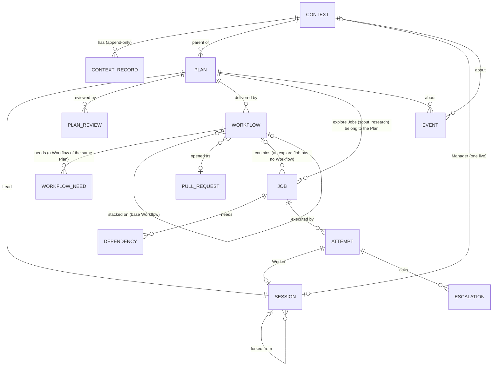
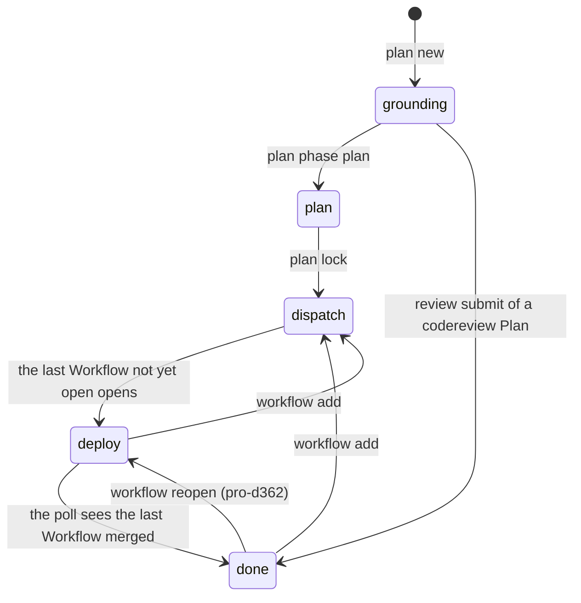
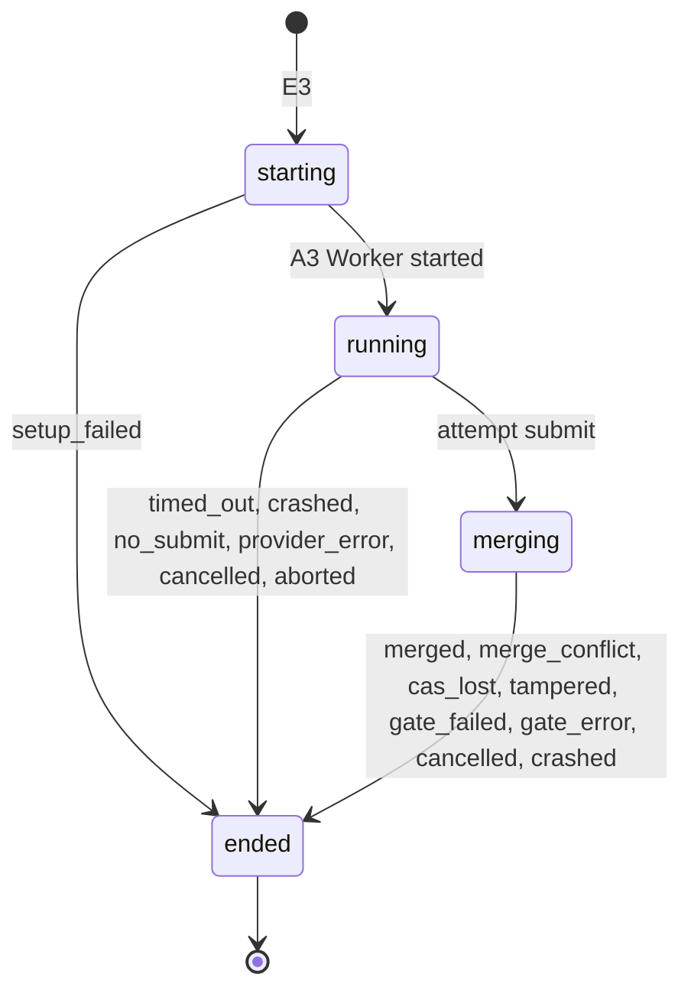
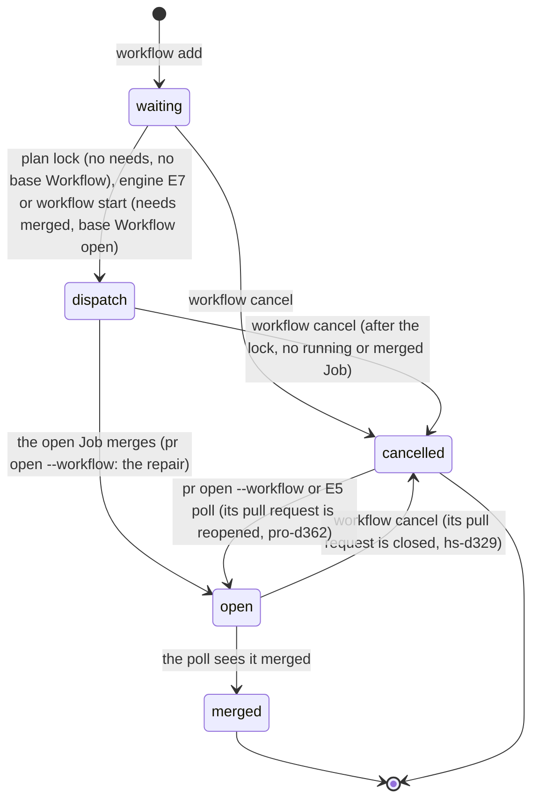

# cpd 2: contract (core)

Status: **normative for every cpd 2 implementation Job.** A Plan is one deliverable over one or more Workflows (R34). Vocabulary: [CONTEXT.md](../CONTEXT.md). Command-by-command reference (synopses, flags, every refusal, JSON examples, the pi adapter protocol, the Worker contract, what the TUI reads): `docs/commands.md`, written by Job `contract-commands` after this document. Where the two disagree, this document wins and `commands.md` is fixed.

Sources: the User's decisions R1–R14 (MIGRATED) and R19–R20 (applied by Job `contract-gate-pr`, §10), R34 (a Plan is one deliverable over one or more Workflows, each with its own repo, base, Lead Branch, Lead worktree, Gate and GitHub pull request; Job `r34-contract`, §10), R35 (§10) and the approved outline with D1–D5 (`~/.cpd/plans/cpd-rust/`), ADR-0009 to ADR-0012 (`docs/adr/`; ADR-0012 is superseded by hs-d23 and hs-a1, Plan manager B1, §4.6), the cockpit vision and research (`~/.cpd/plans/cpd-ui/`). cpd 1 (`docs/archive/cpd1/cli-contract.md`, cited below as "cpd 1 §n") is reference only: where its behaviour is kept, the section is cited; where it changes, the change and its reason are stated.

Evidence labels, as in the research notes: **verified** means run on the homeserver on 2026-10-14 (tmux 3.4, git 2.43.0, gh 2.45.0, pi 1.2.0, worktrunk 0.80.0); **docs** means read in the named tool's documentation; **unverified** means a design assumption the implementation Job must check.

## Contents

1. [Principles](#1-principles)
2. [Model and identifiers](#2-model-and-identifiers)
3. [State machines](#3-state-machines)
4. [Storage](#4-storage)
5. [Events](#5-events)
6. [The tmux host](#6-the-tmux-host)
7. [git and the Gate](#7-git-and-the-gate)
8. [Configuration](#8-configuration)
   - [8.3 Policies](#83-policies)
9. [Tiers](#9-tiers)
10. [Traceability](#10-traceability)

## 1. Principles

### 1.1 What cpd 2 is

- **CLI first.** Every capability is a command. Agents, the pi adapter, scripts and the TUI all use the same commands; the TUI (`cpd tui`) is the human view onto them, never a second way to change state.
- **One binary, written in Rust.** The Cargo workspace at the root of the repo has three crates: `core/` (`cpd-core`, the library), `cli/` (`cpd`, the binary) and `tui/` (`cpd-tui`, the cockpit) (R6, switch-over; `implementing.md`). The binary is `cpd`, and this contract writes every command as `cpd …`. Until the switch-over the binary was installed as `cpd2` beside the TypeScript cpd (R12); the switch-over replaced cpd 1 and renamed the binary everywhere, including in rendered Specs and the pi adapter.
- **System dependencies:** `git`, `tmux` **>= 3.6** (§6.1), `pi` and, for pull requests only, `gh`. No `bd`, no `wt` (worktrunk), no `herdr`, and no Node.js of cpd's own. pi brings its own Node runtime; cpd uses it only to read pi's model catalog (§9).
- **State in SQLite inside the binary** (R1): one database per machine, `$CPD_HOME/cpd.db`, in WAL mode, with SQLite bundled into the binary (no system SQLite). Reads never wait for writers. Every write is recorded in the append-only `history` table (§4). The one other file is the derived cache `$CPD_HOME/vectors.db` (§4.6): not the source of truth, no history, never synced, rebuildable by embedding the records again; deleting it loses nothing.
- **Context records in the database.** A Context's records (decisions, notes, questions and answers, Plans) live only in the database tables `contexts` and `context_records`; Contexts are machine-local (hs-d23, hs-a1; Plan manager B1, §4.6). ADR-0012's git store is superseded.
- **tmux is the only host.** Leads run in the cockpit; Workers and the engine run in a hidden session of the same tmux server (§6).
- **The repo's setup, Gate, test commands and protected paths are its repo policy file** under `$CPD_HOME/policy/<owner>/` (§8.3), read by cpd itself; cpd reads nothing from a repo's tree (R4, R5, §7).
- **Events are the single channel** to Leads, the TUI and agent states (D4, §5). There are no queue directories, no cache directories and no tmux user options carrying state.
- **One engine per machine** (D5): one `cpd watch` schedules every Plan under one concurrency limit.
- **A Plan is one deliverable over one or more Workflows** (R34): each Workflow is the Plan's part in one repo, with its own base, Lead Branch, Lead worktree, Gate and GitHub pull request; one repo may hold several Workflows of one Plan. A Plan of one Workflow behaves exactly as a Plan did before R34.
- **Kept from cpd 1:** the vocabulary (Job, Spec, Dependency, Attempt, Escalation, Tier, Gate, Lead Branch, Merged, Locked); the roles User, Manager (Plan manager B3, §3.1), Lead and Worker (cpd 1's Reviewer is removed by R19, §10); Workers write all the code; the Lead never writes code.
- **The mark** (hs-d694). cpd is written **φ**, as pi is written **π**; the mark and its logo font are specified once in [`mark.md`](mark.md). The word `cpd` itself is never changed.

### 1.2 Output: one JSON value (D1)

Every command prints exactly one JSON value on stdout, always, except the commands that own their terminal (below); there is no `--json` flag and no human format.

- Success: `{"ok": true, …}`, with the command's fields at the top level.
- Failure: `{"ok": false, "error": {"code": "<snake_case>", "message": "<one sentence>", "details": {…}}}`.
- Progress and debug text goes to stderr only.
- **The one streaming command** is `cpd events follow`: it prints one complete JSON value per line, each line an Event (§5.4), as the approved outline specifies. If it fails, its last line is a failure value as above.
- **Commands that own their terminal** print no JSON value on success: `cpd session run` and `cpd tui view` (internal) run pi or draw a ratatui view in their pane, and `cpd tui --attach` and bare `cpd` (no arguments; commands.md §13.3) replace themselves with `tmux attach` (the outline's "builds and attaches the cockpit"). If one fails before taking the terminal, it prints the failure value and exits with its code. `cpd tui` without `--attach` prints one JSON value like every command. `cpd resource run` (commands.md §29) also owns its terminal: once it holds the resource it replaces itself with the user's command (`exec`), so its output and exit status are the command's and it prints no JSON value; if it refuses before it execs (`resource_busy`, `resource_undeclared`, `usage`), it prints the failure value and exits with its code.

Exit codes (kept from cpd 1 §2):

| Exit | Meaning | Examples of codes |
|---|---|---|
| `0` | ok | |
| `1` | failure: an external tool or something unexpected | `git_failed`, `tmux_failed`, `store_tampered`, `store_failed` (the database cannot be opened, is not cpd's, or a statement fails through a bug; Escalation `rs-store-a1-q1`; SQLite failures only), `internal` (a bug in cpd itself, for example a malformed Event built by a command; also a failed write to stdout other than EPIPE, because no I/O error code exists), `config_invalid` |
| `2` | usage error | `usage`, `plan_required`, `invalid_plan_id` |
| `3` | refused by an invariant: Locked, an illegal transition, a precondition | `job_locked`, `illegal_transition`, `dirty_tree`, `cas_lost` |
| `4` | not found | `plan_not_found`, `job_not_found`, `session_not_found` |
| `1` (judge) | the Bifrost judge of write-time curation failed (§4.6) | `judge_unreachable` (retryable), `judge_refused` (`details.status`), `judge_bad_reply` |
| `5` | timeout | `store_busy`, `lock_timeout` (`pr poll`'s `locks/pr-poll.lock`, §7.6; no git operation waits for a cpd lock since hs-d243, §7), `tool_timeout`, `ask_timeout`, `cancel_timeout` |

**`tool_timeout`** (exit 5): a subprocess cpd started ran past its deadline (the deadlines are listed in §7 for `git`, §6.3 for `tmux`, §9 for `node`, §3.7 for the engine's `cpd pr poll` child, `commands.md` §14.1 for `doctor`). `details`: `tool` (`git`, `tmux`, `node`, `cpd`, …), `argv` (the full argument vector) and `deadline_seconds`. Every subprocess cpd starts has a deadline (except tmux's `display-popup`, §6.3), a constant in the code with its reason, not a config key; `gh` keeps its own timeouts (§7.6) and hooks theirs (§7.3). At the deadline cpd kills the process **group** (`SIGTERM`, then `SIGKILL` after 5 s to those still alive) and the command fails with `tool_timeout`; it replaces `git_failed`, `tmux_failed` and the like for that call.

**Test overrides.** Tests need not wait for cpd's real limits: a debug build (the one `cargo test` and `cargo nextest` build; never the installed release build, which ignores them) reads `CPD_TEST_<NAME>=<seconds>`, a decimal (`0.2`), in place of these constants of the code. A value that is not a number of seconds ≥ 0 fails loud (a panic naming the variable). They exist only for the tests; nothing else sets them.

| Variable | Replaces (release value) |
|---|---|
| `CPD_TEST_DEADLINE_<TOOL>` | the deadline of every call of `<TOOL>` (upper-cased: `GIT`, `TMUX`, `NODE`, `CPD`, `GH`, …) through the deadline runner, above any caller's deadline; `deadline_seconds` is then the decimal set |
| `CPD_TEST_DOCTOR_DEADLINE` | `doctor`'s probe deadline (10 s, `commands.md` §14.1) |
| `CPD_TEST_ADAPTER_WATCHDOG` | the adapter watchdog's limit (60 s, §6.7) |
| `CPD_TEST_WATCHDOG_POLL` | how often `session run` reads the Session's state for the watchdog (2 s) |
| `CPD_TEST_FILE_POLL` | `session run`'s loop while pi runs (0.5 s) |
| `CPD_TEST_SOURCE_POLL` | how often a fork looks at its source (2 s, §6.7 step 1) |
| `CPD_TEST_DRIVER_POLL` | how often A4 looks at the Worker (0.5 s, §3.4) |
| `CPD_TEST_KILL_PAUSE` | the pause between A9's `kill-window` tries (1 s, §3.4) |
| `CPD_TEST_BACKOFF_UNIT` | the unit of E3's spawn back-off, `min(2^k, 300)` units (1 s, §3.7) |
| `CPD_TEST_PR_POLL` | E5's `watch.pr_poll_seconds`, the time from the end of one PR poll to the next (§3.7, §8.2) |

`commands.md` introduces more codes, most of them cpd 1's (cpd 1 §11 and its `src/`); each is specified at the command that returns it, under the same exit meanings:

| Exit | Codes |
|---|---|
| `1` | `gate_error`, `migration_changed` and `migration_order` (§4.5; hs-d178), `policy_invalid`, `owner_unconfirmed`, `fallback_missing` and `repo_unkeyed` (§8.3; hs-d288), `watch_start_failed`, `spawn_failed`, `session_malformed`, `driver_lock_missing`, `doctor_failed`, `pi_not_found`, `catalog_failed`, `cleanup_failed` (only as an `error` Event's code, source `watch`, from the janitor (E16), never a command's failure; §3.7 E16, §7.2), `distill_invalid` and `distill_failed` (`context distill`'s failure and, the same, its `error` Event's code; §4.6), `slack_failed`, `slack_refused`, `slack_unparseable` and `slack_helper_failed` (the Slack helper's refusal and, the same, E11's and `pr post`'s `error` Event's code; commands.md §21.5, §21.6, §21.9; `slack_refused` when E17 parks a merge reaction, §3.7 E17), `title_failed` (`session retitle`'s failure, writes nothing, and, the same, the code of the `error` Event engine E10 reports for it; §3.7 E10, commands.md §10.14), `engine_failed` (the bridge exited non-zero, returned `{"ok":false,"error":"engine_error"}`, printed no answer, hit the timeout, or wrote bad JSON; exit 1, Failure; hs-d677), `jira_failed`, `jira_refused` and `jira_helper_failed` (only E19's `error` Event code and the helper's own refusal, §3.7 E19, §4.4 `jira_transitions`: never a command's failure), `models_key_unset`, `models_unauthorized`, `models_unreachable`, `models_tls`, `models_timeout`, `models_unparseable`, `models_empty`, `models_refresh_failed`, `models_no_provider` and `models_helper_failed` (the model-discovery helper's refusals, per provider or for the whole run, and the same codes of E15's `error` Events and of `models refresh`'s failure; §3.7 E15, commands.md §14.5), and the ports' six codes `classifier_unreachable`, `classifier_refused`, `classifier_bad_reply`, `embedding_unreachable`, `embedding_refused` and `embedding_bad_reply` (the errors of `choose()` and `embed()`, the classifier and embedding ports; §3.7a) |
| `2` | `context_required`, `session_required`, `invalid_review_id`, `invalid_session_id`, `invalid_record_id`, `spec_invalid`, `tier_invalid`, `tier_not_allowed` (pro-d53, hs-d554, §9 "Roles and ranges"; hs-d506), `nothing_to_edit`, `file_unreadable`, `invalid_name`, `workflow_required`, `invalid_workflow_id` (R34), `outline_invalid` (`plan outline`, hs-d502, commands.md §4.13) |
| `3` | `resource_undeclared` and `resource_busy` (resources with slots, §8.3 "The `resources` domain", §3.4 "Resources of a Job"; commands.md §30), `distill_running` (§4.6), `jira_auth` and `jira_not_configured` (only E19's `error` Event code and the helper's own refusal, §3.7 E19: never a command's failure), `watch_not_started` (`watch --mark-restart`, §3.7 "A planned restart"), `push_rejected` (hs-d139, §7.6), `session_ambiguous` (hs-a3, commands §1.3), `workflow_exists`, `workflow_in_use`, `workflow_empty`, `workflow_locked`, `workflow_not_ready`, `workflow_ended`, `pr_closed` (§7.6), `workflow_title_required` (hs-d285, §7.6), `description_required` and `description_invalid` (commands.md §9.5a, §7.6), `jira_required` (pro-d127, commands.md §9.1, §7.6), `pr_not_closed` (§7.6, §3.8), `workflow_not_open` (`pr reply` and `pr rerun`, §7.6; pro-d68, pro-d155), `feedback_not_found` (`pr reply`, §7.6; pro-d68) and `no_failed_run` (`pr rerun`, §7.6; pro-d155), `base_conflict` (§7.6, hs-d490: it replaces hs-d329's `base_behind`, which no longer exists), `needs_other_workflow`, `branch_exists` (R34, §3.8), `base_workflow_unknown`, `base_workflow_unavailable`, `base_workflow_other_repo`, `workflow_other_plan` (hs-d522, §2.2) and `stacked_rebase` (hs-d325, §7.6), `adopt_not_open`, `adopt_fork`, `adopt_cpd_branch`, `adopt_taken` and `adopt_foreign` (`workflow add --adopt`, pro-n4, pro-n8, §3.8) and `workflow_adopted` (`workflow edit --repo` or `--base` of an adopted Workflow, §3.8), `context_exists`, `question_answered`, `supersedes_invalid` (§4.6 "A write"), `not_a_git_repo`, `plan_exists`, `illegal_phase`, `no_draft_jobs`, `review_decided`, `dependency_cycle`, `worktree_exists`, `job_key_exists`, `draft_incomplete` (hs-d241, commands §4.6, §4.8), `outline_missing` and `outline_incomplete` (`plan review`, hs-d502, commands §4.6), `lint_failed` (`plan lint`, commands §4.15), `needs_unknown`, `needs_unavailable`, `job_merged`, `job_not_failed`, `job_not_ready`, `attempt_not_running`, `jobs_not_done`, `gate_failed`, `rebase_conflict` (a stop, §7.6), `rebase_in_progress`, `no_rebase_in_progress`, `lead_worktree_dirty` (§7.6), `not_a_lead`, `no_cockpit`, `wrong_pane`, `in_chat_slot`, `cursor_ahead`, `not_a_terminal`, `merge_not_clean` (hs-d272, commands.md §9.10), `no_merge_method` (`pr merge` §9.10 and `pr post` §9.8b, pro-d254, pro-d261), `no_merge_method` (`pr merge` §9.10 and `pr post` §9.8b, pro-d254, pro-d261), `owner_mismatch`, `owner_unset`, `owner_in_use` (§8.3; hs-d288), `touches_missing` (`job add`, `job edit --spec`, hs-d512), `plan_inactive` (`board post`, `session send`, hs-d514), `broadcast` and `duplicate` (`session send`, hs-d514), `already_posted`, `post_disabled`, `not_authored` and `post_unconfigured` (`pr post`, pro-d64, pro-d65, pro-d66), `head_moved` (`review submit`, commands.md §31.1; pro-d169), `slack_auth` and `slack_not_configured` (the team review's helper and `pr post`'s helper, commands.md §21.6), `preset_provider_unconfigured` and `preset_model_unoffered` (`cpd preset apply`'s registry-validation refusals, commands.md §14.6) and `agent_forbidden` (the six archive and unarchive commands, `context archive`, `context unarchive`, `plan archive`, `plan unarchive`, `session archive` and `session unarchive`, and `session resume` (`details` `{command, session, attempt}`), refused when `CPD_SESSION` or `CPD_ATTEMPT` is set and non-empty; commands.md §1.3, §10.17) |
| `4` | `mcp_unknown` (`mcp attach`, a server name the machine policy does not list; commands.md §24.1, pro-d8), `preset_unknown` (`cpd preset show` or `preset apply`, a preset name `config.toml` does not list; commands.md §14.6), `base_not_found` (also a stacked Workflow's base branch missing from the remote, §7.6), `workflow_not_found` (R34), `topic_not_found` (`context show --topic`, hs-d549, hs-d551) |

**Codes of the Job kinds** (hs-d340, hs-d341; §2.2 "Job kinds", §7.7; commands.md §1.3). Exit `3`: `kind_reserved`, `test_job_required`, `impl_job_required` (a `verify` Job needs an `impl` Job of its Workflow, §2.2 "Job kinds"), `tests_unconfigured`, `test_files_missing`, `tests_build_failed`, `tests_not_red`, `tests_failed`, `tests_not_found` (the `[test-commands]` `list` check, §7.7), `tests_tampered`, `open_job_live`, `not_an_impl_job`, `path_not_guarded`, `shape_violation` and `shape_incomplete` (the Workflow's stored shape, §2.2 "Job kinds"). `lead_branch_moved` is no command's code: it is the detail of an `open` or `update` Job's merge, which ends the Attempt `failed` / `merge_conflict` (§7.4 step 5). Exit `1`: `tests_error`. `not_a_lead` (exit 3, existing) is also `job approve-tests`'s refusal of a Worker. **Explore kinds** (`scout`, `research`; pro-d210, pro-d215; §2.2 "Job kinds"): exit `3`: `explore_workflow_forbidden` (`--workflow` on `job add --kind scout|research`), `explore_no_draft` (`--draft` on one), `explore_needs_mixed` (an explore Job needs a Job that is not explore, or another kind needs one), `explore_pending` (`plan phase plan` while a scout or research Job of the Plan is `queued`, `running` or `failed`; commands.md §4.4), and, at `attempt submit` of an explore Attempt, `artefact_missing` (no non-empty artefact), `summary_missing` (no `--summary-file`, or a missing or empty file) and `summary_too_long` (more than 1500 characters, counted as characters and never truncated; `details` `{length, cap}`). No code is new for the other refusals: `job add` of an explore Job in phase `done` is `illegal_phase` (exit 3, existing, a message of its own), a Tier outside the kind's range is `tier_not_allowed` (exit 2, `details` name the kind and its range), and a forbidden Spec field is `spec_invalid` (exit 2).

**Adapter-only codes.** `mcp_register_failed` (`details` `{name, message}`, pi's message: pi refused the registration of an attached MCP server; §5.3, commands.md §15.3, pro-d226) is the code of the `error` Event that `session report` appends for each refused registration, for every role, with `what` `mcp attach <name>` (commands.md §10.18). It is never a command's failure and has no exit code. `mcp_replay_truncated` (the start-up replay of attached servers read a full page of 5000 `mcp-attached` Events and registers nothing; §5.3, commands.md §15.2 step 5a, pro-d226) and `protocol_mismatch` are never a command's failure and have no exit code. They appear in the pi adapter's message to its Session (`cpd adapter: …`, commands.md §15.1, §15.2): a Manager's or a Worker's adapter shows them in chat only, and a Lead's adapter reaches the ledger through `session report` (hs-d573), as every Lead's adapter error does. `protocol_mismatch` appears when `cpd --version`'s `protocol` is not the number the adapter was built for (§5.2 "The protocol number"); `mcp_register_failed` when a registration throws (§5.3), which for a Manager or a Worker is chat and the report both; `mcp_replay_truncated` when the replay's read returns a page of exactly 5000. `skills_unreadable` (`details` `{}`; the start-up check of a Lead's or a Manager's skill directory, commands.md §15.23, pro-d260) is never a command's failure and has no exit code: it is reported with `cpd session report` for every role, `what` `skills check` (commands.md §10.18), and the adapter shows it as §15.1 says for its role.

### 1.3 Conventions every command follows

- **Selecting a Plan.** `--plan <id>`, else the environment variable `CPD_PLAN`, else usage error `plan_required` (exit 2). cpd sets `CPD_PLAN` in every pane it starts for a Plan (§6.5). This replaces cpd 1's `--wf` / `CPD_WF`.
- **Selecting a Workflow** (R34). `--workflow <key>`. It may be omitted when the Plan has exactly one Workflow that is not `cancelled`, which is then selected; with two or more it is the usage error `workflow_required` (exit 2), and with none `workflow_required` too, whose message names `cpd workflow add`. A key that is not one of the Plan's Workflows is `workflow_not_found` (exit 4). Used by `job add`, `pr open`, `pr rebase` and `pr view` (§2.5); `pr poll` has no `--workflow`: it polls every open pull request of the User (§7.6, hs-d96); `workflow add`, `workflow edit`, `workflow cancel` and `workflow start` take the key as their argument.
- **Validation at the boundary.** Every external input (arguments, `config.toml`, Spec files, the policy files and a repo's `origin` URL (§8.3), Context record files, `gh` and `git` output, pi session lines) is parsed into types once, at the edge. Unknown flags and unknown config keys are errors. Nothing falls back silently.
- **Subprocesses** run from argv arrays (never a shell string, except the repo's own hook commands, which are shell by definition, §7.3), with stdin from `/dev/null` unless stated, an explicit `cwd` and an explicit environment. The exit code is checked before any output is parsed.
- **Times.** Times are in two forms (pro-d41, pro-d42, pro-d49): **fields** are RFC 3339 UTC with milliseconds and `Z` suffix (`2026-10-14T21:10:00.000Z`); **prose** for a person is machine-local with the zone abbreviation named, the format `YYYY-MM-DD HH:MM ZZZ`, 24-hour clock, zero-padded, no seconds, one space before ZZZ, with ZZZ the zone abbreviation (letters only: `EDT`, `EST`, `UTC`, `IST`) or the numeric offset when the abbreviation is not available (`+05:30`). Example for the instant 2026-10-25T22:29:00.000Z in America/Toronto: prose `2026-10-25 18:29 EDT`. The zone is the system's (`TZ` environment variable, else `/etc/localtime`); no config key. **Four exceptions to the prose rule:** record dates in `cpd context show` and digests that start a turn stay UTC, labelled `2026-10-26 UTC`; the Event log rows (`tui/src/logs/view.rs`) and Worker view rows (`tui/src/worker/render.rs`) show the local time of day `HH:MM:SS`, bare (no zone); the narrow `HH:MM` fold rows of the pi chat stay bare; `Message from <sender> (HH:MM)` becomes `Message from <sender> (HH:MM ZZZ)`. **Implementation.** In Rust, `core/src/clock.rs` provides the `Clock` trait (default method `zone()` returns `TimeZone::system()`, overridden by `ManualClock` in tests to a fixed zone). The pure functions `clock::prose(at: OffsetDateTime, zone: &TimeZone) -> String` formats an instant in the PROSE format; `clock::time_of_day(at: OffsetDateTime, zone: &TimeZone) -> String` formats `HH:MM:SS` local. Rust uses `jiff` pinned `=0.2.35` with default features (§8.2); `time` stays for stored UTC timestamps in `core/src/clock.rs`. In TypeScript, `Intl.DateTimeFormat` with locale `en-CA` formats local times; prose functions take an optional `timeZone` IANA name parameter, defaulting to the system zone (Node's `process.env.TZ`). **Agents.** The pi adapter (§6.7) adds a system prompt section named `cpd-time-zone` (`pi/lib/system-prompt.ts`), one line per every cpd-started Manager, Lead and Worker Session, as `systemPromptOptions.sections` entry. The line is exact (pro-d49, chosen over reminders or source scans): `` Time zone: <IANA name> (<ZZZ>). State every time to a person in this zone with the zone named, as 2026-10-25 23:03 EDT, never in UTC. `` where `<IANA name>` is from `TimeZone::iana_name()` (or the name Node resolves from the `timeZone` parameter, both from the machine at the moment of the Session's start), `<ZZZ>` is the PROSE abbreviation of that instant (or its numeric offset), and the example is the current local time in the PROSE FORMAT. The section is rebuilt each turn as the instant changes. **Tests.** Tests mock the zone; none read the real system zone, `TZ`, `/etc/localtime` or call `date` (external dependencies, policy §policy.md). Rust: `ManualClock` returns `jiff::tz::TimeZone::posix("EST5EDT,M3.2.0,M11.1.0")` (abbreviations `EST` and `EDT`), fixed. TypeScript: the new functions accept an optional `timeZone` parameter; existing tests set `process.env.TZ = "Asia/Kolkata"` (`pi/test/delivery.test.ts`, `pi/test/updates.test.ts`), so prose times end in `+05:30`.
- **Idempotence.** A command that finds its effect already in place returns `ok` with `"already": true` instead of failing, unless `commands.md` says otherwise for that command.

### 1.4 `$CPD_HOME`

`$CPD_HOME` defaults to `~/.cpd`. cpd 1 uses the same directory; cpd 2 never reads or writes cpd 1's files (`config.json`, `leads/`, `slots/`, `workflows/`, `locks/merge-*.lock`), and none of its own names collide with them.

```
$CPD_HOME/
  config.toml                     machine config (§8)
  policy/                         machine, owner and repo scopes of the policies (§8.3); any file may be a symlink
    host.toml                     the machine scope, optional; names this machine's policy
    <owner>/
      owner.toml                  the owner scope; required for every owner a Context uses
      <repo>.toml                 a repo's policy; optional
  bin/git                         the `git` wrapper first on every Session's `PATH`: refuses `git stash` (§6.5, hs-d310); an executable `sh` script
  cpd.db, cpd.db-wal, cpd.db-shm  the database (§4)
  vectors.db, vectors.db-wal, vectors.db-shm  the derived vector cache of write-time neighbour curation (§4.6); not the source of truth, safe to delete
  archive/contexts/<context>/     an old git store of a Context, moved here by migration 0007 (§4.5); nothing reads it
  locks/
    watch.lock                    held by the one `cpd watch` (§6.6)
    watch-ensure.lock             held by every `watch --ensure` (plain or `--wait`) while it checks and starts the engine (§6.6)
    attempt-<plan>--<attempt>.lock  the driver lock: taken by the Attempt's starter, inherited by its driver, removed when the Attempt ends (§3.4)
    check-<plan>--<attempt>.lock    held by `attempt submit` while it runs a kind check (tests or the Gate, the wait for the slot included); removed when the Attempt ends (§7.7, hs-d341)
    resource.<scope>….<n>.lock    one lock per command slot of a declared resource (§1.4 "The resource locks and the holder record"; §8.3 "The `resources` domain"): held by the process `cpd resource run` started; its content is the holder record (below). A Job takes none
    resource-guard.<scope>….lock  the guard of one pool (§1.4): held for the instants in which a starter or `cpd resource run` decides the pool's free slots; exists only while held
    pr-poll.lock                  held by `pr poll` for the whole poll (§7.6, hs-d96)
    janitor.lock                  held by every pass of `cpd janitor` (exclusive, non-blocking; §3.7 E16, pro-d70, pro-d71)
    tmux-restart.lock             held by the one run of the tmux server's restart (§6.1, hs-d294)
    distill-<context>.lock        held by the Context's one distill run, `context distill`, for its whole life (§4.6)
    title-<session>.lock          held by the Session's one retitle run, `session retitle`, for its whole life (§3.7 E10)
    models.lock                   held by the engine's E15 and by `cpd models refresh` while they read the cached model lists, compute the diffs and write the files (never while the helper runs), so their diffs never interleave (§3.7 E15, commands.md §14.5); waited for at most `store_busy_ms`, then `lock_timeout`
    store.lock                    held by every open of `cpd.db` during its one-time setup only: the WAL switch, the migrations and the conversion of a legacy store (§4.1, §4.5); waited for at most `store_busy_ms`, then `lock_timeout`, except while its holder is migrating: then until the holder releases it, at most `MIGRATION_WAIT_CEILING` (§4.2, §4.5); a migrating holder writes a JSON marker into it and keeps it until it releases the lock (below)
  run/
    cpd-install.json              the install state file: written by dotfiles' `scripts/cpd-install.sh` on every run; read by cpd each tick; shape `{"status":"ok"|"skipped","reason":"dirty|diverged|branch"?,"since":"<RFC 3339 UTC, Z>"}` (one JSON object on one line; `since` is when the current status and reason began; `reason` is present exactly when status is `skipped`; unknown fields are refused). A missing file means no alert; an invalid file is one `error` Event with code `install_state_invalid` (§3.7, commands.md §1.3)
    watch.log                     the engine's stderr
    pr-poll-failing.json          `{call, since}`: the engine's record of when E5's `gh` call first failed transiently (an HTTP 5xx, a timeout or a cut response), deleted by the first poll that succeeds, written whole by a temporary file in the same directory and a rename (write_atomic), as team-review.json is (§3.7 E5, hs-d354)
    install-restart.json          `{by, at, engine_pid}`: the install's marker of a planned engine restart, written by `cpd watch --mark-restart` right before the old engine is retired and consumed (deleted) by the next engine at its start (§3.7 "A planned restart", hs-d471)
    tui/plan-scroll.json          the `plan` view's scroll offsets, `{"<plan id>": [x, y]}`, written by the view itself (a file a view writes, commands.md §13.2, hs-d254); read at its start
    tui/merging/<owner>__<repo>__<n>.json  a merge in progress for that pull request, `{"pid", "at", "merged"}` (the action's pid, an RFC 3339 time, and a boolean when the merge succeeded), written atomically (temporary file, rename) by `cpd tui action merge` (§13.2, hs-d495; the Lead's design); **B4** the marker's lifecycle: at start before `cpd pr merge`, rewritten with `"merged": true` on success after the merge, removed by the action on every exit, at start before later opens of the same PR rewritten as `{"pid", "at"}` when old; the views read it on each snapshot to show the spinner instead of the merge button while `pid` is alive or `merged` is true; **B5** a marker with `merged: true` whose row is not open, and a marker without it whose pid is not alive, are ignored; a second merge action for a pull request that is merging (`merged` field true or pid alive) does nothing and logs `merge already running` (commands.md §13.2, hs-d495, hs-d550)
    tui/tree-folds.json           the `tree` view's folds, `{"collapsed": ["<context id>", …], "expanded": ["<context id>", …], "archived": true}`: the live Contexts the User collapsed, the archived Contexts the User expanded, and the Archive section's fold under the key `archived` (absent or false = folded, true = open); written by the view itself, under the same exception as `tui/plan-scroll.json` (commands.md §13.2, hs-d260); read at its start
    tui/<view>.log                one timestamped line per event in the view's log (appended), such as errors; when `CPD_TUI_TRACE` is exactly `1` at the view's start, also holds one `trace` line per draw of the view's main loop (commands.md §17 "Frame trace")
    tmux-restart.pending          a restart of the tmux server is pending (§6.1, hs-d294): JSON `{at, server, installed, failed}`; not in the store
    tmux-restart.log              the output of the detached tmux restart (§6.1)
    team-review.json              the pull requests posted in the team Slack channel as the helper last read them, `{version, polled_at, channel, read, posts}` (commands.md §21.5, §21.6), written by E11 (§3.7) and read for the Inbox kind `review-requested` (§2.2); derived, not in the store, rewritten whole by rename; a failed run leaves the last good copy
    deploy-runs.json              the deploys (GitHub Actions workflow runs) that wait for the User's approval as the last PR poll read them, `{"version": 1, "polled_at": <time>, "runs": [{"repo", "workflow", "run_id", "environment", "title", "url", "created_at"}]}` (§7.6 step 8), written by the PR poll (E5, §3.7) and read by E8 for the Inbox kind `deploy` (§2.2); `inbox approve` (commands.md §21.13, pro-d167) removes the approved run's entries from it, by the same atomic rewrite, and writes nothing else there; derived, not in the store, written whole by a temp file in the same directory and rename, as `team-review.json` is; a file that is not that JSON is replaced at the next poll
    models-<provider>.json        the model ids a provider offered at its last good list, `{version, provider, polled_at, pi_version, source, ids, known?, changes?}` (§3.7 E15, commands.md §14.5); one file per provider the model-discovery helper listed; derived, not in the store, written whole by `.tmp` and rename; a failed or empty run leaves the last good copy; `<provider>` is the provider's name as pi gives it, which is a file-name-safe token (`^[A-Za-z0-9._-]+$`; the helper refuses another name as `models_unparseable`)
    classifier-unreachable.json   the marker of a classifier outage already announced by one `error` Event (§3.7a): present from that Event until the next successful `choose()` removes it; written with `write_atomic`
    tmux-restart.pid              the pid of the detached tmux restart the engine started, one line; removed when the engine reaps it (an engine that dies first leaves it, its pid perhaps reused); what finds that process, which is in no process group of the engine's
    <plan>/plan.md                the last `plan render`
    <plan>/summary.md             the Plan summary of the last `plan render` (commands.md §4.5, hs-d502)
    <plan>/lead-message.md        the Lead's first message, written by `plan new`
    <plan>/summary-<review>.md    the Plan review's summary, written by `plan review` and never changed by a later render; the pi adapter shows it in the Lead's chat (commands.md §4.6, §15.5, hs-d502) Removed (hs-d738)
    <plan>/feedback-<review>.md   the User's feedback on a Plan review (the note of the chat dialog's Change), written by the pi adapter and overwritten on a retry; passed to `plan decide --feedback-file`
    <plan>/messages/<session>.md  a forked Session's first message, copied by `session fork --message-file`
    <plan>/specs/<attempt>.md     rendered Worker Spec
    <plan>/logs/attempt-<attempt>.log      the Attempt driver's stderr
    <plan>/logs/worker-<attempt>.log       a `durable` Worker's stdout and stderr, appended (§3.4 "The Worker runner and its seam")
    <plan>/attempts/<attempt>.report.json  a `durable` Worker's end report, replaced after every settle and once more at terminate (§6.12 step 8); read by the driver (§3.4)
    <plan>/logs/<attempt>.<hook>.log       full output of a hook run (§7.3)
    <plan>/logs/<attempt>.tests-build.log, <attempt>.tests-run.log   full output of the repo's `[test-commands]` commands at a `test` or `impl` Job's submit (§7.7, hs-d341)
    <plan>/logs/workflow-<key>.pre-merge.log     full output of the last Gate run by `pr open`, `pr rebase` or `pr push` on Workflow <key> (§7.6)
    <plan>/logs/workflow-<key>.pre-start.log     full output of the last `pre-start` before the Gate of Workflow <key> (§7.6, hs-d679)
    <plan>/logs/lead-<key>.<hook>.log      full output of a hook run in Workflow <key>'s Lead worktree: `pre-start` at the Workflow's start (§7.2)
    context-digests/<context>/<upto_seq>.jsonl.invalid  the last distill output that failed its checks (§4.6 step 5), kept to inspect the prompt's failures; one per Context, replaced by the next, removed by a valid run
    context-digests/<context>/runs.jsonl         one JSON line per distiller pi run, appended: what it cost (§4.6)
    context-digests/<context>/prompt.md          the distiller's prompt, written by each run (§4.6)
    context-digests/<context>/batch.md, known.md, docs.md   the distiller's input, written by each run: the batch of at most 60 uncurated records, the topics and short forms in use, and the grep hits of docs (§4.6 step 3)
    context-digests/<context>/distill.log        every distill run's stderr, appended; the engine's runs also their stdout (§3.7 E9)
    context-digests/<context>/distill.pid        the pid of the distill run the engine started (§3.7 E9), one line, as `tmux-restart.pid`
    titles/<session>.log          the output of every retitle run the engine starts for that Session, appended (§3.7 E10)
    secret/
      approve/<uuid>.json         a Worker-requested approval, written by `cpd secret approve` after the User allows it (§8.4); mode 0600; `{session, action, vault, item, field, at}` where `item` and `field` are null when the action has none
      allow/<attempt>.json        an allowance for an Attempt, written by `cpd secret allow` and idempotent (§8.4); mode 0600; a JSON array of `{vault, item, field}`; read until the Attempt ends
```

**The migration marker** (hs-n278). The process that takes `locks/store.lock` and finds a migration or the conversion of a legacy store to run, writes into the lock file, before it starts migrating and while it holds the `flock`, one JSON object `{"migrating": true, "pid", "started_unix_ms", "from", "to", "command"}` (`from` and `to`: the schema versions or the count of applied migrations before and after; `command`: its `argv[0..]` as `txns.command` would name it). It keeps the marker until it releases the `flock`: it truncates the file as the last step of its setup, immediately before it releases `locks/store.lock`, on success and on failure alike, not when the migration commits (the rest of the setup, the connection and the schema check, still holds the lock). A waiter that has read a live marker during its wait keeps waiting while the `flock` stays held by that holder, also when the file is empty in the instants before the release (§4.2). A file that is empty, or whose `pid` is not the holder's, is not a marker: the lock file is a marker only while the `flock` is held and `migrating` is true. A holder that dies releases the `flock` by itself (below) and its marker is ignored; the next opener takes the lock and overwrites it.

**The resource locks and the holder record.** A resource has N slots (`slots`, §8.3 "The `resources` domain"). A **Job** occupies a slot as a tenant derived from the Ledger (§3.4 "Tenancy", §4.4 `job_tenants`) and takes no lock file: no lock row to reap, no liveness reaper. A **command** (`cpd resource run`, commands.md §30) has no Job row, so it keeps a lock file per slot it holds: an `flock(2)` lock like every cpd lock, so the kernel releases it when the command dies. Slot files are numbered from 1 to N. The pool of a resource belongs to the level that declares it (§8.3), and the file name carries that level, with `.` as the separator, because an owner login and a resource name never contain a dot (§2.1 "Owner login"; the name rule of §8.3) while a repo name may (§2.1 "Repo name"):

| Scope of the declaring file | Command slot file `<n>` | Guard file |
|---|---|---|
| host | `resource.host.<name>.<n>.lock` | `resource-guard.host.<name>.lock` |
| owner | `resource.owner.<owner>.<name>.<n>.lock` | `resource-guard.owner.<owner>.<name>.lock` |
| repo | `resource.repo.<owner>.<repo>.<name>.<n>.lock` | `resource-guard.repo.<owner>.<repo>.<name>.lock` |

**The names are injective** per (scope, owner, repo, name, slot): the first segment is the scope, so the three forms never meet; `<n>` and `<name>` are the last two segments before `.lock` (the guard has no `<n>`: `<name>` is the last) and `<owner>` is the segment after the scope, none of them has a dot, and the repo is whatever lies between the owner and the name, so a repo name with dots is read back whole. The first segments `resource` and `resource-guard` differ, so a guard is never read as a slot. A `--` in a resource name or a repo name separates nothing, which is why the `--` of the driver lock names is not used here. The first file of a command's slot is created on demand; a slot file whose number is above the pool's count is never offered (below).

**The free slots of a pool** are its `slots` minus the Job tenants of the pool (the database) minus the held command slot files of the pool, and never below 0. A starter (§3.4 "Resources of a Job") and `cpd resource run` both decide this under the pool's **guard**: an exclusive `flock` on its guard file, taken by blocking for at most the instants another taker holds it, in the name order of the pools when a starter needs several. The guard is created by its taker and removed by it before the lock drops, and the taker checks after the lock that its descriptor and the path are the same file (device and inode), else it takes it again (the check of the driver lock, §3.4 A1): the file exists only while held. The guard makes the decision and the take one step, so a Job's starter and a command cannot both take the last slot of a pool. A command takes the **lowest free slot file** of the pool by a non-blocking exclusive try-lock tried in slot order, inside the guard.

A command slot file's content is the **holder record**, one JSON object, valid only while the lock is held (the rule of the migration marker above): the taker writes it after it holds the lock, and a record is never read as a holder when the lock is free. The holder of a Job tenant is **derived**, not stored in a file, with the shape of the `attempt` record below, of its **latest** Attempt. Two shapes:

| `by` | Shape | Source |
|---|---|---|
| `attempt` | `{"by":"attempt","plan":"<plan>","job":"<key>","attempt":"<attempt id>","at":"<RFC 3339 UTC>"}` | derived: the tenant Job's latest Attempt and its `started_at`; no slot number |
| `command` | `{"by":"command","pid":<n>,"command":"<argv joined by single spaces>","session":"<id>"\|null,"attempt":"<id>"\|null,"at":"<RFC 3339 UTC>"}` | `cpd resource run` (commands.md §30); `session` is `CPD_SESSION` and `attempt` is `CPD_ATTEMPT`, when set, else null |

A reader (`cpd resource list`, `job show`, the `holders` of a `resource_busy` refusal) lists the holders of a pool as: the held command slot files, each probed with a **shared** try-lock that it drops at once and read when the probe finds the lock held, in slot order, each with its slot number; then the Job tenants, by `jobs.seq`, each with the slot `null`. A held slot whose record is empty or does not parse shows as the holder `{"by":"unknown"}`. The probe has one window: a taker that tries during a reader's probe is refused once (a shared lock excludes an exclusive try-lock); engine E3 tries again at the next tick and `cpd resource run --wait` tries again within its second.

**A pool whose `slots` is lowered** below the slots taken keeps them taken until their tenants end (the free slots are then 0, never negative); no tenant is offered a slot above the declared count, whether or not that command slot file exists or is held. Raising `slots` offers the new slots at once.

Locks are `flock(2)` locks on these files: the kernel releases them when the holder dies, so there are no stale-lock takeovers (a change from cpd 1 §4, whose pid files needed them).

There is **no per-repo lock** (hs-d243): merges, `pr open`, `pr rebase`, `pr push` and the clean-up after the merge of a pull request take no lock shared by two Workflows or two Plans; §7 says what replaces it. A file `locks/repo-<sha1>.lock` left by an earlier cpd is inert: nothing opens it, and nothing needs to delete it.

## 2. Model and identifiers

### 2.1 Identifiers

| Thing | Format | Unique within | Example |
|---|---|---|---|
| Context id | `^[a-z][a-z0-9-]{1,39}$` | this machine (Contexts are machine-local, §4.6) | `building-cpd` |
| Machine name | `^[a-z][a-z0-9]{0,7}$`, set in `config.toml` (§8) | the User's machines | `hs` |
| Context record id | `<machine>-<letter><n>`; letter `d` decision, `n` note, `q` question, `a` answer, `p` plan; `n` from 1, sequential per machine, Context and letter | the Context | `hs-d3` |
| Plan id | `^[a-z][a-z0-9-]{1,23}$` (cpd 1's name for a Plan id) | the machine; `workflow add` and every Workflow start (§3.8, A4) refuse when the Workflow's Lead Branch or its parent path already exists in the Workflow's repo (`branch_exists`). The parent path of `<plan>/<key>` is `<plan>`; of a legacy `cpd/<plan>/<key>` is `cpd/<plan>`; a legacy pre-R34 `cpd/<plan>` has no parent check. This keeps cpd 1's plans (cpd 1 called them Workflows) and cpd 2 Plans on one repo from sharing a branch locally or on `origin` | `pay-4521` |
| Owner login (hs-d288) | a GitHub login, `^[a-z0-9](-?[a-z0-9])*$`, 1–39 characters (GitHub's rules, read in its docs; unverified beyond them), ASCII-lowercased when parsed (GitHub compares logins without case), so a policy file name is lowercase | GitHub | `clayton-duarte` |
| Repo name (hs-d288) | a GitHub repository name without its owner, `^[a-z0-9._-]{1,100}$`, ASCII-lowercased when parsed, as a login; `owner` is not a valid repo name (it would be `owner.toml`) | its owner | `cpd` |
| Workflow key (R34) | `^[a-z][a-z0-9-]{0,23}$`, chosen by the Lead (`workflow add`); invalid: `invalid_workflow_id` (exit 2) | the Plan (a `cancelled` Workflow keeps its key) | `schema`, `web` |
| Job key | `^[a-z][a-z0-9-]{0,31}$` | the Plan | `api-schema` |
| Attempt id | `<job>-a<n>`, `n` from 1 per Job | the Plan | `api-schema-a2` |
| Escalation id | `<attempt>-q<k>`, `k` from 1 per Attempt | the Plan | `api-schema-a2-q1` |
| Plan review id | `r<k>`, `k` from 1 per Plan | the Plan | `r3` |
| Session id | pi's session id. cpd chooses it for every session it starts (`pi --session-id`): a lowercase UUID v4. Accepted on input: `^[A-Za-z0-9][A-Za-z0-9_-]{0,127}$` | the machine | `596d007f-6775-4134-b77a-b356cc523842` |
| Event id | positive integer, assigned by SQLite, strictly increasing in commit order, never reused | the machine | `48213` |
| Lead Branch | `<plan>/<key>`, one per Workflow (R34); a Workflow made before the migration `lead-branch-name` keeps its stored name `cpd/<plan>/<key>` or pre-R34 `cpd/<plan>` (§4.5) | the repo | `pay-4521/api` |
| Attempt branch | `cpd/<plan>--<attempt>`, in the repo of the Job's Workflow (unchanged by R34: flat, a sibling of `cpd/<plan>/` and never inside it; t3) | the repo | `cpd/pay-4521--api-schema-a2` |
| Lead worktree | `<repo-parent>/<repo-name>.<plan>.<key>`, one per Workflow, `<repo>` the Workflow's repo (R34); a migrated Workflow keeps `<repo-parent>/<repo-name>.<plan>` | the filesystem | `~/projects/pay.pay-4521.api` |
| Attempt worktree | `<repo-parent>/<repo-name>.<plan>--<attempt>`, `<repo>` the repo of the Job's Workflow | the filesystem | `~/projects/pay.pay-4521--api-schema-a2` |

Within a Plan, Jobs, Attempts and Escalations are addressed by their id plus the Plan; across Plans, by the pair. An invalid id is a usage error (`invalid_<thing>_id`, exit 2).

### 2.2 Objects

Types: `text`, `int`, `bool`, `time` (§1.3), `json` (a JSON value of the stated shape), `?` = nullable. The storage of each field is the DDL in §4.4.

#### Context

The knowledge several Plans share, optionally a Jira Epic. Not a session (ADR-0011).

| Field | Type | Meaning |
|---|---|---|
| `id` | text | Context id (§2.1). A Context id is never changed by any command; only the store migration `permanent-contexts` (§4.5) has moved one |
| `title` | text | the visible label; editable (`context rename`). The id is immutable and need not be readable |
| `jira` | text? | Jira Epic key, stored only |
| `created_at`, `created_on` | time, text | when and on which machine `context new` ran |
| `owner` | text? | the GitHub login (§2.1) of the Context's owner, its policy key (§8.3, hs-d288): every Workflow of its Plans is in a repo of this owner. Set by `context new --owner`, or by `context owner` when it is null or when no Plan of the Context has a Workflow row; null only for a Context created before the migration that added it (§4.5) |
| `archived_at` | time? | null, or when the Context was archived (migration 3, §4.5); see "Archived" below |
| records | [Context record] | append-only, below |
| Manager | Session? | not a field: the Context's one live (not archived) Session of role `manager` (§3.1), if any |

**Permanent Contexts** (pro-d338, pro-d342, pro-d343; User, 2026-11-02 EST). Exactly three Contexts are permanent, with the ids `cpd`, `host` and `codereview`, in that fixed order. They are never archived, renamed or deleted: `context rename`, `archive` and `delete` refuse them `context_permanent` (exit 3, before any write, commands.md §3.8, §3.9, §3.15); `context unarchive` is unchanged. Their Plans and Sessions behave as in any Context: they sleep and auto-archive alike, and only the Context row is ever ensured. **Ensure** (`cpd_core::context::permanent::ensure(home, config, store, PermanentContext)`) is idempotent and is called every tick by engine step E22 (§3.7), by `context manager --context <c>` (commands.md §3.11), by `inbox claim` (commands.md §21.7) and by the host click (commands.md §9.12); `session send` does not call it (lateral comms owns target resolution, pro-d345). It inserts the Context row when it is missing (the title of `cpd` is `cpd`, of `host` `Host: local maintenance of this machine`, of `codereview` `codereview`; the owner is `clayton-duarte`; one `context-created` Event, as `context new` writes it), clears `archived_at` of the Context row only, and registers a `stopped` Manager when the Context has no live one, as `context manager` does (`by_user` 0, tier `manager_tier`, runner `manager_runner`, the Session name that `register()` derives). A live Manager in any state is left alone. A row with `deleted_at` set is refused `context_exists`: an id is never reused. The review Context of the Lead Tier rules is the literal `codereview` (§8.2).

#### Context record

One typed, append-only row of `context_records`, a Context's only store (§4.6). Written only by `cpd context …` commands and by `plan new` (the `plan` kind, and the `brief` kind with `--brief-file`), each in one database transaction.

| Field | Type | Meaning |
|---|---|---|
| `id` | text | `<machine>-<letter><n>` (§2.1) |
| `kind` | text | `decision`, `note`, `question`, `answer`, `plan` or `brief` |
| `at`, `machine` | time, text | when and where it was written |
| `by` | json `{session: text?, plan: text?}` | the writing Session (`CPD_SESSION`, else `PI_SESSION_ID`, else null) and its Plan |
| `text` | text | the decision, note, question or answer; for `plan`, the Plan's title; for `brief`, the Plan's brief (B3-A4) |
| `supersedes` | text? | `decision` or `note` only: the ids of the records it replaces (each must exist in this Context). The store holds them as a comma list (`context-supersedes-list`, §4.5); the JSON output is an array of id strings, absent when it replaces none. A decision may replace an earlier decision or note; a note may replace an earlier note only (a fact never overrules a decision). cpd checks each id at write, and the prose of the text (§4.6 "A write" and "Prose supersession") |
| `question` | text? | `answer` only, required: the id of the question it answers (must exist) |
| `plan` | json? | `plan` and `brief` only, required: `{id, machine, jira?}` (a `brief` has `{id, machine}`); references the Plan by id and machine. R34 (A12): no `repo`, because a Plan has one or more Workflows and none when it is created; a record written before R34 may still carry `repo`, which migration 0007's import drops (§4.5) |

The User's rule is **recency wins**: when two records of a Context contradict each other, the later one stands and the earlier one is removed from force, which is supersession. A decision or note is **active** unless a later decision or note supersedes it (a note is superseded only by a later note or decision; a decision only by a later decision, §4.6). A question is **open** until an answer names it. The rendering Leads read (`context show`, bounded, pro-d1 and pro-d3) lists, in order: title and Jira key; open questions; active decisions; a `Topics` line of the curated topics in force with their record counts; the newest 40 active notes, older ones counted in a footer; the active Plans (a Plan is done when this machine's `plans.done_at` is set for it; a done Plan is not listed), each with the repos of its Workflows that are not `cancelled`, read from this machine's database (a Plan of another machine shows none), and its brief listed short (its id and first line) under it, never in full (`context show --record <id>` prints one record in full); then a History count line, for each non-zero count, of superseded decisions, answered questions, superseded notes and done Plans. Each item shows its id and date. `context show --all` renders the full history, in the order Plans; active and superseded decisions, each superseded one naming its successor; open and answered questions, with their answers; active and superseded notes, each superseded one naming its successor. The bounded view's exact order, its JSON `omitted` object and the `--all` output are in `commands.md` §3.3. Commands (detail in `commands.md`): `context new`, `list`, `show`, `decide`, `note`, `ask`, `answer`, `manager`, `distill`. The letter of a `brief` is `b`. The **Context digest** (§4.6, hs-d194) is not a record: it is a file derived from the records in force, rebuilt from them at any time.

**Retired** (hs-d549, hs-d551). The Context is a shared working memory, not an archive (User, 2026-10-22), so the distiller curates it, and a record can leave force by **retirement** as well as by supersession. A retirement is a row of `record_retirements` (§4.4): the record, a `reason` (`duplicate`, `superseded` or `documented`), a `target` (the record id it duplicates or is superseded by, or the doc path that documents it) and a `status` (`pending`, `approved`, `rejected`). Proposals are written by the distill step (§4.6 "The distiller curates"); **only the User decides** them (the Inbox item `curate-retire`, below, and the internal command of commands.md §3.15 to §3.16). `approved` takes the record out of force (§4.6 "Retirement"); `rejected` leaves it in force and it is never proposed again. The record row and its history stay, and no Context record is written for a retirement. `context show` lists a retired record as `retired (<reason> <target>)`, as it lists a superseded one. A record's **curation** (`record_curations`, §4.4) holds its `topic` and its short form (at most 120 bytes, for machines); a record with no row is not yet curated.

#### Plan

One deliverable over one or more Workflows (R34), optionally a Jira task. This is cpd 1's name for Plan (D3). Before R34 a Plan was one repo, one Lead Branch, one Workflow and one pull request; the per-repo fields moved to the Workflow (below, A6).

| Field | Type | Meaning |
|---|---|---|
| `id` | text | Plan id |
| `context` | text | its Context (required: every Plan belongs to one) |
| `title`, `jira` | text, text? | `title` is the visible label and editable (`plan rename`); the id is immutable |
| `phase` | text | `grounding`, `plan`, `dispatch`, `deploy`, `done` (§3.1) |
| `lead_session` | text | the Plan's Lead Session; its `cwd` is the User's home directory (pro-d343), not a repo (A12) |
| workflows | [Workflow] | one or more, below; none until the Lead adds one (`workflow add`, §3.8) |
| `created_at`, `locked_at`, `done_at` | time, time?, time? | |
| `archived_at` | time? | null, or when the Plan was archived (migration 3, §4.5); see "Archived" below |
| `outline` | text? (JSON) | null until the Lead sets it with `plan outline` (commands.md §4.13; hs-d502): the canonical JSON (keys sorted, no whitespace) of the Plan's outline `{assumptions, decided, decisions, done_when, goal, out_of_scope, risks}`, the source of what a Plan review's summary says (commands.md §4.5, §4.6). Replaced whole, never edited in part. It is in the plan fingerprint when set (§2.3). Added by migration `plan-outline` (§4.5), so a Plan made before it has null |

#### Workflow

The part of a Plan in one repo (R34, A4): one repo, one base, one Lead Branch and Lead worktree, its Jobs, its Gate run and one GitHub pull request opened from its Lead Branch. No other term names it (hs-d36): 'PR' names only the pull request. One repo may hold several Workflows of one Plan, for example a contract change in repo A, then repo B, then A's integration: three Workflows `a-contract`, `b`, `a-integration`, where `b` needs `a-contract` and `a-integration` needs `b`.

| Field | Type | Meaning |
|---|---|---|
| `plan`, `key` | text | the Workflow key (§2.1), unique in its Plan |
| `repo` | text | realpath of the repo's main worktree |
| `name` | text? | the repo's GitHub name without its owner (§2.1), parsed from its `origin` by `workflow add` (and `workflow edit --repo`); with its Context's `owner`, the Workflow's policy key (§8.3, hs-d288). Null only for a Workflow added before the migration that added it (§4.5) |
| `base` | text | the branch the pull request targets. Unstacked: the repo's `origin` HEAD branch, else `main`, or the branch `workflow add --base` names (cpd 1 §11 `workflow init`). **Stacked**: the Lead Branch of another Workflow of the same Plan and same repo, its **base Workflow** (hs-d522; below): `workflow add --base <key>` (or `--base <plan>/<key>`, "A Workflow reference") copies the base Workflow's `lead_branch` into `base`, so every reader of `base` (§7.2 start, §7.6 `pr open`, the Gate's `target`) reads the branch the pull request targets and needs no case. **The stacking is not a second column**: it is derived from `base` (below), so there is one source of truth and no state in which `base` and a stacking field disagree. When the base Workflow merges, GitHub repoints the pull request and the poll sets `base` to what GitHub says; the Workflow is then unstacked without any other write (§3.8 "Stacked Workflows") |
| `needs` | [text] | Workflow references (below) of other Workflows of the same Plan that must be `merged` before this one starts (A7, A9): a bare key (hs-d522); acyclic, together with the base Workflows (§2.2, §3.8 "Stacked Workflows"); none may be `cancelled` when the need is recorded. `workflow add` defaults them in phase `grounding` and `plan` to none; in phase `deploy` or `done` to every `merged` Workflow of the Plan, unless `--needs` or `--no-needs` is given. In phase `dispatch`, one flag is required: `--needs` to name the Workflows, or `--no-needs` to state none (pro-d46); lacking it is `needs_required` (exit 3) |
| `status` | text | `waiting`, `dispatch`, `open`, `merged`, `cancelled` (§3.8) |
| `lead_branch` | text | `<plan>/<key>` (§2.1); set by `workflow add`. A Workflow made before the migration `lead-branch-name` keeps its stored name `cpd/<plan>/<key>` or pre-R34 `cpd/<plan>` (§4.5) |
| `shape` | text | the Workflow's **shape** (hs-d341, hs-d497): `tdd`, `docs`, `config` or `free`; set by `workflow add --shape` (default `tdd`) and **never changed** (no `workflow edit` flag; the trigger `workflows_shape_fixed` refuses an update, §4.4). It is **stored and enforced**: it says which kinds of Job the Workflow may have and which it must have (§2.2 "Job kinds"), so a Lead cannot skip the TDD template by labelling code Jobs `work`. `free` is a Workflow with no shape: every Workflow that exists when migration `job-kinds` runs (§4.5), and no command writes it afterwards; nothing is enforced for it |
| `head_ref` | text? | the head branch of the pull request cpd **adopted** (pro-n8; 1–255 characters): set by `workflow add --adopt` at insert and **never changed** (the trigger `workflows_head_ref_fixed` refuses an update, §4.4); null for a cpd Workflow, non-null means adopted ("An adopted Workflow", below). `lead_branch` stays `<plan>/<key>` (the stored value for new Workflows, or `cpd/<plan>/<key>` for legacy ones); migration `pr-adopt` (§4.5) |
| `lead_worktree` | text? | `<repo-parent>/<repo-name>.<plan>.<key>`; set when the Workflow starts (§3.8, §7.2), null while `waiting` or `cancelled` |
| `title` | text? | the Workflow's own title (hs-d285): it names the Workflow's change, is written by the Lead (`workflow add --title`, `workflow edit --title`), and is 1–72 characters on one line with no control characters (the boundary type `WorkflowTitle`, else `usage`). Null only for a Workflow that existed before migration `pr-title` (§4.5); `pr open` refuses such a Workflow (`workflow_title_required`, §7.6). `pr open` gives it to GitHub as the pull request's title (through one seam, §7.6), and, when the repo squash-merges, the squash merge makes it the commit subject on `main`. Not a Locked field (§2.3, §4.4 `workflows_locked`) |
| `description` | text? | the Workflow's description (commands.md §9.5a): a Markdown body, non-empty after trimming and at most 65536 characters, written by the Lead with `cpd workflow describe <key> --file <path>`. The column is `TEXT CHECK (description IS NULL OR length(description) BETWEEN 1 AND 65536)`; non-empty after trimming is checked at the boundary. Null only for a Workflow made before the description was required. `pr open` refuses such a Workflow (`description_required`, §7.6). `pr open` gives it to GitHub as the pull request body, verbatim (§7.6 step 3, §7.4 step 8b); `workflow describe` on a Workflow whose pull request is open also updates the body through GitHub with `gh api -X PATCH repos/<owner>/<repo>/pulls/<n> -F body=@-`. An **adopted Workflow** (`head_ref` set, §9.4 "An adopted Workflow") is refused `workflow_adopted` when `describe` is run on it: the pull request's body is the Lead's to fill. Not a Locked field |
| `jira` | text? | the Workflow's own Jira ticket (pro-d127, B1): the key of the ticket that tracks the Workflow's change, matching `^[A-Z][A-Z0-9]+-[0-9]+$` (the boundary type `Jira`, else `usage`). Set by `workflow add --jira <KEY>` and `workflow edit <key> --jira <KEY>` (commands.md §9.4, §9.5) in every phase and Workflow status but `merged` and `cancelled`; nothing clears it. Null until one is set. A Plan's own `jira` never fills it: one ticket per Workflow. `pr open` and the open Job's merge refuse a Workflow whose policy sets `pr.jira_required` and whose `jira` is null, unless the Workflow is adopted (`jira_required`, §7.6). Not a Locked field (§2.3, §4.4 `workflows_locked`), outside the plan fingerprint |
| `pr` | json? | `{number, url, opened_at}`, set when the Workflow opens (the open Job's merge, §7.7, or the repair `pr open`); `opened_at` is when the Workflow became `open`. Kept when the Workflow is cancelled (pro-d362, A1), with `pr_number`, `pr_url` and `pr_opened_at` (§4.4) |
| `pull_request` | integer? | the id of its Pull request row (below; hs-d96, migration 6, §4.5): set by `pr open`, non-null when the status is `open` or `merged`, and **kept** when a Workflow is cancelled after it had one (pro-d362, A1: "Reopening a cancelled Workflow", §3.8), so a `cancelled` row may hold it; null while `waiting` or `dispatch`. What the poll last read from the pull request (title, review decision, checks, state) is in that row, not here |
| `all_merged_at` | time? | no longer written (hs-d340: engine E4's `all-merged` steer is retired, §3.7); the column stays, with the value it had on the Workflows that had it |
| `start_failed_at` | time? | set when the engine failed to start the Workflow (A9); while set, the engine does not try again and `workflow start` retries; cleared when the Workflow starts |
| `created_at`, `started_at`, `merged_at` | time, time?, time? | `started_at` when it became `dispatch`, `merged_at` when `pr poll` saw it merged |

The Workflow object is the cpd record; "pull request" names the object on GitHub that its `pr` field points to.

**An adopted Workflow** (pro-n8; `workflow add --adopt <number>`, §3.8). cpd adopts an existing pull request whose head branch is not the stored `lead_branch` of any Workflow of that repo (A5) and works it like a Plan: Jobs that address its review comments and failing CI checks, pushed to the pull request's own head branch, never a second pull request. A Workflow is **adopted** exactly when its `head_ref` is non-null. Its `lead_branch` is unchanged: `<plan>/<key>` for new Workflows or `cpd/<plan>/<key>` for those made before migration `lead-branch-name` (§4.5); it is the **local** branch of the Lead worktree and never appears on `origin`. **`remote_branch()`** (`WorkflowRow`, `core/src/plan/workflows.rs`) returns `head_ref` when it is set, else `lead_branch`: the branch every push, fetch, `gh pr list --head` and merged check names (§7.4, §7.6). Its repo and base come from the pull request (`baseRefName`), so `workflow edit --repo` and `--base` are refused `workflow_adopted` (§3.8). A Workflow without `head_ref` works exactly as before. The author is the User's or, with the User's confirmation, another's (pro-n4, §3.8).

**The base Workflow** (hs-d522) of a Workflow `P` is the Workflow `Q`, in the same Plan and repo as `P`, whose `lead_branch` equals `P.base`: at most one, since a Lead Branch names its Plan (§2.1) and Plan ids are unique. `P` is **stacked** on `Q` exactly when `Q` exists; `Q` is `P`'s **base Workflow**. It is derived, never stored: `plan show` and `pr view` print it as `base_workflow` (the key, or null), and no field can disagree with `base`. It is `P`'s **implied need**, derived and never stored, met when it is `open` or `merged` (a `merged` base Workflow is first unstacked, as today, contract §3.8 "Stacked Workflows" step 7), because `P` starts from `Q`'s head (§3.8). A Workflow `R` is stacked *above* `P` when `P` is `R`'s base Workflow.

**A Workflow reference** (hs-d522; A1 and A2 of Plan `stack-default`, User 2026-10-28 EDT) names a Workflow in a field or a flag. A Workflow key has no `/` (§2.1). A bare `<key>` in `--needs` names a Workflow of the same Plan only. **`--base` names a base Workflow or a branch**, and a branch may contain `/`, so its value is read in this order, the first form that applies deciding (`workflow add`, and `workflow edit` with `--base`, against the repo the Workflow has after the command: the new one with `--repo`):

1. **`<key>`, the bare key:** a base Workflow when the Plan has a Workflow with that key in that repo, this Plan's own included. A Workflow key of the Plan in the repo **wins over a branch of the same name** (to target such a branch, name the Workflow differently). Any other bare value is a branch name: a bare key of a Workflow in another repo, of another Plan, or of no Workflow is a branch, `base_not_found` (exit 4) when that branch does not exist, and never `base_workflow_unknown`, `base_workflow_other_repo` or `workflow_other_plan`.
2. **`<plan>/<key>`, the long form:** a base Workflow when a Plan `<plan>` exists (the Plan's own included): Workflow `<key>` of `<plan>`, with the refusals of "Validation of a reference": `base_workflow_unknown` (no such Workflow), `workflow_other_plan` (another Plan; exit 3, `details` `{workflow, reference, plan}`), `base_workflow_other_repo` (another repo). Without a Plan `<plan>` it is a branch name.
3. **Any other value** is a branch name (`base_not_found` when it does not exist, §9.4). A git branch name still works, `--base main` included when no Workflow is keyed `main`. cpd's Lead Branch `cpd/<plan>/<key>` has two `/` and is a branch name; a `--base` that is the Lead Branch of a Workflow of the same repo stacks on that Workflow all the same (the derivation of "The base Workflow").

The refusals of a base Workflow are the same in every form that names one: `base_workflow_unavailable` (cancelled or merged), `dependency_cycle` (a Workflow stacked on itself, or a cycle), `usage` (the base Workflow is also in `--needs`), and for `workflow edit --base` of an adopted Workflow `workflow_adopted` (§3.8). Cross-Plan needs and stacking are not allowed (hs-d522, hs-d523).

**Validation of a reference** (`workflow add`, `workflow edit`; the codes are in `commands.md` §9.4, §9.5): a need or a base Workflow must be of the same Plan (hs-d522); `workflow_other_plan` (exit 3, `details` `{workflow, reference, plan}`) when it is not. For a reference that is of the same Plan: the Workflow exists (`needs_unknown`, `base_workflow_unknown`); it is not `cancelled` (`needs_unavailable`, `base_workflow_unavailable`); a **base Workflow** is also not `merged` (`base_workflow_unavailable`: there is nothing to stack on, name its base branch instead, which is the base Workflow's `base`) and is in **the same repo**, the same realpath (`base_workflow_other_repo`, `details.repo`, `details.base_repo`: a Lead Branch is a branch of one repo, and a Workflow of another repo is never a base Workflow by the derivation above; a bare `--base` key of one is a branch name, "A Workflow reference"); and the graph of **needs and base Workflows together** (an edge from a Workflow to each Workflow it needs and to its base Workflow) stays acyclic within the Plan (`dependency_cycle`, `details.cycle` lists the references): the base Workflow must only be `open`, but a Workflow that needs, directly or not, the Workflow stacked on it would never start (`A` stacked on `B`, `B` needs `A`: `A` waits for `B` to be `open`, `B` for `A` to merge). A Workflow may not name the same Workflow as base and as need (`usage`, exit 2).

#### Pull request

What the PR poller (hs-d65, hs-d72, hs-d96, hs-d97, hs-d98, hs-d107, §7.6) last read of one of the User's GitHub pull requests: one row per pull request, kept for the Dispatch column (commands.md §13.2). A Workflow (above) points to its row; the User's other pull requests have a row and no Workflow. Table `pull_requests`, migration 6; `mergeable` and `merge_state` come with migration 11, `authored` and `review_requested` with migration 0013 (§4.4, §4.5). A row is there because the User wrote the pull request, because it requests the User's review, or both.

| Field | Type | Meaning |
|---|---|---|
| `id` | integer | the row's id; `workflows.pull_request` refers to it |
| `repo` | text | GitHub's `owner/name` (`nameWithOwner`), not a path |
| `number` | integer | the pull request's number; `(repo, number)` is unique |
| `url` | text | its URL |
| `title` | text | its title |
| `draft` | bool | whether it is a draft |
| `state` | text | `open`, `closed` or `merged` |
| `review_decision` | text | `none`, `approved` or `changes_requested` (§7.6 maps gh's value); `approved` needs a human's approval (§7.6 step 2) |
| `checks` | text | `none`, `passed`, `pending` or `failed` (§7.6 maps gh's value) |
| `mergeable` | text | `mergeable`, `conflicting` or `unknown`: GitHub's `PullRequest.mergeable` (`MERGEABLE`, `CONFLICTING`, `UNKNOWN`), lowercased (§7.6). Stored as each poll reads it, `unknown` included: GitHub computes it lazily after the base moves. `pr open` inserts `unknown` |
| `merge_state` | text | `behind`, `blocked`, `clean`, `dirty`, `draft`, `has_hooks`, `unknown` or `unstable`: GitHub's `mergeStateStatus`, lowercased (§7.6). Stored as each poll reads it. `pr open` inserts `unknown` |
| `authored` | bool | 1 when the User wrote it: the pull request is in the `author:@me` search (§7.6). Set by a search that lists the PR (hs-d565); cleared only by a direct read (§7.6 step 4) when `viewerDidAuthor` is false |
| `review_requested` | bool | 1 when the User's review is requested: the pull request is in the `review-requested:@me` search (§7.6). Set by a search that lists the PR (hs-d565); cleared only by a direct read (§7.6 step 4) when `viewerLatestReviewRequest` is null. **Read by nothing** since the Context decision 'Team review Inbox' (User, 2026-10-19): the Inbox kind `review-requested` no longer reads it (§2.2 Inbox item); the column and the search alias that fills it stay until a later change removes them |
| `created_at` | time | when GitHub created it (GitHub's time, not cpd's) |
| `merged_at` | time? | when it was merged; set exactly when `state` is `merged` |
| `updated_at` | time? | GitHub's `updatedAt` of the pull request at the last read of its feedback (§7.6 step 3a; pro-d68); NULL = never read; it no longer gates the read of a pull request with open items (pro-d231, §7.6 step 3a). Migration `pr-comments` |
| `feedback` | text? | JSON array of the open feedback items ("Feedback item", below) at that read; NULL = never read, `[]` = read, none open; a non-empty list is read at every poll (pro-d231, §7.6 step 3a). Migration `pr-comments` |
| `changed_at` | time | cpd's time of the last change of any other field (`mergeable`, `merge_state`, `authored` and `review_requested` included); a poll that finds nothing changed writes nothing (§7.6) |
| `base_ref` | text? | the base branch of the pull request, from GitHub's `baseRefName`; set by the poll; null until the migration `pr-base` (§4.5). Used to determine if the PR is ready to merge (below) |
| `default_branch` | text? | the default branch of the pull request's repository, from GitHub's `repository.defaultBranchRef.name`; set by the poll with no extra gh call (part of the one search and lookup); null until the migration `pr-base` (§4.5). Used to determine if the PR is ready to merge (below) |

**'Ready to merge'** (pro-d118, A1-A5; hs-d743, hs-d525, hs-n571): a pull request is **ready to merge** exactly when all of the following hold: (1) the pull request's `state` is `open`; (2) the pull request's `draft` is false; (3) the pull request's `merge_state` is `clean`; (4) the pull request's `base_ref` equals its `default_branch` (the Workflow is not stacked: a stacked Workflow's pull request targets another Workflow's Lead Branch, not the repo's default); (5) when the repo policy's `pr.required_checks` is not empty, every name in the list is present on the head's status check rollup and has a `conclusion` or `state` of passed or neutral (not pending, not missing, not failed: hs-n571, hs-d743). **If `base_ref` or `default_branch` is NULL** (a row polled before migration `pr-base`, or a repo with no default branch ref), **the PR is not ready: no silent default, no fallback to assuming `main` or inferring the default**. **GitHub reports `merge_state` `CLEAN` even while a required check has not been created yet on a new head** (hs-n571, hs-d525: the repo is private on a free GitHub plan, so GitHub has no required checks for it; GitHub's bulk rollup state says SUCCESS when only GitGuardian reported; mergeStateStatus CLEAN stays necessary but is not sufficient when `pr.required_checks` is non-empty). Every reader of this predicate (00a72.2 Inbox item `pr-ready` rule, E8 reconcile, the Dispatch column's merge icon and Dispatch menu, the Plan view's Workflow box yellow state, the pr-ready Inbox rule) cites this one definition.

A row is kept while it is in either search or a Workflow points to it; a row a Workflow points to is never deleted (§4.4). The poll never deletes a row: when the pull request leaves the searches and no Workflow points to its row, the row stays with both flags 0 and no owner (hs-d565). The row appends no Event of its own (§5.1); `pr-feedback` and `pr-merged` come from the transitions it causes (§5.2).

#### Feedback item (pro-d68; Plan fb-path)

An item is one open thing a person said on a pull request that a Plan owns. **This subsection is the one definition**: the poll (§7.6 step 3a), `plan show`, `pr view` and `pr reply` (commands.md §4.3, §9.8, §9.8a), the Event texts and the Lead skill refer to it. The Lead is told of items and answers them; **cpd never resolves a thread**; an open item wakes the Lead (`pr-feedback`, reason `comments`, §5.2) and is shown, and **blocks nothing**: not the Inbox's ready-to-merge, not `pr merge`.

**The marker** is the line `<!-- cpd:reply -->`, the last line of every reply `pr reply` posts. A reviewer who replies after it opens the thread again.

**A bot** is an author whose GraphQL `__typename` is `Bot`, or whose `login` ends `[bot]`, or whose `login` is listed in `inbox.bot_reviewers` (§8.2; no key is added). The `__typename` is read because GitHub strips `[bot]` from the `login` of a GitHub App or Bot; a missing `__typename` (empty text) is not `Bot`, so only the login rules then apply. The rule applies to a thread's root author (the item's `bot`), to an issue comment's author and to a review's author: a bot's issue comment or review body is never an item, and a bot's thread always is. **The User** is GitHub's `viewer.login`.

| Kind | What it is | An item only when | Open iff |
|---|---|---|---|
| `thread` | a review thread (inline comments) | always (a bot's thread too) | NOT `isResolved` AND its last comment does not carry the marker. An outdated thread is open until resolved and flagged `outdated` |
| `comment` | an issue comment (the pull request's conversation) | its author is neither the User nor a bot and its body has no marker | no LATER issue comment carries the marker |
| `review` | a review in state `COMMENTED` or `CHANGES_REQUESTED` | its body is non-empty and its author is neither the User nor a bot | no later issue comment carries the marker |

An `APPROVED` review's body, an empty body, a `DISMISSED` or `PENDING` review are never an item; `CHANGES_REQUESTED` keeps its own reason `changes_requested` (§5.2). A bot's top-level comment or review body is never an item (`pr view` still lists them). "Later" is by `createdAt`, ties by the answer's order. A thread resolved on GitHub is not open, and the poll that reads the pull request again drops it (§7.6 step 3a, pro-d231).

**The item's JSON** (stored in `pull_requests.feedback` and shown), exactly these ten keys: `{"id", "kind", "last", "author", "bot", "path", "outdated", "url", "excerpt"}` and no other: `id` = the GraphQL node id of the thread (kind `thread`) or of the comment or review; `kind` = `"thread"`, `"comment"` or `"review"`; `last` = the node id of the comment that makes it open (a thread's last comment; for `comment` and `review` the item's own id); `author` = the login of the item's root (a thread's first comment) and `bot` = whether that author is a bot; `path` = a thread's file, else null; `outdated` = bool (false for `comment` and `review`); `url` and `excerpt` = the html url and the first 160 characters, whitespace collapsed, of the `last` comment.

#### PR post (pro-d64, pro-d65, pro-d117; Plan pr-post)

One message announcing a pull request for review in Slack. A pull request has at most one post (pro-d65): `cpd pr post` refuses `already_posted` on a second run for the same pull request. A post is recorded in `pr_posts` with its Slack channel, message timestamp and link, the time it was posted, optionally the emoji name of a reaction to add when the pull request merges, and the state of its auto-merge request (below). The poll's reasons `ready_to_post` (pro-d225, §5.2) and `approved` (§7.6 step 6), and the reaction that the engine adds after merge, are in their own sections (PR `flow`, `react`: they are not documented here). The post's own transaction also queues the Workflow's `in_review` Jira transition when its `pr_posts` row is new (pro-d126, pro-d128; `jira_transitions`, §4.4), so a refused or repeated post queues nothing; the queue append never calls Jira, and engine E19 (§3.7) makes the transition later.

**Auto-merge** (pro-d117; pro-d254, pro-d261). The post also enables auto-merge on the pull request on GitHub via the GraphQL mutation `enablePullRequestAutoMerge`, with `mergeMethod` the chosen method in upper case: the first allowed of squash, merge commit, rebase (`SQUASH`, `MERGE`, `REBASE`), read fresh and never cached; `pr merge` uses the same method (commands.md §9.10). `pr post` reads the repo and the pull request BEFORE it sends to Slack (check 8, commands.md §9.8b): no usable method refuses `no_merge_method` and a failed read refuses `gh_failed`, with nothing sent and nothing written; after the send the attempt reuses that read. The attempt runs in this order: (a) the repo does not allow auto-merge, stacked or not: REPORTED `not_allowed`, STORED `none`, no mutation and no Event; the reason says cpd merges the pull request when it is ready; (b) the Workflow is **stacked** (its `base` is another `workflows` row's `lead_branch`, in this Plan or any Plan): REPORTED `deferred`, stored `pending`, nothing sent to GitHub, and the engine's step E18 retries the request once the Workflow is unstacked by the base Workflow's merge (§3.7, §7.6 "The base follow"); (c) the pull request already has an auto-merge request: `enabled`; (d) the mutation: `enabled` (accepted by GitHub), `refused` (GitHub's mutation error) or `failed` (gh failed, stored `pending`, retried by E18). The REPORTED states are `enabled`, `deferred`, `not_allowed`, `refused`, `failed`; the STORED `auto_merge` values (with `auto_merge_at` set for `enabled` and `refused`) are `pending` (deferred or failed, waiting for E18), `enabled`, `none` and `refused`. The post and the command's exit status never depend on the mutation's outcome. Known limit: a repo that does not delete branches on merge never has a stacked Workflow's pull request repointed by GitHub, so its auto-merge request stays `pending`.

**Readiness.** A PR is **ready to post** exactly when all eight of the following conditions hold (one definition, read by the `postable` module and the `flow` job): **(1)** the PR's `state` is `open`; **(2)** the PR's `draft` is false; **(3)** the PR's `mergeable` is not `conflicting`; **(4)** the PR's `review_decision` is not `changes_requested`; **(5)** the PR's `checks` is not `failed`; **(6)** the PR's `checks` is `passed` (not `pending` or `none`); **(7)** the PR's `feedback` is not NULL (the comments have been read at least once); **(8)** no item in `feedback` has `bot == true` (all bot comments have been addressed, or the bot is not commenting). The reasons match the error code `pr_not_ready` reasons (§1.2). This definition is also read by the Inbox row's `ready for user review` status (§2.2 "The authored pull request rule"), and the cockpit's Inbox menu entry `Post` runs `cpd pr post --workflow <key> --plan <plan>`. The `checks` these conditions read is the stored value, which the poll computes with the human-gated rule of §7.6 step 3b; condition (6) is unchanged. A PR that turns ready to post wakes its Lead with the `pr-feedback` reason `ready_to_post` (pro-d225; the rule is in §5.2).

#### Plan review

One request for the User's approval of the draft Jobs (cpd 1 §11 `plan decision`, §15). The User sees a short **summary** generated from the Plan and its outline, in the Lead's chat, and decides in one dialog (hs-d502, commands.md §15.5).

In phase `plan` it covers every draft Job and the Workflows, and its approval is what `plan lock` needs. In every phase after `plan` it covers **exactly the draft Jobs** the Plan has at that moment: a Lead that plans several batches adds the later ones as drafts (`job add --draft`, §3.2), and the User approves each batch through a review of its own. Its approval queues the drafts (§2.2 "A parked draft", §3.2) and there is no `plan lock` in these phases; the Jobs already Locked are shown to the User as context, not for approval, and so is a `draft` `open` Job (below, "Job kinds"): cpd's, not the Lead's, it is not under review and no review covers it (hs-d573). Reason: every planned batch must be visible in the Plan view before it is approved, and approved only by the User (User, hs-d173, hs-d174, hs-d179). A Job that only carries out a recorded User decision, with no open design choice, is added queued, not as a draft (User, hs-d301); drafts and their review are for undecided design, and when unsure it is a draft.

| Field | Type | Meaning |
|---|---|---|
| `plan`, `id` | text | `r<k>` |
| `fingerprint` | text | the plan fingerprint (§2.3) the review was rendered from |
| `title` | text? | what the drafts under review do (hs-d291): 1–72 characters, one line, no control characters, the same rule as a Workflow's title. It is the heading of the review document (`commands.md` §4.6). Null only on a review made before it existed |
| `status` | text | `pending`, `approved`, `rejected`, `superseded` |
| `feedback` | text? | the User's feedback |
| `requested_at`, `decided_at` | time, time? | |

#### Job and Spec

A self-contained unit of work. Its **Spec** is the fields `goal`, `context`, `touches`, `acceptance` and `out_of_scope`, and for a `test` Job also `tests` and `test_files` ("Job kinds" below), and optionally `resources` (below); with `title`, `tier`, `workflow`, `kind` and the Job's Dependencies, they are the Job's **Locked fields**. A Job runs in its Workflow's repo: its Attempts' worktrees are cut from, and merged into, its Workflow's Lead Branch (§7). **Explore Jobs** (`scout`, `research`) belong to the Plan, not to a Workflow, and have a Spec of four fields only ("Job kinds" below).

| Field | Type | Meaning |
|---|---|---|
| `plan`, `key` | text | |
| `workflow` | text | the key of the Job's Workflow (R34, A7): every Job belongs to exactly one Workflow; set by `job add --workflow` (§1.3), changed only by `job edit --workflow` while `draft`; a Locked field |
| `review` | bool | **inert since pro-d163**: every new row is 0 (`DEFAULT 0`); nothing reads or writes it (no flag, no struct field, no JSON output, no Event field). Kept so that history needs no table rewrite; the rows that exist keep the value they had (the 6 review Jobs of finished Plans stay 1) (B2, migration 4) |
| `kind` | text | the Job's **kind** (hs-d340, hs-d341; "Job kinds" below): `work`, `docs`, `test`, `impl`, `verify`, `open` or `update`; set by `job add --kind` (default `work`; `open` and `update` only by cpd), changed only by `job edit --kind` while `draft`; default `work` (every Job before hs-d341 is `work`); a Locked field |
| `workflow` (explore) | text? | null **exactly** for the two explore kinds (R2): the table CHECK `(kind IN ('scout','research')) = (workflow IS NULL)` holds both ways; a Job of every other kind has its Workflow. Every query that joins Jobs to Workflows treats a null `workflow` as no Workflow |
| `summary` | text? | an explore Job's bounded summary (at most 1500 characters): not null exactly when an explore Job is `merged` (CHECK `(kind IN ('scout','research') AND status = 'merged') = (summary IS NOT NULL)`); null for every other Job. `kind` also takes `scout` and `research` (the extended `kind` CHECK), added by `job add --kind scout|research` |
| `seq` | int | machine-wide creation order (scheduling order, §3.2) |
| `urgent` | bool | the **urgent** flag (User, Context record "Urgent Jobs", hs-d238): set by `job add --urgent`, or by `job urgent` on a Job that is `queued` or `draft`; default 0; engine E3 starts urgent Ready Jobs first and may run one beyond `concurrency` (§3.7). **Not a Locked field** and not in any fingerprint (§2.3): it changes no Spec, so a Locked Job may become urgent. A Lead or Manager marks a Job urgent **only when the User explicitly asks**, usually for something that blocks all work or for an incident |
| `test_approved` | json [text]? | `impl` only: the paths of the red tests the Lead approved this Job to change ("Job kinds" below); null until `job approve-tests`. **Not a Locked field** and in no fingerprint: it changes after the lock |
| `touches_approved` | json [text]? | the paths the Lead approved this Job to change beyond its Spec `touches` (hs-n641; "Job kinds" below, §7.5); null until `job approve-touches`. **Not a Locked field** and in no fingerprint: it changes after the lock. Not an `impl`-only field: it applies whatever the Job's kind (the touches check itself skips `open`, `update` and explore kinds, so an approval there is unused) |
| `title` | text | |
| `tier` | text? | Tier (§9); null only while `draft` or `cancelled` (a stub draft) |
| `goal`, `context` | text? | Spec; null only while `draft` or `cancelled` |
| `touches` | json [text]?, ≥ 1 | Spec: files or globs the Job may touch; null only while `draft` or `cancelled` |
| `acceptance` | json [text]?, ≥ 1 | Spec: checks that must hold; null only while `draft` or `cancelled` |
| `out_of_scope` | json [text]? | Spec; null only while `draft` or `cancelled` |
| `tests`, `test_files` | json [text]?, ≥ 1 each | Spec of a `test` Job only ("Job kinds" below): the named tests and the files that hold them; null for every other kind, and for a `test` Job that is a stub draft or cancelled as one; both or neither. Spec: locked with the Job, and changed only as the Spec is (§3.2 "Locked"); guarded by `jobs_locked`, in no fingerprint (§2.3) |
| `resources` | json [text]? | Spec, optional: the names of the declared resources (§8.3 "The `resources` domain") the Job is the tenant of from its first Attempt until it is merged or cancelled (§3.4 "Tenancy"); one or more distinct names, each matching `^[a-z][a-z0-9-]{0,31}$`; null when the Spec has none (absent means none). Allowed on kinds `work`, `docs`, `test` and `impl`; `open` and `update` Jobs have cpd's fixed Spec and take none. Spec: locked with the Job, changed only as the Spec is (§3.2 "Locked"); guarded by `jobs_locked`, in no fingerprint (§2.3), as `tests` and `test_files` are, so no existing fingerprint changes; a store migration adds the column (§4.5). `job add` and `job edit --spec` refuse a name no host, owner or repo policy file declares for the Workflow: `resource_undeclared` (exit 3, details `{job, workflow, resource, declared, file}`, `declared` the sorted visible names (§8.3), `file` the repo policy file's path whether or not it exists); a stub draft has no Spec of the Lead's and no check (the `open` stub's Spec is cpd's and names no `resources`), and `plan review` and `plan lock` do not check again |
| `status` | text | §3.2 |
| `appended` | bool | added after `plan lock`; a draft added in a later phase (`job add --draft`, §3.2) is appended too, from the add |
| `fingerprint` | text? | Locked-Job fingerprint (§2.3); null exactly while `draft` (and for a draft that was cancelled), in every phase; recomputed by `job edit --spec` on a queued Job with no Attempt (§3.2 "Locked") |
| `retry_tier` | text? | the Tier `job retry` chose for the next Attempt |
| `cancel_reason`, `cancel_requested_at` | text?, time? | set by `job cancel` |
| `failed_cause` | text? | the cause that failed the Job (§3.4); set exactly while `failed`, or `its need <key> was cancelled` when the Job was failed because a Job it needs was cancelled (3.2 "Cancel") |
| `merged_sha` | text? | the Lead Branch commit after the merge; set exactly when `merged` |
| `created_at` | time | |

**Stub draft** (hs-d241, R1). A `draft` Job may lack its Tier, its Spec, or both: `job add <k> --draft --title <t>` needs neither `--tier` nor `--spec` (commands §5.1), so a Lead can register planned work the moment it is planned (hs-d239). The five Spec fields are null together (all given by `--spec`, or none) and the Tier is null or valid. A draft is editable, so `job edit <k> --tier <T> --spec <f>` completes it (commands §5.2). A draft that lacks its Spec or Tier is **incomplete**: it can be neither approved (`plan review` and `plan lock` are refused `draft_incomplete`, exit 3, `details.jobs` listing each key and what it lacks) nor queued or run (§3.2). A stub is legal on its own (§2.2 "A parked draft"): it needs no review and no need. The nulls hold only while `status` is `draft` or `cancelled` (§4.4 CHECK): a stub can be cancelled (`job cancel`) and keeps its nulls; a Job that is queued, running, merged or failed has every field.

**A parked draft** (User, hs-d822, which supersedes hs-d731; Plans `draft-never-parked`, `job-needs`). A `draft` Job is a temporary state, for work that is not yet scoped or awaits clarification, and the clarification is either a question to the User (a Plan review) or Jobs whose results inform the decision. A **parked draft** is a `draft` Job with neither, and it is an **illegal state**. A draft is legal at every moment in exactly two forms: **(a) incomplete** — it lacks its Tier or its Spec, a stub (above): a stub is legal on its own, with no review and no need (hs-d822 supersedes hs-n615's rule that only waiting made a stub legal); **(b) under a current review** — covered: the Plan's latest Plan review is current (its recorded plan fingerprint still equals the Plan's, the test `plan review` already uses, commands.md §4.6) and either `pending`, or `approved` while the Plan is in phase `plan` (`plan decide --approve` leaves the drafts as drafts until the Lead runs `plan lock`, commands.md §4.7, §4.8, so the approval covers them until then; in a later phase an approval queues the drafts in the same transaction, §4.7, so there an `approved` review covers nothing: pro-d185). The state concerns a `draft` Job of a Plan that is not archived, whose kind is not `open` (the `open` Job's draft stays exempt: it follows the other drafts of its Workflow, hs-d573). A **parked draft**, then, is any other `draft` Job; in particular a complete draft whose needs chain, directly or through other drafts, to a `queued`, `running` or `failed` work Job is parked: the Lead adds that Job **queued** with its `--needs` link instead (`cpd job add` without `--draft`, ordinary decided work, no review), so the engine dispatches it when the dependency is done; a complete draft in a Workflow that merely waits for another Workflow is parked too (the Lead queues its Jobs: "The template" below and commands.md §9.4). A stub, legal on its own, is still never queued: a review request or `plan lock` refuses one (`draft_incomplete`), and only being completed and then approved, or cancelled, moves it. The state is **derived, never stored**: no column, no Event kind. `cpd` makes it unwritable where a command can decide it — the door after the lock: `job add --draft` and `job edit` refuse `draft_parked` a complete draft whose needs name a `queued`, `running` or `failed` Job, directly or through other drafts; the refusal steers to adding the Job queued with its `--needs`, or to a completed draft put under a review in the same turn (commands.md §5.1); `workflow add --shape` keeps its own refusal (commands.md §9.4, "The template" below); `plan archive` and a Workflow's merge resolve a draft (§2.2 "Archived", §3.2). Every other place points here.

#### Job kinds (hs-d340, hs-d341)

Every Job has a **kind** (`jobs.kind`, above): the part it plays in its Workflow's template. A kind is a label that cpd's checks read, not a state: it is chosen when the Job is added, Locked with it, and cannot change once the Job is queued.

| Kind | Added by | What is different |
|---|---|---|
| `work` | the Lead (`job add`, the default) | nothing: every Job that exists before hs-d341, and every research, fix or config Job |
| `docs` | the Lead (`--kind docs`, or the template) | nothing mechanical: it names the step "the contract or the docs first", which the Plan view and the Plan review show. No check reads it |
| `test` | the Lead (`--kind test`, or the template) | a Spec with `tests` and `test_files`; its Worker writes the red tests and adds stubs so the branch builds; its submit runs the named tests and is refused unless they **fail for a reason other than a build error** (§7.7) |
| `impl` | the Lead (`--kind impl`, or the template) | needs at least one `test` Job of its Workflow; its submit is refused unless **the same tests pass**, and it may not change the test Job's files without the Lead's approval (§7.7) |
| `verify` | the Lead (`--kind verify`, by hand: the template has no stub for it) | a Job that adds checks (end-to-end, smoke, load, contract) and changes no product behaviour. A label like `docs`: no Spec section of its own, no `tests` or `test_files` (`spec_invalid`), no `test_approved`, no guard, and cpd runs no check at its submit beyond the tamper check (§7.7; the repo's quick check runs at the merge, §7.4 step 6). Allowed in a `tdd` and a `free` Workflow. It needs at least one non-cancelled `impl` Job of its Workflow (`impl_job_required`, below) |
| `open` | cpd only (engine E4, §3.7) | the Workflow's last Job: its Worker merges the Workflow's base **only when the Lead Branch conflicts with it** and resolves the conflicts (hs-d490); cpd runs the Gate, pushes and opens the pull request, ready, never a draft (hs-d491, §7.7). At most one live per Workflow. It is a `draft` while a draft of its Workflow remains (hs-d573, below) |
| `update` | cpd only (the PR poll, E5, §3.7) | the same for a pull request that exists. It is queued when the pull request **conflicts** with its base, or (hs-d794, hs-n617) when its base Workflow merged, GitHub repointed the pull request to the default branch and main holds commits the Lead Branch lacks without a conflict (§3.7 E5, §3.8 "Stacked Workflows" step 8); on the second cause its Worker merges the base even without a conflict, and cpd runs the Gate and pushes, no rebase (§7.7). A base that merely moved without either cause queues nothing (there is no `behind` detection). A feedback fix is a `work` Job, never an `update` one (§3.8 "Updating") |
| `scout` | the Lead (`--kind scout`), in a phase but `done`; no `--workflow` | an **explore** Job: one question answered from this machine only (Tier letter `H`, effort ≥ 1 or `X`, up to the worker range's ceiling; §9 "Roles and ranges"); belongs to the Plan, not to a Workflow; no draft, no review, no lock; its deliverable is one Markdown artefact and a bounded summary, no commit |
| `research` | the Lead (`--kind research`), in a phase but `done`; no `--workflow` | an **explore** Job that may also reach outside the machine (web, curl, attached MCP servers, registries, upstream docs; Tier letter `S`, effort ≥ 1 or `X`, up to the worker range's ceiling); otherwise as `scout` |

- **A `test` Job's Spec** has two more fields, both required once the Job is not a stub and refused for every other kind (`spec_invalid`, exit 2, with the JSON path): `tests`, the **named tests** (one or more distinct one-line strings, given to the repo's test command, §7.7), and `test_files`, the files that hold the red tests: one or more repo-relative paths or, ending in `/`, directory prefixes (the rule of the `protected` list, §7.5; no `..`, no leading `/`). `test_files` is the guard of the third bullet. They are in the Spec file beside `goal` (commands.md §5).
- **An `impl` Job names no tests.** Its tests are the union of the `tests` of the `test` Jobs it **needs directly**, in `seq` order, derived whenever they are read: one source of truth, so the tests it must make pass are the ones that were red. It must need at least one `test` Job of its Workflow (`test_job_required`, exit 3), checked where it stops being a draft: `job add` without `--draft`, `plan review` and `plan lock` (commands.md §4.6, §4.8, §5.1). The Worker of the `test` Job and the Worker of the `impl` Job are never the same Session: they are Attempts of two Jobs, and every Attempt has a fresh Worker (§3.4).
- **A `verify` Job needs an `impl` Job.** It must need at least one non-cancelled `impl` Job of its own Workflow (`impl_job_required`, exit 3, `details` `{plan, job, jobs}`, `jobs` the Workflow's `impl` Jobs), checked exactly where `test_job_required` is: `job add` without `--draft`, and `plan review` and `plan lock` over a draft `verify` Job (`job edit --kind verify` and `--needs` change a draft, so they are caught there). At review and lock the order is `test_job_required`, then `impl_job_required`, then `shape_incomplete`. `verify` is for checks over code the Workflow's `impl` Jobs built (a Playwright run, a smoke or load test): it is not a code change, and `work` stays out of a `tdd` Workflow (hs-d497; pro-d80).
- **The red tests are guarded.** An `impl` Job may not change a path matched by the `test_files` of a `test` Job it needs: its tamper check refuses it (`tests_tampered` at submit, the cause `tampered` at the merge, §7.5), unless the Lead approved that path for this Job with `job approve-tests`, which records it in `test_approved` and appends `job-edited` with `fields: ["test_approved"]` (no new Event kind). Only paths that are guarded can be approved (`path_not_guarded`), and only for an `impl` Job (`not_an_impl_job`). The command is the Lead's: it is refused `not_a_lead` when `CPD_ATTEMPT` is set, which cpd sets in every Worker's pane (§6.5); a Worker that needs a red test changed asks (`cpd ask`) and the Lead decides. Jobs of other kinds are not guarded: a later fix Job is something the Lead adds.
- **The Job's touches are enforced** (hs-n641). The tamper check (§7.5) refuses a change outside the Job's Spec `touches`: its submit is refused `touches_violation` and its merge ends `tampered`, unless the path is matched by the repo's `[generated] paths` (§8.3), the Lead approved it with `job approve-touches` (recorded in `touches_approved`, which unions and de-duplicates the paths and appends `job-edited` with `fields: ["touches_approved"]`), or a base merge brought it (§7.5's base-merge exception). `touches` supports globs (unlike `protected`); `job approve-touches` validates no path against the touches list and applies to a Job of any kind (the check itself skips `open`, `update` and the explore kinds, so an approval there is unused). The command is the Lead's, refused `not_a_lead` when `CPD_ATTEMPT` is set, exactly like `job approve-tests`.
- **The template** (`workflow add --shape`, commands.md §9.4) lays out a Workflow's first Jobs as **stub drafts** (hs-d241) with their kinds and Dependencies, so the Plan view and the Plan review show the Workflow's shape and the Lead completes each with `job edit --tier --spec`: shape `tdd`, the default: `<workflow>-docs` (`docs`), `<workflow>-tests` (`test`, needs `<workflow>-docs`), `<workflow>-impl` (`impl`, needs `<workflow>-tests`) and `open-<workflow>` (`open`, the Workflow's last Job); shape `docs`: `<workflow>-docs` and `open-<workflow>`; shape `config`: `<workflow>-config` (kind `work`) and `open-<workflow>`. **A docs-only or config-only Workflow says so with its shape, and has no test Job.** The `open` Job is a **stub draft** (hs-d573), kind `open`, Tier `worker_tier` (§8.2), no Dependencies, and a stored Spec: cpd's fixed text, written by `workflow add` when it inserts the stub and never edited (`job edit` refuses it in every status, `job_locked`; once queued it is Locked and in the fingerprint, §2.3). The Lead may cancel it but never edit it. Its Ready rule is derived (§3.2): every other Job of the Workflow is merged or cancelled, with at least one merged. `plan lock` queues every stub, including the `open` Job (it goes `draft` → `queued` with the rest), unless its Workflow has another Job that is still `draft`. **The shape is stored (`workflows.shape`, §2.2; migration `job-kinds`, §4.5) and enforced** (hs-d497), so labelling code Jobs `work` does not skip TDD. The enforcement is the command's (a trigger cannot tell who is writing, §4.4) and holds while the Workflow is `waiting` or `dispatch`: (1) **the kinds a Workflow may have**: `job add` and `job edit --kind` refuse `shape_violation` (exit 3, `details` `{workflow, shape, kind, allowed}`) for a kind the shape does not allow: `tdd` allows `docs`, `test`, `impl`, `verify` and `open`; `docs` allows `docs` and `open`; `config` allows `work` and `open`; `free` allows every kind the Lead may add; (2) **the kinds a Workflow must have**: a `tdd` Workflow must have at least one `test` and one `impl` Job that is not `cancelled`, else `shape_incomplete` (exit 3, `details` `{workflow, missing}`), checked where Jobs stop being drafts, at `plan review` and `plan lock` (commands.md §4.6, §4.8), and by `job cancel` typed by the Lead, which refuses to cancel the last such Job of a `tdd` Workflow that has not opened (a replacement is added first). **Cancelling a Workflow or a Plan is never refused by the shape check** (hs-d573): `workflow cancel` and `plan cancel` do not apply it, and the last `test` and `impl` Jobs of a `tdd` Workflow go with a Workflow that is itself cancelled (§3.8). **Once the Workflow is `open` only `work` is allowed**: `job add` refuses `docs`, `test`, `impl` and `verify` `shape_violation` (`details` `{workflow, status: "open", shape, kind, allowed: ["work"]}`, whatever the shape), so a feedback fix has no test-then-impl chain and no red-test guard (pro-d68; §3.8 "Updating"). A Lead cancels a stub it does not need (a `tdd` Workflow without `docs`), but never, one by one, the `test` and `impl` ones. The shape cannot be changed (`workflow cancel` of the whole Workflow, which cancels its Jobs itself, and add another). The Jobs the template lays out are still the record of what the Workflow holds; the Lead may cancel a stub or add Jobs with `job add` within the shape. A key the Plan already has refuses the template (`job_key_exists`). Shape `tdd` needs the repo's test commands (`tests_unconfigured`, §7.7). **After the lock the stubs are for a Workflow that waits** (hs-d734; §2.2 "A parked draft"): `workflow add --shape --jobs <file>` (commands.md §9.4) writes the template's non-open Jobs as decided work, `queued` with their Tier, Spec and fingerprint, in the same chain of needs (`open` stays the draft it is) — a fully-scoped Job that waits, in a Workflow that waits for another Workflow included, is queued with its needs link, never a waiting draft (§2.2 "A parked draft"); without `--jobs` a Workflow that would start at once is refused `draft_parked` and nothing is written (a refusal of the command's own, not the door of §2.2: a Workflow that starts at once lays its Jobs out as decided work, never as unscoped stubs). Before the lock `--jobs` is refused `usage`: every Job is a draft there.
- **The `open` Job** (hs-d340, hs-d573) is the last Job of every started Workflow, a **stub draft** laid out by the template (above). It is the only Job cpd adds as a stub; the Lead never adds one by hand (`job add --kind open` or `update`: `kind_reserved`, exit 3). Its key is the first free of `open-<workflow>`, `open-<workflow>-2`, … (at most 32 characters, the Workflow key having at most 24); title `Open the pull request: <Workflow title>`; Tier `worker_tier` (§8.2, defaults to the value in `docs/research/opener-tier.md`); `urgent` 0; `status` `draft`, or `queued` when `plan lock` queues it along with the other stubs; `appended` 1; its Spec is fixed text compiled into the binary (`core/src/spec/`) and rendered from the Workflow's repo, base and Lead Branch as the Workflow row then is, at the insert, so nothing in a repo changes it. That stored copy is what `job show`, `plan show` and `plan render` display, so it can name a base the Worker is no longer told: the Worker's Spec is read from the Workflow row at A3, as it then is (§3.4), and nothing is written back; no fingerprint while `draft` (the table's CHECK, §4.4), stored at the moment `plan lock` queues it (§3.2). **It has no `dependencies` rows.** "It needs every other Job of its Workflow" is its Ready rule (§3.2), derived each time it is read, so a Job appended later is waited for too and no Locked field is ever rewritten. It is cpd's, not the Lead's, so it is not a Job under review: no fingerprint covers it (§2.3), `plan render` shows it as context and `plan review` does not count it (commands.md §4.5, §4.6), and `job edit` of an `open` or `update` Job is refused `job_locked`. The Lead may cancel it in any phase (§3.2 "Cancel"), with the normal cancellation of a Job in draft; **a `cancelled` `open` Job is never replaced** (the Lead's cancel stands, the way on is `pr open --workflow` or `workflow cancel`, §3.8). Engine E4 (§3.7) is a **fallback**: when the Workflow becomes `dispatch`, if it has no `open` Job at all (none in any status), E4 adds a fresh `open-<workflow>` Job `queued`; a `draft`, `queued`, `running`, `failed` or `cancelled` one it leaves alone, and it still promotes a `draft` opener to `queued` when no other draft of its Workflow remains (hs-d573).
- **The `update` Job** (hs-d340): the same fields, the first free of `up-<workflow>`, `up-<workflow>-2`, …, title `Bring the pull request up to date: <Workflow title>`, also `worker_tier`. Its stored Spec is written at the insert from the Workflow row as it then is, as the `open` Job's is; the Worker's Spec is read from the Workflow row at A3 (§3.4), and the stored text is not written again. **Two causes (hs-d794, hs-n617), the conflict and a merged base**: the PR poll queues it when the pull request's `mergeable` becomes `conflicting` (`merge_state` `dirty`), in the transaction that stores it (§3.7 E5, §7.6 step 6), `reason` `conflict`; or when its base Workflow merged and GitHub repointed the pull request to the default branch (the old base a base Workflow's Lead Branch, the new base the Workflow's own default branch) while `git merge-tree --write-tree --name-only origin/<default> <lead-branch>` exits 0 and the default branch is not an ancestor of the Lead Branch, `reason` `base-merged` (hs-d794, hs-n617; §3.7 E5, §3.8 "Stacked Workflows" step 8). **Still never for a base that merely moved** without either cause (there is no `behind` detection: the poll reads `mergeable`, not whether the head is behind), and when the default branch is contained in the Lead Branch (ancestor or equal) nothing is queued. It is Ready when the Workflow's other Jobs are neither `queued` nor `running` (§3.2), its Worker merges the base — resolving the conflicts on cause `conflict`, merging even without a conflict on cause `base-merged`, no rebase (hs-d794, hs-n617) — and cpd runs the Gate and pushes (§7.7). No `update` Job is queued for feedback (§3.8 "Updating"). `pr rebase` and `pr push` remain (§7.6) for what a Job cannot cover: a failed `update` Job the Lead repairs by hand, an engine that is down, a failed push of a Job's merge, and a stacked Workflow taking its base Workflow's new commits. It has no `dependencies` rows either; its Ready rule is in §3.2.
- `open` and `update` Jobs are otherwise Jobs: E3 schedules them under `concurrency`, a Worker runs them in an Attempt, the ladder retries them, and the Lead may `job urgent`, `job cancel` or `job retry` them.

**Explore Jobs** (`scout`, `research`; User, Context records pro-d210 and pro-d215; assumptions A1-A5 accepted). Together the **explore kinds**; a Job of one is an **explore Job**. They run on the existing headless Worker runtime (an Attempt, a Spec only, `cpd ask`, `cpd attempt submit`); only the guard profile and the deliverable differ (how they run is §3.7, §7.7 and the Job `contract-run`'s sections).

- **Belongs to the Plan.** `jobs.workflow` is null exactly for the two kinds (the table CHECK above; the Rust `Job.workflow` becomes `Option`). `job add --kind scout|research` takes no `--workflow`, also when the Plan has two or more Workflows (`workflow_required` is not raised for them); `--workflow` is refused `explore_workflow_forbidden` (exit 3). Only a Lead adds them.
- **No draft, no review, no lock.** `job add --kind scout|research` adds the Job `queued` at once, with its Locked-Job fingerprint (§2.3), in phase `grounding`, `plan`, `dispatch` or `deploy` (every other kind stays `illegal_phase` in `grounding`); in phase `done` it is `illegal_phase` (exit 3, existing code, a message of its own); `--draft` is `explore_no_draft` (exit 3). An explore Job is in no plan fingerprint and invisible to `plan review` and `plan lock`: adding one never invalidates an approved review, and a Plan whose only Jobs are explore Jobs still fails the lock as a Plan with no `draft` Job does. "Locked" for them means the Job is `queued` from the add with its fingerprint stored, so its Spec is never edited by a draft path.
- **Dependencies.** An explore Job may need only other explore Jobs, and no other Job may need one (`explore_needs_mixed`, exit 3). A cycle stays `dependency_cycle`.
- **The Spec has exactly four fields:** `goal` (the one question), `context` (where to look, what a good answer contains; it may name absolute machine paths: the repo-relative rule is waived for these kinds), `acceptance` (what the file must answer and cite) and `out_of_scope`. `touches`, `tests`, `test_files` and `resources` are `spec_invalid` (exit 2, with the JSON path). cpd derives and stores `touches` = `["run/<plan>/explore/<job-key>.md"]`, the **artefact**, a path relative to `$CPD_HOME`; the `touches_missing` tree check does not run for these kinds. The Spec of any other Job may cite `$CPD_HOME/run/<plan>/explore/<job-key>.md` (the no-primary-checkout rule must not refuse it).
- **Tier.** `scout` is letter `H` and `research` letter `S`, each at effort ≥ 1 or `X` (A17), and at most the ceiling of the worker range (§9 "Roles and ranges"). Any other Tier is `tier_not_allowed` (exit 2; `details` name the kind and its range) at `job add` and at `job retry`, checked after `tier_invalid`. The retry ladder stays inside the letter and the range (§9); `retry_cap` and the `provider_error` rules are unchanged.
- **Deliverable and end.** One Markdown artefact at `$CPD_HOME/run/<plan>/explore/<job-key>.md` and a summary of at most 1500 characters, given by `cpd attempt submit <attempt> --summary-file <path>`. Submit is refused `artefact_missing`, `summary_missing` or `summary_too_long` (§1.2). No quick check, tamper check, red-test check or Gate runs. On a pass the Attempt and the Job end `merged` with no git merge, **in one transaction written by `attempt submit` itself**, so the end needs no driver: there is no compare-and-swap and no merge-recovery case, and a driver that died before the submit leaves an ordinary dead Attempt (§3.4). The Job's `merged_sha`, the Attempt's `merged_sha` and `submitted_sha`, and the Event's `sha` hold the SHA-256 (hex) of the artefact, which is what was accepted (no commit exists; so every existing CHECK on merged Jobs and Attempts holds and `attempts` is not rebuilt); `jobs.summary` holds the summary. The `job-merged` Event carries `data.summary`, `data.artefact` (the path relative to `$CPD_HOME`) and `data.turn` always true; the Lead gets the summary, never the file (§5.2, written by `contract-run`). `cpd job show` shows both.
- **The Attempt** has no worktree, no `pre-start`, no `base_sha` and no Lead Branch, but its row is still written: `branch` = `cpd/<plan>--<attempt-id>` (a name no git branch ever has; the CHECK allows it) and `worktree` = the explore directory `$CPD_HOME/run/<plan>/explore/`, also the Worker's cwd. Nothing that removes worktrees or branches (janitor, prune, `plan delete`) may remove that directory or act on an explore Attempt.
- **Guards are not a sandbox.** The scout and research guard profile refuses patterns in a Worker's tool calls; it is **not an OS sandbox**. It, the config key `timeouts.explore_minutes` and the Worker's environment are written in the Job `contract-run`'s sections.
- **The phase gate** (pro-d374; assumption A2). `plan phase plan` (commands.md §4.4) in phase `grounding` is refused `explore_pending` (exit 3, `details` `{plan, jobs}`) while the Plan has a scout or research Job that is `queued`, `running` or `failed`; `jobs` is the sorted list of those Jobs' keys. A `merged` or `cancelled` explore Job does not block. The check runs in the phase change's own transaction, before it, so a refusal writes nothing.
- **The Lead's explore-artefact guard** (pro-d374; assumption A3; commands.md §15.22a). A Lead's `read` call, and a `bash` call whose file reader (`cat`, `head`, `tail`, `sed`, `grep`, `rg`, `awk`, `less`, `more`, `jq`, `wc`, `cut`, `sort`, `nl`, `bat`) names a path under `$CPD_HOME/run/<plan>/explore/` of any Plan, is refused with the rule `artefact` and the text `φ: explore artefact: $CPD_HOME/run/<plan>/explore is for Workers; read the job-merged summary or add a follow-up scout Job`. A Lead that cites the path in a heredoc, a Spec file or a `cpd` command is not refused. Workers and Managers are untouched.

#### Dependency

`(plan, job, needs)`: Job `job` may start only after Job `needs` is Merged. Both are in the same Plan **and the same Workflow** (R34, A7: `needs_other_workflow`, exit 3); order across Workflows is the Workflows' `needs`. The graph is acyclic; `needs` may not be `cancelled` or `failed` when the Dependency is created (cpd 1 §11 `job add`). Dependencies are Locked with their Job. No Dependency names an `open` or `update` Job (`needs_unavailable`): those Jobs end the Workflow and have no stored Dependencies of their own ("Job kinds").

#### Attempt

One execution of a Job by one fresh Worker session, in its own worktree.

| Field | Type | Meaning |
|---|---|---|
| `plan`, `id`, `job`, `number` | text, text, text, int | `id = <job>-a<number>` |
| `tier` | text | §9 |
| `origin` | text | `ladder` (created by the engine) or `retry` (after `job retry`) |
| `status` | text | §3.4 |
| `outcome`, `cause` | text?, text? | set together, exactly when `status = ended` (§3.4). `dirty_target` stays in the `attempts.cause` CHECK for the Attempts that ended with it before hs-d243; it is never produced now (§3.4), and removing it from the CHECK is a table rebuild |
| `branch`, `worktree` | text | §2.1 |
| `base_sha` | text? | Lead Branch HEAD the worktree was cut from |
| `driver_pid` | int? | pid of `cpd attempt run` |
| `runner` | text | `pi` or `durable`: the Worker runner of this Attempt, fixed at its creation (§3.4 "The Worker runner and its seam") |
| `worker_pid` | int? | pid of a `durable` Worker's process; null for `pi` and before the start (§3.4) |
| `gate_hook` | text? | the hook of the Gate that failed at the merge, `pre-commit` or `pre-merge` (§7.4 step 6); set together with `gate_command`, `gate_exit` and `check_tail` exactly when `cause` is `gate_failed`, and null for every other end, `gate_error` included, and for Attempts that ended before migration `gate-facts` (pro-d267) |
| `gate_command` | text? | the rendered `sh -c` text of the first command that exited non-zero, in file order (what ran, not its table key; §7.3); set and null together with `gate_hook` |
| `gate_exit` | int? | the exit code of `gate_command`; set and null together with `gate_hook` |
| `worker_session` | text? | the Worker's Session |
| `spec_path` | text? | rendered Worker Spec |
| `submitted_sha`, `submitted_at` | text?, time? | set by `attempt submit` |
| `actual_files` | json? | the repo-relative paths the Attempt wrote, a JSON array of strings in the order of `git diff --name-only --no-renames -z`; set by `attempt submit` in the same UPDATE as `submitted_sha` (§7.3 "The written files"); an explore Attempt (§7.7) sets `[]`; null only for an Attempt that submitted before the migration `actual-files` (pro-d304) and for one that never submitted. `attempt show` and `job show` derive a `footprint` from it on read (§7.3 "The footprint"), which is never stored |
| `check_tail` | text? | last 60 lines of the Gate that failed at the merge (§7.4 step 6); set and null together with `gate_hook` (so `attempt submit` writes none) |
| `merged_sha` | text? | set exactly when the outcome is `merged` |
| `nudged` | bool | the "you ended your turn without submitting" message was sent (§3.4) |
| `stop_request` | text? | `timed_out`, `cancelled` or `aborted`, set by the engine for the driver to act on or by `attempt abort` when a merge step is running (§3.4, commands.md §6.5) |
| `metrics` | json? | cpd 1 §14, kept: `{turns, tokens_in, tokens_out, cache_read, cache_write, cost_usd, duration_s, model, thinking_level, stop_reason}`; `cost_usd` is the session's whole usage cost, pi's own session total ("Session cost" below) |
| `started_at`, `ended_at` | time, time? | |

#### Session cost

The cost counters of the cockpit (decision pro-d179) are dollar amounts that pi wrote into its session files. One parser reads them, `cpd_core::metrics` (`parse` and `parse_file`), and it is fork-safe: a fork's inherited copies of its parent's entries never count.

**What the parser sums.** `parse` and `parse_file` add to `tokens_in`, `tokens_out`, `cache_read`, `cache_write` and `cost_usd` the `usage` of every entry that counts: the `usage` of each assistant `message` (as before), and the top-level `usage` object of each entry of type `usage` (a standalone usage entry; any `kind` counts, an unknown kind as much as a known one), of type `compaction` and of type `branch_summary`. Pi's session format says these entries are "included in session token and cost totals", so `cost_usd` equals pi's own session total. A `usage` object has the shape of an assistant message's usage: `input`, `output`, `cacheRead`, `cacheWrite` and `cost.total`; the other keys pi writes (`totalTokens`, `reasoning`) are ignored. A `compaction` or `branch_summary` entry with no `usage` adds nothing. A `usage` present but not of that shape (a missing `cost`, a string for a number) is `session_malformed`, with `path` and `line`, as a malformed message usage is. An inherited entry never counts, whatever its type. `turns`, `stop_reason`, `model`, `thinking_level` and `duration_s` are unchanged: only an assistant message is a turn, and only it gives a stop reason. An Attempt that has ended keeps the `metrics` it stored; nothing is recomputed for it.

**Formatting.** `cpd_core::metrics::format_cost(usd: f64) -> String` is the one formatter of every surface. A cost that does not exist is never formatted: a surface draws nothing for `None`, and never `$0.00` for a missing or unreadable file. For a cost that exists:

- A cost always fills 5 cells after the `$` (4 significant digits and the point), in thousands `k` after them (User, Context record pro-d194). The form is chosen by the value as the form's own rounding leaves it, so no cost shows 6 cells after the `$` below $100k. For `x = usd`:

| Value | Form | Example |
| --- | --- | --- |
| `x <= 0`, NaN, or `x < 0.0005` | `$0.000` | `0.0` is `$0.000` |
| `x < 9.9995` | `$d.ddd` (3 decimals) | `0.004` is `$0.004`, `0.0123` is `$0.012`, `0.12` is `$0.120`, `1.2344` is `$1.234` |
| `x < 99.995` | `$dd.dd` (2 decimals) | `12.344` is `$12.34` |
| `x < 999.95` | `$ddd.d` (1 decimal) | `123.44` is `$123.4` |
| `x < 9995` | `$d.ddk` (`x / 1000`, 2 decimals) | `999.96` is `$1.00k`, `1234.0` is `$1.23k` |
| `x < 99950` | `$dd.dk` (`x / 1000`, 1 decimal) | `12345.0` is `$12.3k` |
| `x < 999500` | `$ddd` and `k` (`x / 1000`, 0 decimals) | `123456.0` is `$123k` |
| above | `$` and `x / 1000` with 0 decimals and `k` | `1000000.0` is `$1000k` (more than 5 cells is accepted: no such cost exists) |

- A cost under a cent has no special form: `0.0004` is `$0.000` (under 0.05¢, as zero is) and `0.0123` is `$0.012`; there is never a `<1¢`. A value exactly on a rounding tie is not pinned by a test (`1.2345` may give `$1.234` or `$1.235`).
- `format_cost` is the one formatter of the tree's Context and Plan rows, the Workflow box footer and the legend's cost sample, so the footer changes with the rows.

**Totals.** Every cost of the read model is an `Option<f64>`: `None` means no data at all, and `Some(0.0)` means data exists and totals zero.

- A **Session's own cost** is the `cost_usd` of `parse_file` on its session file. It is `None` when the Session has no file, when the file is missing or unreadable, and when it cannot be parsed and never parsed well.
- An **Attempt's cost**: when `attempts.metrics` is not NULL, its `$.cost_usd` (a stored `metrics` with no numeric `cost_usd` is an Attempt with no data, not an error); when it is NULL (a live Attempt, or an ended one that stored none), the own cost of its `worker_session`'s file, or `None` when it has none. A written `metrics` is the only source: the two are never added together.
- A **Plan's cost** is the total of its Sessions' costs (the Lead and its side forks) and of the costs of every Attempt of the Plan, all its Jobs included (the open and update Jobs too).
- A **Context's cost** is the total of its Plans' costs (archived Plans too) and of its Manager Sessions' own costs (live and archived).
- A **Workflow's cost** (the counter on its box's bottom border, commands.md §13.2 "Workflow boxes", decision pro-d179 item 3) is the total of the costs of every Attempt of every Job of the Workflow (every Job with `job.workflow` the Workflow's key, of any kind, retries and the follow-up Jobs after the pull request opened included); the Lead's and its side forks' Sessions are not part of it, so a Plan's cost is at least the total of its Workflows' costs. An explore Job (`scout`, `research`; `jobs.workflow` NULL) has no Workflow, so its Attempts are in no Workflow's cost and no Workflow's active time, are in the Plan's cost (decision pro-d237), and never stop the plan view from reading. A Plan-level explore Job now renders as a node in the Plan view (the Plan-level ` explore Jobs ` box, commands.md §13.2; Plan `explore-view`), and the visibility changes nothing here (decision pro-d237 unchanged): its Attempts still count in no Workflow's cost and no Workflow's active time and stay in the Plan's cost, so no `WorkflowNode.cost_usd` and no `WorkflowNode.elapsed_seconds` of a Workflow box takes them.
- **The total of parts** is `None` when every part is `None` (or there are none), else the sum of the parts that have a value. A part with no data adds nothing and does not make the total unknown.

The tree draws the Context and Plan costs by the rule of commands.md §13.2 ("Rows"). The plan view draws a Workflow's cost by the rule of §13.2 ("Workflow boxes").

#### Escalation

A question from a Worker to its Lead (`cpd ask`).

| Field | Type | Meaning |
|---|---|---|
| `plan`, `id`, `attempt`, `number` | | `id = <attempt>-q<number>` |
| `question` | text | |
| `status` | text | `open`, `answered`, `expired` (§3.5) |
| `answer` | text? | set exactly when `answered` |
| `asker_pid` | int | pid of the blocking `cpd ask` |
| `asked_at`, `answered_at`, `expired_at` | time, time?, time? | |

#### Session

A pi session cpd knows about: every Manager, Lead and Worker is one.

| Field | Type | Meaning |
|---|---|---|
| `id` | text | pi session id |
| `role` | text | `manager`, `lead`, `worker`. A Manager is the Context's higher-level Lead (hs-d83..d86, §3.1); at most one live (not archived) per Context |
| `context` | text | every Session belongs to a Context (vision: "a new session must belong to a Context") |
| `plan` | text? | null for a Context's Manager, and for a fork (`forked_from` set) that has none: the schema allows that although `session fork` always writes one. Set for every Worker and for every Lead that is not a fork (§4.4 CHECKs; migration `20261103T0900-agent-key-schema`, pro-d345). At most one Lead that is not a fork per Plan (`sessions_one_lead`, §4.4), the Plan's Lead being the Session `plans.lead_session` names |
| `attempt` | text? | set exactly for Workers |
| `name` | text | pi display name (`-n`); 1–98 characters, no control characters (98 is the longest agent key, migration `20261103T0900-agent-key-schema`, pro-d345) |
| `file` | text? | absolute path of the session JSONL, known once pi has created it |
| `forked_from` | text? | the Session it was forked from. A fork is never drawn under its source or a Plan: §6.8 (B1) |
| `cwd`, `tier` | text | a Manager's `tier` is the config key `manager_tier` (§8.2); its `cwd` is the User's home directory (`$HOME`, pro-d343; a Lead's too), never the directory the registering command ran from and never `$CPD_HOME`; `sessions.file` is untouched, so pi resumes the transcript in that cwd. **The `tier` of a Lead or a Manager is not fixed at registration** (hs-d506): a Manager starts as `manager_tier`; a Lead starts as `lead_tier`, or as the Tier that `plan new --tier` gives (commands.md §4.1). **`session retier`** (commands.md §10.16) is the command that sets a Session's `tier` after registration, with or without `--tier`: without it the Session moves to the config's target for its Context (`lead_tier` for a Lead, `manager_tier` for a Manager; `review_lead_tier` is gone, pro-d328 to pro-d332), appending a `session-retiered` Event (§5.2); with `--tier <T>` it moves to `<T>` for that one Session, when `<T>` is in the range of its role (the lead range for a Lead, the manager range for a Manager; §9 "Roles and ranges", "Where the ranges are enforced"; a Worker is never retiered); the Session then runs on it, live (§5.3) and at every relaunch (§6.5). A Worker's `tier` is its Job's and is never changed. No other command writes it |
| `tmux_pane` | text? | `%<n>` pane id on the cpd tmux server; null when it has no pane |
| `state` | text | `working`, `waiting`, `blocked`, `idle`, `stopped` (§3.6) |
| `state_label` | text? | why it is waiting or blocked (for example `φ: Worker question` while `waiting`, `dialog` while `blocked`, or `verdict: <option>` for a Verdict question, pro-d150); set exactly while `waiting` or `blocked` |
| `state_at`, `created_at` | time | |
| `title` | text? | the **dynamic title** (hs-d257): a glance reminder of what was last happening in the Session's conversation (hs-d543), **up to the width-derived limit N = chat slot width − 8, at most 200** (never empty), written by `session retitle` (an auxiliary agent, §3.7 E10) for a Lead or a Manager; null until the first one is written, and always null for a Worker. It is not `name`: `name` is what the User or cpd chose (`session rename`), `title` is what was last happening in the conversation. The chat slot's pane header shows it when set (§6.1); the tree keeps showing ids (hs-d101) |
| `titled_at` | time? | when `title` was last written; `session retitle` writes `title` and `titled_at` together, so both are null or both set (`ALTER TABLE` cannot add a check across columns, §4.5) |
| `asleep_at` | time? | null, or when the Session was put to sleep (migration with `session-asleep` Event, §4.5); see "Asleep" and "Archived" below |
| `archived_at` | time? | null, or when the Session was archived (migration 3, §4.5); see "Archived" below |
| `switch_failed` | json? | null, or a JSON object `{"tier": <the row's tier when it failed>, "code": <string>, "message": <string>, "at": <RFC 3339 UTC>}` when a model switch failed (DEFECT 2: `session switch-failed` records it; `session switched` clears it; `session retier`, `session run` and `session open` also clear it when they move the Session or start pi) |
| `runner` | text | `pi` or `durable` (default `pi`): how the Session runs. Set when the Session is created and never changed; existing rows read `pi`. A `durable` Lead or Manager runs on a host process and has no pane by design (§3.6 "A pane that is gone"; its host is §6.13, P1.3); nothing creates one yet and the column is set by tests and by hand only. A Worker's runner is its Attempt's (§3.4), not this column (unverified: no Worker Session is written with `durable` here) |
| `working_pr` | text? | the key of the Workflow of the Session's own Plan that the Lead's current turn concerns; null otherwise. Only a `lead` Session in `working` may name a Workflow of its Plan, and leaving `working` clears it. The invariant, the writers and the display are §3.6 "The Lead's Workflow", the one definition (migration `20261102T2100-session-working-pr`, breaking; pro-d219, pro-d259) |

#### Agent key

cpd's agents form one hierarchy, Manager > Lead > Worker, mapped 1:1 to Context > Plan > Job (pro-d345, pro-d346; User, 2026-11-02 EST; Plan `agent-keys-core`). An agent's **agent key** is the name cpd gives it:

| Agent | Key | Parts, each an id of §2.1 |
|---|---|---|
| Manager | `<context>` | the Context id (never `<context>-manager`) |
| Lead (not a fork) | `<context>:<plan>` | the Context id and the Plan id |
| Worker | `<context>:<plan>:<job>` | the Context id, the Plan id and the Job id; every Attempt of the Job is that Job's Worker, one live at a time |

- **The separator is `:`.** `.` already separates `<plan>.<prefix>` (commands.md §1.3), and `:` is in no id pattern. The id patterns are Context `^[a-z][a-z0-9-]{1,39}$`, Plan `^[a-z][a-z0-9-]{1,23}$` and Job `^[a-z][a-z0-9-]{0,31}$`, so a key is at most 40 + 1 + 24 + 1 + 32 = 98 characters, the length `sessions.name` allows (§2.2 Session, §4.4).
- **The key is the name.** `sessions.name` of a Manager, of a Lead that is not a fork and of a Worker IS its key. Exactly one function writes it: the `AgentKey` type, `cpd_core::agent_key`, whose `Display` is the key. Every registration path builds its name through it, and a test drives each path. The store puts no SQL CHECK on the value (pro-d345): the id patterns are checked in the binary at the boundary (§2.1).
- **The key is fixed.** `session rename` refuses it with `key_fixed` (commands.md §10.7), whatever the new name. `key` in `session show` and `session list` (commands.md §10.1) is the only field an adapter or a script uses to tell such a name from a free one: non-null is fixed, null (a fork) is free.
- **A fork is outside the hierarchy.** A fork (`forked_from` set) keeps `<source name> (fork)`, cut to 98 characters (commands.md §10.3), is free text, and may be renamed (`session rename`).
- **The ids are disjoint.** A Plan id may not equal a Context id, nor the converse: `plan new` and `context new` refuse it with `id_taken` (commands.md §4.1, §3.1), so one name never denotes both a Manager and a Plan. The two archived pairs `bifrost` and `gatemac` predate the rule and are left as they are.
- **Existing rows** are named by the data-only migration `20261103T1000-agent-key-backfill` (§4.5). The schema of §4.4 is unchanged.

**Resolution.** A Session reference (commands.md §1.3), wherever a command takes a Session, may be an agent key, or a relative Plan or Job key of the caller's Context or Plan. How a reference resolves, in what order and which candidate wins is defined once, in commands.md §1.3; this section does not restate it.

#### Asleep

Context, Plan and Session carry `asleep_at` (hs-d515, hs-d520). A Session is put to sleep when it is finished and the User is not looking at it: it is complete but still holds its chat file and its place among live Sessions in the tree. Unlike archiving, sleeping is automatic and without User action.

- **When a Session sleeps** (§3.7 E13): engine E13 puts to sleep a Lead or Manager Session that is not archived, not already asleep, and not in the chat slot (the Lead being looked at; the User's assumption, approved at Plan review), when every work item connected to it is finished. For a Lead of a Plan: every Workflow is `merged` or `cancelled`, and no `cancelled` one has its pull request `open` (A8, pro-d362), no Job is `draft`, `queued`, `running` or `failed`, no Escalation is open, no Plan review is pending, and the Lead has no open Inbox item, a snoozed one included (pro-d358). For a Manager: every Plan of its Context is `done` or `archived`, and the Session has no open, visible Inbox item (no filled dot; commands.md §17 dot rule). The time since the last of these has passed since the Plan's `done_at` (a Manager: the latest `done_at` of its Context's Plans), the Session's `state_at`, or the close of its latest Inbox item must be at least `timeouts.sleep_seconds` (new config key, default 3600, >= 1, contract §8.2). The effect is as `session close` (commands.md §10.9): its pane is closed (pi stops, session files kept), then one transaction sets `asleep_at` and appends `session-asleep`. A `durable` Session is put to sleep by the same conditions and the same two writes; it has no pane to close (§3.6), and stopping its host is added by P1.10.
- **An asleep Session stays live**: it remains in the non-archived lists and keeps its place in the tree, drawn as an inactive row (colour 7 on every mark except its Job counters, 8; no animation; archived rows are 8, hs-d534, §6.1.1). It is not archived and obeys none of the archive rules.
- **Resume, one action in the tree** (User, hs-d515): Enter or click on an asleep Session's row resumes it in the chat slot (`session open`, which clears `asleep_at`; or on an archived Session, Plan or Context row first unarchives the outermost archived object, then opens the Session). This replaces, for the click, the read-only `session history` of an archived row.
- **Archive clears asleep** (commands.md §10.10): archiving a Session that is asleep clears `asleep_at` in the same transaction.
- **Reopen clears asleep** (commands.md §10.4, §10.11): `session open` or `session unarchive` clears `asleep_at` when the Session's pi starts again, or by the unarchive itself. A reopened cancelled Workflow clears its Lead's `asleep_at` too (§3.8 "Reopening a cancelled Workflow", A4, pro-d362).

#### Archived

Context, Plan and Session carry `archived_at`. Archiving hides an object from the cockpit's tree (an archived Context moves into the tree's docked Archive section, folded by default, commands.md §13.2 "The Archive section"; pro-d348); it deletes nothing and changes no phase, status or state. Ids are unique and immutable; the **title** (Context, Plan) or **name** (Session) is the visible label. An asleep Session is not archived: archiving is the User's action only, and asleep is automatic and reversible.

**Worker Sessions are archived by engine E12** (hs-d516): each tick, every Session with role `worker`, `archived_at` null, `state` `stopped`, and whose Attempt is `ended` gets `archived_at` set and one `session-archived` Event. Idempotent, so E12 archives the existing ones on its first tick.

- **Refused while live** (`archive_blocked`, exit 3, `details.blockers` lists each as `{kind, id, plan?, reason}`). Archiving a Context, a Plan or a Lead Session is refused unless **all** of these hold for the objects it covers: a Context's cascade is its Plans, their Sessions and its Manager; a Plan's is the Plan, its Lead and its side forks; a Session covers that Session alone (the Plan clauses (b) to (e) do not apply to it).
  - (a) No covered Session is `working`, `waiting` or `blocked` (kind `session`, reason `Session <name> is <state>.`).
  - (b) Every covered Plan is in phase `done` (kind `plan`, id the Plan id, reason `Plan <plan> is in phase <phase> (not done).`). A Plan in `deploy` is not archived; `plan cancel` abandons an unfinished Plan (§4.12).
  - (c) Every Workflow of a covered Plan is `merged` or `cancelled` (kind `workflow`, id the Workflow key, plan the Plan id, reason `Workflow <key> of Plan <plan> is <status>.`).
  - (d) No Job of a covered Plan is `draft`, `queued`, `running` or `failed`. A `queued`, `running` or `failed` one is kind `job`, id the Job key, plan the Plan id, reason `Job <key> of Plan <plan> is <status>.`; a `draft` one is `{kind: "job", id: "<plan>/<key>", reason: "draft"}` (hs-d731: `plan cancel` abandons a Plan, `job cancel` one draft).
  - (e) No Escalation of a covered Plan is `open` and no Plan review of it is `pending` (kinds `escalation` and `review`, as before).
  - (f) No covered Session has an open, undismissed Inbox item (`closed_at` and `dismissed_at` both null), a snoozed one included (kind `inbox`, id the item's integer id as text, no `plan`, reason `Session <name> has open Inbox item <id> (<kind>).`, `<kind>` the item's `kind`).

  A Workflow of a covered Plan that a Workflow of a Plan outside the cascade names as base Workflow or need also blocks (hs-d324: archiving would leave that Workflow waiting on, or stacked on, a Plan that is hidden; kind `workflow`, id `<plan>/<key>`). A Context's archive archives all its Plans together, so they never block each other. The Lead in the chat slot is refused with `in_chat_slot`. A Plan's own Lead (`plans.lead_session`) is archived only with its Plan. `plan delete` and `context delete` keep their own rules (contract §3.15 and §4.14 "Preconditions"), and `plan cancel` archives through its own rows.
- **Cascade, all or nothing:** a Context archives with its Plans, all their Sessions and its Manager; a Plan with its Lead and side forks. Every object is checked first (nothing is written if any blocks); then every live Lead pane is closed as `session close` does (§6.4: pi stops, the session files stay); then `archived_at` is set and the Events appended in one transaction, which re-checks the rule. Unarchiving clears `archived_at` with the same cascade and touches no pane; `session open` resumes a Lead later. Unarchiving a Plan or Session whose Context (or Plan) is archived is refused with `archived`.
- **Refused on an archived object** (`archived`, exit 3, `details.next` is the unarchive command): `session open` and `session fork` of an archived Session, `plan new` in an archived Context.

#### Deleted

Context and Plan carry `deleted_at` (hs-d527). A delete is permanent and cannot be undone. It deletes the rows of the Plan (Jobs, Dependencies, Workflows, Workflow needs, Attempts, Escalations, Plan reviews, Inbox items, Events, board posts, and every Session but the Lead) or, for a Context, of every Plan as above, its records and its Manager, and it removes their session files, run files, worktrees and local branches. GitHub pull requests and remote branches are left alone. The design (hs-d527):

- **The tombstone.** The `plans` row (and for a Context delete the `contexts` row, and the row of every one of its Plans) is **never deleted**: `deleted_at` is set on it, **first in the transaction** (the exception below reads it), and **once only**: the triggers `plans_deleted_once` and `contexts_deleted_once` (§4.4) refuse an update that clears or changes a `deleted_at` that is set. The tombstone keeps the id from being reused (`plan new` and `context new` on it are refused `plan_exists` and `context_exists`, never `already`), lets a rerun see the delete, and is what the `plan-deleted` or `context-deleted` Event points to. **Every list, view and lookup hides tombstoned rows**, and every command that names a deleted id refuses as for an id that never existed: `plan_not_found` or `context_not_found` (exit 4), and so for the Jobs, Workflows, Attempts and Sessions under it. The one command that sees a tombstone is the delete itself (below). The Lead of a deleted Plan stays too: its `sessions` row is hidden with the Plan, its `plan` unchanged, because `plans.lead_session` is `NOT NULL` and references it (§4.4), so the row of a tombstoned Plan cannot go without it, in a Context delete either (the Manager has no such reference and goes). Its session file, run files and worktrees do go.
- **The exception.** Every table of `history_tables` has a delete trigger that refuses (`T_no_delete`, and the hand-written `events_no_delete`, `workflow_needs_no_delete` and `dependencies_no_delete`). Each gains **one exception and no other** (the restack of §3.8 step 10 adds a second one to `workflow_needs_no_delete` alone, §4.4): the delete is allowed when the row belongs to a Plan whose `deleted_at` is set (through its `plan` column, or through its Session's `plan` for a row that has only a Session) or, for the rows of a Context that no Plan owns (`context_records`, the Manager's Session, Inbox items and Events with no Plan), to a Context whose `deleted_at` is set. §4.4 gives the shapes, one for every table, and §4.5 the migration `delete-tombstone`. The `plans` and `contexts` rows have no exception (the tombstone is never deleted), and `txns` and `history` stay strictly append-only. Nothing else changes: a row of a live Plan or Context stays undeletable.
- **History keeps the trail.** The delete triggers write a `delete` row into `history` for every deleted row, with the whole old row in `before` as `pull_requests_hist_del` does (§4.4 "History row shape"), and the tombstone is an `update` row of `plans` or `contexts`. These rows stay for good, their JSON copies included: the Attempts' worktree paths, the Sessions' files and the records' text can be read there. The one table without a copy is `events` (it is append-only on its own, and not copied into `history`): the Events of a deleted Plan are gone and the `plan-deleted` Event is what remains of them. **The tamper check (§4.3) is unchanged and stays clean after a delete**: it reads only the fingerprints of live Locked Jobs (a deleted Job is no Job), the schema check, and `history.txn` against `txns`, which both stay whole. It does not use the `history` rows to know deleted ids: nothing is "missing" to it, because a deleted row is not compared with anything. **Disk freed comes from the worktrees (their `target/` directories above all), the run files and the session files, not from the database**: the file keeps its size (no `VACUUM`), and the rows the delete leaves behind (the tombstones, `history`, `txns`) only grow.

- **Preconditions** (the delete refuses, `archive_blocked` or `in_chat_slot` as commands.md §3.14 and §4.14 say, before anything is written):
  - **Archived or asleep:** the Plan's `archived_at` or `asleep_at` is set; for a Context, its `archived_at` is, or every Plan's `asleep_at` or `archived_at` is. A Plan already deleted is not checked (nothing is left of it).
  - **Nothing running:** no Job `queued` or `running`, no Attempt not `ended`, no Session working, waiting or blocked, every Escalation closed, no Plan review pending.
  - **No open Workflow:** every Workflow is `merged` or `cancelled`.
  - **Not in the chat slot:** the Plan's Lead (Plan delete) or the Context's Manager (Context delete), as `archive` requires (`in_chat_slot`).
  Which of these hold is **re-read inside the delete's transaction**, before the tombstone is written (safety on a race).

- **What goes, in one transaction** (hs-d527): after the re-check, (1) `deleted_at` is set on the Plan (for a Context: on every Plan not yet deleted, then on the Context); (2) the rows go, in an order that keeps every foreign key whole: the board posts of the Sessions, the Inbox items, then the Events (an Inbox item points to an Event); then the Escalations, Attempts, Dependencies and Jobs, the Workflow needs, Workflows and Plan reviews, and the Sessions but the Lead. A Plan delete does this for its Plan. A Context delete does the Inbox items and Events for the whole Context (every Plan of it, those deleted earlier included, and the rows that have no Plan), the rest for each Plan, and then the `record_retirements` and `record_curations` rows of the Context and its `context_records` (each through the exception; `context_records_immutable` keeps refusing every update) and the Manager's Session; (3) one `plan-deleted` or `context-deleted` Event is appended **after** the row deletes, in the same transaction, carrying the counts. It is **never deleted by its own delete** (it is appended once the deletes are over); a later Context delete deletes the `plan-deleted` Events of its Plans with the other Events of the Context. A `pull_requests` row (§4.4) is no Plan's: the poll does not delete rows (hs-d565, §7.6 step 5). **Context records are kept by a Plan delete and deleted by a Context delete** (hs-d527), whose records go with the Context.

- **The vector cache is left alone.** A Context delete does not touch `$CPD_HOME/vectors.db` (§4.6): its orphan rows are never read, because every read is filtered by the in-force ids the caller passes.
- **Files, after the transaction:** (4) the Sessions' session files (the Lead's included), (5) the run files (`$CPD_HOME/run/<plan>/`, and `$CPD_HOME/run/context-digests/<context>/` for a Context; never the `history` rows), (6) every Attempt worktree and Workflow Lead worktree with its `target/`, then the local branches (`cpd/<plan>--<attempt>` and the stored `lead_branch` of each Workflow, `<plan>/<key>` or `cpd/<plan>/<key>` for legacy ones; §4.5; not on the remote), then the directories. A path that is already gone is skipped.

- **The preview:** without `--yes` the command prints the JSON that `--yes` would produce (lists of ids and counts), and writes nothing.

- **Rerun.** The rows go in one transaction and the files after it, so a crash between them leaves a tombstoned Plan or Context whose files are still on disk. A rerun with `--yes` on a tombstoned Plan or Context **writes nothing to the store** (no row, no Event), **finishes any file step left** (it reads the paths to remove from the `before` copies in `history`, so it needs no row; a missing file or directory is not an error) and returns `"already": true`. A preview of a deleted Plan or Context returns `"already": true` and what is left on disk (`left`), not the counts of the first preview, which only the Event keeps. This replaces the earlier "a rerun writes nothing to the filesystem": it is the resume.

#### Event

An append-only record of something that happened (D4, §5).

| Field | Type | Meaning |
|---|---|---|
| `id` | int | §2.1 |
| `at` | time | |
| `kind` | text | §5.2 |
| `context`, `plan`, `job`, `attempt`, `session` | text? | what it is about; which are set depends on the kind |
| `text` | text | one short paragraph for the Lead, ending with the exact `cpd` command(s) it may want to run (cpd 1 §10, kept) |
| `data` | json object | kind-specific fields (§5.2) |

#### Inbox item

One thing that needs the User: the **single source of "needs you"** (hs-d165), shown by `cpd inbox` and the cockpit. The engine opens it when its condition starts and closes it when the condition ends (E8, §3.7); nobody else does. Its identity is (`kind`, `subject`, `urgency`): when the urgency changes (a Plan locks while a dialog is open, a pull request's status changes colour), the item closes and a new one opens (`inbox-closed`, `inbox-opened`: snooze, dismissal and age belong to a colour). A change of the `label` or of the links (`url`, Context, Plan, Session) **inside** a colour updates the open row in place, appends no Event and writes nothing when nothing differs, for `dialog`, `curate-retire`, `pr-ready` and `unread` (E8, §3.7). A `dialog` item's label is its Session's `state_label` (pro-d150; the table below), so it follows that label in place, and a snooze or a dismissal stays. An `unread` item follows its Row 2 (the title in the kinds table) in place the same way, a snooze or a dismissal staying, as a `dialog` item does (pro-d177). A `pr-ready` item follows its pull request's title in place (its label holds the title); the Row 2 of `deploy`, `review-requested` and `plan-review` is fixed when the item opens, so a changed title does not relabel an open item (pro-d171). A closed item is kept forever (hs-d168). **The label has one row or two** (User, pro-d171): `<row1>` or `<row1>\n<row2>` (one `\n`; no schema change, no migration). Row 1 names the thing; Row 2 is the muted subtitle (the pull request, commit, run or review title). An item has a Row 2 only when the text after its `\n` is non-empty: the cockpit draws an item on one row without a Row 2 and on two rows with one, with no blank row (User, pro-d177, which supersedes pro-d171's fixed two rows); `unread` gained a Row 2 since, the Plan's or the Session's title (the kinds table). A reader that shows one line (every Event text, such as `Inbox item <id> opened: …`) joins the rows as `<row1>: <row2>`, or just `<row1>` when Row 2 is empty; `cpd inbox list` and `cpd inbox show` and the `inbox-opened` Event's `data.label` keep the `\n`.

| Field | Type | Meaning |
|---|---|---|
| `id` | int | |
| `kind` | text | the table below |
| `urgency` | text | `red` (blocked work), `yellow` (review or merge due), `magenta` (a decision before the work runs), `blue` (external support: a review asked of you), `cyan` (a cpd notice: curation, nothing blocks; pro-d16, which refines hs-d570), `white` (an unread turn); the urgency names are the palette's colours (red 1/9, yellow 3/11, magenta 5/13, blue 4/12, cyan 6/14, white 7/15, hs-d534, hs-d570, pro-d16, §6.1.1; two meanings share cyan, §6.1.1) |
| `subject` | text | the identity key: `session:<uuid>`, `review:<plan>/<id>`, `job:<plan>/<key>`, `error:<step>/<scope>/<code>`, `record:<context>/<id>`, `pr:<owner>/<repo>#<n>`, `distill:<context>/<upto_seq>` (hs-d539), `deploy:<owner>/<repo>#<run_id>` (pro-d100) (review ids are per Plan and record ids repeat across Contexts, so both are qualified) |
| `context`, `plan`, `job`, `session`, `record` | text? | what it is about, when it has one |
| `event` | int? | the Event that caused it (the `session-state`, `job-failed` or `error` Event), for "jump to the cause" |
| `label` | text | the short text of the table below |
| `url` | text? | a page that shows it: for `plan-review`, always null (Removed (hs-d738)). For `pr-*` and `review-requested`, the pull request's page; for `review-requested`, `https://github.com/<owner>/<repo>/pull/<n>` built from the item's pull request; for `deploy`, the run's page, the `url` of its entry in `run/deploy-runs.json` |
| `opened_at` | time | when the condition began; for `deploy`, the run's `created_at` (so the Inbox's age counts from when the run began waiting, not from when cpd saw it); for every other kind, when E8 opened the item |
| `closed_at` | time? | null while open |
| `snoozed_until` | time? | hidden until then; the item returns at its rank, `opened_at` kept |
| `dismissed_at` | time? | hidden for the rest of its life; a new cause is a new item and shows again |
| `claimed_at` | time? | hidden for the rest of its life (a `review-requested` item); for any other kind, null |

A hidden (snoozed, dismissed or claimed) item fills no dot and is not counted. When several apply, the item's `hidden` is `dismissed`, then `claimed`, then `snoozed`. Escalations from Workers go to their Lead, not to the User, so they are not items; nor is a stuck Job, which goes to the Context's Manager as a message (§3.7 "A stuck Job"; hs-d318); nor are the errors addressed to a Lead (`workflow_start_failed`, `push_failed`, driver errors), nor the engine's own step errors, which go to the Context's Manager as a message (§3.7 "A step's failure"; hs-d314). There is no `engine-error` kind any more: the User cannot act on a log line, so E8 computes none, and an item an older engine opened for one closes at the next reconcile (the kind stays in the type and in the `inbox_items` check for those old rows).

| Kind | Condition (subject) | Urgency | Label (`<who>`: the tree's label of the Session: its Plan id, `<plan>·<suffix>` for a fork, the Context id for a Manager) |
|---|---|---|---|
| `dialog` | a Lead, side fork or Manager Session (never a Worker) is `blocked` with a label other than `φ: plan review` and `φ: loop guard` (the Session); a Lead that waits for a Worker's answer is `waiting`, not `blocked` (§3.6), so it is no dialog | red when its Plan is in `dispatch` or `deploy`; magenta in `grounding`, `plan`, `done` or with no Plan | `<who> asks you`; when the Session's `state_label` starts with `verdict: ` (the prefix with its space, case-sensitive; pro-d150), `<who> verdict\n<option>`, `<option>` the text after that prefix, for example Row 1 `r-mobile-4686 verdict` and Row 2 `Approve with comments`, for a Lead, a side fork and a Manager alike (`<who>` is unchanged; pro-d171). Urgency and identity are unchanged |
| `plan-review` | the Plan's latest Plan review is `pending` (the review) | magenta | `<plan> plan review\n<review title>` (hs-d291, pro-d171); `<plan> plan review` alone for a review with no title. Its `url` is always null; when the label is drawn a plain left click jumps to the Lead (pro-d60, hs-d502) |
| `unread` | a Lead, side fork or Manager Session is `idle`, not in the chat slot, and its latest `session-state` Event from `working`, `waiting` or `blocked` to `idle` **with `data.reply` true** is newer than its latest `session-moved` with `place: chat` (the Session); only a finished turn that answered a message the User wrote to that Session is a reply (hs-d278, refining hs-d242): a turn started by an engine Event or by another Session's message (the Manager, a Lead, a Worker) is not, and a later turn that is not a reply does not hide an unread reply; a start or reload (`stopped` → `idle`) is not a finished turn (hs-d242) | white | `<who> replied\n<title>` (pro-d177, pro-d176): `<title>` is `plans.title` of the Session's Plan when it has one (a Lead and a side fork of a Plan alike), else its own `sessions.title` (a Manager's, written by E10; a loose fork's); a Session with neither has no Row 2 and the label is `<who> replied` alone; `sessions.name` is never used (it is a handle, not a title) |
| `job-stuck` | **no longer opened** (hs-d318, the User's confirmation 2026-10-19, after hs-d303's rule, *blocked means it needs the human*): a failed Job that nobody has retried or cancelled is the Manager's to handle first, so E8 computes no `job-stuck` condition, and the engine sends the stuck Job to the Context's live Manager as a message instead (§3.7 "A stuck Job"). The kind stays in the type and in the `inbox_items` check for the rows an older engine opened: such a row closes at the next reconcile, as any item whose condition no longer holds, is read as before until then (§17), and has no click (commands.md §13.2) | red | `<plan>/<job> failed` (an old row's) |
| `engine-error` | **only** E8 could not read the team review (subject `error:E8/team-review/<code>`, no Event; "The team review rule" below). A `worker_stalled` `error` Event opens no item (hs-d798, §3.4 A4): it wakes the Plan's Lead only. An error the engine reports for one of its steps opens no item: it is recorded in the Event, counted in the Manager's turn-start digest (hs-d514, §3.7, commands.md §15.7) | red | `team review: <code>` |
| `engine-down` | `locks/watch.lock` is free **and no live Manager Session exists on the machine** (a Session with role `manager` that is not archived; hs-d514, §3.7 "Who restarts a stopped engine": when a Manager exists, the tree sends a message to the one whose Session state changed most recently). **Not stored**: the engine cannot report its own absence, so `cpd inbox list` adds it, first, with `id: null` | red | `engine is down` |
| `pr-failing` | **no longer opened** (hs-d470, the User, 2026-10-20, replacing hs-d302): a pull request's failed checks or merge conflict, or that of a pull request a Plan owns, were reasons E8 computed this item; now E8 computes no condition of it. The kind stays in the type and in the `inbox_items` check for the rows an older engine opened: such a row closes at the next reconcile, as any item whose condition no longer holds, is read as before until then (§17), and has no click (commands.md §13.2) | red | `<repo>#<n> checks failed`; `<repo>#<n> merge conflict` (an old row's) |
| `pr-changes` | **no longer opened** (hs-d470, the User, 2026-10-20, replacing hs-d302): a pull request's `changes_requested` review state, or that of a pull request a Plan owns, were reasons E8 computed this item; now E8 computes no condition of it. The kind stays in the type and in the `inbox_items` check for the rows an older engine opened: such a row closes at the next reconcile, as any item whose condition no longer holds, is read as before until then (§17), and has no click (commands.md §13.2) | red | `<repo>#<n> changes requested` (an old row's) |
| `pr-ready` | an **open pull request the User authored** (`pull_requests` row `state` `open`, `authored` 1), **in every state** (pro-d130, pro-d131, A1-A8 accepted 2026-10-27; supersedes hs-d470 for this kind): one row per pull request, its colour its status by "The authored pull request rule" below. An open item closes at the next reconcile when the pull request is merged, closed or no longer authored (hs-d481), or closes in the same transaction when the pull request is stored as merged (hs-d526, hs-n404). Subject `pr:<owner>/<repo>#<n>` | by status: red, yellow, cyan or white | `<repo>#<n> <status>\n<title>` (`<title>` the `pull_requests.title`; example Row 1 `shop#4 ready to merge`; a reader takes the status from Row 1 only; pro-d171) |
| `pr-closed` | a closed-unmerged PR (§3.8). **One item per pull request** (subject `pr:<owner>/<repo>#<n>`); when several such Workflows point to one pull request, the owner is the newest Plan with one (`plans.created_at` descending, then `id` descending, as "The authored pull request rule"). **Live:** derived each tick; it opens while the predicate holds for the Workflow, and closes when it stops holding (`workflow cancel`, a reopen, a merge). Links: the owner's Plan and its Lead Session; `url` the pull request's page. It fills its Plan's Lead dot as a red `pr-ready` does. It is not claimable and offers no Merge or Post: its actions are Go to Lead, Copy Link, and the generic Snooze and Dismiss. The test `a_pull_request_that_is_not_open_is_no_item` (`core/src/inbox/rules.rs`) is unchanged: a closed pull request of a cpd Workflow that is not `open` still makes no item. | red | `<name>#<n> closed without a merge\n<title>` (`<name>` the row's `repo` without the owner, as `pr-ready`'s `<repo>`; `<title>` the `pull_requests.title`) |
| `review-requested` | a pull request **posted in the team Slack channel** (`inbox.team_channel`, §8.2) in the last 7 days that hermes' rule classifies `NEEDS_REVIEW`: reason `no review yet`, `AI review only`, `you claimed this — approve or request changes` or `you were tagged in the thread` (the team review rule below) (`pr:<owner>/<repo>#<n>`) | blue | `review <repo>#<n>\n<title>` (`<title>` the pull request's GitHub title; pro-d171) |
| `deploy` | a GitHub Actions workflow run of a workflow file the repo's policy declares (`[deploys] workflows`, §8.3 "The `deploys` domain") **waits for the User's approval**: one entry of `run/deploy-runs.json` (§1.4; the rule below) (`deploy:<owner>/<repo>#<run_id>`); `inbox approve` (commands.md §21.13) closes it at once when it approves the run | yellow | `<owner>/<repo> deploy <environment>\n<title>` (pro-d100, pro-d171; `<environment>` the names of the environments the User can approve, sorted, joined with `, `; `<title>` the run's `display_title`) |
| `curate-retire` | a curable Context (R2 of hs-d592) has N ≥ 1 `record_retirements` rows `pending` (hs-d549, hs-d551): the distill step proposed that records leave force and the User has not decided (§4.6 "Retirement"). `context` set; `plan`, `job`, `session` and `record` null. Open while any is pending; its label follows N; closed when none is. An archived Context or one under the floor gets no item; its pending proposals stay pending. **Dismissing the item decides nothing**: the proposals stay `pending` and are decided only by `context retire` (commands.md §3.16); the dismissed item stays hidden until it closes, and proposals that come after it closes open a new one (`curate-retire:<context>`) | cyan (hs-d570, pro-d16: a notice from cpd) | `<context>: <N> to retire` |
| `curate-docs` | **no longer opened** (pro-d327, User, 2026-11-02 09:24 EST): the curator's documentation suggestions are removed, so E8 computes no condition of it. The kind stays in the type and in the `inbox_items` check for the rows an older engine opened (history only): such a row closes at the next reconcile, as any item whose condition no longer holds, and has no click (commands.md §13.2) | cyan (hs-d570, pro-d16: a notice from cpd) | `<context>: <N> doc candidates` (an old row's) |
| `models-changed` | a provider's model list changed (pro-d13, pro-d16; Plan `bifrost`): the file `run/models-<provider>.json` (§1.4) has `changes` whose `at` is within the last `models::WINDOW` (7 days, a constant of the Inbox module like `team::WINDOW`, not a config key) and whose **announced part** (below) is not empty. `context`, `plan`, `job`, `session` and `record` all null: the notice is about the machine. Open while the window holds and that `changes` is the file's; **closed** when the window passes or when a newer `changes` replaces it (a new change is a new subject, so a new item, and the previous one closes). A **missing or unparseable file keeps the open items as they are** (unknown is not empty, as for `review-requested`): none opens, none closes, no `engine-error` condition. `inbox dismiss` hides it while its cause lives (commands.md §21.4). An `error` of discovery (E15) is not an Inbox item; it goes to the Manager (§3.7) (`models:<provider>/<changes.at>`) | cyan (pro-d16: a notice from cpd) | `<provider>: <N> new, <M> gone` |
| `loop-guard` | a Lead, side fork or Manager Session (never a Worker) is `blocked` with a label `φ: loop guard` (hs-d552, hs-d571): the loop-guard breaker tripped, stopping further self-started turns (the Session); the window it counts is a sliding 600 ms; it is resumed by the User's next prompt or by `cpd session resume <id>` | red | `<who>: loop guard, <N> turns in 10 min` (where N = `loop_guard_turns` + 1, the turn that tripped) |
| `drafts-parked` | a Plan's `parked_drafts(P)` (§2.2 "A parked draft"; hs-d822, which supersedes hs-d731; hs-d733; Plans `draft-never-parked`, `job-needs`) is not empty — complete parked drafts only: a stub is never in S (§2.2) —, **a wake W exists with W.id > T** and **its Lead has finished a turn since W**: W is the newest `session-message` to the Lead with `data.from` null whose text begins `Drafts of Plan <P> are parked: `, T the highest Event id of the Plan among the kinds that change a draft's legality, and E20 sent W (§3.7 "Parked drafts", the exact kinds there); the finished turn is a `session-state` Event of the Lead with `from` in (`working`, `waiting`, `blocked`), `to` `idle` and id > W.id. The Lead Session is in state `idle` (`s.state = 'idle'`; pro-d197, which supersedes the clause of hs-d733 that the Lead need not be idle now): the item closes whenever the Lead is `working`, `waiting`, `blocked` or `stopped` (for example while it asks the User with a dialog), and reopens when the Lead returns to `idle` with S still not empty and W.id > T. **It also closes** when S is empty or when T moves past W (the Lead changed something: E20 then wakes it again when it is `idle`). Links: the Plan and its Lead Session. Dismiss, snooze and claim behave as for the other kinds. No Event kind is added (`inbox-opened`, `inbox-closed`). The kind is in the type and in the `inbox_items` check (§4.4) (`drafts-parked:<plan>`) | magenta (a decision before the work runs) | `<plan>: <N> parked drafts` (`<plan>: 1 parked draft` for one) |

Only `pr-ready` and `pr-closed` read the `pull_requests` row the poll last wrote (§7.6): `url` is the row's `url`, the pull request's page, and `<repo>` is the row's `repo` without the owner. When a Plan's Workflow points to the row, the item also links that Plan and its Context. **pro-d130 supersedes hs-d470 for `pr-ready`**: a check or review state now shows on the User's authored pull request's row (its colour, below), owned by a Plan or not, and a pull request no Plan owns shows its row too. `pr-failing` and `pr-changes` stay history-only kinds that E8 never opens (hs-d470); the Lead still receives `pr-feedback` for the same causes (§5.2). Besides that row, only the Lead's own escalation (`dialog`) reaches the User (a stuck Job and an engine error go to the Manager, §3.7). `merge_state` is only read here; the PR poll's mergeable state defines it (§2.2 Pull request, §7.6). Labels are short, for a column of 25 % of 215 columns; the cockpit truncates with `…`. `review-requested` reads `run/team-review.json` (below), not a row, and links no Plan. **A `pr-ready` item closes when the pull request is stored as merged, in the same transaction that stores the merge, whether through `pr merge`'s success, its precheck reading MERGED, the poll's search or lookup, or `pr open`'s adoption (hs-d526, hs-n404; hs-d550 B3): the merge is recorded once and the item is closed with it, never afterwards. A stored merged row is final: the poll changes nothing when a listing says not MERGED (no column, no `changed_at`), and `PullRequest::holds` is true for that pair, so the poll's `dirty` check stays false and a poll with nothing else new opens no write transaction. E8's next reconcile still closes any `pr-ready` item whose rule no longer holds for other reasons (hs-d481).**

**The authored pull request rule** (`pr-ready`; pro-d130, pro-d131, assumptions A1 to A8 accepted 2026-10-27). E8 (§3.7) computes one condition per open `pull_requests` row with `authored` 1, from the rows, with no `gh` call. Links: the owning Plan, its Context and its Lead Session when a Plan owns the pull request, none otherwise; `url` the pull request's page; `<repo>` is the row's `repo` without the owner. The label's Row 2 is the pull request's title (`pull_requests.title`; the kinds table, pro-d171).

- **OWNER:** the newest Plan (`plans.created_at` descending, then `id` descending) that has a `workflows` row whose `pull_request` is the row. A `cancelled` Workflow counts too (it keeps its `pull_request`, pro-d362, §3.8), so the item carries its context, plan and session.
- **HANDLED:** the owner's Lead Session has `state` `working`, or the owner's Workflow has a Job of kind `update` or `work` whose status is `queued` or `running`.
- **POSTED:** a `pr_posts` row exists for the owner's (Plan, Workflow key).
- **POST ENABLED:** the owner's resolved policy (`workflow::policy_of_workflow`) has `pr.post.enabled` true. An unowned pull request, or a policy that does not resolve (`owner_unset`, `owner_unconfirmed`, `policy_invalid`, §8.3), counts as not enabled and fails nothing (the poll already reports it, §7.6).
- **POSTABLE:** `unready(row)` of `core/src/pr/postable.rs` is empty: the one definition of "ready to post" is **Readiness** in §2.2 "PR post", referenced here, not restated.
- **STACKED:** `base_ref` and `default_branch` are both known and differ (a NULL one is not stacked).
- **ready to merge** in row 5 is the **'Ready to merge'** definition (§2.2 Pull request), via `pulls::ready_to_merge_sql`.

**STATUS**, first match wins:

| # | Condition | Urgency | Label tail |
|---|---|---|---|
| 1 | `draft` is true | white | `draft` |
| 2 | broken: `mergeable` is `conflicting`, or `checks` is `failed`, or `review_decision` is `changes_requested`; and HANDLED | cyan | `updating` if conflicting, else `fixing` |
| 2 | broken, and not HANDLED | red | `conflict` if conflicting, else `failing` if checks failed, else `changes requested` |
| 3 | `checks` is `pending` (`none` is not running) | cyan | `checks running` |
| 4 | owned, not POSTED, POST ENABLED and POSTABLE (stacked or not) | yellow | `ready for user review` |
| 5 | ready to merge, `review_decision` is `approved` or `none`, and (the pull request is not owned by a post-enabled owner, or it is POSTED, or its review is `approved`) | yellow | `ready to merge` |
| 6 | STACKED, and (`review_decision` is `approved` or the Workflow is not POSTED) | white | `stacked pr pending base merge` |
| 7 | POSTED | cyan | `waiting for peer review` |
| 8 | otherwise | cyan | `waiting` |

Stacking blocks only `ready to merge` (pro-d118: its definition needs `base_ref` = `default_branch`, so row 5 never holds the row of a stacked Workflow) and no longer hides the other states (pro-d152; the labels are pro-d158's). The pull request of a posted stacked Workflow is `waiting for peer review` until a human approves it on GitHub (rule 1 of pro-d158, §7.6 step 2): a bot's approval never makes `review_decision` `approved`.

**ROW LIFE.** One row per such pull request while it is open and authored. It closes when the pull request is merged, closed or no longer authored: the rule stops emitting it and E8's next reconcile closes it (the paths that store a merge, `close_pr_ready`, still close it in the same transaction, hs-d526). Reconcile keeps the identity (kind, subject, urgency): a colour change closes the row and opens a new one; a change of the label or links inside a colour updates the open row in place with no Event. **Dot:** only yellow and red `pr-ready` items fill the Plan Lead's dot in the Context tree; cyan and white ones fill no Session dot. The Lead is woken by `pr-feedback` (§5.2), which also carries the reason `ready_to_post` (pro-d225).

**The models-changed rule** (`models-changed`; pro-d13, pro-d16, pro-n12). E8 (§3.7) reads each `run/models-<provider>.json` that E15 wrote (§1.4, commands.md §14.5), with no helper call and no network. **Ids only are compared** (E15's diff). The **announced part** of a `changes` is what the User is told: for `github-copilot` the whole of `appeared` and `went_away` (its list is its `available` list); for every other provider `appeared` and `went_away` **without the non-chat ids**, an id that matches the case-insensitive pattern `/embed|tts|transcribe|live|image|nano-banana|ocr/i` (the one place this filter is stated; the cache keeps every id, only the announcement leaves them out). `<N>` is the count of announced `appeared` ids and `<M>` that of announced `went_away` ids; **a zero part is omitted** (`bifrost: 2 new`, `github-copilot: 1 gone`), and the label is cut as other labels are. **A change whose announced part is empty opens nothing.** The first run of a provider writes no `changes` (§3.7 E15), so it announces nothing. The item shows for 7 days from `changes.at`; a file that is not that JSON (not `version` 1) or is missing leaves the open items as they are. **The click** on its row opens the announced ids in the dialog kit's read-only `text` view, the new ids first and then the gone ones, one id per line, each part under a heading line (commands.md §13.2); it runs no command.

**The deploy rule** (`deploy`; User, Context records pro-d98 and pro-d100, assumptions A1 to A8 accepted 2026-10-27). A deploy is a GitHub Actions workflow run that waits for the User's approval. **E8 computes the item from `run/deploy-runs.json`** (§1.4, written by the PR poll's deploy read, §7.6 step 8), with no `gh` call: for each entry of `runs`, one condition of kind `deploy`, urgency `yellow`, subject `deploy:<owner>/<repo>#<run_id>`, label `<owner>/<repo> deploy <environment>\n<title>` (pro-d171), `url` the entry's `url`, `opened_at` the entry's `created_at`, and **no Plan, Context, Job, Session, record or Event link** (so it fills no Session dot, commands.md §17 "Which items fill which row"). The item closes at the next reconcile when its run is no longer in the file (approved, rejected, cancelled, finished, or no longer the User's), and a run that returns opens a new item. **A missing file means no deploy items. A file that is not valid JSON of that shape means no deploy items at that reconcile**, handled exactly as E8 handles an unreadable `run/team-review.json` (the team review rule below: no new notice kind); the next poll replaces it. Snooze and dismiss work as for any item (commands.md §21.3, §21.4); `claim` is for `review-requested` only and stays so. **`inbox approve` approves a deploy and never rejects one** (User, Context record pro-d167, 2026-10-28 EDT; it supersedes the approve clause of pro-d98 and pro-d100): a left click on the label opens `url` in the default browser through the `Link` widget (commands.md §13.2 "Links"), and the right-click menu is **Approve** first, on `deploy` rows only, then the Snooze and Dismiss entries. **Approve** runs `cpd inbox approve <id>` at once, with no confirm popup (commands.md §21.13): it approves the pending deployments of the run that the User can approve, and closes the item at once, also when none is left to approve (the run no longer waits for the User). No other kind has Approve.

**The team review rule** (`review-requested`; Context decisions hs-d320 'Team review Inbox' and hs-d330, User, 2026-10-19, hs-d....). GitHub review requests alone no longer open the item: it opens only for a pull request that someone **posted in Slack #team-private-external-experience** (channel `C02JU6C2Z1D`, key `inbox.team_channel`) in the last 7 days and that hermes' cockpit would call `NEEDS_REVIEW`, **unless the pull request has a `review-requested` Inbox item (open or closed) with `dismissed_at` or `claimed_at` set** (lasting dismissal and claim, C1: the rule emits no condition for that pull request, so no new item opens). The rule is a port of hermes-config `plugins/cockpit/` (`slack_fetch.py`, `refresh.py`, `classify.py`), read-only; each part cites its function:

- **Lasting dismissal and claim.** E8's `review_requested` rule reads `inbox_items` where `kind = 'review-requested'` and `subject` starts with `pr:<owner>/<repo>#<n>` and either `dismissed_at` or `claimed_at` is not null. When such a row exists (open or closed), the rule computes no condition for that pull request, so the item stays closed (if it exists) or never opens (if it does not). This holds for the pull request's repost in Slack, a new head and the 7-day window: once dismissed or claimed, it stays out of the Inbox until a new pull request is posted (a different `pr:<owner>/<repo>#<n>` subject). An open dismissed or claimed item closes at the next reconcile like any item whose cause no longer holds. A dismissal of any other Inbox kind is unchanged: it lasts the item's life, and a new cause is a new item.

- **The posts.** `slack_read_channel` `{channel_id, limit: 200}` through pi's MCP client (`slack_fetch._call_tool`, `refresh.MSG_LIMIT`); the PR URLs of each message (`classify.extract_prs`); the newest posting of a pull request wins, so a bump brings it back (`refresh.parse_messages`); the poster, the primary PR (the first URL) and the reactions ride along (`parse_messages`, `classify.parse_reactions`). **Window: 7 days** from the posting's `ts` (`refresh.RETAIN_DAYS`, `refresh.main` `--since-hours`). The payload must parse into at least one message before anything is replaced, and a failed read keeps the last good copy (`refresh.fetch_slack`).
- **The status** of each pull request is GitHub's, with Slack for attention only (`classify` docstring): draft, the User's own PR, merged or closed, approved, changes requested and "a human (not a bot reviewer) reviewed" all keep it from being `NEEDS_REVIEW` (`classify.classify`, `BOT_REVIEWERS` = `inbox.bot_reviewers`, `ME` = the GitHub login of the User). A bot-only review is `AI review only` and no review is `no review yet`, both `NEEDS_REVIEW`.
- **Slack overrides** (`refresh.build`): a claim in Slack, the reaction `:eyes:` or a mention of someone else without the User (`classify.slack_claim`, `CLAIM_REACTIONS`, `SLACK_ME_ID` = `inbox.slack_user_id`), makes a `NEEDS_REVIEW` pull request `IN_REVIEW`, unless the User's own `:eyes:` is the only claim (`refresh.claimed_by_me`); a mention of the User in the post's thread makes `IN_REVIEW` or `NEEDS_REVIEW` `NEEDS_REVIEW` again (`classify.mentions_me`, `refresh.thread_replies_text`).
- **Only `NEEDS_REVIEW` is the User's move**: DONE, IN_REVIEW, CHANGES_REQUESTED, DRAFT and the User's own pull requests open nothing and close an open item.
- **Where it is computed.** E11 (§3.7) reads Slack through the helper (commands.md §21.6), detached, and caches the posts in `run/team-review.json` (commands.md §21.5); **E8 computes the item** from that file, with no Slack call. For the **primary** posts of the file whose `ts` is within 7 days of now (a post leaves the window and so closes its item 7 days after its posting, as it does when its pull request leaves the file), E8 asks GitHub for the pull requests' state in **one `gh api graphql` call** (`viewer { login }` is `ME`, and per pull request `isDraft`, `state`, `reviewDecision`, `author.login`, `latestReviews` and `title`; 15 s, `tool_timeout`; pro-d171), then applies `classify` and the Slack overrides above with the post's `claim`, `eyes_me` and `thread_tags_me`. It does not use the PR poll's `pull_requests` rows (§7.6): they hold the User's authored and review-requested pull requests, not the team's, and no reviewer logins. The answer is **reused for 5 minutes while the posts are the same** (one GraphQL point per query; the posts change every `watch.team_review_seconds`, the five-second tick must not repeat it), and a failure is reused the same time. A pull request GitHub cannot find is dropped from the run (`refresh.build`); a repo name that is no `owner/name` is one of them. An item is open while its pull request's status is `NEEDS_REVIEW`: its `url` is `https://github.com/<owner>/<repo>/pull/<n>`, it links no Plan, its label's Row 2 is its `title` (pro-d171, A3: a reply with no `title` for a pull request is `gh_failed`, never an empty title), and `status` of anything else (`DONE`, `IN_REVIEW`, `CHANGES_REQUESTED`, `DRAFT`, hidden) closes it. **Unknown is not empty**: with **no file**, an **unreadable file** (not JSON, not `version` 1: `store_failed`), a **GitHub call that fails** (`gh_failed`, `tool_timeout`) or **every post unreadable on GitHub** (hermes `main`: a run where every pull request is unreadable refuses to replace the queue), E8 re-emits the open `review-requested` items as they are, so none opens and none closes; none of these opens an `engine-error` Inbox item (hs-d314: the User cannot act on a log line); the cause is the Event's, E11 reports its own failures, and an `error:E8/team-review/*` item an older engine opened closes at the next E8 reconcile. With `inbox.team_channel` unset the kind never opens (§8.2) and its open items close.
- **Failures are loud, never an empty queue**: a Slack sign-in that is missing (`slack_auth`: `pi mcp login slack`) or any other failure of the helper is E11's `error` (§3.7), so the Inbox shows `engine E11: <code>` in red, and the last good file keeps the items as they were.

**Dropped kind** (hs-d306 (1); pro-d327 for `curate-docs`): E8 opens no `question` item: an unanswered Context question raises nothing, since questions to the User go only through `ask_user_question`. The kind stays in the table's `CHECK` for closed history rows, and an open `question` item an older engine left closes at the next reconcile. The same holds for `curate-docs` (pro-d327): E8 opens none, and of the curation kinds it opens only `curate-retire`; an open `curate-docs` item an older engine left closes at the next reconcile, and a click on one does nothing (commands.md §13.2).

**Order** (hs-d167, hs-d570): red, then yellow, magenta, blue, cyan, white; within one urgency the oldest `opened_at` first (`pr-closed` is red and sorts among the red items the same way). `engine-down` is always first.

**Snooze and dismiss.** `inbox snooze` hides an item until a time (15 minutes, 1 hour, or tomorrow 09:00 local time); `inbox dismiss` hides it for the rest of its life (commands.md §21).

#### Incident

Plan-scoped incident mode (hs-d643, supersedes hs-d634): when on, the engine holds most scheduling for Plans not in the incident. One row in the machine store `incident` table when on, none when off. The incident table has a companion `incident_plans` table that tracks which Plans are in the incident.

| Field | Type | Meaning |
|---|---|---|
| `id` | integer | PRIMARY KEY, always 1 to enforce one active row |
| `started_at` | text | RFC 3339 UTC time when the incident mode began; stays unchanged when a start replaces the Plan set |
| `started_by` | text | the Session id of the Manager who started it; stays unchanged when a start replaces the Plan set |
| `reason` | text | explanation: 1 or more characters; required only on a fresh start; stays unchanged when a start replaces the Plan set |
| `started_txn` | integer | the transaction id of the insert (for history) |
| `until_plan` | text | the Plan id of the `until_workflow`'s Plan (nullable); replaced by a new `--until-workflow`, or cleared when absent and the stored `until_plan` is not in the new set |
| `until_workflow` | text | the Workflow key (format `<plan>/<key>`) that triggers auto-end when merged (nullable); replaced by a new `--until-workflow`, or cleared when absent and the stored `until_plan` is not in the new set |
| `lead` | text | the Session id the incident pill opens: the `lead_session` of the first `--plan` argument's Plan at a fresh start, recomputed when the set changes on a live incident; null for a row written before the migration, when the click resolves the alphabetically first Plan's Lead (hs-d657, hs-d678) |

**The `incident_plans` table:** holds the set of Plans currently under incident. One row per Plan in the incident, with foreign key to `plans(id)`. Additive migration creates it. When a start finds an `incident` row already in place, the new start replaces the rows in `incident_plans` with exactly the named Plans in one transaction, in the same transaction that appends `incident-plans` Event (below).

| Field | Type | Meaning |
|---|---|---|
| `plan` | text | PRIMARY KEY, REFERENCES `plans(id)` |
| `started_txn` | integer | the transaction id of the incident start (for history) |

**Predicates:** `is_on(conn)` is true when one `incident` row exists. The new predicate `is_held(conn, plan)` is true only while the incident is on AND the `plan` is not in `incident_plans` (i.e., the Plan is held by the incident). **Update semantics:** `cpd incident start --plan` on a live incident (when `is_on()` is true) replaces the `incident_plans` set with the named Plans and optionally updates `until_plan` and `until_workflow`; an unchanged set and `until_workflow` returns `changed: false` and appends no Event; a change appends one `incident-plans` Event and returns `changed: true`; no stop-request sweep runs (only a fresh start requests the stop of starting/running Attempts, hs-d643 item 6).

### 2.3 Fingerprints

- **Locked-Job fingerprint:** `sha256` of the canonical JSON (keys sorted, no whitespace) of `{goal, tier, context, touches, acceptance, out_of_scope, needs}` with `needs` sorted. Stored at `plan lock`, at append, and, for a draft added after the lock, when its Plan review is approved (§3.2). `job edit --spec` on a `queued` Job with no Attempt (§3.2 "Locked") recomputes it from the new Spec in its own transaction and stores it. Every engine step that reads a Job recomputes it; a mismatch is `locked_job_tampered` (exit 3) and the Job is not scheduled (cpd 1 §8, kept).
- **Plan fingerprint:** `sha256` of the canonical JSON object `{jobs, workflows}` (R34), **plus the member `outline` when the Plan's outline is set** (hs-d502, D2): `{jobs, outline, workflows}`, `outline` being the outline object (§2.2 Plan, so its canonical JSON nests inside the object's). A Plan whose `outline` is null keeps the object `{jobs, workflows}` and so exactly the fingerprint it had before the outline existed: a Plan review made before then stays current. Setting or changing the outline changes the fingerprint, so a review of the earlier one is no longer current (`plan decide`'s `current`, `plan lock`'s `plan_not_approved`). In the rest of this item `{jobs, workflows}` names the two members that are always there: `jobs` is the array of the Locked fields of every `draft` Job except a `draft` `open` Job (cpd's, not under review: engine E4 adding one never voids a pending Plan review, so the fingerprint with and without it is the same string, hs-d573), `pr` included, ordered by key, with `kind` only when it is not `work` and `tests` and `test_files` only when set (hs-d341: so the fingerprint of a Job that is none of the new kinds is what it was, and no stored Plan review is voided) (cpd 1 §11 `plan render`, kept), a stub draft with its missing fields as JSON `null`, as it is (title only, hs-d241), so completing it changes the fingerprint; `workflows` is the array of `{key, repo, base, needs}` of every Workflow that is not `cancelled`, with `shape` added only when it is not `free` (hs-d497: the fingerprint of a Workflow that existed before `job-kinds` is what it was, so no stored Plan review is voided), `needs` sorted, ordered by key, so adding, editing or cancelling a Workflow changes it (A13). A Workflow's `title` (hs-d285) is **not** in `{key, repo, base, needs}`: editing it never changes the fingerprint, so it never invalidates a review or a lock. All needs are Workflows of the same Plan (hs-d522); a stacked Workflow's `base` is its base Workflow's Lead Branch (§2.2), so the stacking is in the fingerprint without a new member (a new member would void every Plan review stored before it). In a phase after `plan` the Plan review covers the drafts only (§2.2), so the fingerprint is the same object with `workflows` the empty array: the Workflows added after the lock are appended and not reviewed, so adding one must not void a review of drafts. `plan lock` requires the latest Plan review to be `approved` for the current plan fingerprint. A Plan in phase `plan` when migration 4 runs (§4.5) therefore needs a new review before it can be locked.
- `urgent` is in **neither** fingerprint: it is not a Locked field (§2.2), so `job urgent` on a Locked Job leaves its fingerprint as stored and `jobs_locked` (§4.4) does not list it.
- The Locked-Job fingerprint does **not** include the Job's `workflow` field: adding it would invalidate every fingerprint stored before R34. A Locked Job's `workflow` is guarded by the trigger `jobs_locked` instead (§4.4). The same holds for `review` (inert since pro-d163): it is not in the fingerprint, which would invalidate every fingerprint stored before it, and `jobs_locked` guards it.
- **`kind`, `tests` and `test_files`** are guarded the same way (hs-d341): in no Locked-Job fingerprint (adding them would invalidate every stored one) and in the `jobs_locked` trigger's column list (§4.4). The Spec columns among them (`tests`, `test_files`) change only by `job edit --spec` on a queued Job with no Attempt (§3.2 "Locked"), which recomputes the stored fingerprint of the other Spec fields. `test_approved` is neither: it is not a Locked field (§2.2). An `open` or `update` Job's fingerprint is that of its Spec with `needs` the empty list: it has no Dependencies (§2.2 "Job kinds"). **An explore Job** is in **no plan fingerprint** (§2.2 "Job kinds"): the Plan fingerprint's `jobs` member lists only Jobs with a Workflow. Its Locked-Job fingerprint, the same function of its Spec (`touches` the derived artefact path) and `needs`, is stored at `job add`, and every engine step that reads it recomputes it as for any Job.

### 2.4 Relations



- A Context has many Plans; a Plan has exactly one Context and one Lead Session.
- A new Plan's Lead is always a fresh Lead that starts from its brief and the Context's records (§3.1); there is no fork of D2 any more (hs-d92). A Context has at most one live Manager (§3.1).
- A Plan has one or more Workflows once the Lead adds them (R34; none right after `plan new`, and `plan lock` requires one, §3.1). A Workflow belongs to exactly one Plan.
- A Workflow points to **0..1 Pull request** (§2.2): none while `waiting` or `dispatch`, exactly one when `open` or `merged` (hs-d96). A Pull request has 0..n Workflows pointing to it: none for the User's other pull requests, which the poller still stores.
- A Workflow **needs** zero or more other Workflows of its own Plan (hs-d522); the graph of needs and base Workflows together is acyclic within the Plan (`dependency_cycle`, exit 3). A Workflow starts only when every Workflow it needs is `merged` (§3.8).
- A Workflow is **stacked on** at most one other Workflow, its base Workflow, in the same repo and Plan (hs-d522); it starts from that Workflow's Lead Branch head once the base Workflow is `open`, and its pull request targets that branch until GitHub repoints it (§3.8 "Stacked Workflows").
- A Workflow has one or more Jobs by `plan lock` (`workflow_empty`, exit 3); a Job belongs to exactly one Workflow of its Plan (A7). Dependencies link Jobs of the same Workflow only; order across Workflows is the Workflows' needs. **Exception: an explore Job (`scout`, `research`) has no Workflow** (`jobs.workflow` null); it belongs to its Plan, its Dependencies link explore Jobs only, and it is outside the Workflows' needs.
- A Job has zero or more Attempts, at most one of them not `ended`.
- An Attempt has one Worker Session. An Escalation belongs to one Attempt.
- An Inbox item links to at most one Context, Plan, Job, Session, Context record and Event (§2.2): the ones its condition is about, all optional.
- Every Event about a Context or a Plan names the Context, and the Plan, Job, Attempt or Session it is about, when there is one. Events about neither, such as `watch-started` and `watch-stopped`, name no Context (§5.2).

### 2.5 Workflows in commands and views (R34)

The command surface of Workflows; `commands.md` specifies each command in full.

| Command | Phases | What it does |
|---|---|---|
| `plan new <id> --context <c> --title <t> …` | | no `--repo` and no `--base` any more (A12): the Plan has no repo; the Lead starts in the User's home directory, whatever directory `plan new` runs from (pro-d343) |
| `workflow add <key> --repo <path> --title <t> [--shape tdd\|docs\|config] [--base <b>] [--needs <r1,r2> \| --no-needs]` | `grounding`, `plan`, `dispatch`, `deploy`, `done` | adds a Workflow, `waiting` (§3.8). `--base` is a branch or a base Workflow to stack on, by its bare key or in the form `<plan>/<key>` ("A Workflow reference"). In `grounding` and `plan`: `--needs` takes Workflows of the Plan (§2.2, hs-d522) and defaults to none; it is part of the plan fingerprint (§2.3). In `dispatch`: one flag is required (`needs_required`, exit 3, pro-d46): `--needs` to name Workflows of the Plan that must merge first, or `--no-needs` to state none; a Workflow with no needs is started at once. In `deploy` and `done`: it is **appended**, like `job add`, defaults to every `merged` Workflow of the Plan (the reopen case), and the engine starts it when its needs are merged (E7); it also moves the Plan back to `dispatch` (§3.1). Refused on an archived Plan (`archived`) |
| `workflow edit <key> [--repo <path>] [--base <b>] [--needs <r1,r2> \| --no-needs] [--title <text>]` | `grounding`, `plan` | changes a `waiting` Workflow; `--needs` replaces the whole list; `--base` and `--needs` take what `workflow add`'s do. A Workflow that another Workflow is stacked on keeps its repo (`workflow_in_use`, §3.8 "Stacked Workflows" step 2). After the lock: `workflow_locked` (exit 3) for all flags except `--title` (hs-d285) and except the restack (§3.8 "Stacked Workflows" step 10: `--base <A>` with `--needs` or `--no-needs`, of a `waiting` Workflow that is not adopted, `--repo` absent, `<A>` one of its needs or its base Workflow); otherwise the link is fixed at `workflow add`, with `--needs` or `--no-needs` (pro-d46, §3.1) |
| `workflow add <key> --repo <path> --title <t> [--shape tdd\|docs\|config] [--base <b>] [--needs <r1,r2>]` (or `--adopt <number> [--confirm-author <login>]` instead of `--base`: an existing pull request, §2.2 "An adopted Workflow") | `grounding`, `plan`, `dispatch`, `deploy`, `done` | adds a Workflow, `waiting` (§3.8). `--base` is a branch or a base Workflow to stack on, by its bare key or in the form `<plan>/<key>` ("A Workflow reference"), and `--needs` takes Workflows of the Plan (§2.2, hs-d522). In `grounding` and `plan` it is part of the plan fingerprint (§2.3); in `dispatch`, `deploy` and `done` it is **appended**, like `job add`, and the engine starts it when its needs are merged (E7). In `deploy` and `done` it also moves the Plan back to `dispatch` (§3.1). Refused on an archived Plan (`archived`) |
| `workflow edit <key> [--repo <path>] [--base <b>] [--needs <r1,r2>]` | `grounding`, `plan` | changes a `waiting` Workflow; `--needs` replaces the whole list; `--base` and `--needs` take what `workflow add`'s do. A Workflow that another Workflow is stacked on keeps its repo (`workflow_in_use`, §3.8 "Stacked Workflows" step 2). After the lock: `workflow_locked` (exit 3), except the restack (§3.8 step 10) |
| `workflow cancel <key>` | every phase | `waiting → cancelled` in `grounding` and `plan`; after the lock also `dispatch → cancelled` (§3.8). Both cancel, in the same transaction, every `draft`, `queued` and `failed` Job of the Workflow of every kind (reason `workflow cancelled`), and are never refused by the shape check; both are refused `workflow_in_use` (exit 3, nothing written) while a Job of the Workflow is `running`, or `merged` (without `--superseded-by`), or a Workflow of the Plan that is not `cancelled` needs it or is stacked on it (hs-d573). `open → cancelled` (hs-d329), in `dispatch` and `deploy`, only when the Workflow's pull request is stored `closed` (`pr_not_closed`, exit 3 otherwise), cancelling its `draft`, `queued` and `failed` Jobs too, and refused `workflow_in_use` while a Workflow of the Plan that is not `cancelled` needs it or is stacked on it (§3.8). A `merged` Workflow: `illegal_transition` |
| `workflow start <key>` | `dispatch` | starts a `waiting` Workflow whose needs are all `merged` (`workflow_not_ready`, exit 3): the retry after a failed start (A9) |
| `job add --kind <docs\|test\|impl\|verify>` | as `job add` | the Job's kind (§2.2 "Job kinds"); `open` and `update` are cpd's (`kind_reserved`) |
| `job approve-tests <job> --path <p> --reason <t>` | `dispatch`, `deploy` | the Lead approves an `impl` Job to change a guarded red-test path (§2.2 "Job kinds"; `not_a_lead` for a Worker) |
| `job addendum <job> (<text> \| --file <f>)` | `any` | the Lead adds information to a Job without changing its Spec (§3.4 **Addenda**, `commands.md` §5.10); the Job's status is the gate; `not_a_lead` for a Worker |
| `job add --draft` | `plan`, `dispatch`, `deploy`, `done` | adds the Job as a `draft` in any phase (§3.2); the Plan review of a later phase approves the drafts (§2.2) |
| `job add --workflow <key>` | as `job add` | the Job's Workflow, selected by the rule of §1.3; the Workflow must not be `merged` or `cancelled` (`workflow_ended`, exit 3) |
| `pr open --workflow <key>`, `pr rebase --workflow <key>`, `pr view --workflow <key>` | as §7.6 | one Workflow, selected by the rule of §1.3. `pr open` is the **repair** since hs-d340: the Workflow's `open` Job opens its pull request (§7.7) |
| `pr poll [--plan <id>]` | any | the PR poller (hs-d96): one poll of every open pull request of the User, run by engine E5 or a Lead (§7.6); no `--workflow` |
| `plan show` | any | lists the Plan's Workflows, each with its fields (§2.2) and its Jobs |
| `plan outline --file <outline.json>` | every phase | sets the Plan's outline (§2.2 Plan `outline`), replacing it whole; its `done_when` keys are Workflows of the Plan that are not `cancelled`; it is in the plan fingerprint (§2.3) (`commands.md` §4.13, hs-d502) |

**The plan view** (`PlanView`, the cockpit's centre top; A15): one box per Workflow that is not `cancelled`, showing its key, its repo's directory name, its base, and its pull request's number and state (or its status before it is open), with the chart of its Jobs and their Dependencies inside. The boxes are laid out left to right in the order of the needs graph and the base Workflows of the Plan (a Workflow to the right of every Workflow it needs or is stacked on) and linked by lines for the needs and, dashed, for a base Workflow (plain box-drawing, no arrowhead; hs-d638). All references are within the Plan; a stacked Workflow shows `on <key>` (hs-d522). A Plan of one Workflow shows one box.

### 2.7 Plan lint rules

`cpd plan lint` (commands.md §4.15) runs the rules below over one Plan. The lint is **stateless**: it runs fresh on every call, with no table, no content hash and no write. Each rule has one id and one place in the `Rule` enum, and findings sort by that place. A finding has one of two severities:
- `error`: it carries the refusal of the check it names (the same code, message and `details`); `plan review` and `plan lock` refuse with that code.
- `warn`: a hint. It is never a refusal.

**The catalogue** (the order of the `Rule` enum):

| # | Rule | Severity | Fires when | Refusal it carries |
|---|---|---|---|---|
| 1 | `draft_incomplete` | error | a `draft` Job lacks its Tier or its Spec, a stub that waits too (§2.2 "A parked draft", hs-d822: a stub is incomplete, form (a), and no review covers it, so neither `plan review` nor the lint exempts it) | `draft_incomplete` (exit 3), `details.jobs`; the check `check_drafts_complete` |
| 2 | `outline_missing` | error | the Plan has no outline | `outline_missing` (exit 3); the check `check_outline` |
| 3 | `outline_incomplete` | error | a Workflow that is not `cancelled` and has a `draft` Job has no entry in the outline's `done_when` | `outline_incomplete` (exit 3), `details.workflows`; the check `check_outline` |
| 4 | `test_job_required` | error | a draft `impl` Job needs no `test` Job of its Workflow | `test_job_required` (exit 3), `details.jobs`; the check `shape::check` |
| 5 | `impl_job_required` | error | a draft `verify` Job needs no `impl` Job of its Workflow that is not `cancelled` | `impl_job_required` (exit 3), `details` `{plan, job, jobs}`; the check `shape::check` |
| 6 | `shape_incomplete` | error | a `tdd` Workflow that has not opened lacks a `test` or an `impl` Job that is not `cancelled`; one finding per such Workflow | `shape_incomplete` (exit 3), `details` `{workflow, missing}`; the check `shape::shape_incomplete` |
| 7 | `workflow_empty` | error, phase `plan` only | a Workflow that is not `cancelled` has no `draft` Job, or the Plan has no Workflow that is not `cancelled` | `workflow_empty` (exit 3), `details.workflows` (`details.next` = `cpd workflow add` when the Plan has no Workflow at all); the lock's check, as one function |
| 8 | `dependency_cycle` | error | the `needs` of the draft Jobs contain a cycle | `dependency_cycle` (exit 3), `details.cycle`; the check `jobs::cycle` |
| 9 | `parallel_write_overlap` | warn | two Jobs of one Workflow both name a file, as the pair below defines | none (it is a warning) |
| 10 | `tier_advice` | warn | a Job of kind `work`, `docs`, `test`, `impl` or `verify` in status `draft` or `queued` with a Tier, whose kind has advice (§3.4b) and the advised Tier is LOWER than the Job's on the ladder | none (it is a warning) |
**Where the lint runs.** `cpd plan lint` runs every finding (errors and warnings, commands.md §4.15). `plan review` (§4.6) runs the lint and refuses with the first error finding's own code, never `lint_failed`; it returns warnings (not a refusal); errors only in phase `plan` for `workflow_empty`, all errors in other phases.

## 3. State machines

Every transition below is the only way its state changes. Anything else is refused with `illegal_transition` (exit 3) by the command, and also by a trigger in the database (§4.4), so a bug cannot write it either. "Engine" steps are those of `cpd watch` (§3.7, E1–E15) and of the Attempt driver `cpd attempt run` (§3.4, A1–A9). Each row names the Event its transaction appends (§5.2).

### 3.1 Plan phases

The phases are the cpd side of the CPD flow, whose three stages are Context, Plan and Dispatch: §3.9 maps each step of the flow to a phase and its commands.



Before migration 0008 the phase `deploy` was called `pr` (hs-d76); old Events and migration entries above 0008 may still say `pr`.

| From | To | Moved by | Preconditions | Event |
|---|---|---|---|---|
| (none) | `grounding` | `plan new --context X`, run from any directory: it has no `--repo` (A12) | Context exists; its `owner` is set (`owner_unset`, §8.3); Plan id free | `plan-created`, `session-registered` |
| `grounding` | `plan` | `plan phase plan` (the Lead) | none | `plan-phase` |
| `plan` | `dispatch` | `plan lock` | latest Plan review `approved` for the current plan fingerprint (`plan_not_approved`); at least one `draft` Job; at least one Workflow that is not `cancelled`, and each such Workflow has at least one `draft` Job (`workflow_empty`); acyclic Dependency graph and acyclic graph of Workflow needs and base Workflows (`dependency_cycle`); for every Workflow with no needs and no base Workflow, its Lead Branch absent from its repo, and on the remote either absent or reusable, i.e. it does not conflict with `origin/<base>` (`branch_exists`, §7.2, hs-d490) | `plan-phase`, and `workflow-started` for each Workflow started. All `draft` Jobs of every Workflow become `queued` with their fingerprints at once (A8). Every Workflow with no needs and no base Workflow **starts** (§3.8): its Lead worktree is created, reusing or creating and pushing its Lead Branch on the remote (§7.2), and it becomes `dispatch`; every other Workflow stays `waiting`, a stacked Workflow included even when its base Workflow is in the same Plan and starts at the lock (engine E7 starts it, in the tick after the lock, §3.8 "Stacked Workflows"). `watch` is started if it is not running (§6.6) |
| `grounding` | `done` | `review submit` (commands.md §31.1), for a Plan of Context `codereview` only, when `CPD_PLAN` names that Plan (FR10, C3; pro-d6 of Context `codereview`) | the Plan is of Context `codereview`, not deleted and not `done`; the migration `20261103T0800-review-plan-done` (§4.5) adds this one transition, `grounding → done`, for that Context only (every other Context gets `illegal_transition` for it, and every other transition is as before); the Plan has no Workflow and no Job, so no Workflow or Job condition applies | `plan-done` `{workflows: [], turn: false}`, appended once. `locked_at` and `done_at` are set to the transaction's time in the same transaction, as the CHECKs of §4.4 require. Nothing else is written for the Plan |
| (note) | | explore Jobs | The lock is unchanged: it queues `draft` Jobs only and explore Jobs need none (they are `queued` from `job add`, in every phase but `done`); a Plan with only explore Jobs still fails `plan lock` (no `draft` Job) | |
| `dispatch` | `deploy` | the Workflow's `open` Job (§3.8, §7.7), in the transaction that ends it `merged` and makes that Workflow `open`; or `pr open --workflow <key>` (§7.6, the repair) | afterwards every Workflow that is not `cancelled` is `open` or `merged` (A10) | `pr-opened`, then `plan-phase` |
| `deploy` | `done` | `pr poll` (engine E5), in the transaction that makes a Workflow `merged` (it sees the pull request `merged`, §7.6; hs-d96, D7); or `workflow cancel` of an `open` Workflow (§3.8, hs-d329), in the transaction that cancels it | afterwards every Workflow that is not `cancelled` is `merged`, and at least one Workflow is (a Plan whose Workflows are all `cancelled` stays in `deploy`: `workflow add` reopens it, D1) | `pr-merged` (poll) or `workflow-cancelled` (cancel), then `plan-done`, appended once each time the Plan reaches `done` |
| `done` | `deploy` | a reopen of a cancelled Workflow (§3.8 "Reopening a cancelled Workflow", pro-d362; `pr open --workflow <key>` or E5), in the transaction that reopens it, when the Plan is `done`; a Plan in `deploy` or `dispatch` is left as it is | the Workflow is `cancelled` with its pull request `OPEN` on GitHub, and the other preconditions of §3.8 | `workflow-reopened`, then `plan-phase` `{from: "done", to: "deploy"}`. `done_at = NULL` in the same transaction, as the CHECK `(phase = 'done') = (done_at IS NOT NULL)` of §4.4 requires |
| `deploy` or `done` | `dispatch` | `workflow add` (§3.8, D1), in the transaction that appends the Workflow | the Plan is not archived (`archived`); the other preconditions of `workflow add` (§3.8) | `plan-phase` `{from: "deploy"\|"done", to: "dispatch"}`, then `workflow-added` (`appended: true`). `plans.phase = 'dispatch'` and `done_at = NULL` in the same transaction |

**Workflows across the phases** (R34, A8–A10). `grounding` and `plan`: the Lead adds, edits and cancels Workflows (`workflow add`, `workflow edit`, `workflow cancel`), all `waiting`; they are part of the plan fingerprint (§2.3). `dispatch`: from the lock until every Workflow that is not `cancelled` is `open` (or already `merged`): the Workflows start as their needs are merged and their base Workflows started (§3.8, E7), their Jobs run, and each is opened by its own `open` Job (§3.8); the poll (E5) runs in this phase too and handles every `open` Workflow, so a prerequisite Workflow merged during `dispatch` starts its dependents. A Workflow appended in `dispatch` must state its link: it is required to give `--needs` or `--no-needs` (pro-d46, `needs_required`, exit 3), so it cannot be started by E7 and left unlinked to its research. `deploy`: every Workflow is `open` or `merged`; Jobs appended to an `open` Workflow reach its pull request through `pr rebase --workflow <key>` or `pr push --workflow <key>` (§7.6), and an `update` Job brings it up to date when it conflicts or its base moved (§3.7 E5). `done`: every Workflow that is not `cancelled` is `merged`, except a Plan of Context `codereview`, which reaches `done` with no Workflow by `review submit` (the `grounding → done` row above; FR10). `deploy` and `done` take appended Workflows too (hs-d87): a merged Workflow can hold a bug or a regression, so `workflow add` in `deploy` or `done` appends the Workflow `waiting` and moves the Plan back to `dispatch` (the table above); engine E7 then starts it like any Workflow appended in `dispatch`, at once when it has no needs. When its last Workflow is opened the Plan goes `dispatch → deploy`, and when the last is merged `deploy → done`, as before; each arrival at `done` appends `plan-done` again. A reopened Plan has no Plan review of its own (D4): its appended Workflows and Jobs work as appended work does in `dispatch`; only draft Jobs (`job add --draft`, §3.2) are reviewed, by a review of the drafts (§2.2). After the lock, `workflow edit` changes a `waiting` Workflow's link only by the restack of §3.8 step 10, the one exception to `workflows_locked`; `workflow cancel` still cancels a `waiting` or `dispatch` Workflow that has no `running` and no `merged` Job, its `draft`, `queued` and `failed` Jobs going with it (§3.8, hs-d573), and the Plan then moves on as if that Workflow had never been needed. Only deleting or editing committed (Locked) Jobs stays forbidden. The lock is all or nothing across Workflows: if any started Workflow's worktree or `pre-start` fails, every worktree and branch the lock created is removed, nothing is pushed and nothing in the database changes (§7.2).

**Grounding.** The phase in which the Lead grounds itself on the Context: it reads its first message (its brief and the rendered Context records), the material the User gives, and interviews the User (cpd 1 requirements §2 "Context", kept). The phase is always entered; a Lead whose brief and records already say enough adds to the Context with `context decide`, `note` or `ask` if it learns something, or moves on to `plan` at once. That is how "skipped or appended to" (ADR-0011) is represented: one phase name, `grounding`, and no special case. `plan phase plan` writes the phase and `plan-phase` and nothing else.

**`plan new` always starts a fresh Lead** (hs-d92): a Session registered `forked_from` null, whose first message is the Plan header, the full brief and the Context: the digest (the relevant short forms by topic, built by cpd) and at most 20 uncurated records raw (§4.6 "Consumers", `commands.md` §4.1). With `--brief-file` it also writes the brief as a Context record of kind `brief` (§2.2, B3-A4).

**The Context's Manager** (hs-d83..d86, hs-d92, hs-d133; Plan manager B3). The higher-level Lead of a Context: it works at the Epic level, holds the Context's records and Requirements, splits the User's requirements into Plans, starts their Leads and knows where each is. Its memory is the records (records first; the chat is disposable). It acts only when the User talks to it; at each turn start the adapter gives it a digest (§5.3, `commands.md` §15.7). Leads keep asking the User directly; the Manager never answers for the User.
- **One live Manager per Context**: a Session with `role = manager`, `plan` null, `tier` = `manager_tier` (§8.2, default `O4`; moved later by `session retier`, §2.2), name `<context>`, `cwd` = the User's home directory (pro-d343), never the caller's directory. A unique index allows one non-archived Manager per Context (§4.4).
- **`cpd context manager [--context <c>]`** registers it when the Context has none live (`session-registered`), then creates its parked window `ctx-<context>` running `cpd session run <id>` and appends `session-moved` in a second transaction after the commit, as `plan new` starts a Lead (§6.5). When the Manager is `stopped` with no pane, it starts it again on its session file (resume); otherwise it changes nothing. It never moves the chat slot (hs-d103) and is idempotent. An archived Context is refused with `archived`, an unknown one with `context_not_found`.
- **First message**: `You are the Manager of Context <c> "<title>". Follow the cpd-manager skill.` followed by the Context as `plan new` gives it (§4.6 "Consumers"): the digest (the relevant short forms by topic) and at most 20 uncurated records raw.
- It follows only Events addressed to it (§5.3), so it is never woken by Plan Events (hs-d86).

**The grounded Lead is retired** (hs-d92, hs-d129). Until Plan manager B3 a Context's grounded Lead was a parked fork that every new Plan forked (D2, ADR-0011, R15), created by `plan phase plan` with the Event `context-grounded`. Migration 0010 (§4.5) dropped `contexts.lead_session` and `contexts.grounded_seq` and archived every grounded Lead Session. The Manager replaces its role.

### 3.2 Job statuses

```mermaid
stateDiagram-v2
  [*] --> draft: job add (phase plan), job add --draft (any later phase)
  [*] --> queued: job add (phase after plan, no --draft)
  draft --> queued: plan lock, or an approved review of the drafts
  queued --> running: engine E3 starts an Attempt
  running --> merged: driver A8 merge
  running --> queued: Attempt failed, retry allowed: a rung up for no_submit, the same Tier for crashed or merge_conflict, or a gate_failed Attempt is retried once at the same Tier (§3.4 A Gate retry)
  running --> failed: no_submit with no next Tier, the cap reached, or a cause that is not retried; a gate_failed Attempt that is the second since the last job retry, or at the cap, fails the Job
  failed --> queued: job retry --tier
  draft --> cancelled: job cancel, a need was cancelled, or its Workflow merged
  queued --> cancelled: job cancel
  failed --> cancelled: job cancel
  queued --> failed: a need was cancelled
  running --> cancelled: job cancel, then the engine stops the Attempt
  merged --> [*]
  cancelled --> [*]
```



| From | To | Moved by | Event |
|---|---|---|---|
| (none) | `queued` | `job add --kind scout\|research` in every phase but `done`: an explore Job, no `--workflow`, never a draft, fingerprint stored at once (§2.2 "Job kinds") | `job-added` |
| (none) | `draft` | `job add --workflow <key>` in phase `plan`, into a Workflow that is `waiting` | `job-added` |
| (none) | `draft` | `job add --draft --workflow <key>` in a phase after `plan` (`done` included; there every Workflow is `merged` or `cancelled`, so the add is refused `workflow_ended` until a `workflow add` has reopened the Plan, §3.1), into a Workflow that is `waiting`, `dispatch` or `open` (`merged` or `cancelled`: `workflow_ended`): an **appended** draft (`appended = 1`), no fingerprint; the engine never runs it | `job-added` |
| (none) | `queued` | `job add --workflow <key>` in a phase after `plan` without `--draft`, into a Workflow that is `waiting`, `dispatch` or `open` (`merged` or `cancelled`: `workflow_ended`): an **appended** Job, fingerprint stored at once (cpd 1 §11 `job add`, kept); it may not need a `draft` Job (`needs_unavailable`: it could start before its need exists) | `job-added` |
| (none) | `draft` | engine E4 (an `open` Job) when the Workflow has a `draft` Job of another kind (hs-d573, §3.7): no fingerprint; `job-added` with `status` `draft` | `job-added` |
| (none) | `queued` | engine E4 (an `open` Job, when the Workflow has no `draft` Job), or an `update` Job: the Workflow poll, engine E5, on a conflict only (§2.2 "Job kinds"): inserted by cpd with its fingerprint (§2.2 "Job kinds"); `job add` cannot add them (`kind_reserved`) | `job-added` |
| `draft` | `draft` | `job edit`, in any phase (Title, Tier, Workflow, kind and Dependencies may change only here); never of an `open` or `update` Job (`job_locked`, hs-d573) | `job-edited` |
| `queued` | `queued` | `job edit --spec`, the Lead only, on a Job with no Attempt row of any status, in any phase after the lock; never of an `open` or `update` Job (§3.2 "Locked"): the Spec columns change and the Locked-Job fingerprint is recomputed | `job-edited` |
| `draft` | `queued` | `plan lock`; or, in a phase after `plan`, `plan decide --approve` of a review of the drafts (§2.2): in one transaction every draft (§2.2 "A parked draft") becomes `queued`, gets its Locked-Job fingerprint (§2.3) and keeps `appended = 1`, as an appended Job has at `job add` (a `draft` `open` Job is one of them, so a Workflow's `open` Job is `queued` exactly when its other Jobs are, hs-d573) | `plan-phase` (one Event for the whole lock); `plan-review` with `jobs: [key]` (one Event for the whole batch) |
| `queued` | `running` | engine E3, or `job dispatch` by hand: creates the Attempt (§3.4) | `attempt-started` |
| `running` | `merged` | driver A8: the merge succeeded; or R (§7.4) when the driver died after A8's compare-and-swap. **An explore Job**: `attempt submit`, in the one transaction that also ends its Attempt `merged`, with no git merge (§2.2 "Job kinds") | `job-merged` |
| `running` | `queued` | driver or engine: the Attempt ended `failed` / `no_submit`, the only ladder cause (§3.4), the ladder has a next Tier and the automatic Attempts are fewer than `1 + retry_cap` (§9); the Attempt ended `failed` / `crashed` or `merge_conflict` (§3.4), and the automatic Attempts are fewer than `1 + retry_cap`: the Job goes back to `queued` at the **same** Tier; a provider_error Attempt (§3.4 A5) requeues at the **same** Tier while fewer than 3 provider_error Attempts since the last job retry precede it, and is not counted among the `1 + retry_cap` automatic Attempts; or the Attempt's driver never started (`driver_pid` null, §3.4): the Job goes back to `queued` at the **same** Tier and the Attempt is not counted; or the Attempt ended `failed` / `gate_failed` and §3.4 "A Gate retry" holds (no earlier `gate_failed` Attempt since the last `job retry`, and the automatic Attempts since it, this one included, are fewer than `1 + retry_cap`; a `gate_failed` Attempt is counted): the Job goes back to `queued` at the **same** Tier | `attempt-retry` |
| `running` | `failed` | driver or engine: a `no_submit` with no next Tier (the top rung, or the end of an explore kind's letter), the cap is reached (never for an Attempt whose driver never started), or the cause is neither a ladder cause nor retried at the same Tier; a `gate_failed` Attempt when §3.4 "A Gate retry" does not hold (a second since the last `job retry`, or the automatic Attempts have reached `1 + retry_cap`) | `job-failed` |
| `draft` | `queued` | engine E4 (§3.7), for a `draft` `open` Job of a `dispatch` Workflow none of whose other Jobs is `draft` (hs-d573): the fingerprint stored as at an insert | none (an engine log line) |
| `failed` | `queued` | `job retry <job> --tier <T>` (the Lead's decision; sets `retry_tier`); or the engine requeues it when a fix Job of its Workflow merges (pro-d89, below) | `job-retried` |
| `draft`, `queued` | (unchanged; `urgent` set) | `job urgent` (§2.2): a flag, not a status change; a `queued` Job may be Locked | `job-edited` with `fields: ["urgent"]` |
| `draft`, `queued`, `failed` | `cancelled` | `job cancel --reason` with no active Attempt (a `draft` in any phase), or a Job it needs, directly or transitively, was cancelled (3.2 "Cancel") | `job-cancelled` |
| `draft` | `cancelled` | the Workflow of the Job is recorded `merged` (the poll, §7.6 step 6, or `pr merge`, commands.md §9.10; hs-d731): in the same transaction, every `draft` Job of that Workflow, an `open` Job included, with `cancel_reason` `workflow merged`, as `workflow cancel` does for its drafts (hs-d573, §3.8); `workflow cancel` and `plan cancel` are unchanged | `job-cancelled` (one for each Job) |
| `queued` | `failed` | the same transaction that cancels a Job it needs, directly or transitively | `job-failed` |
| `running` | (unchanged; `cancel_requested_at` set) | `job cancel --reason` with an active Attempt | `job-cancel-requested` |
| `running` | `cancelled` | engine E2 or the driver honours the request at its next safe point (§3.4) | `job-cancelled` |

**Nothing moves a `queued` Job back to `draft`** (hs-d573; there is no such transition above and the `jobs_status` trigger, §4.4, is unchanged): an `open` Job that E4 queued before a draft was added to its Workflow stays `queued`, and the Ready rule below still keeps it waiting.

A Job stays `running` from the start of its Attempt until it is `merged`, `queued` again, `failed` or `cancelled`; the Attempt's status (§3.4) says whether it is still being worked on or is being merged. Change (R19): there is no Job status `in_review`, because there is no Job-level review.

**Ready.** A `queued` Job whose every Dependency is `merged`, whose Workflow is `dispatch` or `open` (R34: a Job of a `waiting` Workflow waits for its Workflow to start, §3.8), in a Plan whose phase is `dispatch` or `deploy`. **An `open` Job whose Workflow has no stored `description` and no `head_ref` (an adopted Workflow keeps its own pull request body, §3.8) is never STARTED:** the starter (`decide` in core/src/driver/start.rs) refuses it `description_required` before any lock or Attempt; E3 turns that refusal into one `error` Event for the Job, once until it clears, exactly as it does for `tier_not_allowed`, and starts the Job at the first tick after `cpd workflow describe`. **The same holds for a ticket** (pro-d127): an `open` Job whose Workflow's policy sets `workflow.jira_required` (§8.3), whose Workflow has no stored `jira` and no `head_ref`, is never STARTED either: the starter refuses it `jira_required` after the description check and before any lock or Attempt, and E3 raises the same one `error` Event and starts the Job at the first tick after `cpd workflow edit <key> --jira <KEY>`. An `update` Job needs no description or ticket: its merge's base check reads only the Workflow row. **An explore Job** (no Workflow) is Ready when it is `queued` and every Dependency (explore Jobs only) is `merged`, in a Plan of any phase but `done`: it waits for no Workflow and for no lock, and takes a Worker slot under `concurrency` like any Job.

**Display status: waiting** (hs-d521, hs-d523). A Job or Workflow that is not Ready is shown as `waiting` with its blockers in the Plan view, the plan render, and `cpd context pending` (commands.md §3.11, §4.5, §13.2): a display only, the stored status is unchanged. A Job shown as waiting has a dependency not merged or its Workflow not started; a Workflow shown as waiting has a dependency not merged or, when stacked, a base Workflow not `open`. An explore Job (no Workflow, §2.2 "Job kinds") is shown waiting when a Dependency is not merged — it waits for no Workflow — with the same display-only rule, in the Plan view's ` explore Jobs ` box (commands.md §13.2) and in `cpd context pending`'s plan-level `jobs` array (commands.md §3.12). The blockers (hs-d521) are the needed Jobs or Workflows and the blocked Workflow's base Workflow. A `queued` Job whose Workflow is `waiting` is `waiting` until its Workflow starts (Ready rule above). The open Job of a Workflow is drawn in the chart with a need edge from every Job that `cpd job show` lists among its needs (`core::job::open::shown_needs`; the view derives them, they are not stored), exactly as it draws a stored need (same connectors, same ordering, same transitive reduction) and with no note after its pill (User, hs-d567).

**An `open` or `update` Job has no Dependency rows; its Ready rule is derived** (hs-d340), from the Workflow's other Jobs at the moment it is read. An `open` Job is Ready when its Workflow is `dispatch` and every other Job of the Workflow is `merged` or `cancelled` (none `draft`, `queued`, `running` or `failed`) and at least one is `merged`: a Workflow with a `draft` Job, an unapproved batch, never opens by itself (User, hs-d173, hs-d174, hs-d179), and a `failed` Job keeps it back as it keeps back a Dependent. This rule is not changed by a `draft` `open` Job (hs-d573): a `draft` is not `queued`, so it is not Ready, and a `queued` `open` Job in front of which a draft was added stays `queued` (nothing moves it back to `draft`) and waits by this rule. An `update` Job is Ready when its Workflow is `open` and no other Job of the Workflow is `queued` or `running`: it merges after the Workflow's other Jobs, and a `draft` or `failed` Job does not hold it back. The `open` and `update` Jobs of a Workflow do not count each other. `plan show` and `job show` print the `needs` of these Jobs as that derived list. Nothing else differs: E3 schedules them under `concurrency`, and the Lead may `job urgent` one.


**Drafts in a running Plan** (User, hs-d173, hs-d174, hs-d179). A `draft` Job exists in every phase, not only in `plan`: `job add --draft` adds one after the lock, so that the Plan view shows every planned batch before it is approved — a draft is only for work not yet scoped (a stub) or work under a current review; a fully-scoped Job that waits is added queued with its `--needs` link, never as a draft (§2.2 "A parked draft"). A draft is drawn as the draft pill (`◌`, magenta, §6.1.1) and the engine never schedules it (a Ready Job is `queued`). Drafts stay editable and cancellable in every phase (`job edit`, `job cancel`), and Dependencies may point at drafts; a `queued` Job may not need one (`needs_unavailable`). A draft becomes `queued` only at the approval of a review (§2.2), or at `plan lock` in phase `plan`; an approval queues every draft it covers (§2.2 "A parked draft"). A rejected review leaves the drafts as they are, editable. The one exception is a `draft` `open` Job (hs-d573), which cpd queues itself when no other Job of its Workflow is `draft` (E4, §3.7), and which the approval of a review of the drafts also queues with them; a Workflow's `open` Job is `queued` exactly when its other Jobs are, and nothing moves a `queued` Job back to `draft`.

**Stubs are never queued** (hs-d241, R1). A `draft` that lacks its Spec or its Tier (§2.2) is never moved to `queued`: no approval queues it: a review request or `plan lock` refuses a stub (`draft_incomplete`, exit 3), so no transition above applies to it, and the engine never schedules a draft in any case. It leaves `draft` only by being completed with `job edit` and then approved, or by `job cancel`. The `jobs` CHECK refuses `draft → queued` on a Job with a null Tier or Spec field (§4.4).

**Locked.** Every Job that is not `draft` is Locked (and an `open` or `update` Job is never edited, `draft` or not: `job_locked`, hs-d573): its title, Tier, Workflow, kind and Dependencies never change. Its Spec changes in one case only (ADR-0014, User, Context record pro-d79; it refines ADR-0003): the Job is `queued`, has no Attempt row of any status (not even an ended one), is not an `open` or `update` Job, and the Lead runs `job edit <key> --spec <file>` in any phase after the lock. The Spec columns are `goal`, `context`, `touches`, `acceptance`, `out_of_scope` and, for a `test` Job, `tests` and `test_files`. The new Spec is checked as a draft's is (`spec_invalid`, the no-primary-checkout rule, `touches_missing`); in one write transaction that re-reads the Job's status and Attempts, the edit updates the Spec columns, recomputes `jobs.fingerprint` (§2.3) and appends one `job-edited` Event (`fields` lists the changed Spec columns; the text says it is a Locked Job's edit); the `history` rows keep the old and the new values (§4.4 "History row shape"). An edit that changes nothing writes nothing. The engine starts an Attempt in a transaction of its own and the edit re-checks, so the edit or the Attempt wins, never both: a Worker's Spec never moves under it. No Plan review and no User approval: the Lead tells the User in chat what it changed, and the plan fingerprint (§2.3) covers drafts only, so a pending review stays current. Every other Job that is not a `draft` keeps its Spec: a Job that is `running`, `merged`, `failed` or `cancelled`, a `queued` Job that already had an Attempt (a retried one), and an `open` or `update` Job always; `job edit` on it, and `--title`, `--tier`, `--workflow`, `--kind`, `--needs` or `--no-needs` on any Locked Job, is refused whole with `job_locked` (exit 3, nothing written; for a Job that started, `details: {plan, job, status, attempts}`, the message says to retry it, or to cancel it and append a replacement). It can otherwise only be re-attempted (the ladder, `job retry`) or cancelled, and new Jobs can be appended (ADR-0003, cpd 1 requirements §2, kept). `job edit` by a Worker is refused `not_a_lead` (exit 3). A database trigger refuses every other write (§4.4).

**Cancel.** Kept from cpd 1 §11 `job cancel`, with one change: a cancel request is honoured even after the Worker submitted, up to the compare-and-swap of the merge; after it, the Job is Merged and the request is reported as too late in `job-merged`'s data (`cancel_too_late: true`). (cpd 1 could not cancel an Attempt once it was approved for merge: Plan lead-fork's `session-rename-2` and `review-off-lead` stayed in cpd 1's `in_review` and were merged by hand with the Gate bypassed; `~/.cpd/plans/cpd-ui/fork-note.md`.) In the transaction that makes a Job `cancelled` - `job cancel` (commands.md 5.3), or the engine ending an Attempt `cancelled` (3.4) - every Job of the Plan that needs the cancelled Job, directly or transitively through any status, becomes `failed` when it is `queued` (`failed_cause` is `its need <cancelled-key> was cancelled`, one `job-failed` Event) or `cancelled` when it is a `draft` (`cancel_reason` the same string, one `job-cancelled` Event); a Job already `failed`, `merged` or `cancelled` is untouched, so a rerun changes nothing. Dependents of a `failed` Job keep waiting (`queued`): `job retry` can recover the need, so that wait is legal.

`merged` and `cancelled` are terminal.

### 3.3 Escalations in the Job's life

While an Escalation of the active Attempt is `open`, the Attempt's timeout clock is paused (§3.4) and the Worker Session is `waiting` (§3.6: for its Lead, not for the User).

### 3.4 Attempt statuses, outcomes and causes

Statuses: `starting` → `running` → `merging` → `ended`. Outcome and cause are set exactly when the status becomes `ended`. Outcomes: `merged`, `failed`, `cancelled`. Change (R19): the statuses `reviewing` and `awaiting_lead`, the outcome `rejected` and the cause `review_rejected` are gone, and the success outcome is named `merged` (it was `approved`), because nothing approves an Attempt any more: a submitted Attempt goes straight to the merge.



| From | To | Outcome / cause | Moved by | Event |
|---|---|---|---|---|
| (none) | `starting` | | E3 or `job dispatch` (neither starts a Job whose Tier is outside its range (§9 "Roles and ranges"): `tier_not_allowed`): takes the driver lock, decides the Job's resources ("Resources of a Job", below) and inserts the Attempt with its Tier (§9) in one transaction, which also queues the `in_progress` Jira transition of the Attempt's Workflow (pro-d126, pro-d128; `jira_transitions`, §4.4: only the first Attempt of the Workflow's Jobs adds a row, the later ones are no-ops), and starts the driver `cpd attempt run` detached, handing it the lock (below) | `attempt-started` |
| `starting` | `running` | | A3: Worker started (a pane for `pi`, a process for `durable`) | `attempt-status` |
| `starting` | `ended` | `failed` / `setup_failed` | A1–A2: worktree creation or `pre-start` failed (cpd 1 §12 step 2, kept: no ladder) | `job-failed` |
| `running` | `merging` | | `attempt submit` passes its preconditions (§7.3) | `attempt-status` |
| `running` | `ended` | `failed` / `aborted` | `attempt abort` (hs-a8, the User, 2026-10-31; commands.md §6.5), in ONE write transaction that re-reads the Attempt's status first (ADR-0014): the Job goes `running` → `failed`, the engine requeues nothing and climbs nothing | `job-failed` and `attempt-aborted` |
| `running` | `ended` | `failed` / `timed_out` | A5 after E2 set `stop_request = timed_out` (cpd 1 §12 step 7, kept: no ladder) | `job-failed` |
| `running` | `ended` | `failed` / `crashed` | A5: the Worker pane is dead (`durable`: its restart limit or a `usage` exit, A4), or the Worker stopped with a last assistant `stopReason` other than `stop` | `attempt-retry` or `job-failed` |
| `running` | `ended` | `failed` / `provider_error` | A5: pi stopped with a last assistant `stopReason` error whose `errorMessage` matches the provider-error set ("Connection error.", "Request timed out.", or starts with HTTP 5xx) | `attempt-retry` or `job-failed` |
| `running` | `ended` | `failed` / `no_submit` | A5: the Worker went idle without submitting, was nudged once (`attempt-nudge`), and went idle again without submitting (cpd 1 §12 step 7, kept) | `attempt-retry` or `job-failed` |
| `merging` | `ended` | `merged` / `merged` | A8: compare-and-swap succeeded | `job-merged` |
| `merging` | `ended` | `failed` / `merge_conflict` | A8: rebase conflict | `attempt-retry` or `job-failed` |
| `merging` | `ended` | `failed` / `cas_lost`, `tampered` | A8 (§7.4). The cause `dirty_target` is no longer produced (hs-d243: the merge has no Lead worktree check, §7.4 step 3); the schema keeps it for the Attempts that ended with it before; `tampered` also when the Attempt branch's tip is not `submitted_sha` (§7.4 step 0) | `job-failed` |
| `merging` | `ended` | `failed` / `gate_error` | A8 (§7.4): an `open` or `update` Job's merge refused at the title check, base check or step 8b (`description_required`, `workflow_title_required`, `jira_required`, `base_not_found`) before anything is pushed or opened, with detail `<code>: <message>`; no ladder; Event `job-failed`; nothing is pushed | `job-failed` |
| `merging` | `ended` | `failed` / `gate_failed` | A8 (§7.4 step 6). The Gate at the merge failed. The four columns of §2.2 (`check_tail`, `gate_hook`, `gate_command`, `gate_exit`) are written in this same UPDATE from the hook's typed result. Retried once at the same Tier, per §3.4 "A Gate retry"; otherwise no ladder and the Event `job-failed`, its text per §3.4 "A Gate cause's Event"; nothing is pushed | `attempt-retry` or `job-failed`, per §3.4 "A Gate retry" |
| `merging` | `ended` | `failed` / `gate_error` | A8 (§7.4 step 6). The Gate at the merge could not be judged. `gate_error` writes none of the four columns. No ladder; Event `job-failed`, its text per §3.4 "A Gate cause's Event"; nothing is pushed | `job-failed` |
| any but `ended` | `ended` | `cancelled` / `cancel_requested` | the driver at its next safe point (before A3, before A8's rebase, before A8's compare-and-swap); or, when the driver is dead, E2 (any status but `merging`) or the merge recovery R (`merging`, commits not on the Lead Branch, §7.4) | `job-cancelled` |
| any but `ended` and `merging` | `ended` | `failed` / `crashed` | E2: the driver's lock is free (the driver died) | `attempt-retry` or `job-failed` |
| `merging` | `ended` | `merged` / `merged` | R (§7.4): the driver's lock is free and the Attempt branch's tip is already on the Lead Branch (the driver died after A8's compare-and-swap); `merged_sha` = that tip | `job-merged` |
| `merging` | `ended` | `failed` / `crashed` | R (§7.4): the driver's lock is free and the tip is not on the Lead Branch | `attempt-retry` or `job-failed` |

**An `open` or `update` Job's Attempt** (hs-d340; every row of the tables above holds, except as stated here).
- **A2.** For an `open` Job whose Workflow is stacked and whose base Workflow is `merged`, the driver first unstacks the Workflow (§3.8 "Stacked Workflows" step 7, `workflow-base-changed` with `by` `open job`), so the Worker is told a base that exists, and the render at A3 reads that unstacked base (below).
- **A3, the Spec.** The Worker Spec is cpd's text for the kind (commands.md §16.1): fetch `origin/<base>` (`<base>` is the Workflow's `base`, a base Workflow's Lead Branch when it is stacked) and **merge it into the Attempt branch only if the Lead Branch conflicts with it** (`git merge-tree --write-tree --name-only origin/<base> HEAD` exits 1; a base that merely moved is no reason, hs-d490), resolve every conflict keeping both sides' intent, commit the merge and what it needs (recomputed hashes, tests adapted to the base's new rules, a renumbered migration), run the quick check and submit. It pushes nothing, opens nothing and runs no Gate itself: cpd does (§7.7). When there is no conflict there is nothing to commit, so `no_commits` does not apply to these kinds. For an `open` or `update` Job the facts the Spec names are read from the Workflow row at A3, after A2's unstack: the Workflow's base, repo, Lead Branch and key, and an adopted Workflow's head branch, so the Worker is told the base the submit checks (`base_check` reads the same row). The stored Spec is not read for them and is not written: it keeps the text written at the insert (§2.2 "The `open` Job"). The Job's title stays the one stored at the insert, and a RUNNING Attempt keeps the Spec file it was started with.
- **Submit.** §7.3's preconditions 1, 2, 4 and 5, then §7.7's checks: the tamper check and, for an `open` or `update` Job, the Workflow's policy. The quick check (`pre-commit`), the Gate and the base check run at the merge (§7.4 step 6, hs-d679), not at submit.
- **The merge, A8.** §7.4 "An `open` or `update` Job's merge": no rebase; the push is part of the Job; an `open` Job's merge also opens the pull request, in step 10's transaction.
- **A failure after the fast-forward** (a push or `gh` that fails) ends the Attempt `failed` / `crashed` with the detail `push_failed` or `gh_failed`, retried at the same Tier (§3.4 "Ladder causes"): the next Attempt is a fresh Worker on a Lead Branch that already holds the merge, so it has nothing to merge, submits with no commit and the Gate runs again. Nothing is half done: the Workflow is `open` only in step 10's transaction.
- **Everything else is a Worker's:** the ladder, the nudge, Escalations, cancel, timeout, A9.

**Addenda** (pro-d289, pro-d290, pro-d294, pro-d295; Plan `job-steer`; the User accepted A1-A8 and D2 on 2026-10-30 EDT). The Lead adds information to a Job with `cpd job addendum <job> (<text> | --file <path>) [--plan <id>]` (`commands.md` §5.10). The Lead only: it is refused `not_a_lead` (exit 3, nothing written) when `CPD_ATTEMPT` is set and non-empty, as `job approve-tests` is. Any Job kind is accepted. After `not_a_lead`, `usage` and the lookups of the Plan and the Job (`plan_not_found`, `job_not_found`, exit 4), it is refused: `illegal_transition` (exit 3) when the Job is `draft`, `merged` or `cancelled` (a draft is edited with `job edit --spec`; an ended Job takes no new information); `attempt_not_running` (exit 3, nothing written) when the Job is `running` and its latest Attempt is `starting`, `merging` or `ended`, the Lead runs the command again in a moment. The Job's status is the gate; the Plan's phase is not checked. Each call is a new addendum (not idempotent). `<text>` is 1 to 20000 characters with no NUL; `--file` is read whole as UTF-8 and kept verbatim; exactly one of the two is given (`usage`, exit 2). Its effects are one transaction: one row of `job_addenda` (§4.4), `number` the Job's highest plus one, `attempt` and `session` the running Attempt and its Worker Session, both null when the Job is `queued` or `failed`; and one `job-addendum` Event (§5.2), always appended. Nothing else changes: not the `jobs` row, neither fingerprint, an approved Plan review, the Job's status or Tier, nor any Attempt; a running Attempt is never stopped or restarted. The output is `{"ok": true, "job": {key, status, kind}, "addendum": {number, attempt, delivered}}`, `delivered` true exactly when the Event is addressed to a Worker Session: it means sent, never read. The Event reaches the Worker as a steered message (§5.3). The Worker Spec of every Attempt rendered after an addendum is stored lists all the Job's addenda, oldest first, in the Spec section `## Addenda from the Lead` (R7), so an addendum to a `queued` or failed Job that is retried is read at the next Attempt's start. `job show` lists them, oldest first (R8). An addendum is **additive only** (R9): it adds a fact, a decision, a constraint or a pointer, and never changes the deliverable; a Job that must deliver something else is cancelled and re-added. cpd does not know whether a Worker read an addendum, so nothing waits on it: there is no submit refusal and no read receipt (R10; it is only recorded). An Attempt already running when this is installed has an old runner and adapter and gets no addendum from it (R12; how an old runner treats the new Event kind is unverified).

**An explore Job's Attempt** (`scout`, `research`; User, pro-d210, pro-d215; §2.2 "Job kinds"). Every row of the tables above holds, except as stated here. The explore directory is `$CPD_HOME/run/<plan>/explore/`; the **artefact** is `<explore directory>/<job-key>.md`.
- **A2, explore variant.** No worktree, no `pre-start`, no `base_sha` (null) and no Lead Branch. The Attempt row is still written, so its NOT NULL columns hold: `branch` = `cpd/<plan>--<attempt-id>` (a name no git branch ever has; the table CHECK allows it) and `worktree` = the explore directory, created if missing. The driver also **deletes a stale artefact of the Job** (a file left by an earlier Attempt) at every Attempt start, so a file that exists at submit was written by this Attempt. Nothing that removes worktrees or branches (the janitor, prune, `plan delete`) may remove the explore directory or act on an explore Attempt (§3.7 "Explore Jobs in the engine").
- **A3, explore variant.** The Worker's cwd is the explore directory. Its environment is a Worker's (§6.6) plus **`CPD_JOB_KIND=<kind>`** (`scout` or `research`), set for explore Workers only; the guard profile of §6.6 reads it. The Worker Spec file (`run/<plan>/specs/<attempt>.md`) gets a **Deliverable** section: the artefact path, the submit command `cpd attempt submit <attempt> --summary-file <path>`, the **1500-character cap** of the summary, and that the Worker may run the read-only `cpd context search` and `cpd context show`. **The Context callers rule** (nothing is enforced, commands.md §2; anyone may run any command): the `callers` metadata of `context show` and `context search` (cli/src/interface.rs, docs/interface.md, commands.md) gains `Worker`; every other Worker's rule stays the prose Spec-only rule of the skill.
- **A4, explore variant.** The Attempt timeout is `timeouts.explore_minutes` (§8.2; default **20**, integer >= 1, else `config_invalid`) instead of `attempt_minutes`; the rest of A4 (active time, stall rule, the restart of a `durable` Worker) is unchanged.
- **A8, explore variant: no merge.** `attempt submit` itself ends the Attempt and the Job, in the one transaction of §7.7 "Explore kinds at submit"; the driver's A8 does nothing for an explore Attempt (it never sees status `merging`: submit goes from `running` to `ended` / `merged` in one step). **Why it is safe for a dead driver:** there is no compare-and-swap and no merge-recovery case (R, §7.4). A driver that died before the submit leaves an ordinary dead Attempt that E2 ends `crashed`, retried at the same Tier (§3.4 "Ladder causes"); one that died after it finds the Attempt already `ended` and its A9 only stops the Worker and removes the lock file; the transaction either happened whole or not at all.
- **A9, explore variant.** Stops the Worker and removes the lock file as for any Attempt; there is no worktree or branch to remove.
- **The ladder stays inside the Tier range** of the kind (R6, hs-d791): the ladder climbs to the next valid effort inside the letter (contract §9 'Next rung': `scout` letter `H`, `research` letter `S`, effort ≥ 1 or `X`, up to the worker ceiling); after the top rung a `no_submit` fails the Job, it never leaves the letter (never `H3` > `S1` for a `scout`); a `crashed` or `merge_conflict` at the top rung is retried at the same Tier under `retry_cap`, as at every rung. `retry_cap` and the `provider_error` rules (§9) are unchanged. A Tier outside the range is `tier_not_allowed` (exit 2, `details` name the kind and its range) at `job add` and `job retry`.
- **Policy.** A Worker's policy is resolved from its Job's Workflow (§8.3); an explore Worker has no Workflow, so it resolves as the Plan's Lead does, `Owner(contexts.owner)` of the Plan's Context.

**A driver ended by an install or a migration is not the Worker's failure** (hs-n278; hs-d160's rule extended). An Attempt that ended `failed` / `crashed` because its driver died while an install or a store migration was in progress (the driver's own `lock_timeout` on `locks/store.lock`, which §4.2 now makes a wait, or a kill by the install) is not counted among the automatic Attempts of `retry_cap` (§9) and does not raise the Tier: the Job goes back to `queued` with the same Tier (`attempt-retry` with `n` unchanged, as for a driver that never started). The marker (a design left to the code, which adds its column by a migration and §4.4 then names it) is recorded by the process that ends the Attempt (E2, or the driver itself) when `locks/store.lock` holds a live migration marker (§1.4), or one that ended within `MIGRATION_WAIT_CEILING` before the driver died, or when the driver was killed by SIGTERM or SIGKILL while the installed executable's identity differs from the one the driver recorded (§3.4 "Reload on install"). The ladder never climbs for it, so an install never costs a Worker a Tier.

**Ladder causes** are `no_submit`: only `no_submit` climbs the ladder (to the next Tier, §9). **`crashed` and `merge_conflict` are retried at the SAME Tier** (a crash or a conflict is not a capability problem, so a larger model does not fix it; pro-d265): the Job goes back to `queued` with `attempt-retry` `next_tier` equal to the Attempt's own Tier while the automatic Attempts are fewer than `1 + retry_cap` (§9); both count in `retry_cap`, and at the cap the Job fails. A scout or research Job, or a Worker Job, that crashes at its top rung (`H3`, `S3`) is retried there under the cap. For each of them the next Attempt starts from the newer Lead Branch HEAD and its Spec carries the previous outcome and the conflict list. **An Attempt whose driver never started does not use up a try.** The marker is `attempts.driver_pid` (§4): the starter sets it only after a successful spawn, so an Attempt that ended `failed` / `crashed` with `driver_pid` null never had a driver. Such an Attempt is not counted among the automatic Attempts of `retry_cap` (§9) and does not raise the Tier: the Job goes back to `queued` (`attempt-retry` with `next_tier` = the same Tier; the next Attempt has `origin = ladder`). No schema change and no new cause. `gate_error` is not a ladder cause: the Lead decides (`job retry`, `job cancel`); `gate_failed` is a retry cause: see **A Gate retry** below. **`provider_error` is a retry cause, not a ladder cause**: when an Attempt ends `failed` / `provider_error`, the Job is requeued at the SAME Tier without climbing, at most 3 times per Job since its last `job retry` (A1, A4 of pro-d102); the 4th provider-error Attempt fails the Job and the Lead decides. Every other cause fails the Job, and the Lead decides (`job retry`, `job cancel`).

**`attempt abort`** (hs-a8, the User, 2026-10-31). `cpd attempt abort <id> --plan <p>` (commands.md §6.5) is a Lead command (`not_a_lead` when `CPD_ATTEMPT` is set, as `job approve-tests`, commands.md §5.9); a Worker that types it is refused. The Attempt must be `running` (commands.md §6.5's precondition table); any other state, an already `ended` Attempt included, is refused `attempt_not_running` (exit 3) — `starting` included: the setup_failed row above stays the only way a `starting` Attempt ends, and the abort never touches it. In ONE write transaction the Attempt ends `failed` with the NEW cause `aborted` — a no-ladder cause like `timed_out` and `setup_failed`: the engine requeues nothing and climbs nothing — and its Job goes `running` → `failed` with a `job-failed` Event whose text names the abort and the Tier-fix route `cpd job retry <key> --tier <T>`; exactly one `attempt-aborted` Event is appended (plan, attempt, tier, by whom) and no second command writes it. The Worker is stopped by the existing teardown, never a new one (hs-a8): the stop seam of the Attempt's `runner` (`core/src/driver/runner.rs::stop`, reached through the driver's A9 in `core/src/driver/run.rs` — `pi` kills its window, `durable` signals `worker_pid` as `stop_durable` says) stops the Worker when a live driver acts on the end, and when the driver is dead the crash-recovery teardown (`core/src/merge/recover.rs::recover_attempt` and its `rest_of_a9`/`kill_worker`, the E2/R path) does the same stop and the worktree and branch cleanup — exactly what a crash's end does, reused. **On a live `durable` driver the abort makes the driver stand down** (live evidence: Manager, 2026-10-31 EDT, on `up-p1-9-a1`, recorded as hs-n629): a bare stop signal to `worker_pid` is absorbed, because A4's restart bound launches the same Worker again in about 2 seconds and the Attempt resumes; so the abort's `stop_request = 'aborted'` is what the driver consumes — the `aborted` arm of A4's `stop_request` match stops the Worker through the same `runner::stop` (SIGTERM, then SIGKILL after `timeouts.pi_stop_seconds`, the cmdline guard honoured) and **suppresses the A4 restart**, so no second launch respawns the Worker and no new `worker_pid` is stored; the end then completes with the Worker stopped. On the `pi` runner there is no restart bound to suppress: the window kill — and the crash-recovery teardown when the driver is dead — is the whole teardown. A running merge step is not torn down mid-write: the abort marks `stop_request = aborted` and the merge finishes or unwinds per the existing rules of A8 and R (§7.4) — the merge's own end cause stands, the abort's `aborted` cause is never applied to a merge step that was already running. Race rule (ADR-0014, as `job edit`'s Spec edit, §3.2 "Locked"): the abort's write transaction re-reads the Attempt's status before it writes; if the status moved on since the command read it — the Attempt ended (submitted, timed out, merged) or went `merging` — the transaction ends with the natural ending, refused `attempt_not_running` (exit 3, nothing written) and the natural ending stands: never both. The engine deadline is unchanged (`timed_out` stays `timed_out`), and `attempt abort` never rewrites an ended Attempt's cause: an `ended` Attempt is refused, so the abort cannot change any cause any other path already wrote. The `aborted` cause joins the no-ladder cause list above (with `timed_out` and `setup_failed`), the `attempts.cause` and `attempts.stop_request` CHECKs (§4.4) admit it (migration `20261103T0400-attempt-aborted`, §4.5), and the `attempt-aborted` kind (§5.2) is the trace Event. CLI/TUI parity: `cpd attempt list` and `cpd attempt show` surface the `aborted` cause (commands.md §6.3), and the TUI Job/Attempt detail draws it exactly like `timed_out` (commands.md §13, hs-a8). The overrides live here: where the contract and commands.md already conflict on an Attempt's end, this paragraph wins.

**No-ladder causes** (cpd 1 §12, kept): `setup_failed`, `timed_out` and — new (hs-a8, the User, 2026-10-31) — `aborted` fail the Job with no retry of any kind: the engine requeues nothing and climbs nothing, and the Lead decides (`job retry <key> --tier <T>`, `job cancel`). The `aborted` cause is `attempt abort`'s (below), a no-ladder cause like `timed_out` and `setup_failed`.

**`attempt abort`** (hs-a8, the User, 2026-10-31; commands.md §6.5). A Lead command (`cpd attempt abort <id> --plan <p>`): a Worker that types it is refused `not_a_lead` (the `CPD_ATTEMPT` check, as `job approve-tests`, commands.md §5.9). It ends a running Attempt `failed` with the new no-ladder cause `aborted`: the Attempt's precondition is `running` (an `ended` or `starting` Attempt is refused `attempt_not_running`, exit 3 — the `starting` case decided: `attempt abort` never moves a `starting` Attempt, whose setup is the `setup_failed` row above), so the lifecycle table's only `running -> ended` `aborted` row is the one above. **The one transaction.** In ONE write transaction the Attempt ends `failed` / `aborted`, the Job goes `running` -> `failed`, and the two Events are appended: `attempt-aborted` (plan, attempt, tier, by whom) and `job-failed` (its text names the abort and the Tier-fix route `job retry <key> --tier <T>`), and no second command writes them: the engine requeues nothing and climbs nothing (the no-ladder rule above). **The race rule (ADR-0014, the re-read race pattern).** The command's write transaction re-reads the Attempt's status first; if it already ended (submitted, timed out, merged), the abort is refused `attempt_not_running` and the natural ending stands, never both. The engine's deadline is unchanged: `timed_out` stays `timed_out`, and `attempt abort` never rewrites an ended Attempt's cause. **The teardown reuses the existing seam** (`core/src/driver/runner.rs` and `run.rs`): the same stop the driver's A9 does, by the stored `runner` (`pi` kills its window, `durable` SIGTERMs then SIGKILLs `worker_pid`), and the merge recovery (`core/src/merge/recover.rs`) — the same teardown a crash's R does — never a new one. **On a live `durable` driver the abort makes the driver stand down** (live evidence: Manager, 2026-10-31 EDT, on `up-p1-9-a1`, recorded as hs-n629): a bare stop signal to `worker_pid` is absorbed — A4's restart bound respawns the Worker in about 2 seconds and the Attempt resumes — so the abort's `stop_request = 'aborted'` is what the driver consumes: the `aborted` arm stops the Worker through the same `runner::stop` and **suppresses the A4 restart**, so nothing respawns the Worker and no new `worker_pid` is stored. On the `pi` runner the window kill, and the crash-recovery teardown when the driver is dead, is the whole teardown. **A merge step is not torn down mid-write.** The abort marks `stop_request = aborted` (a new value, §4.4; the `attempts.stop_request` CHECK's third value) and the merge finishes or unwinds per the existing rules of A8 and R (§7.4): the merge is not torn down mid-write, and the abort never rewrites an ended Attempt's cause.

**A Gate retry** (pro-d280; the User, 2026-10-30; supersedes the earlier rule that the Lead decides on the first `gate_failed`). An Attempt that ends `failed` / `gate_failed` (the Gate at the merge, §7.4 step 6: a `pre-commit` or `pre-merge` hook exited non-zero) sends its Job back to `queued` at the SAME Tier, with no Lead turn, when BOTH hold: (1) no earlier Attempt of the Job ended `gate_failed` since the last `job retry` (the Job is retried once per window; a Lead's `job retry` opens a new window, the window `retry_cap` and `provider_error` already use, pro-d102); (2) the automatic Attempts since the last `job retry`, this one included, are fewer than `1 + retry_cap` (§9; a `gate_failed` Attempt is counted among them, unlike a `provider_error` one; `retry_cap = 0` means no gate retry). The next Attempt has `origin = ladder`, starts from the Lead Branch HEAD, and its Spec names the failed Gate's hook and log (**The next Spec**); there is NO hold before it (the 30 s hold of `provider_error` does not apply). The end Event is `attempt-retry`, which wakes no Lead: `data.feedback` is the Attempt's whole end `detail` (hook, exit, tail, log), `data.next_tier` is the same Tier, there is no `k`, and `text` is two parts: (a) `Attempt <id> of Job <job> failed (gate_failed): <body>`, where `<body>` is exactly parts (1) to (3) of **A Gate cause's Event** (the hook and exit, ` Its last <k> lines:`, the last `k` <= 5 non-blank tail lines cut at 160 characters, and the line `See: <log path>`); (b) a last line of its own, `The Job is queued again at Tier <T>. Next: cpd job show <job> --plan <plan>`; the whole `text` is at most 1,500 characters. A `detail` that is not a Gate shape keeps the one-line form of every other cause. When condition (1) or (2) fails the Job fails: `job-failed`, its text per **A Gate cause's Event**, and the Lead decides. `gate_error` is unchanged: no retry, the Lead decides. The retry is a trace, not silence: the failed Attempt row stays (cause `gate_failed`, with its four gate columns), so a Job that failed and then passed is told apart from one that passed at once. No new Event kind, no schema change.

**Gate failure triage** (pro-d366 part 3, pro-d368; the Experimental Feature failure_triage, `config.experimental.failure_triage`, default `true`; Plan experimental-config defines the term). When an Attempt ends `failed` / `gate_failed` (§7.4 step 6) and the flag is `true`, the merge calls `ClassifierPort` (Plan experimental-config) once, after the Gate has failed and before the end is written. The input is the Gate's `hook`, `command`, `exit` and `tail` (the last 60 lines, `check_tail`), and the Job's `kind`, `tier` and `touches`. The verdict is one of three labels, each with a `confidence` (a number, or none):

- `code_or_test_defect`: a compile error, a failing test assertion, or a lint, clippy or fmt failure the Worker can fix on retry.
- `spec_or_scope_violation`: `tests_tampered`, a file modified outside `touches`, a missing Spec precondition, or a migration freeze violation. The Lead must change the Job or its Spec, or approve tests.
- `transient_or_infra`: a timeout, a network or registry hiccup, lock contention, or a tool crash.

**The 0.80 rule.** When the label is `spec_or_scope_violation` and the confidence is 0.80 or more, the same-Tier retry of this section is skipped and the Job fails at once. The `job-failed` Event wakes the Lead; its `data.triage` is `{label, confidence, model}` and its text names the label and the confidence (§3.4 "A Gate cause's Event", §5.2). If conditions (1) or (2) above already fail the Job, it fails as they say, and the same verdict is recorded the same way. **Every other verdict** (the other two labels, or a confidence below 0.80 or none) leaves the retry as this section has it, and the verdict is recorded as `data.triage` of the `attempt-retry` Event (§5.2).

**Fallbacks.**

- A classifier error (unreachable, timeout, refusal or a bad answer) is no verdict: the retry runs unchanged, no `triage` key is written, and neither the merge nor the engine tick fails. The classifier's own timeout, its `classifier_unreachable` error and the deduplicated User notice are specified with `ClassifierPort` (pro-d369); the triage treats any classifier error as no verdict.
- `gate_error` is never classified: no call and no `triage` key. Its rule stands: no retry, the Lead decides.
- With the flag `false`, no classifier call is made and the behaviour is byte for byte that of pro-d280: no `triage` key is written anywhere.

The verdict lives only in Event data. It writes no table, column or migration.

**The next Spec.** The next Attempt's Spec lists every ended Attempt of the Job with its outcome, cause and one explanation (commands.md §16.1); for `merge_conflict` the conflicting files, for `gate_failed` and `gate_error` the failed Gate's hook and log path read from the Attempt's end Event `detail` (`job-failed`) or `feedback` (`attempt-retry`); and rendering never fails on a cause: every cause the `attempts` CHECK admits (§4.4) renders.

**A Gate cause's Event.** The `job-failed` Event of an Attempt that ended `gate_failed` or `gate_error`, whose `detail` is a Gate shape (`<hook> failed (exit <n>). log: <path>` or `<hook> could not be judged (<why>). log: <path>`, each with its `tail:` lines; or `<hook> could not run: <message>. log: <path>`, with no tail), has a `text` of these parts, in this order, each on its own line: (1) the header `Job <job> failed (<cause>): <what>`, where `<what>` is `<hook> failed (exit <n>).`, `<hook> could not be judged (<why>).` or `<hook> could not run: <message>`, with `<why>` and `<message>` cut like a line of (2), followed on the same line by ` Its last <k> lines:` when the tail has a non-blank line, `k` being the smaller of 5 and its count of non-blank lines; (2) those `k` lines, the last `k` non-blank lines of the tail in order, each trimmed of trailing whitespace and cut to 160 characters (a longer line keeps its first 159 characters and ends with `…`, U+2026); (3) `See: <log path>`, the path the detail names; (4) only when the Attempt's verdict is `spec_or_scope_violation` at a confidence of 0.80 or more (**Gate failure triage**, §3.4 "A Gate retry"), `Triage: <label> (<confidence as 0.00>), not retried.`, for example `Triage: spec_or_scope_violation (0.85), not retried.`, and the Event's `data.triage` is then set (§5.2); (5) `Decide: cpd job retry <job> --tier <T> --plan <plan>, or cpd job cancel <job> --reason <text> --plan <plan>`. The whole `text` is at most 1,500 characters (`chars().count()`), whatever the length of the tail and of its lines (pro-d264); the Triage line of part (4) is one of its lines, and the cap holds with it. Nothing is deleted, only not inlined (pro-d257): the Event's `data.detail` keeps the whole tail and the next Spec still reads the hook and the log from it, and the log file is unchanged. A Lead reads the whole log in one command, `cat <the path after See:>`. Why the last lines: over 134 real Gate Events of six days the texts had a median of 7,442 characters and 61 lines, against 241 characters for every other cause, and the last five non-blank lines tell 131 of those 134 apart. A `gate_error` whose detail is not a Gate shape (an `open` or `update` Job's refusal, `<code>: <message>`, §7.4) and every other cause keep their text byte for byte.

**The driver, `cpd attempt run`** (internal; started detached by E3 or `job dispatch` with `setsid`, stderr to `run/<plan>/logs/attempt-<attempt>.log`; holds the driver lock, below, for its whole life). Steps, adapted from cpd 1 §12:

| Step | What it does |
|---|---|
| A1 | Check that fd 3 is the driver lock (below); load the Attempt and Job; recompute the Locked-Job fingerprint (§2.3) |
| A2 | Create the worktree from the HEAD of the Lead Branch of the Job's Workflow, in that Workflow's repo, and run `pre-start` (§7.2, §7.3); record `base_sha` |
| A3 | Render the Worker Spec to `run/<plan>/specs/<attempt>.md` (content: `commands.md`); start the Worker by the Attempt's `runner`: `pi` in the hidden session (§6.5), `durable` as a child process (below); register its Session |
| A4 | Wait. Active time is counted from the Attempt's `running` transition (never from `starting`) and is wall time minus time with an `open` Escalation and minus the span of the submit's checks (§7.7, hs-d341, hs-d604: the tamper check, a test run and the base check are not the Worker's time). The driver logs one line (`run/<plan>/logs/attempt-<attempt>.log`) every 10 minutes it waits, with no Event. Liveness and the restart of a `durable` Worker are in "The Worker runner and its seam", below. The stall rule runs for both runners, each with its own signal (hs-d798): for `pi` it is the stall kill of `stall_seconds`, unchanged, below. For `durable`, when the Attempt's transcript, the store `run/<plan>/durable/<attempt>.sqlite` (§6.12) and its `-wal` sibling `<attempt>.sqlite-wal`, has not grown for `timeouts.stall_minutes` (§8.2, default 15), the driver appends one `error` Event — source `driver`, code `worker_stalled`, `details: {attempt, minutes}` — and no Inbox item opens: one Event per **stall episode**, re-armed when the transcript grows again (in either file), so a Worker that stalls twice appends twice. The Event wakes the Plan's Lead only (the Lead owns Worker supervision; nothing needs the User), and the Lead decides (`cpd job cancel <job>` now, or `cpd attempt abort <attempt>` once that Plan lands). Fail-open (hs-d798): `cpd metrics` reads the local store and `cpd` never depends on the LGTM exporter, Prometheus or the homeserver being up. At each tick, while the Worker's pi is alive and `timeouts.stall_seconds` is not `0`, the driver also checks for a **stall** (hs-d195): the Worker's session file (§6.5) has not been modified for `stall_seconds` **and** its last entry is an assistant message whose last content is a tool call with no tool result after it (pi is inside that tool call). It then kills the processes pi started for the call: every descendant process of the Worker's pi process, never pi itself (`SIGTERM`, then `SIGKILL` after 10 s to those still alive). pi gets the tool's failure, writes it to the session and the Worker continues. The Attempt stays `running`, and its active-time clock is unchanged. One line per kill goes to the driver log (`run/<plan>/logs/attempt-<attempt>.log`): the pids, their command lines and the idle time. No Event, no cause, no row is written; a second stall in the same Attempt is handled the same way. **No stall is declared while a check span is open** (the Worker's own `attempt submit` is inside its tool call, running the checks, such as the tests, which are silent for as long as they run, §7.7) **Nor while an Escalation of the Attempt is `open`** (pro-d274): the Worker's `cpd ask` is a tool call that is silent by design, and killing it would expire the question. The quiet of the session file then counts from the last tick at which an Escalation of the Attempt was open, as it does after a check span, so a stall is judged again `stall_seconds` after the Escalation closes. |
| A5 | Decide the end of `running`: submitted (the Attempt is `merging`) → A8; `stop_request` → end; provider-error stop reason → `provider_error` (A5: pi stopped with a last assistant `stopReason` error whose `errorMessage` is exactly "Connection error." or "Request timed out.", or starts with HTTP 5xx status, §3.4); pane dead or other bad stop reason → `crashed`; Worker `idle` without a submit → append `attempt-nudge` once (its `data.turns` is the Worker's assistant-turn count when nudged, §5.2), then `no_submit` if idle again without a submit. A driver that resumes after a reload reads the nudge baseline (that `turns`) from the Attempt's `attempt-nudge` Event, not from its own memory. A Worker's idleness is read from its Session state and confirmed from its end report (below), never from the state alone (t1 F7, kept) |
| A6 | Removed by R19 (no Job-level Reviewer). |
| A7 | Removed by R19 (no Job-level Reviewer). |
| A8 | Merge (§7.4) |
| A9 | End: record `metrics` (from the end report, cpd 1 §14) in the transaction that ends the Attempt; stop the Worker by the Attempt's `runner`: `pi`, kill the Attempt's tmux window (`kill-window` is tried 3 times, 1 s apart, before the `error` Event); `durable`, "Stop" below; remove the driver lock file `locks/attempt-<plan>--<attempt>.lock` (a missing file is fine; the merge recovery R does the same after it commits an Attempt's end, G13); on `merged`, remove the worktree and branch; otherwise keep them for debugging until their Job or their Workflow is merged, or their Workflow is cancelled, when the janitor removes them (§7.2); the janitor also retries the removal of a merged Attempt that A9 failed to remove. **For a linear Attempt that ends `failed` or `cancelled`** (pro-n341): reset the Lead Branch to `base_sha` with `git reset --hard` followed by `git clean -fd`, so untracked files and directories are removed and the working tree is left clean, and ignored files kept, so the next Attempt's A2 check (`git status --porcelain` empty) then holds; `git reset --hard` alone keeps untracked files, which would make the next Attempt fail at A2 if the Workflow's Lead Branch was left unclean.

**The Worker runner and its seam** (pro-d164, pro-d165, pro-d180; Plan `worker-contract`). A Worker runs on one of two runners, kept side by side: `pi` and `durable` (§6.12). The Attempt's `runner` is the Worker runner (`[experimental].durable_workers`, §8.2, read through `Config::worker_runner()`) at its creation and never changes. E3 and `job dispatch` read `durable_workers` from `config.toml` at that moment (`Config::load`), never from a copy the engine took at start-up; a click on the StatusBar's runner pill (§6.1.1) rewrites that key and moves no started Attempt. `worker_pid` is the `durable` Worker's process (§4.4). **One seam**: everything that differs between the runners sits behind one module of `core/src/driver/`: start (A3), liveness (A4), the end report (A5, A9) and stop (A9, W1 of §7.4, E2 and R). `pi` is a tmux window and pi's session file, exactly as the table above says. `durable` is a child process of the driver and a report file. A driver, a reload, E2 and R follow the Attempt's stored `runner`, never the current flag.

- **The end report.** The driver reads ONE Rust value for A5 and A9, with the fields of `metrics::Metrics` plus `error_message`. It has two producers: for `pi`, the existing session-file parser (which keeps tolerating a half-written last line); for `durable`, the `EndReport` JSON of §6.12 at `run/<plan>/attempts/<attempt>.report.json`, with `duration_s` the wall seconds from the Attempt's `started_at` and `thinking_level` null. A5 and A9 never read pi's session file directly.
- **Start, `durable` (A3).** The runner file is `<pi_adapter>/durable-worker/main.ts`; when it is absent the Attempt ends `setup_failed` before any spawn. Otherwise the argv is `<node> <runner file> --model <pattern> --spec <spec path>`: `<node>` is pi's Node (`config::catalog::node()`, the one the `pi_node` check runs), `<pattern>` is `catalog.model_arg(tier)` (what pi gets as `--model`) and `<spec path>` is `run/<plan>/specs/<attempt>.md`. The cwd is the Attempt worktree; the environment is a pi Worker's (`CPD_HOME`, `CPD_SESSION`, `CPD_PLAN`, `CPD_ATTEMPT`, `PI_SKIP_VERSION_CHECK`, and `PATH` with `$CPD_HOME/bin` first, the `git` wrapper installed as for pi, §6.6). The process is started with `setsid`, its stdout and stderr appended to `run/<plan>/logs/worker-<attempt>.log`, at idle priority like a pi Worker. The Session row is registered before the spawn, as for pi, with no pane and no `session-moved` Event; the Attempt goes `starting` → `running` and `worker_pid` is stored in one transaction. A failed spawn ends the Attempt `setup_failed`, as every other A2 or A3 failure does.
- **Liveness and restart, `durable` (A4).** The runner is alive while its pid is (`Spawn::alive`); its exit status comes from `Spawn::try_wait`. Exit status 2 (a `usage` error) ends the Attempt `crashed` at once, the detail naming the log file. Any other end (exit 1, 143, death by a signal) starts the same launch again in place (the same store, so the conversation resumes), stores the new `worker_pid` and logs a line; after the 3rd restart of one driver run the next death ends the Attempt `crashed`. A reloaded driver counts from 0 again, and an exit status that cannot be read (a reload loses the child table) counts as exit 1. **The durable stall rule** (hs-d798, §8.2 `timeouts.stall_minutes`): each tick the driver also reads the transcript identity: the store `run/<plan>/durable/<attempt>.sqlite` (§6.12) and its `-wal` sibling `<attempt>.sqlite-wal` (the durable host runs SQLite in WAL mode and appends to the `-wal` file while the main file stays unchanged until a checkpoint), as the latest modification time of the two and the sum of their byte lengths; a missing `-wal` file counts as 0 bytes and no modification time, never an error. When that identity has not grown for `stall_minutes`, the driver appends one `error` Event (source `driver`, code `worker_stalled`, `details: {attempt, minutes}`), one per stall episode, re-armed when the identity grows again in either file; no Inbox item opens, and the Event wakes the Plan's Lead only (the Lead decides). The pi stall kill (`stall_seconds`) is unchanged and runs for `pi` only.
- **A5 from the report.** When the Worker's Session state is `idle`, the driver reads the report instead of the session file and applies the same `judge` as for `pi` (nudge once, `no_submit`, `provider_error`, `crashed`). An absent report while idle waits. A report that exists but does not parse is a contract violation by the runner, which writes it atomically: the Attempt ends `crashed`, the detail naming the file and the parse error.
- **Stop (A9, and W1 before the merge).** For `durable` the driver sends SIGTERM, waits up to `timeouts.pi_stop_seconds` for the pid to end (naps on `ports.clock`), then SIGKILL. E2 (a dead driver) and R send SIGKILL at once, because the runner's commits survive a kill and the last report is on disk. **Every signal to a stored `worker_pid` is guarded**: the pid's `Spawn::cmdline` must contain the runner file and this Attempt's spec path, else nothing is sent (the pid may have been reused).
- **Out of scope** (R10 of Plan `worker-contract`; the stall rule for `durable` left this list when hs-d798 added it, §8.2 `timeouts.stall_minutes`; `attempt read` for `durable` left it with pro-d376, commands.md §6.2): the TUI's treatment of a paneless Worker Session, a policy-scope override of `worker_runner`, flipping its default to `durable`, and any change of the runner beyond its report path.

**The driver lock** `locks/attempt-<plan>--<attempt>.lock` is held without a gap from before the Attempt row exists until its driver exits, so a free lock always means a dead driver, and E2 never ends a healthy Attempt whose driver has not started running yet. Chosen fix: the starter takes the lock and hands it to the driver at the spawn. Rejected alternative: an E2 grace period for young `starting` Attempts, which rests on a timing guess and needs a new key.

1. The starter (E3 or `job dispatch`) opens the lock file and takes `flock(LOCK_EX | LOCK_NB)` **before** the transaction that inserts the `starting` Attempt. If the lock is held, another starter is creating the same Attempt: `cas_lost`.
2. It commits the insert, then spawns the driver with that descriptor inherited as fd 3 (not close-on-exec).
3. It closes its own copy, without `LOCK_UN`. A `flock` lock belongs to the open file description, which the driver now shares, so the lock stays held by the driver with no gap; an explicit unlock on any copy would release it for both (docs: flock(2)).
4. At A1 the driver checks that fd 3 is that file (same device and inode as the path), else it exits at once without writing, and E2 ends the Attempt `crashed`. A1's refusal ("already has a driver") stays for an Attempt whose status is not `starting`, `running` or `merging`.

**Resources of a Job** (Plan `repo-lock`; D1; Plan `resource-slots`; pro-d92, pro-d97, pro-d106). A Job whose Spec lists `resources` (§2.2) is not started until each has a free slot (§1.4), and is the **tenant** of each from its first Attempt until it is merged or cancelled ("Tenancy", below). Nothing is held for a Job that lists none besides `workers`: no declaration, no lock, no limit (pro-d30, pro-d31 stand). Every Job needs a worker, so a Job's acquisition is `workers` (below) plus its Spec resources, **all or none**. The starter that E3 and `job dispatch` share gets one step: after it holds the driver lock and before the Attempt row exists, it resolves the Job's Workflow's repo policy and, for a Job that is not yet a tenant, takes the **guard** (§1.4) of every Spec resource's pool, in name order, counts the free slots of every pool the Job needs (`workers` included), and, when all have one, writes the Attempt and one `job_pools` row per Spec resource in **one transaction** (§4.4), then drops the guards:

1. A name no file of the Workflow's host, owner or repo policy declares: the start is refused `resource_undeclared` (exit 3, details `{job, workflow, resource, declared, file}`, `declared` the sorted visible names, §8.3), before any guard is taken. This holds at every start, a retry's included.
2. A pool without a free slot, `workers` or a Spec resource: the start is refused `resource_busy` (exit 3, details `{job, resource, holders}`, `resource` the first name found full in name order, `workers` last, `holders` the holders of §1.4 of the pool); nothing is written, no Attempt row exists, and nothing is held for the Job.
3. All free: the Attempt row and the `job_pools` rows commit together, and the commit is the moment the Job becomes the tenant. The pool of a Spec resource is recorded as the text of its **identity**, `host:<name>`, `owner:<login>:<name>` or `repo:<owner>/<repo>:<name>` (the declaring level's pool, §8.3). It is injective: the first field names the level, and a login, a repo name and a resource name contain no `:` while a repo name contains no `/` (§2.1; the name rule of §8.3), so each text reads back to its level, owner, repo and name. No lock file is taken and no descriptor is handed to the driver for a Job (§1.4).
4. A policy that does not resolve for the Job's Workflow fails that Job alone (§8.3, "A resolve that serves many rows fails per row").
5. A Job that is already a tenant (a retry: a new Attempt after a failed Attempt, §3.4 "Ladder causes", or `job retry`) competes for no pool: it needs no free slot and writes no `job_pools` row, because it holds all its resources already.

**Tenancy** (pro-d106). A Job is a tenant of `workers` from its first Attempt, and of each pool of its `job_pools` rows, **while its status is not `merged` or `cancelled`, or while it has an Attempt that is not `ended`**. So a resource is free the moment its tenant Job is merged or cancelled with no live Attempt, never by time and never by a timer: nothing is reserved. A cancelled Job whose Attempt is still live holds until that Attempt ends. A `failed` Job keeps **all** its resources, `workers` included, and so does a `queued` Job after a ladder retry or `job retry`, for its next Attempt; one rule, with no exception for failure: the Lead addresses a failed Job within seconds (retry or cancel, Lead skill), and if that ever proves a problem it is addressed later, not by a second rule now (pro-d106). A Job that never had an Attempt (a `queued` or `draft` Job, or a Job a cancel failed directly) is no tenant. The tenants are **derived by a join** in the database, the view `job_tenants` (§4.4); there is no lock row to reap and no liveness reaper, and the tenancy of a Job a crash left behind ends with the Job's status like any other.

**The built-in resource `workers`** (Plan `resource-slots`, A2; pro-d106): the Worker slots are a resource like the others, declared by no file (§8.3 "The built-in resource `workers`"). Its pool is the host's, `slots = concurrency` (config, §8.2), and it has no `job_pools` row and no lock file: its tenants are the Jobs with an Attempt that "Tenancy" says live, each counting **one** slot however many Attempts it has had, a `failed` Job and a retried `queued` Job included. A Spec never lists it (`spec_invalid`); the starter takes it implicitly, with the Job's own resources, in the one all-or-none acquisition of E3 (§3.7). An urgent Job may take one slot beyond the count, exactly as §3.7 E3 says: the tenants are at most `concurrency + 1`.

A Worker that holds a resource while it waits on an Escalation holds it for the whole wait. A Job that waits for a resource shows `waiting_for` in `job show` (commands.md §5.7): for each pool a queued Job that is not a tenant needs and that has no free slot right now, `{resource, scope, slots, holders}`, `scope` and `slots` those of the resolved declaration (§8.3) and `holders` as in `resource_busy`; a Lead is not told when a Job waits.

**A busy store** (hs-n212, hs-n213). A transient store error (`store_busy`, or `store_failed` for SQLite `SQLITE_BUSY` or `SQLITE_LOCKED`) at any step never ends the Attempt `crashed`: the driver waits for the write lock and tries again, 0.5 s doubling to 5 s, for as long as it lasts, and logs one line per error code and a line when the store is clear. A migration in progress on the setup lock is waited out the same way, with no ceiling shorter than `MIGRATION_WAIT_CEILING` (§4.2; hs-n278). Errors that are not transient behave as before. The safe points and the lock stay as above.

**Reload on install** (hs-d33, hs-d38). Installing cpd replaces the binary (§3.7); a running driver reloads itself:

- **Detection.** At start the driver records the (device, inode, mtime) of its own executable path (`host::exe`, `std::env::current_exe()` read once at process start). At each safe point it stats that path again; a different identity, or a path that exists again after being replaced, means a new install. Works on Linux and macOS; no new command.
- **Safe points:** each A4 tick (status `running`) and the point before A8's rebase (status `merging`). Never inside another step.
- **Check before reload:** before the `exec` the driver runs `<path> --version` (the new binary, with its own `CPD_HOME`) and reloads only when that succeeds and `store` is `null` or `store.opens` is `true` (commands.md §1.2; §4.5 "The window"), so a binary that cannot open the store is never `exec`ed (hs-d151). Otherwise it does not `exec`: it logs once per installed file (identity) `reload skipped: <path> cannot open the store: <store.refusal.message>` (in its log) and keeps running its old code; a later install (another identity) is checked again.
- **Reload:** `exec` of the same path with the same argv. Before the `exec` the driver clears close-on-exec on fd 3 (A1 sets it, so the lock is not leaked to children), so the lock stays held with no gap; the new process takes its state from the store.
- **Resume.** The new driver's A1 checks fd 3 as above, then resumes: at A4 for `running` (the Worker's Session and pane from the store; the nudge-once state and the nudge baseline `turns` from the Attempt's `attempt-nudge` Event), at A8 for `merging`.
- A Worker's pi is never touched by a driver reload; it is replaced only between Attempts (a new Attempt starts the installed pi adapter).

If the insert fails (`no_slot`, `cas_lost`), the starter closes the descriptor and no Attempt exists. If the spawn fails, the starter ends the Attempt `failed` / `crashed` itself, as E2 would, with `driver_pid` still null (the marker of a driver that never started; §3.4 "Ladder causes"), and then closes the descriptor. E2 probes a lock by opening the file afresh and trying `flock(LOCK_EX | LOCK_NB)`. The lock file is removed when the Attempt ends: by the driver at A9, and by E2 when it ends a dead driver's Attempt. E2's probe never creates the file (it opens without `O_CREAT`): a missing file means no driver.

The concurrency slot is implicit: a Job holds one from its first Attempt until it ends ("Tenancy"). E3 and `job dispatch` insert the first Attempt of a Job only inside a write transaction that counts the tenant Jobs of `workers` on the machine and refuses at `concurrency` (`no_slot`, exit 3; a Job that is already a tenant takes no slot); an urgent Job is refused only at `concurrency + 1` (§3.7 E3; `job dispatch` applies the same rule to an urgent Job). This replaces cpd 1's slot files (§9).

### 3.4a Display Tier derivation (pro-d81)

A Job's **displayed Tier** is what users and tools see in the Plan view, the plan render and `context pending`: the Tier is derived from the Job's Attempts and `retry_tier` by this rule, in order:

1. The Tier of the Job's active Attempt (status not `ended`), if one exists.
2. Else, the `retry_tier` value, **while** a `job retry` has no Attempt since: the Job is `queued` at this Tier (the latest `job-retried` Event of the Job is newer than its latest `attempt-started` Event).
3. Else, the Tier of the latest (most recent) Attempt of the Job, if one exists.
4. Else, the Job's `tier` field.

A Job with no Attempts and no `tier` has no displayed Tier (shown as `—` in displays).

**Readers of the displayed Tier:** the Plan view (tui/src/read/flow.rs `job_nodes` calls `core/src/plan/display.rs` `Display::load`), `plan render` (§4.5), and `context pending` (§3.11). The JSON output of `plan show` and `job show` (§4.3, §5.7) remains unchanged: they print `tier` and `retry_tier` as raw field values, not derived.

### 3.4b Tier advice (pro-d278, pro-d292)

The **Tier advice** names, for each Job kind, the Worker Tier whose history says that a Job of the kind merges at the lowest expected cost. It exists to avoid over-tiering: starting code Jobs at S2 instead of S1 costs more than all the waste before success (pro-n253). Its design and figures are in `docs/research/rfm-planning-ladder.md`, "Priority 3: tier-advice"; this section is the one statement of the rule. Its two constants are `FLOOR = 30` and `MIN_LOWER = 0.70`; the rules below refer to them by name.

1. **Rows.** A row is the first Attempt (`number = 1`) of a Job whose status is `merged` or `failed` and whose cause is not `provider_error` (§3.4). A first Attempt that was cancelled, still running, or ended `provider_error` is not judged. The rows are grouped by the Job's kind and the Attempt's Tier, one cell `(kind, tier)` each, with: `n`, the number of rows; `passed`, the rows whose outcome is `merged`; `avg_cost`, the average of `metrics.cost_usd` over the rows that have one, NULL when none has. A row with no cost counts in `n` and not in the average.
2. **Qualifying.** A cell qualifies when all of these hold:
   - `n >= FLOOR`;
   - the Wilson 95% lower bound of `passed / n` is at least `MIN_LOWER`. With `p = passed / n` and `z = 1.96`, the bound is `(p + z²/(2n) − z·√(p(1−p)/n + z²/(4n²))) / (1 + z²/n)`, clamped to [0, 1], and 0 when `n = 0`. For `n = 30`, 26 passes qualify and 25 do not;
   - the Tier is in the worker range (from `worker_tier` up to the ceiling below `lead_tier`, §9 "Roles and ranges"); a cell on any other Tier is never advised;
   - the cell has an expected cost (rule 3).
3. **Expected cost.** Let `next(t)` be the next rung of the ladder (§9 "Next rung"). The expected cost of cell `(kind, t)` is `avg_cost(t) + (1 − passed/n) × avg_cost(next(t))`, where:
   - `avg_cost(next(t))` is taken from the cell `(kind, next(t))` whatever its `n`;
   - when `next(t)` is none (the top rung of the worker range), the failure term is 0;
   - when the cell `(kind, next(t))` does not exist or its `avg_cost` is NULL, or the cell's own `avg_cost` is NULL, the cell has no expected cost and does not qualify.
4. **Choice.** The advice for a kind is the qualifying cell with the lowest expected cost. Scan the cells in ladder order (§9 "Ladder order") and replace the choice only on a strictly lower cost, so a tie goes to the lower Tier.
5. **No silent default.** A kind with no qualifying cell has no advice: no entry, and no fallback Tier. Nothing is substituted for a missing or unqualified cell.

**Where it lives.** The computation is pure and lives in cpd-core, `core/src/plan/tier_advice.rs`. Its items are `Row` (one `(kind, tier)` cell as read from the store), `Advice` (the chosen cell of one kind), `FLOOR`, `MIN_LOWER`, `wilson_lower` (rule 2), `qualifying` (rules 2 and 3), `recommend` (rules 4 and 5), and `first_attempts`, the one function that holds the SQL of rule 1. The ladder is passed in as a function, so the module needs no pi catalog; apart from `first_attempts`, it reads nothing.

**The limit.** The advice is history, never cause. The Lead chooses harder Jobs for higher Tiers (selection), so a cell's pass rate says what happened to the Jobs that ran on that Tier, not what the Tier does to a Job. The cells are also small: the floor and the lower bound are guards against small samples, not proof that a Tier is the cheapest one that works.

**Readers:** the lint rule tier_advice (§2.7). The computation is specified here; no command reads it.

### 3.5 Escalation states

| From | To | Moved by | Event |
|---|---|---|---|
| (none) | `open` | `cpd ask <attempt> <question>` (the Worker; blocks, polling the row) | `escalation` |
| `open` | `answered` | `cpd answer <escalation> <answer>` (the Lead) | `escalation-answered` |
| `open` | `expired` | `cpd ask` itself at `ask_minutes` (exit 5 `ask_timeout`), or engine E1 when `asker_pid` is no longer alive (which also moves the Worker Session, §3.6; pro-d274) | `escalation-expired` |

`answered` and `expired` are terminal; ids are never reused (cpd 1 §11 "Escalation", kept). `answer` on a non-`open` Escalation is refused: `escalation_answered` or `escalation_expired` (exit 3).

### 3.6 Session states

`working`, `waiting`, `blocked`, `idle`, `stopped`. A Session is created `stopped` (registered, pi not yet running). **Asleep is not a state**: `asleep_at` is a timestamp (§2.2 Session) set by engine E13 when the Session finishes and the User is not looking at it. A Session may be asleep while in any state, though in practice it happens only when `stopped`.

**`blocked` means the User has to act; `waiting` means another agent has to** (hs-d303). `blocked` is for the human reasons only: a dialog (`dialog`, or `verdict: <option>` for a Verdict question, pro-d150), a pending Plan review (`φ: plan review`), the loop-guard breaker (`φ: loop guard`, hs-d552, hs-d571). `waiting` is for an agent that waits for another agent: a Worker for its Lead's answer (`φ: question to the Lead`, set by `cpd ask`) and a Lead for the answer a Worker waits for (`φ: Worker question`). Both carry a label that says why; `state_label` is set exactly in these two states. Nothing an agent handles is `blocked`: it shows as `waiting` or `working`. The visible label and notice prefix is `φ: ` (cpd's mark, hs-d694; the mark and its logo are specified in `docs/mark.md`).

| From | To | Moved by | Event |
|---|---|---|---|
| (none) | `stopped` | `plan new`, `context manager`, `session fork`, A3: the Session is registered before pi starts | `session-registered` |
| `stopped` | `idle` | `session state idle`, called by the pi adapter at pi's `session_start` | `session-state` |
| `idle`, `waiting`, `blocked` | `working` | `session state working`, at pi's `agent_start` (and from `waiting` or `blocked` when the last reason closes while a turn runs); `cpd ask` for the asking Worker's own Session, when the Escalation is answered or expires, and engine E1 when it expires an Escalation whose asker died, unless another Escalation of the Attempt is still `open` (pro-d274) | `session-state` |
| `working`, `waiting`, `blocked` | `idle` | `session state idle`, at pi's `agent_settled` with pi idle (and from `waiting` or `blocked` when the last reason closes while idle); **with `--reply` when the run that ended was a reply to the User** (hs-d278; commands.md §15.4), which the Event carries as `data.reply: true` | `session-state` |
| `working`, `idle`, `waiting` | `blocked` | `session state blocked --label <text>` by the adapter while any human reason is open (a dialog to the User, a pending Plan review) | `session-state` |
| `working`, `idle`, `waiting`, `blocked` | `waiting` | `session state waiting --label <text>` by the adapter while an Escalation to this Lead is open and no human reason is (from `blocked`, the last human reason closed while the Escalation is still open; from `waiting`, a changed label); `cpd ask` for the asking Worker's own Session | `session-state` |
| any | `stopped` | `session state stopped` at pi's `session_shutdown`; engine E2 when the Session's pane is dead or gone; or `session close` | `session-state` |

The adapter counts blocking reasons, of two kinds, and reports `blocked` while a human reason is open, else `waiting` while an agent reason is open, else `working` or `idle`: a human reason always wins, so a Worker's question never hides a dialog the User has to answer. It is the model of `tmux-agent-state.ts` (spike, verified), now written to the database instead of tmux options. `session state` writes nothing and appends nothing when the state and label are unchanged.

**A durable Lead or Manager has no pane by design.** A Session whose `runner` is `durable` and whose role is `lead` or `manager` has no pane and needs none (§2.2). Engine E2 leaves it alone: it never marks it `stopped` for a missing pane, never restarts it, never kills a window for it and appends nothing about it (no `session-state`, no `session-moved`, no `session_restart_loop`). Its `state` is written by its host (§6.13, P1.3). A Worker's form is unchanged (§3.4 "The Worker runner and its seam"). `session send` to it starts no pane (commands.md §10.13). `park`, `history` and `fork` refuse it with `durable_session` before any write or tmux call (commands.md §10.3, §10.5, §10.12); `session open` no longer refuses it: it resumes the Session and waits for its host's socket (§6.19, commands.md §10.4); `session close` has no pane to kill and succeeds with `already` true, writing nothing and leaving the host running (§10.9); `session archive` writes `archived_at`, closes no pane and stops the host (§10.10, §6.19). The rest of this paragraph and the next is for every other Session.

**A pane that is gone.** Engine E2 records a Session's pane as gone (hs-d725, Escalation `e2e-a1-q1`), and so does `session close` (commands.md §10.9), which kills the pane itself and writes the same rows. E2: when the pane in `tmux_pane` is dead or missing and the Session was `stopped`, one transaction sets `state = stopped` (with `session-state` if it was not `stopped`), `tmux_pane = NULL`, and appends `session-moved` `{pane: null, window: null, place: "none"}`; **Exception:** a `lead` or `manager` Session with runner `pi` is restarted as below whatever its state, `stopped` included (pro-d358: an OS shutdown makes pi report `stopped` before tmux dies, leaving the pane recorded; §3.7 E2); when the Session was not `stopped` (a crash, kill-window or tmux restart), E2 restarts it as a parked window (hs-d726, A4, commands.md §10.13, §10.4 starting mechanism) **unless archived or a Lead whose Plan is `done` or archived**, and **guard against restart loops (hs-d727, A4): when E2 itself restarted that Session less than 10 minutes ago (by the engine's clock, kept in `run/session-restarts.json`, a map of Session id to time that is safe to delete: the Ledger's times are wall time and the guard must follow the engine's clock), E2 does not restart it, leaves it `stopped` with no pane, and appends one `error` Event with code `session_restart_loop` (commands.md §1.3) with `details: {session, name, seconds}`** (seconds since that restart, for the Manager to see how long the loop lasted). **Dead Lead panes are cleaned up** (G2): when E2 records a Lead's pane as gone it also kills that pane's window, unless the window is `<cockpit>:main` (a park or ctx window is only that pane's). A dead Lead pane in the chat slot (in `main`) is replaced by the placeholder instead: `respawn-pane -k` running `cpd tui view chat`, with `@cpd_view chat` set and `@cpd_session` unset. `stopped` alone does not mean the pane is gone: a Session gets its pane while still `stopped` (registered before pi starts), and `session run` keeps its pane after pi exits, so `session state stopped` leaves `tmux_pane` alone.

**The Lead's Workflow** (pro-d219, pro-d259; migration `20261102T2100-session-working-pr`). This is the one definition of the Lead's current Workflow: §2.2 (Session) names the column, §4.4 its triggers, and commands.md §13.2 and §17 draw it.

- **Meaning and invariant.** `sessions.working_pr` is the key of the PR, a Workflow of the Session's own Plan, that the Lead's current turn concerns. It is non-null only for a `lead` Session whose `state` is `working` and whose Plan has a PR with that key. A PR of any status may be named, a `merged` or `cancelled` one included; it simply draws no dot. The store enforces this with three triggers (§4.4): `sessions_working_pr_new` (a new Session names nothing), `sessions_working_pr_valid` (a name must satisfy the invariant) and `sessions_working_pr_clear` (leaving `working` by any writer, to `idle`, `waiting`, `blocked` or `stopped`, clears the name, so re-entering `working` starts with none). A violation raises `RAISE(ABORT, 'working_pr_invalid')`, an untyped refusal by design, like `review_pending`: the writers check first, so it does not fire in practice.
- **Writer.** Only cpd sets it, never the Lead's say-so. The eleven commands that name it are `job add` (commands.md §5.1), `job edit` (§5.2), `job cancel` (§5.3), `job retry` (§5.4), `job urgent` (§5.8), `job approve-tests` (§5.9), `answer` (§8.2), `workflow add` (§9.4), `workflow edit` (§9.5), `workflow describe` (§9.5a) and `workflow cancel` (§9.6). Each names, in its own write transaction and after the Plan Event it already appends (that Event is what makes the plan view re-read), the PR in hand: a Job's `pr`; the PR's key for the `pr` commands; for `answer`, the Job's PR of the Escalation's Attempt. An explore Job has no PR and names nothing. One function, `cpd_core::session::working_pr::name`, runs `UPDATE sessions SET working_pr = ?pr WHERE id = <$CPD_SESSION> AND role = 'lead' AND plan = ?plan AND state = 'working' AND working_pr IS NOT ?pr`. With no `$CPD_SESSION` (the User at a terminal), or when no row matches (a Worker, the Manager, a Lead that is not `working`, another Plan's Lead), it writes nothing and is not an error. Last write wins. Naming the PR already named writes nothing and appends no history row. A refused command, or one that writes nothing, names nothing.
- **Not writers.** Reads (`plan show`, `job show`, `pr view`, `plan render`), `pr push`, `pr rerun` and `pr reply` (they write nothing to the store), `pr open` and `workflow start` (the engine's), `pr rebase`, `pr post` and `pr merge` (they act on a box that is merged or never draws the dot) never name a Workflow. **The cost, accepted:** a Lead whose recent commands are all of the other kind keeps the dot on the last Workflow it named until it leaves `working`.
- **Display rule.** A PR box of the plan view (commands.md §13.2) draws the Lead's working dot iff the Plan's Lead Session is `working`, `working_pr` is the box's Workflow key, and the PR is neither `merged` nor `cancelled`, **whether or not the PR has a pull request**: with one, the dot follows the state word (`#12 open ●`); without one, the status word (`dispatch ●`). The dot is red iff a Job of that Workflow is `failed`, or an Escalation of an Attempt of one of that Workflow's Jobs is open; otherwise it takes the Plan phase's colour (pro-d200, "The Lead dot rule", commands.md §17). No other box draws a dot or the red loader, and a Plan whose `working_pr` is null draws none. The read model hands the view `PrNode::lead_dot` (`tui/src/read/flow.rs`), which is `Some` exactly when the box draws the dot.

### 3.7 The engine, `cpd watch`

One per machine (D5). Every `tick_seconds` (a decimal, for example `0.2`; minimum `0.1`), the **tmux restart's drain** (below), then the tick's **25 steps** in order: the `@cpd_workers` and `@cpd_host_alert` steps and the engine steps of the table below (E1–E22; E6 is removed; E21, the closed-pull-request wake, runs right after E20; E22, the Permanent Contexts, runs right after the `@cpd_host_alert` step and before E1). The engine sleeps until the earlier of its next tick and E5's due time, so E5 is not held back to a tick boundary. **A tick starts at the earliest of:** `tick_seconds` after the previous tick began (the longest wait); **E5's due time** (when a poll comes due); and **500 ms after the previous tick began** when another process other than the engine committed to the store since that tick began (the engine detects this by comparing SQLite's `PRAGMA data_version` at each 100 ms nap; the engine's own commits do not trigger it). So the Inbox (E8) and the PR starts (E7) follow another process's commit within 500 ms plus the tick's own time, and ticks come at most twice a second. `tick_seconds` stays the longest wait, and the time-only rules (job-stuck, a snooze's end, liveness) keep it.

**Incident mode** (hs-d643, user decision hs-d643; supersedes hs-d634): Plan-scoped hold on scheduling. One row in the `incident` table when on, none when off; when on, the `incident_plans` table holds the set of Plans in the incident. The engine runs all steps normally except when a Plan is held (is_held(conn, plan) is true): E3, E4, E7 check the Plan before acting, E5 does not queue conflict-driven update Jobs, E9, E10, E11, E16 remain unchanged (machine-wide hold). Held Leads are not messaged and the pi adapter does not pause them: the hold is E3's slot exclusivity, so a held Plan's Jobs simply never get a slot and its Lead sees only `W waiting`. **No `--plan` means every Plan is fair game** (no machine-wide mode is allowed): `cpd incident start --plan <id>... --reason <text> [--until-workflow <plan>/<key>]` is the start command. **Fresh start** (when `incident` row does not exist): inserts the row and one row in `incident_plans` for each Plan, appends `incident-started`, and for every running Attempt in the same transaction, if `stop_request` is null set it to `'cancelled'`; if status is `merging`, leave it alone. When such an Attempt ends, the Interrupted logic is as before (hs-d634's item 6). **Update on a live incident** (when `incident` row exists): replaces `incident_plans` with exactly the named Plans in one transaction, appends `incident-plans` Event when the set or `until_workflow` changed, returns `changed: false` and appends no Event when both are unchanged, and runs no stop-request sweep. The `--reason` is required only on a fresh start; on an update it stays. A new `--until-workflow` replaces the stored one; an absent `--until-workflow` whose stored `until_plan` is not in the new set clears both columns. `cpd incident end` deletes the `incident` row and every `incident_plans` row, appends `incident-ended` with `cause` `"manual"` and `by` the Manager Session id. **Auto-end:** `--until-workflow <plan>/<key>` (must be a Workflow of an incident Plan, else `until_workflow_not_incident` exit 3) stores `until_plan` and `until_workflow` on the incident row. When that pull request merges (the merge is recorded in E5's poll, in core/src/pr/merge.rs or in core/src/pr/poll.rs apply), the incident ends in the same transaction: the `incident` row and every `incident_plans` row are deleted, and one `incident-ended` Event is appended with `cause` `"until-workflow"` and `by` `"engine"`. The seam is `core/src/incident.rs::end_if_until_workflow_merged(&WriteTxn)`, called where a merge is recorded. `cpd incident status` reports on, incident object (with `plans` array and `until_workflow` string or null), started_at, by, reason.

| Step | What it does |
|---|---|
| E1 | **Escalations:** expire `open` Escalations whose `asker_pid` is dead (`escalation-expired`, `reason: "asker_dead"`) and, in the same transaction, put the asking Worker's Session back to `working` (`session-state` `{from: waiting, to: working, label: null}`) when it is `waiting` and no other Escalation of the Attempt is still `open`; a Session in any other state is left as it is (pro-d274) |
| E2 | **Liveness of Attempts and Sessions:** for every Attempt not `ended` whose driver lock is free (the driver died; §3.4): in `merging`, run the merge recovery R (§7.4), which ends it `merged` when its commits are already on the Lead Branch, and otherwise `cancelled` if a cancel was requested, else `crashed`. R runs per orphaned Attempt with no repo lock (hs-d243): two runs of R, or R and a live driver, are kept apart by that Attempt's driver lock, which R takes, and by the compare-and-swap on `status = 'merging'` that ends it (§7.4); in any other status, end it `cancelled` if a cancel was requested, else `crashed`. For every Attempt with a live driver: active time over `attempt_minutes` → set `stop_request = timed_out`; Job `cancel_requested_at` set → set `stop_request = cancelled`. **For every Session not `stopped` or with a pane: pane dead or missing** (`tmux list-panes -a`) (hs-d725, hs-d726): when the Session's state was `stopped`, mark it `stopped` with no pane, a Lead's dead pane's window is killed, or the chat slot's pane is replaced by the placeholder (§3.6); when the Session's state was not `stopped` (a crash, kill-window or tmux restart), restart it as a parked `cpd session run` window (§10.4, A1, hs-d726), unless archived or a Lead whose Plan is `done` or archived; **a `lead` or `manager` Session with runner `pi` whose recorded pane (`tmux_pane`) is dead or missing is restarted this way whatever its state, `stopped` included** (pro-d358: an OS shutdown makes pi report `stopped` before tmux dies, leaving the pane recorded), unless it is archived, asleep (`asleep_at` not null) or a Lead whose Plan is `done` or archived, and never a `durable` one; a `stopped` Session with NO recorded pane (closed by `session close`, put to sleep by E13, never started) is not restarted; and **guard: if E2 restarted the Session less than 10 minutes ago (`run/session-restarts.json`, by the engine's clock), do not restart, leave it `stopped` with no pane, and append one `error` Event with code `session_restart_loop` (A4, hs-d727)** with `details: {session, name, seconds}` (seconds since that restart); an Attempt whose latest check span (§7.7) is a `start` with no `end`, and whose `check-<plan>--<attempt>.lock` is free (the submit died), gets the `end` appended by E2 (`died: true`). **A `durable` Worker has no pane by design:** a Session with role `worker` whose Attempt is not `ended` and has `runner` `durable` is not stopped by E2 for having no pane (§3.4 "The Worker runner and its seam"); every other paneless Session is stopped as above, and a `durable` Worker's Session is stopped by E2 once its Attempt has ended. **A `durable` Lead or Manager has no pane by design:** a Session with `runner` `durable` and role `lead` or `manager` is never stopped, restarted or closed by E2 for having no pane, and E2 appends nothing about it (§3.6); its `state` is written by its host (§6.13, P1.3). The `runner` test is made on the rows E2 reads, not in the SQL: E2's Session read keeps the `WHERE` that the `sessions_live` index proves (`LIVE_SESSIONS`; §4.5 `read-indexes`) unchanged. E2's Session query keeps using the `sessions_live` index (§4.5 `read-indexes`; a test pins the plan) |
| E3 | **Scheduling:** for each Ready Job, **first a Tier check:** when the Job's Tier is outside its range of §9 "Roles and ranges" (the worker range; for `scout` and `research` their letter's range), E3 raises one `error` Event with `code` `tier_not_allowed` for it, once until it clears, leaves it `queued` and goes on to the next Ready Job. A stored Tier outside its range is never started (§9 "Where the ranges are enforced"). The starter's refusals of an `open` Job's Workflow (`description_required`, `jira_required`, §3.2) are handled the same way: one `error` Event with that code, once until it clears, and the Job stays `queued`. When the catalog refuses the Tier (hs-n465, hs-d632), E3 creates the Attempt with the stepped Tier to the next valid Tier in the Job's range at or above its effort, never wedging. **Incident mode (hs-d643):** a Ready Job runs when the incident is off, OR its Plan is in `incident_plans`, OR the Job has `urgent = 1`; every other Ready Job holds (no worker slot). When incident is on and a Plan is held (is_held(conn, plan) is true), only its urgent Jobs may start; non-urgent Ready Jobs of held Plans hold, and the urgent one-beyond-concurrency slot rule is unchanged. Then **the queue walk** (pro-d106; Plan `resource-slots`, which replaces the reservation of pro-d92): E3 walks the Ready Jobs once per tick, across all Plans, in the order **urgent > skipped > queue**: the urgent Jobs (`jobs.urgent = 1`) by `jobs.seq`, then the **skipped** Jobs by their skip order (`jobs.skipped_n`, ascending), then the rest by `jobs.seq`. For each Job in turn E3 checks the Job's acquisition against the available resources: `workers` (§3.4 "The built-in resource `workers`"; a non-urgent Job needs fewer than `concurrency` tenants, an urgent Job fewer than `concurrency + 1`, so the extra slot is never used by a non-urgent Job) and every resource of its Spec (§3.4 "Resources of a Job"), **all or none**. **If all are available**, the starter verifies the fingerprint, takes the driver lock, writes the Attempt and the Job's `job_pools` rows in one transaction, which makes the Job their **tenant** (§3.4 "Tenancy"), clears the Job's skip, and starts its driver with the lock inherited (§3.4), and E3 moves to the next Job. **If it misses any**, a Spec resource (an `okta-port`, say) or `workers`, the Job is **skipped**, not blocked: it takes nothing, **nothing is reserved for it and no slot is kept aside**, it stays `queued` with no Attempt, no Worker slot and no spawn back-off count, and E3 checks the next Job, and so on to the end of the queue. A Job that is already a tenant (a retry) competes for no pool (§3.4 "Resources of a Job" item 5) and so starts whenever it is Ready. An urgent Job waits too when it misses a pool, also for the one slot beyond `concurrency`; incident mode is unchanged. **The skip order:** the first time a Ready Job is skipped for want of a pool, E3 records it skipped, once, with a number above every other skip (`jobs.skipped_n` = the highest plus one, §4.4); the Job keeps its place for as long as it stays skipped (**first skipped, first served**), is not recorded again at later ticks, and is cleared (`NULL`) when it starts. A skip of a Job that is no longer `queued` (cancelled, say) is ignored in the walk and cleared by E3. A skip is no state change of the Job: it appends no Event. **Nothing is reserved by time:** a resource belongs to its tenant Job for the Job's lifetime (§3.4 "Tenancy") and is free at once when the Job ends, so no restart, death or timeout leaks anything, and `cpd resource run` and `job dispatch` bind and are bound by the same free count (§1.4). A take that loses a race (a command took the last slot, or `job dispatch` did) leaves the Job `queued` for the next tick, and a start that fails for another reason (a Tier outside its range, a tampered Job) takes nothing, so E3 walks on without it. **No deadlock:** starting is all or none and nothing is held while a Job waits (a skipped Job holds nothing), so there is no hold-and-wait and no wait cycle; a tenant waits for no resource, only for its own work, the Lead (a failed Job) or the rules of E3. **The bound on waiting:** for a Job that needs **one** resource besides `workers`, while the tenants of that resource are Jobs, the wait is bounded: a tenant's end frees the resource and its worker together, and the skipped Jobs are walked before the queue, so the Job takes them after at most the Jobs skipped before it and the tenants ahead of it have started and ended, barring newly arrived urgent Jobs (which rank ahead by definition). **The limit, plainly:** this is **not guaranteed** for a Job that needs two or more resources besides `workers` (a lower Job can take each of them while the Job lacks another), nor for a resource whose tenant is a command (`cpd resource run` can take a freed slot again, and no worker frees with it); the contract promises no more than the bound above. A name no policy file declares any more when the Job is to start: E3 raises one `error` Event with `code` `resource_undeclared`, once until it clears (as for `tier_not_allowed`), and leaves the Job `queued`; a policy that does not resolve for the Job's Workflow fails that Job alone (§8.3). **Linear vs parallel Attempts** (pro-d52, hs-d680, hs-d682, hs-d683): see §7.2, §7.4 for the full rule. When E3 allocates a Ready Job of a Workflow each pass from the Ledger, **the rule is:** (1) if the Workflow has a live Attempt (status not `ended`) that is linear, E3 starts NO Ready Job of that Workflow (holds them `queued`, no Event or error, until the linear Attempt ends; urgent is not excepted; the one-beyond-concurrency slot is the Lead worktree's line only); (2) else, if the Workflow's live Attempts are all parallel, every Ready Job of the Workflow is parallel; (3) else (no live Attempt), when E3 has exactly one Ready Job of the Workflow to start in this pass, it is linear; when two or more, every one is parallel; (4) the starter enforces the same rule: it refuses `cas_lost` any start while a linear Attempt of the Workflow is live, whatever allocation was requested. E3 passes the allocation to the driver starter, which takes the driver lock and enforces it atomically before starting, ensuring no two Attempts can share the Lead worktree. **Back-off:** E3 does not start a Job whose latest `k >= 1` Attempts in a row ended with `driver_pid` null (the driver never started) until `min(2^k, 300)` seconds after the last one's `ended_at`; an Attempt whose driver started resets `k`. So a permanent spawn failure does not start an Attempt at every tick. **Provider-error hold (pro-d102):** a Job whose latest Attempt ended `provider_error` is not started by E3 until 30 s have passed after that Attempt's `ended_at`, read from the engine's Clock (no back-off growth, no Event, no hold on the provider). The `error` Event rule is unchanged (once until the step clears, at most once per `watch.error_repeat_seconds`) |
| E4 | **Open Jobs** (hs-d340; it replaces the completion step and its `all-merged` steer): for each Workflow in status `dispatch`, of a Plan that is not archived and is not held (hs-d643), that has no `open` Job in status `draft`, `queued`, `running`, `failed` or `cancelled`, insert one (a `merged` one on a PR that is still `dispatch` is a merge that died before it opened the pull request, §7.4 R: it counts for nothing, so a fresh Job follows) (§2.2 "Job kinds": key `open-<pr>`, the first free; Tier `worker_tier`, §8.2; `queued`, or `draft` when the PR has a Job in status `draft` of any kind but `open` and `update` (hs-d573: its Tier, fixed Spec, `appended` 1 and no Dependency rows are the same, it has no fingerprint, and its `job-added` Event carries `status` `draft`); `appended` 1; fixed Spec; no Dependency rows; fingerprint at the insert when `queued`), with the Event `job-added` (`kind: "open"`, `by: "engine"`) in the same transaction. One transaction for every PR missing one; nothing is written when none is, so the step is idempotent and an engine restart repeats nothing. **E4 also queues a `draft` `open` Job** (hs-d573): each tick, a `draft` `open` Job of a `dispatch` PR of a Plan that is not archived and is not held, none of whose other Jobs (as above) is `draft`, becomes `queued` with its fingerprint stored as at an insert (`locked_fingerprint`), in one transaction for all of them, with an engine log line like the one of an insert and no new Event; nothing is written when there is none, so this is idempotent too. This is how a cancel of the last draft frees the open Job, and how an approval that queued the drafts leaves it queued. A `queued` `open` Job is never moved back to `draft` (§3.2): one queued before a draft was added to its PR stays `queued` and the Ready rule keeps it waiting. **Why** (cause B, hs-d573): an appended PR's `open` Job was once queued while its test and impl Jobs were drafts that would never run, so the Plan could never finish. **A PR whose `open` Job is `cancelled` gets no new one** (the Lead's cancel stands; E4 never undoes it: seen, Plan ui-design's Lead cancelled `open-proto` because PR `proto` was a throwaway, and E4 added `open-proto-2` four seconds later): the PR stays `dispatch` and waits for the Lead, who either opens it by hand with `pr open --workflow <key>` (§3.8, §7.6) or ends it with `workflow cancel` (§3.8). A fresh Job still follows only a `merged` one (above). One whose Job is `failed` waits for the Lead (`job retry`, or `pr open`). A cancel of the `open` Job that `workflow cancel` makes with its PR (§3.8) is not undone either: the PR is then `cancelled`, not `dispatch`, so E4 does not look at it. This is also how a PR that was already `dispatch` when hs-d340 landed gets its Job (§3.8). **Retired with the old step:** the `all-merged` Event and `job add`'s re-arm of it (hs-d140), and the escalation to the Manager after `pr_open_escalate_minutes` (hs-d334): the Job opens the PR, and a Job that is stuck is a `job-failed` Event and, after `inbox.stuck_job_minutes`, an Inbox `job-stuck` item (§2.2). The Event kind `all-merged` stays in `event_kinds` for history and is no longer appended; `workflows.all_merged_at` is no longer written; the config key `pr_open_escalate_minutes` is removed (§8.2); the `error` code `pr_unopened` is no more |
| E5 | **PR poll** (hs-d96, hs-d97): run `cpd pr poll` (no `--plan`) as a subprocess (a process boundary, cpd 1 §11 step 5), `pr_poll_seconds` after the **end** of the previous poll (never overlapping), **at its due time**, not at the next tick: a poll of 1.3 s with `pr_poll_seconds = 5` and `tick_seconds = 5` runs every 6.3 s, not every 10 s, whether or not any Plan is in `deploy`. One poll covers every open pull request of the User (§7.6); it also reads each pull request's base branch and, when GitHub changed it, sets the PR's `base` to it (**cpd follows GitHub**, §3.8 "Stacked Workflows", hs-d325). When the output's `rate_limit.remaining` is below 100, E5 skips polls until `rate_limit.reset_at` and reports one `error` Event with code `gh_rate_limited` (`details`: `remaining`, `reset_at`); the error clears when polling resumes. **A transient `gh` failure** (hs-d354; the machine-wide search met GitHub `HTTP 502` with nginx's HTML page 1–4 times an hour, 56 between 2026-10-18 and 2026-10-20, each an `error` Event the next poll healed): a `cpd pr poll` child that failed with `gh_failed` whose `details.transient` is true (§7.6 step 4) is not yet an error: E5 appends no `error` Event and sends no message, writes one `watch.log` line `pr poll: gh <call> failed transiently (<reason>), failing since <time> (<n> s): retrying at the next poll` (`<call>` `search` or `lookup`; `<reason>` `HTTP <status>`, `timeout` or `unexpected end of JSON input`), and polls again at the next due time. It keeps when the call first failed in **`run/pr-poll-failing.json`**, `{"call": "search"|"lookup", "since": <time>}`, written by E5 (the child stays stateless, so a Lead's `pr poll` by hand neither reads nor writes it): created at the first transient failure, **left as it is** while the same call keeps failing transiently, **replaced** when the other call fails transiently (a new 10 minutes), and **deleted** at the first poll that succeeds and at any failure that is not transient. A file, not a row or Events, because the fact is the engine's own, short-lived and clears by itself: a row needs a migration (§4.5), an Event kind needs a migration and shows in every Event list and in the Plans' digests, and memory alone loses the first time at an engine restart (an install restarts it, §3.7), so a 502 spread over a restart would never reach 10 minutes; the file costs nothing and is safe to delete (the 10 minutes then start again). A file that is not that JSON is deleted and written again, with one `watch.log` line. **After `watch.pr_poll_transient_minutes` (§8.2, default `10`) of the same call failing** (`now − since` at least that, at the failure being handled) E5 raises the error: one `error` Event, `source` `watch`, `code` `gh_failed`, no Plan, `details: {call, since, minutes, reason, argv, exit, stderr}` (the child's, `stderr` its last 60 lines), reported to the Manager by the step-failure rule below with the message `pr poll: gh <call> has failed for <n> minutes (<reason>): <the last stderr line>`, so the Manager's text is `Engine error at pr poll for the machine: pr poll: gh <call> has failed for <n> minutes (<reason>): <line>. It tries again at every tick. See: cpd events list --kind error` (the machine's error: every live Manager gets it). **It fires again** only by that rule: once while the failure stays (the polls go on, the file keeps `since`, the `watch.log` lines go on), and again only after a poll succeeded (the failure "cleared") and the same call later fails for 10 more minutes, and then at most once per `watch.error_repeat_seconds`. Every other `gh` failure of the poll (a 4xx, a rate-limit answer, an authentication failure, an empty or non-JSON body, `errors` in the search response, `gh` not found) is not transient and stays an `error` Event at once, by the same rule, as before. A poll whose `cpd pr poll` child failed on a busy store (`store_busy`, `store_failed` for SQLite busy or locked, or `lock_timeout` of `locks/store.lock`, §4.2) did not happen: no `error` Event, one `watch.log` line, and the poll is tried again at the next due time. **Rebinding a cancelled Workflow** (pro-d362): when the poll writes a pull request whose `state` is `open` and which is the kept `pull_request` of a `cancelled` Workflow (or the legacy match of A7, §3.8), the poll runs that reopen (§3.8 "Reopening a cancelled Workflow": its git step, then its transaction, its Events and its refusals). The poll never changes a pull request on GitHub for it. **The legacy candidate** (pro-d362 follow-up): the poll tries a legacy row only while an unowned open authored pull request exists (§3.8 "Reopening a cancelled Workflow"); a legacy row whose pull request is not `OPEN` on GitHub is skipped with no `error` Event and no write, while a row with a kept `pull_request` still reports one `error` Event per refusal. **The update Job on a conflict** (hs-d340, narrowed by hs-d497): in the transaction in which the poll writes a pull request's row (§7.6 step 5), for the PR that is `open` and points to it: when its `mergeable` became `conflicting` (GitHub's `mergeable` `CONFLICTING`, merge state `DIRTY`; from anything else: once per transition, as `pr-feedback`'s reasons are), the row's `state` is `open`, the PR's Plan is not archived and is not held (hs-d643), the PR's policy resolves (§7.6 step 6) and the PR has no `update` Job that is `queued` or `running`, the poll inserts one `update` Job (§2.2 "Job kinds": `queued`, fixed Spec, `job-added` with `kind: "update"`, `by: "poll"` and `reason` `conflict`). **The update Job on a merged base** (hs-d794, hs-n617): in the same transaction, for the PR that is `open` and points to a pull request whose base this poll's base follow (§3.8 "Stacked Workflows" step 8) repointed — the old base (`from`) was a base Workflow's Lead Branch (`from_workflow` some) and the new base (`to`) is the pull request's default branch (`to_workflow` none, `to` the `pull_requests.default_branch`), and the ahead test holds: `git merge-tree --write-tree --name-only origin/<default> <lead-branch>` exits 0 (no conflict) and the default branch is not an ancestor of the Lead Branch — the poll inserts one `update` Job in the same way, `reason` `base-merged` (§2.2 "Job kinds"). One update Job per repoint: the existing de-dup query (no `update` Job that is `queued` or `running`) keeps an already queued or running update Job from duplicating, and when the default branch is contained in the Lead Branch (ancestor or equal) nothing is queued. On that cause the Job's Worker merges `origin/<default>` into the Lead Branch even though there is no conflict, and cpd then runs the Gate and pushes; no rebase (hs-n611 pattern, §7.7). **There is no `behind` detection** (User, hs-d497): a base that merely moved without either cause queues nothing, whatever `merge_state` says (`behind` is stored as GitHub gives it and is not a cause). **Once per conflict:** the Job's own push is no transition (GitHub answers `unknown` and then the new state), and a transition after the Job ended is a new cause. A poll a Lead runs by hand queues it the same way. The other cause, a feedback fix Job, is not the poll's: `job add` and the approval of a review insert the Job in their own transaction (§2.2). **The Lead's `-r` replacement** (hs-d796, hs-d797): the transition rule above is what makes a Lead's `-r` replacement sound (§3.8 "Updating") — cancelling the `update` Job (`cpd job cancel up-<pr> --reason <why>`) and re-adding it as a plain `work` Job at the chosen Tier (`cpd job add up-<pr>-r1 --tier <T> --spec <merge spec>.json --pr <pr>`) re-queues nothing, because the poll fires only when `mergeable` becomes `conflicting` from something else (`core/src/pr/poll.rs` `update_for_conflict`: `change.before.mergeable != "conflicting"`), and a later transition queues one as always. The engine's own update Jobs keep `worker_tier`: the engine has no complexity judgment, `--tier` is the Lead's (hs-d792, hs-d796). **The deploy read** (pro-d100): the same `cpd pr poll` child, after it has written its own rows, reads the deploys that wait for the User's approval of every repo that declares `[deploys] workflows` (§7.6 step 8) and rewrites `run/deploy-runs.json` (§1.4); there is no new config key (it runs at `pr_poll_seconds`). A `gh` failure of that read fails the child as a failed PR lookup does (`gh_failed`, `call` `lookup`, exit 1; no new error code), so **the transient rule above applies to it unchanged**; the child's own writes before it stand |
| E6 | **Host alert** (hs-d618): read the install state file `$CPD_HOME/run/cpd-install.json` (§1.4); when status is `skipped` it sets the tmux global option `@cpd_host_alert` to the reason, otherwise unsets it with `set -gu`; it calls tmux only when the value changed since the last call (as E3 steers `@cpd_workers` in each tick: first tick always sets; no tmux server means nothing is set and it is set once a server appears; a tmux failure is one `error` Event, once until it clears). A missing file unsets the option; an invalid file is one `error` Event with code `install_state_invalid` (once until it clears) and leaves the option as it is |
| E22 | **Permanent Contexts** (pro-d338, pro-d342; "Permanent Contexts" in §2.2; commands.md §3.11): every tick, right after the `@cpd_host_alert` step and before E1; not held by incident mode. For each of `cpd`, `host` and `codereview`, in that order, runs `ensure` (§2.2 "Permanent Contexts"): it creates a missing Context row, clears its `archived_at` (the row only) and registers a `stopped` Manager when it has no live one. It writes nothing when all three exist with a live Manager. A failure (for example `context_exists`) raises the usual one `error` Event for it, once until it clears, and the tick goes on; it never stops the tick. Appends no Event kind of its own beyond those of `ensure` (`context-created`, `session-registered`) |
| E7 | **Workflow start** (R34, A9): for each Plan in `dispatch` that is not held (hs-d643), each Workflow in status `waiting` whose needs are all `merged` and whose `start_failed_at` is null: **when it is stacked** (§2.2 "The base Workflow") and its base Workflow is `waiting` or `dispatch`, it waits, as for a need; when its base Workflow is `merged`, it is **unstacked** first, with `workflow-base-changed` `by` `engine` (§3.8 "Stacked Workflows", step 7: the poll already did it when it recorded the merge, `by` `poll`, so E7 finds it done in the usual case), and starts from the new base like any Workflow; a stacked Workflow whose base Workflow is `open` is ready: start it (§3.8, §7.2), from the base Workflow's Lead Branch head. A Workflow starts in the tick after E5's poll's result is applied; within EARLY_GAP (500 ms) of the poll's commit. A stacked Workflow starts in the first tick after its base Workflow is `open`; it also starts a Workflow appended in `dispatch` with no needs. A failed start sets `start_failed_at` and appends one `error` Event with code `workflow_start_failed` for the Plan's Lead; E7 does not try that Workflow again, the Lead retries with `cpd workflow start <key>` |
| E20 | **Parked drafts** (hs-d822, which supersedes hs-d731; hs-d733, hs-d734, hs-d735; Plans `draft-never-parked`, `job-needs`; "Parked drafts" below): every tick, **after E7 and before E8**, so that E8 reads what it writes. For each Plan P that is not archived and not held (incident mode), whose Lead Session L is a live Lead (role `lead`, not archived) in state `idle`: with S = `parked_drafts(P)` (§2.2 "A parked draft") not empty and no message W newer than P's last Event that changes a draft's legality, sends L one `session-message` that wakes (`data.from` null, `wake` true) naming S. For each Plan with `archived_at` set that has a `draft` Job, cancels it in one transaction. Appends no Event kind of its own |
| E21 | **Closed-pull-request wake** (Plan closed-unmerged; "A PR closed without a merge", §3.8): every tick, **right after E20**. For each Workflow that is closed-unmerged (§3.8) in a Plan P that is not archived and not held (incident mode), whose Lead Session L is a live Lead (role `lead`, not archived) in state `idle` (the conditions of E20): when no `session-message` to L with `data.from` null already begins with the wake text of this (Workflow key, pull request number), sends L one `session-message` with `data.from` null and `wake` true, whose `text` is the wake text: ``PR <key> of Plan <plan> is open in cpd but its pull request #<n> was closed without a merge. <url> A person or GitHub closed it (for example GitHub does when a stacked pull request's base branch is deleted). cpd has not cancelled the PR and will not. Decide: ask the User, reopen the pull request on GitHub, or give the PR up with `cpd workflow cancel --workflow <key>`.`` The prefix up to and including `without a merge.` identifies (Workflow key, number). The marker is that message Event itself (no column, as E20's); no timer, no repeat; a new pull request number of the same PR wakes again. The step never cancels, never reopens and never edits the pull request. Appends no Event kind of its own |
| E8 | **Inbox** (hs-d168): after E7, compute the conditions of the Inbox kinds (§2.2, `workflow-ready` from the `pull_requests` rows with the owning Plan, its Lead's state, its Jobs, `workflow_posts` and the owner's policy, "The authored pull request rule" in §2.2; `review-requested` from `run/team-review.json` as E11's last good run wrote it and one memoised `gh` GraphQL read of its pull requests, hs-d320; `deploy` from `run/deploy-runs.json` as E5's last poll wrote it, with no `gh` call, pro-d100, "The deploy rule" in §2.2; `models-changed` from each `run/models-<provider>.json` file's `changes` within `models::WINDOW` (a missing or unparseable file leaves the open items as they are; the rule under the Inbox kinds table); `curate-retire` from each curable Context's `record_retirements` rows, one item per Context, with N the count of its pending rows, hs-d549, hs-d551, hs-d592 (pro-d327: no `curate-docs` item, and `record_curations` is no longer read for an item); §2.2) from the store, that file, the config (`inbox.stuck_job_minutes`) and the clock; compare them with the open `inbox_items`; and in **one transaction** insert the new items, set `closed_at` on the gone ones, and append `inbox-opened` and `inbox-closed` (§5.2). Nothing is written when nothing changed (idempotent). **A change of label or links inside a colour** updates the open row in place with no Event (`dialog`, `curate-retire`, `workflow-ready`, `unread`); **a colour change** closes the item and opens a new one. **A stuck Job is not an item:** after it reconciles, E8 sends each stuck Job to its Context's Manager as a message, once (hs-d318; "A stuck Job", below), so a tick with nothing new still writes nothing. A repeated ask is not an item either: E8 sends it to its Context's Manager as a message (§3.7 "A repeated ask"). A failure of E8 is reported like any step's (to the Manager, below). An open `engine-error` or `job-stuck` item (a row an older engine wrote, hs-d314, hs-d318) is closed here as any item whose condition no longer holds. `engine-down` is not computed here: it is not stored. **Curation items and uncurable Contexts (R6 of hs-d592):** a Context that stops being curable (archived or the floor raised above its record count) closes its open `curate-retire` item, which opens again when the Context is curable again (unarchived or the floor lowered). Their pending `record_retirements` and `record_curations` rows stay exactly as they were, unchanged and unapplied. **A stored merged pull request is final (hs-d550 B3):** a pull request stored `merged` closes any open `workflow-ready` item in the transaction that records the merge (the poll's search, lookup, or `pr merge`'s success), and the poll's later search or lookup that lists it not MERGED changes nothing and opens no write transaction |
| E9 | **Context curation** (hs-d549, hs-d551): for each Context that is not archived, not deleted, and holds at least `context_curation_min_records` records (R2 of hs-d592), when the newest uncurated record is at least **10 minutes** old, **or 20 or more** of them exist, and `locks/distill-<context>.lock` is free (no run of that Context is alive): start `cpd context distill --context <c>` detached, or `cpd context distill --context <c> --batch <n>` for a smaller batch (§3.12, below). **One batch per run** (at most N records, where N is 60, 30, 15, 5 or 1; default 60 and at most 49152 bytes of their text in batch.md, §4.6 step 2): while a backlog remains and it succeeds, the **next tick** starts the next batch (one run per Context at a time). **Retry with smaller batch on failure** (hs-d549, hs-d551; a run has no ladder, hs-d560): when a run started for a state (the highest uncurated `seq` and the count of uncurated records) ends without changing that state (fails with `distill_invalid`, `distill_failed`, or a crash: its lock is free and the batch is still uncurated), E9 remembers this state and at the next tick starts the next run for the same state with the next smaller batch: 60 → 30 → 15 → 5 → 1 (one record). It records the batch size with each failed state, never starting it again. After a failed run of batch 1, it stops until the state changes (a success curates at least one record, or a new record is written) or the engine restarts, when it starts again at 60. A run that succeeded is never held back. A Context that is not curable (archived, deleted, or under the floor) gets no run, no Event, no error, and no log line (R5, R8 of hs-d592); the floor is read from config.toml at every tick. E9 itself appends nothing; its failure to spawn is an `error` with code `spawn_failed` under the step rule below |
| E10 | **Session titles** (hs-d257, hs-n95): after E9, in every tick, for each Session of role `lead` or `manager` that is not archived, whose `state` is `idle`, whose latest `session-state` Event with `from: "working"` and `to: "idle"` (a **finished turn**; a start or reload, `stopped` → `idle`, is not one, so a Session just started is never picked) is newer than its `titled_at` (or that has no `title`), and whose `titled_at` is null or at least **10 minutes** old: start `cpd session retitle <id> --width <cols>` (hs-d543: `<cols>` is the width of the chat slot pane, §6.2, read from tmux when E10 starts the retitle; **with no chat slot pane in the cockpit E10 starts no retitle that tick**, the Session stays due, and no title is shown anywhere without the slot; a later resize truncates as the header does today; the title is N = cols − 8 characters at most, commands.md §10.14) as a detached process (`setsid`, stdin `/dev/null`, stdout and stderr appended to `run/titles/<session>.log`), as E9 starts a distill run. **At most one in flight per Session**: the retitle process holds `locks/title-<session>.lock` for its whole life, and E10 starts none while it is held (a retitle that loses the race exits `title_failed`, harmlessly: the lock is its first step, before pi). **At most 2 in flight machine-wide**: E10 counts the held `title-*.lock` files and starts no more while two are held (the Sessions it left over wait for a later tick). The 10 minutes is measured from `titled_at`, which only a successful retitle sets, so a **failed retitle** (`title_failed`: it wrote nothing; an answer that is empty or **malformed**, that is not one checked `TITLE:` line, commands.md §10.14, is one) leaves the Session due: it is retried at the next tick, at most once per tick, at most 2 at a time, and the failure is **logged** (`run/titles/<session>.log`), not reported (hs-d356). E10 reports it as an `error` Event with code `title_failed` **only when that Session's titling has failed for 10 minutes in a row** (as engine E5 does for gh, hs-d354; a success clears it), through the engine's `report` (once until the step clears for that Session, at most once per `watch.error_repeat_seconds`; `details: {session, tail, log}`, `tail` the last lines of pi's stderr; the Event sets no `context`, `plan` or `session`, so no Lead gets a turn for it). A run that finds no `user` or `assistant` text in the Session's file succeeds as a no-op (`"skipped": "no_messages"`, commands.md §10.14: no pi, no Event, nothing written), so `titled_at` stays as it was and E10 may start it again at a later tick; that costs no pi run and is rare, since a finished turn leaves messages. The retitle itself is `commands.md` §10.14; E10 itself appends nothing, and its failure to spawn is an `error` with code `spawn_failed` under the step rule below |
| E11 | **Team review poll** (Context decision 'Team review Inbox', §2.2): when `inbox.team_channel` is set (§8.2), start the Slack helper (commands.md §21.6) **detached from the tick**: `node <pi_adapter>/lib/slack-channel.ts --coding-agent <pi-coding-agent dist/index.js> --channel <inbox.team_channel> --me <inbox.slack_user_id>` with `PI_CODING_AGENT_DIR` (both from §9's `locate_pi`), cwd `$CPD_HOME`, under pi's Node, on its own thread with a deadline of 120 s (below); a later tick collects its answer, so E11 never holds the tick and the engine's other steps never wait for Slack. A run starts `watch.team_review_seconds` (default 1800) after the **end** of the previous one (never overlapping); the first starts with the engine, and E11 is only looked at at each tick. The helper reads Slack through pi's own MCP client and token store, so cpd holds no credential and has no HTTP client (hs-d107). Its `ok` answer is written, whole, to `run/team-review.json.tmp` and renamed to `run/team-review.json` (`{version: 1, polled_at, channel, read, posts}`, §1.4): the cache. An answer without `posts` and `read` is refused (`slack_helper_failed`). A failure (the helper's own refusal with its code, `slack_auth`: run `pi mcp login slack`; `slack_not_configured`, `slack_failed`, `slack_unparseable`, `slack_helper_failed`; or `pi_not_found`, `spawn_failed`, `tool_timeout`) is the step's failure (below): **one `error` Event per code** (`source` `watch`, reported again only when the code changes or `watch.error_repeat_seconds` has passed; hs-d514: the error is recorded in the Event, counted in the Manager's turn-start digest, commands.md §15.7; no Inbox item); **the last good file is kept**, so the items stay as they were. It writes no row and appends no Event of its own. With `inbox.team_channel` empty E11 does nothing |
| E12 | **Worker archive** (hs-d516): for each Session with role `worker`, `archived_at` null, `state` `stopped`, and whose Attempt is `ended`: set `archived_at` to now and append one `session-archived` Event (contract §2.2 'Archived', commands.md §10.10). One transaction per Session; idempotent, so it also archives the existing ones on its first tick. The Worker view and `attempt read`/`attempt show` still read an archived Worker Session (they do not filter archived, §2.2 Archived) |
| E13 | **Sleep** (hs-d515, hs-d520): put to sleep Lead and Manager Sessions that are finished and the User is not looking at. For each Session of role `lead` or `manager` that is not archived, not already asleep (`asleep_at` null), and not in the chat slot (the Lead being looked at): when it is done with its work, does not need the User, the chat slot is elsewhere, and `timeouts.sleep_seconds` have passed since the last activity. For a Lead of a Plan: every Workflow is `merged` or `cancelled`, and no `cancelled` one has its pull request `open` (A8, pro-d362: its Lead stays awake, since a reopen rebinds it, §3.8 "Reopening a cancelled Workflow"), no Job is `draft`, `queued`, `running` or `failed`, no Escalation is open, no Plan review is pending, and the Lead has no open Inbox item, a snoozed one included (pro-d358: `snoozed_until` is not read for a Lead; this is the test `LEAD_FINISHED` shares with E14). For a Manager: every Plan of its Context is `done` or archived, and the Session has no open Inbox item to fill a dot (commands.md §17 dot rule; a snoozed item fills none, so it does not block). The time since the last of: the Plan's `done_at` (a Manager: the latest of its Context's Plans), the Session's `state_at`, the close of its latest Inbox item, is at least `timeouts.sleep_seconds` (default 3600 seconds, minimum 1, contract §8.2). When ready: close the Session as `session close` does (commands.md §10.9: pi stops, session files kept), then one transaction sets `asleep_at` and appends `session-asleep` (§5.2). A `durable` Lead or Manager (§3.6) is put to sleep by the same conditions, with the same `asleep_at` and `session-asleep`; the pane step is skipped, as it has none (stopping its host is added by P1.10). It stays live and unarchived in the lists and tree, drawn as archived rows are (muted). Write nothing when nothing is ready (idempotent). E13 is unchanged by FR10 (C6): a finished review Plan of Context `codereview` does not wait for this sleep, E14 archives it at once (below) |
| E14 | **Archive asleep Lead, and finished review Plans** (hs-d630, hs-d633; FR10, C6; pro-d6 of Context `codereview`): for each Lead or Manager Session that is not archived, not already asleep (`asleep_at` null), and whose `asleep_at` is older than `timeouts.archive_sleep_seconds` (default 86400, >= 1, contract §8.2), and whose Plan is finished by the Lead's rule of E13 (the same test for both selections of E14): archive it with its Plan (and for a Manager, its Context as `context archive` does, contract §2.2 "Archived"), in one transaction. **Finished review Plans** (FR10): besides those, every Plan that is not archived and not deleted, of Context `codereview`, that is finished by the rule of E13 (phase `done`; no Workflow that is not `merged` or `cancelled`; no Job `draft`, `queued`, `running` or `failed`; no open Escalation; no pending Plan review; no open Inbox item of its Lead, a snoozed one included, pro-d358) and whose Lead Session's `state` is `idle` or `stopped` (the Lead is not working a turn) is archived at once, without waiting for sleep, as `plan archive` does (commands.md §4.10): the Lead's parked pane is closed, and `archived_at` is set on the Plan and its Lead Sessions. `in_chat_slot` and `archive_blocked` are not errors: the Plan is skipped this tick and tried again at the next. E14 never sends a message to, or wakes, the Manager of the Context. Plans of other Contexts keep the rule above only. A Plan whose `deleted_at` is set (§2.2 'Deleted') is never an archive candidate; E14 ignores it, appends no `error` and never retries it (hs-d716). Idempotent: an archived Plan is not selected again |
| E15 | **Model discovery** (Context decision pro-d13, pro-d17, pro-d20; commands.md §14.5): learn which models the providers pi can use offer, and keep them in `run/models-<provider>.json` (§1.4). **cpd has no provider list and names no key variable** (pro-d20, pro-n18): the providers are found by the helper, from pi, and are the ones a model list can change for: `github-copilot` when pi has a login for it, plus every custom provider of pi's `models.json` that has a `baseUrl` (a provider the dotfiles declare, such as `bifrost`, is one of them; cpd does not know the name). Built-in providers (anthropic, openai, …) are not listed: their lists change only with pi's own upgrade. **Due** when no `run/models-*.json` file exists, or the newest `polled_at` among them is at least `watch.models_discovery_seconds` (§8.2, default 604800: 7 days) old; the 7 days count from the `polled_at` of the last good file, never from the engine's start, so a restart repeats nothing. After a failed or empty run (below) the next attempt is not before `watch.error_repeat_seconds` after its end (kept in memory, as E11's `last_end`; an engine restart may try at once). One helper run at a time; E15 is only looked at at each tick, and the run is **detached** from the tick as E11's is (a later tick collects its answer), so it never holds the engine. **The helper** is `node <pi_adapter>/lib/models-list.ts` with **no argument**, under pi's Node (`locate_pi`, §9), cwd `$CPD_HOME`, on its own thread, **through the host `Runner`** (`SystemRunner` is `deadline::output`: its own process group, and past the deadline of 120 s the group is killed, `tool_timeout`, and the run failed; a test's `FakeRunner` answers the program `node` in-process), with that deadline of 120 s. It inherits the engine's environment (`PI_CODING_AGENT_DIR`, `NODE_EXTRA_CA_CERTS` and whatever key variables pi's `models.json` names): cpd names no key variable, holds no key, and has no HTTP client (pro-d17). **The helper's answer** is ONE JSON value on stdout: `{"ok": true, "pi_version": <text>, "providers": [<entry>, …]}` or, when the whole run failed, `{"ok": false, "error": {code, message, details}}`. An `<entry>` is `{"provider": <name>, "auth": "oauth"|"api_key"|"custom", "base": <"scheme://host:port"|null>, "ids": [<text>, …], "known"?: [<text>, …]}` for a provider that was listed, or `{"provider": <name>, "error": {code, message, details}}` for one that was not. For a custom provider the helper reads its list with `GET <baseUrl>/models` (OpenAI-style `{data: [{id}]}`), the key resolved by pi from that provider's own `apiKey` setting, sent as `Authorization: Bearer <key>` and **no other header of its own**, each fetch with a 60 s timeout; `auth` is `custom` and `base` the origin of `baseUrl`. For `github-copilot` it asks pi's own API, with `ModelRuntime.create({allowModelNetwork: false})`, `rt.refresh({allowNetwork: true, force: true, providers: ["github-copilot"]})` (which writes only pi's `models-store.json` `checkedAt`), `rt.models.getAvailable("github-copilot")` for `ids` (the User's login: no read of `auth.json`), `getAllModels` for `known` and `checkAuth()` for `auth` (`oauth`, or `api_key` when the login is a key, whose account lists more than its plan allows, so the auth type is recorded); with no Copilot login the provider is left out of the answer. **The key is never printed, logged, put in an argument, in a file, in an Event or in an error's `details`** (pro-d5, pro-d8); `base` is an origin, never a URL with a path or a query. A provider that fails does not hide the others. **Error codes**, per provider or for the whole run: `models_key_unset` (the provider's `apiKey` resolves to nothing), `models_unauthorized` (HTTP 401), `models_unreachable` (connection refused, DNS, any other HTTP status; `details.status` when there is one), `models_tls`, `models_timeout` (the 60 s of one fetch), `models_unparseable` (not JSON, or no `data[].id` text, or a provider name that is not a file-name-safe token), `models_empty` (the list holds no id), `models_refresh_failed` (pi's `rt.refresh` swallowed an error in `result.errors`; the helper raises it, with the first as `message`), and for the whole run only `models_no_provider` (pi can use no provider the rule above lists). **The engine validates the answer** once, at the edge: it must be that JSON, with `ok` a boolean; `ok` true needs `pi_version` text and `providers` an array of entries of one of the two shapes (`ids` an array of non-empty texts, `auth` one of the three, `base` text or null, `provider` unique in the answer); anything else is `models_helper_failed` (the run failed, nothing written). **A provider's list is empty** (`ids` empty) is `models_empty` for it. **Then, per provider with ids, under `locks/models.lock`:** it reads that provider's previous file (a file it cannot parse is treated as missing and reported once as an `error` Event, code `models_unparseable`, `details.file`); it computes the diff against it, `appeared` and `went_away`, the **sets of ids compared**, per provider and per `auth`: **none on the first run** (no previous file) **and none after a change of `auth`**, which only rewrites the file (the two lists are not comparable); and it writes `run/models-<provider>.json.tmp` whole and renames it to `run/models-<provider>.json`: `{"version": 1, "provider", "polled_at" (the time of this list, RFC 3339), "pi_version", "source": {"kind": "openai-models"|"copilot-available", "auth", "base"}, "ids": [sorted], "known"?: [sorted], "changes"?: {"at", "appeared": [sorted], "went_away": [sorted]}}`. `source.kind` is `copilot-available` for the pi API's list and `openai-models` for a `GET <baseUrl>/models`. `changes` is the diff of this write **when it is not empty**; when this list is the same as the previous one the file keeps the previous `changes` (the last change, not the last poll) and `polled_at` moves; after the first run or an `auth` change there is none (a previous `changes` is dropped). **`polled_at` is the time of the last GOOD list.** A provider the helper no longer lists keeps its file untouched (its `polled_at` ages, and the step is due again by the newest file). **A failure** (the whole run's, a provider's, `pi_not_found`, `spawn_failed`, `tool_timeout`, `models_helper_failed`) is the step's failure (below): **one `error` Event per provider and code** (`source` `watch`, `code` the code above, `message`, `details` `{provider, …}` of the helper's, or `{}` for a whole run; reported again only when the code changes or `watch.error_repeat_seconds` has passed; no Plan, Session or Context; no Inbox item: the Inbox notice of a change is Plan `bifrost`'s later Workflow, not this step's); **nothing is written for the failing provider and its last good file is kept**; the other providers of the same answer are written. **An empty or failed list never replaces a good one.** It writes no row and appends no Event of its own besides the `error` Event. With no file and a failing run, E15 tries again after `watch.error_repeat_seconds`. The same helper, validation, diff and write are `cpd models refresh` (commands.md §14.5), which holds the same lock, so a command and the engine never interleave; a `refresh` that writes makes the step not due for 7 days from that write |
| `watch.janitor_minutes` | int | `60` | ≥1, else `config_invalid` (`details.key`). When no pass of `cpd janitor` was started in this engine's life or the last start is at least this many minutes old by the engine's clock, E16 starts a new pass detached (E16, §3.7) |
| E16 | **Janitor** (pro-d70, pro-d71, pro-d72): one pass that removes merged and cancelled Workflows' worktrees and branches. It is one pass, then exit; it takes `locks/janitor.lock` (exclusive, non-blocking; follow `cpd context distill` in `core/src/context/distill.rs` for the lock, the probe that does not create the file, and the log); held by another pass, it prints `{"ok":true,"skipped":"running"}`, exits 0 and touches nothing. Callers: engine E16 and `cpd janitor` (the command, commands.md); not Leads. **Pending:** every Workflow of any Plan (archived included) in status `merged` or `cancelled` (but not a `cancelled` one whose stored pull request is `open`, A8, pro-d362: a reopen rebinds it, so the janitor leaves its worktree and Lead Branch alone) that still has on disk an Attempt worktree, its Lead worktree, or its aside leftover (below), and every Workflow in status `dispatch` or `open` that has on disk the worktree of an Attempt that §7.2 'Ended Attempts of merged Jobs on a live PR' sweeps, for which only that Attempt is cleaned. **Per pending Workflow**, in order, as today's clean-up does (§7.2): (a) idle check: every Attempt of the Workflow's Jobs is `ended` and its driver lock is free, else outcome `pending`, nothing touched, no Event; (b) kill the Workflow's Attempt tmux windows; (c) discard the parallel Attempt worktrees and branches; (d) rule S (§7.4); (e) remove the Lead worktree. **Lead worktree removal** (DESIGN 4): dirty (`git --no-optional-locks status --porcelain` not empty) or unpushed (`git rev-list --no-merges HEAD --not --remotes=origin` not empty, unless the pull request's recorded head, by `gh pr view`, accepts them, as §7.2) is kept untouched. Otherwise, in order: (i) rename `<path>` to `<path>.removing` (atomic; Workflow keys have no dot, so no collision); (ii) `git worktree prune` (the registered directory is gone); (iii) `git branch -D <lead branch>` when it exists; (iv) delete `<path>.removing`. A stop at any point leaves the worktree whole or `<path>.removing` as a marker. A pass that finds `<path>` absent and `<path>.removing` present runs (ii), (iii), (iv) again; every step is idempotent. A failure in (ii), (iii) or (iv) is outcome `failed`: the path is already gone and every later pass retries. **Output**, one JSON value: `{"ok":true,"outcomes":[{"plan","workflow","status":"merged"|"cancelled"|"dispatch"|"open","path","outcome":"removed"|"kept"|"pending"|"failed","reason":...}]}`, one entry per pending Workflow path; `reason` only for `kept` and `failed`. Exit 0 unless the store cannot be read. **Events:** per Workflow, only from the first pass that sees it with no `cleanup_failed` Event of that Workflow yet (later passes retry silently, as `fresh` does today for a cancelled Workflow; a merged Workflow now works the same way), one `error` Event `cleanup_failed` per `kept` or `failed` path. **`status` and `outcome` in `details`** (§5.2). **Deadlines:** every git, gh and tmux call keeps the per-call deadline of its runner; the pass has no deadline of its own; deleting the aside directory is plain `std::fs::remove_dir_all`. **When:** each tick, when incident mode holds, log `E16: holding: incident mode is on` as E9 does and do nothing; when `locks/janitor.lock` is held, do nothing; when no pass was started in this engine's life (so the first tick after every engine start) or the last start is at least `watch.janitor_minutes` (§8.2, default 60) old by the engine's clock, start `cpd janitor` detached with the helpers E9 uses (`detached_launch`, `record_detached`, `sweep_detached` in `engine/src/watch/mod.rs`), its output in the janitor log. The engine never waits for it or kills it. A spawn failure is an `error` with code `spawn_failed` under the step rule |
| E17 | **Merge reaction** (pro-d124, pro-d125; Plan merged-emoji; commands.md §21.9): drains the `slack_reactions` queue (§4.4, §2.2) and places or parks merge reactions. **When:** once at the start of each tick (not every tick: E17 is only looked at each tick, not re-triggered; the queue is drained once per tick), for every queue row: (a) if `reacted_at` is set, the row is reacted, skip it; (b) if `refused_at` is set (the row is parked), re-read the Workflow's policy (A5, A6); if the policy names a non-empty emoji different from the row's `emoji`, reopen the row (clear `refused_at` and `refusal`, update `emoji`) and fall through to (c); else done with this row; (c) read the queue row's `plan` and `workflow` (or null if the queue was pre-merge or pre-refusal); if set (a merge reaction), call `policy_emoji(conn, home, plan, workflow)` to resolve the emoji from the Workflow's policy; if not set, use the row's `emoji` (an eye reaction, unlinked). If the policy names no emoji (empty string), park the row with refusal `policy_empty` (A6). If the emoji is empty, skip. If the emoji differs from the row's `emoji`, update it. (d) When ready to place, call the helper `slack-react.ts` (commands.md §21.8, A3) with the emoji, channel and ts, and update the row: on success set `reacted_at` to now; on `slack_refused`, park the row (A4: set `refused_at` to now, `refusal` to the reason, and one `error` Event with code `slack_refused`, source `watch`, scoped to the Plan when set, detailing the emoji, reason, channel, ts, and for a merge reaction the Workflow and policy file); on other transient failures, leave the row for retry at `watch.error_repeat_seconds`. **Events:** one `error` Event per `slack_refused` parking, per row, per reason, as A4 says; transient failures report the old way (§3.7); no Event on success or on parsing an empty policy. A spawn or helper failure during the run (E17 ticks, the step's failure) is one `error` Event until it clears. **Never deleted:** a row never leaves the queue except by reacting or being parked (A4, A6); a parked row is re-checked each tick and reopened on a policy change (A5) |
| E18 | **Auto-merge retry** (pro-d117, pro-d254, pro-d261): retries each `pending` post's auto-merge request of an open Workflow that is not stacked, through the same attempt as `workflow post` (read the repo fresh, then (a), (c), (d) of the Auto-merge paragraph, §4.4). `autoMergeAllowed` false: the row becomes `none`, NO `error` Event, only an engine log line. All three methods false: the row becomes `refused` and ONE `error` Event `auto_merge_refused` with reason `the repo allows no merge method`. A mutation GitHub refuses: the row becomes `refused` and the `auto_merge_refused` Event. A gh failure: the row stays `pending`. `auto_merge_refused` means only that GitHub or the repo's methods refused: a repo that merely lacks auto-merge never raises it. Held in incident mode (hs-d643). |
| E19 | **Jira transitions** (pro-d126, pro-d128; Plan jira-sync): drains the `jira_transitions` queue (§4.4) and moves each queued Workflow's Jira ticket (`workflows.jira`) to the status its policy names for the row's target (`pr.jira.in_progress`, `pr.jira.in_review`, `pr.jira.done`, §8.3). A row is PENDING, SETTLED (`settled_at` and `outcome`) or PARKED (`refused_at`, `refusal`, `refused_with`). **When:** each tick, right after E17's `react::run`, and held while incident mode is on, like E17 and E18 (§3.7 "Incident mode"). **One helper run at a time**, detached on its own thread, its answer read at a later tick, with a deadline of 120 s, exactly as E17 runs `slack-react.ts`. The helper is the pi adapter's `lib/jira-transition.ts`, run under pi's Node by `cpd_core::jira::call`: it reads Jira through pi's own Atlassian MCP client, so cpd holds no credential and no HTTP client. **Each tick**, with no run in flight: first, for each PARKED row, re-read the PR's ticket and policy; when the target's name is non-empty and `<ticket>\|<name>` differs from `refused_with`, `reopen` it (the normal path then runs it); a policy that does not resolve for a parked row is `engine.fail(Step::E19, About::Plan(plan), …)`. Then loop: `next_due(skip)` (the oldest PENDING row whose id is not in the skip list, whose PR has a ticket and is not `cancelled`); a row that failed in this engine's life is skipped for `watch.error_repeat_seconds` after the failed run's end (in memory only). Resolve the PR's policy (`policy_of_pr`); an error is E17's merge-row failure path, `engine.fail(Step::E19, About::Plan(plan), failure)`, and the row is retried later. When the target's name is empty, `mark_settled` with `skipped` (no helper), and the loop takes the next row. Otherwise start the helper with the ticket, the target, the three names and `estimate_fields`, the policy's `pr.jira.estimate_fields` (§8.3, a list, `[]` when none is set); the request always carries it, and the helper writes an estimate only for `done` (commands.md §21.12). On its answer: `ok` → `mark_settled` with `moved` or `unchanged`, and the step's error is cleared; `jira_refused` → `refuse` the row with the helper's `details.reason` as `refusal`, its `message`, the ticket and the status name the run used (`<ticket>\|<status>` as `refused_with`), in one transaction with one `error` Event `jira_refused` (§5.2): nothing is tried again until the PR's ticket (`cpd workflow edit <pr> --jira <KEY>`) or the policy key changes; any other failure skips the row for `watch.error_repeat_seconds` after the failed run's end and the row is retried; the row is never parked by it. The failure's Event follows these rules. **R1 A row failure** is any failure of the helper run, of its start, or of the store write that settles or parks the row, whose code is not `jira_auth`, `jira_not_configured` or (the parking path) `jira_refused`: that is `jira_failed`, `jira_helper_failed`, `spawn_failed`, `pi_not_found`, `tool_timeout`, and a store error under its own code. **R2 Its Event** is one `error` Event: `source` `watch`; scoped to the row's Plan (`plan` set, no Job or Session); `code` the failure's own; `data.message` is exactly `<ticket> could not be moved to "<status>": <the failure's message>`, where `<status>` is the policy's status name for the target; `data.details` is the failure's own details plus the keys `plan`, `pr`, `ticket`, `target`, `status` (E19's keys win a clash); the text is `The engine failed at E19 (Jira transitions) for the <target> move of PR <pr> of Plan <plan>: <data.message> It tries again at every tick. See: cpd plan show --plan <plan>`. **R3 Dedupe:** the Report key is (E19, Plan, PR, target), one Event per code until the row ENDS (it settles `moved`, `unchanged` or `skipped`, or is parked); ending the row clears the key. A different code on the same row is a new Event; another row's failure, with the same code and in the same Plan, is its own Event. One thing an engine restart changes: it forgets the open keys, so a row that is still failing is reported once more, unless the store holds an Event of the same step, scope and code appended less than `watch.error_repeat_seconds` ago (the Report's existing restart lookup, which finds the new per-row lead text). **R4** `jira_auth` and `jira_not_configured` stay ONE machine-wide `error` Event each (no Plan), as today: the sign-in or the server is missing for every ticket and only the User can fix it (`pi mcp login atlassian`, `[mcp.servers.atlassian]`); a row that settles or is parked clears the machine key as today. **R5** No Inbox item. The Event reaches the Plan's Lead exactly as any Plan-scoped `error` Event does (hs-d514: a turn only while its pane is live; the Manager sees the digest); nothing about delivery changes. With no due row the step is cleared. **What it never does:** call Jira outside the helper, move a ticket backwards (the helper's never-backwards rule), change a PR, Job or Plan row, send an Inbox item, or append an Event on success. |

**Explore Jobs in the engine** (E3, E2, E16; §2.2 "Job kinds"). **The Ready rule of an explore Job** (the `scout` or `research` Job has no Workflow, so the Workflow conditions of §3.2 do not apply): the Job is `queued`, every Job it needs is `merged`, the Plan's phase is `grounding`, `plan`, `dispatch` or `deploy`, the Plan is not archived (and not held by incident mode, unless the Job is urgent, as for any Job), and a Worker slot is free under `concurrency` (`workers`, §3.4 "The built-in resource `workers`": explore Jobs take slots like any Job; it has no Spec resources, `resources` being refused). E3 starts it with the explore variant of A2-A4 (§3.4), its Tier checked against the kind's range (§9 "Roles and ranges"), not against the worker range alone (`tier_not_allowed`, raised once until it clears). **Every step that joins Jobs to Workflows treats a null `workflow` as no Workflow**: E4 (open Jobs), E7, E8, E20 and the Workflow-scoped stuck-Job and being-worked-on rules look at the Workflow's Jobs only, so an explore Job is never an `open` Job's need, never counted among a Workflow's Jobs, never blocks a Workflow's `open` Job, and a Workflow's start waits for no explore Job; a failed explore Job has no Workflow whose Jobs could work on it, so only the Plan Lead's state (rule (a)) says it is being worked on. **The janitor (E16), prune and `plan delete` act on worktrees and branches only**: they never remove the explore directory, its artefacts or any explore Attempt's `branch` (a name no git branch has); the artefacts stay, and E2 treats a dead explore driver as for any Attempt.

**The tmux restart's drain** (hs-d294; §6.1). Before E1 each tick, when `run/tmux-restart.pending` exists: with a `failed` that the engine has not reported (`reported` false), it appends one `error` Event (`source: "watch"`, `code` and `message` of the failure, `details: {at, server, installed, log}`) and rewrites the file with `reported: true`; with no `failed`, when no Attempt is `starting`, `running` or `merging` and no Lead or Manager Session is `working` or `blocked`, it starts `cpd watch --restart-tmux` **detached** (`setsid`, stdin `/dev/null`, stdout and stderr appended to `run/tmux-restart.log`), as E3 starts a driver, and not again for 60 s: the restart kills the server the engine runs in. It appends nothing else and changes no row.

**Deadline of the engine's own subprocesses.** E5's `cpd workflow poll` child has a deadline of 120 s (above `pr poll`'s own 15 s per `gh` call, §7.6), E11's helper the same 120 s (above its 45 s channel read plus its 30 s thread reads, eight at a time), E15's helper the same 120 s (above its 60 s per fetch), and E16's helper the same 120 s (above its 30 s for the Slack call); past it the child's process group is killed (§1.2 `tool_timeout`) and the step counts as failed like any step's failure (below). The `git` and `tmux` calls the steps make have the deadlines of §7 and §6.3.

`watch` holds `locks/watch.lock` (a second one exits with `watch_running`, exit 3), appends `watch-started` and `watch-stopped`, and never exits on its own except when its store outgrows the binary and it stands down: unlike cpd 1, it serves every Plan.

**The engine is supervised** (User, hs-d328, after incident hs-n288: reliability first, the engine never stays down). However the engine stops (a crash, `SIGTERM`, `SIGKILL`, `kill-window` of `cpd-work:watch`, a stand-down when its store outgrows the binary, an install's restart that fails to start the new one, a tmux restart), it runs again within seconds with no human; §6.6 says how and what each path does not depend on. **On each start after a previous engine** (the home has a `watch-started` Event), the new engine says how long none ran, before its first tick: `watch-started`'s `text` carries the sentence (`The engine was down for <s> s: it stopped at <time>.` when the previous engine appended `watch-stopped`, whose `at` is the time; `it was last alive (it left no watch-stopped: a crash or a kill) at <time>` when it did not), and the log line `run/watch.log` is the same sentence. No message is sent to a Manager (hs-d514): the downtime is recorded in the Event, read on demand. The time a crashed engine was last alive is the **modification time of `locks/watch.lock`**, which the engine sets at the start of every tick (no row, no Event; a previous engine that never set it, one from before this rule, is dated by its `watch-started`, so the downtime is then too long, never too short). The first engine of a home tells nobody.

**An engine whose store outgrew its binary stands down** (hs-n568, hs-d745). A breaking migration that this binary lacks means the store has changed in a way the binary does not understand (`store_too_new`): the binary's `store::verdict` on its own connection returns `opens() = false` with that code. When the engine's nap loop or a step's failure path reads the verdict and it is `store_too_new`, the engine runs no further step: it takes the stored Attempt and unfinished Inbox rows as final (no `error` Event, no `watch-stopped` appended, no `error` Event for a step that fails after the store outgrew it, the log line only); awaits an in-flight E5 poll if it is mid-flight (before applied), discards its result; and exits 0 with `{"stopped": true}` printed, releasing the lock. The cost is one `PRAGMA data_version` per tick when the store is quiet, since the verdict is read again only when `PRAGMA data_version` differs from the previous check; a quiet store that is outgrown stays outgrown and stays quiet. The engine appends exactly one line to `run/watch.log`: `standing down: this binary can no longer open the store (store_too_new: <message>); the engine of the installed binary takes over`, where `<message>` is the verdict's refusal message; nothing else is written. The check runs before every step of a tick and before the first tick (a prior engine left data the new engine cannot read), in the nap loop before E5's poll is applied (a poll succeeding before the verdict is checked applies its rows), and when a step fails (a step that failed after the store outgrew is not reported: no `error` Event, the log line only). Idempotent and reversible: a later engine with those migrations starts the next engine's work from where the watch-stopped-less one left off. The supervisor (§6.6, 'however the engine stops') starts the engine of the installed binary, which has the migrations; hs-d745 accepted that a migration moving through the store before the old engine is retired cannot close hs-n568's window: `any command of the new binary migrates, whoever runs it`. **Tests** (hs-n568): `stand_down_between_ticks_runs_no_step_and_writes_nothing`, `stand_down_during_a_tick_runs_no_later_step_and_reports_no_error`, `stand_down_leaves_the_lock_free_and_logs_one_line`, `stand_down_does_not_happen_for_an_additive_migration` (file `cli/tests/engine/watch_stand_down.rs`: the engine in-process on the `Fx` harness, a breaking migration applied between two ticks, a breaking migration applied during a tick, the lock free and one log line, an additive migration changing nothing) and `a_kill_window_that_fails_because_the_engine_already_left_is_not_a_failure` (`core/src/install/followup_tests.rs`).

**A planned restart is logged only** (User, hs-d471, 2026-10-20: dotfiles' sync installed new mains and the Manager got 10 downtime messages of 0.3–0.6 s each). The sentence goes to `watch-started`'s `text` and to `run/watch.log`, with ` (an install's planned restart)` before the final full stop when the restart was planned and back within `PLANNED_RESTART_QUIET_SECS` (10 s), else without it.

- **The marker** is `run/install-restart.json`, one JSON object `{"by": "install-cpd.sh", "at": <time>, "engine_pid": <n>}` (`at` an RFC 3339 time, §1.2; `engine_pid` the pid of the engine being retired, the `pid` of the latest `watch-started` Event). It is written by **`cpd watch --mark-restart`** (internal, commands.md §12), which the install runs right before `kill-window` (step 3 below), by rename of a temporary file so a reader never sees half of it; it overwrites any earlier marker. It is **consumed by the new engine at its start**, before the downtime sentence is built: the engine reads it and deletes it in every case (valid or not, so it is read once and a stale one never waits for a later stop). A missing marker, a file that is not that JSON, or a field of another type is no marker (one `watch.log` line for the unreadable file; never an engine failure).
- **It counts** only when all hold: `engine_pid` equals the `pid` of the previous engine's `watch-started` (the engine whose stop is being reported; a marker for any other pid is not this stop's), `at` is not after the new engine's start, and the new engine starts at most `PLANNED_RESTART_MARKER_MAX_AGE_SECS` (120 s: the install's 60 s lock wait, 10 s for `--ensure` and slack) after `at`. Otherwise the stop is not planned and everything is as before this rule.
- **The bound is a named value**, `PLANNED_RESTART_QUIET_SECS = 10`, a constant in `core/src/watch/engine.rs` next to `PLANNED_RESTART_MARKER_MAX_AGE_SECS = 120`, not config keys (the 10 s is the User's decision). The downtime it is compared with is the one of the sentence: from the previous engine's `watch-stopped` `at` (or its last tick when it left none) to the new engine's start; **downtime <= 10 s is quiet, > 10 s tells**.
- **No guessing**: nothing infers a planned restart from timing alone; with no marker a 0.3 s stop tells the Managers. **Idempotent**: running `--mark-restart` twice leaves one marker; a marker is consumed once; re-running the install is safe and a marker of a retirement that failed (`kill-window` failed, the old engine kept running) is harmless, because its `engine_pid` is that of an engine that did not stop, and it is deleted by the next engine start anyway.
- **Tests** (red first, hs-d341): the new engine against a home with a previous `watch-started`, `watch-stopped` and a marker: (1) valid marker, downtime 0.5 s: `watch-started` text and `watch.log` carry the sentence with `(an install's planned restart)`, no `session-message`, marker deleted; (2) no marker, same downtime: one `session-message` per live Manager, as hs-d328; (3) valid marker, downtime 11 s (the stop time set back): one message per Manager, with `it was an install's restart that took longer than 10 s`; (4) the boundary: 10 s quiet, 10.5 s tells; (5) `engine_pid` not the previous engine's: tells, marker deleted; (6) marker older than 120 s: tells, marker deleted; (7) unparseable marker: tells, one `watch.log` line, file deleted, engine runs; (8) previous engine left no `watch-stopped` (a crash) with a valid marker: the rule applies to the last-alive downtime the same way; (9) `watch --mark-restart` writes the object with the latest `watch-started`'s pid and twice leaves one file; with no `watch-started` in the home it writes nothing and fails `watch_not_started` (exit 3, commands.md §12).

**Who restarts a stopped engine** (hs-d328, hs-d363; replaces hs-d318's restart by the tree). **One restart path: the supervisor** of §6.6 (hs-d328), which covers every way the engine stops: a dead pane (`pane-died`, about 1 s), `kill-window` or a failed install restart (`window-unlinked`, up to 15 s) and a tmux server restart (its own `cpd tui`); a failed start is retried every few seconds under `watch-ensure.lock` and logged to `run/watch.log`. The only case outside it, a tmux server killed from outside, kills the `tree` view too, since the tree runs in that server, so a restart by the tree would cover no case the supervisor misses, and it raced the supervisor's own restart (hs-d363: the tree found the engine already running and left `engine was down: … found it running` up, and printed it over its own frame). So **the tree never runs `cpd watch --ensure` by itself**: `found it running` is nothing and shows nothing. The tree only **speaks**, and only when the engine **stays down past the supervisor's window**: when the `tree` view (commands §13.2) has read `locks/watch.lock` free on **every** snapshot for **60 s** (past the supervisor's 15 s wait and its retries), it sends **one message per downtime** to **the one Manager whose Session's `session-state` Event is most recent** (hs-d514: the one live Manager that was last active; `from` null), with `wake` true (hs-d514: a message that wakes), `The cpd engine has been down for 60 s and its supervisor has not restarted it; see run/watch.log, start it with cpd watch --ensure.`, and shows no note (hs-d469): the message is the whole of it (a lock read held ends the downtime). The Inbox's `engine-down` item (§2.2) exists only while no live Manager exists to receive that message, and its click, the User's own explicit `cpd watch --ensure` (commands §13.2), stays. A view writes nothing to its terminal outside its frame, so what the tree has to say goes to `run/tui/tree.log`, and a dialog when the User must see it (commands §17 "No notes").

A step's failure appends an `error` Event once until it clears, and the same `error` (step, scope and code) at most once per `watch.error_repeat_seconds` even if it clears in between (R31, finding 4), except that a failure after the store outgrew the binary appends no `error` Event (the log line only). **The window holds across an engine restart**: before it appends an `error` Event for a step, scope and code, the engine reads the store. The match is an `error` Event whose `source` is `watch`, whose `code` is the same, whose text begins `The engine failed at <step> for <scope>:` (the text every engine `error` Event carries, built by one function shared by its writer and this lookup, `engine/src/watch/report.rs` `fail`) and whose `at` is less than `watch.error_repeat_seconds` ago. The Event has no step field (§5.2 is unchanged), so the step and scope are matched by that text prefix. When the last such Event in the store is that recent, it counts as the last append: the engine appends nothing and only remembers the failure as open. So a new engine (`cpd install` restarts it, below) appends no `error` Event for a failure the store already reports within the window. A clear, and a later `workflow-described` Event, do not reset the window. No message is sent to any Manager (hs-d514: the error is recorded in the Event, read on demand; the Manager's turn-start digest counts errors, commands.md §15.7). The log line `run/watch.log` carries the engine error text: `Engine error at <step> for <scope>: <message>. It tries again at every tick.` A transient store error (`store_busy`, `store_failed` for SQLite busy or locked) never ends the engine or loses an Event: every step, `watch-started` and `watch-stopped` included, waits for the store as the driver does (§3.4 "A busy store"), logging to `run/watch.log`; a step stops waiting only when the engine is told to stop, and then `watch-stopped` still waits. E5's `cpd workflow poll` child opens the store itself, so it can meet the same errors, and the setup lock's `lock_timeout` (§4.2) counts as one: E5 logs it and tries the poll again at the next due time instead of reporting it. A step's store error that is not transient stays an `error` Event once the store is reachable again. The engine opens the store through the same wait as every process (§4.2): a migration by a newer binary in progress on the setup lock is waited out (not a `lock_timeout` error), and an Attempt that E2 finds ended by an install or a migration is ended `crashed` with the marker of §3.4 "A driver ended by an install", so E3 starts the Job again at the **same Tier**, not counted (hs-n278). E3's back-off and the retry count do not count it either. `cpd install` restarts a running engine after installing (kills the `watch` window, then `cpd watch --ensure`), because an engine keeps running the binary it started with (finding 5).

**A failed Job being worked on** (pro-d88). A `failed` Job is *being worked on* when (a) its Plan's Lead Session (`plans.lead_session`) has `sessions.state = 'working'`, OR (b) a Job of the same Plan and the same Workflow (`jobs.workflow`) with status `queued` or `running` was created after the failure: `jobs.created_txn` greater than the `txn` of the failed Job's latest `job-failed` Event (a Job with no `job-failed` Event has no clause (b)). A `draft`, `merged`, `failed` or `cancelled` Job never counts, nor a Job of another Workflow. There is no third clause for 'a queued retry': `job retry` sets the Job to `queued` and clears its `failed_cause` in one transaction (core/src/job/retry.rs; the schema CHECK ties `failed` to `failed_cause`), so a failed Job never has a queued retry. The TUI and the Manager read `cpd_core::job::worked_on::failed_worked_on` and nothing else for this rule.

**A stuck Job** (hs-d318, the User's confirmation 2026-10-19; hs-d303: red is for what only the human can do). A Job is *stuck* when it is `failed`, its latest `job-failed` Event is at least `inbox.stuck_job_minutes` (§8.2) old, **and it is not being worked on** (the rule above: its Lead is working, or a fix Job of its Workflow created after the failure is queued or running; the Job is stuck from the first tick after that stops holding, if it is still `failed`; audit Q1). After it reconciles the Inbox, E8 groups the stuck Jobs by their Workflow and sends the live Manager of the Plan's Context (role `manager`, not archived) one message per Workflow, listing each stuck Job with its own minutes and `failed_cause`, oldest `job-failed` Event first, by the path of a step's failure above: the write of `cpd session send` with no sender, a `session-message` Event with `data.from` null and `wake` true (hs-d514: a message that wakes, commands.md §10.13). The text is `Jobs of Workflow <plan>/<workflow> failed and their Lead has not retried or cancelled them: <plan>/<key> (<n> min ago, <cause>); <plan>/<key> (<m> min ago, <cause>). Retry each (cpd job retry <key> --plan <plan> --tier <T>), nudge the Lead, or ask the User.`: `<n>` and `<m>` are the whole minutes since that `job-failed` Event (each Job's), `<cause>` is the Job's `failed_cause` (§2.2), and `<T>` stays as written, for the Manager to choose (`job retry` requires the Tier, commands.md §5.4). It is sent **once until a Job of the group has a newer `job-failed` Event**: the record that it was sent is a `session-message` Event to that Manager with `from` null, newer than the group's newest `job-failed` Event, whose text begins `Jobs of Workflow <plan>/<workflow> failed `, so the next ticks and a restarted engine send nothing, while a Job of the Workflow that is retried and fails again or another Job of the Workflow fails adds a newer `job-failed` Event and the group is sent again. With no live Manager nothing is sent and nothing is written (the next tick looks again, so a Manager started later, or one that replaces an archived Manager, is told). E8 opens no item for any of this (§2.2). A failed explore Job (`scout` or `research`, with `workflow` NULL) is stuck by the same rule: it is `failed`, its latest `job-failed` Event is at least `inbox.stuck_job_minutes` old, and it is not being worked on (where only the Plan's Lead's `working` state counts as being worked on, since the Job has no Workflow). After it reconciles the Inbox, E8 groups the stuck explore Jobs by their Plan and sends the live Manager of that Plan's Context one message per Plan, by the same path: `session-message` with `data.from` null and `wake` true. The text is `Explore Jobs of Plan <plan> failed and their Lead has not retried or cancelled them: <plan>/<key> (<n> min ago, <cause>); <plan>/<key> (<m> min ago, <cause>). Retry each (cpd job retry <key> --plan <plan> --tier <T>), nudge the Lead, or ask the User.`, with the same meaning for `<n>`, `<m>`, `<cause>` and `<T>` as above. It is sent **once until a Job of the group has a newer `job-failed` Event**: the record is a `session-message` Event to that Manager with `from` null, newer than the group's newest `job-failed` Event, whose text begins `Explore Jobs of Plan <plan> failed `. The Workflow groups and the Plan group are independent and ordered together by their first Job's `job-failed` Event id. E8 never fails because a Job's `workflow` is NULL.

**A repeated ask** (pro-d288, the User's acceptance 2026-10-30 EDT; measured in pro-n244, pro-n243 and pro-n285; pro-n247 keeps it out of the Inbox). A Job that repeats a question nobody answers is reported to its Context's Manager. E8 applies this rule after it reconciles the Inbox, and every read keys an Escalation by (plan, id), an Attempt by (plan, attempt id) and a Job by (plan, job key), never by id alone (six Escalation ids repeat across Plans, pro-n243). (1) The **counted Escalations** are the rows of `escalations` whose `status` is `expired` or `open` (never `answered`) and whose Job is `queued`, `running` or `failed` (never `merged`, `cancelled` or `draft`), the Job reached through the Attempt: `escalations.(plan, attempt) = attempts.(plan, id)`, then `attempts.(plan, job)`. (2) The **key** of an Escalation is its `question`'s first 60 characters (characters, not bytes; the whole question when it is shorter) with every ASCII digit replaced by `#`, one `#` per digit, so `1` and `10` give keys of different length and are different keys. (3) A **group** is the counted Escalations of one (plan, job) with one key; it is *repeated* when it has 3 or more Escalations. The threshold 3 is a code constant, with no config key. (4) A Job with several repeated groups is **one case**: its group with the most Escalations, a tie going to the group whose earliest `asked_at` is older, then to the smaller key. (5) E8 sends the live Manager of the Job's Context (role `manager`, not archived) **one waking message per (plan, job), ever**, through `tell_managers`: one `session-message` Event with `data.from` null and `wake` true. The record that it was sent is the message itself: a `session-message` Event to that Manager with `from` null whose text begins `Job {plan}/{job} asked ` (with the trailing space). There is no "newer than" condition, so a later Escalation, a later tick and a restarted engine send nothing more. With no live Manager nothing is sent and nothing is written, so the next tick looks again and a Manager started later is told. A Manager of another Context is never told. (6) The **text** is `Job {plan}/{job} asked the same question {n} times over {a} Attempt(s), none answered, the first {m} min ago: "{q}". Nudge its Lead (cpd session send {plan} "<text>" --unblocks "<reason>"), or ask the User.`, where `{plan}` and `{job}` are the Job's Plan and key; `{n}` is the number of Escalations in the case's group; `{a}` is the number of distinct Attempts among them; `{m}` is the whole minutes (rounded down) from the group's earliest `asked_at` to now, by the engine's clock; `{q}` is the question of the group's earliest Escalation (earliest `asked_at`, then smaller id), cut to its first 60 characters (characters, not bytes), each control character (newline, tab) replaced by one space, digits kept. `<text>` and `<reason>` stay as written, for the Manager to choose. (7) There is **no Inbox item and no Inbox kind** (an Inbox kind is a CHECK list and a breaking migration, pro-n247), and there is no table, no column, no config key, no PROTOCOL bump and no new Event kind. Evidence (pro-n244, pro-n243): on the machine's Ledger of 403 Escalations the rule fires on exactly 1 of 259 (plan, job) pairs, `vitest-migration/convert-snaps`, at its 3rd ask 41 min after the first and 6 h 22 min before the Job merged; its 17 equal asks send one message, not four (one per Attempt) or 17 (one per newer Escalation).

**Parked drafts** (hs-d822, which supersedes hs-d731; hs-d733, hs-d734, hs-d735; Plans `draft-never-parked`, `job-needs`; engine step E20). The door (§2.2 "A parked draft") refuses a parked draft where a command writes one; E20 resolves what only time can park: a complete draft whose need ended, a full draft nobody put under review, a rejected review. A draft is never parked, so the engine wakes the Plan's Lead, and when the Lead's turn ends with the drafts still parked it puts them to the User (the Inbox item `drafts-parked`, §2.2). There is no timer, no automatic cancel and no automatic review. E20 runs every tick after E7 and before E8, and for each Plan P that is not archived and not held (incident mode, above) whose Lead Session L is a live Lead (role `lead`, not archived) in state `idle` (a `working`, `waiting` or `blocked` Lead is composing or busy, and a `stopped` one is E2's to restart: nothing is done for those). Let S = `parked_drafts(P)` (`core/src/plan/parked.rs`, the predicate of §2.2 "A parked draft", not restated here; it holds complete parked drafts only: a stub is never in S). **An empty S: nothing is done and nothing is written.** Let T be the highest Event id of P among the kinds that change a draft's legality: `job-added`, `job-edited`, `job-merged`, `job-failed`, `job-retried`, `job-cancelled`, `plan-review`, `workflow-added`, `workflow-edited`, `workflow-started`, `workflow-cancelled`, `workflow-merged` and `plan-phase`. Let W be the newest `session-message` Event addressed to L with `data.from` null whose text begins `Drafts of Plan <P> are parked: `. When W is absent or W.id < T, the engine sends L one message by the path of "A stuck Job" above (`cpd session send` with no sender: a `session-message` with `data.from` null and `wake` true, a turn always, hs-d514, commands.md §10.13): `Drafts of Plan <P> are parked: <k1>, <k2> (no pending Plan review, no unfinished need). Resolve each now: edit it to a full Spec and Tier and call cpd_plan_review; or cancel it and add it queued when it only carries out a recorded decision; or cancel it (cpd job cancel <k> --reason "<why>"). Nothing runs it otherwise.` The keys of S are sorted and joined with a comma and a space. **The message is the record that it was sent**: nothing more is sent until a newer Event of the kinds above (T moves past W), so the next ticks and a restarted engine send nothing, while a Lead that changes something and leaves a draft parked is woken again at its next `idle`. **No Event kind is added** (the wake is a `session-message`) and the adapter needs no change (§5.3 delivers it as it delivers any `session-message`: a turn). **Archived Plans** (hs-d731): for each Plan with `archived_at` set that has a `draft` Job of any kind, the same step cancels each such Job in one transaction, `cancel_reason` `Plan archived with a draft (hs-d731)`, one `job-cancelled` Event each; it is idempotent (a cancelled Job is no draft) and needs no Lead. There is no data migration: this resolves the drafts of the archived Plans `merged-inbox` and `clean-start`. E8 reads W and T for the Inbox item `drafts-parked` (§2.2): it is open when the Lead Session is `idle`, has finished a turn after W and S is still not empty. Per pro-d197, which supersedes the clause of hs-d733 that the Lead need not be idle, the item closes while the Lead is `working`, `waiting`, `blocked` or `stopped` and reopens when it returns to `idle` with S still not empty.

**Engine auto-retry on fix merge** (pro-d89). When a Job J merges, for each Job F of J's Workflow (same Plan, same `jobs.workflow`) with `jobs.kind` `open` or `update` and `jobs.status` `failed`: if J was created after F's failure and no other Job of the Workflow created after that failure is still `queued` or `running` (clause (b) of the **"A failed Job being worked on"** rule above, without the Lead clause (a)), the engine requeues F in the same transaction as J's merge bookkeeping, exactly as `cpd job retry` does (`status = queued`, `retry_tier`, `failed_cause = NULL`, one `job-retried` Event), at the Tier of F's latest Attempt (`attempts.tier` of the highest `number`). The Event text names the cause: `Job <F> of Plan <plan> is queued again at Tier <T> after fix <J> merged. Next: cpd job show <F> --plan <plan>`. J is any Job of the Workflow except an `open` or `update` Job. Idempotent and bounded: F must be `failed` (so never twice for one failure: once requeued it is `queued`, and a later failure has a newer `job-failed` Event that J no longer postdates); never for a `cancelled` F; never when the Lead already retried (F is then not `failed`). This happens in the merge transaction (core/src/attempt/ledger.rs, `end_opened`, `End::Merged`), not in a new engine tick.

**Which executable starts a driver** (hs-d151). The engine (E3) and `job dispatch` start each driver from `Spawn::self_exe` (`core/src/host/spawn.rs`: the path of cpd's own executable that the process recorded at its start, `host::exe::record_start`, and that `Ports::real()` returns; a `FakeSpawn` returns the path a test sets), never from `std::env::current_exe()` at spawn time: on Linux that reads `<path> (deleted)` once an install has replaced the file, and every new Attempt would fail with `cannot run`. **`cpd install --root <checkout>` refuses** (hs-d151, hs-d178 D4; `scripts/install-cpd.sh` is only the bootstrap: it builds the release binary with `CPD_COMMIT`, then `exec`s `target/release/cpd install --root <checkout>`; the build replaces nothing, and the install is Rust over the `Runner`, implementing.md "`cpd install`"), before replacing anything (exit 1, nothing replaced), in two cases, so that a build whose migrations are not all on `origin/main` is never installed:

- **The store check (the install guard, hs-d151).** `<build> --version` (the built binary run through the `Runner`, with the caller's `CPD_HOME`) reports `store.opens` false. The install prints `cpd install refused: this build cannot open <CPD_HOME>/cpd.db: <store.refusal.message>` and a fix by `store.refusal.code` (§4.5): `store_too_new`, which includes a build that lacks a breaking migration the store has: `merge main into this branch, then install again`; `migration_changed`: `the branch's migration <name> differs from the one this store applied; restore it from origin/main or wait for the store to be repaired`; `migration_order`: `rename the branch's breaking migration to a newer name with scripts/new-migration.sh, then install again`; any other code: the message alone. A `--version` that fails, or that has no `store` field, is refused too.
- **The branch check (the preview guard, D4).** The install runs `git fetch --quiet origin main` through the `Runner` (a failed fetch refuses: it cannot know) and compares the files of `core/src/store/migrations/` in the working tree it builds from with the same paths on `origin/main`. A file that is added, modified or untracked refuses with `cpd install refused: this build carries migration <names> that is not on origin/main, and a preview would apply it to <CPD_HOME>/cpd.db before the Workflow merges. Merge main into this branch, or wait until the PR merges, then install again.` A file of `origin/main` that the tree lacks is not this case: the store check (above) decides it. The check is git only, runs before the install replaces anything (the bootstrap has built the binary by then, which changes nothing installed), and needs nothing from the new binary's code. This keeps hs-d151's rule "a preview of a Lead Branch must contain main" and enforces it: the store check refuses a build that lacks a breaking migration of the store, the branch check refuses a build that adds a migration `main` does not have. A build that lacks only additive migrations that the store applied installs (the window, §4.5).
- **The config migration and validation** (hs-d721, hs-d722). The install runs the built binary's `cpd config --migrate` (the built binary, read-only, through the `Runner`, with the caller's `CPD_HOME`): it reads `$CPD_HOME/config.toml`, applies the ordered, additive migrations (hs-d722; §8.1 "Config migrations"), validates the result (the same checks as plain `cpd config`, including the Tier rules of §8.2 and §9 "Roles and ranges"), and writes the file only when it changed and only when the result is valid (so a still-invalid config is never written). It prints `{"ok":true,"path":"<path>","migrated":["<name>",...]}` on stdout; each applied migration is reported on stderr as `cpd install: config.toml migrated: <name>`. The file is untouched on any refusal. A missing file is `config_missing`; a migrated file that is still invalid is `config_invalid` (details.key names it); any other refusal prints its message. The migration happens before the binary is replaced, so that if it fails, nothing is replaced and the config is not mutated.

**The adapter packages** (step 4a of `cpd install`, between the config migration (step 4) and the binary (step 5), so a failure leaves the binary, the adapter link and the config as they are; commands.md §14.4). It reads `<root>/package.json`. When the file is absent, or has no `dependencies` key or an empty one, it does nothing and runs no pnpm (today the root package.json has no `dependencies`, so no machine runs pnpm at install). Otherwise `<root>/pnpm-lock.yaml` must exist, else the install is refused: `cpd install refused: package.json has dependencies but the checkout has no pnpm-lock.yaml`. Otherwise it creates `<share>` (`~/.local/share/cpd`) if needed, copies `package.json`, `pnpm-lock.yaml` and, when present, `pnpm-workspace.yaml` there byte for byte, and runs `pnpm install --prod --frozen-lockfile` with working directory `<share>`, bounded at 10 minutes, output captured. Result: `<share>/node_modules` holds the production packages only (no devDependencies), and each adapter version `pi.<id>` finds them by Node's walk up from its real path (`<share>/pi.<id>/...` reaches `<share>/node_modules`; checked with plain `node` through the `pi` symlink; unverified for pi's jiti loader, to be checked by the first Plan that adds a dependency). A non-zero exit, a timeout, or a pnpm that cannot start (not installed) refuses the install: `cpd install refused: pnpm install --prod --frozen-lockfile failed in <share>:` then the captured stdout and stderr, trimmed (for a pnpm that cannot start, the error). Idempotent: the same package.json and lockfile give the same result. The adapter swap's cleanup never touches `<share>/node_modules`, `<share>/package.json` or `<share>/pnpm-lock.yaml`.

**The adapter swap** (hs-d355; incident: `renameat2` does not exist on macOS, so the install script exited 1 after the binary swap on every Mac and the adapter, the views and the engine stayed old). One code path for Linux and macOS, so the Gate on hs runs what a Mac runs (`cpd install`'s Rust: `std::fs::rename`, no `python3`, no `cfg(target_os)`); the adapter directory the binary finds (§8.2 `pi_adapter`) is a **symlink** to a versioned directory:

- **Layout**, in `<dir of the binary>/../share/cpd/` (`~/.local/share/cpd/`): `pi` is a symlink with a relative target to `pi.<id>`, the installed adapter (no `test/`), `<id>` = `<UTC YYYYmmddTHHMMSS>-<pid of the install>`. `pi.legacy` is the real directory a first install displaced (below). `pi.tmp.<pid>` is a version being built and `pi.link.<pid>` the new symlink before its rename; both are removed by their own install.
- **The swap is one `rename(2)`** (`std::fs::rename` of `pi.link.<pid>` over `pi`, POSIX on both platforms; never `renameat2`, never `ln -sfn` or `mv` onto a symlink, whose meaning differs between GNU and BSD): `pi` resolves at every instant to the old or the new version, complete, never to nothing and never to a half-written one. The new version is built under `pi.tmp.<pid>` and renamed to `pi.<id>` before the link exists.
- **Migration of an existing real directory** (every machine's first install after this change; `pi` is a directory, and a rename of a symlink over a directory fails `EISDIR`): `cpd install` renames `pi` to `pi.legacy`, then renames the new link over the now-missing `pi`, back to back in one process. **That one time is not atomic**: two renames with `pi` missing between them, for microseconds. A reader in the window gets `ENOENT`: a pi that starts in it fails to load the adapter (the adapter watchdog restarts it, §6.7), and a running adapter's reload poll treats a missing directory as "not a change" (commands.md §15.6). If the second rename fails, the install renames `pi.legacy` back to `pi`, the install prints why on stderr and exits 1. After it `pi` is a symlink for good, and every later swap is atomic. A `pi` that is neither absent, a symlink nor a directory is refused (exit 1, before the binary is replaced).
- **The pin** (pro-d224). A pin is a symlink `pi.pin.<pid>` in `<share>`, beside the version directories, whose target is the **bare name** (no slash) of the version directory that the process with that `<pid>` loaded the adapter from: `pi.legacy` or `pi.<id>` (the grammar of `is_version`, implementing.md "The adapter swap"). **The adapter writes it itself, at load,** from the real path of its own files, and only when that real directory is a version directory. Nothing writes a pin from a checkout run (`pi/`), from a `pi_adapter` override that is not a `pi.<id>` directory, or from the durable runner, which imports nothing lazily.
- **Cleanup**, at the end of each install, in two passes. **Pass 1 reads the pins:** a pin whose pid is alive (`Spawn::alive`) protects the version it names, whatever that version's age (a live pin has no time cap); a pin whose pid is dead, or whose pid does not parse, is removed; a live pin whose target is not a version name protects nothing, is never followed, and is removed. **Pass 2** removes a version directory (`pi.<id>`, `pi.legacy`) unless it is the one `pi` now resolves to, or the one `pi` resolved to before this install (the displaced version stays one install, as before; it protects no running pi, whose pin does), or it was modified in the last 60 minutes (a concurrent install's version that is not linked yet), or a live pin protects it. So a dead pin's version is swept by the install that removes the pin, once it is old. `pi.tmp.<pid>` and `pi.link.<pid>` of a pid that is no longer alive (`Spawn::alive`; a killed install) are removed; those of a live pid are another install's and are left. Two installs at once are safe: each renames its own link atomically, the last rename wins, and each checks after its swap that `pi/package.json` exists, else exits 1 saying so.
- **What pi and a running Lead see.** A Session that starts during a swap loads the old or the new adapter, whole. A running process pins the version it runs from (**The pin**, above), so the files it reads later stay until it ends. No module of the adapter is imported after load by a relative literal specifier (enforced by `pi/test/ask-user-question/no-lazy-import.test.ts`, which bans a relative dynamic `import()` in non-test `pi/` sources): a live pi lost a module it had not imported yet when an install pruned its version (Context pro-d223), and ask-user-question imports its submodules statically for that reason. Limits: a pi started before the pin existed pins nothing until it reloads; a pid reused by an unrelated process keeps one version until that process exits (accepted). Its reload poll watches the installed path `pi`, never its own real directory: the identity (device, inode, mtime) is read through the link (`stat` follows it), so it changes at the rename and the reload of §5.3 follows as before; when the adapter's own directory is named `pi.<id>` it watches the sibling `pi`, otherwise (a checkout's `pi/`) its own directory. cpd passes `pi_adapter` to pi as written, unresolved (§6.5 `-e <adapter>`).

**The install's engine order: verify, then retire, then start** (hs-d463; incident: on mac-pro the first install after #169 killed `cpd-work:watch`, then the new binary's `watch --ensure` failed `tmux_failed`, so the engine was down for hours, hs-n288's failure again). **The install never stops the running engine before the new binary is known to be able to start one.** `cpd install` runs these steps after the binary and the adapter are in place (the binary is `<dest>/cpd`, the new one; the engine that runs is still the old image), in this order, and stops at the first failure of a step that **precedes** the retirement:

1. **Verify, nothing stopped.** `cpd config` (the socket, the cockpit and work session names it prints) and then **`cpd watch --check`** (commands.md §12), run by the new binary. `watch --check` is read-only: no row, no Event, no window, no pane, no lock taken, no tmux option set, no server started. It runs, in this order and failing at the first, everything `watch --ensure` and the engine's start depend on: (a) the config loads (`config_invalid`); (b) **the store's read-only verdict** (hs-d463, the User's requirement that a failed check leave the old engine as it was): `store::verdict` (§4.5 "The window"), the function `cpd --version` runs, on the database opened read-only (`SQLITE_OPEN_READ_ONLY`; it reads `user_version`, `schema_migrations` and the binary's list, nothing else). It passes when the database file does not exist (a fresh store is made by the engine's start) or the verdict opens (`opens`, with any `pending` migrations all known to this binary); it fails with the verdict's own refusal code (`store_too_new`, `migration_changed`, `migration_order`, `store_failed`) when this binary could not open or migrate the store. It **never calls `Store::open`, never migrates, converts or writes**: the database file, its WAL and shared-memory files and `locks/store.lock` are not written, not created and not locked (it does not wait for a migration in progress either: it reads the committed state). **The migration happens when the first command of the new binary opens the store, whoever runs it (the engine's start, an agent's command, a view), after the old engine is retired**: `watch --check` stays read-only and does not migrate; an old engine that keeps running and meets the migration stands down instead (A1, above); (c) `tmux -V` parses and is at least 3.6 (`tmux_failed`); (d) **the tmux listing**: with the server of `<socket>` running, `list-panes -a -F` with the format of the liveness call (§6.3) is run as a UTF-8 client (§6.1) and every line parses (`tmux_failed`: `tmux list-panes printed unexpected output` is the mac-pro failure), and with no server it is skipped (no server is not a failure: `--ensure` starts one); (e) `$CPD_HOME/locks` and `run` exist or can be created and `locks/watch.lock`, **only if it exists**, can be opened read-write (the probe `--ensure` makes, but with no `O_CREAT` and no `flock`: it creates no file, takes no lock and writes nothing; a missing file is not a failure, `--ensure` creates it). The whole check writes nothing, not even the two directories (it tests that their nearest existing ancestor is writable). It prints `{"ok": true, "checked": ["config", "store", "tmux", "listing", "home"], "tmux": {"version": "<v>", "server": "running" | "none"}}`, exit 0; a failure prints the failing step's own error value and exit code (§1.2). Idempotent; every deadline is the step's own (§6.3's 10 s per tmux call, §4.2's wait for the store), so it has no bound of its own. **If it fails, the engine and the views are not touched**: the install prints `cpd install follow-up failed: cpd watch --check: <error message and its code>; the engine was not touched: the engine that runs, if one does, is the old one and keeps running; the views were not respawned` on stderr, runs no later follow-up that depends on the new binary starting (steps 2 and 3), and exits 1 at the end. The same line with `cpd config` as the step, when `cpd config` fails.
2. **The views.** `cpd tui --respawn` (commands.md §13.1) runs, **before the first `respawn-pane -k`**, the checks (a), (b), (d) of `watch --check` on its own cockpit; if one fails it respawns no pane and fails with that error, so the views keep running the old binary rather than being killed into a binary that cannot draw. Panes are respawned one at a time; one pane's `respawn-pane` failing does not stop the others, and the command then fails `tmux_failed` after the last, `details.failed` the panes that failed and `details.respawned` the ones restarted. A view that dies after its respawn is respawned again by the `pane-died` hook (§6.1), and is never part of the engine's order. The install prints `cpd install follow-up failed: cpd tui --respawn exited <code>: <message>; the views still run the old binary` (exit 1 at the end; step 3 still runs: the views do not depend on the engine and the engine does not depend on them). **What it cannot do:** a view is a process that draws; `--respawn` cannot know that a new one will keep running, only that what it depends on was verified.
3. **Retire the old engine, then start the new one**, only when step 1 passed and only when the engine's window exists (`<work>:watch`). **Retire:** `kill-window -t =<work>:watch` (the old engine gets `SIGHUP` and finishes its tick, §3.7; the server's `window-unlinked` hook, §6.6, will also run `watch --ensure --wait`, which is harmless: whoever takes `locks/watch-ensure.lock` first starts it); when `kill-window` fails and the window is gone, the engine had already left (it stood down, A1 above): that is no failure, the install goes on; when the window is still there, it fails as before; then wait for `locks/watch.lock` to be free, polling every 0.25 s for at most `CPD_INSTALL_LOCK_WAIT_SECS` (default 60). **Start:** `cpd watch --ensure` once (its own bound: 10 s for the engine to take the lock, 30 s for `locks/watch-ensure.lock`, commands.md §12), then check that `locks/watch.lock` is now held. **The marker** (hs-d471): immediately before `kill-window`, after step 1 passed, the install runs `cpd watch --mark-restart` with the new binary, which writes `run/install-restart.json` (§3.7 "A planned restart"); the new engine consumes it at its start, and a restart that is back within 10 s is then logged only and does not reach the Managers. A `--mark-restart` that fails prints `cpd install follow-up failed: cpd watch --mark-restart: <message>; the engine restart is not marked as planned` and the retirement goes on (the Managers then hear the restart, as before hs-d471). What each failure of step 3 prints on stderr, each as `cpd install follow-up failed: <text>` and each making the install exit 1 at the end:

| Failure | `<text>` | State of the engine |
|---|---|---|
| `kill-window` fails with window still there | `tmux kill-window <work>:watch failed: <tmux's message>; the engine was not stopped and still runs the old binary` | the old one runs |
| `kill-window` fails but window is gone | (no failure; the engine stood down; continue to wait for lock) | (the engine already left by standing down) |
| the old engine still holds the lock after the wait | `the old engine still holds <lock> after <n>s: it was told to stop and has not; the new engine was not started` | the old one is stopping or stuck; the new one is not started |
| `watch --ensure` fails | `cpd watch --ensure: <out> <message>; the old engine was stopped and no engine is running: run cpd watch --ensure, the server's hooks also retry it every few seconds` | **down** |
| `watch --ensure` answers but the lock is free | `cpd watch --ensure answered <out>, but no engine holds <lock>: the old engine was stopped and no engine is running` | **down** |

A failure after the retirement cannot leave the old engine running: it is already gone, and the text says so, never `still runs`. The install keeps no `kill` of its own and never `SIGKILL`s an engine. Nothing is skipped silently (hs-n278): the later follow-ups run, and the exit is non-zero at the end. Every tmux call of the install is a UTF-8 client (§6.1, hs-d463); the install depends on no locale variable. The follow-ups are run by `cpd install` through the `Runner` (the new `cpd` at `<dest>/cpd`, and `tmux -u`); the lock check is `cpd_core::lock`, a probe of `locks/watch.lock` with no `python3`; and the last step runs `scripts/tag-version.sh` through the `Runner`: a failure only warns (`tag-version:` on stderr) and never changes the exit.

**What the tests can pin** (hs-d463): with a `Runner` route for the new `cpd` whose `watch --check` fails, no `kill-window` is run and the call log of the tmux route has no `kill-window`; with a check that passes and a `watch --ensure` that fails, the `kill-window` is run once, the message contains `the old engine was stopped and no engine is running`, and the exit is non-zero; with the lock held past `CPD_INSTALL_LOCK_WAIT_SECS=1`, `watch --ensure` is never run; the install, run in-process under `LANG=C`, `LC_ALL=C` and an empty `LANG` (every tmux call of the route begins `-u`), passes `watch --check` and restarts the engine; and (hs-d463, read-only) `watch --check` against a store with a pending migration (a store one migration behind this binary's list) that fails after the store step, at the tmux listing (the tmux route printing `_` for the tabs), exits with `tmux_failed` and leaves the store unmigrated: its schema version (`schema_migrations` rows, `user_version`) is unchanged, the database file, its WAL and `locks/store.lock` are byte-identical and unmodified, and the old engine (a binary with the earlier list) still opens and works against it, with no `store_too_new`.

**What an install reloads** (hs-d33, hs-d38): the engine and the views, by `cpd install` (as above and `cpd tui --respawn`, commands §13); each Lead's `session run` wrapper, by itself at once like a driver, re-execing the new cpd and adopting its running pi, so a cpd install never restarts a Lead's pi and never ends a Lead (hs-n141, hs-n148; §6.7 "Reload on install"); each Attempt driver, by itself between its steps (§3.4 "Reload on install"); a Lead's pi, when pi itself changes, by the same rule (a new pi from dotfiles' pin or a manual `pi update` restarts each Lead's pi, §6.7 "Reload on install"); a Worker's pi only between Attempts, so Workers get a new pi at their next Attempt.
### 3.7a Classifier and embedding ports

The two domain ports that Context curation calls (`docs/research/rfm-curation-models.md` §4; the shape is the one decided for Plan `experimental-config`). They sit **beside `Ports`**, not in it (`docs/implementing.md`, "Ports, Spawn and run_with"). Each has a real adapter, which runs a Node helper through the host `Runner`, and a fake for tests. The endpoints and models are constants, not config keys (A7).

**The types** (fixed: other Plans compile against them):

```rust
trait EmbeddingPort: Send + Sync {
    fn embed(&self, text: &str, dims: usize) -> Result<Embedded, CpdError>;
}
struct Embedded { vector: Vec<f32>, model: String, tokens: Option<u64> }

trait ClassifierPort: Send + Sync {
    fn choose(&self, q: &Choice) -> Result<Chosen, CpdError>;
}
struct Choice<'a> { state: &'a serde_json::Value, question: &'a str, labels: &'a [Label<'a>] }
struct Label<'a> { name: &'a str, definition: &'a str }
struct Chosen { label: String, confidence: Option<f32>, usage: Option<Usage>, model: String }
struct Usage { input_tokens: u64, output_tokens: u64 }
```

**Fakes.** `FakeEmbedding` and `FakeClassifier` in `core/src/fakes/` (cargo feature `fakes`), each with `new(replies)` (scripted in order; a reply is `Ok` or a `CpdError`), `answering(x)` (the same answer to every call) and `calls()` (every request it received). No process, no thread, no sleep. `FakeClassifier` raises no notice.

**Real adapters.** `PiClassifier` (a `ClassifierPort`) runs `node pi/lib/classify.ts` and `BifrostEmbedding` (an `EmbeddingPort`) runs `node pi/lib/embed.ts`. Each is built over `Ports.runner` (its `Runner` is passed in, so a test hands it a `FakeRunner`) and calls `Runner::run` with the request on the helper's stdin. The helper reads its key from pi, as `pi/lib/models-list.ts` does; **cpd passes no key**, in argv, in the environment or in any error. The constants (A7): the classifier is `llama.cpp/kev-4b` at `http://ollama.lab/v1` (declared in the User's pi `models.json`, not by this Plan); the embedding is `vertex/gemini-embedding-2` through Bifrost, at 768 dimensions.

**The helper protocols.** Each helper prints ONE JSON line on stdout and exits 0 after it, whether the line is an answer or an error. The adapter checks the exit code before it parses the line (§1.3).

- **classify.** stdin `{"state": <json>, "question": <text>, "labels": [{"name": <text>, "definition": <text>}]}`. stdout `{"ok": true, "label": <text>, "confidence": <number or null>, "probabilities": <per label, when the route gives them, else null>, "model": <text>, "usage": {"input_tokens": <int>, "output_tokens": <int>} or null}`, or `{"ok": false, "error": {"code", "message", "details"}}`. `Chosen` takes `label`, `confidence`, `usage` and `model`; the adapter does not keep `probabilities`.
- **embed.** stdin is the text. argv `--dims <n>`. stdout `{"ok": true, "vector": [<number>, …], "model": <text>, "tokens": <int or null>}`, or the same error shape.
- **The error shape** is `{"ok": false, "error": {"code", "message", "details"}}`. The helper's `code` is one of the six codes of the table below; `details.status` carries the HTTP status for a `*_refused`. A `message` or `details` never holds the key.

**Timeouts.**

| Bound | Value | Where | A breach is |
|---|---|---|---|
| classify request | 3 s | inside `classify.ts` (the fetch is aborted) | `classifier_unreachable` |
| embed request | 10 s | inside `embed.ts` (the fetch is aborted) | `embedding_unreachable` |
| whole helper run, classify | 8 s | the `Runner` deadline of `PiClassifier`; a hung node is killed | `classifier_unreachable` |
| whole helper run, embed | 15 s | the `Runner` deadline of `BifrostEmbedding`; a hung node is killed | `embedding_unreachable` |

The whole-run bounds leave room above the request bound for node to start and for the line to be written.

**Codes and exit classes.** All six are Failure, exit `1` (§1.2). A timeout, a DNS failure or a failed connect folds into `*_unreachable` (A6).

| Code | Meaning |
|---|---|
| `classifier_unreachable` | the endpoint could not be reached: connect, DNS or any network failure, the 3 s request bound, or the whole-run deadline |
| `classifier_refused` | the endpoint answered with an HTTP status that is not a success; `details.status` |
| `classifier_bad_reply` | the reply is not the protocol of the helper; the helper exited non-zero or wrote no line; the label is not the `name` of one of `labels`; or the helper's error `code` is not one of the six |
| `embedding_unreachable` | as `classifier_unreachable`, for the embed request and its bounds |
| `embedding_refused` | as `classifier_refused`, for the embed request |
| `embedding_bad_reply` | as `classifier_bad_reply`, and also a vector whose length is not `dims`, or a vector with a float that is not finite |

When `node` cannot start, the adapter returns the existing `spawn_failed` (§1.2), not one of the six.

**Validation at the edge.** The adapter parses the helper's line once: a JSON object whose `ok` is a boolean; an `ok` answer has the fields of its type, and a `confidence` that is a number is finite. Inside the adapter the types are already true: a `Chosen.label` is one of the `labels` names, and an `Embedded.vector` has `dims` finite elements.

**Graceful degradation.** A port adds no retry, no fallback and no cache. An `*_unreachable` return leaves that call's work undone; the consumer picks its degraded path (for example, the record stays uncurated). Consumers call `choose()` or `embed()` and do nothing else.

**The notice of an unreachable classifier (once per outage).**

1. When `PiClassifier::choose` returns `classifier_unreachable` and the marker `run/classifier-unreachable.json` (§1.4) does not exist, it raises ONE `error` Event with code `classifier_unreachable` and the message `http://ollama.lab/v1 is unreachable (connect Tailscale or disable in [experimental])`, then writes the marker with `crate::atomic::write_atomic`. While the marker exists, no further Event is raised, so one outage raises one Event.
2. The next successful `choose()` removes the marker, so the next outage notifies again.
3. A `classifier_refused` or `classifier_bad_reply`, and every `embedding_*` outcome, raises nothing and changes no marker. `BifrostEmbedding` has no notice.
4. A failure to append the Event or to write the marker never changes the error that `choose()` returns and never delays the classification.

### 3.8 Workflow statuses (R34)



| From | To | Moved by | Preconditions | Event |
|---|---|---|---|---|
| (none) | `waiting` | `workflow add <key> --repo <path> --title <text> [--base <b>] [--needs <r,…> \| --no-needs]` (`--title` required, hs-d285: a bad title is `usage`), phase `grounding`, `plan`, `dispatch`, `deploy` or `done`; the Plan is not archived (`archived`) | key valid (`invalid_workflow_id`) and free in the Plan (`workflow_exists`, unless every flag matches: `already`); `--repo` inside a git repository (`not_a_git_repo`); the Plan's Context has an `owner` (`owner_unset`); the repo keyed from its `origin` or, if no `origin`, keyed as `Repo(<context.owner>, <repo-name>)` where `<repo-name>` is the directory basename (else `repo_unkeyed`), of the Context's owner (`owner_mismatch`), whose owner file exists (`owner_unconfirmed` with details for `--confirm-fallback`) (§8.3, hs-d288); `<base>` is a branch that exists as `origin/<base>`, or as a local branch when the repo has no `origin` (`base_not_found`), or a base Workflow (§2.2 "A Workflow reference": the bare `<key>` of a Workflow of the Plan in the repo, or `<plan>/<key>`) whose Lead Branch becomes `base`; in phase `dispatch`, one of `--needs` or `--no-needs` is required (`needs_required`, exit 3, pro-d46): an existing key is compared first (`already` when the flags match, else `workflow_exists`); every need is a Workflow of the same Plan (`needs_unknown`, `workflow_other_plan` for another Plan) that is not `cancelled` (`needs_unavailable`), and the references of §2.2 "Validation of a reference" hold for a base Workflow (`base_workflow_unavailable` in either form; `base_workflow_unknown`, `base_workflow_other_repo` and `workflow_other_plan` for another Plan only in the `<plan>/<key>` form, "A Workflow reference"), and the graph of needs and base Workflows stays acyclic (`dependency_cycle`); `refs/heads/cpd/<plan>/<key>` does not exist in the repo, and neither does `refs/heads/cpd/<plan>`, except the legacy branch of a `merged` Workflow, which is moved first (below); the legacy branch of a Workflow that is not `merged` is `branch_exists` (§2.1); the move's `git push origin --delete` fails: `push_failed` | in phase `deploy` or `done`, `plan-phase` (`deploy` or `done` → `dispatch`, §3.1), then `workflow-added` |
| `waiting` | `waiting` | `workflow edit <key>`, phase `grounding` or `plan` (after the lock: `workflow_locked`, except the restack, §3.8 step 10) | as `workflow add` for the fields given (`--needs` and `--no-needs` exclusive); after the lock the link changes only by the restack, otherwise it is stated at `workflow add` with a required flag (§2.2, pro-d46) | `workflow-edited` |
| (none) | `waiting` | `workflow add <key> --repo <path> --title <text> [--jira <KEY>] [--base <b>] [--needs <r,…>]` or, to adopt a pull request, `workflow add <key> --repo <path> --title <text> --adopt <number> [--confirm-author <login>] [--shape ..] [--needs ..]` (`--title` required, hs-d285: a bad title is `usage`; with `--adopt` it is a local label for the stub Jobs' titles, never sent to GitHub: the pull request keeps its own title; `--base` with `--adopt` is a usage error, exit 2, because the base is the pull request's `baseRefName`), phase `grounding`, `plan`, `dispatch`, `deploy` or `done`; the Plan is not archived (`archived`) | key valid (`invalid_workflow_id`) and free in the Plan (`workflow_exists`, unless every flag matches: `already`); `--repo` inside a git repository (`not_a_git_repo`); the Plan's Context has an `owner` (`owner_unset`); the repo keyed from its `origin` or, if no `origin`, keyed as `Repo(<context.owner>, <repo-name>)` where `<repo-name>` is the directory basename (else `repo_unkeyed`), of the Context's owner (`owner_mismatch`), whose owner file exists (`owner_unconfirmed` with details for `--confirm-fallback`) (§8.3, hs-d288); `<base>` is a branch that exists as `origin/<base>`, or as a local branch when the repo has no `origin` (`base_not_found`), or a base Workflow (§2.2 "A Workflow reference": the bare `<key>` of a Workflow of the Plan in the repo, or `<plan>/<key>`) whose Lead Branch becomes `base`; every need is a Workflow of the same Plan (`needs_unknown`, `workflow_other_plan` for another Plan) that is not `cancelled` (`needs_unavailable`), and the references of §2.2 "Validation of a reference" hold for a base Workflow (`base_workflow_unavailable` in either form; `base_workflow_unknown`, `base_workflow_other_repo` and `workflow_other_plan` for another Plan only in the `<plan>/<key>` form, "A Workflow reference"), and the graph of needs and base Workflows stays acyclic (`dependency_cycle`); `refs/heads/cpd/<plan>/<key>` does not exist in the repo, and neither does `refs/heads/cpd/<plan>`, except the legacy branch of a `merged` Workflow, which is moved first (below); the legacy branch of a Workflow that is not `merged` is `branch_exists` (§2.1); the move's `git push origin --delete` fails: `push_failed`. **With `--adopt`** (pro-n4, pro-n8), after those checks and in this order, nothing written on a refusal (all exit 3): cwd is the repo, and cpd reads `gh pr view <number> --json number,url,state,isCrossRepository,headRefName,baseRefName,author` and `gh api user --jq .login` (a `gh` failure is `gh_failed`); the Workflow's `base` is `baseRefName` and must exist as `origin/<base>` (`base_not_found`); the pull request is `OPEN` (`adopt_not_open`, `details` `{number, url, state}`); not from a fork, `isCrossRepository` false (`adopt_fork`: cpd cannot push to a fork; `{number, url}`); its `headRefName` does not start with `cpd/` (`adopt_cpd_branch`: it is a cpd pull request; `{number, head_ref}`); no Workflow of any Plan with the same repo and `head_ref` is `waiting`, `dispatch` or `open` (`adopt_taken`; `{head_ref, plan, workflow}`); and the author is the User, `author.login` equal to the login of `gh api user` compared case-insensitively, else `--confirm-author` equals `author.login` (case-insensitively), otherwise `adopt_foreign` (`{number, url, author, user, confirm: "--confirm-author <author>"}`; the message tells the Lead to ask the User first: pro-n4, an author who is the User is adopted without asking, another author is warned and confirmed first). `--confirm-author` with an author who is the User is accepted and does nothing. `head_ref` is stored with the Workflow; the pull request's number is not (the table's checks tie `pr_number` to the status `open` or `merged`): `pr open` finds the pull request by head (§7.6). The same flags again are `already` (the comparison includes `head_ref`) | in phase `deploy` or `done`, `plan-phase` (`deploy` or `done` → `dispatch`, §3.1), then `workflow-added` |
| `waiting` | `waiting` | `workflow edit <key>`, phase `grounding` or `plan` (after the lock: `workflow_locked`, or `workflow_adopted` for `--repo` and `--base`; an adopted Workflow is never restacked, §3.8 step 10) | as `workflow add` for the fields given; on an adopted Workflow `--repo` and `--base` are refused `workflow_adopted` (exit 3, `details` `{workflow, flag}`): the repo and the base come from the pull request | `workflow-edited` |
| any status but `merged` and `cancelled` | the same | `workflow edit <key> --title <text>` alone, in every phase (hs-d285; a `merged` or `cancelled` Workflow: `workflow_ended`) | the title is a `PrTitle` (`usage`); with an open pull request, `gh api -X PATCH` retitles it first (`gh_failed`: nothing changes) | `workflow-edited` |
| any status but `merged` and `cancelled` | the same | `workflow edit <key> --jira <KEY>` alone, in every phase (pro-d127, B1; a `merged` or `cancelled` Workflow: `workflow_ended`) | the key is a `Jira` (`usage`); no GitHub call; the same key again writes nothing | `workflow-edited` |
| `waiting` | `cancelled` | `workflow cancel <key>`, in any phase | no Job of the Workflow is `running` or `merged`, and no Workflow of the Plan that is not `cancelled` needs it or is stacked on it (`workflow_in_use`); a `draft`, `queued` or `failed` Job, of any kind, never holds it and is cancelled with it (the **`workflow cancel`** bullet below, hs-d573) | `workflow-cancelled` (and one `job-cancelled` per Job it cancels) |
| `dispatch` | `cancelled` | `workflow cancel <key>`, after the lock (hs-n271: a Workflow whose Jobs were all cancelled, or that never had one, would keep the Plan out of `done` forever) | as `waiting → cancelled`, the stacked Workflows included; an `open` or `merged` Workflow is not cancelled (`illegal_transition`): its pull request is out of scope. The Locked Jobs are never edited or deleted: only the Workflow's status moves. `lead_worktree` and `started_at` are cleared (the table's checks allow neither on a `cancelled` Workflow; the earlier values stay in `history`); a `dispatch` Workflow has no pull request, so it keeps none (`pr_number`, `pr_url`, `pr_opened_at` and `pull_request` stay null, pro-d362, A1), but **nothing is removed on disk**: the Lead worktree and the local Lead Branch stay until the next janitor pass, which removes them unless dirty or unpushed (pro-d72, hs-d517) | `workflow-cancelled`; and, when no Workflow of the Plan is then `waiting` or `dispatch` and one is not `cancelled`, `plan-phase` (`dispatch → deploy`) and, when every Workflow that is not `cancelled` is `merged`, `plan-done` (`deploy → done`), as `pr open` and the poll move it |
| `dispatch` | `cancelled` | `workflow cancel <key> --superseded-by <key>`, after the lock (hs-d301: the Workflow's work was merged into the Plan's branches and then carried by another Workflow, so it will never open) | as `dispatch → cancelled` above, except that its `merged` Jobs no longer hold it: no Job is `running` (`workflow_in_use`, `details.jobs`: the holding ones), and its `draft`, `queued` and `failed` Jobs are cancelled with it as there (reason `workflow cancelled` too); the superseding Workflow exists (`workflow_not_found`), is of the same Plan (`workflow_other_plan`), is not the Workflow itself (`usage`) and is not `cancelled` (`illegal_transition`); the flag on a Workflow that is not `dispatch` is `illegal_transition` (a `waiting` Workflow has no work, an `open` Workflow is ended by its closed pull request, a `merged` one is not cancelled) | `workflow-cancelled` with `superseded_by`; and the Plan's moves as for `dispatch → cancelled` |
| `waiting` | `dispatch` | **the Workflow's start**: `plan lock` for every Workflow with no needs and no base Workflow; engine E7 for a Workflow whose needs are all `merged` and whose base Workflow, if any, is `open`; or `workflow start <key>` by the Lead | Plan phase `dispatch` (or the lock's own transaction; `workflow start` in another phase: `illegal_phase`); the Workflow `waiting` (`workflow start` on a started Workflow: `already`; on a `cancelled` one: `illegal_transition`); every need `merged` and the base Workflow, if any, `open` (`pr_not_ready`; a `merged` base Workflow is first unstacked, "Stacked Workflows" step 7); its Lead worktree created and `pre-start` passed, R35's rules applied to its Lead Branch (§7.2). **An adopted Workflow** (A6) is cut from `origin/<head_ref>` after `git fetch origin <head_ref>` (a failure is `workflow_start_failed` with step `remote`), with no conflict check against the base (a conflict with the base is the `update` Job's), nothing pushed (no `cpd/…` branch ever appears on `origin`), and the User's own local branch of the head's name never read or touched (§7.2) | `workflow-started` |
| `waiting` | `waiting`, `start_failed_at` set | engine E7, when the start fails (worktree, remote check or `pre-start`, §7.2) | | `error` with code `workflow_start_failed` |
| `dispatch` | `open` | the Workflow's `open` Job (§7.7), in the transaction that ends it `merged`; or `pr open --workflow <key>` (§7.6, the repair) | every Job of the Workflow other than its `open` and `update` Jobs `merged` or `cancelled`, at least one `merged` (`jobs_not_done`; for the `open` Job this is its Ready rule, §3.2); a base Workflow that is `merged` is first unstacked ("Stacked Workflows" step 7); a stacked Workflow's base branch is on the remote (`base_not_found`, §7.6); the gated commit does not conflict with `origin/<base>`, freshly fetched (`git merge-tree`; `base_conflict`, hs-d490, §7.6), under `gate.merge` and `gate.pr` are `none` as under `local`, and a base that merely moved ahead is no refusal; the Gate passes, when the Workflow's `gate.merge` is `local` (for `pr open` and `pr push`) or `gate.pr` is `local` (for `pr rebase`) (§8.3); the last three are checks of the `open` Job's merge (§7.4 step 6) | `pr-opened`; and `plan-phase` (`dispatch → deploy`) when every Workflow that is not `cancelled` is now `open` or `merged` (§3.1) |
| `dispatch` | `merged` | `pr open --workflow <key>` (§7.6 step 0), when the newest pull request of the Lead Branch is already `merged` on GitHub: in one transaction `dispatch → open → merged`, no Gate | every Job of the Workflow `merged` or `cancelled`, at least one `merged` (`jobs_not_done`); the pull request `merged` (`closed`: `pr_closed`) | `pr-merged`, no `pr-opened`; `plan-phase` (`dispatch → deploy`) when every Workflow that is not `cancelled` is now `open` or `merged`, then `plan-done` (`deploy → done`) when every one is `merged` |
| `open` | `cancelled` | `workflow cancel <key>`, phase `dispatch` or `deploy` (hs-d329) | the Workflow's `pull_requests` row is `state = closed`, as the last poll stored it (`open` or `merged`: `pr_not_closed`); no Workflow of the Plan that is not `cancelled` needs it or is stacked on it (`workflow_in_use`); its `draft`, `queued` and `failed` Jobs are cancelled with it (hs-d573). It **keeps** `pr_number`, `pr_url`, `pr_opened_at` and `pull_request` (A1, pro-d362), so a reopen on GitHub can bind it again ("Reopening a cancelled Workflow" below) | `workflow-cancelled`; and `plan-done` (`deploy → done`) when every Workflow that is not `cancelled` is now `merged` and at least one is |
| `cancelled` | `open` | `pr open --workflow <key>` (the manual form, commands.md §9.1) or engine E5 (automatic: the poll sees the pull request reopened, §3.7 E5) | the Workflow is `cancelled` with a pull request that GitHub reports `OPEN`, found by its kept `pull_request` or, for a legacy row with NULL `pull_request`, by repo and Lead Branch (the pull request's head ref) when exactly one `cancelled` Workflow matches (A7; otherwise nothing is rebound; the poll tries a legacy row only while an unowned open authored pull request exists, and skips one whose pull request is not `OPEN`, pro-d362 follow-up, "Reopening a cancelled Workflow"); the Lead worktree is recreated from `origin/<lead_branch>` (`origin/<head_ref>` for an adopted Workflow), and `setup_failed` (exit 1) when its path or its local branch still exists, with nothing discarded; `pr_number`, `pr_url`, `pr_opened_at` and `pull_request` are as kept; the Lead's `asleep_at` is NULL (A4); the Plan moves `done → deploy` with `done_at` NULL when it is `done` (§3.1), and a Plan in `deploy` or `dispatch` is left as it is (A3). An `open` Workflow is `already` and nothing changes (A5). The steps and the cas are in "Reopening a cancelled Workflow" below | `workflow-reopened` `{workflow}`, then `plan-phase` `{from: "done", to: "deploy"}` when the Plan moved |
| `open` | `merged` | `pr poll` (E5, §7.6), in phase `dispatch` or `deploy` | the poll sees the Workflow's pull request `merged` (hs-d96, D7: the open search no longer lists it and the lookup answers `MERGED`) | `pr-merged`; its `draft` Jobs are cancelled in the same transaction (§3.2, hs-d731: `job-cancelled`, reason `pr merged`); and `plan-done` when every Workflow that is not `cancelled` is now `merged` (§3.1) |

`merged` is terminal, and `cancelled` is terminal except for the reopen of "Reopening a cancelled Workflow" below (pro-d362). A Workflow can be cancelled while it is `waiting` (A13), and after the lock also while it is `dispatch` (above); never when `merged`, and when `open` only as below (hs-d329). A Workflow that is neither cancelled nor opened keeps the Plan in `dispatch` until it starts and opens, or is cancelled. A Plan whose Workflows are all `cancelled` stays in `dispatch` (ends with `cpd plan cancel`, contract §4.12, when that was its work). A Workflow recorded `merged` (the `open → merged` and `dispatch → merged` rows above) also queues its `done` Jira transition in the same transaction (pro-d126, pro-d128; `jira_transitions`, §4.4; §7.6 step 6).

**The open Job and the update Job in a Workflow's life** (hs-d340; §2.2 "Job kinds", §7.7).
- **Opening.** A started Workflow gets its `open` Job from engine E4 (§3.7): `draft` when the Workflow has a Job in status `draft` (any kind but `open` and `update`), `queued` otherwise, and E4 queues a `draft` one when no other Job of the Workflow is `draft` any more (hs-d573); a `queued` one is never moved back to `draft` (§3.2). It is Ready when every other Job of the Workflow is `merged` or `cancelled` and at least one is `merged` (§3.2). Its Worker merges the base; cpd runs the Gate, pushes and opens the pull request in its merge (§7.4 "An `open` or `update` Job's merge"). **The Workflow moves `dispatch → open` in the transaction that ends the Job `merged`**, with the rows `pr open` wrote (§7.7), and the Plan `dispatch → deploy` there when this was the last Workflow not yet open (§3.1). The Lead runs nothing. Events: `job-merged` (with the `kind` and the pull request's `number` and `url`, §5.2), `pr-opened`, `plan-phase`.
- **Updating** (pro-d68: a feedback fix is one `work` Job that reaches the pull request by its own merge). On an `open` Workflow a Lead appends only `work` Jobs (§2.2 "Job kinds"; `docs`, `test`, `impl` and `verify` are refused `shape_violation`). The fix for failed checks or review comments (`pr-feedback`, §5.2) is one `work` Job per cohesive fix, queued at once (`job add` without `--draft`); its Worker writes any test first inside the same Job (cpd enforces no red-first on a fix). **The Job's merge pushes the Lead Branch to the pull request** (rule P, §7.4): no `update` Job is queued, no Workflow Gate (`pre-merge`, `gate.pr`) runs, and only the quick check runs, as for every `work` Job (at the merge, `gate.merge` runs the quick check, §7.4 step 6). A failed push is R35's `push_failed` (the merge stands), repaired by `cpd pr push --workflow <key>`. The `update` Job has two causes (hs-d794, hs-n617): a **conflict**, and a **merged base** — when a stacked Workflow's base Workflow merges, GitHub repoints the pull request to the default branch and main holds commits the Lead Branch lacks without a conflict, the poll queues the Job with reason `base-merged` (§3.7 E5; never for a base that merely moved without either cause, and nothing when the Lead Branch already contains the default branch); its Worker merges the base — on `base-merged` even without a conflict, no rebase — and cpd runs the Gate and pushes (§7.7). The Workflow's status does not change. **The `-r` replacement** (hs-d796, hs-d797): a Lead may cancel that `update` Job — for example one the Lead judges to be on the wrong Tier (hs-d792) — and replace it with a plain `work` Job at the chosen Tier: `cpd job cancel up-<workflow> --reason <why>`, then `cpd job add up-<workflow>-r1 --tier <T> --spec <merge spec>.json --workflow <workflow>` (§5.1). Its merge merges the base and rule P pushes the Lead Branch to the pull request exactly as any `work` Job of an open Workflow. Cancelling re-queues nothing, because the poll queues an `update` Job only when `mergeable` becomes `conflicting` from something else (§3.7 E5, `core/src/pr/poll.rs` `update_for_conflict`: `change.before.mergeable != "conflicting"`), and a later transition queues one as always.
- **`workflow cancel`.** (hs-d573; decided work, User, 2026-10-22, cause B: "cancelling a Workflow or a Plan is never refused by the shape check; it cancels the Workflow's draft, queued and failed Jobs with it", superseding hs-d572.) In the same transaction that sets the Workflow `cancelled`, `workflow cancel` of a `waiting` or `dispatch` Workflow cancels every Job of the Workflow whose status is `draft`, `queued` or `failed`, of every kind (`docs`, `test`, `impl`, `work`, `open`, `update`): `status = cancelled`, `cancel_reason = 'workflow cancelled'` (also with `--superseded-by`, the `workflow-cancelled` Event carrying `superseded_by`), `failed_cause` cleared, `cancel_requested_at` set, and one `job-cancelled` Event each; a Job already `cancelled` is untouched and gets no Event. It does not call `job cancel`, so `shape_incomplete` does not apply: the last `test` and `impl` Jobs of a `tdd` Workflow go with the Workflow. E4 re-adds nothing: it looks only at `dispatch` Workflows (§3.7). What still holds `workflow cancel` (`workflow_in_use`, exit 3, nothing written: every check runs before the first write): a `running` Job; a `merged` Job when `--superseded-by` is absent; a Workflow of any Plan that is not `cancelled` and needs it or is stacked on it. A `draft`, `queued` or `failed` Job never holds it; `details.jobs` lists the holding Jobs and `details.workflows` the Workflows. After it no Job of the Workflow is `queued` or `running`, so `plan archive` is not blocked by it: this is how a `tdd` Workflow left in draft is removed (the deadlock of hs-n421). The same holds for an `open` Workflow whose pull request is closed (below). `job cancel` typed by the Lead is unchanged and still refuses the last `test` or `impl` Job of a `tdd` Workflow that has not opened, `shape_incomplete`. **`plan cancel`** (E1, commands.md §4.12) cancels its Jobs through a path that skips that one check (an internal parameter, never a flag, option or environment variable): no Job is refused `shape_incomplete`, a `running` Job gets the cancel request as before, and the rest of the command is as it was, except that it **never closes an adopted pull request and never deletes its branch** (pro-n8): the pull request stays open on GitHub and `plan cancel` lists it in its output under `left_open` (`[{workflow, number}]`, beside `closed`). `workflow cancel` is unchanged (it accepts only a pull request GitHub already closed), and `pr merge`, the squash merge that never deletes the branch (pro-d240), is unchanged.
- **`pr open` by hand is the repair** (§7.6): refused `open_job_live` while the Workflow has an `open` Job that is `draft`, `queued` or `running` (hs-d573). It is for what the Job cannot cover: the Job `failed` (the Lead decides between `job retry <job> --tier <T>` and `pr open`), an engine that is down, and **a Workflow whose `open` Job the Lead cancelled**.
- **Cancelling the `open` Job** (decided work, hs-d301; the Manager, 2026-10-21). A `job cancel` of a Workflow's `open` Job stands: E4 adds no fresh one (§3.7), so the Workflow stays `dispatch`, with no `open` Job live, and the Plan stays in `dispatch`. It is not how the Lead starts over: no command re-adds a cancelled `open` Job (`job add --kind open`: `kind_reserved`; `job retry` is for a `failed` Job only). The ways on are two: **open the Workflow later** with `pr open --workflow <key>` (the repair: it is not refused `open_job_live`, because no `open` Job is live; it runs the steps of §7.6, the Gate included, with no Worker to merge the base, so a conflict with the base is `base_conflict` and the Lead merges it in the Lead worktree), or **give it up** with `workflow cancel <key>` (a Workflow that is never to be opened; its `draft`, `queued` and `failed` Jobs are cancelled with it, hs-d573). A `merged` `open` Job on a Workflow that is still `dispatch` is the other case and is unchanged: E4 adds a fresh one (§7.4 R).
- **Workflows in flight when hs-d340 lands.** The migration only adds columns (§4.5 `job-kinds`), so no row changes: every existing Job is `work`, no check of a kind applies to it, and no template is laid out retroactively. A `waiting` Workflow is started as before and gets its `open` Job from E4. **A Workflow that is already `dispatch`** gets one in the first tick after the install, whatever its Jobs' states, and opens through it: the Lead no longer runs `pr open`; if it does so first, the Job finds the Workflow no longer `dispatch` and ends `merged` without touching it (§7.4), and `pr open` itself is refused while the Job is live. A Workflow that is `open` needs nothing: the poll queues an `update` Job the first time it sees a conflict, and a fix Job appended to it queues one. The conflict handling a User's `pr` policy text told the Lead to do by hand (§8.3) is superseded by it, and the text is updated with the instructions (§3.9); a Lead that still does it races the Job harmlessly (the Job finds the base already merged). The `all-merged` steer and the escalation to the Manager (hs-d334) stop at the install: nothing is steered to a Lead about a Workflow that waits to open.

**Ending a `dispatch` Workflow whose work was superseded** (hs-d301; the Manager's request, seen: release's Workflow `busyfix` had merged Jobs, was never opened, and its work was carried by another Workflow, `storefix`; `workflow cancel` refused it, `workflow_in_use`, and the Plan could not reach `done`). A Workflow whose Jobs are all `merged` or `cancelled` must be opened (`pr open`) or cancelled, or it keeps the Plan out of `done` (hs-d334); when its work was carried by another Workflow there is nothing left to open. The Lead runs `workflow cancel <key> --superseded-by <plan>/<key>` (a bare `<key>` is a Workflow of the Plan itself, §2.2 "A Workflow reference"), which differs from `dispatch → cancelled` only so:
- the Workflow must be `dispatch` and the Plan locked; the Workflow's `merged` Jobs stay as they are and do not hold it; a `running` Job does (`workflow_in_use`), and so does a Workflow that needs it or is stacked on it; its `draft`, `queued` and `failed` Jobs never hold it and are cancelled with it, as without the flag (reason `workflow cancelled`, hs-d573). Without the flag a Workflow with a `merged` Job is still refused `workflow_in_use`;
- the superseding Workflow is **any Workflow of the Context, in any Plan of it (the work may have moved: it is where the work went, not a dependency), that is not `cancelled`**, whatever its status (`waiting`, `dispatch`, `open` or `merged`): cpd cannot know where the work went and does not check it, only that the reference points at a Workflow that has not itself been given up. It is not checked that the work is there;
- **recorded**: the Event `workflow-cancelled` has `data.superseded_by`, the superseding Workflow as a reference (the bare key in the Plan itself, else `<plan>/<key>`, §2.2), and its `text` names it. Its `merged` Jobs are untouched (its `draft`, `queued` and `failed` ones are cancelled, above), the history rows keep the old `lead_worktree` and `started_at`;
- the Lead worktree and the Lead Branch stay until the next janitor pass, which removes them unless dirty or unpushed (pro-d72, hs-d517);
- the Plan moves as for `dispatch → cancelled`, so a Plan whose other Workflows are all `merged` reaches `done`;
- idempotent: a Workflow already `cancelled` is `already`, with or without the flag, and nothing is written.

**Ending an `open` Workflow whose pull request was closed** (hs-d329; the Lead's design within the Manager's request; seen: a pull request superseded by another and closed on GitHub while cpd kept its Workflow `open`). The poll never ends a Workflow because it sees `CLOSED`: a Lead may close a pull request on GitHub and reopen it once it is ready again (§7.6 "Ready, never a draft"), so the poll only tells the Lead (`pr-feedback` with reason `closed`, §5.2) and the Lead decides. To give the Workflow up the Lead runs `workflow cancel <key>`, which, for an `open` Workflow:
- reads the stored `pull_requests` row (no `gh` call: the row is what the last poll wrote, so the Lead runs `pr poll` first; a pull request reopened on GitHub after that poll is cancelled all the same: accepted, the window is one poll) and refuses `pr_not_closed` (exit 3; `details`: `{workflow, number, url, state}`, the row's `state`, `open` or `merged`) unless it is `closed`. A pull request `open` or `merged` on GitHub is never given up this way; a `merged` one is the poll's to record;
- refuses `workflow_in_use` (exit 3) when a Workflow of the Plan that is not `cancelled` needs it or is stacked on it (`details.workflows`, keys): its dependents would wait for a merge that cannot come, and a pull request stacked on its branch would target a branch that never lands. The Workflow's own Jobs are not checked: a `draft`, `queued` or `failed` one never holds it and is cancelled in the transaction below (hs-d573). A `waiting` dependent of a Workflow in that state cannot be cancelled after the lock, and its link changes only by the restack of §3.8 step 10 (onto one of its needs or its base Workflow): that limit is unchanged and not solved here;
- in one transaction, with a compare-and-swap on `status = 'open'` (`cas_lost`): the Workflow `cancelled` and its `draft`, `queued` and `failed` Jobs cancelled as above (hs-d573), with `lead_worktree` and `started_at` set to null in the same `UPDATE`. `pr_number`, `pr_url`, `pr_opened_at` and `pull_request` are **kept** (A1, pro-d362): the Workflow stays bound to its pull request, which is what a reopen binds it to again (§4.4 allows a `cancelled` row to hold them). The old `lead_worktree` and `started_at` stay in the Workflow's history rows (§4.4), and the Event's `text` names the pull request, the Lead worktree and the Lead Branch. The worktree and branch stay until the next janitor pass, which removes them unless dirty or unpushed (pro-d72, hs-d517). The key stays used (`workflow_exists`), and the work moves to a new Workflow (`workflow add`) if it moves at all. Its `pull_requests` row stays, still pointed to by the cancelled Workflow: the poll does not delete rows (hs-d565, §7.6 step 5);
- appends **`workflow-cancelled`** `{workflow}` as for a `waiting` Workflow, and, when every Workflow that is not `cancelled` is now `merged` and at least one is, the Plan `deploy → done` with `done_at` and `plan-done` (§3.1) in the same transaction. In every other case the phase stays: in `dispatch` Workflows remain to start or open, and in `deploy` another Workflow is still `open`. The fingerprint is unchanged, as after the lock it covers drafts only (§2.3).
- is idempotent: a Workflow already `cancelled` is `already`, in any phase.

The trigger `workflows_status` allows `open>cancelled` for this (§4.4); the migration is §4.5's `pr-cancel-open`.

**Reopening a cancelled Workflow** (pro-d362; decided, the User's request: a Workflow cancelled after its pull request was closed must come back when GitHub reopens that pull request; assumptions A1 to A8 of its Context record). A `cancelled` Workflow is rebound to its pull request, `cancelled → open`, by `pr open --workflow <key>` (the manual form, commands.md §9.1) or by engine E5 when the poll sees that pull request reopened (automatic, §3.7 E5). The pull request is the Workflow's kept `pull_request` (A1). A legacy `cancelled` row whose `pull_request` is NULL (cancelled before this rule) is matched by its repo and its Lead Branch equal to the pull request's head ref, **only when exactly one** `cancelled` Workflow of that repo matches; otherwise nothing is rebound (A7). **The legacy candidate rule** (pro-d362 follow-up; decided, assumptions A1 to A3 accepted). The poll tries a legacy row (`pull_request` NULL) **only when the store holds an unowned open pull request**: a `pull_requests` row with `state = 'open'` and `authored = 1` that no `workflows` row links through `workflows.pull_request`. The check is global, not per repo: `pull_requests.repo` is GitHub's `owner/name`, `workflows.repo` is a path, and the store has no mapping between them. Without the check, every historical cancelled row, most of which never opened a pull request, was probed on every poll tick, and each refusal appended an `error` Event. A legacy row whose pull request is not `OPEN` on GitHub is **skipped by the poll**: no `error` Event and no write. A row with a kept `pull_request` is not a legacy row: a refusal of its reopen still appends one `error` Event. The reopen itself is unchanged: `pr open --workflow <key>` still refuses a legacy row whose pull request is not open with `illegal_transition` (commands.md §9.1). The preconditions: the Workflow is `cancelled`; GitHub reports that pull request `OPEN`; the Lead worktree path and the local Lead Branch do not exist on disk. The steps:
1. **The Lead worktree** is recreated at its path (`<repo-parent>/<repo-name>.<plan>.<key>`, §2.2) from `origin/<lead_branch>`, or from `origin/<head_ref>` for an adopted Workflow (`remote_branch()`, §2.2 "An adopted Workflow"), after `git fetch origin <branch>`, as the start does (§7.2). Nothing is pushed. A worktree or local branch that still exists (the janitor kept it, dirty or unpushed, §3.7 E16) is never discarded: the reopen is refused `setup_failed` (exit 1, as a failed start is: §3.8 "A failed start"), and nothing is written.
2. **One transaction**, with a compare-and-swap on `status = 'cancelled'` (`cas_lost`): `status = open`, `lead_worktree` the recreated path, `started_at` the transaction's time (as the start sets it); `pr_number`, `pr_url`, `pr_opened_at` and `pull_request` are as they are. The Lead Session's `asleep_at` is set to NULL (A4): engine E2 then restarts a stopped Lead into a parked window (§3.7 E2), with no direct session start. When the Plan is `done`, it moves `done → deploy` with `done_at` NULL (§3.1, the only such move); a Plan in `deploy` or `dispatch` is left as it is (A3).
3. **Events**, in that transaction: `workflow-reopened` `{workflow}` (§5.2), whose `text` names the pull request, the Lead worktree and the Lead Branch; then `plan-phase` `{from: "done", to: "deploy"}` when the Plan moved.

No Gate runs and nothing is pushed or created on GitHub: the pull request already holds the commits it was opened with, and a cancel cancels the Workflow's Jobs, so none merges into its Lead Branch afterwards. A `cancelled` Workflow whose pull request is `open` in the stored row is left alone by the janitor (E16) and keeps its Lead awake (E13) (A8). **Idempotent** (A5): a Workflow already `open` is not rebound again, and nothing changes.

**The legacy Lead Branch** (superseded by pro-d112, migration `lead-branch-name`). Workflows made before the migration keep their stored `lead_branch`: `cpd/<plan>/<key>` or pre-R34 `cpd/<plan>`. Nothing moves (A1): existing branches are never renamed, and the stored names stay as they are. New Workflows after the migration have `lead_branch = '<plan>/<key>'`. The branch_exists check (A4) recognizes both forms and their parent paths.

**The start** (A8, A9) creates the Workflow's Lead worktree from a fresh `fetch origin <base>`, so a Workflow that needs another Workflow in the same repo and on the same base starts from a base that already contains it (A1 → B → A2: A2 is cut after A1 merged). A **stacked** Workflow is the other case, cut from its base Workflow's Lead Branch head before that Workflow merges (below, §7.2). It applies R35 to the Workflow's Lead Branch (§7.2), runs `pre-start` from the Workflow's repo, then writes, in one transaction with a compare-and-swap on `status = 'waiting'`: `status = dispatch`, `lead_worktree`, `started_at`, `start_failed_at = null`, and `workflow-started`. The Workflow's `queued` Jobs then become Ready (§3.2).

**A failed start** (A9). At `plan lock`, the lock fails as a whole (§3.1). From engine E7, the worktree and branch it created are removed, the Workflow stays `waiting`, and one transaction sets `start_failed_at` and appends one `error` Event (`code: workflow_start_failed`, `details: {workflow, step, tail?, log?}`) addressed to the Plan's Lead (§5.3). The Lead fixes the cause (or asks the User) and runs `cpd workflow start <key>`, which starts the Workflow as E7 would; if it fails again, `workflow start` returns `setup_failed` (exit 1) with the same details and changes nothing.

**A Workflow closed without a merge** (A11, hs-d96). The poll sees the pull request `closed` (it leaves the open search and the lookup answers `CLOSED`; the row then holds `closed` and the pull request is looked up once, not on every later poll, until a search lists it again): one `pr-feedback` with `reasons: ["closed"]` (§5.2); the Workflow stays `open` in cpd, every Workflow that needs it stays `waiting`, and the Plan cannot reach `done`. The Lead asks the User what to do. Reopening the pull request on GitHub puts it back in the open search, and the poll continues from the row; it sends no feedback for the reopening.

**The closed-unmerged Workflow** (Plan closed-unmerged; User-accepted assumptions A1–A8, pro-d273, pro-d276). A cpd Workflow is **closed-unmerged** when its `workflows` row has `status = 'open'` and the `pull_requests` row it points to (`workflows.pull_request = pull_requests.id`) has `state = 'closed'`; then `merged_at` is null (the CHECK `(state = 'merged') = (merged_at IS NOT NULL)`, migration 6). This is the one definition. The Inbox kind `pr-closed` (§2.2), `plan show`'s `closed_unmerged` (commands.md §4.3), the Lead's turn-start line (§5.3) and engine step E21 ("closed-pull-request wake", §3.7) read it and restate it nowhere. A person closing the pull request and GitHub closing it are the same case: the poll stores only `state`. **cpd never cancels the Workflow itself.** The predicate holds until someone runs `workflow cancel <key>`, reopens the pull request on GitHub, or merges it. **A reopen clears every surface by itself:** the poll writes a reopened pull request back as `open` (`upsert` in `core/src/pr/pulls.rs`, called from `apply` in `core/src/pr/poll.rs`) whenever it lists it, and a reopen emits no Event (measured, scout-reopen). For a `cancelled` Workflow the reopen is not silent: it rebinds the Workflow ("Reopening a cancelled Workflow", pro-d362, `workflow-reopened`). **Limit:** the poll lists only the pull requests of the `author:@me` and `review-requested:@me` searches, the first 100 of each, in repos that are not archived (`core/src/pr/gh.rs`). A pull request outside those searches stays stored `closed` after a reopen, so its Workflow stays closed-unmerged until `workflow cancel`.

### Stacked Workflows (hs-d522, hs-d523)

Within a Plan, a Workflow's base may be another Workflow of the same Plan. A stacked Lead takes the base Workflow's new commits with a merge and publishes with `pr push`, never `pr rebase`; the rules below make that the only way. Sequencing across Workflows of the same Plan is done by stacking (a Workflow's base is another Workflow) or by needs (a Workflow needs another Workflow to merge). Within one repo, stacking is the default order: a Workflow that follows an earlier Workflow of the Plan in the same repo is stacked on it (`--base <key>`). `--needs` is for the other cases: a Workflow in another repo, or a Workflow in the same repo that must start from fresh `main` after the earlier Workflow merged, so it must not carry that Workflow's commits. Sequencing across Plans is the Manager's: a Lead waiting on another Lead's work raises it to the Manager (hs-d523), which moves the work or re-routes it, never sequences across Leads. The decided details, in the order a stacked Workflow lives:

1. **Naming and storage** (§2.2, §4.4). A base Workflow is named in `--base` by its bare key `<key>` (a Workflow of the Plan in the repo) or in the form `<plan>/<key>`; the forms and their precedence are §2.2 "A Workflow reference". cpd copies its `lead_branch` into the Workflow's `base` and stores nothing else: the base Workflow is **derived** from `base` (§2.2 "The base Workflow"), so no stacking field can disagree with `base`.
2. **Validation** (§2.2 "Validation of a reference"): the Workflow exists; of the same Plan; not `cancelled`; not `merged`; in the same repo. No cycle in the graph of needs and base Workflows within the Plan. A Workflow that another Workflow is stacked on keeps its repo (`workflow_in_use`): the derivation compares repos, so changing it would silently unstack the Workflow above it. The refusals' codes and exits are in `commands.md` §9.4 and §9.5.
3. **Waiting and starting** (E7, `workflow start`, §3.7). A Workflow with a base Workflow starts only when its base Workflow is `open` (or `merged`, then unstacked). A base Workflow that is `waiting` or `dispatch` is waited for exactly as a need is: the stacked Workflow stays `waiting`, with `start_failed_at` untouched and no Event; `workflow start` is refused `pr_not_ready` (`details.base_workflow` the base Workflow's key when it has not opened). `plan lock` starts only Workflows with no needs and no base Workflow (§3.1): a stacked Workflow of the same Plan is started by E7 in the tick after the lock, so the lock never has to order its own worktrees. A `merged` base Workflow is not waited for: step 7.
4. **E7's start point** (§7.2). The stacked Workflow's Lead Branch is created from the base Workflow's Lead Branch **head** (its last commit, the local `refs/heads/<base>` of the repo, which merges move by compare-and-swap; the remote copy may lag it after a failed push), never in parallel from `origin/<default branch>`, so it contains the base Workflow's work and the Gate runs on top of it (step 5). After the start the base Workflow goes on and the stacked Lead Branch does not follow by itself, and need not (hs-d490): the Lead merges the base Workflow's new commits in only when they conflict with its branch (`base_conflict` at `pr open`, §7.6 step 1; GitHub's `CONFLICTING`, the poll's `conflict`), by `git -C <lead worktree> merge --no-edit origin/<base>`, and publishes with `pr push` (§7.6). **`pr rebase` of a stacked Workflow is refused `stacked_rebase`** (exit 3, `details.next` those two commands): `git rebase origin/<base>` would replay the base Workflow's commits, which the base Workflow's own `pr rebase` rewrites, and conflict with itself (hs-d325). `pr rebase --continue` and `--abort` are unaffected, and an unstacked Workflow rebases as before.
5. **The Gate and the tamper check** (§7.3, §7.5, §7.6). The gated commit of a stacked Workflow contains the base Workflow's work. The Gate's `target` is the Workflow's `base`, so the base Workflow's Lead Branch (`target_worktree_path`: the base Workflow's Lead worktree while it exists), and the tamper check's `<base>` and base-merge exception read the same branch (plus the root base, §7.5). The Gate's `branch` is unchanged, the Workflow's own Lead Branch. Reading of the task: "the Gate's `branch` and the tamper check's base use the base Workflow's Lead Branch" is `target` for the Gate (`branch` has to keep naming the branch under test, §7.3) and the base for the tamper check.
6. **`pr open` and the `open` Job** (§7.6, §7.4 step 8b): `gh pr create --base <its base>`, that is, the base Workflow's Lead Branch, so GitHub merges the stacked pull request into the base Workflow's branch and will not land it before the base Workflow does. The base branch must be on the remote (`base_not_found`, exit 4, before the Gate); a stacked Workflow is opened ready and never as a draft, like every Workflow (hs-d329, hs-d326: stacking replaces drafts for ordering).
7. **A merged base Workflow, no pull request yet** (hs-d301, the Manager's routing of 2026-10-20; the contract said this since hs-d324 and the code did not do it: `pr open` refused `base_not_found` on the base Workflow's deleted branch, and `workflow edit --base` refuses `workflow_locked`). **Trigger:** a Workflow whose status is `waiting` or `dispatch` (no pull request of its own yet, so nothing for GitHub to repoint) and whose base Workflow (§2.2 "The base Workflow", derived from `base`) is `merged`. Such a Workflow is **unstacked**: `base` := the base Workflow's own `base`, in one transaction that also appends **`workflow-base-changed`** (§5.2). It is the same move as the poll's follow of an `open` Workflow (step 8, hs-d326), made by cpd because there is no pull request for GitHub to move. **Everywhere it can be seen**, in this order of appearance: (a) **the poll** (E5, §7.6 step 6), in the transaction that records the base Workflow's merge (`pr-merged`), for every Workflow in `waiting` or `dispatch` whose `base` is the merged Workflow's Lead Branch, whatever its Plan's phase (`by` `poll`); (b) **engine E7** for a `waiting` Workflow (`by` `engine`) and **`workflow start`** (`by` `workflow start`), before the start's checks, so a stale base never reaches the start; (c) **`pr open`** (`by` `pr open`) and the **`open` Job's merge** (`by` `open job`, §7.4 step 8b), before the base check (§7.6), so a merge that no poll recorded yet, or one that `pr open`'s own adoption of a `MERGED` pull request records (§7.6 step 0), is still found. (b) and (c) read the base Workflow's status in the transaction, not from a poll. **The new base:** the base Workflow's own `base` (normally the repo's default branch, `main`); when that is itself the Lead Branch of a Workflow that is still not `merged`, the Workflow stays stacked on that one, as GitHub would repoint it; when it is the Lead Branch of a Workflow that is `merged` too, the unstack **repeats** down the chain in the same transaction, one `workflow-base-changed` per step, until the base is no merged Workflow's Lead Branch (a Workflow stacked on a merged Workflow that is itself stacked on a merged Workflow; `from` and `to` of each Event are the step's). **The deleted branch is never needed:** after the unstack nothing in `workflow start` (§7.2: the start point is `origin/<new base>`, or the new base Workflow's head, step 4), the Gate (`target` is the new base), the base check, `gh pr create --base` or the poll names the merged Workflow's Lead Branch, whether or not it still exists on the remote, so `base_not_found` can no longer come from a merged base Workflow (it stays for a base Workflow that is `dispatch` or `open` and whose branch is missing). The refusal order of `pr open` is unchanged after it, so a started Workflow whose base was squash-merged is checked only for a conflict with the new base (`base_conflict`, §7.6 step 1; hs-d490), never for lacking it. `workflows_locked` allows it (§4.4: a stacked Workflow's `base` may change after the lock). Nothing else changes: no Gate, no push, no status change, and a `dispatch` Workflow's Lead worktree stays as it is. It is idempotent: a Workflow already unstacked has no merged base Workflow, and nothing is written.
8. **When the base Workflow merges, cpd follows GitHub, it does not retarget** (hs-d325, the Manager's routing of 2026-10-19). `pr merge` passes no `--delete-branch` (pro-d240, which supersedes pro-d236): the deletion and the repoint are the repo's own `delete_branch_on_merge` setting, the same for a merge from GitHub's web button or by GitHub auto-merge. GitHub repoints the stacked pull request to `main` (or to the base Workflow's own base) before it deletes the merged base Workflow's branch. A repo with the setting off deletes nothing and repoints nothing (the Known limit of the Auto-merge paragraph, pro-d117), and `pr merge` warns `auto_delete_off` (commands.md §9.10 step 4). The earlier text had `pr merge` pass `--delete-branch`, a flag that raced GitHub's repoint: a measured sample on a throwaway repo, not a proof of the mechanism, closed the stacked pull request in 4 of 7 runs, where the repo's own setting alone retargeted it to `main` in 5 of 5 (pro-n209). Engine E5's poll reads each pull request's base branch, `baseRefName` (§7.6 step 1), and, for a Workflow whose status is `open`, and whose pull request is in one of the searches as `OPEN`, when `baseRefName` differs from the Workflow's `base`: in the transaction that writes the poll's other changes it sets the Workflow's `base` to `baseRefName` and appends **`workflow-base-changed`** (§5.2) for the Workflow's Plan. The poll does this for any `open` Workflow whose base changed, a stacked one or not (a base retargeted by hand on GitHub is followed the same way): it is cpd learning what GitHub did. The Workflow is unstacked by it, or stacked on the next Workflow when `baseRefName` is that Workflow's Lead Branch (the derivation). **Nothing else changes** (hs-d326: a pull request does not go back to draft when its base moves): no Gate, no `pr-feedback` (a conflict the new base causes queues an `update` Job, §3.7 E5; and so does the repoint itself when the old base was a base Workflow's Lead Branch and the new base is the default branch with main ahead of the Lead Branch without a conflict, `reason` `base-merged`, hs-d794, hs-n617, §3.7 E5), no status change, no draft, no push; the tree is unchanged, so a ready Workflow stays ready and the Lead gets an informational Event (message, no turn, §5.3). cpd **never edits a pull request's base itself**: no cpd command runs `gh workflow edit --base`, no automatic retarget exists, and `pr rebase`'s onto-base work is about commits, not the pull request's target.
9. **A base Workflow closed unmerged, or never merged**: GitHub repoints nothing, because it deleted no branch (it deletes the head branch of a merged pull request only). The poll sees `closed` as always (`pr-feedback` `closed` to the base Workflow's Lead, §7.6) and changes nothing about the stacked Workflow: its `base` stays the base Workflow's Lead Branch and `pr open` of a Workflow stacked above one still adopts or opens against it. A base Workflow cannot be `cancelled` while a Workflow is stacked on it (`workflow_in_use`, §3.8 `workflow cancel`), so **cancelled** never meets a stacked Workflow. The way out is the Lead's, by hand and on GitHub: retarget the stacked pull request (`gh workflow edit <n> --base <branch>`), which E5 then follows (step 8); a stacked Workflow with no pull request yet can be restacked only onto one of its own needs (step 10), and any other way out is refused `workflow_locked`: the Lead asks the Manager or the User, the same limit as for a need that cannot be met (§3.8, `workflow cancel`), "not solved here".
10. **Restack of a `waiting` Workflow after the lock** (User, 2026-10-28 EDT; Context records pro-d133 and pro-d137, which supersede pro-d135). The lock makes a Workflow's link Locked (§4.4 `workflows_locked`). A Workflow registered with `--needs <A>` where `--base <A>` would have served waits for `<A>`'s merge, where stacking waits only for its `open`. After the lock `workflow edit` may **restack** one `waiting` Workflow, and nothing else. A restack is `workflow edit <key> --base <A> --needs <rest>` or `workflow edit <key> --base <A> --no-needs` (phase `dispatch`, where every `waiting` Workflow is, §3.1), on a Workflow whose status is `waiting` and that is not adopted, and it is allowed when: `--base` is given together with `--needs` or `--no-needs` (the dropped need is never implicit; `--base <A>` alone is `workflow_locked`); `--repo` is not given; `<A>` is read as any `--base` is (§2.2 "A Workflow reference": a bare `<key>` or `<plan>/<key>`), is a Workflow of the same Plan and repo that is not `cancelled` and not `merged`, and the graph stays acyclic (the refusals of §2.2 "Validation of a reference" apply, as before the lock); `<A>` is one of the Workflow's current needs or already its base Workflow; and the Workflow's needs after the edit are exactly its current needs without `<A>`. The result: `base` is `<A>`'s Lead Branch; the need on `<A>` is gone (a base Workflow is the implied need, met when `<A>` is `open`); the Event is `workflow-edited` with `fields` `["base","needs"]` (the fields that changed). The same edit run again is `already` (exit 0, nothing written): the Workflow is already stacked on `<A>` and has no need on it. Every other `--repo`, `--base`, `--needs` or `--no-needs` after the lock, and any such flag on a Workflow that is not `waiting`, is refused `workflow_locked` (exit 3); `--title` and `--jira` work in every phase as before and combine with a restack. **Why it is safe.** After the lock the plan fingerprint covers drafts only (§2.3), so no Plan review or lock is voided. A `waiting` Workflow has no worktree, branch or Attempt. Engine E7 and `workflow start` never start a Workflow that has an unmerged need, and the restack runs only while `<A>`, a need, is not merged (a merged `<A>` is `base_workflow_unavailable`), so a start cannot race the edit. The Workflow still waits for `<A>`, now only to be `open` instead of `merged`: same-repo order is stacking. The Workflow cannot shed any other need, so no other approved sequencing is dropped. **Not solved here:** the `waiting` dependent of a Workflow that cannot be opened (`workflow cancel`'s `workflow_in_use` rule, "Ending an `open` Workflow whose pull request was closed", §3.8), which the restack does not release; and a stacked Workflow whose base Workflow was closed unmerged (step 9) can be restacked only onto one of its own needs, never onto a branch or a Workflow that is none of its needs.

### 3.9 The CPD flow

**CPD** is Continuous Parallel Delivery (hs-d245). Its flow has three stages, Context, Plan and Dispatch (pro-d145): the cockpit's three columns, read as past, present and future. Each stage has steps (pro-d146). The flow below names each stage's steps and maps them to the phases of §3.1 and to commands; it adds no state of its own. A stage is not a phase and a step is not a Job: the phases are the stored position of a Plan (`grounding`, `plan`, `dispatch`, `deploy`, `done`), and an engine step is the engine's own loop (E1 to E16, §3.7).

| Stage | Step | cpd phase | What happens | Commands |
|---|---|---|---|---|
| Context | Grounding | `grounding` | read the Context's records and the User's material | `context show`, `context note` |
| Context | Grilling | `grounding` | the interview with the User until unknowns are minimised; ends with the move to `plan` | `context ask`, `context decide`, `plan phase plan` |
| Plan | Clarifying | `plan` | the Requirements are restated, the records are written, the assumptions the User accepts are listed | `context decide`, `context note` |
| Plan | Scoping | `plan` | the repositories are chosen and the deliverable is cut into Workflows | `workflow add` |
| Plan | Splitting | `plan` | the Workflows' Jobs are written with their Specs; order: Dependencies and Workflow needs, parallel versus serial | `job add`, `job add --needs`, `workflow add --needs` |
| Plan | Orchestrating | `plan` | the Plan review: the User reads and decides; then the Plan lock | `plan render`, `cpd_plan_review` (adapter), `plan lock` |
| Dispatch | Documenting | `dispatch` | the engine runs the `docs` Jobs; Workers merge them into the Lead Branches | `watch` (engine), `job list`, `job add --kind docs` |
| Dispatch | Red testing | `dispatch` | the `test` Jobs: red tests that build and fail | `job add --kind test` |
| Dispatch | Implementing | `dispatch` | the `impl` and `work` Jobs, merged into the Lead Branch | `job add --kind impl`, `job add --kind work` |
| Dispatch | Verifying | `dispatch` | the `verify` Jobs: checks that change no product behaviour | `job add --kind verify` |
| Dispatch | Deploying: the checks | end of `dispatch` | all Jobs of a PR are merged and its Lead Branch does not conflict with its base (`base_conflict`, hs-d490: a base that merely moved ahead is no reason, and no new Gate run); the Gate runs when the PR's `gate.merge` is `local` (for `pr open` and `pr push`) or `gate.pr` is `local` (for `pr rebase`), else the repo's CI is the check (§8.3, hs-d292); both are checks of the `open` Job's merge (§7.4 step 6, hs-d340), so the Gate runs inside Deploying | the PR's `open` Job (§7.7); `pr open` is the repair (§7.6) |
| Dispatch | Deploying: the pull request | `dispatch` → `deploy` | the pull request is opened, by the `open` Job's merge | the `open` Job (§3.8); `pr open`, the repair |
| Dispatch | Deploying: CI and review | `deploy` | people and the User's review bot review the open pull request, CI runs; the engine polls it | `pr poll` (engine E5), `pr view`, Event `pr-feedback` |
| Dispatch | Deploying: feedback fixes | `deploy` → `dispatch` → `deploy` | feedback fix Jobs (`work` only) are appended and run (back to `dispatch`), each pushed by its own merge (§3.8 "Updating"); a conflict is an `update` Job (never a moved base) | `job add --pr`; the `update` Job (§2.2, §3.7 E5); `pr rebase`, `pr push` are the repair |
| Dispatch | Deploying: merge | `deploy` → `done` | the poll sees the pull request merged; the Plan is `done` when every PR that is not `cancelled` is merged (a `codereview` Plan has no PR: it is finished by its review instead, §3.1) | `pr poll` (engine E5), Event `pr-merged` |

The Context stage ends with `plan phase plan` and the Plan stage with `plan lock`. The Dispatch stage runs from the lock through the phases `dispatch` and `deploy` until `done`; the Deploying step of a PR runs from the end of its Jobs (all merged, the `open` Job) through phase `deploy` until its pull request is merged. The old names of the steps (before pro-d145 and pro-d146) were Clarifying (the interview), Specifying, Dividing, Sequencing, Approving, Dispatching and, in the old Deploy stage, Mechanical checks, PR, Reviewing and Monitoring, and Addressing; the Mechanical checks are part of Deploying and Addressing is its feedback fixes.

**Who does what at Deploying since hs-d340 and hs-d341.** The Lead **stops**: opening Workflows (`pr open` is the repair, §3.8); merging the base into the Lead Branch before the Gate; resolving a Workflow's conflicts by hand, or merging a base that merely moved; appending fix Jobs for a failed Gate (the Gate runs inside the `open` and `update` Jobs, whose Worker fixes what it reports, §7.7); reacting to `all-merged`. The Lead **keeps**: planning each Workflow as the template (docs, test, impl, and a `verify` Job by hand for a check that changes no product behaviour; `--shape docs` or `config` for a Workflow with no behaviour; `job add --kind`; `tests` and `test_files` in the test Job's Spec); answering Escalations, among them a Worker's request to change a red test, which the Lead grants with `job approve-tests`; deciding when an `open` or `update` Job fails (`job-failed`: `job retry <job> --tier <T>`, or `job cancel` for a fresh `open` Job); the feedback of the pull request (`pr-feedback`: checks failed, changes requested, closed) with `work` fix Jobs, each pushed by its own merge (§3.8 "Updating"; the Lead runs `pr push` only after a `push_failed`, and `pr rebase` and `pr push` for a stacked Workflow's base commits, §7.6); and `workflow cancel`. **What changes in the instructions** (the skill headings named here are the ones the skill has today; the text is Job `wf-text`, hs-d492: `CONTEXT.md`, the skills, the Worker Spec, the adapter's text, `docs/interface.md` and the owner policy text, all updated together): the Workers' in the rendered Worker Spec (commands.md §16.1: the rows *Who you are*, *Rules* and *Finish*, and one section for each kind the template adds: `test`, `impl`, `open`, `update`); the `cpd-lead` skill in `2. Plan` / Dividing (the template, `--shape`, `--kind`, the Spec's `tests` and `test_files`), Sequencing (the "Workflow shape" bullet and its by-hand layout), Approving (the User sees kinds and, once started, the `open` Job), Dispatching (the Event table's `job-merged`, `all-merged`, `pr-feedback`, `escalation` and `job-failed` rows, "Appending fixes", "Failed Jobs", "Escalations", and "Judging material" for the stub draft that holds the `open` Job), `3. Deploy` (the intro, Mechanical checks, Workflow, Addressing) and `references/spec-files.md` (the Spec fields, Dependencies, Tiers); and the `cpd-manager` skill's rule that lists the commands that belong to a Lead (`pr open` leaves it, `job approve-tests` joins it). The owner's `pr` policy text (§8.3), which says the Lead resolves a conflict itself and pushes by `pr rebase`, is rewritten by `wf-text` (hs-d492) to say that cpd does it through the `update` Job; `CONTEXT.md`, the adapter's text (the Events and the turns that name `all-merged`, `pr open` and `pr rebase`) and `docs/interface.md` change with it; the repo's `[test-commands]` are in its policy file (§7.7).

**Who does the Context steps.** At the Epic level the Manager does Grounding and Grilling for the Context (§3.1, "The Context's Manager"); each Lead does them for its Plan, in phase `grounding`, and then Clarifying in phase `plan`.

**No local review before the Gate** (hs-d171, supersedes hs-d77). A PR is reviewed after it opens by people and the User's review bot (pull request review, in Deploying). Nothing requires a review before the Gate.

## 4. Storage

### 4.1 The database

- One file per machine: `$CPD_HOME/cpd.db` (R1), created on first use with `PRAGMA journal_mode = WAL` (persistent) and `PRAGMA application_id = 1668310066` (`0x63706432`, "cpd2").
- Every connection sets `PRAGMA foreign_keys = ON`, `PRAGMA synchronous = NORMAL`, `PRAGMA busy_timeout = <store_busy_ms>`, and registers the SQL function `cpd_txn()` (§4.3) before it runs any statement. The function must not be flagged `SQLITE_DIRECTONLY`, because triggers call it.
- `synchronous = NORMAL` with `journal_mode = WAL` (decision of 2026-10-19): SQLite documents this pair as never corrupting the database, but a power loss or OS crash can lose the last committed transactions (a process crash loses nothing). Why: `synchronous = FULL` made each commit wait for a WAL fsync, and under disk load that held the write lock for seconds (measured in `run/store-slow.log`: a 7902 ms hold was a 7861 ms commit, the work 0-5 ms).
- SQLite is bundled into the binary (rusqlite's `bundled` feature), at least 3.45, so `STRICT` tables and the JSON functions are always present.
- `$CPD_HOME/vectors.db` is a derived cache beside it, not part of this database and not the source of truth (§4.6 "The vector cache").
- Rows are deleted only by `plan delete` and `context delete`, through the exception of §4.4 (hs-d527, §2.2 "Deleted"). The file never shrinks and nothing is pruned: the tombstones, `history` and `txns` only grow.

### 4.2 Transactions and concurrency

- **Who writes:** any `cpd` process: commands, `watch`, Attempt drivers, `ask`. Nothing else can (§4.3).
- **Readers never block.** Reads run in deferred read transactions on the WAL snapshot and never wait for a writer. A reader keeps its transaction short (one query or one command's reads), so checkpoints are not starved; `events follow` opens a new read transaction for every poll (§5.4).
- **Writers** begin with `BEGIN IMMEDIATE`, so at most one write transaction is open on the machine at any moment. A writer that cannot get the write lock within `store_busy_ms` fails with `store_busy` (exit 5), and `SQLITE_LOCKED` is reported as `store_busy` too; an Attempt driver and the engine wait and try again instead (§3.4, §3.7).
- **Who holds the lock** (hs-n212). A process that begins a write transaction records itself in `locks/store-writer-<pid>.json` (`pid`, `command` (the `txns.command`), `argv`, `session`, `attempt`, `since_unix_ms`), written atomically right after `BEGIN IMMEDIATE` and removed when the transaction ends (one small file write per transaction; one file per process, so none removes another's). `store_busy` reads the records, takes the newest of a live process and adds `holder: {pid, command, argv, session, attempt, since_ms}` to its `details` and the same to the end of its message (`holder: null` and "holder is unknown" when none is recorded). A transaction that held the lock for 1 s or more appends a line to `run/store-slow.log` with `phases` (`waited_ms` for the lock, `begin_ms`, `closure_ms`, `commit_ms`, `held_ms`), so a long hold can be traced to its commit's sync or to its work.
- **The setup lock.** `Store::open` takes `locks/store.lock` (§1.4) for the one-time setup. It waits for it at most `store_busy_ms`, then fails `lock_timeout` (exit 5) with a message naming what it waited for (the lock file, `locks/store.lock`, and the time waited). It never waits without a limit: a holder that hangs does not hang every other `cpd` command. **Except a migration in progress** (hs-n278): when the holder's marker (§1.4) says it is migrating, every waiter, in every process (the Attempt driver, `events follow`, `config`, `watch`, the views and plain commands) keeps waiting for as long as the `flock` stays held by that holder (the marker's `pid`, alive), until the holder releases it: a waiter that has read a live marker during this wait keeps waiting also after the marker is gone, since the holder truncates it only as the last step before the release (§1.4); at most `MIGRATION_WAIT_CEILING` (a named constant of `core/src/store/`, **10 minutes**, not a config key) counted from the marker's `started_unix_ms`; past it, `lock_timeout` as above, its message also naming the holder's `pid`, `command`, `from`, `to` and the seconds it has migrated. On its first wait it prints one line on stderr, `waiting for cpd pid <pid> to migrate the store <from> -> <to> (<command>)`, and nothing more until it proceeds (a JSON command still prints exactly one JSON value on stdout, at the end, §1.2; `events follow` prints the line on stderr, never on stdout). A waiter that has read a live marker during its wait also waits for SQLite, in its own setup under the lock (the connection's pragmas, the migration check), at least `MIGRATION_SETTLE_MS` (a named constant of `core/src/store/`, **5000 ms**, not a config key), whatever its `store_busy_ms`, because the migrating holder may still be finishing (closing its connection checkpoints the migration's WAL); once the setup is over its connection's busy timeout is `store_busy_ms` again. A holder that is **not** migrating (no marker ever read during the wait, or a marker that is not live) keeps the `store_busy_ms` bound, and a waiter that never read a marker keeps `store_busy_ms` for its setup. A holder that dies releases the `flock` by itself, so the wait ends.
- **One command, one write transaction** for its state change, its `history` rows and its Events: all three commit together or not at all.
- **No external work inside a write transaction.** git, the Gate, tmux, pi and `gh` run outside. A step reads, acts, then writes with a compare-and-swap on the state it read (`UPDATE … WHERE status = :expected`); zero rows changed is `cas_lost` (exit 3), and the step re-reads and decides again.
- **Ordering.** Because writers are serialised, Event ids and history ids increase in commit order: a reader that has seen id N never later sees a new id below N.

### 4.3 Writes only through cpd: `txns` and `cpd_txn()`

Every write transaction starts by inserting its row into `txns` with an explicit id, `(SELECT coalesce(max(id), 0) + 1 FROM txns)`, after setting the connection's `cpd_txn()` to return that id. Triggers on every table call `cpd_txn()`:
- a connection that is not a `cpd` process (for example the `sqlite3` shell) has no such function, so any write it attempts fails with "no such function: cpd_txn" (SQLite resolves trigger functions when the outer statement is prepared; verified by `cli/tests/store.rs`; a delete from an append-only table fails with its `append_only` error instead);
- a write whose `cpd_txn()` does not match its transaction's `txns` row is refused by the triggers on `txns`, `events` and `history`.

`txns.cwd` is the process's working directory; when it cannot be read (the directory was deleted under the process) it is the text `(unreadable)` and the write goes on (hs-d196).

The **schema check** (hs-d178 D2): at open, after the migrations of §4.5 have run, cpd compares the store's schema with the schema this binary's own migrations create. The trusted value is **pinned in the code and never recorded in the store**: `SCHEMA_HASH`, a constant of the store module, is the canonical schema hash (below) of a fresh store that applied exactly this binary's migrations. A migration's PR updates the constant in the same change: `scripts/repin.sh` writes it, and also resolves a merge conflict on it (it takes either side of the hunks that hold the pin and nothing else, refuses when another hunk remains, writes the computed value and stages the file). A mismatch means someone dropped or changed an object: write commands refuse with `store_tampered` (exit 1); read commands still work and report it in their `tamper` field. This plus the history replaces cpd 1's `bd history` actor check (§8).

**Why a canonical form.** Additive migrations may reach different stores in different orders (§4.5 "Order"), and `ALTER TABLE … ADD COLUMN` appends the new column's text to the table's `sql` in `sqlite_schema`, so two orders leave two texts for the same schema (verified with Python's `sqlite3` 3.45.1; the bundled SQLite 3.53 is pinned by `add_column_in_either_order_gives_one_canonical_table` in `core/src/store/schema.rs`). The hash is therefore computed over a form that depends on which migrations were applied and not on their order. It is defined exactly here, and `core/src/store/` implements and tests exactly this:

1. **Objects.** The rows of `sqlite_schema` whose `name` does not start with `sqlite_`, of any `type`, except the generated history triggers (item 5).
2. **Normalising a text** `N(text)`. Read the text left to right. A *quoted run* is `'…'`, `"…"`, `` `…` `` (the quote character doubled inside it is an escape) or `[…]`; it is copied unchanged. Outside quoted runs, every comment (`--` to the end of the line, and `/* … */`) is deleted, every maximal run of whitespace and deleted comments becomes one space, and the ends are trimmed.
3. **A table** is the entry `["table", name, columns, constraints, options]`. In the table's `sql`, the *body* is the text between the first `(` outside a quoted run and its matching `)` (parentheses outside quoted runs are counted), and the *options* are the text after that `)` (for example `STRICT`). The body is split at every comma that is outside quoted runs and not inside parentheses; each piece is an *item*. An item is a *constraint* when its first word (the characters up to the first whitespace or `(`), unquoted, equals `CONSTRAINT`, `PRIMARY`, `UNIQUE`, `CHECK` or `FOREIGN` ignoring ASCII case; every other item is a *column*, whose *key* is its first token with its quotes removed (a doubled quote character becomes one), ASCII-lowercased. Then `columns` is the `N` of every column item, **sorted by key** (bytewise); `constraints` is the `N` of every constraint item **in source order** (only `CREATE TABLE` writes them: `ADD COLUMN` inserts its column before the first table constraint, or before the closing `)`, so the constraints never move); `options` is `N` of the options; `name` is the `name` of the `sqlite_schema` row.
4. **Every other object** (index, view, trigger) is the entry `[type, name, sql]` with `sql` exactly as stored.
5. **Generated triggers** are not hashed as text, because they name the columns in column order. They are checked on their own, in every case, as a part of the schema check: for each row `(t, no_delete)` of `history_tables` (§4.4) the store has `t_hist_ins`, `t_hist_upd` and, when `no_delete` is 1, `t_hist_del` and `t_no_delete` (the latter with the table's delete exception, §4.4), and each equals, byte for byte, the SQL the history-trigger generator (§4.4 "Triggers", the one the runner's reconcile uses, §4.5) produces from the table's **current** columns and primary key. Those are the generated triggers: a trigger with any other name is an object of item 4, and a table with `no_delete` 0 has its own hand-written `t_no_delete` and `t_hist_del` (`dependencies`, `workflow_needs`; `pull_requests` has the second only). A missing or different generated trigger is a mismatch.
6. **The hash** is the lowercase hex sha256 of the compact JSON text (no whitespace; `serde_json`'s default) of the array of all entries, sorted by `(type, name)` bytewise (the order of `SELECT … ORDER BY type, name`).

**What the check does, by the store's state after the migrations** (the open has applied every migration this binary knows, so the store has them all):
- **No applied migration is unknown to this binary** (the verdict's `unknown` is empty, §4.5): the hash of the store's objects (item 6) must equal `SCHEMA_HASH`, and item 5 must hold.
- **The store also has additive migrations this binary does not know** (inside the window, §4.5): a pinned hash of the whole schema cannot match, since the store has more objects and more columns. The check is then of **the canonical subset of the objects this binary's migrations created**. The reference *R* is the list of entries (items 1 to 4) of a fresh in-memory database that applied this binary's migrations in name order, built once per process and only when needed (a test asserts that the hash of *R* is `SCHEMA_HASH`). The store passes when **all** hold: (a) for every table entry of *R*, the store has a table of that name, with the same `constraints` and `options`, and whose `columns`, **restricted to the keys that *R*'s columns have**, are equal to *R*'s (a column of the store whose key *R* lacks belongs to an unknown migration and is ignored); (b) every other entry of *R* is in the store, equal; (c) every trigger of the store that is on a table of *R* (its `tbl_name`) and is neither generated (item 5) nor an entry of *R* is a mismatch, because an additive migration only creates triggers on tables it creates (§4.5 A1); (d) item 5 holds for every row of `history_tables`, tables of unknown migrations included. Tables, indexes and triggers of unknown migrations are **not checked**: this binary cannot know them. The binary that knows them checks them when it opens the store, and an install of `main` (§3.7) does.

The check never reads a hash from the store: `schema_migrations` records names, compat and checksums only (§4.5).

The **tamper report** (`plan show`'s `tamper` list, `doctor`): the schema check; every Locked Job whose recomputed fingerprint differs from the stored one; any `history` row whose `txn` has no `txns` row. A `plan delete` or `context delete` leaves the report clean (§2.2 "Deleted"): a deleted Job has no fingerprint to compare, and the `history` rows of the delete have their `txns` row. The check reads only the `txn` column of `history` (through `history_txn`), never `before` or `after`, so the shape of an `update` row (§4.4, "History row shape") does not change it: a full row or a changed-column row is judged the same. The threat is an agent writing the Ledger outside cpd, as in cpd 1; a local user who drops the triggers, edits and recreates them exactly is out of scope (in cpd 1 the beads database could be edited the same way).

### 4.4 DDL

The schema after migration `<timestamp>-session-runner`, the latest named migration (§4.5), and so after every migration that exists today. Migration `0001-initial` created these tables as they were at its version (`core/src/store/migrations/0001-initial.sql`); `0002-cockpit-parity` to `0004-cross-repo` (§4.5) brought `plans`, `jobs`, `events` and `context_records` to the shape below and created `workflows` and `workflow_needs` (R34); `0005-plan-reopen` changed the triggers `plans_phase` and `workflows_locked` (hs-d118); `0006-pr-poller` created `pull_requests` and rebuilt `workflows` (hs-d96); `0007-context-records` dropped `contexts.sync_failing` and made `context_records` the only store of Context records (§4.6); `0008-phase-deploy` renamed the Plan phase `pr` to `deploy`; `0009-session-message` added the Event kind `session-message`; `0010-manager` added the role `manager` and the record kind `brief` and dropped `contexts.lead_session` and `grounded_seq`; `0011-pr-mergeable` added `pull_requests.mergeable` and `merge_state` (hs-n152); `0012-inbox` created `inbox_items` (the Inbox, hs-d168) and added the four `inbox-*` Event kinds; `0013-pr-inbox` added `pull_requests.authored` and `review_requested` and the four pull request kinds to `inbox_items` (hs-d165); `kind-tables` created `schema_migrations`, `event_kinds`, `record_kinds` and `history_tables` and replaced the two kind checks by foreign keys (below, §4.5); `read-indexes` added the indexes `jobs_plan_status` and `sessions_live` (§4.5); `job-urgent` added `jobs.urgent`; `history-changed` changed the `_hist_upd` triggers; `waiting-state` rebuilt `sessions` for the state `waiting` (§3.6, §4.5); `board-posts` created `board_posts` for the message board, with an index for message delivery to Sessions and an Event kind `board-message` removed (replaced by direct posts, hs-d514); `session-by-user` added `sessions.by_user` (hs-d542: 0 = today's behaviour, 1 = by-user Session); `pr-posts` created `pr_posts` for posting PRs to Slack (pro-d64, pro-d65, Plan pr-post); `slack-reactions` created `slack_reactions` for the Slack reaction queue (pro-d107, Plan review-intake, PR `claim`); `20261102T0900-deploy-kind` added `'deploy'` to the `inbox_items.kind` CHECK; `job-tenancy` created `job_pools` and the view `job_tenants` and added `jobs.skipped_n` (pro-d106, Plan resource-slots); `lead-branch-name` rebuilt `workflows` and `attempts` and relaxed their CHECKs (pro-d112, A1-A6); `20261102T1500-jira-transitions` created `jira_transitions` (pro-d126, pro-d128; Plan jira-sync; §4.4); `20261102T2100-session-working-pr` added `sessions.working_pr` and three triggers (pro-d219, pro-d259; Plan working-pr; §3.6). Every later change is a named migration (§4.5) and amends this section in the same PR. Check constraints that need regular expressions are enforced in the binary at the boundary (§2.1), and the database checks shapes and lengths.

```sql
-- ---------- audit ----------
CREATE TABLE txns (
  id      INTEGER PRIMARY KEY,               -- explicit: max(id) + 1 under BEGIN IMMEDIATE
  at      TEXT    NOT NULL,
  command TEXT    NOT NULL,                  -- e.g. 'job add', 'watch', 'attempt run', 'migrate'
  pid     INTEGER NOT NULL,
  session TEXT,                              -- CPD_SESSION or PI_SESSION_ID of the caller, if any
  cwd     TEXT    NOT NULL
) STRICT;

CREATE TABLE history (
  id     INTEGER PRIMARY KEY AUTOINCREMENT,
  txn    INTEGER NOT NULL REFERENCES txns(id),
  tbl    TEXT    NOT NULL,
  pk     TEXT    NOT NULL CHECK (json_valid(pk) AND json_type(pk) = 'array'),
  op     TEXT    NOT NULL CHECK (op IN ('insert', 'update', 'delete')),
  before TEXT    CHECK (before IS NULL OR json_valid(before)),
  after  TEXT    CHECK (after  IS NULL OR json_valid(after)),
  CHECK ((op = 'insert') = (before IS NULL)),
  CHECK ((op = 'delete') = (after IS NULL))
) STRICT;
CREATE INDEX history_tbl_pk ON history(tbl, pk);
CREATE INDEX history_txn ON history(txn);

-- ---------- Contexts ----------
CREATE TABLE contexts (
  id            TEXT PRIMARY KEY CHECK (length(id) BETWEEN 2 AND 40),
  title         TEXT NOT NULL CHECK (length(title) >= 1),
  jira          TEXT,
  created_at    TEXT NOT NULL,
  created_on    TEXT NOT NULL,
  archived_at   TEXT,                         -- see migration 0010 (§4.5) for the columns it dropped
  owner         TEXT CHECK (owner IS NULL OR length(owner) BETWEEN 1 AND 39),  -- GitHub login, the policy key (§8.3, hs-d288); NULL only for a Context created before the migration of the policy keys (§4.5), an ADD COLUMN
  deleted_at    TEXT                          -- migration `delete-tombstone` (hs-d527; an ADD COLUMN, so last): null, or the time the Context was deleted; the row is then a tombstone, never deleted (§2.2 "Deleted"); set once (`contexts_deleted_once`)
) STRICT;

CREATE TABLE incident (
  id            INTEGER PRIMARY KEY CHECK (id = 1),   -- enforce one active row
  started_at    TEXT NOT NULL,
  started_by    TEXT NOT NULL,                  -- the Manager's Session id
  reason        TEXT NOT NULL CHECK (length(reason) >= 1),
  started_txn   INTEGER NOT NULL REFERENCES txns(id),
  lead          TEXT REFERENCES sessions(id),  -- migration `incident-lead` (hs-d657): the Session the incident pill opens
  until_plan    TEXT,                           -- migration `incident-plans` (hs-d643): the Plan of the auto-end PR, null unless `--until-workflow`
  until_workflow      TEXT                            -- migration `incident-plans` (hs-d643): the auto-end Workflow key, null unless `--until-workflow`
) STRICT;

CREATE TABLE incident_plans (                -- migration `incident-plans` (hs-d643): the Plans in the incident
  plan        TEXT PRIMARY KEY REFERENCES plans(id),
  started_txn INTEGER NOT NULL REFERENCES txns(id)
) STRICT;

CREATE TABLE context_records (               -- the only store of Context records (§4.6)
  seq          INTEGER PRIMARY KEY AUTOINCREMENT,   -- position in this machine's database
  context      TEXT NOT NULL REFERENCES contexts(id),
  id           TEXT NOT NULL,
  kind         TEXT NOT NULL REFERENCES record_kinds(name),
  at           TEXT NOT NULL,
  machine      TEXT NOT NULL,
  by_session   TEXT,
  by_plan      TEXT,
  text         TEXT NOT NULL CHECK (length(text) >= 1),
  supersedes   TEXT,                          -- a comma list of record ids (context-supersedes-list, §4.5)
  question     TEXT,
  plan_id      TEXT,
  plan_machine TEXT,
  plan_jira    TEXT,                          -- R34: no plan_repo (A12)
  UNIQUE (context, id),
  CHECK (supersedes IS NULL OR kind IN ('decision', 'note')),   -- the pairing (a note names a note only) is checked by cpd at write: a CHECK cannot see another row
  CHECK ((question IS NOT NULL) = (kind = 'answer')),
  CHECK ((plan_id IS NOT NULL) = (kind IN ('plan', 'brief'))),
  CHECK ((plan_id IS NULL) = (plan_machine IS NULL))
) STRICT;

-- ---------- Curation (hs-d549, hs-d551; migration `curation`) ----------
CREATE TABLE record_retirements (            -- a proposal to take a record out of force; the record row and its history stay (§4.6 "Retirement")
  context      TEXT NOT NULL REFERENCES contexts(id),
  record       TEXT NOT NULL,
  reason       TEXT NOT NULL CHECK (reason IN ('duplicate', 'superseded', 'documented')),
  target       TEXT NOT NULL CHECK (length(target) >= 1),   -- a record id of the Context (duplicate, superseded) or a doc path (documented)
  status       TEXT NOT NULL CHECK (status IN ('pending', 'approved', 'rejected')),
  proposed_at  TEXT NOT NULL,
  decided_at   TEXT,
  decided_by   TEXT,                           -- 'user': only the User decides (hs-d551)
  PRIMARY KEY (context, record),               -- one row per record, ever: the UNIQUE(context, record) of the design, as the key the history rows use
  FOREIGN KEY (context, record) REFERENCES context_records(context, id),
  CHECK ((status = 'pending') = (decided_at IS NULL)),
  CHECK ((decided_at IS NULL) = (decided_by IS NULL))
) STRICT;

CREATE TABLE record_curations (              -- a record's topic and short form; a record with no row is not yet curated
  context       TEXT NOT NULL REFERENCES contexts(id),
  record        TEXT NOT NULL,
  topic         TEXT NOT NULL CHECK (length(topic) BETWEEN 1 AND 40),
  short         TEXT NOT NULL CHECK (length(CAST(short AS BLOB)) BETWEEN 1 AND 120),   -- bytes, for machines
  doc_candidate TEXT CHECK (doc_candidate IN ('pending', 'sent', 'dismissed')),        -- history only (pro-d327): nothing writes or reads it since the curator's documentation suggestions were removed; no migration
  doc_paths     TEXT CHECK (doc_paths IS NULL OR (json_valid(doc_paths) AND json_type(doc_paths) = 'array')),   -- history only (pro-d327), as doc_candidate
  curated_at    TEXT NOT NULL,
  PRIMARY KEY (context, record),
  FOREIGN KEY (context, record) REFERENCES context_records(context, id)
) STRICT;

-- ---------- Plans ----------
CREATE TABLE plans (
  id            TEXT PRIMARY KEY CHECK (length(id) BETWEEN 2 AND 24),
  context       TEXT NOT NULL REFERENCES contexts(id),
  title         TEXT NOT NULL CHECK (length(title) >= 1),
  jira          TEXT,
  phase         TEXT NOT NULL CHECK (phase IN ('grounding', 'plan', 'dispatch', 'deploy', 'done')),
  lead_session  TEXT NOT NULL REFERENCES sessions(id) DEFERRABLE INITIALLY DEFERRED,
  created_at    TEXT NOT NULL,
  locked_at     TEXT,
  done_at       TEXT,
  archived_at   TEXT,                          -- migration 3 (archive)
  outline       TEXT CHECK (outline IS NULL OR (json_valid(outline) AND json_type(outline) = 'object')),  -- migration `plan-outline` (additive): the canonical JSON of the Plan's outline (§2.2); null until `plan outline`
  deleted_at    TEXT,                          -- migration `delete-tombstone` (hs-d527; an ADD COLUMN, so last): null, or the time the Plan was deleted; the row is then a tombstone, never deleted (§2.2 "Deleted"); set once (`plans_deleted_once`)
  CHECK ((phase IN ('grounding', 'plan')) = (locked_at IS NULL)),
  CHECK ((phase = 'done') = (done_at IS NOT NULL))
) STRICT;

-- ---------- Pull requests (the PR poller, hs-d96; migration 6; mergeable and merge_state: migration 11; authored and review_requested: migration 0013; updated_at and feedback: migration `pr-comments`; base_ref and default_branch: migration `pr-base`) ----------
CREATE TABLE pull_requests (
  id              INTEGER PRIMARY KEY,
  repo            TEXT NOT NULL CHECK (repo LIKE '_%/_%'),      -- GitHub's owner/name
  number          INTEGER NOT NULL CHECK (number >= 1),
  url             TEXT NOT NULL,
  title           TEXT NOT NULL CHECK (length(title) >= 1),
  draft           INTEGER NOT NULL CHECK (draft IN (0, 1)),
  state           TEXT NOT NULL CHECK (state IN ('open', 'closed', 'merged')),
  review_decision TEXT NOT NULL CHECK (review_decision IN ('none', 'approved', 'changes_requested')),
  checks          TEXT NOT NULL CHECK (checks IN ('none', 'passed', 'pending', 'failed')),
  created_at      TEXT NOT NULL,                               -- GitHub's
  merged_at       TEXT,
  changed_at      TEXT NOT NULL,
  mergeable       TEXT NOT NULL DEFAULT 'unknown' CHECK (mergeable IN ('mergeable', 'conflicting', 'unknown')),
  merge_state     TEXT NOT NULL DEFAULT 'unknown' CHECK (merge_state IN ('behind', 'blocked', 'clean', 'dirty', 'draft', 'has_hooks', 'unknown', 'unstable')),
  authored        INTEGER NOT NULL DEFAULT 1 CHECK (authored IN (0, 1)),          -- migration 0013: 1 when the User wrote it
  review_requested INTEGER NOT NULL DEFAULT 0 CHECK (review_requested IN (0, 1)), -- migration 0013: 1 when the User's review is requested
  updated_at      TEXT,                                           -- migration `pr-comments` (pro-d68): GitHub's updatedAt at the last read of the feedback; NULL = never read
  feedback        TEXT,                                           -- migration `pr-comments`: JSON array of the open feedback items (§2.2 "Feedback item"); NULL = never read, '[]' = read, none open
  base_ref        TEXT,                                           -- migration `pr-base` (pro-d118, A1-A5, section 4.5): the base branch from GitHub; used to determine if ready to merge (section 2.2 Pull request)
  default_branch  TEXT,                                           -- migration `pr-base`: the default branch from GitHub; used to determine if ready to merge
  -- cpd's time of the last change
  UNIQUE (repo, number),
  CHECK ((state = 'merged') = (merged_at IS NOT NULL))
) STRICT;

-- ---------- Workflows (R34) ----------
CREATE TABLE workflows (
  plan               TEXT NOT NULL REFERENCES plans(id),
  key                TEXT NOT NULL CHECK (length(key) BETWEEN 1 AND 24),
  repo               TEXT NOT NULL CHECK (length(repo) >= 1),
  base               TEXT NOT NULL CHECK (length(base) >= 1),   -- the branch the pull request targets; a stacked PR's is its base Workflow's lead_branch, and the base Workflow is derived from it (§2.2): no other column holds the stacking
  status             TEXT NOT NULL CHECK (status IN ('waiting', 'dispatch', 'open', 'merged', 'cancelled')),
  lead_branch        TEXT NOT NULL CHECK (lead_branch IN (plan || '/' || key, 'cpd/' || plan || '/' || key, 'cpd/' || plan)),  -- the first form only for A1 new Workflows; the second and third forms only for Workflows made by migration 4 and the pre-R34 form
  lead_worktree      TEXT,
  pr_number          INTEGER,
  pr_url             TEXT,
  pr_opened_at       TEXT,
  pull_request       INTEGER REFERENCES pull_requests(id),   -- migration 6 (hs-d96): set by pr open; kept when a Workflow is cancelled after it had one (pro-d362, A1)
  all_merged_at      TEXT,
  start_failed_at    TEXT,
  created_txn        INTEGER NOT NULL REFERENCES txns(id),
  created_at         TEXT NOT NULL,
  started_at         TEXT,
  merged_at          TEXT,
  name               TEXT CHECK (name IS NULL OR length(name) BETWEEN 1 AND 100),  -- the repo's GitHub name without its owner (§8.3, hs-d288); NULL only for a PR added before the migration of the policy keys (§4.5), an ADD COLUMN
  title              TEXT CHECK (title IS NULL OR length(title) BETWEEN 1 AND 72),   -- migration `pr-title` (hs-d285, §4.5; additive, so after `name`): nullable, a PR that existed before it has none; one line, no control characters is checked at the boundary (`PrTitle`)
  shape              TEXT NOT NULL DEFAULT 'free' CHECK (shape IN ('tdd', 'docs', 'config', 'free')),   -- migration `job-kinds` (hs-d341, hs-d497; an ADD COLUMN, so after `title`): the PR's shape, stored and enforced (§2.2 "Job kinds"); `workflow add` always writes one of the first three, `free` is every PR that existed before the migration; never updated (`workflows_shape_fixed`)
  head_ref           TEXT CHECK (head_ref IS NULL OR length(head_ref) BETWEEN 1 AND 255),   -- migration `pr-adopt` (pro-n8, §4.5; an ADD COLUMN, so after `shape`): the head branch of the pull request cpd adopted (§2.2 "An adopted PR"); non-null means adopted, null is a cpd PR; set at insert only (`workflows_head_ref_fixed`); `lead_branch` stays the local `cpd/<plan>/<key>`
  description        TEXT CHECK (description IS NULL OR length(description) BETWEEN 1 AND 65536),   -- migration `pr-description` (pro-d93..pro-d96, §4.5; an ADD COLUMN, so after `head_ref`): the PR's description, a Markdown body; non-empty after trimming is checked at the boundary; null only for a PR made before it
  jira               TEXT,   -- migration `pr-jira` (pro-d127, B1, §4.5; an ADD COLUMN, so after `description`): the PR's Jira ticket, a key matching `^[A-Z][A-Z0-9]+-[0-9]+$` (checked at the boundary by the `Jira` type); null until one is set; not a Locked field, outside the plan fingerprint
  PRIMARY KEY (plan, key),
  UNIQUE (plan, lead_branch),
  CHECK ((status IN ('waiting', 'cancelled')) = (lead_worktree IS NULL)),
  CHECK ((status IN ('waiting', 'cancelled')) = (started_at IS NULL)),
  CHECK (status = 'cancelled' OR (status IN ('open', 'merged')) = (pr_number IS NOT NULL)),   -- pro-d362: a cancelled row may keep its PR (A1); open and merged need one, waiting and dispatch have none
  CHECK ((pr_number IS NULL) = (pr_url IS NULL) AND (pr_number IS NULL) = (pr_opened_at IS NULL)),
  CHECK (status = 'cancelled' OR (status IN ('open', 'merged')) = (pull_request IS NOT NULL)),   -- pro-d362, as pr_number
  CHECK ((status = 'merged') = (merged_at IS NOT NULL)),
  CHECK (start_failed_at IS NULL OR status = 'waiting')
) STRICT;

-- A join table, not JSON text in workflows: its foreign keys keep every need on an existing PR, as dependencies does for Jobs.
-- A need is a PR of the same Plan (migration `local-needs`, hs-d522: no `needs_plan`); the cycle rule is the command's, not the table's
CREATE TABLE workflow_needs (
  plan       TEXT NOT NULL,
  workflow   TEXT NOT NULL,
  needs      TEXT NOT NULL,
  PRIMARY KEY (plan, workflow, needs),
  FOREIGN KEY (plan, workflow) REFERENCES "workflows"(plan, key),
  FOREIGN KEY (plan, needs)    REFERENCES "workflows"(plan, key),
  CHECK (needs <> workflow)
) STRICT;

CREATE TABLE plan_reviews (
  plan         TEXT NOT NULL REFERENCES plans(id),
  id           TEXT NOT NULL,
  number       INTEGER NOT NULL CHECK (number >= 1),
  fingerprint  TEXT NOT NULL CHECK (length(fingerprint) = 64),
  status       TEXT NOT NULL CHECK (status IN ('pending', 'approved', 'rejected', 'superseded')),
  feedback     TEXT,
  requested_at TEXT NOT NULL,
  decided_at   TEXT,
  title        TEXT CHECK (title IS NULL OR length(title) BETWEEN 1 AND 72),  -- hs-d291, migration `review-title` (additive, so last): null for a review made before it; one line, no control characters is checked at the boundary (`PrTitle`)
  PRIMARY KEY (plan, id),
  UNIQUE (plan, number),
  CHECK (id = 'r' || number),
  CHECK ((status = 'pending') = (decided_at IS NULL))
) STRICT;

-- ---------- Jobs ----------
CREATE TABLE jobs (
  seq                 INTEGER PRIMARY KEY AUTOINCREMENT,
  plan                TEXT NOT NULL REFERENCES plans(id),
  workflow            TEXT,                   -- R34: the Job's Workflow (A7); NULL exactly for an explore Job (CHECK below)
  review              INTEGER NOT NULL DEFAULT 0 CHECK (review IN (0, 1)),  -- inert since pro-d163: nothing reads or writes it (B2, migration 4)
  key                 TEXT NOT NULL CHECK (length(key) BETWEEN 1 AND 32),
  title               TEXT NOT NULL CHECK (length(title) >= 1),
  tier                TEXT CHECK (tier IS NULL OR (length(tier) = 2 AND substr(tier, 1, 1) IN ('O', 'S', 'H', 'G') AND (substr(tier, 2, 1) BETWEEN '0' AND '4' OR substr(tier, 2, 1) = 'X'))),  -- null only while draft (migration 0014); the Tier syntax of §9, rebuilt by `tier-syntax-g-x` (§4.5)
  goal                TEXT CHECK (goal IS NULL OR length(goal) >= 1),
  context             TEXT,
  touches             TEXT CHECK (touches IS NULL OR (json_valid(touches) AND json_type(touches) = 'array' AND json_array_length(touches) >= 1)),
  acceptance          TEXT CHECK (acceptance IS NULL OR (json_valid(acceptance) AND json_type(acceptance) = 'array' AND json_array_length(acceptance) >= 1)),
  out_of_scope        TEXT CHECK (out_of_scope IS NULL OR (json_valid(out_of_scope) AND json_type(out_of_scope) = 'array')),
  status              TEXT NOT NULL CHECK (status IN ('draft', 'queued', 'running', 'merged', 'failed', 'cancelled')),
  appended            INTEGER NOT NULL CHECK (appended IN (0, 1)),
  fingerprint         TEXT CHECK (fingerprint IS NULL OR length(fingerprint) = 64),
  created_txn         INTEGER NOT NULL REFERENCES txns(id),
  retry_tier          TEXT CHECK (retry_tier IS NULL OR (length(retry_tier) = 2 AND substr(retry_tier, 1, 1) IN ('O', 'S', 'H', 'G') AND (substr(retry_tier, 2, 1) BETWEEN '0' AND '4' OR substr(retry_tier, 2, 1) = 'X'))),  -- migration 20261103T0700-tier-rows-v2 (breaking; pro-d204, pro-n347; §4.5): the Tier syntax of §9, effort 5 rewritten to 4 in the copy
  cancel_reason       TEXT,
  cancel_requested_at TEXT,
  failed_cause        TEXT,
  merged_sha          TEXT,
  created_at          TEXT NOT NULL,
  urgent              INTEGER NOT NULL DEFAULT 0 CHECK (urgent IN (0, 1)),  -- the urgent flag (§2.2); not in jobs_locked, not in a fingerprint; added by the migration 20261019T0451-job-urgent (an ADD COLUMN, so last among the columns)
  kind                TEXT NOT NULL DEFAULT 'work' CHECK (kind IN ('work', 'docs', 'test', 'impl', 'verify', 'open', 'update', 'scout', 'research')),  -- the Job's kind (§2.2 "Job kinds"); named migration `job-kinds` (hs-d341), an ADD COLUMN, so after `urgent`, rebuilt by `job-verify-kind` (§4.5); a Locked field, guarded by jobs_locked, in no fingerprint
  tests               TEXT CHECK (tests IS NULL OR (json_valid(tests) AND json_type(tests) = 'array' AND json_array_length(tests) >= 1)),            -- a `test` Job's named tests (Spec); guarded by jobs_locked, in no fingerprint
  test_files          TEXT CHECK (test_files IS NULL OR (json_valid(test_files) AND json_type(test_files) = 'array' AND json_array_length(test_files) >= 1)),  -- the files that hold them (Spec); the guard of §7.5
  test_approved       TEXT CHECK (test_approved IS NULL OR (json_valid(test_approved) AND json_type(test_approved) = 'array')),                      -- an `impl` Job's approved red-test paths; NOT Locked: `job approve-tests` changes it after the lock
  resources           TEXT CHECK (resources IS NULL OR (json_valid(resources) AND json_type(resources) = 'array' AND json_array_length(resources) >= 1)),  -- the exclusive resources the Job takes (Spec, optional; §2.2); guarded by jobs_locked, in no fingerprint; added by the migration job-resources
  skipped_n           INTEGER CHECK (skipped_n IS NULL OR skipped_n >= 1),  -- E3's skip order (§3.7): set the first time E3 skips a Ready Job for want of a pool, cleared when it starts; NOT Locked (E3 writes it after the lock); added by the migration job-tenancy
  summary             TEXT CHECK (summary IS NULL OR length(summary) >= 1),  -- an explore Job's bounded summary (§2.2 "Explore Jobs"); NOT NULL exactly when an explore Job is merged; added by the migration explore-kinds
  touches_approved    TEXT CHECK (touches_approved IS NULL OR (json_valid(touches_approved) AND json_type(touches_approved) = 'array')),  -- the paths the Lead approved a Job to change beyond its Spec `touches` (§2.2, §7.5); NOT Locked, in no fingerprint; added by the migration job-touches-approved
  UNIQUE (plan, key),
  FOREIGN KEY (plan, workflow) REFERENCES "workflows"(plan, key),
  CHECK (status <> 'draft' OR fingerprint IS NULL),
  CHECK (status IN ('draft', 'cancelled') OR fingerprint IS NOT NULL),
  CHECK (status IN ('draft', 'cancelled') OR (tier IS NOT NULL AND goal IS NOT NULL AND context IS NOT NULL AND touches IS NOT NULL AND acceptance IS NOT NULL AND out_of_scope IS NOT NULL)),  -- stubs only as drafts, or cancelled as such (hs-d241)
  CHECK ((goal IS NULL) = (context IS NULL) AND (goal IS NULL) = (touches IS NULL) AND (goal IS NULL) = (acceptance IS NULL) AND (goal IS NULL) = (out_of_scope IS NULL)),  -- the Spec is all or nothing
  CHECK ((status = 'merged') = (merged_sha IS NOT NULL)),
  CHECK ((status = 'failed') = (failed_cause IS NOT NULL)),
  CHECK ((cancel_reason IS NULL) = (cancel_requested_at IS NULL)),
  CHECK (status <> 'cancelled' OR cancel_reason IS NOT NULL),
  CHECK ((workflow IS NULL) = (kind IN ('scout', 'research'))),  -- an explore Job belongs to the Plan, not to a Workflow (migration explore-kinds)
  CHECK ((kind IN ('scout', 'research') AND status = 'merged') = (summary IS NOT NULL))
) STRICT;
CREATE INDEX jobs_plan_status ON jobs(plan, status);   -- migration read-indexes (sql-F4)
CREATE UNIQUE INDEX jobs_skipped_n ON jobs(skipped_n) WHERE skipped_n IS NOT NULL;   -- the skip order has no ties (migration job-tenancy)

CREATE TABLE dependencies (
  plan  TEXT NOT NULL,
  job   TEXT NOT NULL,
  needs TEXT NOT NULL,
  PRIMARY KEY (plan, job, needs),
  FOREIGN KEY (plan, job)   REFERENCES jobs(plan, key),
  FOREIGN KEY (plan, needs) REFERENCES jobs(plan, key),
  CHECK (job <> needs)
) STRICT;

-- ---------- Attempts ----------
CREATE TABLE attempts (
  plan             TEXT NOT NULL,
  id               TEXT NOT NULL,
  job              TEXT NOT NULL,
  number           INTEGER NOT NULL CHECK (number >= 1),
  tier             TEXT NOT NULL CHECK (length(tier) = 2 AND substr(tier, 1, 1) IN ('O', 'S', 'H', 'G') AND (substr(tier, 2, 1) BETWEEN '0' AND '4' OR substr(tier, 2, 1) = 'X')),  -- migration 20261103T0700-tier-rows-v2 (breaking; pro-d204, pro-n347; §4.5): the Tier syntax of §9, effort 5 rewritten to 4 in the copy
  origin           TEXT NOT NULL CHECK (origin IN ('ladder', 'retry')),
  status           TEXT NOT NULL CHECK (status IN ('starting', 'running', 'merging', 'ended')),
  outcome          TEXT CHECK (outcome IN ('merged', 'failed', 'cancelled')),
  cause            TEXT CHECK (cause IN ('merged', 'cancel_requested', 'setup_failed', 'timed_out',
                                         'crashed', 'no_submit', 'merge_conflict',
                                         'aborted',  -- hs-a8, the User, 2026-10-31: attempt abort's cause (migration attempt-aborted)
                                         'cas_lost', 'dirty_target', 'tampered',
                                         'gate_failed', 'gate_error', 'provider_error')),
  branch           TEXT NOT NULL CHECK (branch = 'cpd/' || plan || '--' || id
                                        OR substr(branch, 1, length(plan || '/')) = plan || '/'
                                        OR branch = 'cpd/' || plan
                                        OR substr(branch, 1, length('cpd/' || plan || '/')) = 'cpd/' || plan || '/'),
  worktree         TEXT NOT NULL,
  base_sha         TEXT,
  driver_pid       INTEGER,
  worker_session   TEXT REFERENCES sessions(id) DEFERRABLE INITIALLY DEFERRED,
  spec_path        TEXT,
  submitted_sha    TEXT,
  submitted_at     TEXT,
  check_tail       TEXT,
  merged_sha       TEXT,
  nudged           INTEGER NOT NULL DEFAULT 0 CHECK (nudged IN (0, 1)),
  stop_request     TEXT CHECK (stop_request IN ('timed_out', 'cancelled', 'aborted')),  -- hs-a8: 'aborted' set by attempt abort (§6.5 of commands.md) when its merge step is running (migration attempt-aborted)
  metrics          TEXT CHECK (metrics IS NULL OR json_valid(metrics)),
  started_at       TEXT NOT NULL,
  ended_at         TEXT,
  runner           TEXT NOT NULL DEFAULT 'pi' CHECK (runner IN ('pi', 'durable')),  -- migration `worker-runner` (pro-d165, §4.5; an ADD COLUMN, so after `ended_at`): the Worker runner, `[experimental].durable_workers` of §8.2 read when the Attempt was created; existing rows read `pi`
  worker_pid       INTEGER,  -- migration `worker-runner` (§4.5): the pid of a `durable` Worker's process, null for `pi` and before the start (§3.4)
  gate_hook        TEXT CHECK (gate_hook IN ('pre-commit', 'pre-merge')),  -- migration `gate-facts` (pro-d267, §4.5; an ADD COLUMN): the hook of the failed Gate, §2.2
  gate_command     TEXT,  -- migration `gate-facts`: the rendered `sh -c` text of the first command that exited non-zero, §2.2
  gate_exit        INTEGER,  -- migration `gate-facts`: that command's exit code, §2.2
  actual_files     TEXT CHECK (actual_files IS NULL OR (json_valid(actual_files) AND json_type(actual_files) = 'array')),  -- migration `actual-files` (pro-d304, §4.5; an ADD COLUMN): the paths `attempt submit` recorded, a JSON array; null means not captured, §2.2
  PRIMARY KEY (plan, id),
  UNIQUE (plan, job, number),
  FOREIGN KEY (plan, job) REFERENCES jobs(plan, key),
  CHECK (id = job || '-a' || number),
  CHECK ((status = 'ended') = (outcome IS NOT NULL)),
  CHECK ((outcome IS NULL) = (cause IS NULL)),
  CHECK ((status = 'ended') = (ended_at IS NOT NULL)),
  CHECK ((outcome = 'merged') = (cause = 'merged')),
  CHECK ((outcome = 'cancelled') = (cause = 'cancel_requested')),
  CHECK ((outcome = 'merged') = (merged_sha IS NOT NULL)),
  CHECK ((submitted_sha IS NULL) = (submitted_at IS NULL)),
  CHECK (status <> 'merging' OR submitted_sha IS NOT NULL)
) STRICT;
CREATE UNIQUE INDEX attempts_one_active ON attempts(plan, job) WHERE status <> 'ended';
CREATE INDEX attempts_active ON attempts(status) WHERE status <> 'ended';

-- The `cause` CHECK above is the single list of Attempt causes that the Ledger (core/src/attempt/ledger.rs), the Worker Spec renderer (core/src/spec/mod.rs) and the cockpit (tui/src/read/shared.rs) read; a cause is added there and in the Ledger's Cause enum and nowhere else.

-- ---------- Resource tenancy (pro-d106; migration job-tenancy) ----------
-- The pools a Job holds, one row per Spec resource, written by the starter in the transaction that inserts the Job's FIRST
-- Attempt, never updated or deleted. `workers` has no row: its tenants are the Jobs with a live Attempt (the view below).
CREATE TABLE job_pools (
  plan  TEXT NOT NULL,
  job   TEXT NOT NULL,
  pool  TEXT NOT NULL CHECK (length(pool) BETWEEN 1 AND 200 AND pool GLOB '[a-z]*:*'),   -- host:<name> | owner:<login>:<name> | repo:<owner>/<repo>:<name> (§3.4 "Resources of a Job", item 3)
  PRIMARY KEY (plan, job, pool),
  FOREIGN KEY (plan, job) REFERENCES jobs(plan, key)
) STRICT;
CREATE TRIGGER job_pools_first_attempt BEFORE INSERT ON job_pools   -- a row only with the Job's first Attempt, in the same transaction
WHEN NOT EXISTS (SELECT 1 FROM attempts WHERE plan = NEW.plan AND job = NEW.job)
  OR EXISTS (SELECT 1 FROM attempts WHERE plan = NEW.plan AND job = NEW.job AND number > 1)
BEGIN SELECT RAISE(ABORT, 'illegal_transition'); END;
CREATE TRIGGER job_pools_no_update BEFORE UPDATE ON job_pools BEGIN SELECT RAISE(ABORT, 'append_only: job_pools'); END;

-- The live tenants, derived by a join (§3.4 "Tenancy"): a Job with a `job_pools` row, or for `workers` with any Attempt,
-- while its status is not merged or cancelled, or while it has an Attempt not ended.
CREATE VIEW job_tenants AS
  SELECT j.plan AS plan, j.key AS job, p.pool AS pool
    FROM jobs j JOIN job_pools p ON p.plan = j.plan AND p.job = j.key
   WHERE j.status NOT IN ('merged', 'cancelled')
      OR EXISTS (SELECT 1 FROM attempts a WHERE a.plan = j.plan AND a.job = j.key AND a.status <> 'ended')
  UNION ALL
  SELECT j.plan, j.key, 'workers'
    FROM jobs j
   WHERE EXISTS (SELECT 1 FROM attempts a WHERE a.plan = j.plan AND a.job = j.key)
     AND (j.status NOT IN ('merged', 'cancelled')
          OR EXISTS (SELECT 1 FROM attempts a WHERE a.plan = j.plan AND a.job = j.key AND a.status <> 'ended'));

-- ---------- Addenda from the Lead (pro-d294; migration 20261103T0400-job-addenda; §3.4 "Addenda") ----------
-- The information a Lead adds to a Job after its Spec is locked, one row per `cpd job addendum`, never updated or deleted.
-- Beside the Spec, in no fingerprint (§2.3). `attempt` and `session` are both null when no Attempt runs (queued or failed).
CREATE TABLE job_addenda (
  plan       TEXT NOT NULL,
  job        TEXT NOT NULL,
  number     INTEGER NOT NULL CHECK (number >= 1),
  attempt    TEXT,
  session    TEXT REFERENCES sessions(id),
  text       TEXT NOT NULL CHECK (length(text) BETWEEN 1 AND 20000),
  created_at TEXT NOT NULL,
  PRIMARY KEY (plan, job, number),
  FOREIGN KEY (plan, job) REFERENCES jobs(plan, key),
  FOREIGN KEY (plan, attempt) REFERENCES attempts(plan, id),
  CHECK ((attempt IS NULL) = (session IS NULL))
) STRICT;
CREATE TRIGGER job_addenda_no_update BEFORE UPDATE ON job_addenda BEGIN SELECT RAISE(ABORT, 'append_only: job_addenda'); END;

-- ---------- Escalations ----------
CREATE TABLE escalations (
  plan        TEXT NOT NULL,
  id          TEXT NOT NULL,
  attempt     TEXT NOT NULL,
  number      INTEGER NOT NULL CHECK (number >= 1),
  question    TEXT NOT NULL CHECK (length(question) >= 1),
  status      TEXT NOT NULL CHECK (status IN ('open', 'answered', 'expired')),
  answer      TEXT,
  asker_pid   INTEGER NOT NULL,
  asked_at    TEXT NOT NULL,
  answered_at TEXT,
  expired_at  TEXT,
  PRIMARY KEY (plan, id),
  UNIQUE (plan, attempt, number),
  FOREIGN KEY (plan, attempt) REFERENCES attempts(plan, id),
  CHECK (id = attempt || '-q' || number),
  CHECK ((status = 'answered') = (answer IS NOT NULL)),
  CHECK ((status = 'answered') = (answered_at IS NOT NULL)),
  CHECK ((status = 'expired') = (expired_at IS NOT NULL))
) STRICT;

-- ---------- Sessions ----------
CREATE TABLE sessions (
  id          TEXT PRIMARY KEY CHECK (length(id) BETWEEN 1 AND 128),
  role        TEXT NOT NULL CHECK (role IN ('manager', 'lead', 'worker')),
  context     TEXT NOT NULL REFERENCES contexts(id),
  plan        TEXT REFERENCES plans(id) DEFERRABLE INITIALLY DEFERRED,
  attempt     TEXT,
  name        TEXT NOT NULL CHECK (length(name) BETWEEN 1 AND 98),  -- migration 20261103T0900-agent-key-schema (pro-d345): 98 = 40 + 1 + 24 + 1 + 32, the longest agent key
  file        TEXT,
  forked_from TEXT REFERENCES sessions(id),
  cwd         TEXT NOT NULL,
  tier        TEXT NOT NULL CHECK (length(tier) = 2 AND substr(tier, 1, 1) IN ('O', 'S', 'H', 'G') AND (substr(tier, 2, 1) BETWEEN '0' AND '4' OR substr(tier, 2, 1) = 'X')),  -- migration 20261103T0700-tier-rows-v2 (breaking; pro-d204, pro-n347; §4.5): the Tier syntax of §9, effort 5 rewritten to 4 in the copy
  tmux_pane   TEXT CHECK (tmux_pane IS NULL OR tmux_pane GLOB '%[0-9]*'),
  state       TEXT NOT NULL CHECK (state IN ('working', 'waiting', 'blocked', 'idle', 'stopped')),
  state_label TEXT,
  state_at    TEXT NOT NULL,
  created_at  TEXT NOT NULL,
  archived_at TEXT,
  title       TEXT CHECK (title IS NULL OR length(title) BETWEEN 1 AND 200),  -- named migration session-titles, check widened by session-title-length (hs-d543)
  titled_at   TEXT,                                                           -- named migration session-titles
  asleep_at   TEXT,                                                           -- named migration session-asleep
  by_user     INTEGER NOT NULL DEFAULT 0 CHECK (by_user IN (0, 1)),          -- additive migration session-by-user (hs-d542); 0 = today's behaviour (first message at registration), 1 = by-user Session (first message with User's first prompt)
  switch_failed TEXT CHECK (switch_failed IS NULL OR json_valid(switch_failed)),  -- additive migration switch-failed (Plan retier-truth, pro-d86); NULL = no failed model switch, see commands.md §10.2
  working_pr  TEXT,  -- migration 20261102T2100-session-working-pr (breaking; pro-d219, pro-d259): the key of the Lead's current Workflow, null otherwise; the invariant and the triggers below are §3.6 "The Lead's Workflow"
  runner      TEXT NOT NULL DEFAULT 'pi' CHECK (runner IN ('pi', 'durable')),  -- additive migration session-runner (§4.5): set when the Session is created, never changed; a durable Lead or Manager has no pane (§3.6)
  FOREIGN KEY (plan, attempt) REFERENCES attempts(plan, id) DEFERRABLE INITIALLY DEFERRED,
  CHECK ((role = 'worker') = (attempt IS NOT NULL)),
  CHECK (role = 'manager' OR role = 'lead' OR plan IS NOT NULL),
  CHECK (role <> 'manager' OR plan IS NULL),
  CHECK (role <> 'lead' OR forked_from IS NOT NULL OR plan IS NOT NULL),  -- migration 20261103T0900-agent-key-schema (pro-d345): a Lead that is not a fork belongs to a Plan
  CHECK (state NOT IN ('waiting', 'blocked') OR state_label IS NOT NULL),   -- migration waiting-state (hs-d303): `waiting` has a label as `blocked` has
  CHECK (state_label IS NULL OR state IN ('waiting', 'blocked') OR (state = 'stopped' AND state_label = 'host crash loop'))   -- migration session-crash-loop (P1.10, hs-d785): a crash-looped durable Session is `stopped` with the label `host crash loop`
) STRICT;
CREATE INDEX sessions_plan ON sessions(plan);
CREATE UNIQUE INDEX sessions_one_manager ON sessions(context) WHERE role = 'manager' AND archived_at IS NULL;   -- migration 0010
CREATE UNIQUE INDEX sessions_one_lead ON sessions(plan) WHERE role = 'lead' AND forked_from IS NULL;   -- migration 20261103T0900-agent-key-schema (pro-d345): one Lead per Plan, archived or not; a fork is outside it, and a NULL plan is never a duplicate
CREATE INDEX sessions_live ON sessions(id) WHERE state <> 'stopped' OR tmux_pane IS NOT NULL;   -- migration read-indexes (engine-F2)
-- migration 20261102T2100-session-working-pr (pro-d219, pro-d259; §3.6 "The Lead's Workflow"). A violation is the untyped refusal working_pr_invalid, by design (like review_pending)
CREATE TRIGGER sessions_working_pr_new BEFORE INSERT ON sessions WHEN NEW.working_pr IS NOT NULL
BEGIN SELECT RAISE(ABORT, 'working_pr_invalid'); END;
CREATE TRIGGER sessions_working_pr_valid BEFORE UPDATE OF working_pr ON sessions
WHEN NEW.working_pr IS NOT NULL AND NOT (NEW.role = 'lead' AND NEW.state = 'working' AND EXISTS (SELECT 1 FROM "workflows" WHERE plan = NEW.plan AND key = NEW.working_pr))
BEGIN SELECT RAISE(ABORT, 'working_pr_invalid'); END;
CREATE TRIGGER sessions_working_pr_clear AFTER UPDATE OF state ON sessions
WHEN OLD.state = 'working' AND NEW.state <> 'working' AND NEW.working_pr IS NOT NULL
BEGIN UPDATE sessions SET working_pr = NULL WHERE id = NEW.id; END;

-- ---------- Events ----------
CREATE TABLE events (
  id      INTEGER PRIMARY KEY AUTOINCREMENT,
  txn     INTEGER NOT NULL REFERENCES txns(id),
  at      TEXT    NOT NULL,
  kind    TEXT    NOT NULL REFERENCES event_kinds(name),   -- §4.5: a kind exists when its row does
  context TEXT    REFERENCES contexts(id),
  plan    TEXT    REFERENCES plans(id),
  job     TEXT,
  attempt TEXT,
  session TEXT    REFERENCES sessions(id),
  text    TEXT    NOT NULL,
  data    TEXT    NOT NULL CHECK (json_valid(data) AND json_type(data) = 'object'),
  CHECK (plan IS NULL OR context IS NOT NULL)
) STRICT;
CREATE INDEX events_plan ON events(plan, id);
CREATE INDEX events_context ON events(context, id);
CREATE INDEX events_session ON events(session, id);

-- ---------- Inbox items (§2.2) ----------
CREATE TABLE inbox_items (
  id            INTEGER PRIMARY KEY,
  kind          TEXT NOT NULL CHECK (kind IN ('dialog', 'plan-review', 'unread', 'job-stuck', 'engine-error', 'question', 'pr-failing', 'pr-changes', 'pr-ready', 'review-requested', 'curate-retire', 'curate-docs', 'loop-guard', 'deploy', 'models-changed', 'drafts-parked', 'pr-closed')),  -- drafts-parked: hs-d731, hs-d733 (the migration that adds it is named by the PR that builds the kind); models-changed: migration 20261102T1200-models-changed (pro-d13, pro-d16); deploy: migration 20261102T0900-deploy-kind (pro-d100); curate-retire, curate-docs: migration curation (hs-d549, hs-d551; `curate-docs` history only since pro-d327, the CHECK keeps it); the last four: migration 0013; loop-guard: migration loop-guard (hs-d552, hs-d571); review-waiting removed by migration drop-plannotator (hs-d738); pr-closed: migration `<YYYYMMDDTHHMM>-pr-closed-kind` (Plan closed-unmerged, §4.5)
  urgency       TEXT NOT NULL CHECK (urgency IN ('red', 'yellow', 'magenta', 'blue', 'cyan', 'white')),
  subject       TEXT NOT NULL CHECK (length(subject) >= 1),
  context       TEXT REFERENCES contexts(id),
  plan          TEXT REFERENCES plans(id),
  job           TEXT,
  session       TEXT REFERENCES sessions(id),
  record        TEXT,
  event         INTEGER REFERENCES events(id),
  label         TEXT NOT NULL CHECK (length(label) >= 1),
  url           TEXT,
  opened_at     TEXT NOT NULL,
  closed_at     TEXT,
  snoozed_until TEXT,
  dismissed_at  TEXT,
  claimed_at    TEXT CHECK (claimed_at IS NULL OR kind = 'review-requested'),
  CHECK (plan IS NULL OR context IS NOT NULL),
  CHECK (job IS NULL OR plan IS NOT NULL)
) STRICT;
CREATE UNIQUE INDEX inbox_items_open ON inbox_items(kind, subject, urgency) WHERE closed_at IS NULL;
CREATE INDEX inbox_items_closed ON inbox_items(closed_at);

-- ---------- PR posts (pro-d64, pro-d65, pro-d117; Plan pr-post; migration pr-posts, then pr-auto-merge, which adds the last two columns with ALTER TABLE ADD COLUMN; the CHECK tying them is the auto_merge column's own) ----------
CREATE TABLE pr_posts (
  plan        TEXT NOT NULL REFERENCES plans(id),
  workflow    TEXT NOT NULL,
  channel     TEXT NOT NULL CHECK (length(channel) BETWEEN 1 AND 20),
  ts          TEXT NOT NULL CHECK (length(ts) >= 1),
  link        TEXT NOT NULL CHECK (length(link) >= 1),
  posted_at   TEXT NOT NULL,
  reaction    TEXT CHECK (reaction IS NULL OR length(reaction) BETWEEN 1 AND 100),
  reacted_at  TEXT,
  auto_merge_at TEXT,
  auto_merge  TEXT NOT NULL DEFAULT 'none' CHECK (auto_merge IN ('none','pending','enabled','refused') AND ((auto_merge IN ('enabled','refused')) = (auto_merge_at IS NOT NULL))),
  PRIMARY KEY (plan, workflow),
  FOREIGN KEY (plan, workflow) REFERENCES "workflows"(plan, key),
  CHECK (reaction IS NOT NULL OR reacted_at IS NULL)
) STRICT;

CREATE TABLE slack_reactions (
  id          INTEGER PRIMARY KEY,
  channel     TEXT NOT NULL CHECK (length(channel) BETWEEN 1 AND 20),
  ts          TEXT NOT NULL CHECK (length(ts) >= 1),
  emoji       TEXT NOT NULL CHECK (length(emoji) BETWEEN 1 AND 100),
  queued_at   TEXT NOT NULL,
  reacted_at  TEXT,
  plan        TEXT,
  workflow    TEXT CHECK ((plan IS NULL) = (workflow IS NULL)),
  refused_at  TEXT,
  refusal     TEXT CHECK ((refused_at IS NULL) = (refusal IS NULL) AND (reacted_at IS NULL OR refusal IS NULL)),
  UNIQUE (channel, ts, emoji)
) STRICT;

-- ---------- Jira transitions queue (pro-d126, pro-d128; Plan jira-sync; migration `20261102T1500-jira-transitions`): a data table, not a history table; a Plan delete removes its rows ----------
CREATE TABLE jira_transitions (
  id           INTEGER PRIMARY KEY,
  plan         TEXT NOT NULL,
  pr           TEXT NOT NULL,
  target       TEXT NOT NULL CHECK (target IN ('in_progress','in_review','done')),
  queued_at    TEXT NOT NULL,
  settled_at   TEXT,
  outcome      TEXT CHECK (outcome IN ('moved','unchanged','skipped')),
  refused_at   TEXT,
  refusal      TEXT,
  refused_with TEXT,
  UNIQUE (plan, pr, target),
  FOREIGN KEY (plan, pr) REFERENCES "workflows"(plan, key),
  CHECK ((settled_at IS NULL) = (outcome IS NULL)),
  CHECK ((refused_at IS NULL) = (refusal IS NULL) AND (refused_at IS NULL) = (refused_with IS NULL)),
  CHECK (settled_at IS NULL OR refused_at IS NULL)
) STRICT;

-- ---------- Message board (hs-d514) ----------
CREATE TABLE board_posts (
  id        INTEGER PRIMARY KEY,
  at        TEXT    NOT NULL,
  context   TEXT    NOT NULL REFERENCES contexts(id),
  from_session TEXT,                                              -- null = the User; otherwise a Session id
  to_session  TEXT    NOT NULL REFERENCES sessions(id),
  text      TEXT    NOT NULL CHECK (length(text) BETWEEN 1 AND 2000),
  read_at   TEXT
) STRICT;
CREATE INDEX board_posts_delivery ON board_posts(to_session, read_at);   -- query unread posts to a Session

-- ---------- Tier catalog cache (section 9) ----------
-- A cache, append-only (INSERT OR IGNORE): a changed models.json adds rows, old rows stay (pro-d26, Plan bifrost, PR catfp). Every letter is cached, G included (§9; `tier-syntax-g-x`, §4.5).
-- models_sha: lowercase hex SHA-256 of the bytes of <agentDir>/models.json, '' when that file does not exist.
CREATE TABLE tier_catalog (
  pi_version TEXT NOT NULL,
  models_sha TEXT NOT NULL DEFAULT '',
  letter     TEXT NOT NULL CHECK (letter IN ('O', 'S', 'H', 'G')),
  model      TEXT NOT NULL,
  efforts    TEXT NOT NULL CHECK (json_valid(efforts) AND json_type(efforts) = 'array'),
  read_at    TEXT NOT NULL,
  PRIMARY KEY (pi_version, models_sha, letter, model)
) STRICT;
```

**The runner's table and the lookup tables** (created by `kind-tables`, §4.5; `schema_migrations` by the runner itself, in the same transaction, never by a `.sql` file):

```sql
CREATE TABLE schema_migrations (
  name      TEXT    PRIMARY KEY CHECK (length(name) BETWEEN 6 AND 54),
  compat    TEXT    NOT NULL CHECK (compat IN ('additive', 'breaking')),
  checksum  TEXT    NOT NULL CHECK (length(checksum) = 64),      -- sha256 (hex) of the migration's text
  seq       INTEGER NOT NULL UNIQUE CHECK (seq >= 1),           -- order of application on this store
  txn       INTEGER NOT NULL REFERENCES txns(id),               -- the migrating transaction
  converted INTEGER NOT NULL CHECK (converted IN (0, 1))        -- 1: a legacy migration recorded by the conversion (§4.5)
) STRICT;
CREATE TRIGGER schema_migrations_own BEFORE INSERT ON schema_migrations WHEN NEW.txn IS NOT cpd_txn()
BEGIN SELECT RAISE(ABORT, 'schema_migrations.txn must be cpd_txn()'); END;
CREATE TRIGGER schema_migrations_no_update BEFORE UPDATE ON schema_migrations BEGIN SELECT RAISE(ABORT, 'append_only: schema_migrations'); END;
CREATE TRIGGER schema_migrations_no_delete BEFORE DELETE ON schema_migrations BEGIN SELECT RAISE(ABORT, 'append_only: schema_migrations'); END;

CREATE TABLE event_kinds    (name TEXT PRIMARY KEY CHECK (length(name) BETWEEN 1 AND 40)) STRICT, WITHOUT ROWID;
CREATE TABLE record_kinds   (name TEXT PRIMARY KEY CHECK (length(name) BETWEEN 1 AND 40)) STRICT, WITHOUT ROWID;
CREATE TABLE history_tables (name TEXT PRIMARY KEY, no_delete INTEGER NOT NULL CHECK (no_delete IN (0, 1))) STRICT, WITHOUT ROWID;

-- what kind-tables inserts (the kinds the two CHECKs listed at 0013-pr-inbox, and the tables of "Triggers" below):
INSERT INTO event_kinds (name) VALUES
  ('context-created'), ('context-record'), ('context-grounded'),
  ('plan-created'), ('plan-phase'), ('plan-review'), ('plan-done'),
  ('job-added'), ('job-edited'), ('job-merged'), ('job-failed'), ('job-retried'),
  ('job-cancel-requested'), ('job-cancelled'),
  ('attempt-started'), ('attempt-status'), ('attempt-retry'), ('attempt-nudge'),
  ('all-merged'), ('pr-feedback'),
  ('pr-added'), ('pr-edited'), ('pr-cancelled'), ('pr-started'), ('pr-opened'), ('pr-merged'),
  ('escalation'), ('escalation-answered'), ('escalation-expired'),
  ('session-registered'), ('session-state'), ('session-moved'), ('session-renamed'),
  ('context-renamed'), ('plan-renamed'),
  ('context-archived'), ('plan-archived'), ('session-archived'),
  ('session-message'),
  ('inbox-opened'), ('inbox-closed'), ('inbox-snoozed'), ('inbox-dismissed'),
  ('watch-started'), ('watch-stopped'), ('error');
-- what later named migrations insert:
INSERT INTO event_kinds (name) VALUES ('session-titled');   -- session-titles
INSERT INTO event_kinds (name) VALUES ('plan-outlined');    -- plan-outline
INSERT INTO event_kinds (name) VALUES ('plan-deleted'), ('context-deleted');   -- delete-tombstone (hs-d527)
INSERT INTO event_kinds (name) VALUES ('records-retired'), ('docs-decided'), ('context-curated');   -- curation (hs-d549, hs-d551); docs-decided retired by pro-d327 (kept in the table, nothing writes it)
INSERT INTO record_kinds (name) VALUES ('decision'), ('note'), ('question'), ('answer'), ('plan'), ('brief');
INSERT INTO history_tables (name, no_delete) VALUES
  ('contexts', 1), ('context_records', 1), ('plans', 1), ('pull_requests', 0), ('workflows', 1), ('workflow_needs', 0),
  ('plan_reviews', 1), ('jobs', 1), ('dependencies', 0), ('attempts', 1), ('escalations', 1),
  ('sessions', 1), ('inbox_items', 1), ('tier_catalog', 1), ('event_kinds', 1), ('record_kinds', 1), ('history_tables', 1);
-- what the named migration `curation` inserts (hs-d549, hs-d551):
INSERT INTO history_tables (name, no_delete) VALUES ('record_retirements', 1), ('record_curations', 1);
```

Only lists that an older binary can ignore are lookup tables (hs-d178 D1): the Event kinds and the record kinds. State-machine columns (`plans.phase`, `jobs.status`, `workflows.status`, `attempts.status`, `attempts.cause`, `sessions.role` and `state`, …) stay `CHECK`s, with their transition triggers: a new state changes what old code must handle, so changing one is a breaking migration. No other column becomes a lookup table without an amendment of this paragraph. The other `CHECK`s of `context_records` stay, since they name specific kinds. The three lookup tables are themselves in `history_tables` with `no_delete` 1: a row cannot be deleted, every change is recorded in `history`, and an insert from the `sqlite3` shell fails on `cpd_txn()` like any other table (§4.3).

**History row shape** (hs-d234, sql-F2). An `insert` row holds the whole new row in `after`; a `delete` row holds the whole old row in `before` (`json_object` of every column, as the `_hist_ins` trigger above). An `update` row holds **the key and only the columns that changed**: `before` and `after` are JSON objects with the same keys, the primary-key columns of the table (always) and each other column whose value differs (`OLD.c IS NOT NEW.c`, so a change to or from `NULL` counts), `before` with the old values and `after` with the new ones. A column that did not change is absent from both. An `UPDATE` that changes no column still writes one row, with the key columns only. Why: a row of `jobs` carries long text (7 KB on average) and a status flip used to store it twice. The history stays replayable: apply an `update`'s `after` to the row as the earlier rows left it. `pk` is unchanged.

**Triggers.** For each table `T` listed in `history_tables` (`contexts`, `context_records`, `plans`, `pull_requests`, `workflows`, `workflow_needs`, `plan_reviews`, `jobs`, `dependencies`, `attempts`, `escalations`, `sessions`, `inbox_items`, `tier_catalog`, `board_posts`, `pr_posts`, `record_retirements`, `record_curations`, `job_pools` (their migrations insert them) and the three lookup tables), the runner generates from `T`'s current column list `T_hist_ins` and `T_hist_upd`, and, when `no_delete` is 1, `T_hist_del` and `T_no_delete` (shown for `escalations`; the others differ only in table name, primary key and columns, and `T_no_delete` in its exception, below); `no_delete` 0 means neither (`dependencies`, `workflow_needs` and `pull_requests` write their own rule, below). **A migration never creates a generated trigger** (it may drop them, which SQLite needs before `DROP COLUMN`); it inserts a row into `history_tables` for a table it creates, and after the last migration of a migrating transaction the runner **reconciles** (§4.5), so the triggers always list every column of the final table and do not depend on the order in which additive migrations added columns. The legacy migrations (§4.5) still create theirs, with the generator as it was before `delete-tombstone` (its exception reads a column that migration adds), and the reconcile of the migrating transaction replaces them. The generated names `T_hist_ins`, `T_hist_upd`, `T_hist_del` and `T_no_delete` are reserved; the schema check verifies them against the generator (§4.3 item 5):

```sql
CREATE TRIGGER escalations_hist_ins AFTER INSERT ON escalations BEGIN
  INSERT INTO history(txn, tbl, pk, op, before, after) VALUES (cpd_txn(), 'escalations',
    json_array(NEW.plan, NEW.id), 'insert', NULL,
    json_object('plan', NEW.plan, 'id', NEW.id, 'attempt', NEW.attempt, 'number', NEW.number,
                'question', NEW.question, 'status', NEW.status, 'answer', NEW.answer,
                'asker_pid', NEW.asker_pid, 'asked_at', NEW.asked_at,
                'answered_at', NEW.answered_at, 'expired_at', NEW.expired_at));
END;
CREATE TRIGGER escalations_hist_upd AFTER UPDATE ON escalations BEGIN
  INSERT INTO history(txn, tbl, pk, op, before, after) VALUES (cpd_txn(), 'escalations',
    json_array(NEW.plan, NEW.id), 'update',
    (SELECT json_group_object(k, v) FROM (
       SELECT 'plan' AS k, OLD.plan AS v UNION ALL SELECT 'id', OLD.id
       UNION ALL SELECT 'attempt', OLD.attempt WHERE OLD.attempt IS NOT NEW.attempt
       UNION ALL SELECT 'number', OLD.number WHERE OLD.number IS NOT NEW.number
       UNION ALL SELECT 'question', OLD.question WHERE OLD.question IS NOT NEW.question
       -- … one line for each of the other columns: status, answer, asker_pid,
       --   asked_at, answered_at, expired_at
    )),
    (SELECT json_group_object(k, v) FROM (
       SELECT 'plan' AS k, NEW.plan AS v UNION ALL SELECT 'id', NEW.id
       UNION ALL SELECT 'attempt', NEW.attempt WHERE OLD.attempt IS NOT NEW.attempt
       UNION ALL SELECT 'number', NEW.number WHERE OLD.number IS NOT NEW.number
       UNION ALL SELECT 'question', NEW.question WHERE OLD.question IS NOT NEW.question
       -- … the same other columns
    )));
END;
CREATE TRIGGER escalations_hist_del AFTER DELETE ON escalations BEGIN
  INSERT INTO history(txn, tbl, pk, op, before, after) VALUES (cpd_txn(), 'escalations',
    json_array(OLD.plan, OLD.id), 'delete',
    json_object('plan', OLD.plan, 'id', OLD.id, 'attempt', OLD.attempt, 'number', OLD.number,
                'question', OLD.question, 'status', OLD.status, 'answer', OLD.answer,
                'asker_pid', OLD.asker_pid, 'asked_at', OLD.asked_at,
                'answered_at', OLD.answered_at, 'expired_at', OLD.expired_at), NULL);
END;
CREATE TRIGGER escalations_no_delete BEFORE DELETE ON escalations
WHEN NOT ((SELECT deleted_at FROM plans WHERE id = OLD.plan) IS NOT NULL)   -- the exception (hs-d527), below
BEGIN
  SELECT RAISE(ABORT, 'append_only: escalations');
END;
```

**The delete exception** (hs-d527; §2.2 "Deleted" says why). Each `T_no_delete` of a table that a delete reaches, and the three hand-written triggers that refuse a delete (`events_no_delete`, `workflow_needs_no_delete`, `dependencies_no_delete`), gain **one exception and no other** (the restack's second exception of `workflow_needs_no_delete`, §3.8 step 10, is not this one): a `WHEN NOT (<owner>)` (for the two hand-written ones of `workflow_needs` and `dependencies`, `AND NOT (<owner>)` after the condition they have), so the delete is allowed when the row's owner has `deleted_at` set, and refused as before otherwise. Write `P(x)` for `(SELECT deleted_at FROM plans WHERE id = x) IS NOT NULL` and `C(x)` for `(SELECT deleted_at FROM contexts WHERE id = x) IS NOT NULL`; `<owner>` is, by table:

| Table | `<owner>` |
|---|---|
| `workflows`, `workflow_needs`, `plan_reviews`, `jobs`, `dependencies`, `attempts`, `escalations`, `pr_posts`, `job_pools`, `jira_transitions` | `P(OLD.plan)` |
| `context_records`, `record_retirements`, `record_curations` | `C(OLD.context)` |
| `events`, `inbox_items`, `sessions` | `P(OLD.plan) OR (OLD.plan IS NULL AND C(OLD.context))`: a Plan's row, or a context-level row (the Manager's Session, a record's Inbox item, an Event of the Context) |
| `board_posts` (`to_session`) | `EXISTS (SELECT 1 FROM sessions s WHERE s.id = OLD.to_session AND (P(s.plan) OR (s.plan IS NULL AND C(s.context))))`: they have no `plan` column, so they belong to their Session's owner. The Session row is still there when they go (they are deleted first). |
| `plans`, `contexts`, `tier_catalog`, `event_kinds`, `record_kinds`, `history_tables` | none: the tombstone is never deleted, and the others belong to no Plan |

No table has a row with neither a Plan, a Context nor a Session to belong to. `txns` and `history` get **no exception** (`txns_no_delete`, `history_no_delete` as below), and `schema_migrations` none. A `NULL` owner is false, so a row whose Plan or Context is missing or live is refused. `P(OLD.plan)` reads the tombstone the delete's transaction set first, which is why `deleted_at` is set first.

The tombstone itself is write-once, in the database (`NEW.deleted_at IS NOT OLD.deleted_at` so that an `UPDATE` that sets the same value, or one that does not touch it, passes):

```sql
CREATE TRIGGER plans_deleted_once BEFORE UPDATE OF deleted_at ON plans
WHEN OLD.deleted_at IS NOT NULL AND NEW.deleted_at IS NOT OLD.deleted_at
BEGIN SELECT RAISE(ABORT, 'append_only: plans.deleted_at'); END;
CREATE TRIGGER contexts_deleted_once BEFORE UPDATE OF deleted_at ON contexts
WHEN OLD.deleted_at IS NOT NULL AND NEW.deleted_at IS NOT OLD.deleted_at
BEGIN SELECT RAISE(ABORT, 'append_only: contexts.deleted_at'); END;
```

`Store::open` generates these triggers from the table definitions above (primary key: `id` for `contexts`, `plans` and `sessions`; `seq` for `context_records` and `jobs`; `id` for `pull_requests` and `inbox_items` too, the declared `PRIMARY KEY` for the others, `workflows` and `workflow_needs` included), and a test asserts that every column of every table appears in its `_hist_ins` and `_hist_del` `json_object` calls and in the changed-column lines of its `_hist_upd` (the `escalations_hist_upd` above abbreviates the repeated lines).

The exceptions to "never delete": a Dependency of a `draft` Job may be deleted (that is how `job edit --needs` changes a draft), a PR's need may be deleted while its Plan is in `grounding` or `plan` (that is how `workflow edit --needs` changes it; R34), a PR's need may be deleted after the lock when it is the base Workflow of a `waiting` PR (the restack of §3.8 step 10 updates `base` first and then deletes the need, in one transaction), and the rows of a deleted Plan or Context may be deleted (hs-d527, below). A pull request row stays: the poll does not delete rows (hs-d565, §7.6 step 5). `workflow_needs` gets `workflow_needs_no_delete` and `workflow_needs_hist_del`, written as below for `dependencies` (its history key is `json_array(OLD.plan, OLD.pr, OLD.needs)` since migration `local-needs`) with the condition `(SELECT phase FROM plans WHERE id = OLD.plan) NOT IN ('grounding', 'plan') AND NOT P(OLD.plan) AND NOT EXISTS (SELECT 1 FROM workflows r, workflows q WHERE r.plan = OLD.plan AND r.key = OLD.pr AND r.status = 'waiting' AND q.plan = OLD.plan AND q.key = OLD.needs AND q.repo = r.repo AND q.lead_branch = r.base)` and the error `workflow_locked` (the last `AND NOT EXISTS` is migration `pr-restack`: a need that is the base Workflow of a `waiting` PR may be deleted after the lock; `workflow_needs_locked`, the insert, is unchanged, as a restack adds no need). (A third exception, hs-d527: the rows of a deleted Plan go, as the exception above says.)

`pull_requests` gets no `_no_delete`. It gets `pull_requests_hist_del`, a delete history trigger written like `dependencies_hist_del` below (`json_array(OLD.id)`, `json_object` of every column), and `pull_requests_owned`, which refuses the delete of a row a PR points to:

```sql
CREATE TRIGGER pull_requests_owned BEFORE DELETE ON pull_requests
WHEN EXISTS (SELECT 1 FROM "workflows" WHERE pull_request = OLD.id)
BEGIN SELECT RAISE(ABORT, 'append_only: pull_requests owned by a PR'); END;
```

```sql
CREATE TRIGGER dependencies_no_delete BEFORE DELETE ON dependencies
WHEN (SELECT status FROM jobs WHERE plan = OLD.plan AND key = OLD.job) <> 'draft'
 AND NOT ((SELECT deleted_at FROM plans WHERE id = OLD.plan) IS NOT NULL)   -- hs-d527
BEGIN SELECT RAISE(ABORT, 'job_locked'); END;
CREATE TRIGGER dependencies_hist_del AFTER DELETE ON dependencies BEGIN
  INSERT INTO history(txn, tbl, pk, op, before, after) VALUES (cpd_txn(), 'dependencies',
    json_array(OLD.plan, OLD.job, OLD.needs), 'delete',
    json_object('plan', OLD.plan, 'job', OLD.job, 'needs', OLD.needs), NULL);
END;
```

Locked, in the database:

```sql
-- A Locked Job is frozen, except the Spec (goal, context, touches, acceptance, out_of_scope, tests, test_files) of a queued, non-open, non-update Job with no Attempt (ADR-0014, job edit --spec): its title, tier, plan, key, workflow, review and kind must stay as they are.
CREATE TRIGGER jobs_locked BEFORE UPDATE OF title, tier, goal, context, touches, acceptance, out_of_scope, plan, key, workflow, review, kind, tests, test_files, resources ON jobs
WHEN OLD.status <> 'draft'
 AND NOT (OLD.status = 'queued'
          AND OLD.kind NOT IN ('open', 'update')
          AND NOT EXISTS (SELECT 1 FROM attempts WHERE plan = OLD.plan AND job = OLD.key)
          AND NEW.title IS OLD.title AND NEW.tier IS OLD.tier AND NEW.plan IS OLD.plan AND NEW.key IS OLD.key
          AND NEW.workflow IS OLD.workflow AND NEW.review IS OLD.review AND NEW.kind IS OLD.kind)
BEGIN SELECT RAISE(ABORT, 'job_locked'); END;

-- R34: a PR's identity, repo and base are Locked once its Plan is locked; needs only at the PR's own insert (workflow add in dispatch)
-- migration 5 (hs-d118) had one exception, the move of a merged PR's `cpd/<plan>` to `cpd/<plan>/<key>`; migration `lead-branch-name` (pro-d113 A3) removed it
-- migration `stacked-workflows` (hs-d324, hs-d325): a second, the follow of `base` alone: on an `open` PR (the poll sets it to what GitHub says, §3.8 "Stacked Workflows" step 8), or on a PR that is stacked, i.e. whose `base` is the `lead_branch` of a PR of its repo (the unstack of a merged base Workflow, step 7); never the PR's identity, repo or Lead Branch
-- hs-d285: `title` is not in the column list: editing it is allowed in every phase and never fires this trigger
-- migration `pr-restack` (§3.8 "Stacked Workflows" step 10): a third, the restack of a `waiting` PR: its `base` may change to the Lead Branch of a PR of its Plan and repo (the need it drops is deleted in the same transaction, `workflow_needs_no_delete`)
CREATE TRIGGER workflows_locked BEFORE UPDATE OF plan, key, repo, base, lead_branch ON workflows
WHEN (SELECT phase FROM plans WHERE id = OLD.plan) NOT IN ('grounding', 'plan')
 AND NOT (OLD.status IN ('waiting', 'dispatch', 'open')
          AND NEW.plan IS OLD.plan AND NEW.key IS OLD.key AND NEW.repo IS OLD.repo AND NEW.lead_branch IS OLD.lead_branch
          AND NEW.base IS NOT OLD.base
          AND (OLD.status = 'open'
               OR EXISTS (SELECT 1 FROM workflows q WHERE q.repo = OLD.repo AND q.lead_branch = OLD.base)
               OR (OLD.status = 'waiting' AND EXISTS (SELECT 1 FROM workflows q WHERE q.plan = OLD.plan AND q.repo = OLD.repo AND q.lead_branch = NEW.base))))
BEGIN SELECT RAISE(ABORT, 'workflow_locked'); END;

-- hs-d497: the shape is the PR's identity, written once by `workflow add` and never changed, in any phase (a different shape is a new PR: cancel and add)
CREATE TRIGGER workflows_shape_fixed BEFORE UPDATE OF shape ON workflows
BEGIN SELECT RAISE(ABORT, 'workflow_locked'); END;

-- pro-n8: the head branch of an adopted PR is its identity, written once by `workflow add --adopt` and never changed, in any phase
CREATE TRIGGER workflows_head_ref_fixed BEFORE UPDATE OF head_ref ON workflows
BEGIN SELECT RAISE(ABORT, 'workflow_locked'); END;

-- pro-n8: one live PR per head branch of a repo, in any Plan (`adopt_taken` is the command's check of it, §3.8)
CREATE UNIQUE INDEX workflows_head_ref_live ON workflows (repo, head_ref) WHERE head_ref IS NOT NULL AND status IN ('waiting', 'dispatch', 'open');

CREATE TRIGGER workflow_needs_locked BEFORE INSERT ON workflow_needs
WHEN (SELECT phase FROM plans WHERE id = NEW.plan) NOT IN ('grounding', 'plan')
 AND (SELECT created_txn FROM workflows WHERE plan = NEW.plan AND key = NEW.workflow) <> cpd_txn()
BEGIN SELECT RAISE(ABORT, 'workflow_locked'); END;

CREATE TRIGGER dependencies_locked BEFORE INSERT ON dependencies
WHEN (SELECT status FROM jobs WHERE plan = NEW.plan AND key = NEW.job) <> 'draft'
 AND (SELECT created_txn FROM jobs WHERE plan = NEW.plan AND key = NEW.job) <> cpd_txn()
BEGIN SELECT RAISE(ABORT, 'job_locked'); END;

-- hs-d341: a kind's Spec fields, its approvals and the review flag agree with it. Triggers, not CHECKs: ALTER TABLE cannot add a check across columns (§4.5). The same rule on insert and on update.
-- Which Jobs a kind may have, and who may add `open` and `update`, is the commands' (`kind_reserved`, `test_job_required`, `impl_job_required`; §2.2 "Job kinds"): a trigger cannot tell who is writing.
CREATE TRIGGER jobs_kind_spec_ins BEFORE INSERT ON jobs
WHEN (NEW.kind <> 'test' AND (NEW.tests IS NOT NULL OR NEW.test_files IS NOT NULL))
  OR ((NEW.tests IS NULL) <> (NEW.test_files IS NULL))
  OR (NEW.kind = 'test' AND NEW.tests IS NULL AND NEW.status NOT IN ('draft', 'cancelled'))
  OR (NEW.kind <> 'impl' AND NEW.test_approved IS NOT NULL)
  OR (NEW.review = 1 AND NEW.kind <> 'work')
BEGIN SELECT RAISE(ABORT, 'spec_invalid'); END;

CREATE TRIGGER jobs_kind_spec_upd BEFORE UPDATE OF kind, tests, test_files, test_approved, review, status ON jobs
WHEN (NEW.kind <> 'test' AND (NEW.tests IS NOT NULL OR NEW.test_files IS NOT NULL))
  OR ((NEW.tests IS NULL) <> (NEW.test_files IS NULL))
  OR (NEW.kind = 'test' AND NEW.tests IS NULL AND NEW.status NOT IN ('draft', 'cancelled'))
  OR (NEW.kind <> 'impl' AND NEW.test_approved IS NOT NULL)
  OR (NEW.review = 1 AND NEW.kind <> 'work')
BEGIN SELECT RAISE(ABORT, 'spec_invalid'); END;
```

Dependencies only inside one Workflow (R34, A7), in the database. `job edit` that changes both `--workflow` and `--needs` deletes the old Dependencies, updates `workflow`, then inserts the new ones, so neither trigger fires on a legal edit:

```sql
CREATE TRIGGER dependencies_same_workflow BEFORE INSERT ON dependencies
WHEN (SELECT workflow FROM jobs WHERE plan = NEW.plan AND key = NEW.job)
  IS NOT (SELECT workflow FROM jobs WHERE plan = NEW.plan AND key = NEW.needs)
BEGIN SELECT RAISE(ABORT, 'needs_other_workflow'); END;

CREATE TRIGGER jobs_workflow_dependencies BEFORE UPDATE OF workflow ON jobs
WHEN OLD.workflow <> NEW.workflow AND EXISTS (SELECT 1 FROM dependencies WHERE plan = NEW.plan AND (job = NEW.key OR needs = NEW.key))
BEGIN SELECT RAISE(ABORT, 'needs_other_workflow'); END;
```

Legal transitions, in the database (the tables of §3 as data):

```sql
CREATE TRIGGER plans_phase BEFORE UPDATE OF phase ON plans
WHEN OLD.phase <> NEW.phase AND (OLD.phase || '>' || NEW.phase) NOT IN
  ('grounding>plan', 'plan>dispatch', 'dispatch>deploy', 'deploy>done', 'deploy>dispatch', 'done>dispatch', 'done>deploy')   -- done>deploy: a Workflow reopen (pro-d362, §3.8), with done_at cleared
  AND NOT (OLD.phase = 'grounding' AND NEW.phase = 'done' AND NEW.context = 'codereview')   -- migration 20261103T0800-review-plan-done (FR10): review submit finishes a codereview Plan; no other Context
BEGIN SELECT RAISE(ABORT, 'illegal_transition'); END;

CREATE TRIGGER plans_done_no_pending_review BEFORE UPDATE OF phase ON plans
WHEN NEW.phase = 'done' AND OLD.phase <> 'done' AND EXISTS (SELECT 1 FROM plan_reviews WHERE plan = NEW.id AND status = 'pending')
BEGIN SELECT RAISE(ABORT, 'review_pending'); END;

CREATE TRIGGER workflows_status BEFORE UPDATE OF status ON workflows
WHEN OLD.status <> NEW.status AND (OLD.status || '>' || NEW.status) NOT IN
  ('waiting>dispatch', 'dispatch>open', 'open>merged', 'waiting>cancelled', 'dispatch>cancelled', 'open>cancelled', 'cancelled>open')   -- dispatch>cancelled: migration `pr-cancel-started`; open>cancelled: migration `pr-cancel-open` (hs-d329, §3.8); cancelled>open: the reopen of pro-d362 (§3.8)
BEGIN SELECT RAISE(ABORT, 'illegal_transition'); END;

CREATE TRIGGER jobs_status BEFORE UPDATE OF status ON jobs
WHEN OLD.status <> NEW.status AND (OLD.status || '>' || NEW.status) NOT IN
  ('draft>queued', 'queued>running', 'running>merged',
   'running>queued', 'running>failed', 'failed>queued', 'queued>failed',
   'draft>cancelled', 'queued>cancelled', 'failed>cancelled', 'running>cancelled')
BEGIN SELECT RAISE(ABORT, 'illegal_transition'); END;

CREATE TRIGGER attempts_status BEFORE UPDATE OF status ON attempts
WHEN OLD.status <> NEW.status AND (OLD.status || '>' || NEW.status) NOT IN
  ('starting>running', 'starting>ended', 'running>merging', 'running>ended', 'merging>ended')
BEGIN SELECT RAISE(ABORT, 'illegal_transition'); END;

CREATE TRIGGER attempts_ended BEFORE UPDATE ON attempts
WHEN OLD.status = 'ended'
BEGIN SELECT RAISE(ABORT, 'illegal_transition'); END;   -- metrics are written in the transaction that ends the Attempt

CREATE TRIGGER escalations_status BEFORE UPDATE OF status ON escalations
WHEN OLD.status <> NEW.status AND (OLD.status || '>' || NEW.status) NOT IN ('open>answered', 'open>expired')
BEGIN SELECT RAISE(ABORT, 'illegal_transition'); END;

CREATE TRIGGER context_records_immutable BEFORE UPDATE ON context_records
BEGIN SELECT RAISE(ABORT, 'append_only: context_records'); END;
```

Append-only audit tables and writes only through cpd:

```sql
CREATE TRIGGER txns_own BEFORE INSERT ON txns WHEN NEW.id IS NOT cpd_txn()
BEGIN SELECT RAISE(ABORT, 'txns.id must be cpd_txn()'); END;
CREATE TRIGGER events_own BEFORE INSERT ON events WHEN NEW.txn IS NOT cpd_txn()
BEGIN SELECT RAISE(ABORT, 'events.txn must be cpd_txn()'); END;
CREATE TRIGGER history_own BEFORE INSERT ON history WHEN NEW.txn IS NOT cpd_txn()
BEGIN SELECT RAISE(ABORT, 'history.txn must be cpd_txn()'); END;
CREATE TRIGGER txns_no_update    BEFORE UPDATE ON txns    BEGIN SELECT RAISE(ABORT, 'append_only: txns'); END;
CREATE TRIGGER txns_no_delete    BEFORE DELETE ON txns    BEGIN SELECT RAISE(ABORT, 'append_only: txns'); END;
CREATE TRIGGER history_no_update BEFORE UPDATE ON history BEGIN SELECT RAISE(ABORT, 'append_only: history'); END;
CREATE TRIGGER history_no_delete BEFORE DELETE ON history BEGIN SELECT RAISE(ABORT, 'append_only: history'); END;
CREATE TRIGGER events_no_update  BEFORE UPDATE ON events  BEGIN SELECT RAISE(ABORT, 'append_only: events'); END;
CREATE TRIGGER events_no_delete  BEFORE DELETE ON events
WHEN NOT ((SELECT deleted_at FROM plans WHERE id = OLD.plan) IS NOT NULL
          OR (OLD.plan IS NULL AND (SELECT deleted_at FROM contexts WHERE id = OLD.context) IS NOT NULL))   -- hs-d527, the exception above
BEGIN SELECT RAISE(ABORT, 'append_only: events'); END;
```

`events` are not copied into `history`: the table is itself append-only and carries its `txn`. The delete exception makes it the one table whose deleted rows leave no copy: the Events of a deleted Plan are gone, and the `plan-deleted` Event (§5.2) is what remains of them.

### 4.5 Schema versions and migrations

The store's schema changes by **named migrations** (hs-d178; design `docs/research/migrations.md`, as amended by the User's decisions D1–D4, which win where they differ). Everything below is normative for `core/src/store/`.

- **Names (N1).** A migration is a file `core/src/store/migrations/<name>.sql`, `<name>` = `<YYYYMMDDTHHMM>-<slug>`: the **UTC** minute its author created it (by rule; no `Z`), then a slug `[a-z][a-z0-9-]{0,39}`, for example `20261019T0905-plan-pins`. Names order bytewise, which is chronological. A build test refuses any other shape. The name is the migration's identity.
- **Legacy names (N2).** The migrations that exist as numbered files when the first named migration lands are the **legacy set**: `0001-initial`, `0002-cockpit-parity`, `0003-archive`, `0004-cross-repo`, `0005-plan-reopen`, `0006-pr-poller`, `0007-context-records`, `0008-phase-deploy`, `0009-session-message`, `0010-manager`, `0011-pr-mergeable`, `0012-inbox`, `0013-pr-inbox`, one name per numbered file, the number kept as the prefix (every numbered migration on `main` when the conversion integrated it joins the set with its number as the prefix, frozen like these; hs-d178 D3, hs-d211). `0` sorts before `2`, so the legacy set always comes first. It is a frozen constant of the store module (`LEGACY`); each entry keeps its Rust function. The files `0001.sql` … `0013.sql` are renamed with `git mv` to their legacy names, and a numbered file is never added again. The legacy per-version hashes (`SCHEMA_HASHES`) stay, as **legacy schema hashes**, used only by the conversion (C2 step 2): the sha256 (hex) of the JSON array of `[type, name, sql]` rows of `SELECT type, name, sql FROM sqlite_schema WHERE name NOT LIKE 'sqlite_%' ORDER BY type, name`, as integer-era binaries computed it.
- **Declaration (N3).** The first line of every named migration is `-- cpd-migration: additive` or `-- cpd-migration: breaking after <n>`; `n` is the number of migrations (legacy included) that sort before it: the ones its author wrote it against. A missing or malformed header fails the build.
- **The list is the directory (N4).** A build step lists `migrations/*.sql`, sorts by name and generates the array of `(name, compat, sql)`: a Plan that adds a migration adds one file and edits no shared line (it also edits `SCHEMA_HASH`, which `scripts/repin.sh` writes, §4.3). A migration that needs more than SQL has a `<name>.rs` beside its `.sql`, with `pub fn run(conn, home)`, which the build step wires in. `scripts/new-migration.sh <slug> additive|breaking` writes the file with the name from `date -u +%Y%m%dT%H%M` and the header, and for a breaking migration counts the files for `after <n>`; it runs `scripts/sync-version.sh` after creating the file, so Cargo.toml follows the new migration count (docs/versioning.md).
- **Frozen once merged (N5).** A migration on `main` is never edited or deleted; a breaking migration already on `main` is never renamed to a newer timestamp (a store records an applied migration by name, and renaming it orphans the applied name). Only a breaking migration the PR itself adds (absent from `origin/main`) may be renumbered to a newer timestamp before it lands. A base breaking migration whose `after <n>` no longer holds because a later-landing migration sorts before it has its first line (the header) corrected in place, every other line byte-identical. **Freeze:** once a migration is on `origin/main` and a store has applied it, its `after <n>` header is historical and is never recomputed. The reason: the store records the sha256 of the whole migration text, header included (R3), so a recomputed header refuses that store with `migration_changed` (hs-n544). **Exception: restore.** A breaking migration may be renamed to the name a live store applied when every line but the first (the `-- cpd-migration:` header) is byte-identical, and when one or more stores applied it under that name (the restore is named in hs-d697, hs-d700): the header's `after <n>` count may be corrected in the same rename when the restore shifts how many names sort before it. **One-off exception:** the forward rename of exactly `20261031T1000-deploy-kind` to a newer name, body byte-identical except the header, is allowed once (decision pro-d120); every other forward rename of a breaking migration on `main` stays refused (hs-d704). Edits, deletes and additive or legacy renames stay refused. The runtime checksum (R3) catches an edit on any store that applied it; the Gate fails when the diff against `origin/main` modifies or deletes a file, or renames one that is not such a renumber (not breaking, an older name, a changed body, a renumber of a migration already on main, a restore, or the one-off rename) or a restore's header correction (the `after <n>` only).
- **What the store records (R1–R4).** The table `schema_migrations` (§4.4) has one row for every applied migration: name, `compat`, `checksum` (sha256 of the file's text), `seq` (the order of application on this store) and `txn`. It records **no schema hash**: the trusted hash stays pinned in code (§4.3, D2). The runner creates it, not a migration, in the transaction that first records a migration. `PRAGMA user_version` is **1000** in every named store and never changes again: it means only "this store uses named migrations". Every integer-era binary has a `VERSION` far below 1000, so it refuses such a store with its existing `store_too_new`.
  - **R3. Checksum.** For every applied migration whose name the binary knows, the recorded `checksum` must equal the sha256 of the binary's embedded text, else the open refuses with `migration_changed` (exit 1; `details: {name, recorded, embedded}`).
  - **R4. The floor** is the `breaking` row with the highest `seq` (O3 makes it the breaking row with the latest name): the oldest schema allowed to open the store. A store with no breaking row has none.
- **A migration in progress is waited out, and bounded** (hs-n278, incident: an install's first opener migrated the store for more than `store_busy_ms`; adapters' `events follow` failed `lock_timeout`, three drivers died and were restarted one Tier higher, and `install-cpd.sh`'s follow-ups were skipped). The opener that migrates writes the marker (§1.4) and every other opener waits for it up to `MIGRATION_WAIT_CEILING` (§4.2). Beyond the wait, the migration itself must be fast: converting a legacy store to the named migrations (`a_legacy_store_of_every_version_converts_keeping_every_row_and_id`, 34 s in the Gate) is made fast or bounded to well below `store_busy_ms` for a real store, and a conversion that cannot be is a documented ceiling, never an unbounded hold.
- **Lookup tables (K1–K3).** `event_kinds` and `record_kinds` (§4.4) list the kinds; `events.kind` and `context_records.kind` reference them (hs-d178 D1: no other column). **A kind exists when its row does.** Adding one is an additive migration of one statement, `INSERT INTO event_kinds (name) VALUES ('<kind>');`: two such migrations commute and neither can drop the other's kind, because neither rewrites a list (§5.2; adding an Event kind also raises `PROTOCOL`). Old binaries read an Event kind as a string, so that is additive. A record kind is parsed into a closed type (`RecordKind`) by every binary: **a new value that old code parses into a closed type makes a migration `breaking`** (D1). No test can enforce that; the author declares it, and a review checks it.
- **History triggers are derived (K4).** A migration never *creates* `T_hist_ins`, `T_hist_upd` or `T_no_delete` (§4.4); it inserts a row into `history_tables`. After the last migration of a migrating transaction the runner **reconciles**: for each row of `history_tables` it generates the three triggers from the table's current columns and primary key (the generator of the legacy migrations, §4.4 "Triggers", unchanged), keeps a trigger whose `sqlite_schema.sql` is identical to the generated SQL and drops and recreates any that differs or is missing (the generator's output changed once, with `delete-tombstone`, below: the exception in `T_no_delete` and the new `T_hist_del`); a listed table that does not exist is `migration_failed`. The result depends only on the final columns, so it is the same in any order of application. The hand-written triggers (`dependencies_hist_del`, `workflow_needs_hist_del`, `pull_requests_hist_del`, `pull_requests_owned`) stay owned by their migrations. The generator's output is part of the schema: changing it changes every store's triggers, so it ships only with a breaking migration. Dropping a table listed in `history_tables` is not supported until needed. A rebuild of a table (`CREATE <t>_new`, copy, `DROP`, `RENAME`) copies only the columns its author knew, so every rebuild is **breaking**.
- **Additive means compatible (A1).** A binary that does not know an *additive* migration can still read and write the store correctly at the SQL level. Every statement of an additive migration is one of: `CREATE TABLE`, with an insert into `history_tables` for it; `CREATE INDEX` that is not `UNIQUE` on an existing table (any index on a new table); `CREATE TRIGGER` on a table the same migration creates; `ALTER TABLE <existing> ADD COLUMN`, nullable or `NOT NULL` with a constant `DEFAULT` (a `CHECK` or `REFERENCES` on it is allowed, since a null passes both); `INSERT` into `event_kinds`, `record_kinds`, `history_tables`, or into a table the migration created. Everything else is **breaking**: a rebuild, `DROP`, `RENAME`, `UPDATE` or `DELETE` of existing rows, a new or changed trigger or unique index on an existing table, **and a trigger change that only relaxes** (the legacy `0005-plan-reopen`; D1). A `breaking` header on a migration that would pass is allowed (the label is conservative); an `additive` header on one that fails is not.
- **The checks (A2, A3; `core/tests/`, so `cargo test` and the Gate run them).** (1) *Additive test:* every migration declared `additive` is run on the name-ordered prefix before it, and an SQLite authorizer allows only the actions of A1 (`CREATE TABLE/INDEX/TRIGGER`, `ALTER TABLE`, `INSERT` into the tables A1 names, reads) and denies `UPDATE`, `DELETE`, every `DROP` and `PRAGMA`; and a catalog diff: every `sqlite_schema` row that existed before is unchanged after, except that a table's `sql` has only grown by `ADD COLUMN`; the old `pragma_table_xinfo` rows are an unchanged prefix of the new ones and each new column is nullable or has a non-null `dflt_value`; every new trigger is on a new table; every new index on an old table has `unique = 0`. (2) *Order test:* for every migration declared `breaking after n`, exactly `n` names sort before it in the binary's list. (3) *Orders test:* applying the additive migrations of the list in every permutation to the same prefix ends with the same canonical hash (§4.3) and with `SCHEMA_HASH`; and no code uses `SELECT *` or an `INSERT` without a column list (cpd names its columns, so column order is harmless; O2). (4) *Check 3 (Gate test):* a breaking migration the PR adds, or renames to a name absent from `origin/main`, must sort bytewise (LC_ALL=C) after every name on `origin/main`. `scripts/check-migrations-frozen.sh`, run first by the Gate (`pnpm run verify`) in the PR's open and update Jobs, fetches `origin/main`, lists every migration name on it, and refuses with `migration_order` (exit 1) naming the PR's migration and every name on main that sorts after it. The remedy is `git mv` to a newer timestamp (a name after the newest on main) and a recount of its `breaking after <n>` (O3 already lets a PR do it), rerunning the check.
- **The migrating transaction.** At start-up every `cpd` process opens the database and computes the verdict (below). When migrations are pending (a fresh store, a conversion, or a newer binary), it runs `BEGIN IMMEDIATE`, computes the verdict again inside the transaction (another process may have migrated meanwhile), inserts one `txns` row with `command = 'migrate'`, applies the migrations, reconciles (K4), checks `PRAGMA foreign_key_check`, inserts one `schema_migrations` row for each migration it applied, runs the schema check (§4.3) and commits. A migration that fails rolls the whole transaction back and the command fails with `migration_failed` (exit 1). **The schema check of a migration** (hs-n121, S2): the check every open runs (§4.3: the generated triggers, then the pinned canonical hash, or the canonical subset inside the window) also runs inside the migrating transaction, after the last migration and before the commit. A mismatch rolls the whole transaction back, so `user_version` and every table stay as they were, and the command fails with `migration_failed` (exit 1; `details: {migration: "schema_check", expected, actual, object}`, `object` only for a single object). A migration that produces a schema this binary does not describe is never committed. Rerunning is safe: nothing was written. The check at the open follows, as at every open.
- **Order (O1–O3).** *O1:* a fresh store applies the legacy set, then every named migration in name order, in one `BEGIN IMMEDIATE` transaction, and records each. *O2:* on an existing store the runner applies the binary's unapplied migrations in name order after what the store has, so `seq` is the order of application. An unapplied migration may sort before an applied one (Plan A's lands on `main` after Plan B's, which a machine already applied): **allowed when it is additive**, because additive migrations commute (distinct objects, rows and columns; column order differs between stores and is harmless, by the Orders test). *O3: a breaking migration is a barrier.* A pending *additive* migration that sorts before the applied floor is applied by O2 and is not a refusal. A pending *breaking* migration is refused with `migration_order` (exit 1, nothing written; `details: {name, applied_after, unknown}`) when the store has an applied migration that sorts after it, or one this binary does not know. At build, its `after n` must equal the number of names that sort before it (check 2): the exact count `after n == the names that sort before it` is required only for a breaking migration the Workflow itself adds (one absent from `origin/main`). A breaking migration already on `origin/main` keeps its historical header. When two Workflows both add breaking migrations, the one that lands first has its `after n` equal to the number of names before it on `main` at the time; the one that lands second on `main` has both migrations ahead of it and must renumber (update `after n`) only its own migration if it sorts before the first, else keep it as is—the first Workflow need not renumber. **Never renumber a breaking migration already on `main` to a newer timestamp** (the N5 rule: a store records an applied migration by name). A base breaking migration whose `after <n>` no longer holds after a merge (because a later-landing migration sorts before it) is corrected in place by its first line only (the `-- cpd-migration:` header), every other line byte-identical. It is never corrected by a rename. **Freeze:** once a migration is on `origin/main` and a store has applied it, its `after <n>` header is historical and is never recomputed (R3, hs-n544). **Restore exception:** a breaking migration may be renamed to an earlier name (restoring the name a live store applied) when every line but the first is byte-identical, and its header's `after <n>` is corrected when the restore shifts how many names sort before it; the `after <n>` is the count of names that would sort before the restored name in the binary's list.
- **Why Check 3 holds without a poll (pro-d122).** Every migration changes `SCHEMA_HASH` (§4.3), which is pinned in the code. When two Workflows each add a migration to the same base, they both edit `SCHEMA_HASH`, and the conflict on that line queues the Workflow's update Job: `pr rebase` merges the base, reruns `scripts/repin.sh` to recompute the hash for the merged schema, runs the Gate (which includes Check 3 of the open and update Jobs) and pushes. The Gate's Check 3 runs against the merged base and every name on `origin/main` at that moment. The one case this does NOT cover: a migration that changes no schema object, so `SCHEMA_HASH` does not move. No two Workflows that both add migrations conflict on it, they are never merged in parallel, and Check 3 at open and push is the only guard; the pinned hash test does not claim to cover it. The hash is verified at every open (§4.3), so the check is enforced even in that gap.
- **The window and its one verdict (W1–W5).** `store::verdict(conn, list) -> Verdict` is computed from read-only state (`user_version`, the `schema_migrations` rows, the binary's list), the first row that matches deciding:

  | Store state | Verdict |
  |---|---|
  | no file, or `user_version = 0` | opens: fresh (O1) |
  | `1 ≤ user_version ≤ LEGACY.len()` | opens: convert (C1) |
  | `LEGACY.len() < user_version < 1000` | `store_too_new`: a numbered migration this binary lacks |
  | `user_version > 1000` | `store_too_new`: a later scheme |
  | `user_version = 1000`, no `schema_migrations` | `store_failed`: not a store cpd wrote |
  | an applied name this binary knows, with another checksum (R3) | `migration_changed` |
  | the floor (R4) is not in the binary's list | `store_too_new`; `unknown` lists every applied name the binary lacks |
  | a pending breaking migration breaks O3 | `migration_order` |
  | otherwise | opens; `pending` = the binary's unapplied names, applied in name order |

  A refusal carries `{user_version, floor, unknown}` for `store_too_new` (`floor` null when none). **The window:** a binary opens the store when it knows the store's floor. Knowing the floor implies knowing every migration that sorts before it (check 2 in the binary that contains the floor), so an older binary lacks only additive migrations named after it, and by A1 they cannot change what it reads or writes at the SQL level. It reads and writes normally and runs the schema check on the canonical subset (§4.3). If it has pending migrations of its own (a Lead Branch build), it applies them by O2/O3 and reconciles (K4), which covers tables of migrations it does not know, because `history_tables` is in the store. **Who uses the verdict:** nothing compares schema numbers on its own. `Store::open` refuses with the verdict's code, and otherwise migrates `pending` and runs the schema check (§4.3); it recomputes the verdict inside `BEGIN IMMEDIATE`, since another process may have migrated meanwhile (the order is today's: migrate, then check; the pinned hash makes that safe). A process keeps its connection for its life, so every write transaction re-reads `user_version` after `BEGIN IMMEDIATE`, before its `txns` row, and refuses with `store_too_new` when it is neither a legacy version, nor 0, nor 1000. `cpd --version` reports it (commands.md §1.2) and never creates or migrates. The install guard and the reload guard (§3.7, §3.4, §6.7) and `events follow` (§5.4) act on it; `doctor`'s `store` check reports its refusal (commands.md §14.1; there is no separate `store_window` check, D1: `--version`'s `store.unknown` is enough). **`store_too_new` keeps its code and exit 1** and means: this store has a breaking migration this cpd does not know, or a later scheme.
- **Conversion of the legacy store (C1–C6).** The first binary with named migrations opens a store with `1 ≤ user_version ≤ LEGACY.len()` and no `schema_migrations` table (on a User's machine: `hs`, `air` and `pro`, at their integer-era `user_version`, 13 once they run `main` with `0013`). Converting `~/.cpd` is a Lead step with the User's go after the PR merges; code and tests never touch the real `~/.cpd`. In **one** `BEGIN IMMEDIATE` transaction under `locks/store.lock`, with the pragmas `foreign_keys = OFF` and `legacy_alter_table = ON` set around it as for every migration (the legacy functions need them, migration 4 step 1):
  1. re-read `user_version` and check that `schema_migrations` still does not exist; if another process converted meanwhile, take the named path instead;
  2. check that the legacy schema hash of the store equals `SCHEMA_HASHES[user_version - 1]`; on a mismatch refuse with `store_tampered` and convert nothing (a tampered store must not become the base of a trusted chain);
  3. apply the legacy functions `user_version + 1 ..= LEGACY.len()`; right after `0007-context-records` the runner imports the old Context stores (its Rust step, below), and moves their folders after the commit;
  4. create `schema_migrations` and insert one row per legacy migration: its legacy name; `compat` `breaking` for `0001`, `0003` to `0013` and `additive` for `0002` (A1 applied to each: `0005` is breaking because its triggers only relax, D1; `0011` and `0013` because they rewrite the hand-written `pull_requests_hist_del`, `0012` and `0013` because they rebuild a table); the checksum of its `.sql` text; `seq` = its number; `txn` = the migrating `txns` row; `converted` 1. The original application times were never recorded, so none are invented;
  5. apply the named migrations in name order, the first being `kind-tables` (below), then reconcile (K4), run `PRAGMA foreign_key_check` (any row: `migration_failed`), set `user_version = 1000`, run the schema check (§4.3; a mismatch is `migration_failed`, above) and commit. The schema check runs again at the open, as at every open.

  **The cost of the conversion** (hs-n278, the incident of 2026-10-19 18:14Z, where it held `locks/store.lock` for more than `store_busy_ms`). It runs once and never twice in parallel: the `flock` serialises it and step 1 re-reads the version inside the transaction. It is one transaction, and **bounded by the size of the store**: the only per-row work is `kind-tables`' copy of `events` and `context_records` (one `INSERT … SELECT` each, no Rust per row; `fill_prs` is one statement per Plan, and only for a store older than migration 4), the three indexes of `events` built after the copy, and `PRAGMA foreign_key_check`; no `VACUUM`, no rewrite of `history` (the history rows of the conversion are those of the policy keys' fill, one per Context and Workflow). On a copy of `hs`'s store (19.5 k Events, 25.8 k history rows, 20.7 k `txns`, 78 MB) that is about 0.3 s of SQLite's own work on an idle machine; no step is slow by itself. What made it long was the **commit**: SQLite checkpoints the WAL inside a commit that leaves more than 1000 pages in it, copying them into the database and syncing it, and the conversion rebuilds `events` (thousands of pages). On this machine under load a plain commit's checkpoint took 1.3 to 2.4 s (`run/store-slow.log`: closure 0 to 7 ms, commit 1251 and 2428 ms), so the conversion's own was longer, with the setup lock held (inferred: the incident left no `store-slow.log` line). The migrating transaction therefore runs with `PRAGMA wal_autocheckpoint = 0` and restores SQLite's value after it: its commit only appends to the WAL, and the next commit of any process checkpoints, outside the setup lock. Whatever time the conversion still takes is waited out by every process (§4.2, "The setup lock"), so it breaks no other command. `core/src/store/mod.rs` pins both: the work of converting a store with four times the Events is at most five times as many SQLite virtual machine steps, and the conversion's commit checkpoints no frame.

  Any failure rolls the whole transaction back and leaves the store at its old `user_version`, readable by the old binary; a rerun starts from step 1 and, once committed, step 1 never matches again, so converting is idempotent. Nothing is deleted. A **fresh** store applies the same legacy functions and `kind-tables` and records the legacy rows with `converted` 0. **An old binary meets a converted store** (`user_version 1000 > VERSION`): `Store::open` and `events follow` refuse with `store_too_new`: correct, because `kind-tables` is breaking. **A new binary meets an unconverted store:** it converts, and its `--version` says `store.opens` is true. A store at a numbered version that is not in the legacy set (above 13) is refused with `store_too_new`. **The tests:** version-1 to version-13 databases with rows in every table convert, keep every row and id, pass `foreign_key_check`, have thirteen `converted = 1` rows and end with the same canonical hash as a fresh store (the legacy tests of each version's hash stay, on the legacy hash); a legacy database with a changed trigger is refused and unchanged; converting twice is a no-op.

- **History `update` rows hold only the changed columns** (hs-d234, sql-F2; §4.4, "History row shape"). The change to the `_hist_upd` triggers of every table is a **named migration**, made with `scripts/new-migration.sh` (never a numbered `NNNN.sql`): it drops and recreates the `_hist_upd` trigger of each table in the list under §4.4's **Triggers**, and its schema hash entry is added with it. It rewrites no row: existing `update` rows in `history` keep their full `before` and `after` (the table is append-only), so a reader treats an `update` row as holding at least the key and the changed columns.

**The legacy record.** `0001-initial` created the tables as they were at version 1 (§4.4). The twelve bullets below are the record of `0002-cockpit-parity` (migration 2), `0003-archive` (3), `0004-cross-repo` (4), `0005-plan-reopen` (5), `0006-pr-poller` (6), `0007-context-records` (7), `0008-phase-deploy` (8), `0009-session-message` (9), `0010-manager` (10), `0011-pr-mergeable` (11), `0012-inbox` (12) and `0013-pr-inbox` (13); the legacy set is frozen (N2). Under the named scheme, what their texts say about `user_version`, the pragma pair around the transaction, the history triggers they drop and recreate, and `PRAGMA foreign_key_check` is done once for the whole migrating transaction by the runner (the conversion's steps 3 and 5, a fresh store's O1); "its schema hash equals that of a fresh database" in their tests means the legacy schema hash (N2).

- **Migration 2** (cockpit parity; a real `cpd.db` exists since migration 1 shipped, so the change is a migration and not an edit of §4.4): adds three nullable columns to `plans`, each with its own check, then drops and recreates `plans`' history triggers (the rule above):

  ```sql
  ALTER TABLE plans ADD COLUMN pr_title TEXT CHECK (pr_title IS NULL OR length(pr_title) >= 1);
  ALTER TABLE plans ADD COLUMN pr_review_decision TEXT CHECK (pr_review_decision IN ('none', 'approved', 'changes_requested'));
  ALTER TABLE plans ADD COLUMN pr_checks TEXT CHECK (pr_checks IN ('none', 'passed', 'pending', 'failed'));
  ```

  A Plan that has a PR when the migration runs keeps the three columns null until its next `pr poll`. `pr poll` writes the three together (§7.6); `ALTER TABLE` cannot add a check across columns, so the binary keeps them all null or all set (migration 4 moves them to `workflows`, where a check holds it).
- **Migration 3** (archive and rename, the tree's right-click menu): adds a nullable `archived_at` to `contexts`, `plans` and `sessions`, rebuilds `events`, and drops and recreates the history triggers of the three tables (the rule above):

  ```sql
  ALTER TABLE contexts ADD COLUMN archived_at TEXT;
  ALTER TABLE plans    ADD COLUMN archived_at TEXT;
  ALTER TABLE sessions ADD COLUMN archived_at TEXT;
  ```

  `events`' `kind` check gains `context-renamed`, `plan-renamed`, `context-archived`, `plan-archived` and `session-archived` (§5.2). SQLite cannot alter a check, so the migration **recreates the table**: it creates the new `events` with the longer check, copies every row (ids included, so the `AUTOINCREMENT` sequence and every Event cursor stay valid), drops the old table, renames the new one, and recreates `events`' indexes (`events_plan`, `events_context`, `events_session`) and its triggers (`events_own`, `events_no_update`, `events_no_delete`). Existing rows are unchanged. Every `archived_at` is null until the first archive. If another migration numbered 3 reaches `main` first, this one is renumbered when it is rebased.
- **Migration 4** (R34, A6: Plans across repos), applied after migration 3. It moves the per-repo columns from `plans` to the new table `workflows`, adds `jobs.pr` and `jobs.review` (B2: `INTEGER NOT NULL DEFAULT 0 CHECK (review IN (0, 1))`, 0 for every existing Job), adds the six `pr-*` Event kinds and drops `context_records.plan_repo`. `ALTER TABLE` can do none of it except `CREATE TABLE`: SQLite refuses `DROP COLUMN` on a column named in a table `CHECK` or `UNIQUE` (`plans.repo` is not, but `lead_branch`, `lead_worktree` and `pr_number` are), cannot add a composite foreign key to `jobs`, and cannot change the `CHECK` on `events.kind` or `context_records` (docs: SQLite `ALTER TABLE`). So migration 4 rebuilds `plans`, `jobs`, `events` and `context_records` with SQLite's documented procedure (docs: "Making Other Kinds Of Table Schema Changes"):
  1. before its `BEGIN IMMEDIATE`, `PRAGMA foreign_keys = OFF` (the pragma is a no-op inside a transaction, docs) and `PRAGMA legacy_alter_table = ON`, so the renames below do not re-check the triggers of other tables that name a table while it is being replaced (the migration tests exercise the whole procedure);
  2. `CREATE TABLE workflows` and `workflow_needs` (§4.4) with their history triggers, and fill `workflows` with **one PR per Plan**, one row per `plans` row:

     | `workflows` column | from the Plan |
     |---|---|
     | `plan` | `id` |
     | `key` | the base name of `repo`, made a valid PR key by the binary: lower-cased, each character outside `[a-z0-9-]` replaced by `-`, prefixed `pr-` when it does not then start with a letter, cut to 24 characters |
     | `repo`, `base`, `lead_branch`, `lead_worktree` | the same columns, kept as stored (`lead_branch` stays `cpd/<plan>`, the worktree `<repo-name>.<plan>`) |
     | `status` | from `phase`: `grounding` and `plan` → `waiting`; `dispatch` → `dispatch`; `pr` → `open`; `done` → `merged` |
     | `pr_number`, `pr_url`, `pr_opened_at`, `pr_seen`, `pr_polled_at`, `pr_title`, `pr_review_decision`, `pr_checks`, `all_merged_at` | the same columns |
     | `start_failed_at` | null |
     | `created_txn` | the migration's own `txns` row |
     | `created_at`, `started_at`, `merged_at` | `created_at`, `locked_at`, `done_at` |

     No `workflow_needs` rows: one PR has no needs;
  3. for each of `plans`, `jobs`, `events` and `context_records`: `CREATE TABLE <t>_new` with the §4.4 definition, `INSERT INTO <t>_new SELECT …` every row with its primary key kept (`jobs.seq`, `events.id`, `context_records.seq`), `DROP TABLE <t>`, `ALTER TABLE <t>_new RENAME TO <t>`. `jobs.pr` is filled with the key of its Plan's one PR and `jobs.review` with 0; `plans` loses the moved columns and keeps `archived_at` (migration 3); `context_records` loses `plan_repo`; `events` keeps migration 3's kinds and gains the six, and its `AUTOINCREMENT` sequence is kept at least the old one's, as migration 3 keeps it;
  4. recreate every index and trigger of the rebuilt tables (§4.4: `plans_phase`, `jobs_locked` (which now lists `review`), `jobs_status`, `jobs_pr_dependencies`, `events_own`, `events_no_update`, `events_no_delete`, `context_records_immutable`, the indexes `events_plan`, `events_context`, `events_session`), the new ones (`prs_status`, `prs_locked`, `pr_needs_locked`, `pr_needs_no_delete`, `dependencies_same_pr`), and the history triggers of `plans`, `jobs` and `context_records` (the rule above). `events_own` is created after the copy, because the copied rows carry their old `txn`;
  5. `PRAGMA foreign_key_check` must return no row, else the migration fails (`migration_failed`) and rolls back; set `user_version = 4`; commit; then `PRAGMA legacy_alter_table = OFF` and `PRAGMA foreign_keys = ON`.

  History: each migrated PR gets an `insert` history row in the migration's `txns` row (step 2); the copies of step 3 write none, because the rebuilt tables' history triggers exist only after them, and the moved values stay readable in the earlier history rows of `plans`. A Plan in phase `plan` keeps its Jobs `draft` and its review, but the new plan fingerprint (§2.3) no longer matches the review's, so it needs a new `plan review` before `plan lock`. The tests: a version-2 database with one Plan in each phase, Jobs, Attempts, Events and Context records migrates through 3 to 4, keeps every row and id, passes `PRAGMA foreign_key_check`, and its schema hash equals that of a fresh database migrated to 4; a version-3 database as migration 3 leaves it (archived rows, the archive Event kinds) migrates to 4 keeping every `archived_at`.
- **Migration 5** (hs-d87, A4: a Plan takes follow-up PRs after `pr` and `done`; no table rebuild), applied after migration 4. It drops and recreates two triggers and changes no table:
  - `plans_phase` gains `pr>dispatch` and `done>dispatch` (§4.4). The existing `CHECK ((phase = 'done') = (done_at IS NOT NULL))` already forces `done_at` to be cleared by the same update;
  - `prs_locked` gains one exception (§4.4): an update whose only `lead_branch` change is from `'cpd/' || OLD.plan` to `'cpd/' || OLD.plan || '/' || OLD.key`, on a PR with `OLD.status = 'merged'`. Every other column it guards is still refused.

  Every row is unchanged; `user_version = 5`. Plan pr-poller's migration, which landed second, is migration 6 (hs-n59, hs-d68).
- **Migration 6** (the PR poller, hs-d96, D5, D6), applied after migration 5. It creates `pull_requests`, back-fills it from the existing PRs, and rebuilds `workflows` without `pr_seen`, `pr_polled_at`, `pr_title`, `pr_review_decision` and `pr_checks` and with `pull_request`. `DROP COLUMN` cannot do it: SQLite refuses it on a column named in a table `CHECK`, and `pr_title` is named in `workflows`' `CHECK`. So it rebuilds `workflows` as migration 4 rebuilt `plans`: `prs_new`, copy, `DROP`, `RENAME`, history triggers generated again. Steps:
  1. as migration 4's step 1: before its `BEGIN IMMEDIATE`, `PRAGMA foreign_keys = OFF` and `PRAGMA legacy_alter_table = ON` (`workflow_needs` and `jobs` name `workflows`);
  2. create `pull_requests` (exactly this):

     ```sql
     CREATE TABLE pull_requests (id INTEGER PRIMARY KEY, repo TEXT NOT NULL CHECK (repo LIKE '_%/_%'), number INTEGER NOT NULL CHECK (number >= 1), url TEXT NOT NULL, title TEXT NOT NULL CHECK (length(title) >= 1), draft INTEGER NOT NULL CHECK (draft IN (0, 1)), state TEXT NOT NULL CHECK (state IN ('open', 'closed', 'merged')), review_decision TEXT NOT NULL CHECK (review_decision IN ('none', 'approved', 'changes_requested')), checks TEXT NOT NULL CHECK (checks IN ('none', 'passed', 'pending', 'failed')), created_at TEXT NOT NULL, merged_at TEXT, changed_at TEXT NOT NULL, UNIQUE (repo, number), CHECK ((state = 'merged') = (merged_at IS NOT NULL))) STRICT;
     ```

     with its history triggers: generated `pull_requests_hist_ins` and `pull_requests_hist_upd`, a delete history trigger `pull_requests_hist_del` like `dependencies_hist_del`, and **no** `pull_requests_no_delete`; instead

     ```sql
     CREATE TRIGGER pull_requests_owned BEFORE DELETE ON pull_requests
     WHEN EXISTS (SELECT 1 FROM workflows WHERE pull_request = OLD.id)
     BEGIN SELECT RAISE(ABORT, 'append_only: pull_requests owned by a PR'); END;
     ```

  3. **back-fill**, one row for each `workflows` row with a `pr_number` (the triggers of step 2 exist, so each row gets an `insert` history row in the migration's `txns` row):

     | `pull_requests` column | from the `workflows` row |
     |---|---|
     | `repo` | parsed from `pr_url`, `https://github.com/<owner>/<name>/pull/<n>`: `<owner>/<name>` |
     | `number`, `url` | `pr_number`, `pr_url` |
     | `title` | `coalesce(workflows.pr_title, plans.title)` |
     | `draft` | 0 |
     | `state`, `merged_at` | `merged` with `merged_at = workflows.merged_at` for a PR in status `merged`, else `open` with null |
     | `review_decision`, `checks` | `coalesce(pr_review_decision, 'none')`, `coalesce(pr_checks, 'none')` |
     | `created_at`, `changed_at` | `pr_opened_at`, both |

  4. rebuild `workflows`: `CREATE TABLE prs_new` with the §4.4 definition (without the five columns and their `CHECK`; `pull_request INTEGER REFERENCES pull_requests(id)`; `CHECK ((status IN ('open', 'merged')) = (pull_request IS NOT NULL))`), `INSERT INTO prs_new SELECT …` every row with `pull_request` set to the id of the back-filled row of its `pr_url` (null without a `pr_number`), `DROP TABLE workflows`, `ALTER TABLE prs_new RENAME TO workflows`. `workflow_needs` and `jobs` keep referencing `workflows(plan, key)`;
  5. recreate every trigger of `workflows` (`prs_status`, and `prs_locked` with migration 5's exception, as §4.4) and generate its history triggers again (the rule above; the copy of step 4 writes no history);
  6. `PRAGMA foreign_key_check` must return no row, else `migration_failed`; set `user_version = 6`; commit; then `PRAGMA legacy_alter_table = OFF` and `PRAGMA foreign_keys = ON`.

  The five dropped columns' values stay readable in `workflows`' earlier history rows. The tests: a version-5 database with PRs in every status, open ones with `pr_title` set and null, migrates to 6 keeping every other column and migration 5's triggers on `workflows`, gets one row per PR with a number, passes `PRAGMA foreign_key_check`, and its schema hash equals that of a fresh database migrated to 6; deleting a row a PR points to is refused, deleting any other is allowed and leaves a `delete` history row.
- **Migration 0007** (Plan manager B1, hs-d23, hs-a1, A2: Context records only in the database), applied after migration 6; migration 0008 follows it (it renames a Plan phase). It imports from `$CPD_HOME/contexts/<id>/` (`context.json` and `records/*.jsonl`, the git store's format: one JSON record per line with `"v": 1`; a `plan` record may carry the pre-R34 field `plan.repo`, which is accepted and dropped) every Context and every record the database does not hold yet, keyed by Context id and by `(context, id)`, with the same row values the earlier import (`import_all`) wrote, and drops the column `contexts.sync_failing` (the history triggers of `contexts` are generated again, the rule above). A folder that is not a valid store fails the migration, which rolls back entirely (`migration_failed`). After the transaction commits, the code that applied the migration moves each `$CPD_HOME/contexts/<id>/` to `$CPD_HOME/archive/contexts/<id>/`, creating the parents. Nothing is deleted. Rerunning is safe: a folder already moved is absent. An existing destination is never overwritten: the folder stays and the failure is reported loud.
- **Migration 0008** (Plan manager B1, hs-d76, hs-d131, A4: the Plan phase `pr` is called `deploy`), applied after migration 0007. It renames the phase value in every place that holds it, in one transaction: (1) `plans` is rebuilt as migration 4 rebuilt it (`plans_new` with the §4.4 definition, whose `CHECK` lists `'grounding', 'plan', 'dispatch', 'deploy', 'done'`; copy with every primary key and column kept and `phase = 'pr'` written `'deploy'`; `DROP`, `RENAME`, history triggers generated again), because `ALTER TABLE` cannot change a `CHECK`; (2) `plans_phase` is dropped and recreated with `dispatch>deploy`, `deploy>done` and `deploy>dispatch` in place of `dispatch>pr`, `pr>done` and `pr>dispatch`; no other `CHECK` or trigger lists phases; (3) the `from` and `to` of every `plan-phase` Event's `data` that read `"pr"` are rewritten to `"deploy"`: the append-only guards `events_no_update` and `events_no_delete` are dropped before the rewrite and recreated after it, inside the transaction. Event `text`, Event kind names, the `cpd pr …` command names, the PR statuses and `data.pr` are unchanged. The tests: a database with one Plan in each phase and `plan-phase` Events with `pr` in `from` and `to` migrates keeping every row, id and `Event` `text`, holds `deploy` where it held `pr` and no `pr` phase anywhere, passes `PRAGMA foreign_key_check`, and its schema hash equals that of a fresh database migrated to 0008; `deploy>done` is accepted and `pr>done` refused.
- **Migration 0009** (Plan manager B2, hs-d92 A4, hs-d133, B2-A3: `cpd session send`), applied after migration 0008. It adds the Event kind `session-message` (§5.2) to the `CHECK` on `events.kind`, keeping every existing kind. SQLite cannot alter a check, so the migration recreates `events` as migration 3 and 4 did: create the new table with the §4.4 definition, copy every row (ids included, so the `AUTOINCREMENT` sequence and every Event cursor stay valid), drop the old table, rename the new one, recreate its indexes (`events_plan`, `events_context`, `events_session`) and triggers (`events_own`, created after the copy, `events_no_update`, `events_no_delete`), in one transaction with the foreign-key handling of migration 4 steps 1 and 5. The adapter's `KINDS` learns the kind. The tests: a database at 0008 with Events of every earlier kind migrates keeping every row and id, passes `PRAGMA foreign_key_check`, accepts a `session-message` Event, and its schema hash equals that of a fresh database migrated to 0009.

- **Migration 0010** (Plan manager B3, hs-d92, hs-d129, hs-d133, B3-A3: the Manager role and the `brief` record; the grounded Lead is retired), applied after migration 0009, in one transaction with the foreign-key handling of migration 4 steps 1 and 5. SQLite cannot alter a check or drop a column that a check names, so each table is rebuilt as migration 4 rebuilt `plans` (new table with the §4.4 definition, copy with every primary key and column kept, `DROP`, `RENAME`, indexes and history triggers generated again):
  1. `sessions` is rebuilt: `role` accepts `manager`; the checks become those of §4.4 (`(role = 'worker') = (attempt IS NOT NULL)`; a Manager has no Plan); the unique index `sessions_one_manager` (one non-archived Manager per Context) is created;
  2. `context_records` is rebuilt: `kind` accepts `brief`, and the `plan_id` check requires the Plan reference for `plan` and `brief` alike (§4.4); every `seq` is kept, so the `AUTOINCREMENT` sequence and every cursor stay valid;
  3. `contexts` is rebuilt without `lead_session` and `grounded_seq` and without the check that tied them;
  4. **every grounded Lead Session is archived**: each Session with `role = 'lead'` and `plan IS NULL` and `archived_at IS NULL` gets `archived_at` set to the migration's time, with one `session-archived` Event each, named as `session archive` names it (§5.2). Its pane, if any, is not touched here (the grounded Lead was never typed into; a pane that is still alive is closed by engine E2 or by the User). The rows stay, with `plan` null and `role = 'lead'`, as history.
  The Event kind `context-grounded` stays in the `events` check for history and is no longer appended. Event kinds are unchanged, so `events` is not rebuilt. The error code `grounded_lead` is removed with its last use. The tests: a database at 0009 with a Context that has a grounded Lead (and Plans, records of every kind, Events of every kind) migrates keeping every row and id, passes `PRAGMA foreign_key_check`, archives the grounded Lead with one `session-archived` Event, has no `lead_session` or `grounded_seq` column, accepts a `brief` record and a `manager` Session, refuses a second live Manager for one Context and accepts one after the first is archived, and its schema hash equals that of a fresh database migrated to 0010.
- **Migration 11** (file 0011; the PR poll's mergeable state, hs-d188; applied after migration 0010; the next free number on its base: written as 7, renumbered 11 at rebase because Plan manager's 0007–0010 landed first, hs-d68): adds two columns to `pull_requests`, then drops and recreates `pull_requests_hist_ins`, `pull_requests_hist_upd` and `pull_requests_hist_del` so they list every column (the rule above):

  ```sql
  ALTER TABLE pull_requests ADD COLUMN mergeable TEXT NOT NULL DEFAULT 'unknown' CHECK (mergeable IN ('mergeable', 'conflicting', 'unknown'));
  ALTER TABLE pull_requests ADD COLUMN merge_state TEXT NOT NULL DEFAULT 'unknown' CHECK (merge_state IN ('behind', 'blocked', 'clean', 'dirty', 'draft', 'has_hooks', 'unknown', 'unstable'));
  ```

  Existing rows get `unknown` for both until their next poll. `pull_requests_hist_del` is rewritten with the new columns; `pull_requests_owned` is unchanged and `pull_requests` still gets no `_no_delete`. Set `user_version = 11`.
- **Migration 0012** (file `0012-inbox`; the Inbox, hs-d168; D4 of Plan inbox; applied after migration 0011, the PR poll's mergeable state): creates `inbox_items` with its partial unique index, `inbox_items_no_delete` and its history triggers (§4.4), and rebuilds `events` with the four `inbox-*` kinds in its `kind` check, as migrations 3 and 0009 did (copy with ids kept, drop, rename, recreate its indexes and triggers). Every other row is unchanged. Its `kind` check lists the core kinds only; the pull request kinds come with migration 0013.
- **Migration 0013** (file `0013-pr-inbox`; the PR poll's Inbox kinds, hs-d165, D1 and D4 of Plan inbox; applied after migration 0012; the next free number on its base, renumbered at rebase when another migration lands first, hs-d68, hs-d211): adds two columns to `pull_requests`, then drops and recreates `pull_requests_hist_ins`, `pull_requests_hist_upd` and `pull_requests_hist_del` so they list every column (the rule above), and rebuilds `inbox_items` with `pr-failing`, `pr-changes`, `pr-ready` and `review-requested` in its `kind` check (copy with ids kept, drop, rename, recreate its index, `inbox_items_no_delete` and history triggers; SQLite cannot alter a check):

  ```sql
  ALTER TABLE pull_requests ADD COLUMN authored INTEGER NOT NULL DEFAULT 1 CHECK (authored IN (0, 1));
  ALTER TABLE pull_requests ADD COLUMN review_requested INTEGER NOT NULL DEFAULT 0 CHECK (review_requested IN (0, 1));
  ```

  Every existing row came from the `author:@me` search, so it gets `authored` 1 and `review_requested` 0, which the defaults give. `pull_requests_owned` is unchanged and `pull_requests` still gets no `_no_delete`. Set `user_version = 13`.
- **Migration 0014** (file `0014-register`; stub drafts, hs-d241, R1; applied after migration 0013; the next free number on its base, renumbered at rebase when another migration lands first, hs-d68, hs-d211): makes `jobs.tier`, `goal`, `context`, `touches`, `acceptance` and `out_of_scope` nullable **only while `status` is `draft` or `cancelled`** (a stub is cancellable). SQLite cannot drop a `NOT NULL` or alter a check, so `jobs` is rebuilt as migration 4 rebuilt it (foreign-key handling of its steps 1 and 5; `jobs_new` with the §4.4 definition; copy with every primary key and column kept, `jobs.seq` included; `DROP`, `RENAME`; indexes, triggers (`jobs_locked`, `jobs_status`, `jobs_pr_dependencies`, and the others of §4.4) and history triggers generated again), in one transaction. The new definition adds the checks `status IN ('draft', 'cancelled') OR (tier IS NOT NULL AND goal IS NOT NULL AND context IS NOT NULL AND touches IS NOT NULL AND acceptance IS NOT NULL AND out_of_scope IS NOT NULL)`, so a Job that is queued, running, merged or failed has every field, and `(goal IS NULL) = (context IS NULL) = (touches IS NULL) = (acceptance IS NULL) = (out_of_scope IS NULL)`, so the Spec is all or nothing; each field's own check accepts null. Every existing row has every field, so no row changes; `user_version = 14`. The tests: a database at 0013 with Jobs of every status migrates keeping every row and `seq`, passes `PRAGMA foreign_key_check`, accepts a `draft` with only a title and refuses a `queued` Job with a null `tier` or `goal`, and its schema hash equals that of a fresh database migrated to 0014.
- **`kind-tables`**, the first named migration (`<timestamp>-kind-tables`, `-- cpd-migration: breaking after 14`: the fourteen legacy names sort before it; the timestamp is its author's, and a test asserts that no named migration sorts before it). It creates the lookup tables and `history_tables` of §4.4 and fills them with the inserts shown there, then rebuilds `events` and `context_records` **once more, and the last time either is rebuilt for a kind**: `CREATE TABLE <t>_new` with the §4.4 definition (`kind` a foreign key instead of the `CHECK`; every other column and check of `context_records` unchanged), `INSERT INTO <t>_new SELECT …` every row with its primary key (`events.id` and the `AUTOINCREMENT` sequence kept, as `0003`), `DROP`, `RENAME`, recreate the indexes (`events_plan`, `events_context`, `events_session`) and the hand-written triggers (`events_own` after the copy, `events_no_update`, `events_no_delete`, `context_records_immutable`). It creates no history trigger: the reconcile (K4) generates them for every table of `history_tables`, the three lookup tables included. The copies write no `history` rows. Tests: after the conversion `events` and `context_records` have every row and id; an `events` insert with a kind that is not in `event_kinds` fails on the foreign key; an additive migration that inserts a kind makes it insertable.
- **`read-indexes`**, the second named migration (`20261019T0504-read-indexes`, `-- cpd-migration: additive`: two `CREATE INDEX` on existing tables, A1; Plan quality findings sql-F4, tui-F3, engine-F2). It creates `jobs_plan_status ON jobs(plan, status)`, for the job counts of every cockpit refresh (`plan_heads` in `tui/src/read/shared.rs` read `jobs` whole, its long text columns first), and the **partial** index `sessions_live ON sessions(id) WHERE state <> 'stopped' OR tmux_pane IS NOT NULL`, for E2's Session read (§3.6), which names the Sessions that are not `stopped` or still have a pane and used to scan every Session ever made. SQLite reads a partial index only for a query whose `WHERE` it can prove implies the index's, which it does for the same expression: **E2's `WHERE` is the index's, written the same** (`core/src/watch/liveness.rs`, `LIVE_SESSIONS`), and a test pins the plan. The index has `<> 'stopped'` and not a list of the other states, so a state added later is in it. No row is rewritten; §4.4 lists the two.

  **Indexes asked for and not created** (Escalations `sm-index-a2-q1` and `-q2`; numbers on a `sqlite3 .backup` copy of the live store with 15 119 Events, 529 Sessions and 591 Jobs, migrated with the build; N = 15 medians, `EXPLAIN QUERY PLAN` in the commit message). `events(kind, id)` (sql-F6): SQLite has no statistics, so with it next to `events_session` and `events_plan` every statement that tests a `kind` and a Session or a Plan reads every Event of that kind instead (`events_kind (kind=?)`): the Session SELECT of `session list` and the tree went from 6.7 to 797 ms, the inbox rules from 0.37 to 3.3 ms, E2's active time of an Attempt from 0.40 to 1.65 ms, while the reads it was meant for gain nothing (the widgets engine read 0.011 to 0.014 ms, `watch --ensure` 0.015 to 0.012 ms). `plans(lead_session)` and `contexts(lead_session)` (sql-F5): `contexts.lead_session` was dropped by `0010-manager`, and the Session SELECT reads `plans` once (`SELECT DISTINCT lead_session FROM plans`), 0.011–0.05 ms. A later Job that wants either index starts from these numbers, and a test (`cli/tests/store.rs`, `the_lookups_of_events_by_kind_and_session_or_plan_keep_their_selective_index`) pins that the statements above keep their selective indexes. Tests of this migration: the plans of the job counts and of E2's read name the indexes (`cli/tests/store.rs`, `liveness.rs`), and the schema tests (§4.4 as written, the pinned `SCHEMA_HASH`) hold.
- **`waiting-state`**, a named migration (`20261020T0300-waiting-state`, `-- cpd-migration: breaking after 26`, after `event-pr-base-changed`: a rebuild, and an older binary parses a Session's state into a closed type; hs-d303, Plan inbox, Job wait-core). `ALTER TABLE` cannot change a CHECK, so `sessions` is rebuilt as `0010-manager` rebuilt it (foreign-key handling as every migration; `sessions_new` with the §4.4 definition, copy of every row with every column, `DROP`, `RENAME`, then `sessions_plan`, `sessions_one_manager` and `sessions_live` again; the history triggers are derived, K4). `state` accepts `waiting`, and the label check becomes `(state IN ('waiting', 'blocked')) = (state_label IS NOT NULL)`: a `waiting` Session says why, as a `blocked` one does. Every row is unchanged and the copy writes no history row. Tests (`core/src/store/schema/tests.rs`): a store before it, with a Session of each role and state, keeps every Session column for column, the three indexes and the generated triggers; `waiting` is accepted with a label and refused without one, `blocked` without one and `working` with one are still refused.
- **`session-title-length`**, a named migration (`20261022T0028-session-title-length`, `-- cpd-migration: breaking after 37`). A title is at most the chat slot's width less 8 characters, up to a Title's maximum of 200 (commands.md §10.14), so `sessions.title`'s check goes from `BETWEEN 1 AND 60` to `BETWEEN 1 AND 200`. `ALTER TABLE` cannot change a CHECK, so `sessions` is rebuilt as `waiting-state` rebuilt it (`sessions_new` with the §4.4 definition, copy of every row with every column, titles included, `DROP`, `RENAME`, then `sessions_plan`, `sessions_one_manager` and `sessions_live` again; the history triggers are derived, K4). Every row is unchanged and the copy writes no history row. Tests (`core/src/store/schema/tests.rs`): a store before it, with Sessions of each role, one with a title of 60 characters, keeps every Session column for column, the indexes and the generated triggers; a title of 200 characters is accepted, one of 201 and the empty one refused; a binary without it refuses the store (`store_too_new`).
- **Named migration `session-titles`** (dynamic session titles, hs-d257; Plan tui-visuals, PR `titles`): a **named** migration (`<timestamp>-session-titles`, `-- cpd-migration: additive`), made with `scripts/new-migration.sh` as `docs/implementing.md` describes (hs-d178, hs-d233). It does two things, and rebuilds no table and touches no trigger:
  1. adds two nullable columns to `sessions` (the reconcile, K4, regenerates `sessions`' history triggers from the new columns):

     ```sql
     ALTER TABLE sessions ADD COLUMN title TEXT CHECK (title IS NULL OR length(title) BETWEEN 1 AND 60);
     ALTER TABLE sessions ADD COLUMN titled_at TEXT;
     ```

     Every existing Session gets null for both (no title until its first retitle, §3.7 E10); the binary keeps the two null or set together, as migration 2 does for its columns;
  2. adds the Event kind `session-titled` (§5.2) with an `INSERT INTO event_kinds` in the migration (hs-d211), not by rebuilding `events`.

  The pi adapter's list of kinds (`pi/lib/event.ts`) learns `session-titled` in the same PR (§5.3): an unknown kind costs an error turn (hs-n122). The tests: a database before the migration, with Sessions of every role, migrates keeping every row and id, has `title` and `titled_at` null on each Session, accepts a `session-titled` Event, and its schema hash equals that of a fresh database with the migration applied; the additive and orders checks (A2, A3) cover it.
- **`pr-title`** (`<timestamp>-pr-title`, made by `scripts/new-migration.sh pr-title additive`; hs-d285; applied after `session-titles`): `ALTER TABLE workflows ADD COLUMN title TEXT CHECK (title IS NULL OR length(title) BETWEEN 1 AND 72)` (§4.4). Additive: existing PRs keep a null `title`, and `pr open` refuses them (`pr_title_required`, §7.6) until `pr edit --title` sets one. `prs_locked` and its column list are unchanged. The test: a store before it migrates with every PR's `title` null.

- **`pr-description`** (`<timestamp>-pr-description`, made by `scripts/new-migration.sh pr-description additive`; commands.md §9.5a; applied after `pr-title`): `ALTER TABLE workflows ADD COLUMN description TEXT CHECK (description IS NULL OR length(description) BETWEEN 1 AND 65536)` (§4.4). Additive: existing PRs keep a null `description`, and `pr open` refuses them (`description_required`, §7.6) until `cpd pr describe --pr <key> --file <path>` sets one. `prs_locked` and its column list are unchanged. The test: a store before it migrates with every PR's `description` null.

- **The policy keys** (hs-d288, §8.3), a named migration made with `scripts/new-migration.sh` (hs-d211, hs-n243), declared **`breaking`**: its fill updates existing rows (A1). It adds the two key columns of §4.4 and the Event kind `context-owner` (§5.2), and fills the columns; the reconcile (K4) generates the history triggers of `contexts` and `workflows` again:

  ```sql
  ALTER TABLE contexts ADD COLUMN owner TEXT CHECK (owner IS NULL OR length(owner) BETWEEN 1 AND 39);
  ALTER TABLE workflows ADD COLUMN name TEXT CHECK (name IS NULL OR length(name) BETWEEN 1 AND 100);
  INSERT INTO event_kinds (name) VALUES ('context-owner');   -- §5.2
  -- a PR's name from its own pull request's owner/name, when linked
  UPDATE workflows SET name = lower((SELECT substr(r.repo, instr(r.repo, '/') + 1) FROM pull_requests r WHERE r.id = workflows.pull_request))
   WHERE pull_request IS NOT NULL;
  -- a Context's owner from the owner part of the pull requests of its PRs, when they all agree; else NULL
  UPDATE contexts SET owner = (SELECT min(lower(substr(r.repo, 1, instr(r.repo, '/') - 1)))
                                 FROM plans p JOIN workflows ON workflows.plan = p.id JOIN pull_requests r ON r.id = workflows.pull_request
                                WHERE p.context = contexts.id)
   WHERE (SELECT count(DISTINCT lower(substr(r.repo, 1, instr(r.repo, '/') - 1)))
            FROM plans p JOIN workflows ON workflows.plan = p.id JOIN pull_requests r ON r.id = workflows.pull_request
           WHERE p.context = contexts.id) = 1;
  ```

  A PR with no pull request yet keeps `name` NULL, and a Context with none, or with pull requests of two owners, keeps `owner` NULL: §8.3 "Keys and resolution" says how such rows resolve, and `cpd context owner` sets a missing owner. The values are lowercased as §2.1 parses them. The tests: a store with Contexts of one owner, of two owners and of none, and PRs with and without a pull request, migrates keeping every row, fills exactly those values, and passes `PRAGMA foreign_key_check`.
- **`pr-cancel-started`** (`-- cpd-migration: breaking after 19`: the fourteen legacy names, `kind-tables`, `job-urgent`, `read-indexes`, `history-changed` and `policy-keys` sort before it; a trigger change that only relaxes is breaking, A1): drops and recreates the trigger `prs_status` (§4.4) with `dispatch>cancelled` added, so `pr cancel` can cancel a started PR after the lock (§3.8). It changes no table and no row.
- **`pr-cancel-open`** (hs-d329, §3.8: `pr cancel` ends an `open` PR whose pull request is closed), a named migration made with `scripts/new-migration.sh pr-cancel-open breaking` (hs-d211; the file `<UTC minute>-pr-cancel-open.sql`), declared **`breaking`**: it changes a trigger on an existing table, and a trigger change that only relaxes is breaking (A1; an older binary would refuse `open>cancelled` only at the trigger, as `illegal_transition`, while the store allows it). Header `-- cpd-migration: breaking after <n>` (N3), `n` the number of migrations, legacy included, that sort before it (20 on the base this contract was written against: `pr-cancel-started` sorts before it; the code Job counts again at its rebase, O3). One statement pair, in the migrating transaction: `DROP TRIGGER prs_status;` and `CREATE TRIGGER prs_status` exactly as §4.4 now has it, with `'open>cancelled'` added to the list. No table, column or check changes (§3.8 nulls the columns the checks tie to the status), no row changes, no history trigger changes. The tests: a store at the migration before it refuses `UPDATE workflows SET status = 'cancelled'` on an `open` PR with `illegal_transition` and, after it, accepts it, with the other transitions of the list unchanged and every other transition (`merged>cancelled`) still refused; the schema check (§4.3) holds, and the pinned `SCHEMA_HASH` is re-pinned by the code Job.
- **`queue-failed`** (hs-d647, 3.2 "Cancel": a Job a cancelled Job needs is failed directly, so the trigger must allow `queued>failed`), a named migration made with `scripts/new-migration.sh queue-failed breaking` (hs-d211; the file `<UTC minute>-queue-failed.sql`), declared **`breaking`**: it changes the `jobs_status` trigger on an existing table, and a trigger change that only relaxes is breaking (A1; an older binary would refuse `queued>failed` only at the trigger, as `illegal_transition`, while the store allows it). Header `-- cpd-migration: breaking after <n>` (N3), `n` the number of migrations, legacy included, that sort before it (the code Job counts again at its rebase, O3). One statement pair, in the migrating transaction: `DROP TRIGGER jobs_status;` and `CREATE TRIGGER jobs_status` exactly as 4.4 now has it, with `'queued>failed'` added to the list. No table, column or check changes, no row changes, no history trigger changes. The tests: a store at the migration before it refuses `UPDATE jobs SET status = 'failed'` on a `queued` Job with `illegal_transition` and, after it, accepts it; the other transitions of the list are unchanged; the schema check (4.3) holds, and the pinned `SCHEMA_HASH` is re-pinned by the code Job.
- **`context-supersedes-notes`** (the User's rule "recency wins", Plan manager PR `hygiene`; §2.2 Context record, §4.6 "Records in force"), a named migration made with `scripts/new-migration.sh context-supersedes-notes breaking` (hs-d211), declared **`breaking`**: SQLite cannot alter a CHECK, so `context_records` is rebuilt, and a rebuild copies only the columns its author knew (K4). Header `-- cpd-migration: breaking after <n>`, `n` the number of migrations, legacy included, that sort before it (the code Job counts at its rebase, O3). In the migrating transaction, with the pragmas of every migration: `CREATE TABLE context_records_new` with the §4.4 definition (the one change: `CHECK (supersedes IS NULL OR kind IN ('decision', 'note'))`), `INSERT INTO context_records_new SELECT …` every row with every column and its `seq` kept (the `AUTOINCREMENT` sequence too, as `kind-tables`), `DROP`, `RENAME`, recreate the indexes and the hand-written trigger `context_records_immutable` (the history triggers are the reconcile's, K4). Every row is unchanged and the copy writes no `history` row. The SQL check only says which kinds may carry `supersedes`; that a note names only a note, and a decision a decision or a note, is checked by cpd at write (SQLite CHECKs cannot see another row). Tests: a store before it keeps every `context_records` row column for column; a note with `supersedes` is accepted after it and refused before; a `question`, `answer`, `plan` or `brief` with `supersedes` is refused still; the schema check (§4.3) holds, and the pinned `SCHEMA_HASH` is re-pinned by the code Job.
- **`stacked-workflows`** (hs-d324, hs-d325; §2.2 "The base PR", §3.8 "Stacked PRs"), a named migration made with `scripts/new-migration.sh stacked-workflows breaking` (hs-d211), declared **`breaking`**: it rebuilds a table (`workflow_needs`; a rebuild copies only the columns its author knew, so it is breaking, K4) and changes a trigger on an existing table (`prs_locked`, which a relaxation makes breaking, A1). It also has to be breaking for a reason of its own: a binary that does not know it would start a PR whose need is a PR of another Plan as if it had no need, and a stacked PR in parallel from `origin/<base>`, which the whole contract forbids; as breaking it is refused by `store_too_new` (§4.5 "The window"). Header `-- cpd-migration: breaking after <n>`, `n` the number of migrations, legacy included, that sort before it (21 on the base this contract was written against: `pr-cancel-open` sorts before it; the code Job counts again at its rebase, O3). It adds **no column to `workflows`**: the base PR is derived from `base` (§2.2), so no stacking state needs a migration. In the migrating transaction, with the pragmas of every migration (`foreign_keys = OFF`, `legacy_alter_table = ON`, as migration 6's step 1):

  1. `CREATE TABLE pr_needs_new` with the §4.4 definition (`needs_plan`, the primary key `(plan, pr, needs_plan, needs)`, the two foreign keys, the `CHECK`), `INSERT INTO pr_needs_new (plan, pr, needs_plan, needs) SELECT plan, pr, plan, needs FROM workflow_needs` (every existing need is a need of the same Plan: `needs_plan = plan`), `DROP TABLE workflow_needs`, `ALTER TABLE pr_needs_new RENAME TO workflow_needs`. The copy writes no history (the history triggers of the dropped table went with it);
  2. recreate the hand-written triggers of `workflow_needs` as §4.4 has them: `pr_needs_locked`, `pr_needs_no_delete` and `pr_needs_hist_del` (its key now holds `needs_plan`); the generated history triggers are the reconcile's (K4);
  3. `DROP TRIGGER prs_locked;` and `CREATE TRIGGER prs_locked` exactly as §4.4 now has it, with the second exception (the follow of `base`). No row of `workflows` changes.

  The tests: a store at the migration before it, with PRs of every status and PR needs, migrates keeping every `workflow_needs` row with `needs_plan = plan` and every `workflows` row, passes `PRAGMA foreign_key_check` and the schema check (§4.3), its `SCHEMA_HASH` re-pinned by the code Job; `UPDATE workflows SET base = …` after the lock is refused `pr_locked` before it for every status, and after it is accepted exactly for an `open` PR and for a PR whose `base` is the `lead_branch` of a PR of its repo, and refused for a `merged` or `cancelled` PR, for any other column of the guarded list and for an unstacked `waiting` or `dispatch` PR; a `workflow_needs` insert naming a PR of another Plan succeeds and one naming no PR is refused by the foreign key.
- **`local-needs`** (hs-d522; §2.2 "Validation of a reference", §3.8), a named migration declared **`breaking`** (`-- cpd-migration: breaking after 34`): it rebuilds `workflow_needs` without `needs_plan`, and a binary that does not know it would write a column the table no longer has. It first refuses to run when a need of another Plan exists (`needs_plan <> plan`): a `NOT NULL` guard on a temporary table fails the migration (migration error, nothing dropped) rather than dropping the need. Then `CREATE TABLE pr_needs_new` with the §4.4 definition (primary key `(plan, pr, needs)`, the two foreign keys on `(plan, …)`, `CHECK (needs <> pr)`), `INSERT … SELECT plan, pr, needs`, `DROP`, `RENAME`, and the hand-written triggers of `workflow_needs` again (`pr_needs_locked`, `pr_needs_no_delete`, `pr_needs_hist_del` with the key `json_array(OLD.plan, OLD.pr, OLD.needs)`); the generated history triggers are the reconcile's (K4). The copy writes no history. The tests (`cli/tests/store/store_local_needs.rs`): the column is gone, the need of the Plan is kept, `PRAGMA foreign_key_check` is clean, and a store holding a need of another Plan fails the migration.
- **`event-pr-base-changed`** (§5.2), an additive migration of one statement, named after `stacked-workflows` (A1: `INSERT INTO event_kinds (name) VALUES ('pr-base-changed');`, K1). It raises `PROTOCOL` with the Event kind (§5.2, the adapter shows the Event: §5.3).
- **`event-session-retiered`** (§5.2; hs-d506), an additive migration of one statement, named after the latest migration of its base (A1: `INSERT INTO event_kinds (name) VALUES ('session-retiered');`, K1). It raises `PROTOCOL` with the Event kind (§5.2): the adapter acts on it (§5.3). `sessions.tier` already exists and has no guard (the history trigger records each change), so no column or trigger changes.
- **`event-mcp-attached`** (§5.2; pro-d8), an additive migration of one statement, named after the latest migration of its base (`INSERT INTO event_kinds (name) VALUES ('mcp-attached');`, K1, as `event-session-retiered`). It raises `PROTOCOL` with the Event kind (§5.2): the adapter acts on it (§5.3). No table changes.
- **`session-by-user`** (hs-d542 A2), an additive named migration of one statement: `ALTER TABLE sessions ADD COLUMN by_user INTEGER NOT NULL DEFAULT 0 CHECK (by_user IN (0, 1));`. Every existing Session gets `by_user = 0` (today's behaviour: first message at registration). New Sessions created with `plan new --by-user` or `context manager --by-user` have `by_user = 1` (first message with the User's first prompt, delivered by `session first-message`, §10.15, and the pi adapter, §15.7a). `session show` and `session list` print `by_user`. The command is idempotent for both behaviours (`--by-user` is part of 'the same flags', §4.1 A1). No Event kind is added; when the first message is delivered the adapter adds a `cpd-first-message` custom message with `details.event` for tracking (§15.7a).
- **`switch-failed`** (Plan retier-truth, pro-d86), an additive named migration of one statement: `ALTER TABLE sessions ADD COLUMN switch_failed TEXT CHECK (switch_failed IS NULL OR json_valid(switch_failed));`. Every existing Session gets `switch_failed = NULL` (no failed model switch).
- **`job-kinds`** (hs-d340, hs-d341; §2.2 "Job kinds", §4.4), a named migration made with `scripts/new-migration.sh job-kinds breaking` (hs-d211), declared **`breaking`**, `-- cpd-migration: breaking after <n>` (N3), `n` counting every migration that sorts before it. It adds columns and triggers and rewrites no row. It is breaking although its columns are additive, for the reason `stacked-workflows` is: a binary that does not know it would schedule an `open` Job as an ordinary Job (a Worker whose Spec opens nothing, with no Gate and none of `pr open`'s rows), a `test` Job without its red check and an `impl` Job without its guard, and one `CREATE TRIGGER` on `jobs` is breaking by A1 anyway; an older binary is refused by `store_too_new` (§4.5 "The window"). Its statements:

  ```sql
  ALTER TABLE jobs ADD COLUMN kind TEXT NOT NULL DEFAULT 'work' CHECK (kind IN ('work', 'docs', 'test', 'impl', 'open', 'update'));
  ALTER TABLE jobs ADD COLUMN tests TEXT CHECK (tests IS NULL OR (json_valid(tests) AND json_type(tests) = 'array' AND json_array_length(tests) >= 1));
  ALTER TABLE jobs ADD COLUMN test_files TEXT CHECK (test_files IS NULL OR (json_valid(test_files) AND json_type(test_files) = 'array' AND json_array_length(test_files) >= 1));
  ALTER TABLE jobs ADD COLUMN test_approved TEXT CHECK (test_approved IS NULL OR (json_valid(test_approved) AND json_type(test_approved) = 'array'));
  ALTER TABLE workflows ADD COLUMN shape TEXT NOT NULL DEFAULT 'free' CHECK (shape IN ('tdd', 'docs', 'config', 'free'));   -- hs-d497: the PR's shape, stored; every existing PR is `free`
  CREATE TRIGGER prs_shape_fixed …;   -- exactly as §4.4
  DROP TRIGGER jobs_locked;   -- and CREATE TRIGGER jobs_locked exactly as §4.4 now has it (kind, tests, test_files added)
  CREATE TRIGGER jobs_kind_spec_ins …;  CREATE TRIGGER jobs_kind_spec_upd …;   -- exactly as §4.4
  ```

  The reconcile (K4) generates `jobs`' history triggers from the new columns. Every existing Job is `work` with the other columns null, so no check of a kind applies to it, and every existing PR is `free` (hs-d497), so no shape is enforced on it and its plan fingerprint is what it was. **No Event kind is added**: `job-added`, `job-edited`, `job-merged` and `attempt-status` carry their new data in fields the adapter does not read (§5.2), so `protocol` does not change. **The config key `pr_open_escalate_minutes` goes with it** (§8.2): a `config.toml` that still sets it is `config_invalid`, as any unknown key. The tests: a store before the migration, with Jobs of every status, migrates keeping every row, has `kind` `work` on each, passes the schema check and gives the same plan fingerprint as before; a `shape` update of a PR is refused `pr_locked` in every phase; a `test` Job that is queued without `tests`, a `docs` Job with `tests`, a `test` Job with `tests` and no `test_files`, an `impl` Job's `test_approved` on a `work` Job and `review = 1` on a `docs` Job are each refused `spec_invalid`; `kind`, `tests` and `test_files` of a queued Job cannot be updated (`job_locked`) and `test_approved` can; the additive and order checks (A2, A3) classify it breaking.
- **`pr-adopt`** (`<timestamp>-pr-adopt`, made by `scripts/new-migration.sh pr-adopt additive`; pro-n8; applied after `loop-guard`; §2.2 "An adopted PR", §3.8, §4.4): `ALTER TABLE workflows ADD COLUMN head_ref TEXT CHECK (head_ref IS NULL OR length(head_ref) BETWEEN 1 AND 255)`, `CREATE TRIGGER prs_head_ref_fixed …` and `CREATE UNIQUE INDEX prs_head_ref_live …`, exactly as §4.4. Additive: every existing PR keeps a null `head_ref` (a cpd PR), so nothing about it changes; `prs_locked`, its column list and the `lead_branch` CHECK are unchanged. The tests: a store before it migrates with every PR's `head_ref` null; a `head_ref` update is refused `pr_locked` in every phase; a second live PR with the same repo and `head_ref` is refused by the index, and a `merged` or `cancelled` one frees it.
- **`pr-comments`** (`<timestamp>-pr-comments`, made by `scripts/new-migration.sh pr-comments additive`, docs/versioning.md; pro-d68, Plan fb-path; applied after `pr-adopt`; §2.2 "Feedback item", §4.4, §7.6 step 3a): `ALTER TABLE pull_requests ADD COLUMN updated_at TEXT` and `ALTER TABLE pull_requests ADD COLUMN feedback TEXT`, exactly as §4.4. Additive: every existing row has both NULL (never read), so the next poll reads the feedback of every PR a Plan owns once; the reconcile (K4) generates the `pull_requests` history triggers from the new columns. The tests: a store before it migrates with both columns NULL on every row and passes the schema check; the additive and order checks (A2, A3) classify it additive.
- **`lead-branch-name`** (`<timestamp>-lead-branch-name`, made by `scripts/new-migration.sh lead-branch-name breaking`; pro-d112, A1-A6; migration 4.5, §4.5), declared **`breaking`**: the stored Lead Branch of every new PR changes from `<plan>/<key>` (not yet stored) to the new form, and the `branch` of every new Attempt changes similarly. It rebuilds `workflows` and `attempts` without renaming any stored values (A1): PRs made before the migration keep `cpd/<plan>/<key>` or pre-R34 `cpd/<plan>`, as the migration name and design decision document. The CHECK of `workflows.lead_branch` is rebuilt from `('cpd/' || plan || '/' || key, 'cpd/' || plan)` to `(plan || '/' || key, 'cpd/' || plan || '/' || key, 'cpd/' || plan)` (the first form only for A1 new PRs), and the CHECK of `attempts.branch` relaxed to accept both the old `cpd/<plan>--<id>` and the new `<plan>--<id>` forms. Header `-- cpd-migration: breaking after <n>` (N3), `n` counting every migration that sorts before it. In the migrating transaction, with the pragmas of every migration: `CREATE TABLE prs_new` with the §4.4 definition (the new CHECK), `INSERT INTO prs_new SELECT …` every row with every column kept, `DROP`, `RENAME`, recreate the indexes (`prs_unique` on `lead_branch`, `prs_head_ref_live` of head-ref PRs, `prs_live` for status, §4.4), `prs_locked` trigger with the new exception (A4), and history triggers are the reconcile's (K4); then `CREATE TABLE attempts_new` with the §4.4 definition (the new CHECK), `INSERT INTO attempts_new SELECT …` every row with every column kept, `DROP`, `RENAME`, recreate the indexes (`attempts_one_active`, `attempts_active`), and history triggers are the reconcile's (K4). Every row is unchanged and no history row is written. No Event kind is added or changed. The tests: a store before the migration, with PRs of every status and Attempts of every outcome, migrates keeping every row column for column, passes `PRAGMA foreign_key_check`, accepts `lead_branch '<plan>/<key>'` and `'cpd/<plan>/<key>'` and `'cpd/<plan>'` for new and existing PRs, accepts `branch 'cpd/<plan>--<id>'` and `'<plan>--<id>'` for Attempts, and its schema hash equals that of a fresh database migrated to `lead-branch-name`. The `branch_exists` check (A4) recognizes both forms of the Lead Branch and their parent paths.

- **`pr-base`** (made by `scripts/new-migration.sh pr-base additive`; pro-d118, A1-A5; applied after `lead-branch-name`; section 2.2 Pull request, section 4.4, section 7.6): `ALTER TABLE pull_requests ADD COLUMN base_ref TEXT` and `ALTER TABLE pull_requests ADD COLUMN default_branch TEXT`, exactly as section 4.4. Additive: every existing row has both NULL, so a PR polled before this migration is not ready to merge (no silent default to main); the next poll reads both from the one GraphQL search and lookup with no extra gh call; the base follow (section 3.7 E6) reads the stored base_ref instead of the search base. The tests: a store before it migrates with both columns NULL on every row and passes the schema check.
- **`pr-jira`** (`<timestamp>-pr-jira`, made by `scripts/new-migration.sh pr-jira additive`; pro-d127, B1; commands.md §9.4, §9.5; applied after `pr-base`, the newest migration listed in this section): `ALTER TABLE workflows ADD COLUMN jira TEXT` (§4.4). Additive: existing PRs keep a null `jira`, and only a PR whose owner's policy sets `pr.jira_required` is refused (`jira_required`, §7.6) until `pr edit --jira` sets one. `prs_locked` and its column list are unchanged, and no Event kind is added (`pr-edited` carries `jira`). The test: a store before it migrates with every PR's `jira` null and passes the schema check.
- **`worker-runner`** (`<timestamp>-worker-runner`, made by `scripts/new-migration.sh worker-runner additive`; pro-d165, Plan `worker-contract`; §3.4 "The Worker runner and its seam"; applied after `jira-transitions`, the newest migration listed in this section): `ALTER TABLE attempts ADD COLUMN runner TEXT NOT NULL DEFAULT 'pi' CHECK (runner IN ('pi', 'durable'))` and `ALTER TABLE attempts ADD COLUMN worker_pid INTEGER` (§4.4). Additive: existing rows are not rewritten and read as `pi` with a null `worker_pid`; no Event kind is added. `attempt show` and `job show`'s attempts carry both fields (commands.md §6.3). The test: a store before it migrates with every Attempt's `runner` `pi` and `worker_pid` null, refuses a `runner` other than `pi` or `durable`, and passes the schema check.
- **`pr-restack`** (User, 2026-10-28 EDT; §3.8 "Stacked PRs" step 10; Context records pro-d133 and pro-d137, which supersede pro-d135; applied after `pr-jira`), a named migration made with `scripts/new-migration.sh pr-restack breaking` (hs-d211; the file `<UTC minute>-pr-restack.sql`), declared **`breaking`**: it changes two triggers on existing tables, and a trigger change that only relaxes is breaking (A1; an older binary would refuse the restack only at the trigger, as `pr_locked`, while the store allows it). Header `-- cpd-migration: breaking after <n>` (N3), `n` the number of migrations, legacy included, that sort before it (the code Job counts again at its rebase, O3). One group of statements, in the migrating transaction: `DROP TRIGGER prs_locked;` and `CREATE TRIGGER prs_locked` exactly as §4.4 now has it, with the third alternative of its `AND (...)` (a `waiting` PR's `base` may change to the Lead Branch of a PR of its Plan and repo); `DROP TRIGGER pr_needs_no_delete;` and `CREATE TRIGGER pr_needs_no_delete` with its condition of §4.4 (the paragraph "The exceptions to 'never delete'") and the `AND NOT EXISTS` clause written there for it. No table, column or check changes, no row changes, no history trigger changes (`workflow_needs`' history triggers are the reconcile's, K4, and do not change). The tests: a store at the migration before it refuses `UPDATE workflows SET base = <the Lead Branch of another PR of its Plan and repo>` on a `waiting` PR after the lock with `pr_locked`, and after it accepts that update; every other case of `prs_locked` is unchanged and refused as before (a `merged` or `cancelled` PR; another column of the guarded list; a `waiting` PR whose new `base` is not the Lead Branch of a PR of its Plan and repo, unless its old `base` was already stacked, step 7's unstack; the follow of step 8 is accepted as before); a `DELETE FROM workflow_needs` of a need that is the base PR of a `waiting` PR after the lock is refused `pr_locked` before it and accepted after it, and every other delete after the lock is refused as before; the schema check (§4.3) holds, and the pinned `SCHEMA_HASH` is re-pinned by the code Job.
- **`explore-kinds`** (pro-d210, pro-d215; §2.2 "Job kinds"), a named migration made with `scripts/new-migration.sh explore-kinds breaking` (hs-d211), declared **`breaking`**, `-- cpd-migration: breaking after <n>` (N3). SQLite cannot make `NOT NULL` column nullable or alter a CHECK, so `jobs` is rebuilt, and a rebuild copies only the columns its author knew (K4): breaking. The DDL of the rebuilt `jobs` (which §4.4 does **not** show until the Job `kinds-impl` edits it with the migration, so this PR's `the_schema_is_contract_4_4_as_written` test stays green) is, in prose: `pr` nullable with the CHECK `(kind IN ('scout','research')) = (pr IS NULL)`; the `kind` CHECK extended with `'scout'` and `'research'`; the new column `summary TEXT` with the CHECK `(kind IN ('scout','research') AND status = 'merged') = (summary IS NOT NULL)`; the foreign key `(plan, pr)` to `workflows` stays (a null `pr` passes it). Every existing Job keeps its row, with `summary` null. `attempts` is **unchanged**: an explore Attempt's `branch` is `cpd/<plan>--<attempt-id>` and `merged_sha` and `submitted_sha` hold the artefact's SHA-256, so no CHECK of `jobs` or `attempts` relaxes. The tests: a store before it migrates keeping every `jobs` row; a `scout` Job with a `pr`, or a `work` Job without one, is refused; a `merged` explore Job without `summary`, or a `summary` on another Job, is refused; the schema check (§4.3) holds.
- **`<YYYYMMDDTHHMM>-tier-syntax-g-x`** (Plan `status-config-tiers`, Tier model v2, pro-d328 to pro-d332; made with `scripts/new-migration.sh tier-syntax-g-x breaking`), declared **`breaking after <n>`**, where `<n>` is the number of migrations, legacy and named, that sort before it at submission. It makes the Tier syntax of §9 storable: `jobs.tier` admits the letter `G` and an `X` second character, and `tier_catalog.letter` admits `G` (§4.4). SQLite cannot alter a CHECK constraint, so it rebuilds both tables (K4), which makes it breaking. One transaction:
  1. `jobs_new` with the §4.4 definition, whose `tier` check is the one of §4.4 (`substr(tier, 1, 1) IN ('O', 'S', 'H', 'G')`, and the second character `0`–`4` or `X`: effort 5 is gone); every row copied with all columns and every `seq` kept, the old table dropped, the new one renamed, and every index and trigger of `jobs` recreated exactly as §4.4 has them. The copy writes no `history` row. A stored Tier with effort 5 fails the new CHECK and so the migration (no Worker, Lead or Manager could have one: every role refused effort 5).
  2. `tier_catalog` is rebuilt **empty** with the §4.4 definition (`letter IN ('O', 'S', 'H', 'G')`): it is a cache, and the next `cpd tiers` recomputes its rows, as `tier-catalog-source` did (above).
  The reconcile (K4) keeps the history triggers of both tables. `PRAGMA foreign_key_check` is empty afterwards. The pinned `SCHEMA_HASH` changes (`scripts/repin.sh`, §4.3). Tests: every `jobs` row and `seq` survives; `tier_catalog` is empty; the CHECK accepts `GX` and `G4` and refuses `G9`. `sessions.tier`, `attempts.tier` and `jobs.retry_tier` are not rebuilt here: `20261103T0700-tier-rows-v2` (§4.5) fixes them.
- No migration from cpd 1's beads Ledgers (R7): running Workflows finish on cpd 1.

### 4.6 The Context store

Since Plan manager B1 (hs-d23, hs-a1, hs-d128; migration 0007, §4.5) the database tables `contexts` and `context_records` (§4.4) are the only store of Context records. ADR-0012's git store, its index and its sync are superseded and gone.

- **Contexts are machine-local** (hs-a1): a Context and its records exist on the machine that wrote them. Nothing copies them to another machine, so there is no sync, no remote, no conflict and no lock file. The Context `host` (id immutable: `"host"`) is created by dotfiles' `scripts/cpd-install.sh` on the machine's first or later cpd install, when it is absent. The cpd checkout path for incident repair is `$HOME/projects/cpd`, the same constant as the script's `CPD_DIR` (§3.7 E6, commands.md §9.17).
- **Another machine's record id** (decision pro-d2, User, 2026-11-03): `context show --record <id>` of a record whose machine prefix (§2.1) differs from this machine's `config.machine` is `record_not_found` (exit 3), with `details` `{context, record, record_machine, local_machine}` and a message that says Contexts are machine-local and names CONTEXT.md and this contract as the authority (commands.md §3.3 has the exact text). Only when the machines differ: a missing record of this machine keeps its error unchanged, `details` `{context, record}`. The records of another machine are never copied or read here.
- **One record per row**, the fields of §2.2 "Context record". A record's id is `<machine>-<letter><n>` (§2.1); existing ids never change.
- **A write** (`context decide`, `note`, `ask`, `answer`, and `plan new`'s `plan` record) is one database transaction: validate (every id of `supersedes` names an existing record of this Context, each checked on its own, and `question` an existing question; else `record_not_found`, exit 3. An id named twice is `supersedes_invalid`, exit 3. A `decision` may name a `decision` or a `note`, a `note` only a `note` (a fact never overrules a decision): a `note` naming a `decision`, or either naming a record of another kind (`question`, `answer`, `plan`, `brief`), is refused `supersedes_invalid`, exit 3, `details: {record, kind, allowed}`, `record` the id named, `kind` its kind, `allowed` the kinds the writing record may supersede (`["decision", "note"]` for a decision, `["note"]` for a note); nothing is written), insert the `context_records` row, append `context-record`. `context new` writes only its `contexts` row and appends `context-created`. Rendering is on demand (`context show`); no rendered file is stored, except the Context digest, a derived file (below).
- **In-force dedupe** (E1, Plan `ctx-supersedes-multi`; User, Context record pro-d10, 2026-11-03 EST). Right after the retry check and before the links and the prose check, a `decision` or `note` whose trimmed text and whole `supersedes` list (same ids, same order) equal those of any in-force record of this Context of the same kind, whatever machine or session wrote it, inserts nothing and returns that record as `already`. Another kind, list or text, or a record out of force (superseded or retired), does not dedupe. A `note` still can never supersede a `decision`, also when the decision is one of several targets: `supersedes_invalid`, nothing written.
- **Prose supersession** (D4, Plan `ctx-supersedes-multi`; User, Context records pro-d4 and pro-d1, 2026-11-03 EST). A write whose `text` says it replaces records without listing them is refused, so every supersession is linked. The check runs after the retry (an identical latest record of this machine, with the same `kind`, `text`, `supersedes`, `question` and session, is returned as `already` and writes nothing) and before the insert. The text is scanned for **phrases**: one of the verbs `supersedes`, `overrules` or `replaces` (case-insensitive), then one or more record ids (§2.1) joined by `,`, `and` or `&`; the ids of a phrase are those directly after its verb, up to the first word that is neither an id nor one of those joiners. An id of a phrase is **unlinked** when it is an in-force record ("Records in force" below) of this Context whose kind the new record may supersede (a decision or a note for a `decide`; a note for a `note`) and the write's `supersedes` does not list it. Any unlinked id fails the write `supersedes_unlinked`, exit 3, `details.ids` the unlinked ids in text order, and nothing is written. Not matched: an id of another Context, an id that is not in force, an id of a kind the record may not supersede, and a partial amendment (`supersedes A1 of pro-d342` names no record id after its verb). `--no-supersedes` (commands.md §3.5) skips the check.
- **Positions are machine-local**: `context_records.seq` belongs to this database.
- **Old stores.** A `$CPD_HOME/contexts/<id>/` folder of an earlier version is imported and archived by migration 0007 (§4.5, §1.4). Nothing reads `archive/contexts/` afterwards.
- **Record kinds are the rows of `record_kinds`** (§4.4, §4.5): a kind exists when its row does. Every binary parses a record's kind into a closed type, so a migration that inserts a record kind is declared `breaking` (§4.5: a new value that old code parses into a closed type; hs-d178 D1), unlike an Event kind.

**Records in force** (hs-d194, D2). Computed by cpd, deterministically, from the database alone: every record of kind `decision`, `note`, `question` (open or answered) or `answer` that no `decision` or `note` of the same Context names in its `supersedes` list, each id of the list on its own, so a record that names several targets leaves force with each of them (the write allows a `note` to name only a `note`). Recency wins: a record superseded by a later one is out of force, and it leaves no trace in a digest. `plan` and `brief` records are never in force (a Lead gets its own brief in full, §3.1; the others are listed short, §2.2). Since hs-d549 and hs-d551 a record is also out of force when its `record_retirements` row is `approved` ("Retirement", below). Computed **as of a `seq`**, it considers only the records whose `seq` is at most that one. A superseded record, a note as well as a decision, stays queryable (`context show --record <id>`, and labelled superseded naming its successor in `context show`) but is never in a digest. Lives in `core/src/context/inforce.rs`.

**Retirement** (hs-d549, hs-d551; Plan curate, PR `retire`). The Context is a shared working memory, not an archive (hs-d549): it holds what matters for the current conversations of the agent teams, must not keep growing, and not all of it is read all the time. So a record can be **retired**: "delete" means retire, never a physical delete (the row and its history stay, K4). A retirement is one row of `record_retirements` (§4.4), at most one per record: `reason` `duplicate`, `superseded` or `documented`; `target`, the record id or the doc path the reason names; `status` `pending`, `approved` or `rejected`; and who decided and when.
- **Proposals are written by the distill step** (FX2 of hs-d549, hs-d551: "The distiller curates", below), through the core function `propose`, which writes the curations (`record_curations`) and the pending retirements in **one transaction**. When the distill step proposes, it writes the curations and retirements that hold at its read moment; if a record or its `duplicate`/`superseded` target is no longer in force when `propose` writes the transaction (the distiller runs for minutes; the User may have approved a retirement meanwhile, FX2), the retirement proposal for that record is dropped, and the curations are still written; the Event's `retire` count counts only the written (not dropped) retirements (hs-d549, hs-d551). A record that already has a retirement row of any status gets no new proposal (so a `rejected` one is never proposed again, and a decided one is not proposed twice). A retirement is never applied without the User's approval (hs-d551).
- **Only the User decides.** `cpd context retire` decides pending retirements in one transaction, `decided_by` `user`, and appends one Event (§5.2). It is an internal command (commands.md §3.15 to §3.16) that the cockpit's checklist dialog runs when the User approves an Inbox item (`curate-retire`, §2.2); an agent's Session cannot run them (`user_only`: `CPD_SESSION` or `CPD_ATTEMPT` set in the environment; §6.1 says how the cockpit's panes and popups never carry them). Approved retirements **leave force** (the rule above); `rejected` ones stay in force. No Context record is written for a retirement, so a retirement is not a record and cannot itself be superseded or retired.
- **A rejected retirement is never proposed again** (R9 of hs-d592): a record is curated once (a `record_curations` row; the distiller's batch holds only uncurated records in force, and a line for an id outside the batch is ignored), and a record with a retirement row of any status gets no new proposal (the rule above); the Inbox counts only `pending`.
- **Retired records stay queryable**: `context show --record <id>` prints one, and `context show` labels it `retired (<reason> <target>)`, as it labels a superseded one; it is never in a digest.
- **Out of scope here**: memory providers (hs-n417), physical deletes, and applying a retirement without the User's approval.

**The holographic engine rail** (hs-d675, hs-d677). cpd reaches the holographic memory engine to answer `context search` through a small bridge spawned per operation. **cpd.db stays the source of truth**; the engine is a derived per-Context index under `<context_engine_dir>/<context>.db` (§8.2 config keys), projected lazily at search time, never on writes. The bridge lives in cpd's repo at `contrib/holographic/bridge.py`, installed by `scripts/install-cpd.sh` beside the pi adapter. It speaks JSON lines over stdin/stdout (hs-d675): `index` and `search` commands (with fields `record` and `content`, mapping cpd's record id and the text from `topic`, `short` and `text`); a `bad_query` probe detects malformed FTS5; `add_facts_batch` is used, never `add_fact`, to avoid collapsing records (hs-d675). `context search` first syncs the index incrementally or from scratch (Watermark in Index and staleness, §4.6), then searches. Missing software (bridge or Python) is `engine_missing` (exit 4, hs-d677); disabled with `context_engine_enabled = false` is `engine_disabled` (exit 3, hs-d677); a bridge failure is `engine_failed` (exit 1, hs-d677). A malformed query surfaces as `usage` (exit 2), not a silent no-hits (hs-d675).


**The distiller curates** (hs-d549, hs-d551; Plan curate, PR `distill`). The Context is a shared working memory (above, "Retirement"), so the distiller does not summarise it: for each record in force that is not yet curated it **classifies** it (a topic), **compresses** it for machines (a short form), **proposes retirements** (delete duplicates, superseded and documented records). This replaces the old validation 2 of this section, that every decision and open question in force be cited in the digest (hs-d244), which is removed with the repair turn, the `## Contradictions` section and the `## Record index`; it does not return. Recency still wins (§2.2): a contradiction is a supersession by the User's later record, and the distiller's role there is to propose a `superseded` retirement. **A Context that is not curable** (R2 of hs-d592: archived, deleted, or under the floor) **gets no run and no Event** (R8).
- **Curated** means the record has a `record_curations` row (§4.4): `topic` (1 to 40 characters) and `short` (1 to 120 bytes). A record in force with no row is **uncurated**; a record is never curated twice, and an approved retirement removes its record from force, not its row. A rejected retirement is never proposed again (hs-d551).
- **Proposals are written by the core function `propose`** (§4.6 "Retirement"): in one transaction it writes every curation of a step, the pending retirements, and appends `context-curated` (§5.2). The proposals are applied only by the User (Inbox item `curate-retire`, §2.2).

**The distill run, `cpd context distill`** (D4, D5; `commands.md` §3.12). It lives in `core/src/context/distill.rs`. Started on demand, or detached by engine E9 (§3.7). **One run curates one batch** of at most 60 uncurated records, so the backlog of a Context is curated one batch per run (hs-d551: the 751 records in force of `building-cpd` take thirteen runs, one each time E9 ticks). **Skipped when not curable** (R4 of hs-d592): when called on a Context that is not curable (archived, deleted, or under the floor), the command exits 0 with no lock, no Event, no error, no log line, and its JSON data is `{"context": "<c>", "skipped": "archived"}` for an archived Context, or `{"context": "<c>", "skipped": "young", "records": <n>, "floor": <N>}` for one under the floor (archived is checked first). Steps:
1. Take `locks/distill-<context>.lock` without waiting (held: `distill_running`, exit 3), so a Context never has two runs at once; the kernel frees it when the run dies, so a crashed run leaves no stale lock (§1.4).
2. One read transaction: the Context's records in force that are uncurated, oldest first, **at most N** uncurated records where N is `--batch` (from 1 to 60, default 60), and at most 49152 bytes of their text in `batch.md` (the first record is always taken, so one oversized record goes alone; hs-d549, hs-d551) (the batch; `upto_seq` is the highest `seq` among them). With none, nothing to do (`"already": true`, no pi).
3. Write the distiller's input in `run/context-digests/<context>/` (§1.4), every path through `CpdHome`:
   - `prompt.md`, embedded in the binary from `core/src/context/distill_prompt.md` (versioned with the code that checks its output; no config);
   - `batch.md`, the batch, one block per record, the full text: `[<id>] <kind> (<date>)`, `answers <question id>` for an answer, then its full `text`;
   - `known.md`, the **topics in use**, one per line, then `[<id>] <topic> | <short>` for **every curated record in force**, oldest first (so the distiller reuses a topic that fits and finds duplicates and superseded records without reading their full text);
   - `docs.md`, for each batch record the paths where cpd's grep found its id: for each distinct `workflows.repo` of the Context's Plans' Workflows (the repos of the Context), `git -C <repo> grep -l -w <id> -- docs '*.md'`, each hit written `<repo>:<path>`. cpd runs the grep, never the model (a model has no tools, §6.5). It feeds only the `documented` retirements (step 5; the `doc` flag is removed, pro-d327).
4. Run the distiller (§6.5 "Distiller"), one-shot pi in JSON mode (`--mode json`, hs-d244 D-d) at `context_distill_tier` (§8.2, default `H0`, an `H` Tier, §9 "Roles and ranges"; one step, no ladder, hs-d560), in `run/context-digests/<context>/`, stderr to the log. cpd reads pi's JSON stdout itself (the raw stream is not stored): the final assistant text is the step's output, and the run's tokens and cost are taken from the usage the stream reports. **GXD3 `length`**: when pi's last message stopped with `stop_reason: "length"` and has text, cpd takes that text up to its last complete line (dropped the incomplete trailing line if any) and notes `cut: true` in the run's output; an output with no complete line (no text or no newline) fails the step with `distill_failed` (below). **Output: JSON lines only, one per batch record**: `{"id", "topic", "short", "retire"}` with `topic` a string of 1 to 40 characters (reusing a topic of `known.md` when one fits), `short` a string of 1 to 120 **bytes** (GXD4: bytes, not characters; a short of 90 to 100 bytes is one of the four distill_prompt.md examples), compressed for machines and not written for humans, `retire` `null` or `{"reason": "duplicate" | "superseded" | "documented", "target": <string>}`. There is no `doc` field and no documentation candidate (pro-d327). pi exiting non-zero (an error, or an answer cut at the output limit, docs: pi `cli-integration.md`), failing to start, running longer than `timeouts.distill_minutes` (§8.2; the run then kills it), or a stream with no final assistant text, fails the step with `distill_failed` (exit 1) and one `error` Event, `details: {context, upto_seq, reason: "exit" | "spawn" | "timeout" | "output", exit?, tail, log}`, `tail` the last 60 lines of pi's stderr.
   **No ladder** (hs-d560, replacing hs-d538 and hs-d535). A run is exactly one step, at `context_distill_tier` (default `H0`). A step whose output is invalid (`distill_invalid`) or whose pi run fails (`distill_failed`) fails the run, with the one `error` Event of that step, and the kept `.jsonl.invalid` is that output. There is no repair turn and no Inbox item for the Tier.
   **The run log** (D-d): every pi run, valid, invalid or failed, appends one line to `run/context-digests/<context>/runs.jsonl` when pi ends (a run with nothing to do ran no pi and logs nothing): `{"started_at", "seconds", "model", "tier", "tokens_in", "tokens_out", "cost", "context", "upto_seq", "result", "kind"}`, `kind` always `"distill"`, `started_at` an RFC 3339 UTC time, `seconds` the run's wall time (a number), `model` the `<model>:<level>` given to pi, `tier` the Tier of that pi run (hs-d560, `context_distill_tier`, e.g. `"H0"`), `tokens_in` and `tokens_out` integers, `cost` a number (the unit pi reports; unverified, to be read from pi's JSON docs by the implementing Job), `result` `"valid"`, `"invalid"` or `"failed"`. `tokens_in`, `tokens_out` and `cost` are `null` when pi reported none (a spawn failure, a kill). The file is append-only and never pruned; a write failure to it fails nothing and is written to the log. It has one line per pi run: no `repair` line, no `contradictions` and no `contradictions_dropped` field.
5. **Check** the output, deterministically (hs-d549, hs-d551); **GXD1-GXD2 per-line acceptance** (hs-d563): every line is validated independently. Lines that pass all checks are curated; lines that fail stay uncurated (nothing is written for them, no `propose` call). GXD2 **Rejections are visible**: the run's output carries `rejected: [<rejected>]` (empty when all pass), and when any line was rejected or the output was cut (`cut: true`), the raw text is kept as `<upto_seq>.jsonl.invalid`. The run **succeeds when at least one line passes** (the Event's `curated` is the count of accepted lines); with none accepted it fails `distill_invalid` (below). Checks (apply to each line; collect every failure):
   1. the line is valid UTF-8 JSON of the shape above (an unknown key, a `doc` key included, fails it, pro-d327);
   2. the `id` is in the batch (GXD1: a record missing from output stays uncurated; a line with an id not in the batch is ignored; a record whose id appears twice is not curated, both lines rejected);
   3. the field bounds: `topic` 1 to 40 characters (GXD4: must match `[a-z0-9-]{1,40}`), `short` 1 to 120 bytes, `reason` one of the three;
   4. a `duplicate` target is a record in force of the Context, in the batch or in `known.md`, **not the record itself**, and its `seq` is **less than** (older than) the record's; a `superseded` target is a record in force, not the record itself, and its `seq` is **greater** than the record's (a later record supersedes: recency wins, §2.2);
   5. a `documented` `target` is one of the paths of **that record's** hits in `docs.md` (the model cannot invent a path);
   6. GXD4 PROMPT: the record's `short` at most 100 bytes; one of the four examples in distill_prompt.md has 90 to 100 bytes; a short must be readable alone and never says only `correction to <id>`.
   **Valid run**: curated lines are written in one transaction calling `propose` and appending `context-curated` (§5.2) with `curated` the count and `rejected` the count of rejected lines. **Invalid run** (no line passes or output could not be read): the run output (all attempted lines) is kept as `run/context-digests/<context>/<upto_seq>.jsonl.invalid` (the last one of the Context, replacing the previous; a valid run removes it), the step fails with `distill_invalid` (exit 1), one `error` Event `{source: "context distill", code, message, details: {context, upto_seq, errors, invalid, log}}` and the run fails (hs-d560). `errors` lists the failures, each `{id, line, what}` (id is the record id or null when the line is not valid JSON; line is the line number in the output, from 1). The Event sets no `context`, `plan` or `session` (the Context is in `details`): §5.3 delivers an Event with a Context and no Plan to every Lead of the Context, with a turn, and a failed step concerns none of them. It is read in the cockpit's `logs` view and with `events list`.

**Consumers** (hs-d655; the design: docs/research/context-retrieval-design.md "First messages"). The first message of a Lead or Manager contains no pushed digest: a Lead gets on-demand access via `cpd context show` and `cpd context search`; a Manager acts at turn-start and reads the Context on demand (hs-d209, D1, D2). `plan new` gives the Lead its first message with: the existing header (from `plan::header`), then the Lead's own brief in full (trimmed) when `plan new --brief-file` wrote one, then the pointer line:
```
You are the Lead of Plan <id> "<title>" in Context <c>. Phase grounding: follow the cpd-lead skill.

<brief, trimmed of trailing whitespace>

Context on demand: cpd context search <query> · cpd context show --since <seq> · cpd context show --record <id>
```
Without a brief, the middle block is omitted. `context manager` gives the Manager its first message: the existing header, then the pointer line, without a brief (the Manager has no brief, and its turn-start message is fresh every turn at §15.7). Exact text:
```
You are the Manager of Context <c> "<title>". Follow the cpd-manager skill.

Context on demand: cpd context search <query> --context <c> · cpd context show --context <c> --since <seq> · cpd context show --context <c> --record <id>
```
Turn-start Context updates stay raw records (hs-d147, `commands.md` §15.7). `context show --topic <t>` prints every curated record in force of a topic as `- [<id>] <short>` (an unknown topic is refused `topic_not_found`, exit 4, `details` `{context, topic, topics}`, `commands.md` §3.3).


- **`<YYYYMMDDTHHMM>-plannotator-reviews`** (hs-d496), **removed by migration drop-plannotator** (hs-d738): it was a named migration declared `additive` that created the `plannotator_reviews` table (removed from section 4.4). Removed (hs-d738).

- **`<YYYYMMDDTHHMM>-plan-outline`** (hs-d502; made with `scripts/new-migration.sh plan-outline`, declared `additive`), the Plan's outline and its Event kind, in one migration of two statements and no rebuild:

  ```sql
  ALTER TABLE plans ADD COLUMN outline TEXT CHECK (outline IS NULL OR (json_valid(outline) AND json_type(outline) = 'object'));
  INSERT INTO event_kinds (name) VALUES ('plan-outlined');
  ```

  Both are additive (A1: a nullable `ADD COLUMN`; the Event kind insert of K1, §5.2). Every existing Plan gets a null `outline`: nothing is back-filled and the fingerprint of such a Plan is unchanged (§2.3), so a pending or approved review made before the migration stays current. The reconcile (K4) regenerates `plans`' history triggers from the new column. `PROTOCOL` is raised by one, 9 to 10, with the Event kind (§5.2). The tests: a store before the migration keeps every `plans` row, each with `outline` null, and accepts a Plan whose outline is set and an Event of kind `plan-outlined`; the schema hash after the migration matches that of a fresh store.

- **`<YYYYMMDDTHHMM>-review-waiting`** (hs-d496), **removed by migration drop-plannotator** (hs-d738): it was a named migration declared `breaking after <n>` that added the `review-waiting` Inbox kind by rebuilding `inbox_items`. Removed (hs-d738).

- **`<YYYYMMDDTHHMM>-drop-plannotator`** (hs-d738, hs-d739; made with `scripts/new-migration.sh drop-plannotator breaking`), a breaking migration declared `breaking after <n>`, where `<n>` is the number of migrations, legacy and named, that sort before it at the time of submission. It removes the `review-waiting` Inbox kind and the `plannotator_reviews` table. One transaction: (1) delete every `inbox_items` row of kind `review-waiting`; (2) rebuild `inbox_items` without `review-waiting` in the `kind` check (SQLite cannot alter a CHECK constraint, so the rebuild is breaking, K4): `inbox_items_new` with the section 4.4 definition where `kind` checks every value except `review-waiting`, every row copied with all columns and the primary key kept (maintaining the `id` sequence and Event cursors), the old table dropped, the new one renamed, and `inbox_items_open`, `inbox_items_closed` and the trigger `inbox_items_no_delete` recreated; (3) `DROP TABLE plannotator_reviews; DELETE FROM history_tables WHERE name = 'plannotator_reviews';` (the history triggers the reconcile drops). The Event kinds `review-opened` and `review-closed` stay in `event_kinds` but nothing writes them (they are retired, §5.2). The pinned `SCHEMA_HASH` changes as for any migration (`scripts/repin.sh`, §4.3). Tests: a store before the migration keeps every `inbox_items` row and id; after it accepts a `plan-review` item but refuses a `review-waiting` item; it has no `plannotator_reviews` table; the schema hash matches that of a fresh store; a binary without it refuses the store (`store_too_new`).

- **`<YYYYMMDDTHHMM>-pr-closed-kind`** (Plan closed-unmerged; made with `scripts/new-migration.sh pr-closed-kind breaking`), declared `breaking after <n>`, where `<n>` is the number of migrations, legacy and named, that sort before it at submission. It adds the Inbox kind `pr-closed` (§2.2) by rebuilding `inbox_items` (SQLite cannot alter a CHECK constraint, so the rebuild is breaking, K4): `inbox_items_new` with the §4.4 definition whose `kind` check also lists `'pr-closed'`, every row copied with all columns and the primary key kept, the old table dropped, the new one renamed, and `inbox_items_open`, `inbox_items_closed` and the trigger `inbox_items_no_delete` recreated (a `DROP TABLE` takes its triggers with it). The copy writes no `history` row. The pinned `SCHEMA_HASH` changes (`scripts/repin.sh`, §4.3).

- **`<YYYYMMDDTHHMM>-delete-tombstone`** (hs-d527; made with `scripts/new-migration.sh delete-tombstone breaking`), declared `breaking after <n>`, `<n>` the number of migrations that sort before it. It is breaking for three reasons of A1/K4: it creates triggers on tables that exist, it replaces triggers that refuse a delete with ones that allow one (a trigger change that only relaxes, D1), and it changes the generator's output. One transaction:
  1. `ALTER TABLE contexts ADD COLUMN deleted_at TEXT; ALTER TABLE plans ADD COLUMN deleted_at TEXT;` (nullable, so last among the columns; every existing row gets null: nothing is deleted).
  2. `INSERT INTO event_kinds (name) VALUES ('plan-deleted'), ('context-deleted');` (K1).
  3. `CREATE TRIGGER plans_deleted_once` and `contexts_deleted_once`, as §4.4 has them.
  4. `DROP TRIGGER` and `CREATE TRIGGER` of the hand-written `events_no_delete`, `workflow_needs_no_delete` and `dependencies_no_delete`, as §4.4 has them with the exception.
  5. **The generator** (§4.4 "Triggers") now writes the exception into every `T_no_delete` and writes `T_hist_del` for every table with `no_delete` 1. The migration creates none of them (K4): the reconcile after it drops and recreates every `T_no_delete` (they differ) and creates every `T_hist_del` (missing), so a store that applied the migration and a fresh one end with the same triggers.
  It copies no row and writes no `history` row. The pinned `SCHEMA_HASH` changes as for any migration (`scripts/repin.sh`, §4.3). Tests: a store before it keeps every row and id, and every `deleted_at` is null; with it, a delete of a row of a live Plan is refused in each table of the exception's table (§4.4) with the error it had, and the same delete once the Plan's `deleted_at` is set succeeds and leaves one `delete` row in `history` with the whole row in `before` (the Manager's Session, a record and a context-level Event by the Context's `deleted_at`); `deleted_at` cannot be cleared or changed once set; the `plans` and `contexts` rows cannot be deleted; no `txns` or `history` row can be deleted, whatever is deleted; `context_records_immutable` still refuses an update; the tamper check is clean after a delete and the schema check holds; the schema hash after the migration equals that of a fresh store.
- **`20261103T0400-job-addenda`** (pro-d294; Plan `job-steer`; named by the Lead's decision, after the latest named migration `20261103T0300-session-crash-loop`, and written by hand), declared `additive` (`-- cpd-migration: additive`). It creates the table `job_addenda` and its trigger `job_addenda_no_update` (§4.4), inserts its row into `history_tables` with `no_delete` 1, so the reconcile (K4) generates its history triggers, and inserts the Event kind `job-addendum` into `event_kinds` (§5.2). It raises `PROTOCOL` by one (§5.2 "The protocol number"; today 21, set by the agent-key display surfaces, pro-d345). No existing rows are back-filled.
- **`<YYYYMMDDTHHMM>-curation`** (hs-d549, hs-d551; Plan curate, PR `retire`; made with `scripts/new-migration.sh curation breaking`), declared `breaking after <n>`, `<n>` the number of migrations that sort before it. It is written like `distill-tier`'s: it rebuilds `inbox_items` to add two Inbox kinds (SQLite cannot alter a CHECK constraint, so the rebuild is breaking, K4): `inbox_items_new` with the §4.4 definition whose `kind` check also lists `curate-retire` and `curate-docs`, every row copied with all columns and the primary key kept, the old table dropped, the new one renamed, and `inbox_items_open`, `inbox_items_closed` and the trigger `inbox_items_no_delete` recreated. It also (1) creates `record_retirements` and `record_curations` as §4.4 has them, both `STRICT`; (2) inserts `('record_retirements', 1)` and `('record_curations', 1)` into `history_tables`, so that the reconcile (K4) generates their history triggers and their `T_no_delete`, whose one exception is a deleted Context (`C(OLD.context)`, §4.4 "The delete exception"); and (3) inserts the Event kinds `records-retired`, `docs-decided` and `context-curated` into `event_kinds` (§5.2; `context-curated` is appended by the next PR's distill step and is added here so that one migration covers the kinds). A new table starts empty: no record is retired or curated, so no record leaves force and every record is uncurated. Every existing row is unchanged and the copy writes no `history` row. `PROTOCOL` is raised (§5.2). The pinned `SCHEMA_HASH` changes as for any migration (`scripts/repin.sh`, §4.3). Tests: a store before it keeps every `inbox_items` row and id, and every record; after it accepts a `curate-retire` and a `curate-docs` item; the two tables refuse a status, reason, `doc_candidate`, topic or short form outside their checks (a short form of 120 bytes is accepted, one of 121 refused) and a second row for one record; their history rows and triggers exist; a delete is refused except under a deleted Context; the schema hash matches that of a fresh store; a binary without it refuses the store (`store_too_new`).
- **`<YYYYMMDDTHHMM>-loop-guard`** (hs-d552, hs-d571; Plan `loop-guard`; made with `scripts/new-migration.sh loop-guard breaking`), declared `breaking after <n>`. It rebuilds `inbox_items` to add one Inbox kind (SQLite cannot alter a CHECK constraint, so the rebuild is breaking, K4): `inbox_items_new` with the §4.4 definition whose `kind` check also lists `loop-guard`, every row copied with all columns and the primary key kept, the old table dropped, the new one renamed, and `inbox_items_open`, `inbox_items_closed` and the trigger `inbox_items_no_delete` recreated. It also inserts the Event kind `session-resumed` into `event_kinds` (§5.2, L10). `PROTOCOL` is raised (§5.2). A new table starts empty: no Session is loop-guarded. Every existing row is unchanged and the copy writes no `history` row. The pinned `SCHEMA_HASH` changes as for any migration. Tests: a store before it keeps every `inbox_items` row and id; after it accepts a `loop-guard` item and a `session-resumed` Event; a binary without it refuses the store (`store_too_new`).

- **`<YYYYMMDDTHHMM>-review-superseded`** (Plan review-done, Context record hs-n427; made with `scripts/new-migration.sh review-superseded breaking`), declared `breaking after <n>`, where `<n>` is the number of migrations, legacy and named, that sort before it at the time of submission. It adds the `superseded` value to `plan_reviews.status` (§2.2) and closes pending reviews that are no longer the latest or whose Plan is done, creates the enforcement trigger `plans_done_no_pending_review` (§4.4), and adds the Event kind `plan-review` (already exists; no insertion needed as it was created by `kind-tables`). The migration does three things in one transaction, with the pragmas of every migration (`foreign_keys = OFF`, `legacy_alter_table = ON`):

  1. Rebuild `plan_reviews`: SQLite cannot alter a CHECK constraint, so the migration creates `plan_reviews_new` with the §4.4 definition where `status` checks for `superseded` in addition to the three earlier values, copies every existing row with all columns and primary keys kept (maintaining the `id` sequence and Event cursors), drops the old table, renames the new one to `plan_reviews`, and recreates the unique index `plan_reviews_number` and the triggers `plan_reviews_pending` (the reconciled trigger from `history_tables`, K4). Every existing row is unchanged and the copy writes no history row.

  2. Close already pending reviews: before closing, identify pending reviews that are no longer the latest of their Plan (a pending review of an older number when a later review exists) or whose Plan is `done`. For each: `UPDATE plan_reviews SET status = 'superseded', decided_at = (SELECT at FROM txns WHERE id = cpd_txn()) WHERE status = 'pending' AND (number < (SELECT max(w.number) FROM plan_reviews w WHERE w.plan = plan_reviews.plan) OR plan IN (SELECT id FROM plans WHERE phase = 'done'))`. A latest pending review of a Plan that is not done stays pending: it is a real, open request.

  3. Create the trigger: after the UPDATE, `CREATE TRIGGER plans_done_no_pending_review BEFORE UPDATE OF phase ON plans WHEN NEW.phase = 'done' AND OLD.phase <> 'done' AND EXISTS (SELECT 1 FROM plan_reviews WHERE plan = NEW.id AND status = 'pending') BEGIN SELECT RAISE(ABORT, 'review_pending'); END;` (§4.4, enforcing that no Plan becomes done with a pending review, to block the root cause of hs-n427: pr-links reached done with a pending r4 because nothing closed it when r5 was approved).

  Every existing row is unchanged and the `UPDATE` in step 2 writes no history row per the append-only history rule (it is an in-transaction cleanup of stale reviews, not a business event; the `plan-review` Events of step 2's updates are not written). The findiing of hs-n427: no lock or phase path skipped a review closure. r4 of pr-links was requested on 2026-10-19 at 13:20Z; r5 was requested 63 minutes later (14:23Z) and approved at 14:37Z; `plan review` leaves the older review pending and nothing closed it, while `plan archive` and engine sleep read every pending review of the Plan, not only the latest. The store held eight pending reviews on 2026-10-22, seven older than their Plan's latest review (hygiene r1, loop-guard r1, mergefix r1, pi-theme r1, pr-links r4, quality r4 and r5): the same cause. Rebuilding `plan_reviews` and the new rule (step 3) cover a Plan reaching done with its latest review pending, which the store did not show before but the brief required. Tests: a store before the migration keeps every `plan_reviews` row; after it accepts a `superseded` review and the root Attempts that let a latest review become `pending` while the Plan is `done` refuse the phase update with `review_pending`; the schema hash matches that of a fresh store; a binary without it refuses the store (`store_too_new`).  

- **`<YYYYMMDDTHHMM>-blue-tier`** (blue Inbox tier for external support; Job `blue-docs`; made with `scripts/new-migration.sh blue-tier breaking`), declared `breaking after <n>`, where `<n>` is the number of migrations, legacy and named, that sort before it. It adds the new Inbox urgency `blue` by rebuilding `inbox_items` (SQLite cannot alter a CHECK constraint, so the rebuild is breaking, K4): `inbox_items_new` with the §4.4 definition whose `urgency` check is `IN ('red', 'yellow', 'magenta', 'blue', 'cyan', 'white')`, every row copied with all columns and the primary key kept, `urgency` unchanged (open and closed rows alike), the old table dropped, the new one renamed, and `inbox_items_open` (the open-item unique index), `inbox_items_closed` and the trigger `inbox_items_no_delete` recreated. The `review-requested` Inbox kind changes from `yellow` to `blue` (§2.2). Nothing else changes: no kind, glyph change or position in the order. The copy writes no `history` row. The pinned `SCHEMA_HASH` changes as for any migration (`scripts/repin.sh`, §4.3). Tests: a store before it with `review-requested` items at yellow keeps every row and id; after it accepts a `blue` item and the urgency of `review-requested` items is `blue`; the schema hash matches that of a fresh store; a binary without it refuses the store (`store_too_new`). The file name is `20261030T0900-blue-tier.sql` (date and time before this spec was approved; the test counts `after <n>`).

- **`<YYYYMMDDTHHMM>-job-edit-queued`** (ADR-0014, User, Context record pro-d79; Plan `locked-edit`; made with `scripts/new-migration.sh job-edit-queued breaking`), declared `breaking after <n>`, where `<n>` is the number of migrations, legacy and named, that sort before it. It replaces the trigger `jobs_locked`: `DROP TRIGGER jobs_locked;` and `CREATE TRIGGER jobs_locked` exactly as §4.4 has it, with the exception for the Spec of a `queued` Job with no Attempt. No row changes and nothing is copied; it is breaking (K4) because it changes the schema every binary checks (§4.3), so an older binary refuses the store. The pinned `SCHEMA_HASH` changes as for any migration (`scripts/repin.sh`, §4.3). Tests: a store before it keeps every `jobs` row; after it the trigger accepts an update of the Spec columns of a `queued` Job with no Attempt and refuses it (`job_locked`) for a `running`, `merged`, `failed` or `cancelled` Job, for a `queued` Job with an Attempt, for an `open` or `update` Job, and for a change of title, tier, plan, key, pr, review or kind; the schema hash matches that of a fresh store; a binary without it refuses the store (`store_too_new`).
- **`<YYYYMMDDTHHMM>-job-verify-kind`** (pro-d80; §2.2 "Job kinds"; made with `scripts/new-migration.sh job-verify-kind breaking`), declared `breaking after <n>`, where `<n>` is the number of migrations, legacy and named, that sort before it. It adds the Job kind `verify` by rebuilding `jobs` (SQLite cannot alter a CHECK constraint, so the rebuild is breaking, K4; `0014-register.sql` rebuilt `jobs` before): `jobs_new` with the §4.4 definition whose `kind` check is `IN ('work', 'docs', 'test', 'impl', 'verify', 'open', 'update')`, every row copied with all columns and every `seq` kept, the old table dropped, the new one renamed, and every index and trigger of `jobs` recreated exactly as §4.4 has them; `jobs`' history triggers are generated by the reconcile. `PRAGMA foreign_key_check` is empty afterwards. The copy writes no `history` row. The pinned `SCHEMA_HASH` changes as for any migration (`scripts/repin.sh`, §4.3). The migration's own timestamp and header are written by the Job that implements it.

- **`<YYYYMMDDTHHMM>-cyan-tier`** (pro-d16, which refines hs-d570; made with `scripts/new-migration.sh cyan-tier breaking`), declared `breaking after <n>`, `<n>` the number of migrations that sort before it. It renames the stored Inbox tier `blue` to `cyan` by rebuilding `inbox_items` (SQLite cannot alter a CHECK constraint, so the rebuild is breaking, K4): `inbox_items_new` with the §4.4 definition whose `urgency` check is `IN ('red', 'yellow', 'magenta', 'blue', 'cyan', 'white')`, every row copied with all columns and the primary key kept, `urgency` `blue` copied as `cyan` (open and closed rows alike), the old table dropped, the new one renamed, and `inbox_items_open` (the open-item unique index), `inbox_items_closed` and the trigger `inbox_items_no_delete` recreated. Nothing else changes: no kind, glyph or position in the order. The copy writes no `history` row. The pinned `SCHEMA_HASH` changes as for any migration (`scripts/repin.sh`, §4.3). Tests: a store before it with open and closed `blue` items keeps every row and id, each now `cyan`; after it accepts a `cyan` item and refuses a `blue` one; the schema hash matches that of a fresh store; a binary without it refuses the store (`store_too_new`).

- **`<YYYYMMDDTHHMM>-models-changed`** (pro-d13, pro-d16; Plan `bifrost`; made with `scripts/new-migration.sh models-changed breaking`), declared `breaking after <n>`, `<n>` the number of migrations that sort before it at submission; its name sorts after the newest migration on `main` when it merges (`20261102T1100-pr-base`; it is `20261102T1200-models-changed`, declared `breaking after 72`: the 72 migrations before it). **Verdict: breaking.** It adds one Inbox kind, `models-changed`, to the `kind` CHECK of `inbox_items`; SQLite cannot alter a CHECK constraint, so the migration rebuilds the table, and a rebuild is not among A1's additive statements (K4); a binary that does not know the kind would refuse to read a row of it, so the store must not open there (`store_too_new`). It is `loop-guard`'s migration for one more kind: `inbox_items_new` with the §4.4 definition whose `kind` check also lists `models-changed`, **built from the newest shape on `main`** (the `kind` list of `deploy-kind`, so `deploy` stays, plus `models-changed`; the `urgency` check `IN ('red', 'yellow', 'magenta', 'blue', 'cyan', 'white')` and `inbox-claim`'s `claimed_at` column (`TEXT CHECK (claimed_at IS NULL OR kind = 'review-requested')`, last, as its ALTER put it, copied with the rest); a rebuild that drops `blue` or `claimed_at` is a defect), every row copied with all columns and the primary key kept, the old table dropped, the new one renamed, and `inbox_items_open`, `inbox_items_closed` and the trigger `inbox_items_no_delete` recreated. It inserts no Event kind (the notice reuses `inbox-opened`, `inbox-closed` and `inbox-dismissed`, §5.2). Nothing else changes: no table, no column, no urgency, no glyph. The copy writes no `history` row. The pinned `SCHEMA_HASH` changes as for any migration (`scripts/repin.sh`, §4.3). Tests: a store at `main`'s newest migration before it keeps every row and id; after it accepts a `models-changed` item; the schema hash matches that of a fresh store; a binary without it refuses the store (`store_too_new`).

- **`20261030T1000-inbox-claim`** (lasting dismissal and claim, Plan review-intake, PR `claim`), additive or breaking as C2 says. The claim: adds `inbox_items.claimed_at` (TEXT, null, a time; `CHECK (claimed_at IS NULL OR kind = 'review-requested')`) and the Event kind `inbox-claimed` (`INSERT INTO event_kinds (name) VALUES ('inbox-claimed');`, one statement, as `event-session-retiered`). Additive when SQLite accepts the ADD COLUMN with its CHECK; otherwise breaks `inbox_items` by rebuild like `blue-tier`, starting from the newest shape on origin/main (`git grep -l "CREATE TABLE inbox_items_new" origin/main -- core/src/store/migrations`, the one that sorts last).
- **`20261030T1100-tier-catalog-source`** (pro-d26, Plan bifrost, PR `catfp`; `-- cpd-migration: breaking after 58`): `tier_catalog` is rebuilt **empty** with `models_sha TEXT NOT NULL DEFAULT ''` (the default means exactly `no models.json`; `cache::write` sets the column explicitly) and the primary key `(pi_version, models_sha, letter, model)` (§4.4, §9): it is a cache, so the next `cpd tiers` recomputes the rows. `history_tables` still lists it, so the history triggers and `tier_catalog_no_delete` are derived again (K4).
- **`job-resources`** (`20261031T0900-job-resources`, made by `scripts/new-migration.sh job-resources breaking`; `-- cpd-migration: breaking after 60`; Plan `repo-lock`, D1; applied after `job-edit-queued`; §2.2 `resources`, §4.4): `ALTER TABLE jobs ADD COLUMN resources TEXT CHECK (resources IS NULL OR (json_valid(resources) AND json_type(resources) = 'array' AND json_array_length(resources) >= 1))`, then `DROP TRIGGER jobs_locked` and `CREATE TRIGGER jobs_locked` exactly as §4.4 now has it (`resources` added to its column list, and nothing else changed from `job-edit-queued`'s trigger). Breaking: one `CREATE TRIGGER` on `jobs` is breaking by A1. It rewrites no row: every existing Job has `resources` null. The reconcile (K4) generates `jobs`' history triggers from the new column.

- **`20261102T0900-deploy-kind`** (pro-d100; Plan `deploy-inbox`, PR `deploy`; made with `scripts/new-migration.sh deploy-kind breaking`; the newest named migration, applied after every other): adds `'deploy'` to the `inbox_items.kind` CHECK (§4.4) by rebuilding `inbox_items`, breaking as SQLite cannot alter a CHECK (K4), like the newest migration that rebuilds it (`git grep -l "CREATE TABLE inbox_items_new" core/src/store/migrations`, the one that sorts last): `inbox_items_new` with the §4.4 definition, every row copied with all columns and the primary key kept, the old table dropped, the new one renamed, and `inbox_items_open`, `inbox_items_closed` and the trigger `inbox_items_no_delete` recreated. Nothing else changes. The copy writes no `history` row. The pinned `SCHEMA_HASH` changes (`scripts/repin.sh`, §4.3). **History:** it was first added as `20261031T1000-deploy-kind` in #526, which sorted before an applied migration (O3 refused it on install) and was renamed forward under the one-off exception, N5, decision pro-d120; no store had applied it. Tests: a store before it keeps every row and id and then accepts a `deploy` item and refuses an unknown kind; the schema hash matches that of a fresh store; a binary without it refuses the store (`store_too_new`).

- **`<YYYYMMDDTHHMM>-pr-posts`** (pro-d64, pro-d65; Plan pr-post; made with `scripts/new-migration.sh pr-posts additive`), a named migration declared `additive`. It creates the `pr_posts` table (§4.4) with one `CREATE TABLE` statement and inserts its row into `history_tables` with `no_delete` 1, so the reconcile (K4) generates its history triggers. No existing rows are back-filled.

- **`slack-reactions`** (pro-d107; Plan review-intake, PR `claim`; made with `scripts/new-migration.sh slack-reactions additive`), a named migration declared `additive`. It creates the `slack_reactions` table (§4.4) with one `CREATE TABLE` statement. It is a data table: it appends no Event, belongs to no Plan and is not a history table. It back-fills the queue: for every `pr_posts` row whose `reaction` is not NULL and whose PR is `merged` (in status `merged`), it inserts one queue row with `emoji` = `pr_posts.reaction`, `channel` = `pr_posts.channel`, `ts` = `pr_posts.ts`, `queued_at` = the PR's `merged_at`, `reacted_at` = `pr_posts.reacted_at`, ON CONFLICT DO NOTHING (so posts merged before the upgrade still get their reaction, and if a row was somehow already queued, the old queue row is kept). No new rows are appended for rerun idempotence.

- **`20261102T1300-slack-reaction-refusal`** (pro-d124, pro-d125; Plan merged-emoji, PR reactions; made with `scripts/new-migration.sh slack-reaction-refusal breaking`), a named migration declared `breaking after 73` (its back-fill UPDATEs existing rows, which A1 forbids in an additive migration). It adds four columns to `slack_reactions` (§4.4): `plan` and `pr` (both TEXT, nullable), `refused_at` and `refusal` (both TEXT, nullable), with three CHECKs ensuring plan and pr are both null or both set, refused_at and refusal are both null or both set, and a row never has both reacted_at and refused_at set. It back-fills plan and pr by joining `slack_reactions` on channel, ts and emoji to `pr_posts.reaction`, setting plan and pr for matching rows, leaving unmatched rows with both null (the old posts made before the upgrade). `refused_at` and `refusal` are null for all rows (A4: E17 sets them on the event). Rerun changes nothing.

- **`job-tenancy`** (pro-d106; Plan `resource-slots`; made by `scripts/new-migration.sh job-tenancy breaking`; `-- cpd-migration: breaking after <n>`, `n` counting every migration that sorts before it, N3). It creates `job_pools` with its two triggers, `job_pools_first_attempt` and `job_pools_no_update`, and the view `job_tenants` (§4.4), adds `jobs.skipped_n` (`ALTER TABLE jobs ADD COLUMN`, nullable) with the unique partial index `jobs_skipped_n`, and inserts `job_pools` into `history_tables` with `no_delete` 1, so the reconcile (K4) generates its history triggers and `job_pools_no_delete` (with the Plan-delete exception, §4.4). **Breaking**, not additive: a view is no action of the additive test (A1 allows `CREATE TABLE/INDEX/TRIGGER`, `ALTER TABLE` and `INSERT`), and an older binary would start Jobs without writing `job_pools` and so leak the tenancy of every Job it starts, so it must be refused (`store_too_new`, "The window"). **It rewrites no row:** no Job, Attempt or other row is changed, copied or deleted; every Job has `skipped_n` null, and no `job_pools` row is back-filled, so a Job already started before the migration is a tenant of `workers` only (its Attempts say so) and of no Spec pool, a gap that ends with that Job: its Spec pools look free to the starter until it ends. The pinned `SCHEMA_HASH` changes as for any migration (`scripts/repin.sh`, §4.3).

- **`20261102T1500-jira-transitions`** (pro-d126, pro-d128; Plan jira-sync; named the minute after `20261102T1400-pr-restack`, the newest name on `main`), a named migration declared `additive`. It creates the `jira_transitions` table (§4.4) with one `CREATE TABLE` statement and writes no row: no UPDATE, no back-fill, no Event. It is a data table, not a history table: `history_tables` is unchanged and it gets no trigger. A PR's rows are queued by the transitions that start, post or merge it (§3.4, §3.8, §7.6), from this migration on, one row per PR and target, so queueing twice changes nothing.

- **`20261102T2100-session-working-pr`** (pro-d219, pro-d259; Plan working-pr; made with `scripts/new-migration.sh session-working-pr breaking`; `-- cpd-migration: breaking after 80`, `80` being the migrations that sort before it), declared **`breaking`**. It runs `ALTER TABLE sessions ADD COLUMN working_pr TEXT` (nullable, no foreign key, §4.4), then creates the three triggers `sessions_working_pr_new`, `sessions_working_pr_valid` and `sessions_working_pr_clear`, exactly as §4.4 has them. Breaking: the triggers are on an existing table, and A1 allows a trigger only on a table the same migration creates; an older binary would write a Lead's Workflow with no guard, so it must be refused (`store_too_new`), as the User accepted. It rewrites no row: every existing Session has `working_pr` null, nothing is back-filled and no Event is appended. The reconcile (K4) generates `sessions`' history triggers from the new column. The pinned `SCHEMA_HASH` changes (`scripts/repin.sh`, §4.3).

- **`20261103T0400-attempt-aborted`** (made with `scripts/new-migration.sh attempt-aborted breaking`; `-- cpd-migration: breaking after 91`; hs-a8, the User, 2026-10-31; applied after `20261103T0330-job-blocked-kind`, the newest migration on `main`): SQLite cannot alter a CHECK, so `attempts` is rebuilt (the `lead-branch-name` pattern, §4.5): `attempts_new` with the §4.4 definition whose `cause` and `stop_request` CHECKs each also list `'aborted'` (hs-a8), every row copied with its primary key kept, the old table dropped, the new renamed, the indexes (`attempts_one_active`, `attempts_active`) and the triggers of `attempts` recreated. `user_version` is bumped and the `attempts` history trigger is generated again (K4). Additive in behaviour: existing rows change nothing, `aborted` admits only new writes; an older binary that writes a row it already read refuses it, which the window §4.5 says. The pinned `SCHEMA_HASH` changes (`scripts/repin.sh`, §4.3). Tests: a store before it keeps every Attempt row and id, and after it accepts `cause = 'aborted'` and `stop_request = 'aborted'`; the schema hash matches a fresh store's; a binary without it refuses the store (`store_too_new`).
- **`20261103T0301-attempt-aborted-kind`** (made with `scripts/new-migration.sh attempt-aborted-kind additive`; `-- cpd-migration: additive`; hs-a8; applied before the renumbered breaking `20261103T0400-attempt-aborted`): `INSERT INTO event_kinds (name) VALUES ('attempt-aborted');` (§5.2). `PROTOCOL` is raised to 21 (the adapter's kind list learns it, §5.3). Tests: an Event of the kind is appendable after it, and the kinds test (`the_kinds_are_exactly_those_of_5_2_and_of_event_kinds`) passes.
- **`session-runner`** (`<timestamp>-session-runner`, made by `scripts/new-migration.sh session-runner additive`; Plan `durable-leads`, P1.1; §3.6 "A durable Lead or Manager has no pane by design"; applied after `20261102T2100-session-working-pr`, the newest migration listed in this section): `ALTER TABLE sessions ADD COLUMN runner TEXT NOT NULL DEFAULT 'pi' CHECK (runner IN ('pi', 'durable'))` (§4.4). Additive, one `ADD COLUMN` (A1; N1 to N5 apply): existing rows are not rewritten and read as `pi`; no Event kind is added. `session list` and `session show` carry `runner` (commands.md §10.1, §10.2). The reconcile (K4) generates `sessions`' history triggers from the new column. The test: a store before it migrates with every Session's `runner` `pi`, refuses a `runner` other than `pi` or `durable`, and passes the schema check; the pinned `SCHEMA_HASH` changes (`scripts/repin.sh`, §4.3).
- **`20261103T0600-permanent-contexts`** (pro-d338, pro-d340, pro-d343; User, 2026-11-02 EST; named by hand after `20261103T0501-tier-syntax-g-x`, the newest on `main`, not by the clock of `scripts/new-migration.sh`; `-- cpd-migration: breaking after 97`: all 97 migration files on `main` sort before it (the file itself is the 98th)), declared **`breaking`**: a binary older than it is refused (`store_too_new`, R4). It is a Rust hook `20261103T0600-permanent-contexts.rs` beside the `.sql` (`pub fn run(conn, home)`, N4). It moves data only: it creates **no** Context row (a fresh store stays empty; the ensure step of the Permanent Contexts, §2.2, creates the rows) and **no** Event. It runs in this order, in one transaction:
  - **`move(from, to)`**, generic and idempotent (a rerun changes nothing):
    - (0) a no-op when `from` has no live row (`contexts.deleted_at` NULL).
    - (1) the triggers that block the UPDATEs below are dropped first: `events_no_update`, `context_records_immutable`, `jobs_locked`, and any other BEFORE UPDATE trigger found to block one of them. Each is recreated at the end from the `sql` captured from `sqlite_master`, so the trigger text and `SCHEMA_HASH` (§4.3) do not change.
    - (2) `to` absent: a rename in place. Every column that holds a Context id is updated from `from` to `to`: `contexts.id`, `events.context`, `context_records.context`, `plans.context`, `jobs.context`, `sessions.context`, `inbox_items.context`, `board_posts.context`, `record_retirements.context`, `record_curations.context`. `contexts.title` becomes `to` when it equals `from`; the owner and the rest of the row stay. `history` rows and Event text keep the old id (append-only), and `sessions.name` is not a Context-id column, so it is not changed by the rename.
    - (3) `to` present: a **merge**.
      - (a) Records: every `from` record whose id already exists in `to` (`UNIQUE (context, id)`, §4.4) gets, in `seq` order, the next free id `<machine>-<letter><n>` in `to` (§2.1), where `n` is one more than the largest `n` over the ids of `to` with that machine and kind letter, counting the ids this merge has already given. Every record-id column is re-pointed in the same way: `context_records.supersedes` and `.question`, `record_retirements.record` and `.target` (where it holds a record id), `record_curations.record`, `inbox_items.record`. `context_records.supersedes` holds a comma list (`context-supersedes-list`, §4.5): the merge splits it on `,`, re-points every id of the list the same way and rejoins the list in its order. Event `data` JSON is not rewritten.
      - (b) Every Context-id column of (2) is updated from `from` to `to`.
      - (c) Manager seat: when `from` has a live Manager (role `manager`, `archived_at` NULL), `to`'s live Manager is archived first (`archived_at` = the transaction time), then `from`'s Manager moves to `to`. When `from` has no live Manager, `to`'s live Manager is left alone.
      - (d) Session names: every Session moved to `to` (the Manager, and the Leads, Workers and forks of the moved Plans) keeps its name, except that the id prefix is replaced: `<from>-manager` becomes `<to>-manager`; a name equal to `<from>` becomes `<to>`; `Manager <from>` becomes `Manager <to>`; a name starting `<from>:` has that prefix replaced by `<to>:`. Any other name is left as it is: the agent-key Plan `lateral-comms` (pro-d345) rewrites names later; this rule only keeps a name that already carries the id coherent.
      - (e) `to` keeps its title and owner, except that after move(`host-2`, `host`) the owner of `host` is `clayton-duarte`.
      - (f) `from`'s row gets `deleted_at` (a tombstone; its id is never reused).
  - **The two calls**, in this order: `move(eec-codereview, codereview)`, then `move(host-2, host)`. Then, for each of `cpd`, `host` and `codereview` that exists and is not deleted, `UPDATE contexts SET archived_at = NULL`: the Context row only; its Plans, Sessions and archived Manager stay as they were. This unarchives the three permanent Contexts.
  - **The cwd step** (pro-d343; after the moves, for every Context): `UPDATE sessions SET cwd = <user home> WHERE role IN ('manager', 'lead') AND cwd = <$CPD_HOME>`. `<$CPD_HOME>` is `home.root()` as the hook receives it; `<user home>` is `std::env::home_dir()`, canonicalized, else as it is, inlined in the migration (a frozen migration calls no function that may change later). When the User's home is unknown the migration fails (`usage`); it is not skipped. `sessions.file` and every other column stay, so pi resumes the same transcript in the new cwd.
  - **The file clean-up**, last in the hook and only after all SQL succeeded; each step ignores "not found" and never fails the migration: remove `$CPD_HOME/engines/holographic/{eec-codereview,codereview,host,host-2}.db` (the engine index is rebuilt on the next search; a SQL-only merge would leave it silently stale); rename `$CPD_HOME/run/context-digests/eec-codereview` to `$CPD_HOME/run/context-digests/codereview` when the target does not exist.
  - **What it deliberately does not do**: create a Context row or an Event; rewrite Event text, Event `data` or `history` (they keep the old ids); change a Context id that is not one of the two calls above.

- **`20261103T0700-tier-rows-v2`** (pro-d204, pro-n347, pro-d328 to pro-d330; the User's protocol pro-d204: a mitigation, then a root-cause fix as a tracked Job with regression tests; named by hand after `20261103T0600-permanent-contexts`, the newest on `main`, since `scripts/new-migration.sh` names by the UTC clock and would sort it before that one; `-- cpd-migration: breaking after 98`: the 98 `*.sql` migration files on `main` sort before it), declared **`breaking`**: it rebuilds three tables and tightens three CHECKs (A1), so a binary older than it is refused (`store_too_new`, R4). It is SQL only, no Rust hook, and runs in one transaction with `PRAGMA legacy_alter_table = ON` as `20261103T0501-tier-syntax-g-x` does (the runner already applies migrations with foreign keys off).
  - **Why.** `20261103T0501-tier-syntax-g-x` rebuilt `jobs` and `tier_catalog` only. It left `sessions.tier` and `attempts.tier` with their length-only CHECK, left `jobs.retry_tier` with no CHECK, and did not rewrite stored effort-5 values. An archived Manager row `preco-manager` with `sessions.tier = 'O5'` survived on the machine `pro`, and `Tier::parse` failed on it at the read boundary (tui/src/read/shared.rs, tui/src/read/tree.rs: `store_failed`), which blanked the whole tree pane (pro-n347, reported 2026-11-02 14:27 EST). The row was retiered to `O3` by hand as a mitigation; this migration is the root-cause fix.
  - **Rebuilds** (K4, the pattern of `tier-syntax-g-x`): `sessions`, `attempts` and `jobs`, each as `<t>_new` with its §4.4 definition, every row and every column copied with the primary key and `seq` kept (`INSERT INTO <t>_new (...) SELECT ... FROM <t> ORDER BY ...`), then `DROP TABLE <t>` and `ALTER TABLE <t>_new RENAME TO <t>`. Then every index and hand-written trigger the DROP removed is recreated from the live schema, none dropped or changed: `sessions_plan`, `sessions_one_manager`, `sessions_live`, `sessions_working_pr_new`, `sessions_working_pr_valid`, `sessions_working_pr_clear`, `attempts_one_active`, `attempts_active`, `jobs_plan_status`, `jobs_skipped_n` and the triggers of `attempts` and `jobs`. The history triggers and `jobs_no_delete` are generated by the reconcile (K4), as in the earlier rebuilds. The copy writes no `history` row.
  - **The new CHECKs** (§4.4): `sessions.tier` and `attempts.tier` admit the Tier syntax of §9 (`length(tier) = 2`, first character `O`, `S`, `H` or `G`, second `0` to `4` or `X`), and `jobs.retry_tier` the same, `NULL` allowed. `jobs.tier` keeps the CHECK `tier-syntax-g-x` gave it.
  - **The effort-5 rewrite, in the copy.** The Tier column of the `SELECT` is `CASE WHEN substr(tier, 2, 1) = '5' THEN substr(tier, 1, 1) || '4' ELSE tier END` for `sessions.tier` and `attempts.tier`, and the same on `retry_tier` for `jobs.retry_tier` (a `NULL` stays `NULL`): `O5` becomes `O4`. There is no separate `UPDATE`, since the new CHECK would refuse the row first. `jobs.tier` cannot hold effort 5 (the frozen `tier-syntax-g-x` refuses it), so it is copied as it is. Any other stored value outside the syntax (`Z9`, `s2`, three characters) is not rewritten: the new CHECK refuses it, the migration fails with the CHECK error and changes nothing.
  - **`sessions_working_pr_valid` text fix.** It is recreated naming `workflows`: `EXISTS (SELECT 1 FROM workflows WHERE plan = NEW.plan AND key = NEW.working_pr)`. `20261103T0300-session-crash-loop.sql` still says `FROM prs`. `20261103T0400-workflow-rename` renamed `prs` to `workflows` and rewrote this trigger's text in a live store, but not in that file, so the file's text is stale.
  - **Frozen.** `20261103T0501-tier-syntax-g-x` is not edited: it stays as merged, and this migration does for the three columns above what it did not do.
  - **Derived files, by script only.** `scripts/sync-version.sh` (the version follows the migrations: `Cargo.toml`, `Cargo.lock`) and `scripts/repin.sh` (`SCHEMA_HASH` in core/src/store/schema.rs, §4.3) run after the migration is written; neither is edited by hand.

- **`20261103T0800-review-plan-done`** (FR10, C4; Context records pro-n346 and pro-n351, pro-d6 of Context `codereview`; Plan `review-direct`; named by hand after `20261103T0700-tier-rows-v2`, the newest on `main`, since `scripts/new-migration.sh` names by the UTC clock; `-- cpd-migration: breaking after 99`: the 99 `*.sql` migration files on `main` sort before it), declared **`breaking`**. It is SQL only, no Rust hook. **Why breaking, not additive:** it changes a trigger (`plans_phase`) on an existing table, and A1 admits a trigger only on a table the same migration creates; the change only relaxes the trigger, which A1 names as breaking (the legacy `0005-plan-reopen`). A binary older than it is refused (`store_too_new`, R4), so an older binary cannot write a `grounding>done` transition past the Context check. **What it does:**
  - `DROP TRIGGER plans_phase;` then `CREATE TRIGGER plans_phase` with the definition of §4.4, which adds one allowed transition: `grounding>done` when `NEW.context = 'codereview'`. Every other Context still gets `illegal_transition`, and every transition the trigger allowed before is still allowed.
  - It changes no row, writes no `history` row and appends no Event. The pinned `SCHEMA_HASH` changes (`scripts/repin.sh`, §4.3); the reconcile (K4) is unchanged, since no history table changes.
  - Tests: a `codereview` Plan in `grounding` moves to `done` with `locked_at` and `done_at` set; a Plan of another Context in `grounding` moving to `done` gets `illegal_transition`; a `codereview` Plan in `plan` moving to `done` gets `illegal_transition`; the schema check passes.

- **`20261103T0900-agent-key-schema`** (pro-d345, pro-d346; User, 2026-11-02 EST; Plan `agent-keys-core`, Workflow `schema`; named by hand after `20261103T0800-review-plan-done`, the newest on `main`, since `scripts/new-migration.sh` names by the UTC clock; `-- cpd-migration: breaking after 100`: the 100 `*.sql` migration files on `main` sort before it), declared **`breaking`**: it rebuilds `sessions` and creates a unique index on an existing table, so a binary older than it is refused (`store_too_new`, §4.5 "The window"). It is SQL only, no Rust hook, and runs in one transaction. **What it does:**
  - `sessions` is rebuilt as `tier-rows-v2` rebuilt it: `sessions_new` with the §4.4 definition, every row and every column copied in rowid order, `DROP`, `RENAME`, then `sessions_plan`, `sessions_one_manager`, `sessions_live`, `sessions_working_pr_new`, `sessions_working_pr_valid` (over `workflows`) and `sessions_working_pr_clear` again. The history triggers are generated (K4), and the copy writes no history row.
  - The `name` check goes from `BETWEEN 1 AND 80` to `BETWEEN 1 AND 98`, the length of the longest agent key (`<context>:<plan>:<job>`, 40 + 1 + 24 + 1 + 32).
  - The check `CHECK (role <> 'lead' OR forked_from IS NOT NULL OR plan IS NOT NULL)` is added: a Lead that is not a fork belongs to a Plan. The check `CHECK (role = 'manager' OR role = 'lead' OR plan IS NOT NULL)` stays.
  - The unique index `sessions_one_lead ON sessions(plan) WHERE role = 'lead' AND forked_from IS NULL` is created: at most one Lead that is not a fork per Plan, archived or not. A fork is outside it, and a NULL `plan` is never a duplicate in SQLite.
  - No row is renamed, and no SQL CHECK constrains the value of `name` (pro-d345: 303 test fixtures insert free names). The names are written by the `keys` Workflow, which also adds the data-only backfill. **This migration repairs no data:** a store with two Leads that are not forks on one Plan, or one such Lead with no Plan, is refused loudly (`migration_failed`), and nothing is applied.
  - **Tests** (`core/src/store/schema/agent_key_schema_tests.rs`): `agent_key_schema_is_a_breaking_migration_after_100`, `agent_key_schema_keeps_every_session_row_and_column`, `agent_key_schema_recreates_the_indexes_and_working_pr_triggers`, `agent_key_schema_accepts_a_name_of_98_characters_and_refuses_99_and_empty`, `agent_key_schema_refuses_a_second_non_fork_lead_on_a_plan`, `agent_key_schema_lets_a_fork_share_the_plan_of_a_lead`, `agent_key_schema_refuses_a_non_fork_lead_without_a_plan`, `agent_key_schema_lets_a_fork_have_no_plan_and_a_manager_never_has_one`, `agent_key_schema_refuses_a_store_with_two_non_fork_leads_on_a_plan`, `agent_key_schema_refuses_a_store_with_a_non_fork_lead_without_a_plan`.
- **`20261103T1000-agent-key-backfill`** (pro-d345, pro-d346; User, 2026-11-02 EST; Plan `agent-keys-core`, Workflow `keys`; named by hand after `20261103T0900-agent-key-schema`, the newest on `main`, since `scripts/new-migration.sh` names by the UTC clock; `-- cpd-migration: breaking after 101`: the 101 `*.sql` migration files on `main` sort before it), declared **`breaking`**: it UPDATEs existing rows (A1). It is data only: no rebuild, no index, no CHECK, no DDL change, and SQL only, no Rust hook. Its file is `20261103T1000-agent-key-backfill.sql`, and it runs in one transaction with the pragmas of every migration. **What it does**, exactly:

  ```sql
  UPDATE sessions SET name = CASE
      WHEN role = 'manager' THEN context
      WHEN role = 'lead' THEN context || ':' || plan
      WHEN role = 'worker' THEN context || ':' || plan || ':' || (SELECT job FROM attempts WHERE attempts.plan = sessions.plan AND attempts.id = sessions.attempt)
    END
  WHERE role IN ('manager', 'worker') OR (role = 'lead' AND forked_from IS NULL);
  ```

  - A fork keeps its name. A Manager, a Lead that is not a fork and a Worker get their key, archived ones too (the statement does not read `archived_at`).
  - A row whose key cannot be built (a Worker without its Attempt) makes the NOT NULL of `name` fail, so the migration is refused (`migration_failed`) and nothing is applied.
  - The statement changes only the column `name`: no other column, and no row is inserted or deleted.
  - **Tests** (`core/src/store/schema/agent_key_backfill_tests.rs`): `agent_key_backfill_is_a_breaking_migration_after_101`, `agent_key_backfill_names_every_manager_by_its_context_archived_too`, `agent_key_backfill_names_every_non_fork_lead_context_colon_plan`, `agent_key_backfill_names_every_worker_context_plan_job_for_every_attempt`, `agent_key_backfill_leaves_a_fork_name_alone`, `agent_key_backfill_changes_only_the_name_column`.
- **`20261103T2150-context-supersedes-list`** (Plan `ctx-supersedes-multi`; User, Context records pro-d4 and pro-d1, 2026-11-03 EST; the file is `20261103T2150-context-supersedes-list.sql`, made with `scripts/new-migration.sh context-supersedes-list breaking`), declared **`breaking`**. The column `context_records.supersedes` now holds a comma list of record ids (a record that names one target holds a one-id list, which is today's data, so no row changes), and a binary older than it would read a list as one id; as breaking it is refused by `store_too_new` (R4, §4.5 "The window"). **DDL-free**: it changes no table, column, index, trigger, CHECK or row, and no history row.

#### Write-time neighbour curation (Experimental Feature `write_curation`)

Plan `exp-write-curation` (pro-d366, pro-d370, pro-a1). When a Context record is written, the feature checks it against its nearest in-force records and proposes pending retirements only; the User approves them as ever (`user_only`, unchanged). It adds no migration, no relation, no Event kind and no Inbox kind (A7).

- **Off means silent.** With `experimental.write_curation` false the whole feature makes no port call (no embedder, no classifier, no judge, no runner) and writes nothing, in `cpd.db` or in `vectors.db`.
- **The kind gate.** `plan` and `brief` records are never curated. `question` and `answer` records get `topic` and `short` only: k = 0 neighbours, one judge call, no retirement (A9). `decision` and `note` records continue to the neighbour lookup.
- **Forced neighbours.** Every in-force record id named in the new record's text, and the target of the record's own `supersedes`, are neighbours whatever their score.
- **Neighbour lookup, k = 8.** FTS5 `bm25` over the 20 rarest terms of the new text, in an index built in memory per run (A1; no virtual table, no migration), top 25; embedding cosine, top 25, from `vectors.db` when the embedder answers; both lists fused by Reciprocal Rank Fusion with constant 60; the forced ids first; the first 8 are the neighbours. Every read is filtered by the in-force ids the caller passes. When the embedder is unreachable, or `vectors.db` is corrupt, only FTS5 runs and the run line says `fts-only`. Each run embeds the new record and up to 25 in-force records that have no vector yet, newest first (A11).
- **The pair verdict.** For each (new record, neighbour) pair the classifier `kev-4b` (ClassifierPort) answers first: `independent` with confidence >= 0.80 is accepted at no cost (A8: it writes no `record_curations` row; the batch distiller fills `topic` and `short` later). Every other result, and an unreachable classifier, goes to the judge, Bifrost `vertex/gemini-3.8-flash` (no lite judge, A4). The verdict is one of `duplicate`, `supersedes`, `contradicts`, `independent`. **Agreement and quote** (A10, A14): when `kev-4b` answered a retire-class verdict, the judge must return the same verdict and a **verbatim quote**; with `kev-4b` unreachable the judge alone suffices, with its quote check. Any disagreement, or a quote that is a substring of neither the new record's text nor the neighbour's, makes the pair `independent`: counted, never applied.
- **Direction rules** (as `Batch::retire`, §4.6 above): `duplicate` keeps the OLDER record and retires the later one (target seq < record seq); `superseded` retires the OLDER record in favour of the newer target (target seq > record seq). A confirmed retirement is written only as a `record_retirements` row with status `pending`, through `propose_rejecting`, with its `record_curations` row (the only curation rows this feature writes).
- **`contradicts` retires nothing** (A3, A7). It is reported in the run line and in the curate command's JSON only; it writes no relation and no Inbox item.
- **The already-checked marker.** A record whose pairs were all judged is entered in `context_checked` of `vectors.db` and is not checked again.
- **Backoff.** After a failed port call (embedder, classifier or judge unreachable) the feature waits 1, 2, 4 ... 60 minutes (doubling, ceiling 60) before it calls that port again; a success resets it. The state is in engine memory (A5), read from `Ports.clock`, and is lost at a restart.
- **Privacy** (pro-a1). The full text of a record goes to the hosted embedder and to the judge. The User accepted this on this machine.

##### The vector cache `$CPD_HOME/vectors.db`

A derived cache, **not the source of truth**: it holds no history, is never synced, and is rebuilt by embedding the records again. Deleting the file loses nothing. It is a separate file because a BLOB in a `history_tables` table breaks every insert (User, 2026-11-03). A Context delete (§2.2) leaves it alone: orphan rows are never read, because every read is filtered by the in-force ids the caller passes.

```sql
PRAGMA application_id = 1668703587;
PRAGMA user_version = 1;
CREATE TABLE context_embeddings (context TEXT NOT NULL CHECK (length(context) BETWEEN 2 AND 40), model TEXT NOT NULL CHECK (length(model) BETWEEN 1 AND 128), record TEXT NOT NULL CHECK (length(record) BETWEEN 1 AND 64), dims INTEGER NOT NULL CHECK (dims > 0), vector BLOB NOT NULL CHECK (length(vector) = dims * 4), at TEXT NOT NULL, PRIMARY KEY (context, model, record)) STRICT, WITHOUT ROWID;
CREATE TABLE context_checked (context TEXT NOT NULL, record TEXT NOT NULL, at TEXT NOT NULL, PRIMARY KEY (context, record)) STRICT, WITHOUT ROWID;
```

- `vector` is `dims` little-endian `f32`.
- A read of a missing file is empty and creates nothing. The first open takes `locks/store.lock`, sets the pragmas of `Store::connect` and WAL, and creates the tables.
- A file with a foreign `application_id`, or a `user_version` above 1, is refused. A corrupt file is `store_failed` with the path; curation then runs FTS5-only and says so.
- It has no migration (§4.5): its own `user_version` is its version.

##### The Bifrost judge and its error codes

The judge is `JudgePort`, beside `Ports` (docs/implementing.md); the real one runs a Node helper through the Runner, which resolves the key (never in argv, env, output or error). Its failures:

| Code | Exit | Meaning |
|---|---|---|
| `judge_unreachable` | 1 | connect, DNS, timeout, or a non-zero exit of the helper; retryable (it starts the backoff) |
| `judge_refused` | 1 | the gateway answered a non-2xx; `details.status` is the status |
| `judge_bad_reply` | 1 | the reply is not JSON, has an unknown verdict, or lacks a field |

## 5. Events

### 5.1 Rules

- **Every state change appends at least one Event, in the same transaction** (§4.2). The tables of §3 name the kind for each transition. Rows written only to record data (metrics, a `pull_requests` row that changes no Workflow's state, a `pr_posts` row) append no Event of their own; they belong to the transition that wrote them.
- Events are the single channel (D4): to Leads (through the pi adapter), to the TUI, and for agent states. Nothing else carries messages: no queue directories (cpd 1 §10), no tmux user options for state (spike), no cache directories (TUI spike).
- `text` is written for the Lead and ends with the `cpd` command(s) it may run, for every kind delivered as a message; for silent kinds it is a one-line description.

### 5.2 Kinds

Common fields on every Event: `id`, `at`, `kind`, `context`, `plan`, `job`, `attempt`, `session`, `text`, `data`. The table lists which of `plan`/`job`/`attempt`/`session` are set and the fields of `data`.

**A kind exists when its row is in `event_kinds`** (§4.4). **Adding a kind is one additive migration**, `INSERT INTO event_kinds (name) VALUES ('<kind>');` (§4.5; D1), plus the row of the table below, the `Kind` enum of `core/src/events/kind.rs` and `pi/lib/event.ts`, and **`PROTOCOL` raised** (below). Old binaries read an Event's kind as a string, so the migration is additive; they do not know the kind's code and the adapter ignores a kind its table in §5.3 ignores. The table below lists the kinds that exist; the `kind-tables` migration's insert (§4.4) is the set at its creation, and each later kind has its own migration.

**Renamed kinds** (Plan `glossary-rename`, hs-d805). The six kinds that name the Workflow were `pr-added`, `pr-edited`, `pr-described`, `pr-cancelled`, `pr-started` and `pr-base-changed`; they are the `workflow-*` rows of the table now. `pr-opened`, `pr-merged` and `pr-feedback` keep their names (they name the pull request), and every `data` key that held the Workflow key is `workflow` (`base_workflow`, `from_workflow`, `to_workflow`, `until_workflow` follow; the cause `until-pr` is `until-workflow`); the `prs` keys of `plan-phase` and `plan-done` are `workflows`, as their rows show. An Event of kind `pr-opened` written before the rename carries the Workflow key as `data.pr`; Events are never rewritten (K1), so the adapter's `parsePrOpened` (pi/lib/updates.ts) reads `data.workflow` and, when it is absent, `data.pr`; an Event with neither is `bad_output`. The object error codes become `workflow_*` — in this table `pr_start_failed` is `workflow_start_failed`; the `pr_not_ready` split (`workflow_not_ready` for unmet needs, `pr_not_ready` kept for a pull request that cannot be posted) and the kept `pr_closed`/`pr_not_closed` are commands.md §1.2's. Old Events of the old kind names stay in the store as history; readers read the new kinds only. Where a `text` below is quoted, it is the wording cpd writes after the rename, with the object named Workflow; where a sentence quotes history — a cpd 1 name, a Context record, a kind kept for old Events — it keeps the old words.

| Kind | Appended when | Set | `data` |
|---|---|---|---|
| `context-created` | `context new` | context | `{title, jira, created_on}` |
| `context-record` | a record is written (§4.6) | context | `{record, kind, machine, seq}` |
| `context-grounded` | **no longer appended** (retired by migration 0010, hs-d129; kept for history) | context, session | `{seq, forked_from}` |
| `plan-created` | `plan new` | plan | `{title, jira, lead_session, forked_from, cwd}` (`forked_from` is always null since Plan manager B3: `plan new` starts a fresh Lead, §3.1); R34: no `repo` or `base` (A12), `cwd` is the User's home directory (pro-d343) |
| `plan-phase` | `grounding → plan`, `plan → dispatch` (also moves every draft Job to `queued`), `dispatch → deploy` (when the last Workflow not yet open opens, A10), `done → deploy` (a reopen of a cancelled Workflow, pro-d362, §3.8; `done_at` cleared), `deploy → dispatch` and `done → dispatch` (`workflow add` appends a Workflow to a Plan that was past `dispatch`, D1; appended before `workflow-added`) | plan | `{from, to}` (`from` is `deploy` or `done` and `to` is `dispatch` when `workflow add` reopens the Plan; `from` `done` and `to` `deploy` on a Workflow's reopen, pro-d362); at lock also `jobs: [key]` and `workflows: [key]` (the Workflows it started); at `deploy` also `workflows: [{key, number, url}]` (every Workflow not `cancelled`) |
| `plan-review` | a Plan review is requested or decided; `superseded` status: cpd closed the review because nobody can or needs to decide it any more (§3.1 Plan phases rule closing other pending reviews, the Plan becoming done, or the Plan being cancelled). No longer requires the Lead's decision: `decided_at` is set, `feedback` stays NULL | plan | `{review, fingerprint, status, feedback?, jobs?}`; `feedback` and `jobs` are absent for `superseded`; `jobs: [key]` only when an approval in a phase after `plan` queued the drafts (§3.2): the Jobs it queued; `text` names the reason (§3.1, commands.md §4.6, §4.12) |
| `plan-outlined` | `plan outline` sets or replaces the Plan's outline (commands.md §4.13; hs-d502): once, in the transaction that writes `plans.outline`; a rerun with the same outline appends nothing | plan | `{replaced}`, `replaced` true when the Plan already had an outline. `text`: `Plan <plan> outlined.` |
| `plan-done` | `deploy → done`, when the last Workflow not `cancelled` is merged; appended each time the Plan reaches `done`, so again after a reopen (D2; cpd 1's `workflow-done`); and `grounding → done` by `review submit` for a Plan of Context `codereview` (FR10, C3, C5), with `workflows` `[]` and `turn` `false` | plan | `{workflows: [{key, number, url, merged_at}], turn?: false}`. `turn` is written only by `review submit` (`false`): such an Event is no message and no turn for the Lead (§5.3). Every other `plan-done` has no `turn` key and wakes the Lead as before |
| `job-added` | `job add`; the stub drafts of `workflow add`'s template (§2.2 "Job kinds"); engine E4 (an `open` Job) and the PR poll (an `update` Job) | plan, job | `{workflow, kind, status, appended, tier, needs, urgent}`, plus the optional `by` and `reason` (the Events before pro-d163 also carry `review`, which nothing reads any more); `status` is `draft` for a draft added in a later phase too, with `appended` true; it is also `draft` for an `open` Job engine E4 adds while a draft of its Workflow remains (hs-d573); `kind` is new (hs-d341) and the adapter does not read it; cpd's own Jobs also have `by` (`engine` or `poll`) and, for an `update` Job, `reason` (`conflict` or `base-merged`, hs-d794, hs-n617; the poll is the only producer of an `update` Job), and their `needs` is the empty list (derived, §3.2) |
| `job-edited` | `job edit`; `job urgent`; `job approve-tests` | plan, job | `{fields: [name]}`; `job edit --spec` on a queued Job with no Attempt lists the changed Spec columns and its text says it is a Locked Job's edit; `job urgent` appends `{fields: ["urgent"]}` and `job approve-tests` `{fields: ["test_approved"]}` (no new Event kind) |
| `job-merged` | Job → `merged` | plan, job, attempt | `{sha, tier, kind, turn, cancel_too_late?: true}`; `turn` is true when after the merge the Plan has at least one draft Job and no Job queued or running other than `open` and `update` Jobs; false otherwise (an `open` Job's merge included, hs-d514); for an `open` Job also `workflow`, `number` and `url`, and its `text` says the pull request is open (hs-d340: it is the Lead's only word of it); `kind` is new and the adapter does not read it; for a `work` Job of an `open` Workflow whose stored `feedback` (§2.2 "Feedback item") is not empty, its `text` ends with `Workflow <key> still has <n> open review comments: cpd pr view --workflow <key>, then cpd pr reply.` (pro-d68) |
| `job-failed` | Job → `failed`; a Gate cause's `text` is short, §3.4 "A Gate cause's Event" | plan, job, attempt? | `{cause, detail, tier, attempts}`; `triage?` is `{label, confidence, model}` (`label` one of `code_or_test_defect`, `spec_or_scope_violation`, `transient_or_infra`; `confidence` a number; `model` a string), set only on a `gate_failed` whose verdict is `spec_or_scope_violation` at 0.80 or more (§3.4 "Gate failure triage"); its `text` then has the `Triage:` line of §3.4 "A Gate cause's Event". The pi adapter does not read `triage`, so it does not raise `PROTOCOL` |
| `job-retried` | `job retry` (`failed → queued`) or the engine's auto-retry when a fix merges (pro-d89) | plan, job | `{tier}` |
| `job-blocked` | E3 skipped a Ready Job for want of a pool slot (§3.7): one Event per **waiting episode**, appended at the episode's first tick — keyed by `jobs.skipped_n` being newly set (§4.4) — and re-armed when the Job starts (hs-d798); `waiting` is the number of Ready Jobs that could not start that tick. Dependency waits and review waits produce no Event. The adapter ignores it (§5.3) | plan, job | `{waiting}` |
| `job-cancel-requested` | `job cancel` with an active Attempt | plan, job, attempt | `{reason}` |
| `job-cancelled` | Job → `cancelled` | plan, job, attempt? | `{reason}` |
| `job-addendum` | `job addendum` (commands.md §5.10), in its transaction, after the `job_addenda` row (§3.4 "Addenda"); always appended | plan, job, attempt?, session? (both set when an Attempt runs, both null otherwise) | `{text}`, the addendum's text verbatim. Its `text` is one of two shapes. Addressed: `Addendum <n> from the Lead on Job <job> (Attempt <attempt>). It adds to your Spec and replaces nothing in it: your Goal, Files you may touch, Acceptance and Out of scope stand as written.`, a blank line, then the text. Not addressed: `Addendum <n> added to Job <job>: no Attempt is running, so it reaches the next Attempt's Spec. Next: cpd job show <job> --plan <plan>`, a blank line, then the text |
| `attempt-started` | Attempt inserted (`queued → running`) | plan, job, attempt | `{number, tier, origin}` |
| `attempt-status` | an Attempt status change not covered by another kind; and the start and the end of a submit's check span (§7.7, hs-d341) | plan, job, attempt | `{from, to}`; a check span has `from` = `to` = `running`, `check` `start` or `end` and `what` `checks`; E2's `end` for a submit that died has `died: true` |
| `attempt-ended` | an Attempt ends, in the transaction that calls `ledger::end_opened` (every end, whatever the outcome: hs-d798); the record of the Attempt's spend | plan, job, attempt | the `attempts.metrics` blob itself: `{turns, tokens_in, tokens_out, cache_read, cache_write, cost_usd, duration_s, model, stop_reason, thinking_level}` (§2.2 "An Attempt's cost" stores the same object in `attempts.metrics`); `model`, `stop_reason` and `thinking_level` are null when the Worker reported none. Fail-open (hs-d798): `cpd metrics` reads the local store and `cpd` never depends on the LGTM exporter, Prometheus or the homeserver being up. The adapter ignores the kind (§5.3). Adding it raises `PROTOCOL` to 20 |
| `attempt-retry` | Attempt ended `no_submit` (a ladder cause: `next_tier` is the next Tier, §9), `crashed` or `merge_conflict` (`next_tier` is the Attempt's own Tier), or `provider_error`, or `gate_failed` with a retry left (§3.4 "A Gate retry"; its `text` is given there, and it has no `k`), and the Job went back to `queued` | plan, job, attempt | `{outcome, cause, next_tier, k?, feedback?, triage?}` (`k` is the provider_error retry count, 1..3, only when `cause = provider_error`; `triage` is `{label, confidence, model}`, `confidence` a number or null, when a `gate_failed` verdict other than a 0.80 `spec_or_scope_violation` was recorded (§3.4 "Gate failure triage"), absent otherwise; `text`: Attempt <id> of Job <job> failed (<cause>): [ladder message | pi stopped on a provider error: "<errorMessage>". Retry <k> of 3 at the same Tier, not before 30 s have passed]. The Job is queued again at Tier <same Tier>. Next: cpd job show <job> --plan <plan>) |
| `attempt-aborted` | `attempt abort` (commands.md §6.5; hs-a8, the User, 2026-10-31): the Lead's command ends a `running` Attempt `failed` / `aborted` in one write transaction, which also moves its Job `running` → `failed` | plan, attempt | `{tier, by}` (`by` the calling Session's id; `text`: `Attempt <id> of Job <job> aborted by the Lead.`). Adding it raises `PROTOCOL` to 21 |
| `attempt-nudge` | A5 (the Worker ended its turn without submitting) | plan, job, attempt, session | `{prompt, turns}` (`turns` = the Worker's assistant-turn count when nudged) |
| `all-merged` | **no longer appended** (retired by hs-d340: engine E4 adds the Workflow's `open` Job instead, §3.7; the kind stays for history) | plan | `{workflow, merged: [key], cancelled: [key]}` |
| `pr-feedback` | the poll (§7.6) wrote a change to the pull request of a Workflow of this Plan (hs-d96, D7), when any of: its checks became `failed` (from anything else, by the per-check mapping of step 3b, after the newest-run reduction (pro-d230): FAILURE, TIMED_OUT, ACTION_REQUIRED, STARTUP_FAILURE, ERROR; not CANCELLED or pending checks) and the Workflow's `pr.feedback.checks` is `any` (§8.3, hs-d292) and the Workflow carries none of its resolved `pr.excused_labels` (pro-d216, pro-d229; §7.6 step 6), its review became `changes_requested` (from anything else), its state became `closed` (from `open`), **the Workflow turns ready to post** (reason `ready_to_post`, pro-d225: the owner's `pr.post.enabled` is true, the pull request is `authored`, the Plan's Workflow has no `pr_posts` row, `postable::unready(after)` is empty (the one definition, §2.2 "PR post" Readiness) and `before` was not ready, `before` none counting as not ready; once, when the Workflow turns ready, so a Workflow that leaves ready and turns ready again is told again; a posted Workflow, a Workflow of a disabled owner and a Workflow the User only reviews are not told; it is independent of `comments`, so a Workflow that turns ready with a new human thread gets `comments` and `ready_to_post` in one Event, and `pr.feedback.checks` does not apply to it), **the Workflow has a `pr_posts` row, is `open`, and its review became `approved` by a human** (reason `approved`, §7.6 steps 2 and 6; pro-d64, pro-d158: a bot's approval never sends it), or **its feedback has a new open item** (reason `comments`, §7.6 step 6; pro-d68). **A conflict is no longer a reason** (hs-d340): `mergeable` becoming `conflicting` queues an `update` Job (§3.7 E5; a moved base queues nothing, hs-d497). Written in the transaction that writes the change; only the Plan whose Workflow points to the pull request gets it, and a pull request no Plan owns gets no Event | plan | `{workflow, number, url, state, checks, review_decision, mergeable, merge_state, reasons}`; `workflow` is the Workflow's key, `state`, `checks`, `review_decision`, `mergeable` and `merge_state` are the row's, `reasons` is a subset of `["checks_failed", "changes_requested", "comments", "closed", "ready_to_post", "approved"]`, in that order (`conflict`, with its data field of the same name, is removed by hs-d340; the adapter reads neither). Once per transition, not every poll: a check that failed again after it recovered is a new transition and wakes the Lead again. `text`: `Workflow <key> (#<n>) of Plan <p> needs attention: <reasons>. Read the details with cpd pr view --plan <p> --workflow <key>.`, the reasons comma-separated as `checks failed`, `changes requested`, `comments`, `closed without a merge`, `ready to post for review`, `approved`; when `comments` is a reason the `text` also states the number of new and of open comments and says `cpd pr view` (§2.2 "Feedback item"); `pr.feedback.checks` does not apply to the `approved` reason. pro-d225 (User, 2026-10-30 12:40 EDT) restored the reason `ready_to_post`, which pro-d130 had removed (commit 7b9f4f2b): the Inbox row `ready for user review` is seen only by the User, so the Lead is woken too (pro-n208) |
| `workflow-added` | `workflow add` (R34) | plan | `{workflow, repo, base, base_workflow, title, head_ref, author, needs: [reference], appended}` (`title`: hs-d285; `head_ref` and `author`, pro-n8: the adopted pull request's head branch and its author's login, both null for a cpd PR, §2.2 "An adopted PR"); `base_workflow` is the base Workflow's `<plan>/<key>` or null (§2.2), `needs` holds keys of Workflows of the Plan; `appended` is true in phases `dispatch`, `deploy` and `done` |
| `workflow-edited` | `workflow edit` | plan | `{workflow, fields: [name]}`; `fields` lists only the fields whose value changed, `title` (hs-d285) and `jira` (pro-d127) included |
| `workflow-described` | `workflow describe` (commands.md §9.5a) in its transaction, only when the stored description changed | plan | `{workflow}` |
| `workflow-base-changed` | a Workflow's `base` was changed by cpd following what GitHub did, or by the unstack of a merged base Workflow (§3.8 "Stacked Workflows" steps 7–8; hs-d325, hs-d326): the poll sets the `base` of an `open` Workflow to its pull request's `baseRefName` (E5), or the poll (when it records the base Workflow's merge), E7, `workflow start` or `pr open` unstack a `waiting` or `dispatch` Workflow whose base Workflow merged before it had a pull request (hs-d301). **Informational**: no Gate, the Workflow keeps its status and stays ready, nothing is pushed. Appended in the transaction that writes `base` | plan | `{workflow, from, to, from_workflow, to_workflow, by}`; `from` and `to` are the old and the new base branch; `from_workflow` and `to_workflow` the base Workflow before and after (`<plan>/<key>` or null: the derivation of §2.2, `from_workflow` null for an unstacked Workflow); `by` is `poll`, `engine`, `workflow start`, `pr open` or `open job` (an `open` Job's A2, §3.4); for `poll`, also `number` and `url`: those of the Workflow's own pull request when it follows GitHub's repoint (step 8), and both null when the poll unstacks a Workflow that has none. `text`: `Workflow <key> of Plan <p> now targets <to> (was <from>): <reason>. Its tree is unchanged: no new Gate is needed and it stays ready. Read it with cpd plan show --plan <p>.`, `<reason>` `its base Workflow <from_workflow> merged and GitHub repointed the pull request` when `from_workflow` is set and `to_workflow` is not, else `the base changed on GitHub`, or `its base Workflow <from_workflow> merged before its pull request existed` when the Workflow has no pull request (`by` other than `poll`, or `poll` with a null `number`) |
| `workflow-cancelled` | `workflow cancel`: `waiting → cancelled` (before the lock), `dispatch → cancelled` (also with `--superseded-by`, hs-d301), or `open → cancelled` (hs-d329, §3.8: its pull request is closed). All appended before any `plan-done` | plan | `{workflow}`, plus `superseded_by`, optional, the superseding Workflow as a reference (§2.2), only for a `dispatch` Workflow cancelled with `--superseded-by`. For an `open` Workflow the `text` names the pull request (`#<n>`, its url), the Lead worktree and the Lead Branch cpd leaves in place, the values the transaction nulls on the row (`lead_worktree` and `started_at`; the pull request columns are kept, pro-d362) |
| `workflow-reopened` | a `cancelled` Workflow is rebound to its pull request, `cancelled → open` (§3.8 "Reopening a cancelled Workflow", pro-d362): `pr open --workflow <key>`, or engine E5 when the poll sees the pull request reopened. Appended before the Plan's `plan-phase` `done → deploy`, when the Plan moves. Adding this kind raises `PROTOCOL` to 22 ("The protocol number", §5.3) | plan | `{workflow}`; its `text` names the pull request, the Lead worktree and the Lead Branch |
| `workflow-started` | a Workflow's start: `plan lock`, engine E7 or `workflow start` (§3.8) | plan | `{workflow, repo, base, lead_branch, lead_worktree, base_sha, reused, pushed, by}`; `reused` and `pushed` as R35 (§7.2), `by` is `lock`, `engine` or `workflow start` |
| `pr-opened` | the Workflow's `open` Job merges (§7.7), or `pr open` (`dispatch → open`, the repair) | plan | `{workflow, number, url}` |
| `pr-merged` | `pr poll` (`open → merged`: the poll sees the pull request `merged`, D7) | plan | `{workflow, number, url, merged_at}` |
| `escalation` | `ask` | plan, job, attempt | `{escalation, question}` |
| `escalation-answered` | `answer` | plan, job, attempt | `{escalation}` |
| `escalation-expired` | timeout or dead asker | plan, job, attempt | `{escalation, reason}` |
| `session-registered` | a Session row is created | context, plan?, session | `{role, name, forked_from, tier}` |
| `session-state` | a Session's state or label changes | context, plan?, session | `{from, to, label, reply?}`; `from` and `to` are the states of §3.6 (`working`, `waiting`, `blocked`, `idle`, `stopped`; `waiting` since hs-d303, the Event kind itself is unchanged); `label` is the label of `to`, null unless `to` is `waiting` or `blocked`; `reply` is true only on a transition to `idle` that ended a reply run (§3.6, hs-d278), false or absent otherwise |
| `session-moved` | the Session's pane is created, moved into the chat slot, parked or gone (§6.4); gone is appended by E2 or by `session close`, with `pane` and `window` null (§3.6, §6.4) | context, plan?, session | `{pane, window, place}`, `place` is `chat`, `parked`, `work` or `none` |
| `session-renamed` | `session rename` (cpd 1's `rename`, User decision 7 in the vision) | context, plan?, session | `{name}` |
| `session-titled` | `session retitle` (commands.md §10.14), in the transaction that writes `sessions.title` and `titled_at` (hs-d257) | context, plan?, session | `{title}`; the new `title`, 1–200 characters (at most the width-derived limit, commands.md §10.14). `text`: `Session <id> titled "<title>".` A silent kind: it has no command to suggest, and the adapter delivers it as no message and no turn (§5.3); it is for the views. Adding it raises `protocol` (below) |
| `session-retiered` | `session retier` (commands.md §10.15), one per Session whose `tier` changed, in the transaction that writes `sessions.tier` (hs-d506) | context, plan?, session | `{from, to}`: Tier strings (`O3`, `O2`). `text`: `Session <id> moved from O3 to O2.` The adapter of the Session it names acts on it (§5.3): it switches pi's model and thinking level at its next idle, with no message and no turn. Adding it raises `protocol` (below) |
| `session-model-changed` | `cpd preset apply` (commands.md §14.6), one per live Lead or Manager Session whose model changed, all in one transaction, after the `host.toml` write succeeds | context, plan?, session | `{from, to}`: model refs (`<provider>/<id>`, §8.3), the refs the Session resolved at its tier's letter under the pre-write and the post-write host `[model]`. `text`: `Session <id> model moved from <from> to <to>.` The adapter of the Session it names acts on it (§5.3): it switches pi's model and thinking level at its next idle, with no message and no turn. Adding it raises `protocol` (below) |
| `mcp-attached` | `mcp attach` (commands.md §24.1), in its transaction (pro-d8) | context, plan?, session | `{name, server}`: the server's name and its entry exactly as the machine policy gives it (§8.3 "MCP servers of the machine scope"; pi's key names, a key left out is absent). `text`: `Server <name> attached to Session <id>.` The adapter of the Session it names acts on it (§5.3): it registers the server with pi, with no message and no turn. At every adapter start the Session's attached servers are registered again from these Events (§5.3, commands.md §15.2 step 5a, pro-d226): the Events are the record, so there is no column, table or migration. Adding it raises `protocol` (below) |
| `context-renamed` | `context rename` | context | `{title}` |
| `context-owner` | `context owner` sets or changes the owner of a Context (§8.3, hs-d288) | context | `{owner}` |
| `plan-renamed` | `plan rename` | context, plan | `{title}` |
| `context-archived` | `context archive` or `unarchive`, for the Context | context | `{archived: bool}` |
| `plan-archived` | `plan archive` or `unarchive`, or the cascade of the Context's, for each Plan | context, plan | `{archived: bool}` |
| `session-archived` | `session archive` or `unarchive`, or a cascade, for each Session | context, plan?, session | `{archived: bool}` |
| `session-asleep` | engine E13 puts to sleep a Lead or Manager Session that is finished and the User is not looking at (§3.7; hs-d515, hs-d520); appended once when it puts it to sleep | context, plan?, session | `{}`; no data fields. The Session stays live and unarchived. `text`: `Session <id> is asleep and out of view.` |
| `session-resumed` | `session resume` (commands.md §10.17; hs-d552, hs-d571): when the loop-guard breaker is active and the command resumes it, appended once in the transaction. The adapter reads it and acts on it (§3.7 L6) | context, plan?, session = the resumed Session | `{}`; no data fields. `text`: `Loop guard of Session <id> resumed.` |
| `plan-deleted` | `plan delete --yes` (hs-d527) tombstones the Plan and deletes its rows, worktrees and branches; appended once, after the row deletes, in the same transaction, and never deleted by its own delete (§2.2 "Deleted") | context, plan | `{jobs, attempts, sessions, worktrees, disk_freed_mb}`; counts and estimated disk freed in MB. `text`: `Plan <plan> deleted: <jobs> Jobs, <attempts> Attempts, <sessions> Sessions, <worktrees> worktrees, ~<disk> MB.` |
| `context-deleted` | `context delete --yes` (hs-d527) tombstones the Context and its Plans and deletes the rest (records, Events, Manager, worktrees, branches); appended once, after the row deletes, in the same transaction | context | `{plans, jobs, attempts, sessions, worktrees, disk_freed_mb}`; counts. `text`: `Context <context> deleted: <plans> Plans, <jobs> Jobs, <attempts> Attempts, <sessions> Sessions, <worktrees> worktrees, ~<disk> MB.` |
| `session-message` | `session send` (commands.md §10.13): one message to a Lead or a Manager; also the engine's report of a step's failure and of a stuck Job and of a repeated ask, to the Manager (§3.7, hs-d314, hs-d318; `from` null, `wake` false) (engine E4's escalation of an unopened PR to the Manager, hs-d334, is retired by hs-d340) | context, plan?, session = the target | `{from, text, wake}`; `from` is the sender Session's id or null (the User); `wake` is a boolean, true only for `session send --wake` (hs-d209). Its `text` is `Message from <who>: <preview>` (commands.md §10.13), `<who>` the sender's `sessions.name` with its id (`<name> (<uuid>)`), the id alone when the name is null, or `the User`; the target is not named (the Event is addressed to it). |
| `inbox-opened` | E8 inserts an Inbox item (§3.7) | context?, plan?, job?, session? | `{item, kind, urgency, label}` |
| `inbox-closed` | E8 closes an Inbox item; `inbox approve` closes a `deploy` item (commands.md §21.13) | context?, plan?, job?, session? | `{item, kind}` |
| `inbox-snoozed` | `inbox snooze` | context?, plan?, job?, session? | `{item, until}` |
| `inbox-dismissed` | `inbox dismiss` | context?, plan?, job?, session? | `{item}` |
| `inbox-claimed` | `inbox claim` | context?, plan?, job?, session? | `{item}` |
| `incident-started` | `cpd incident start --plan <id>... --reason <text> [--until-workflow <plan>/<key>]` (hs-d643, user decision hs-d643; supersedes hs-d634) | (none) | `{by, reason, started_at, plans, until_workflow?}`; `plans` is the array of Plan ids in the incident; `until_workflow` the Workflow key or null (addition the adapter ignores, so PROTOCOL stays 14) |
| `incident-plans` | `cpd incident start --plan <id>... [--until-workflow <plan>/<key>]` on a live incident, when the set or `until_workflow` changed (hs-d643, this Job) | (none) | `{by, plans, until_workflow?}`; `plans` is the array of Plan ids in the incident after the update; `until_workflow` the Workflow key or null (addition the adapter ignores, so PROTOCOL stays 14) |
| `incident-ended` | `cpd incident end` or auto-end when `until-workflow` merges | (none) | `{by, ended_at, cause}`; `cause` is `"manual"` (Manager-only end command) or `"until-workflow"` (auto-end on merge); `by` is the Manager Session id for manual, `"engine"` for until-workflow. Addition the adapter ignores (PROTOCOL stays 14) |
| `watch-started`, `watch-stopped` | the engine starts or stops | (none) | `{pid}` |
| `error` | `watch` or a driver hit an unexpected failure; codes include `lead_worktree_stale` (rule S failed at a merge or merge recovery), `description_required` (an engine E3 or `job dispatch` refusing to start an `open` Job whose Workflow has no stored description and no `head_ref`), `jira_required` (the same for a Workflow whose policy sets `workflow.jira_required` and that has no stored `jira`), `merge_check_failed`, `push_failed` (a failed push of a Lead Branch at a Workflow's start or at a merge, §7.2, §7.4; `details.workflow` names the Workflow) `cleanup_failed` (the janitor kept a merged or cancelled Workflow's Lead worktree, or a removal failed, §3.7 E16; `details: {plan, workflow, path, status, outcome, reason}`, `status` `merged`, `cancelled`, `dispatch` or `open`, `outcome` `kept` or `failed`, `reason` for `kept` `dirty` or `unpushed`, for `failed` git's stderr tail) `workflow_start_failed` (engine E7 could not start a Workflow, §3.8; `details: {workflow, step, tail?, log?}`) and `adapter_missing` (the `session run` wrapper restarted a pi whose adapter reported `stopped` for more than 60 s, §6.7 "Adapter watchdog"; `details: {session, state_since, seconds}`) and `gh_rate_limited` (engine E5 skips polls while GitHub's rate limit is nearly used, §3.7; `details: {remaining, reset_at}`; no Plan, it concerns the User's account) and `slack_auth`, `slack_not_configured`, `slack_failed`, `slack_unparseable`, `slack_helper_failed` (engine E11's team review poll could not read the Slack channel, §3.7; `details` is the helper's; source `watch`; no Plan, it concerns the User's account) and `distill_invalid`, `distill_failed` (source `context distill`: a distill step's output failed its checks, or its pi run failed, §4.6; `details.context` names the Context, and the Event sets no `context`, so no Lead gets a turn) and `title_failed` (engine E10 reports a retitle of a Session that failed, §3.7; `details: {session, tail, log}`; the Event sets no `context`, `plan` or `session`, so no Lead gets a turn) and `models_key_unset`, `models_unauthorized`, `models_unreachable`, `models_tls`, `models_timeout`, `models_unparseable`, `models_empty`, `models_refresh_failed`, `models_no_provider`, `models_helper_failed` (engine E15's model discovery could not list a provider, or the whole run failed, §3.7; source `watch`; `details` is the helper's with `provider` when it names one, never a key; no Plan, Session or Context, so no Lead gets a turn), and `classifier_unreachable` (the notice of `PiClassifier`, one per outage, §3.7a). `jira_refused` (engine E19 parked a Jira transition, §3.7 E19, §4.4 `jira_transitions`; source `watch`, scoped to the row's Plan, `details` `{id, plan, workflow, ticket, target, status, reason}`) and `jira_auth`, `jira_not_configured`, `jira_failed` and `jira_helper_failed` (E19's other failures, one `error` Event per code; source `watch`, no Plan, `details` the helper's). When source is `adapter`, the code is from the adapter itself (hs-d573, §15.1): the adapter ran `cpd session report` (a Lead's adapter for every error it reports; the adapter of any role for `mcp_register_failed`, pro-d226) and the Manager got the error Event; `context` is the Lead's; **`session` = the reporting Session, `plan` null** (by design: so the Manager can see which Session failed; the follower rule of §5.3 excludes adapter-source errors from a Lead's and any other Session's follower, so no Lead's follower receives its own adapter errors back); `details` is `{source: "adapter", code, message, details}` with the given details plus `{what, session, plan}` (the reporting Session's id and Plan, null if none) | context?, plan?, ... | `{source, code, message, details}` |
| `review-opened` | **retired** (hs-d738): nothing writes this kind; past Events keep it. It was written by `cpd review open` (hs-d496, the adapter's session tracker for plannotator) when it created a `plannotator_reviews` row; additive Event kind (delivery `none`). Removed (hs-d738) | session | `{pn_id, kind, subject, port}` |
| `review-closed` | **retired** (hs-d738): nothing writes this kind; past Events keep it. It was written by `cpd review close` when it closed a `plannotator_reviews` row; additive Event kind (delivery `none`). Removed (hs-d738) | session | `{pn_id, ended}` |
| `records-retired` | `cpd context retire` (commands.md §3.16; hs-d549, hs-d551): once, in the transaction that decides the pending retirements; additive Event kind (delivery `none`, §5.3) | context | `{context, approved: [id], rejected: [id]}` |
| `docs-decided` | **retired** (pro-d327): nothing writes this kind; past Events keep it. It was written by `cpd context docs` (hs-d549, hs-d551), once, in the transaction that decided the pending doc candidates. Removed (pro-d327) | context | `{context, sent: [id], dismissed: [id]}` |
| `context-curated` | a distill step wrote its curations and proposals (the next PR, `distill`; added to `event_kinds` by migration `curation`, §4.5; GXD1-GXD2 hs-d563: per-line acceptance, rejected lines stay uncurated) | context | `{context, curated, retire}`, plus `rejected` (the count of rejected lines) only when a line was rejected; the counts of records curated and retirements proposed (no doc candidates since pro-d327). Text: `Context <id> curated: <n> records, <r> lines rejected, <k> retirements proposed.` |

**The protocol number** (hs-a4). `cpd --version` reports `protocol`, an integer that starts at **1** and is raised by one whenever an Event kind, a field of an Event's `data` that the pi adapter reads, or the output of a command the adapter runs changes in a way the adapter depends on. **Today it is 22** (`PROTOCOL` was 19 when the rename was written, and 20 before the agent-key display surfaces; `core/src/events/kind.rs:38` and `pi/lib/event.ts:9`; the code and the adapter rise together) (1 until `session-message`, 2 until the four `inbox-*` kinds, 3 until `session state idle --reply`, hs-d278: the adapter runs a command with a new flag, 4 until `session-titled`, hs-d257, 5 until `pr-base-changed`, hs-d324; the adapter shows that kind, section 5.3; 6 until `session state waiting`, hs-d303: the adapter reports a new state; 7 until `review-opened`/`review-closed` and the adapter's `cpd review` commands, hs-d496; 8 until `session-retiered`, hs-d506: the adapter acts on it and reads the new `model` and `thinking` of `session show`, commands.md §10.2; 9 until `plan-outlined`, hs-d502, with `plan review`'s new `summary` file the adapter reads, §15.5; 10 until `job-merged`'s new `data.turn` field and `session-message`'s new required `data.unblocks` field, hs-d514: the adapter reads both; 11 until `session-resumed`, hs-d552: the adapter acts on it; 12 until `session report`, hs-d573: the adapter runs a new command; 13 until `incident-started` and `incident-ended`, hs-d634; 14 until `mcp-attached`, pro-d8: the adapter registers the server with pi; 15 until `session switch-failed` and `session switched` are run by the adapter on model switch failure and success, and the `error` Event now carries `session` = the reporting Session: the adapter depends on knowing which Session failed (DEFECT 2); 16 until `pr-described`, pro-d94: the adapter shows that kind, section 5.3; 17 until `session-model-changed`, the tier-preset switch: the adapter acts on it at the Session's next idle, §5.3; 18 until `context pending`'s plan-level `jobs` field (Plan `explore-view`): the pi adapter's Manager `Pending work:` digest reads it, commands.md §15.7; 19 until the Workflow rename (Plan `glossary-rename`, hs-d805): the six object kinds become `workflow-*` — new kinds the adapter learns in its `KINDS` (`pi/lib/event.ts:12`) — and the `data` key that held the Workflow key becomes `workflow`, which the adapter reads for `pr-opened` (`pi/lib/updates.ts:108-115`): the adapter reads the change, so the bump is due (hs-n628)); 21 until the agent key on every display surface (Plan `agent-keys-surfaces`, pro-d345, pro-d346), because the adapter reads two new fields and handles one new refusal: `session show` and `session list` carry `key` (string or null), which the adapter reads to keep a Manager's, a Lead's or a Worker's name fixed (commands.md §10.2, §15.3); `board take` and `board list` carry `from_name`, which the adapter shows as the sender of a board post (commands.md §10a, §15.3); and the adapter handles `session rename`'s `key_fixed` refusal by restoring the key (commands.md §10.7, §15.3). The `session-message` text changes too (`Message from <name> (<uuid>): …`), but the adapter renders `event.text` unchanged, so that text alone would not raise it. The `incident-plans` kind is added by hs-d634's Job but the adapter ignores it, so it did not raise `protocol`. So **adding a kind, or a `data` field the adapter reads, raises `protocol`**; so does removing or renaming one. An addition the adapter ignores (a kind its table in section 5.3 ignores, a `data` field it does not read) does not. Retiring review Jobs (pro-d163) dropped `job-added`'s `review` field and needed no bump (**protocol stays 17**): the adapter never read it. When `PROTOCOL` is raised by hand in `core/src/events/kind.rs`, run `scripts/sync-version.sh` after to update Cargo.toml (docs/versioning.md). The adapter holds the number it was built for and checks it at start-up and at every restart of its follower (commands.md section 15.2); a mismatch is reported once per installed binary, with the code `protocol_mismatch` (section 1.2). The kind set is tied to the adapter by `pi/test/protocol.test.ts` and to `event_kinds` (section 4.4) by the events test (`the_kinds_are_exactly_those_of_5_2_and_of_event_kinds`); no hash of the kinds is pinned.

**`job-merged` of an explore Job** (§2.2 "Job kinds"; Plan `explore-roles`). `data` is `{sha, tier, kind, summary, artefact, turn}`: `sha` is the SHA-256 (hex) of the artefact, which is what was accepted (no commit exists); `summary` is the Worker's summary (at most 1500 characters); `artefact` is the path relative to `$CPD_HOME`, `run/<plan>/explore/<job-key>.md`; **`turn` is always true** (the Lead must learn of it; the §5.2 rule above does not apply). `workflow`, `number` and `url` are absent. Its `text` is built in Rust with the other `job-merged` texts (core/src/attempt/ledger.rs) and is in §5.3.

### 5.3 Delivery by the pi adapter

The pi adapter (TypeScript in `pi/`, loaded in every pi session cpd starts, §6.5) follows the Events **for its Session**:
- for the Session that is Plan P's `lead_session` (Context C): Events with `plan = P`; Events with `plan IS NULL AND context = C` (but not adapter-source `error` Events); Events with `session` = itself. A Plan has one Lead for all its Workflows (R34): every Event about one of them (the `workflow-*` kinds, `pr-opened`, `pr-merged`, `pr-feedback`), and an `error` about a Workflow such as `workflow_start_failed`, sets `plan = P` and goes to that Lead. Adapter-source errors (DEFECT 1) are excluded so a Lead does not see its own adapter error
- for any other Session (a Worker, a side fork of a Lead, a Manager): Events with `session` = itself (for a Worker only `attempt-nudge` and `session-renamed` are ever addressed so), except adapter-source `error` Events (DEFECT 1: so a Session does not see its own adapter error) A Manager (`plan` null) therefore follows only Events addressed to it, `session-message` (`cpd session send`, hs-d86; the engine's step errors and stuck Jobs reach it this way too, §3.7, hs-d314, hs-d318), and is never woken by the Events of its Plans. Its Plan Events reach it only as the turn-start digest, which the adapter builds, for a Manager only (hs-d209, D1), when the User talks to it: after the Context records, a section `Plans:` with one line per Event since the cursor of kinds `plan-created`, `plan-phase`, `pr-opened`, `pr-merged`, `job-failed` and `plan-done` of the Context (`- <at> <plan>: <event text>`), at most 20, then `and <K> more: cpd events list --context <c> --since <id>`. An `escalation` Event is a Worker's `cpd ask` to its Lead (§5.2) and is never counted, because the Lead answers it or asks the User and the Manager has no action on it (decision pro-d24); one cursor (Event ids) serves both sections, and nothing is added when nothing is new (B3-A5; `commands.md` §15.7). Turn-start updates show a `brief` record short (§2.2). **A Lead gets a short turn-start update** (hs-d209, D1, D2; corrected by Plan closed-unmerged): `pi/lib/turns.ts` (lines 30–33) builds one with `leadUpdate` in `pi/lib/updates.ts` at `before_agent_start`, a `cpd-context` message that starts no turn, holding the new decisions of other Sessions, the Plan's board posts and the `pr-opened` Events of its Plan (commands.md §15.7). Nothing else from the Context is pushed into its turn: it reads the Context on demand with `cpd context show --since <seq>`. `cpd session send` starts no turn unless `--wake` (D3). **The closed-unmerged line** (Plan closed-unmerged): in that same message, for a Lead only (never a Manager or a Worker), one line per Workflow of its Plan whose `closed_unmerged` is true in `cpd plan show` (commands.md §4.3): ``Workflow <key>: its pull request #<n> (<url>) is closed without a merge and cpd still lists the Workflow as open. Ask the User, or cpd workflow cancel --workflow <key>.`` It is shown on every turn while the predicate holds, also when nothing else is new. A failing `cpd plan show` shows one visible warning line in its place: never a thrown error, never silence.

Besides Events, the adapter gives its Session the policy text of the Session's key, as one system prompt section (§8.3 "Delivery to agents").

It delivers a message with `pi.sendMessage({customType: "cpd", content: text, display: true, details: event}, {triggerTurn, deliverAs})` (cpd 1 §15, kept, except `deliverAs`). **`deliverAs` is `"steer"` for the urgent kinds, `pr-feedback` (every `reason`), `escalation` and a Worker's `job-addendum` (pro-d294, §3.4 "Addenda"), and `"followUp"` for every other message** (User, hs-d276; evidence hs-n241: with every message a follow-up and pi's `followUpMode` `"one-at-a-time"`, a busy Lead got a conflict notice 19 minutes late and a `job-merged` 56 minutes late). A steered message is injected after the current tool call; an idle Session starts a turn as before. The other queued messages are delivered as the User's pi settings say (`followUpMode`, `steeringMode`; §6.5); cpd does not set them. It never types into a pane.

| Kind | Lead | Worker |
|---|---|---|
| `job-merged` | message, **turn** only when `data.turn` is true; otherwise no message (hs-d514) | |
| `attempt-retry` | no message, no turn (hs-d514) |
| `attempt-aborted` | no message, no turn: the Job's `job-failed` Event of the same transaction wakes the Lead | |
| `job-failed` | message, **turn** | |
| `escalation` | message, **turn**, **steered**; opens a blocking reason (`φ: Worker question`) | |
| `escalation-answered`, `escalation-expired` | no message; closes that blocking reason | |
| `all-merged` | ignored: no longer appended (hs-d340); the adapter still knows the kind (`pi/lib/event.ts`), because an old Event may be read | |
| `pr-feedback` (every reason) | message, **turn**, **steered** | |
| `workflow-started` | no message, no turn (hs-d514: the Workflow's Jobs are now scheduled) | |
| `pr-merged` | no message, no turn (hs-d514) | |
| `workflow-base-changed` | no message, no turn (hs-d514: informational, a conflict the new base causes queues an `update` Job, §3.7 E5) | |
| `workflow-described` | no message, no turn (informational: the stored description changed, pro-d94) | |
| `plan-done` | message, **turn**, except an Event whose `data.turn` is `false`: no message and no turn, like a `job-merged` whose `data.turn` is not true (the `review submit` of a `codereview` Plan, FR10, C5; the review Lead has submitted and is not woken at its peak context) | |
| `plan-review` with `status: pending` | opens the Plan review in the Plan Lead's adapter, in its chat: the summary and a dialog (commands.md §15.5, hs-d502); no message of the Event itself | |
| `plan-outlined` | ignored: no message, no turn (the Lead wrote the outline itself; the adapter only learns the kind, in `pi/lib/event.ts`, because an unknown kind costs an error turn, hs-n122) | ignored |
| `error` | message, **turn**; this includes `workflow_start_failed`, which the Lead answers with `cpd workflow start <key>` (A9). **Adapter-source errors (`data.source = "adapter"`)** are excluded from a Lead's follower and from any other Session's follower (DEFECT 1: so a Lead does not receive its own adapter error, but the Manager does, named in the Event's `session`) | |
| `job-cancelled` | no message, no turn (hs-d514) | |
| `session-renamed` (own session) | no message, no turn: `pi.setSessionName(name)` and a one-line notice (cpd 1 §10, kept) | same |
| `attempt-nudge` (own session) | | message, **turn** (replaces cpd 1's `herdr agent prompt`) |
| `job-addendum` (own session) | no message, no turn: the Lead sent it | message, **turn**, **steered** (`deliverAs: "steer"`): the Lead's addendum; the next Attempt's Spec lists it too (§3.4 "Addenda"; R5) |
| `session-message` (own session) | message (the adapter's content from `data`, `Message from <name> (<uuid>) (<HH:MM ZZZ>): <text>`, §5.3), for every Lead and a Manager; **a turn always, whatever `data.wake`** (hs-d514, hs-n406; old Events with `wake` false included): an idle Session starts a turn at once, a working, waiting or blocked one gets it after its running turn | |
| `context-renamed`, `plan-renamed`, `context-archived`, `plan-archived`, `session-archived` | ignored: no message, no turn (they are for the TUI) | ignored |
| `session-retiered` (own session) | no message, no turn: **the live switch** (hs-d506). At the Session's next idle (at once when it is idle) the adapter reads the Session (`cpd session show`: `model`, `thinking`) and calls pi's `setModel` and `setThinkingLevel` (commands.md §15.3), once, never while the Session works, waits or is blocked, with no restart and no lost context. A model pi cannot find or authenticate is one error message; nothing is set | same |
| `session-model-changed` (own session) | no message, no turn: **the live switch of the model** (the tier-preset switch, commands.md §14.6), the same switch path as `session-retiered`'s: at the Session's next idle (at once when it is idle) the adapter reads the Session (`cpd session show`: `model`, `thinking`) and calls pi's `setModel` and `setThinkingLevel` (commands.md §15.3), once, never while the Session works, waits or is blocked, with no restart and no lost context. A model pi cannot find or authenticate is one error message; nothing is set | same |
| `mcp-attached` (own session) | no message, no turn: **the registration** (pro-d8). The adapter calls `pi.registerMcpServer(name, server)` with the Event's `data` (`attachServer`, §6.11). An Event whose `session` is another Session registers nothing. The registration survives a reload and a restart (pro-d226). At every `session_start` the adapter replays the Session's own `mcp-attached` Events, as follows. **The read** is one call, `cpd events list --session <id> --kind mcp-attached --limit 5000`: the full history, whatever the cursor; the staleness filter of pro-d214 applies only to `events follow`, never to this read. **The replay** (`replayServers` in `pi/lib/mcp.ts`) keeps the Events whose `session` is its own id, then for each distinct `data.name` the Event with the highest id, and registers those with `attachServer` (§6.11) in ascending id order, using the entry exactly as the Event holds it. Each own Event the read returned counts as handled for this Run, whether it registered or was superseded by a later Event of the same name: the follower's later delivery of the same Event id registers nothing (the cursor counts delivered messages only, "No loss, no duplicates"; commands.md §15.2). An Event id the replay did not read registers as it always has: a new Event always registers, and `cpd mcp attach` again is still the recovery for a server that is missing. **A failed read** (`events list` fails, or its output is not a list of valid `mcp-attached` Events) is one adapter error with what `events list (mcp-attached)` and the code of the failure; start-up goes on with no replay and no retry. **A page of exactly 5000** is the adapter error `mcp_replay_truncated`: it registers nothing and counts as a failed read, because a page is the oldest 5000 and its latest Event per name could be missing. A registration pi refuses (it throws), live or in the replay, is one error per refused registration, with the adapter-only code `mcp_register_failed` (§1.2; `details` `{name, message}`, pi's message): the adapter reports it with `cpd session report` for every role, `what` `mcp attach <name>` (commands.md §10.18), so the ledger holds one `error` Event for it, and a Manager's or a Worker's adapter also delivers it in chat (commands.md §15.1). It is exempt from the once-per-(`what`, `code`) memory of the chat and of the log: every refusal is delivered and reported, the same server twice in a row included, and it neither sets nor clears that memory (pro-d226). A failed `session report` for it is one log line, `report failed:` (commands.md §15.6), never delivered and never reported again (L4); every other adapter error keeps its role's delivery and its memory (L5). A refusal does not stop the other servers of the replay, which still register. The policy's own checks are stricter than pi's, so it is a rare fault. With no `mcp-attached` Event the adapter registers no server (pro-d2). The durable runner handles its own Session's mcp-attached Events itself (section 6.12) and registers no server with pi. Adding the kind raises `protocol` | same |
| `session-titled` | ignored: no message, no turn (hs-d257: it is for the views; the adapter only learns the kind, in `pi/lib/event.ts`, because an unknown kind costs an error turn, hs-n122). It is delivered to no Session as a message, whichever Session it names | ignored |
| `inbox-opened`, `inbox-closed`, `inbox-snoozed`, `inbox-dismissed` | ignored: delivered to no Session, they are for the views that follow Events (the adapter only learns the kinds) | ignored |
| `records-retired`, `docs-decided` (retired, pro-d327), `context-curated` | ignored: no message, no turn, though they set a Context and no Plan (hs-d549, hs-d551; the adapter only learns the kinds, in `pi/lib/event.ts`, because an unknown kind costs an error turn, hs-n122) | ignored |
| `attempt-ended`, `job-blocked` | ignored: no message, no turn (hs-d798; the adapter only learns the kinds, in `pi/lib/event.ts`, because an unknown kind costs an error turn, hs-n122): `attempt-ended` is the metrics record `cpd metrics` reads (commands.md §14.7) and `job-blocked` the engine's record of a queue wait | ignored |
| every other kind | ignored | ignored |

Every message in the table that is not marked steered is a follow-up. The turn column is cpd 1 §10's table, kept; the renamed kinds are `workflow-done` → `plan-done` and `rename` → `session-renamed`.

**The Lead's message for an explore Job** (R9). The `text` of the `job-merged` Event of an explore Job is exactly three lines, `<key>`, `<kind>`, `<plan>` and `<summary>` filled in; never the file:

```
Job <key> (<kind>) merged: findings in $CPD_HOME/run/<plan>/explore/<key>.md.
Summary: <summary>
Next: cite that path in the Specs that need it; add another explore Job when the summary is not enough. cpd job show <key> --plan <plan>
```

The adapter renders `event.text` unchanged and reads neither `summary` nor `artefact`: **the protocol number does not change** (§5.2 "The protocol number"). The Lead gets the summary, not the material; `cpd job show` shows the summary and the artefact.

**No loss, no duplicates.** The adapter's cursor is the highest Event id it has delivered, which it reads back at `session_start` from its own session file (the highest `details.id` among the `cpd` custom messages whose `details.delivered_to` is this Session, not the last in file order: delivery is not in id order, because `pr-feedback` and `escalation` are steered at once and every other kind waits as a follow-up, so the file can hold Event 12 before Event 10), else the `id` of the Session's `session-registered` Event, whichever is greater. The adapter delivers an Event id at most once per activation: an Event line whose id it already delivered in this activation is skipped. The adapter adds `delivered_to` (the Session's id) to the `details` of every message it delivers, so the cursor counts only messages delivered to this Session and never one at or below its `session-registered` Event: a fork's session file starts with its source's messages, whose Event ids belong to the source's stream. It runs `cpd events follow --session <id> --since <cursor>` and restarts it with the latest cursor if it exits. The exact protocol (activation, errors, the Plan review) is in `commands.md`.

**The title row** (hs-d486, the last word; replaces hs-d485 and hs-d484): no dot glyph. The row is `╭─` (muted), then the pill `φ` alone: U+E0B6, bold `φ`, U+E0B4, no padding inside, folded and expanded alike; then one space and the first sentence of the summary (commands.md §15.9) **outside** the pill, text 7, exactly like a tool row's title after its pill (§6.9). Example: ` ╭─[φ] Worker of Job chatfix-impl-misc (Attempt chatfix-impl-misc-a…` then ` ╰󰬦 expand`. A long sentence wraps onto continuation rows aligned like a wrapped tool title (`renderToolCall`). It matches the cockpit's pill title, `title` in `tui/src/section.rs` (used by `tui/src/dialog/view.rs`, `tui/src/logs/view.rs`; caps `CAP_L`/`CAP_R` in `tui/src/plan/flow.rs`): lead 8 (a line), the pill magenta (background 5, text 0, caps 5: cpd's own blocks are magenta, hs-d534, §6.1.1). The pi window follows Dango through the Dango pi theme (hs-d534; owner: Plan `pi-theme`), which maps pi's colour tokens to the indices 0-15; `pi/lib/render.ts` draws the pill with explicit indexed SGR (hs-d545; §6.1.1): caps `ESC[35m`, block `ESC[45m` with the text `ESC[30m`, then `ESC[49m` and `ESC[39m` to reset (today it still draws the grey `ESC[100m`/`ESC[37m`/`ESC[90m` until Plan `pi-theme` lands). Display only.

**The fold's closing row** (hs-d484; applies hs-d449 inside pi; the rendering itself is `commands.md` §15, `pi/lib/render.ts`). A cpd message in a pi pane is the title row above, then `│ ` content lines when expanded, then one closing row: a block that cannot fold (an always-open type such as the Plan review summary, or one with no body) ends with the terminator ` ╰󰬪` of the fold template (§6.9 "The terminator"), never a bare `│`; a foldable one has a toggle (colour 7, §6.1.1; the rails are 8): `╰󰬦 expand` when folded (U+F0B26) or `╰󰬬 collapse` when expanded (U+F0B2C), one space between the glyph and the word. It replaces `╰─ expand` / `╰─ collapse`. It is the cockpit's own toggle, `toggle` in `tui/src/fold.rs` (glyphs `DOWN` / `UP` in `tui/src/tree/look.rs`), the row of the Inbox and the tree. Display only; no behaviour change.

**Reload after an install** (hs-d141, hs-d49). After an install the adapter reloads its own pi by itself (`ctx.reload()`), when its guard passes (idle, nothing pending, own state `idle`, so not `working`, `waiting` or `blocked`, nothing typed in the editor); it detects the install by the identity of the installed adapter path, which is a symlink swapped by one rename (§3.7 "The adapter swap", hs-d355), runs its own command, and retries a refused reload at the next poll. Nothing reaches the model and nothing is typed into a pane. Before it triggers, it proves that the new package loads (the identity is stable on two polls, the entry files exist, a throwaway load in a child process succeeds); otherwise it does not reload, shows one error and retries at a later poll. Detection, pre-validation, command, guard and retries: commands.md §15.6. How the adapter reaches a command context: pi's `ctx.reload()` exists only on a command's context, so the adapter sends its own command `/cpd-reload-after-install` with `pi.sendUserMessage(..., {expandPromptTemplates: true})` and the command calls `ctx.reload()` (commands.md section 15.6 'The command'), only when its guard passes, so never mid-turn; running it again changes nothing (idempotent: a reload that happened records the new identity, a refused one is retried). Every live Lead and Manager reloads itself after every install; no script, no typing into a pane and no /reload by the User is part of an install (hs-d587 (1)); a Worker starts fresh and needs none. What a reload loads must be what runs: pi's classes outlive a reload and the extension's modules do not, so every wrapper this package puts on a pi class routes each call to the newest load's behaviour (`hookMethod`, section 6.9 'compact-tools'); a wrapper that closes over its own module's state is a defect (the Thinking block's was one, hs-d587).

### 5.4 `cpd events follow`

- **Selection:** `--plan <id>`, `--context <id>`, `--session <id>` (the rule of §5.3: the Plan's `lead_session` follows its Plan, its Context and itself; any other Session only Events addressed to itself) or none (every Event); `--kind <k>` may repeat.
- **Since:** `--since <id>` is exclusive: the first line printed is the first matching Event with an id greater than it. Without `--since`, it starts after the current highest id (only new Events). `--since 0` replays everything.
- **Order:** strictly increasing `id`, which is commit order (§4.2). Each line is one Event as JSON (the fields of §5.2, `data` as an object).
- **Stale Events** (pro-d214): only a `--session` follow filters; `--plan`, `--context` and unscoped follows and `events list` are unchanged and keep the full history. A dropped Event stays in the store: only its delivery is skipped. Only the Events that report a *condition* can go stale: `plan-done`, `pr-feedback`, `job-failed`, `escalation`, `error` and `attempt-nudge`. Events that report a completed fact (`job-merged`, `pr-merged`, `job-cancelled`, `workflow-started`, `pr-opened`, `attempt-started`, …) and control Events (`plan-review`, `escalation-answered`, `session-*`, `mcp-attached`, …) always stream. "Since" is proved by a *later* Event (one with a greater id), never by the object's current status: a `push_failed` error is appended after its Job merged and is live work.

  | Kind | Dropped when |
  |---|---|
  | `plan-done` | a later `plan-done` of the Plan, or a later `plan-phase` of the Plan whose `data.from` is `done` |
  | `job-failed` | a later `job-retried`, `job-merged` or `job-cancelled` of the same Job (same plan, same job) |
  | `escalation` | a later `escalation-answered` or `escalation-expired` whose `data.escalation` equals its own, or a later `job-merged` or `job-cancelled` of its Job |
  | `attempt-nudge` | a later `attempt-started`, `job-merged`, `job-failed` or `job-cancelled` of its Job |
  | `job-addendum` | a later `attempt-started`, `job-merged`, `job-failed` or `job-cancelled` of its Job (R6, as `attempt-nudge`) |
  | `error` with a Job (its `job` is set) | a later `attempt-started`, `job-merged` or `job-cancelled` of that Job |
  | `error` with no Job and `data.details.workflow` a string | a later `workflow-started`, `pr-merged` or `workflow-cancelled` whose `data.workflow` equals it, in the same Plan |
  | `error`, any other | never |
  | `pr-feedback` | a later `pr-merged` or `workflow-cancelled` whose `data.workflow` equals its own (same Plan); or none of its `data.reasons` still holds in the Workflow's `pull_requests` row (below) |

  The `pr-feedback` reasons, as `data.reasons` lists them, and when each still holds in the `pull_requests` row of the Workflow (`workflows.pull_request`): `checks_failed` while `checks` = `failed`; `changes_requested` while `review_decision` = `changes_requested`; `comments` while the `feedback` JSON array is not empty; `closed` while `state` = `closed`; `ready_to_post` while `postable::unready` of the row is empty (§2.2 "PR post") and the Plan's Workflow has no `pr_posts` row (pro-d225); `approved` while `state` = `open` and `review_decision` = `approved`. The Event is dropped only when every listed reason is known and none holds.

  **Fail open:** an Event whose Plan, Job, Workflow, `workflows` row or `pull_requests` row the store lacks, whose `data` lacks the field a rule reads, whose `data.reasons` is missing, empty, not an array of strings or holds a reason not listed above, or whose `pull_requests.feedback` is NULL (never read) is streamed, never dropped: staleness must be proved.

  **When it runs:** when a line is about to be printed, in the same read transaction as the batch. An Event that is falsified while it waits in pi's follow-up queue is not caught (pi owns that queue). **The cursor** and the re-exec `--since` move past every Event *read*, printed or dropped, so a full batch of dropped Events is followed by the next batch.

  **No wire change:** no new Event kind, and `protocol` (§5.2) does not change: an old adapter with a new cpd just receives fewer Events; a new adapter with an old cpd delivers each id once (§5.3).
- **Mechanism: polling, no notification channel.** Every `events_poll_ms` the follower reads `PRAGMA data_version` together with `PRAGMA schema_version`; when `schema_version` has changed since the last read, it recomputes the store verdict (§4.5) and, when the store no longer opens, ends with the verdict's code (below); when `data_version` has changed since the last read, it runs `SELECT … FROM events WHERE id > :cursor AND <filter> ORDER BY id LIMIT 500` in a fresh read transaction, prints each row, flushes, and advances the cursor. It repeats the query at once while it returns a full batch. `data_version` costs no I/O when nothing has changed, so an idle follower is cheap (docs: SQLite `PRAGMA data_version`).
- **Back-pressure:** writes to stdout are blocking. A slow reader slows the follower, which reads the next batch only after the previous one is written; nothing is buffered beyond one batch and nothing is dropped, because the database is the buffer. A reader that falls behind or restarts resumes with `--since <last id it processed>`.
- **End:** it runs until killed or until stdout closes (EPIPE), and then exits 0. With `--until-idle` it exits 0 once it has printed everything committed when it started (for scripts and tests).
- **Store errors end it** (hs-d140): on any store error (`store_too_new` after an upgrade included, which now comes from the verdict of §4.5 and means a breaking migration this binary does not know, and `migration_changed`, `migration_order`, `store_busy`, `store_failed`, …) it prints the failure value (§1.2) as its last line and exits with that code's exit; it never stays alive on a database it cannot read. The pi adapter restarts a follower that ends (§5.3), so the restart meets the new binary or reports the error again.
- **Re-exec on a new install** (hs-d140; hs-d55): between polls it checks its own executable path with the `(device, inode, mtime)` check of `core/src/host/exe.rs`, as `session run` and `attempt run` do (§3.4, §6.7); when it changed, it re-execs itself with the same argv except `--since`, which is the id of the last Event it printed (when it has printed none: the cursor it started from, its `--since`, or the highest id at its start), so no follower outlives an install and none loses or repeats an Event. The check runs in every mode.
- `cpd events list` takes the same selection and prints one JSON value `{ok, events: [...], next: <id>}`, at most `--limit` (default 500) Events.

## 6. The tmux host

### 6.1 The server

- One tmux server per machine: `tmux -L <tmux.socket>`, default socket name **`cpd`**. cpd starts it when it is not running, with `-f /dev/null` (the User's own tmux config is not read, so behaviour is the same everywhere) and then sets the options below. Every tmux call cpd makes passes `-L <socket>` and runs with `TMUX` and `TMUX_PANE` removed from its environment.
- **Every tmux call is a UTF-8 client, whatever the caller's environment** (hs-d463; incident: a tmux 3.8 client with no UTF-8 locale prints the tab separators of `-F` formats as `_`, so `list-panes` answered `%0_@0_cpd_main_0__63276__tree`, every cpd tmux call of an install failed `tmux_failed: tmux list-panes printed unexpected output`, and the engine stayed down; the install runs from a launchd agent that sets only `PATH`). **The mechanism is tmux's own `-u` flag**, the first argument after the program: `tmux -u -L <socket> -f /dev/null <command>`. **Why `-u` and not `LANG`:** tmux decides UTF-8 from `LC_ALL`, then `LC_CTYPE`, then `LANG`, so a `LANG=en_US.UTF-8` that cpd sets for the child loses to a caller's `LC_ALL=C` (verified on tmux 3.8: with `LC_ALL=C` and `LANG=en_US.UTF-8` the tab still prints as `_`; with `-u` and `LANG=C` it prints a tab); `-u` needs no locale to be installed (macOS and Linux differ in which UTF-8 locales exist: `en_US.UTF-8`, `C.UTF-8`), is the same on both and is accepted by every call cpd makes (`-V` and `attach` take it too; verified: `tmux -u -V`). cpd never changes the caller's locale variables for it and never depends on a launchd agent or a shell profile setting one (dotfiles adds a UTF-8 `LANG` to its agent separately; cpd works without it).
  - **The one place, in Rust:** `core/src/host/tmux.rs` (`Tmux::argv` builds the argv, `Tmux::command` the `Command`; the program-less calls, `installed_version` and `doctor`'s tmux probe, use the same constructor, `host::tmux::client(program)`, which puts `-u` first and removes `TMUX`, `TMUX_PANE`, **`CPD_SESSION` and `CPD_ATTEMPT`** (hs-d551: a tmux server that an agent's `cpd` started, from inside its own Session or Attempt, would otherwise pass them to every pane and popup it runs, and the cockpit's own call of `context retire` would be refused `user_only`; so no cockpit pane or popup carries them, and only a Session's pane gets `CPD_SESSION`, through its `Spawn`, §6.5)). **No other file spawns a tmux program**: `Command::new` of tmux appears only there. The cockpit's attach (`exec_attach`) takes its argv from `Tmux::argv`, so it is `tmux -u -L <socket> -f /dev/null attach -t <cockpit>`; the `attach` field of `cpd tui`'s JSON stays the line for a human to type (commands.md §13.1), which is not a call cpd makes.
  - **The one place, in shell:** every script cpd ships that calls tmux (`scripts/pi-check.sh`, `scripts/preview-tui.sh`; `scripts/install-cpd.sh` calls none, `cpd install` does, in Rust) calls it through **one function of its own that holds the only `tmux -u` line** (`tmx` in the first, `tmux_cmd` in the second; `env -u TMUX -u TMUX_PANE tmux -u -L "$socket" -f /dev/null "$@"`, and in `pi-check.sh` the same under its `env -i` allow-list). A new tmux line goes through that function.
  - **The guards** (a new call cannot skip it, hs-d463): (1) **shell:** `scripts/check-portable.sh` (docs/implementing.md "The portability check"; the Gate runs it) refuses, in every covered script, `tmux` in command position (line start, or after `|`, `;`, `&`, `(`, `$(`, `env` and its options) whose next word is not `-u`: `<file>:<line>: bare tmux: use tmux -u (hs-d463)`; `command -v tmux` and `for tool in tmux …` are not calls and pass. (2) **Rust, structural:** a test reads every `.rs` file of `core/src`, `cli/src` and `tui/src` and fails on a spawn of a tmux program (`Command::new` whose program is `tmux` or a tmux path) outside `core/src/host/tmux.rs`. (3) **Rust, behavioural:** a test puts a fake `tmux` first on `PATH` that records its argv, runs every `Tmux` method, `installed_version`, `doctor`'s tmux check and the argv of `exec_attach` under `LANG=C`, `LC_ALL=C` and an empty locale, and requires `-u` as the first argument of every recorded call. (4) **The defect, on a real tmux:** a test runs `list-panes -a -F` (the liveness call, §6.3) through `Tmux` against a real server with `env_clear` plus `PATH` only, then with `LC_ALL=C`, and requires the panes to parse (before the fix: `tmux_failed`).
- **`TMUX_TMPDIR` must be a directory** (hs-d519): `Tmux::command` (§6.3) refuses a call that would run tmux with `tmux_failed` when the effective `TMUX_TMPDIR` (explicit `tmpdir` or the process's environment variable) is not a directory. tmux silently falls back to `/tmp/tmux-<uid>/` when `TMUX_TMPDIR` does not exist (verified: `TMUX_TMPDIR=/missing/path tmux -L x new-session -d 'sleep 30'` leaves `/tmp/tmux-1000/x`), which leaks the socket outside the test's cleanup; this refusal keeps the socket inside the temp directory the test controls (docs/research/hygiene.md, hs-d519, bug 3b; implementing.md §The Gate leak check)..
- Global options cpd sets (from the spike's `tmux.conf`, verified in daily use with tmux 3.4):

| Option | Value | Why |
|---|---|---|
| `mouse` | `on` | clicks in the ratatui panes |
| `default-terminal` | `tmux-256color` | |
| `extended-keys` | `on` | pi's keys (verified by the User) |
| `extended-keys-format` | `csi-u` | pi's keys under tmux >= 3.5 or so: the default `xterm` makes pi warn `extended-keys-format is xterm, pi works best with csi-u`. Set with `set -gq`, so an older tmux that does not know the option starts without an error |
| `terminal-features` | append `xterm*:extkeys,xterm-ghostty:extkeys,xterm-ghostty:hyperlinks` | `hyperlinks`: inside tmux, pi emits clickable OSC 8 links only when the client lists it (pi-tui `terminal-image.js`), and tmux forwards them only then |
| `escape-time` | `10` | |
| `status` | `off` | the server default: `cpd-work` has no status row. The cockpit session turns it on for itself (below) |
| `pane-border-status` | `top` | |
| `pane-border-lines` | `heavy` | |
| `remain-on-exit` | `on` | a dead pane stays, so cpd can read `#{pane_dead_status}` |
| `focus-events` | `on` | the views are told when their pane gains or loses focus |
| `pane-border-style` | `fg=colour7` | the unfocused panes' borders: interactive lines (they can be dragged) are colour 7 (hs-d531, hs-d534 rule (2), §6.1.1; replacing hs-d489's colour 8) |
| `pane-active-border-style` | `fg=blue` | the focused pane's border (blue is 4, §6.1.1) |
| `popup-style` | `default` | tmux 3.8 changed its default to `bg=themedarkgrey`, which greys every cpd dialog and menu instead of black (User, hs-d353). Set with `set -gq`, so an older tmux that does not know the option ignores it |
| `popup-border-style` | `fg=colour7` | the frame of a popup or dialog that can be dragged is an interactive line, colour 7 (hs-d531, hs-d534 rule (2), §6.1.1). It sets the foreground only, so the background stays the terminal's and not tmux 3.8's `bg=themedarkgrey` default, which greyed every cpd dialog and menu instead of black (User, hs-d353). The dialog kit's popups pass `-B` and draw their own frame (hs-d578), so the option no longer colours them; the legend, `logs` and `merge` popups keep it. Set with `set -gq`, so an older tmux that does not know the option ignores it |
| `menu-style` | `fg=colour15` | a menu's entries are clickable text, colour 15 (hs-d534 rule (2), §6.1.1). It sets the foreground only, so the background stays the terminal's and not tmux 3.8's `bg=themedarkgrey` default, which greys every cpd dialog and menu instead of black (User, hs-d353; it was `default` for that reason). Set with `set -gq`, so an older tmux that does not know the option ignores it |
| `menu-border-style` | `fg=colour8` | tmux's own pane menu has a line that is no drag target: colour 8, a muted line (hs-d534 rule (2), §6.1.1); tmux 3.8's default is the theme name `themedarkgrey`, which is no number of the palette. Set with `set -gq` |
| `menu-selected-style` | `fg=blue,reverse` | the selected entry of tmux's menu is the blue block, inverted by reverse video (hs-d594, §6.1.1), not tmux 3.8's `bg=themeyellow,fg=themeblack`. Set with `set -gq` |
| `mode-style` | `fg=blue,reverse` | tmux's copy and view mode selection is the blue block, inverted by reverse video (hs-d594, §6.1.1), in place of tmux 3.8's `bg=themeyellow,fg=themeblack`. Set with `set -gq` |
| `set-titles` | `on` | the terminal window attached to the cockpit is titled (User, hs-d300) |
| `set-titles-string` | `φ · #{?@cpd_machine,#{@cpd_machine},#{host_short}}` | the window reads `φ · <machine>` (`φ · hs`, `φ · pro`), the config's `machine` name (§8.2), not the OS hostname; the mark φ is specified in [`mark.md`](mark.md), rendered bold (only the glyph, not the colon); tmux's own option, no pane format, so it never changes per pane (hs-d300) |
| `@cpd_machine` (user option) | the config's `machine` | set by the cockpit's build or repair (`cpd tui`, bare `cpd`), which has the config; `SERVER_OPTIONS` is static. A server another command started shows the host's short name until the cockpit is built |
| `pane-border-format` | the format below | the column titles |

**Every server start sets every option, key binding and hook of this section**, whichever command starts the server (`plan new`, `watch --ensure`, `tui`), so the cockpit looks and behaves the same whatever started it. Rerunning is safe (each is a plain `set -g`, `bind` or `set-hook -g`), so `cpd tui` also applies them to a server that is already running. Cockpit parity (User, 2026-10-15): the cockpit matches the running cpd 1 cockpit, whose `tui/scripts/tmux.conf` these are, renamed (`@cpd_view`).

**The pane border format** (`pane-border-format`) titles a pane by its pane options, first match:

| Pane | Title |
|---|---|
| has `@cpd_session` (a Lead, a Manager, a Worker or a fork) | `#{@cpd_title}` as a pill (below) when `@cpd_title` is set (below), else none |
| `@cpd_view = chat` (the placeholder) or `@cpd_view = history` (an archived Session's history) | none: pi and the placeholder say what they are |
| `@cpd_view = tree` | the CPD mark (below), not a pill (hs-d729) |
| `@cpd_view = plan` or `@cpd_view = widgets` | none: no title (hs-d729; as chat and history have none) |
| any other | `#{pane_current_command}` |

**The title rule** (User, hs-d475, 2026-10-20; Manager, hs-d478; amended by hs-d729, 2026-10-28, which supersedes the view-title part of hs-d671): one rule for every pane title of the cockpit. Each title is its text in **Title Case**, drawn as a pill with **no padding spaces inside** the block, between the rounded caps, and never clickable. **Every pane title** (a Session's `#{@cpd_title}`, another pane's `#{pane_current_command}`) is a read-only title pill (block 7, text inverted, caps 7) and turns blue on the focused pane (block 4, text inverted, caps 4) (hs-d594, §6.1.1; replacing hs-d534 and earlier rules). **The three views have no pill** (hs-d729): the tree pane's top border carries the CPD mark instead (below), and the plan and widgets panes have no title. The three status buttons keep their bright dango colours 13, 15, 10 (hs-d671). (In-pane section titles are commands.md §17's, not this rule.)

- **The pill, with no padding:** `<title>` with reverse video, the block's colour set by the format (§6.1.1), e.g. a Lead's `Retry Payouts` (`#{@cpd_title}`) or `#{pane_current_command}`. The left cap `` (U+E0B6) and the right cap `` (U+E0B4) are one cell each, in the block's colour as foreground on the terminal's default background, not reversed, all inside the branch that has a title, so untitled panes get none of them.
- **Grey (7 reversed), blue when focused (4 reversed):** the block's colour is 7 on an unfocused pane and blue (4) on the focused one, the text inverted (reversed video); the caps' colour is 7 or blue, on the terminal's default background, not reversed (hs-d594, §6.1.1), all chosen in the format itself (`#{?pane_active,…,…}`; the exact `BORDER_FORMAT` is in §6.1.1). This replaces hs-d534's text 0 rule and earlier designs.
- **Title Case:** `Tmux::set_pane_title` (the one setter of `@cpd_title`) title-cases the text it writes: the first letter of each space-separated word upper-cased, the rest of each word unchanged, so ids, acronyms and `E10` stay. The store's titles (`sessions.title`, `plans.title`, names) and the tree's labels do not change; the view titles are written in Title Case in the format.
- **The pill starts three columns from the pane's edge** (hs-d478), like the in-pane titles (` ╭─Inbox…`: a padding column, `╭`, `─`, then the cap). With `pane-border-status top`, tmux draws the format after the border's first **2** line cells (probed on an outer client's capture of a private server: format `XYZ` gave `━━XYZ━━━…`), so the format starts with **one** border line character `━`, which carries no colour of its own and takes the border line's style (blue on the focused pane, colour 7 otherwise), before the left cap: `━━━Retry Payouts━━━…` counted from the edge. This holds for pills; the CPD mark below has no leading `━`.
- **The CPD mark (hs-d729):** the top border of the tree pane (`@cpd_view = tree`), where the Context pill was, shows the three glyphs `󰯲` (U+F0BF2, C), `󰰙` (U+F0C19, P) and `󰯵` (U+F0BF5, D), Material Design icons of the Nerd Font, in the bright dango colours sakura 13, shiro 15, midori 10 (the clickable pair of 5, 7, 2; the mark no longer matches the status buttons, which are all colour 15 since pro-d195, and keeps 13, 15, 10, hs-d729). The `━` between them is in the border's own style (colour 7, blue when the pane is focused), like the line around it. The mark is not a pill (no caps, no reverse video), not clickable, and the same on a focused and an unfocused pane: the glyph colours do not change with focus, only the `━` between them and the border line do. **No `━` of the format comes before the first glyph**, because tmux draws the format after the border's first 2 line cells (`redraw_mark_border_status`, `sx = wp->xoff + 2`): the first cell of the format is the C glyph, so the glyphs start at the 3rd cell counted from 0 (`━━󰯲`). **Each glyph is followed by an empty cell in the border's own style (hs-d730, superseding hs-d729's string, User, 2026-10-28)** so the terminal draws it full size: the User's screenshot (Ghostty 1.4.0, Maple Mono with Symbols Nerd Font Mono fallback) showed a glyph against a `━` squeezed into one small cell, and the same glyph followed by a space drawn about two cells wide (observed, not read from Ghostty's source; no tmux or cpd option forces it). The mark is `━━󰯲 ━󰰙 ━󰯵 ━━`. **Each glyph is followed by `#[default]`**: a `#[fg=colourN]` lasts until another style directive and would run into every later cell, and `#[default]` returns to the base style, which is the border's own (`format-draw.c`: `style_parse(&sy, &current_default, ...)`; `style.c`: `default` copies the base's fg, bg and attr; the format is drawn over the border row, filled in the pane's border style). The plan and widgets panes show no title. A Session's `@cpd_title` pill, the chat placeholder and history pane (no title) and another pane's command pill are unchanged. This supersedes the view-title part of hs-d671 (User, hs-d729, 2026-10-28).

Mockups: the pill `━━━Retry Payouts━━━━━━` (the first two `━` are tmux's, the third is the format's with the border line's colour; all three `━`, the cap and block are blue when focused, grey (colour 7) otherwise, with black text; the caps stand where `` and `` are) and the mark `━━󰯲 ━󰰙 ━󰯵 ━━━━━━━━━` (the first two `━` are tmux's, the empty cell after each glyph and the `━` after them are the border line's, the glyphs in 13, 15, 10, hs-d729, hs-d730). Reason: User, hs-d105, hs-d124, hs-d266 (the cockpit takes the powerline style of the User's zsh theme, agnoster, with the MesloLGS Nerd Font that dotfiles installs on every machine, `font-meslo-lg-nerd-font` in `home/.chezmoidata/packages.yaml`), hs-d475, hs-d478. Pane borders are the cockpit's top-level separators: the unfocused ones colour 7, because they can be dragged (`pane-border-style`; hs-d531, hs-d534 rule (2)), the focused pane's blue (`pane-active-border-style`); separators inside a slot are colour 8 (`commands.md` §13.2, design rule; hs-d124).

**What `@cpd_title` holds** (hs-d257; the agent-key pill rule, Plan `agent-keys-surfaces`, pro-d346). The pill of a Manager, a Lead and a Worker is its **dynamic title** (`sessions.title`, §2.2, §3.7 E10) when it has one, else its **agent key** (`sessions.name`, §2.2 "Agent key"): `<context>` for a Manager, `<context>:<plan>` for a Lead, `<context>:<plan>:<job>` for a Worker. A fork's pill is its dynamic title, else its name, as today. **No Plan title is a pill**: `plan new` and `plan rename` leave it out (commands.md §4.1, §4.9). The precedence is one rule, kept wherever cpd sets the option: `session retitle` sets it to the new title; `session rename` sets it **only while the Session has no dynamic title** (a Session with one keeps its title, and the rename still writes the name); a start, resume or move of a Session's pane (`core/src/plan/lead.rs`, `core/src/session/`) applies the same rule. **What a Worker's pane shows:** its key `<context>:<plan>:<job>` by this rule. Today cpd sets only `@cpd_session` on a Worker's pane (`core/src/driver/worker.rs`) and no `@cpd_title`, so its border shows no pill until cpd sets the key there; a Manager's pane gets its pill at its next move, rename or retitle, as `context manager` sets none at start today.

**The StatusBar is tmux's status line** (User, Plan tui-visuals, hs-d149, hs-d179; research `docs/research/statusbar-no-row.md`): one row, on the cockpit session only, with no pane of its own. `status` is a session option, so these three are set with `-t <tmux.cockpit_session>`, once that session exists, never with `-g` (which would give `cpd-work` a row too):

| Session option (`-t <cockpit session>`) | Value | Why |
|---|---|---|
| `status` | `on` (hs-d567; hs-d561 had `2`) | one row: the StatusBar's `─` line (below) |
| `status-style` | `default` | tmux's default is `bg=green,fg=black`; the cockpit's bar uses the terminal's own colours, with the buttons as white pills (interactive) and a dark grey `─` line between the left and right items, whose pills (workers, version) are colour 8 with inverted text (hs-d561 and hs-d594; §6.1.1). A deviation from tmux's default, for that look |
| `status-format[0]` | the format below | one dark grey (colour 8) `─` line across the row, with the buttons and the workers counts (`workers Q󰞘W󰞘N/M`, or `Q󰞘W󰞘N/M` on a narrow client) as pills on it, joined by single `─`; the junctions are drawn with `#{P/i/:…}` (tmux 3.6+); the exact format is in §6.1.1 |

`status-format[0]` (User, hs-d567) draws **one grey (colour 8) `━` line across the full width** (User, hs-d479, replacing hs-d322's separate pills and fill; the powerline look, hs-d266; the pills' colours are hs-d534's, §6.1.1). It **starts and ends with one `━`**. Its pieces, left to right: the leading `━`, the **buttons**, the optional preview pill, the **fill** (split by the junctions, below) and the **right items**, the closing `━`. **Every item is a pill**: its text between the caps, **no padding spaces inside**. Mockup (each cap is one cell, `` U+E0B6 and `` U+E0B4; `━` is grey, colour 8):

```
━󰨝 ━󰨁 ━󰧭 ━ ━━━…━━━inbox 8━workers 6Db81Df980Db81Df984/60.0.5-5ba3a1d3━
━󰨝 ━󰨁 ━󰧭 ━ ━━━━━━━━━━━━━━━━━┻━━━━━━━━━━━━━━━━━━━━━━━━━━━━━━━━━━━━━━━━━━━━━━━━┻━━━━━━━━━━workers 1/4━0.9.1━
```

The second row shows junctions at columns 34 and 106 (a 140-column client with panes as in example (1) of the junctions bullet, above).

- **A pill** is the left cap `` (U+E0B6), the item's text on a background with no padding, and the right cap `` (U+E0B4); each cap is one cell, in the pill's background colour as its foreground, on the terminal's normal background, so the pill has rounded ends. A button's pill is **interactive**: a white (colour 15) block with inverted text (`#[reverse]`), with its caps in `fg=colour15`, `#[bg=default]` after the block (hs-d594, §6.1.1, replacing hs-d534); each button's text is one glyph followed by one space, the space inside the reverse block: `󰨝` (U+F0A1D md-view_dashboard_outline, reset), `󰨁` (U+F0A01 md-map_legend, legend), `󰧭` (U+F09ED md-text_box_outline, logs) and the costs glyph U+EEC1 (costs) and the settings glyph U+F013 (nf-fa-gear, settings; pro-d296, pro-d332), Material Design (hs-d235) and Font Awesome, so a button is 4 cells wide (the two caps, the glyph and the space). The space is there because the terminal draws a Nerd Font glyph full size only with an empty cell after it (hs-d730, pro-d296). Its `#[range=user|reset]`, `#[range=user|legend]`, `#[range=user|logs]`, `#[range=user|costs]` or `#[range=user|settings]` wraps the whole pill, caps and space included. The workers text `@cpd_workers` or `@cpd_workers_short` is one **non-interactive** pill, colour 8 with inverted text (hs-d594; §6.1.1), caps `fg=colour8` (hs-d561, which supersedes hs-d534's 7 for this pill and the version pill); the format draws the caps in the same colour around it. The engine's texts carry **no style at all** (plain text, no `#[fg=…]`, no `dim`, as set below) for every pill, so the pill's inverted text, the colour 8 block and the terminal's background, gives the whole text; no colour sits inside a pill (rule (3)). The incident pill (hs-d634; hs-d640): when `@cpd_incident` is set (incident mode is on), a pill with Meaning::Failed colour (index 9, bright red), text inverted plus the tmux `italics` attribute, reading `Incident Mode: ` followed by the value of `@cpd_incident`, caps `fg=colour9`: the whole pill is italic red text on a red block. The click range `#[range=user|incident]` wraps the whole pill, caps included; a click opens the incident's Lead in the chat slot (no message sent), and on the clicking client reports a failure with `display-message -c <client>` if incident mode is off or no Lead resolves (A1, hs-d657, hs-d678). The engine sets `@cpd_incident` to the elapsed time since the incident row's `started_at` each tick while incident mode is on, and unsets it off. The engine writes it in whole minutes: under 60 minutes `<m>m`, under 24 hours `<h>h` plus ` <m>m` only when the minutes part is non-zero, else `<d>d` plus ` <h>h` only when the hours part is non-zero (whole minutes truncated; a started_at in the future reads `0m`). The version pill is below.
- **The joins** (hs-d479): the buttons are **joined by a single `━`**, and so are the workers pill and the version pill. **The joins and the leading and closing `━` stand outside the click ranges**: a range also owns the cell after it (`format-draw.c`, `status.c`; research 2a), so each join is the cell the button before it owns, and the next button's range starts after that join; the space inside a button lies inside that button's own range, so it moves no join and no other range. The leading `━` is outside the first range, so touching ranges never steal each other's first cell. The click columns, with the runner unset (the check that the space shifts no click, hs-d730, pro-d296): the leading `━` is col 0; reset cols 1-4 (owns col 5); legend cols 6-9 (owns col 10); logs cols 11-14 (owns col 15); costs cols 16-19 (owns col 20); settings cols 21-24 (owns col 25, the join before the runner pill or the first fill cell). With the runner set, its pill starts at col 26.
- **The left group** is 25 cells: the leading `━`, 5 pills of 4 cells (the two caps, the glyph and its space) and 4 joins (the costs button, U+EEC1, is the fourth; pro-d189; the settings button, U+F013, is the fifth, after costs and before the runner pill; pro-d296, pro-d332), plus the runner pill while `@cpd_runner` is set: its join, the two caps and its text, `#{n:@cpd_runner}` + 3 cells.
- **The preview pill** (hs-n264, hs-d479): while the server option `@cpd_preview` is set (`scripts/preview-tui.sh on`), a non-interactive pill with no padding (yellow again, hs-d534: background 3, text 0, `fg=colour3` caps; it was grey from hs-d530 to hs-d534), `preview: <value>`, follows the buttons, joined by a single `━`: `━󰨝 ━󰨁 ━󰧭 ━ ━preview: <value>━━━…`. It adds `#{n:@cpd_preview}` + 12 cells (the join, the two caps and `preview: `, 9 cells) to the left group, which the fill and the choice between the long and the short workers form take into account, so the row stays full and the right items never overlap it.
- **The runner pill** (pro-d199; Context record pro-d199, User, 2026-10-29 EDT): the status line's toggle for the Worker runner. While the global tmux option `@cpd_runner` is set (`RUNNER_OPTION` in `core/src/host/tmux.rs`; the engine sets it, commands.md §12), a **clickable pill with text only** follows the settings button (the fifth, after the costs button) and precedes the preview marker, joined by a single `━`. Its text is the option's value, `pi` or `durable`, lowercase, with no icon and no padding, between the two caps. It is drawn like a button (§6.1.1: base 7 drawn 15, text inverted, caps 15), and its `#[range=user|runner]` wraps the whole pill, caps included, so a click runs `cpd tui action runner --client <name>` (below). The click flips `[experimental].durable_workers` in `config.toml` (§8.1, §8.2) and sets `@cpd_runner` to the new value at once. It affects only Workers created after it and never a running one (§3.4 "The Worker runner and its seam"). While the option is unset nothing is drawn.
- **The right group** is **the incident pill when on** (hs-d640), a single `━` join, the workers pill in the long or the short form (User, hs-d198), the version pill (below), and the closing `━`: its width is the incident pill's width plus `#{w:@cpd_workers}` or `#{w:@cpd_workers_short}` (tmux measures the display width of the form drawn, whose one space is now the `━` join, the same cell) plus the version pill's width (`#{n:@cpd_version}` + 3 when `@cpd_version` is set, the join and two caps; 0 when unset) plus 1 for the closing `━`. The incident pill's width is `#{n:@cpd_incident}` plus 18 when `@cpd_incident` is set (one join, two caps, and the 15-cell label `Incident Mode: `), 0 when unset.
- **The fill** is a `━` (U+2501) in **dark grey, colour 8** (`fg=colour8`, no `reverse`; a muted line, hs-d534 rule (2)) between the left group and the right group, so the status line is a full line across the whole row, as the pane borders are. Its width is computed per client from the format: `#{client_width}` minus the left group (25, plus the runner pill's width while `@cpd_runner` is set, plus the preview's width; so the row keeps exactly `#{client_width}` cells with `pi`, with `durable` and with the option unset) minus the right group (the incident pill if on, the workers pill, the version pill if on, and the two joins and closing `━`, 1 + 3 + 1 cells base). Because the fill's width subtracts every element of the right group, the right group sits at the right edge of the row. It is split into runs of `━` by the junctions (below) using tmux's repeat format `#{R:━,<n>}` for each run and a `#{P/i/:…}` loop over the window's panes (tmux 3.6+) in index order (probed on tmux 3.8 with `#{R:━,5}` giving `━━━━━`).
- **The junctions (hs-d575 b, hs-d577)** are `┻` (U+253B, up heavy and horizontal heavy) in **dark grey, colour 8** (the same colour as the line) at each bottom-row pane border where it crosses the fill. A junction is drawn at column `c = pane_right + 1` for every pane of the window that is on the window's bottom row (`pane_at_bottom`), is not at the right edge (`pane_at_right` false) and has `F0 <= c < F1`, where `F0 = 25 + runner_width + preview_width` and `F1 = F0 + fill_count`, with `runner_width` the runner pill's width (`#{n:@cpd_runner}` + 3 while `@cpd_runner` is set, else 0) and `preview_width` the preview pill's (`#{n:@cpd_preview}` + 12 while `@cpd_preview` is set, else 0), and the 25 the left group's cells (the runner and the preview pills follow it); it replaces one `━` of the fill, so the row's width does not change. No junction is drawn under the left group (the buttons, cols 0 to 24), the preview pill, or the right group; a border there is simply not joined. A zoomed window has no junctions: `window_zoomed_flag` is true and the fill is drawn with no loop (today's plain line). The panes are visited in index order (`#{P/i/:…}`, tmux 3.6+), not creation order, so the runs of `━` between junctions come out left to right; the index order is an unproven but consistent assumption (docs/research/status-junctions.md Q1.3, Q1.4). The junctions are plain text outside every `#[range]`, so no click range changes. No hook, process or `@cpd_…` option is used; tmux redraws the row on every drag motion, resize and layout change (research Q2).
  - **(1)** A 140-column client with panes tree `l=0 r=33`, plan `l=35 r=105`, widgets `l=107 r=139`: junctions at columns 34 and 106, where the `┃` above are.
  - **(2)** 100 columns, tree `r=29`, widgets `l=80 r=99`: junction at column 30 (the border at 79 is under the workers pill, cols 78–99, so it is not drawn).
  - **(3)** 100 columns, one bottom pane at the left of width `w`, junction at `c = w`: widths 3, 5, 6, 9, 10, 11, 12, 15, 16, 19, 20, 22, 24 draw nothing (the left group); widths 25, 26, 27 draw one. With `@cpd_preview = abc` (the pill 15 cells, cols 25–39, `F0 = 40`): widths 25 to 28 and 39 draw nothing and 40 draws one.
  - **(4)** 100 columns, widgets pane of width `w` at the right, `c = 99 - w`: widths 23 and 22 draw (cols 76, 77); widths 21 and 20 do not (cols 78, 79 are under the right group). At 43 columns (short form, right group cols 29–42, fill cols 25–28; at 39 columns the fill would be empty, 25 + 14 = 39): tree of width 28 (`c = 28`) draws, width 29 does not.
  - **(5)** A window with `window_zoomed_flag = 1`: no junctions; unzoomed again, they return.
- **The long or the short form** is chosen per client by tmux's comparison format `#{e|>=:a,b}` (tmux(1), FORMATS): the **long** form when the fill would still be **at least 1 cell** with it (`#{client_width}` at least the left group + `#{w:@cpd_workers}` + 1 + 1), else the short form `Q󰞘W󰞘N/M`, whose width is `#{w:@cpd_workers_short}`. With the 15-cell text `workers 9󰞘4󰞘6/6` (17 cells with its caps) the long form fits from 44 columns (the left group's 25, the closing `━` and a fill of 1 make the `long_fits!` constant 27; the 17 more make 44), and from 89 with the 33-cell preview (its 45 cells, `#{n:@cpd_preview}` + 12). Two clients of different widths each get their own form and fill width.

**The click binding.** `bind -T root MouseDown1Status run-shell -b 'cpd tui action #{mouse_status_range} --client #{client_name} 2>/dev/null'`, with the `cpd` binary path as cpd starts the views. `#{mouse_status_range}` is `reset`, `legend`, `logs`, `costs`, `runner`, `host` or `incident`; the click goes to the status row, not to a pane, so it never selects one and the chat keeps the keyboard focus. `cpd tui action` (commands.md §13.2) acts on **the clicking client** (`#{client_name}`), so a popup opens on that client only. It never writes to stderr: a failing `run-shell -b` puts the active pane into view mode (research 2c), so it reports a failure with `display-message -c <client> '<message>'`.

**The chat slot padding** (hs-d684 item 3, 2026-10-25: one uniform 1-cell pad on all four sides, applied by wrapping the pi pane's fullscreen layout root and re-applied when a fresh TUI mounts). The chat slot's pi pane is inset by one blank cell on all four sides. The pad is fixed (it does not scroll) and is re-applied when a fresh TUI mounts (a `/settings` mode switch or `/reload`). The placeholder and history views carry the same pad.

**How the pad is applied.** The mechanism is in docs/research/chat-padding.md. The pi pane's fullscreen layout root (a `VStack` of the transcript `ScrollView` and the input dock) is wrapped in a 1-cell inset by reaching the fullscreen TUI through `ctx.ui.setWidget` and replacing its layout root (the pi adapter hooks `ViewportTUI.setLayoutRoot`). The wrapper is one blank row above, one blank row below, one blank column left and right, around the original root. This pad sits outside the transcript, so the top cell does not scroll away. **The pad's cost** (the type-lag report, 2026-10-30): the pad draws one blank cell on each side and one blank row above and below, and nothing else of the layout changes: the transcript's `ScrollView` keeps its rectangle and its mouse regions. A frame lays the transcript out and measures it at **one** width (the pane width minus the pad's two cells) and renders every message at that one width, never at the pane width as well. A padded frame calls `Intl.Segmenter` only for the rows on screen (pi-tui paints them into the pad), so the number of calls of an unchanged frame, and of a frame after a key typed in the editor, does not depend on the number of messages in the transcript; rows scrolled out of view cost nothing. Pinned by `pi/test/chat-pad-cost.test.ts`, whose four tests are `chat pad: an unchanged padded frame segments the same text among 30 messages as among 100`, `chat pad: a key typed in the editor segments the same text among 30 messages as among 100`, `chat pad: a padded frame renders every message at one width` and, passing before and after, `chat pad: the pad leaves one blank cell on each side and one blank row above and below`; `pi/test/chat-pad-layout.test.ts` pins that the padded root lays out (every rect) and routes the mouse (a click on the transcript, the editor row and the pad columns; a wheel on the transcript and in a pad column) as the plain nested pad does, at width 80 and at width 81 (`chat pad layout: the padded root lays out and routes the mouse as the plain pad does at width 80` and `... at width 81`). **On every TUI mount** (at `session_start`), the adapter re-applies the wrapper, whether the pane is in the chat slot or parked elsewhere. The mechanism is the same; a parked pane shows the same uniform pad.

What went: hs-d567's mechanisms. The bottom blank row (`ctx.ui.setStatus("cpd-pad", "")`), the top blank row (`ctx.ui.setHeader(factory)`), per-element MARGIN columns in the cpd fold rows and balloons, and the failed top-row attempt are removed. Each edge of the new pad is one cell, so the pane's size and the row arithmetic are unchanged.

Mock-up, a client of **20 rows** (rows numbered from 1; the window is 19 rows): row 1 is the pane border row (`pane-border-status top`, titles), rows 2-19 are the panes' 18 rows, and **row 20 is the `─` status line** (`status-format[0]`). The chat slot's 18 content rows (rows 2-19) are framed by the uniform pad: row 2 and row 19 are the top and bottom pad cells, column 0 and column W−1 are the left and right pad cells. The pi pane's content (the transcript and editor) occupies rows 3-18 and columns 1 to W−2 (width W−2). The tree, the Plan view and the widgets draw down to row 19:

```
 1  ━━title━━━━━━━━━━━━━┳━━title━━━━━━━━━━━━━   border row
 2  tree                ┃ █                    chat slot: uniform pad, top row
 3  tree                ┃ █pi: transcript      pi pane content starts
..  ...                 ┃ █...
18  tree                ┃ █/path/to/cwd        pi footer, directory line
19  tree                ┃ █0.0%/1.0M (auto) …  chat slot: uniform pad, bottom row
20  tree                ┃                      (no row 20 shown; window ends at 19)
21  ─󰨝 ─󰨁 ─󰧭 ────────────────────workers pills─   status line (status-format[0])
```

(The `█` marks the left pad column; the right pad column is off-screen.)

The same for the pi pane, the history view and the placeholder: each draws at least the top and bottom pad rows empty, and the left and right columns carry the pad. A parked pane shows the uniform pad identically; its content occupies the center.

**The status row.** The cockpit session's `status` is `on`, `status-style default` and `status-format[0]` is the `─` line (the format below); there is no other `status-format` entry. tmux's borders join the status line again, and the tree, the Plan view, the widgets and the chat slot reach the row above it (a 20-row client: the window is 19 rows, row 20 is the status line). The window is not shortened; reset layout and its percentages are those of commands.md §13.2 (hs-d601).

**`MouseDown1Pane` is tmux's own.** cpd sets no binding for it; the override (`if -F '#{==:#{@cpd_view},statusbar}' 'send-keys -M' 'select-pane -t = ; send-keys -M'`) existed only so that a click on the StatusBar pane never selected it, and goes with that pane. `cpd tui` restores tmux's default, `bind -T root MouseDown1Pane select-pane -t = \; send-keys -M`, on a server that still has the override.

**`@cpd_workers`, `@cpd_workers_short` and `@cpd_runner`: a deliberate exception** to "no tmux option carries state" (D4, §6.2; commands.md §17; User, hs-d149, hs-d198). They are the texts of the workers indicator, global user options (`set -g @cpd_workers '<text>'` and `set -g @cpd_workers_short '<short>'`) that the engine (`cpd watch`, commands.md §12) sets on each tick, only when the values changed (and again after a tmux failure or a missing server, since a restarted server starts without them; a tmux failure of the step while a restart is pending and has not failed is expected, the restart takes the server away under it, and raises no `error` Event). `N` is the occupancy of the `workers` pool, as the starter counts it: the Jobs that are tenants of `workers` (§3.4 "Tenancy"; the `job_tenants` view, §4.4), a `failed` Job and a retried `queued` Job included, so the StatusBar and the starter agree and `N` can exceed the Attempts running; `M` is config `concurrency`, `W` (**waiting**) is the number of Ready Jobs (§3.2: `queued`, every Dependency `merged`, PR `dispatch` or `open`, Plan in `dispatch` or `deploy`: the Jobs E3 would start if a slot were free) and `Q` (**queued**) is the number of Jobs with status `queued`, waiting ones included. `@cpd_workers` is the long form `workers Q󰞘W󰞘N/M` and `@cpd_workers_short` the short form `Q󰞘W󰞘N/M`. The texts hold no caps and no background: the format draws them (above). The status line measures their display widths using tmux's `#{w:…}` format modifier (verified on tmux 3.8; check `man tmux` FORMATS for your version to confirm it is supported), which counts display cells correctly for wide characters like CJK text: `#{w:@cpd_workers}` gives the width of the long form and `#{w:@cpd_workers_short}` of the short form. No width is computed in the engine. The texts are plain text with no style: the pill's inverted text, the colour 8 block and the terminal's background gives the text colour. Reason: the status line cannot read the store, and the other ways to feed it cost a `cpd` process per client per interval or a resident view. Cost, accepted: the value is up to one tick (`watch.tick_seconds`) late, and **stale while the engine is stopped**. It is a display value only; nothing reads it back. `@cpd_runner` (pro-d199) is the same kind of exception: the engine's copy of the Worker runner (`[experimental].durable_workers`), set from `config.toml` on each change (commands.md §12) and set again by the click on the runner pill, which writes `config.toml` first; the file stays the source, and nothing reads the option back. There is no Inbox pill in the status line and no Inbox option (hs-d541, the User's decision: only the pill read them; the Inbox section of the Context pane is unchanged).

**The hooks** (§6.6). `set-hook -g pane-died 'if -F "#{@cpd_view}" "respawn-pane" "if -F \'#{==:#{window_name},watch}\' …"'`: a pane that carries `@cpd_view` (a view of the cockpit) is respawned when its program dies; a pane of the window `watch` (the engine's, `host::layout::WATCH_WINDOW`) starts the engine again by running `cpd watch --ensure --wait` (`run-shell -b`, output dropped); any other pane, a Lead's, stays dead, as `remain-on-exit` leaves it, because engine E2 must see its death (§3.6, §3.7). This differs from cpd 1's unconditional `set-hook -g pane-died "respawn-pane"`. `set-hook -g window-unlinked 'if -F "#{==:#{hook_window_name},watch}" "run-shell -b …"'` runs the same command when a window named `watch` is gone (`kill-window`, which kills its pane's process with `SIGHUP` and fires no `pane-died`). `set -s exit-empty off`: tmux exits when its last session's last window goes, which would take the hook with it when `cpd-work:watch` is the only window (a server without a cockpit); a deviation from tmux's default, for that reason only, and a server with no session lists no panes. The hooks and the option are set at every server start, by `cpd tui` on a running server and by `watch --ensure`, so a server an older cpd started has them after the next install or the next start of the engine.

**tmux >= 3.6 is required** (User, 2026-10-18). A tmux < 3.6 built with libutempter (e.g. Ubuntu 24.04's 3.4) can lose the `SIGCHLD` of a pane whose pty reaches EOF before the child's exit is signalled: on that EOF tmux calls `utempter_remove_record`, which sets `SIGCHLD` to `SIG_DFL` while it waits for its helper. The pane then shows dead, but tmux never reaps it, so `pane-died` does not fire and the hook above does not respawn the cockpit view until the server's next `SIGCHLD`. Fixed upstream in tmux 3.6 (commit `fa5f3cef3d`, tmux GitHub issue 4559). A running server keeps the version it started with, so after an upgrade it must be restarted. **Bare `cpd` does it, and the engine finishes it** (User, hs-d259 and hs-d294; commands.md §13.3): when the server's version (`tmux -L <socket> display -p '#{version}'`) is older than the installed client's (`tmux -V`), it restarts the server onto the installed tmux **when it is safe**, then reopens every Lead and Manager Session that had a pane (same pi session file, same place: the chat slot, its parked window, a Context's window) and attaches. **Safe** = no Attempt `starting`, `running` or `merging`, and no Lead or Manager Session in state `working` or `blocked` (a `blocked` one has a dialog open). A `durable` Lead or Manager (§3.6) does not count, whatever its state: it has no pane and runs on a host the restart does not touch, so the hold and the drain never wait for it; it is never in the list of Sessions to reopen either (it has no pane, and the rows of such a Session are not written). **Not safe**: **hold, drain, restart** (hs-d294). It marks a restart **pending** (`$CPD_HOME/run/tmux-restart.pending`: JSON `{at, server, installed, failed}`; no store change, hs-d233's freeze), attaches at once with the server's own tmux binary (`/proc/<server pid>/exe`; a newer client cannot attach to an older server) and prints one line saying so and that the restart waits. **Hold:** while it is pending and has not failed, engine E3 starts no Attempt (§3.7); running ones finish. **Drain:** once no Attempt is `starting`, `running` or `merging` and no Lead or Manager is `working` or `blocked`, the engine starts the restart **detached** (`cpd watch --restart-tmux`, `setsid`, its log `run/tmux-restart.log`, §3.7 "The tmux restart's drain"), because the restart kills the server the engine runs in. **Restart:** under `locks/tmux-restart.lock` the detached process checks again that it is safe, records every Lead and Manager Session with a live pane **or** a pane its row records (a pane that is dead or lacks its `@cpd_session` is still a Session to bring back, hs-n285) and its place (the chat slot, or parked: a Lead's `park-<label>` window, a Manager's `ctx-<context>` window), **taking the list before the kill and every command to the old server (the list, `kill-server`) from the server's own binary** (`/proc/<server pid>/exe`, as the attach does: the installed tmux may be another version), kills the server and waits for it to be gone (a dying server's `server exited unexpectedly`, `lost server`, `no server running` and a refused connection all mean it is going or gone, never a failure), **writes the rows of each recorded Session as engine E2 does for a pane that is gone (§3.6: `stopped`, no pane), so no row keeps a pane id of the dead server (the new server hands them out again) and a Session says `stopped` until the adapter of its new pi reports `idle` at start-up (commands.md §15.2; the adapter watchdog, §6.7, restarts a pi whose adapter never does)**, runs `cpd tui` (the cockpit on the installed tmux, and `watch --ensure`, so the engine runs again), reopens each Session in the same place (the chat slot's as `session open` does, the others in a new window running `cpd session run <id>`, which resumes the same pi session file), clears the pending file and logs the result. **Once the server is killed nothing stops the restart**: a step that fails (the wait for the old engine, `cpd tui`, one Session's reopening) is kept and the next step runs, so the cockpit is rebuilt and every Session reopened whatever failed before; the failures are then reported together, as the `failed` below. A **failure** keeps the file with `failed` (`at`, `code`, `reason`) and the engine, once it runs again, appends one `error` Event for it; a failed restart holds nothing, and the next bare `cpd` tries again. Then the engine schedules as usual and the User reconnects with bare `cpd`. Never from inside the cockpit's own server (it would kill the pane it runs in). Nothing else restarts the server.

### 6.1.1 The Dango palette (hs-d534)

Dango, the one palette of the cockpit, the pi window included (User, tui-visuals, 2026-10-21; **hs-d534**, which replaces hs-d501's concept, hs-d530's and hs-d531's pill colours and hs-d352's blue escalation bar; hs-d351 and hs-d362 stand where they agree; hs-d531's colour 7 for interactive lines stands; named Dango by the User, hs-d591). Every other section of the docs says what an element is and refers here for its colour; none restates one.

**The 16 colours, by number:** 0 is the theme's own (Dango v3: bamboo, lines and sticks), never drawn as text; 1 red, 2 green, 3 yellow, 4 blue, 5 magenta, 6 cyan, 7 grey, and 8 to 15 their bright pairs (8 dark grey, 9 bright red, 10 bright green, 11 bright yellow, 12 bright blue, 13 bright magenta, 14 bright cyan, 15 white). ratatui: `Black` 0, `Red` 1 … `Cyan` 6, `Gray` 7, `DarkGray` 8, `LightRed` 9 … `LightCyan` 14, `White` 15. tmux: `colour0` … `colour15` (`blue` is 4; tmux's `white` is **7**, never used here). **No other colour exists**: no 256-palette number (the status pills' `colour236` is gone), no hex, no theme name; **no `DIM`** (it becomes colour 8); blocks are drawn with reverse video (hs-d594, below), never with `REVERSED` text (a cursor or selection is a blue block, below); `BOLD` and `UNDERLINED` are not colours and stay.

**Boxes (hs-d578).** The Box rule (User, 2026-10-22) applies to every box of the cockpit: dialogs, input boxes, fold blocks, balloons. Horizontally: 1 column of margin (between the box's outermost edge, its wall, corner or rail, and the edge of what contains it) and 1 column of padding (between the wall or rail and the content). Vertically: 0, a box has no blank padding row inside it above its first or below its last content row (spacing rows between the box's elements are spacing, not padding). For a box inside another, the outer box's padding is the inner box's margin, so the two are not added. A fold block has a left rail only: its rows are margin, rail, padding (` ╭─`, ` │ `, ` ╰`); in the pi chat pane's compact style (fold `toggle`) the fold's own margin column is removed (User, Plan `chat-margins`, 2026-10-26; Context decision pro-d76): its rows are rail, padding (`╭─`, `│ `, `╰`), the pane's 1-cell root pad (`pi/lib/pad.ts`) unchanged. Worked example, the dialog frame of a popup `W` cells wide: the wall is at column 0 and `W - 1`, the padding at columns 1 and `W - 2`, the content at columns 2 to `W - 3` (width `W - 4`); the popup's margin is one column each side of the cockpit (at most `client width - 2` wide), 0 vertically; the blank rows under the top border and above the buttons are spacing. The input box inside a dialog is drawn `W - 2` wide, its own margin cells being the dialog's padding.

**The box widget** implements the rule uniformly, in `tui/src/box_widget.rs`: a `spacing` module holds every number (MARGIN_X = 1, PAD_X = 1, FOLD_MARGIN_Y = 1, MIN_WIDTH = 5 columns); a `Walls` enum picks `Full` (rounded corners, all four sides) or `Rail` (left side only, for folds); `BoxWidget<'a, B: Widget>` wraps a body widget, holds the walls, title, border style and an optional highlight range for selected rows; and a pure `geometry(walls, area)` function computes the wall, inner and title rectangles, used by both the widget and views for hit-testing. The widget fixes by construction: the padding width and height (no field needed), wall and corner glyphs (no hand-drawn corners), the title's position (corner, border dash, title line), a nested box's margin equal to its parent's padding (child's wall rect = parent's inner rect), a fold's blank rows above and below (drawn by Rail), and a rail's content ending at column W−4 (the geometry of the inner rect). The horizontal margin stays the container's responsibility, so that the dialog sizes its popup, the menu clamps itself, and the chart canvas applies its own margin—the box cannot move what contains it. Every box uses rounded corners (`Borders::ROUNDED`, hs-d474). A box narrower than MIN_WIDTH columns draws nothing, and its geometry returns `Rect::ZERO` for the inner area. The spacing is pinned by the layout test in `tui/src/layout_tests/`, which names and exempts the recorded glyph-against-the-rail rows by design.

**SectionTitle** (in `tui/src/box_widget.rs`, an `impl Widget`) is a separate widget for section titles: it takes three rows, a blank row above, the title row (drawn by the `section::title` rule with a pill and optional count pill, hs-d476), and a blank row below; it writes nothing on the two blank rows. `SectionTitle::body(area)` returns the area under the three rows, where content starts. The widget is stateless, like `BoxWidget`, and every section title inside a pane uses it: the Dispatch column's `Workflows` header, the legend's and the logs popup's titles.

**The rail fold** (User, 2026-10-22, in answer to the audit's questions: "Check those 2 templates; those use the exact same principles and rules about spacing, the only difference is that in one the line goes all the way around, while in the other it doesn't. For the rail we should still leave the same spaces. Note the bolder lines ┃: they represent the outer container, the space available for the widget; they show how much empty space should be added."). The rail is a box without its right wall and its horizontal lines, with the same spacing. The two templates, verbatim (the ┃ is the outer container):

```
Input (box)
┃ ╭─[Title]────────────────────────────╮ ┃
┃ │ content. content. content. conten… │ ┃
┃ ╰────────────────────────────────────╯ ┃

Collapsible (Rail)
┃ ╭─[Title]                              ┃
┃ │ content. content. content. conten…   ┃
┃ ╰󰬦 expand                              ┃
```

In a pane `W` columns wide a rail fold's rows are, by column: column 0 the rail (`╭` on the head, `│` on a body row, `╰` on the closing row; no margin column before it: User, Plan `chat-margins`, 2026-10-26, Context decision pro-d76; the pane's root pad is unchanged); column 1 a blank (padding), or the head's `─`, or the closing row's glyph; the content from column 2 to column `W - 3` (`W - 4` cells); columns `W - 2` and `W - 1` blank (the padding and the blank column where a box's right wall would stand; was three blank columns). So text that is wrapped or cut with `…` ends at column `W - 3`, and a right-aligned element ends at column `W - 3`. This holds for the compact style with fold `toggle` (tool rows, group heads, Thinking, compaction and every other compact rail row); the Codex and Claude styles and fold `status` are unchanged. The head `╭─<title>` and the closing row `╰<glyph> <word>` are as before (the glyph straight against `╰` is a recorded design). No blank row sits between the head and the first content row. Out of the rule, kept as recorded: the chat balloons (far-side gap of at least 3, §6.9), the Codex-style rows (`style: codex`, a copy of Codex's chrome) and the tree's branch rows' glyph placement and right edge (its rows end at column `W - 2` and carry the cost beside the name; pro-d186).

**The layout test** (`tui/src/layout_tests.rs`) covers every box of the cockpit by cells of a drawn buffer: the Workflow boxes (by drawing each through a sample), the three section titles (the Dispatch column's `Workflows`, the legend's and the logs popup's titles), and the margins and padding of every box and container. The test names and exempts the recorded glyph-against-the-rail rows by design. Assertions verify the walls, corners, title format (the dash after the corner), content width and spacing rules at every width the test exercises, from wide to below minimum.

**The rules.**

- **(1) Base for read-only, bright for clickable.** A colour *n* (1-7) is *n* on what cannot be clicked and *n*+8 on what can. Clickable is the **whole hit target**, so every coloured mark inside a clickable area is bright: a red dot is 9 in the tree (the Plan row is clickable), while the status line's unclickable workers pill is 8 (hs-d561; it was 7). Blue is the exception hs-d534 itself states: it is **always 4** (the focus and selection colour, hs-d351), clickable or not, **except the focused input box's border is bright blue 12** (hs-d575), and bright blue 12 is also the input box's label pill when focused and the selected dialog button (hs-d578); a blue block's text is 0.
- **(2) Colourless text follows one hierarchy of attention: 15 > 7 > 8 > 0.** **15** is clickable text. **7** is read-only text, inactive (asleep) rows except their Job counters and cost counters, and the fold toggles (`╰󰬦 expand`, `╰󰬬 collapse`). **8** is muted: lines, rails, borders, separators, archived and cancelled rows, zero counts, the counters and cost counters of an asleep row, the cost counters of a Context or Plan row (decision pro-d179; contract §2.2 "Session cost"), drawn beside the name or id (pro-d186), and secondary text (ages, times, scroll cues, placeholders, the former `DIM` text). **0** is the background (and the text on a block). **Interactive lines**, the draggable pane borders and popup frames, are **7** (hs-d531); every other line is 8.
- **(3) Colour goes on the text or on the background, never both.** A block (a pill, a selection) is drawn with reverse video, the colour as foreground and the terminal's background as fill (hs-d594, below): a read-only title pill is colour 7 reversed; a clickable pill is 15 reversed; a coloured pill is its colour reversed (its bright pair when clickable); a selection is the blue block (4 reversed). **Coloured text never sits on a coloured block**: every mark inside a block inherits the reversal, so a pill carries no separate text colour and a cursor row shows no state colours. A pill's caps (U+E0B6, U+E0B4) are the block's colour as foreground, on the terminal's background, not reversed. The three view titles are gone (hs-d729: the tree pane shows the CPD mark, §6.1), and the three status buttons their bright pairs (reset 13, legend 15, logs 10, §6.1.1).
- **(4) The mark φ is always bold.** cpd's mark φ is rendered bold wherever it renders: in the cockpit's styles and in the pi chat. Only the φ glyph is bold; the colon and any text that follows it are not. The mark and its logo font are specified in [`mark.md`](mark.md).

**What each colour means.**

| Colour | Meaning |
|---|---|
| 0 black | the background; index 0 is the theme's own (Dango v3: bamboo, lines and sticks), never drawn as text or as a colour on a block |
| red (1, 9) | **blocking, the User needs to act now**: a failed Job's pill, always (hs-d586 refined by pro-d88), a stuck failed Job, a failed Job's count in the tree, a PR no Lead owns with failing checks or a conflict, a closed PR its Lead asks the User about, a log error for the User, a view that cannot load its data (its error line), the Inbox's red tier, Pulse's error bars, a Lead's loader while its Plan has a failed Job being worked on (pro-d88; the Lead or a fix Job is handling the failure, nothing is asked of you), or while its Plan has an open Worker Escalation (pro-d200) |
| green (2, 10) | **success, completed**: merged Jobs and Workflows, passed checks, Pulse's merge bars |
| yellow (3, 11) | **urgent, not blocking** (delivery matters; only a blocker ranks higher): a Job that is landing (checking or merging, below), ready to merge (a PR's `open` is yellow only when it is ready to merge, `merge_state` `clean`; otherwise it is colourless, 7 read-only or 15 clickable), the Inbox's yellow tier, a dialog's input refusal, the preview pill |
| blue (4, 12) | **focus and selection only** (pro-d16 takes the Inbox notice tier back out, hs-d351, hs-d534): the focused pane's border and title, the selected tree name, and every cursor and selection as a blue block (4 reversed, hs-d594) in place of reverse video: the tree's and the Inbox's cursor, the active PR row, the selected entry of a menu, the default dialog button, the Logs dialog's opened-at line, tmux's menus and copy mode; blue is always 4 (rule 1's exception) |
| magenta (5, 13) | **a decision before the work runs**: plans, questions, decisions, draft Jobs, a pending Plan review, the Inbox's magenta tier, Pulse's plan and ask bars, cpd's own blocks in the pi chat |
| cyan (6, 14) | **agent activity, and a cpd notice** (the Inbox's cyan tier, pro-d16: a notice that blocks nothing and decides nothing before the work runs, curate-retire items (`curate-docs` left the tier with pro-d327); base 6, bright 14 on the clickable Inbox glyph). Two meanings share this colour, `Meaning::Waiting` and the separate notice Meaning, because they never meet: the tier is read from its glyph and its position in the Inbox, and the Inbox draws no waiting state. Agent activity: running Jobs, working dots and spinners (except the red loader, pro-d88, and the Lead dots of pro-d200 that are red, yellow, magenta or white), a working Lead's dot in the dispatch phase (pro-d200), what a Lead is handling (a closed PR, the conflict or failing checks of an owned PR, `updating`), escalations (Pulse's bar), pending checks, Pulse's activity and PR-opened bars, the Worker pane's `agent` label, a log error addressed to a Lead. The Worker pane's `you` label is **7**, not cyan (hs-d362 amended) |
| grey (7, 15) | the default when no meaning applies: 7 read-only, 15 clickable |

**Landing and `checking`** (User, hs-d604, hs-d605; display only, no schema change). A running Attempt whose latest `attempt-status` Event with a `check` field is `start` is shown as `checking`: a state derived by the cockpit's read model and never stored (it adds no transition to §3.4). An Attempt in the store's status `merging` stays `merging`. A Job is **landing** while its active Attempt is checking or merging, from the first check of its submit to the end of its merge (rebase, fast-forward, push and, for an `open` Job, the pull request's creation); landing is yellow (3 on the Job pill and its legend sample, bright 11 on the counter). A failed check ends the span and the Job is cyan again (running). One derivation in the read model feeds every surface; no surface computes it alone. **Job pills** (the Plan view's cards, the legend's samples, hs-d534): draft magenta, queued 7, running cyan, landing yellow, merged green, failed red (hs-d586), cancelled 8; the block is the base colour (5, 7, 6, 3, 2, 1; cancelled 8) because a Job pill is not clickable (pro-d63, rule (3)), text inverted, caps the block's colour (hs-d594). **The status line:** buttons dango 13/15/10, text inverted (hs-d671: reset sakura 13, legend shiro 15, logs midori 10); the workers pill 8 text inverted, the version pill 8 text inverted with no colours (hs-d561 and hs-d594; they were 7 text 0 under hs-d534); the preview pill yellow (3 inverted). **The pi chat** (hs-d508): cpd's blocks are magenta, tool pills follow their status in base colours (running cyan, done green, failed red), the pill of Thinking is 7 (hs-d557 item 1, replacing hs-d534's colour 6), lines and rails are 8, toggles are 7, and every pill is read-only with inverted text (hs-d594), so only the base colours 0-7 (hs-d557 item 5); the pi window follows the palette through a **pi theme that cpd ships**, mapping pi's colour tokens to the indices 0-15 (pi themes accept indices). **Its owner is Plan `pi-theme`**: the rows below that say "pi theme" state the contract, and the Plan `tui-visuals` implements only `tui/` and the tmux options and formats.

**The explore box and `plan render`** (Plan `explore-roles`; display only, no schema change; Plan `explore-view` moved and retitled the box). A Plan with explore Jobs (§2.2 "Job kinds") gets **one Plan-level box titled ` explore Jobs ` (the leading and trailing space are part of the title; no state word, no pull request, no footer) in its own row above its Workflow boxes** in the Plan view, only when the Plan has at least one explore Job; an explore-only Plan (no Workflows) still renders it. Its body is the same flow chart of the Plan's explore Jobs a Workflow box draws of its Jobs: Job pills with the displayed Tier (§3.4a), the key, the kind, the status, the live spinner and the Attempts, and the same connectors for needs among the explore Jobs (same ordering, same transitive reduction); it has **no `open` Job row**, **no pull-request or branch footer**, and **no need line to or from a Workflow box** (an explore Job never shares a need with a Workflow Job). A Plan with no explore Job has no such box. The box draws **no cost counter and no active-time counter**: the cost and the active time of an explore Attempt are in the Plan's cost only (§2.2 "Session cost", decision pro-d237, unchanged), and no read of the plan view takes the `jobs.pr` of an explore Job, which is NULL, for a Workflow key. **`plan render`** (commands.md §4.5) gets a `## Explore` section **after `## Overlaps`**: a table with the columns exactly `Job | Kind | Tier | Status | Needs | Question | Artefact` (`Question`: the first line of the Job's `goal`, at most 100 characters; `Artefact`: `run/<plan>/explore/<key>.md`), then, for each merged explore Job, a `### <key>` heading and its summary. Both the section and the table are absent when the Plan has no explore Job.

**Where the colours live.** The views take every colour from `tui/src/palette.rs` only (the test `no_colour_outside_the_palette` forbids `Color::` elsewhere under `tui/`): `palette::fg(Meaning)` for a meaning's colour (base, or the bright pair of it for a mark inside a clickable area), the colourless text of rule (2) (15, 7, 8), `palette::pill_static()` (colour 7, text inverted), `palette::pill_interactive()` (colour 15, text inverted), `palette::pill(…)` (a coloured pill, text inverted, hs-d594), and `palette::selected()` (the blue block, colour 4, text inverted). tmux draws its own pills and lines from the format strings and the server options below, which hold the same numbers. pi draws from the theme of Plan `pi-theme` (§6.1.1 "The pi theme"). 

**The pill spec (hs-d598).** The one source of pill data is `pi/lib/pill-spec.json`: the caps (U+E0B6 left, U+E0B4 right), the colour number for each meaning key, and the clickable rule (a base colour n in 1-7 becomes n+8 on clickable elements; 8 stays 8). The three adapters read this file: ratatui in `tui/src/pill.rs` (`pill(text, block) -> Vec<Span>`) returns the pill's three spans with `cap_style` and `CAPS_COLUMNS` as code constants; tmux in `core/src/host/tmux/pill.rs` exports pure string functions that print every colour as `colourN`, so tmux's `blue` is `colour4`; pi in `pi/lib/pill.ts` exports `pill(index, text)` to build an ANSI string, `clickable` and `meaning` to apply the spec's rules. The Rust `Meaning` enum in `palette.rs` stays and only maps domain facts (a Job status) to a spec key, so the palette always reads the spec's meanings. Padding is 0 (no data field) and reverse video is always used for blocks (code constant in each adapter), pinned by tests. Every reader rejects an unknown or missing key and an index outside 1-15. The guard: no U+E0B6 or U+E0B4 in non-test source outside the file, and no hand-assembled pill.

**Inverted blocks (hs-d594).** A block (a pill, a selection, a cursor row) is drawn with reverse video: the block's colour is set as foreground, the terminal's default background is the fill, and reverse video swaps them, so the block shows in its colour and the block's text in the terminal's own background. No style names colour 0, black or any value of the terminal's background as a text colour; the text on a block is always inverted (reversed), never a separate colour. A pill's caps (U+E0B6 left, U+E0B4 right) stay the block's colour as foreground on the terminal's background, not reversed.

| Surface | The block's text | Caps |
|---|---|---|
| ratatui (`tui/`) | style `Style::new().fg(<colour>).bg(Color::Reset).add_modifier(Modifier::REVERSED)`; a rendered text cell has fg = <colour>, bg = `Color::Reset` (`Cell::EMPTY.bg`) and REVERSED in its modifier; marks inside a block (icon, key, `│`, tier, `aN`, loader frame) set no colour of their own and inherit it | fg = <colour>, bg = `Color::Reset`, not REVERSED |
| tmux (`core/src/host/tmux.rs`) | `#[reverse]` before the text and `#[noreverse]` after it, the colour set by `#[fg=<colour>]` (`fg=blue` for blue), never a `bg=` | in the colour, plain |
| pi (ANSI strings) | `ESC[7m` before the text and `ESC[27m` after it, never `ESC[30m`, `ESC[4Nm` or `ESC[49m` | `ESC[<fg>m` before the left cap, `ESC[<fg>m` before the right cap, `ESC[39m` after the right cap |

Exact shapes: a pi pill is `ESC[<fg>m` + U+E0B6 + `ESC[7m` + TEXT + `ESC[27m` + `ESC[<fg>m` + U+E0B4 + `ESC[39m`, with `<fg>` = 30+n for n in 0-7 and 90+(n-8) for n in 8-15; a tmux title pill is `#{?pane_active,#[fg=blue],#[fg=colour7]}━\u{e0b6}#[reverse]` + TEXT + `#[noreverse]\u{e0b4}` with the border line `━` and the caps in the colour, not reversed; a tmux button is `#[range=user|<range>]#[fg=colour15]\u{e0b6}#[reverse]<glyph>#[noreverse]\u{e0b4}#[default]#[norange]`; a tmux pill is `#[fg=<colour>]\u{e0b6}#[reverse]<text>#[noreverse]\u{e0b4}#[default]` (preview `colour3`, workers and version `colour8`). Server options: `menu-selected-style` = `fg=blue,reverse` and `mode-style` = `fg=blue,reverse`.

**The terminal theme** (hs-d594). The Dango theme of the dotfiles' Ghostty config is v3 since hs-d594, with background #1c1a20, foreground #d8d2cc, index 0 bamboo #5a504a for lines and sticks, and the cpd and pi palettes mapped to indices 1-15. The old Dango v1 theme (background #2d2522, foreground #c8bfb9) stays selectable as `Dango v1` in Ghostty. cpd names indices only, never colours by value, and uses the theme's own foreground. Index 0 is the theme's own: the cockpit and pi never draw it as text.

**The elements.** One row per coloured element of the cockpit (the inventory of `docs/research/colour-audit.md`, decided by hs-d534). *Interactive* is whether the element is part of a hit target (click or key). For a block, *Colour* gives the foreground (the block's colour), the text inverted, and the caps; for text it gives the foreground; a mark inside a blue block inherits the inversion.

| Element | Interactive | Colour | Where |
|---|---|---|---|
| **The Context tree** | | | |
| Fold lines `╭`, `├─`, `╰─`, `│` | no | fg 8 | palette: muted |
| Live Context title (its id), unselected | yes (opens its Manager) | fg 15, bold | palette: clickable text |
| Context title, selected (its Manager is in the chat slot) | yes | fg 4 | palette: blue |
| Archived Context row (dot and id) | no | fg 8 | palette: muted |
| Live Plan or fork row name, unselected | yes (opens the Session) | fg 15 | palette: clickable text |
| Plan or fork row name, selected (its Session is in the chat slot) | yes | fg 4 (beats the muted colour of archived and asleep rows) | palette: blue |
| Archived Plan or fork row (dot, name, counters) | yes (opens its history) | fg 8 on every mark: archived wins over the clickable 15, and no mark is coloured | palette: muted |
| Archived Manager row (dot, name) | yes (unarchives the Context and opens the Manager) | fg 8 on every mark: archived wins over the clickable 15, and no mark is coloured | palette: muted |
| Asleep Session row (dot, name) | yes (resumes it) | fg 7 | palette: read-only text |
| Asleep Session row (counters) | yes (resumes it) | fg 8 | palette: muted |
| Keyboard cursor row (only while the pane has focus) | yes | block: 4 inverted, the whole row; its marks inherit the inversion | `palette::selected()` |
| Dot: needs-you, red / yellow / magenta / cyan / white | part of the row | fg 9 / 11 / 13 / 14 / 15 | palette: bright meaning (pro-d16: the notice tier is cyan) |
| Dot: waiting (half circle) | part of the row | fg 14 | palette: bright meaning |
| Dot: working Lead, its Plan has a failed Job being worked on or an open Worker Escalation (spinner) | part of the row | fg 9 | palette: bright meaning (pro-d200; hs-d581) |
| Dot: working Lead, planning (a draft Job, grounding, plan or done) (spinner) | part of the row | fg 13 | palette: bright meaning (pro-d200) |
| Dot: working Lead, PR, deploy or landing work (spinner) | part of the row | fg 11 | palette: bright meaning (pro-d200) |
| Dot: working Lead, dispatch (spinner) | part of the row | fg 14 | palette: bright meaning (pro-d200) |
| Dot: working Session with no Plan (spinner) | part of the row | fg 15 | palette: clickable text (pro-d200) |
| Dot: idle | part of the row | fg 15 | palette: clickable text |
| Dot: stopped | part of the row | fg 8 | palette: muted |
| Counter: queued | part of the row | fg 15 | palette: bright meaning |
| Counter: draft (phase `plan`) | part of the row | fg 13 | palette: bright meaning |
| Counter: zero | part of the row | fg 8 | palette: muted |
| Counter: running | part of the row | fg 14 | palette: bright meaning |
| Counter: landing | part of the row | fg 11 | palette: bright meaning |
| Counter: merged | part of the row | fg 10 | palette: bright meaning |
| Counter: failed (1 or more) | part of the row | fg 9 | palette: bright meaning |
| Counter on an asleep Lead's row (every one, zeros too) | part of the row | fg 8 | palette: muted |
| Counter separator `⋅` | no | fg 8 | palette: muted |
| Closing toggle `╰󰬦 expand` / `╰󰬬 collapse` | yes (click) | fg 7 | palette: read-only text |
| Archive section header (`Archive` pill left, fold glyph pill right; pro-d348) | yes (folds or opens the Archive section) | block 7 inverted, caps 7 | `palette::pill_static()` |
| Empty Context row `╰󰬪 new` | yes (left click opens New Plan) | the corner and glyph fg 8, the word new fg 15 | palette: muted and clickable text |
| ` no Contexts` | no | fg 8 | palette: muted |
| Scroll cues `▲ n more`, `▼ n more` (the tree and the Inbox only; they end at column `W - 2`) | no | fg 8 | `dialog/scroll.rs` through the palette: muted |
| Footer: the snapshot's error (every view's error line) | no | fg 1 | palette: red |
| **The Inbox** | | | |
| Flush header: title pill `Inbox` and its count pill (pro-d147) | no | block 7 inverted, caps 7 | `palette::pill_static()` |
| Flush header lines: the `───` lead, the `─` fill and the closing `─` (column 0 `─` is next to tmux's `┃` border cell, half a cell apart: they do not join, pro-d157) | no | fg 8 | palette: muted |
| Tier glyph: red / yellow / magenta / cyan / white | yes (part of the item's row) | fg 9 / 11 / 13 / 14 / 15 | palette: bright meaning (pro-d16: the notice tier is cyan); the Inbox row of kind `deploy`, `pr-ready` or `review-requested` draws that kind's own glyph instead, in its tier's colour (the `pr-ready` glyph: red, yellow, cyan or white by its status, pro-d130; pro-d98, pro-d100; commands.md §13.2) |
| Merge spinner in the glyph cell (an item's PR merge runs) | part of the row | fg 11 | palette: bright meaning |
| Item label (the `Link` widget text for the five link kinds: `plan-review`, `pr-ready`, `review-requested`, `deploy`, and others) | yes | fg 15 | palette: clickable text |
| Item subtitle (Row 2, only when the label has one; no cell for a one-row label) | no | fg 8 | palette: muted |
| Age (`42s`, `5m`) | no | fg 8 | palette: muted |
| Keyboard cursor on an item row | yes | block: 4 inverted | `palette::selected()` |
| Up-to-date row ` up to date, drink some water` (no item) | no | fg 8 | palette: muted |
| Terminator `╰󰬪` (archived Context: nothing to fold) | no | fg 8 | palette: muted |
| **The Plan view** | | | |
| Job pill: draft | no | block 5 inverted, caps 5 | `palette::pill(…)` |
| Job pill: queued | no | block 7 inverted, caps 7 | `palette::pill(…)` |
| Job pill: running | no | block 6 inverted, caps 6 | `palette::pill(…)` |
| Job pill: landing | no | block 3 inverted, caps 3 | `palette::pill(…)` |
| Job pill: merged | no | block 2 inverted, caps 2 | `palette::pill(…)` |
| Job pill: failed (red in every case, hs-d586) | no | block 1 inverted, caps 1 | `palette::pill(…)` |
| Job pill: cancelled | no | block 8 inverted, caps 8 | `palette::pill(…)` |
| Job pill text (icon, key, `#n`, tier) | part of the pill | inherits inversion | pill |
| Chart lines (`─`, `│`, junctions) | no | fg 8 | palette: muted |
| PR box border and its `┬` exit, `┴` landing and connector | no | fg 8 | palette: muted |
| PR box title: the key (bold), ` · repo 󱦰 base · ` | no | fg 7 | palette: read-only text |
| PR box title: `#12` | yes (inside the link) | fg 15 | palette: clickable text |
| PR box title: state `open` | yes (the link) | fg 15; fg 11 when the PR is ready to merge | palette: clickable text, bright meaning |
| PR box title: `merged` | yes | fg 10 | palette: bright meaning |
| PR box title: `closed`, its Lead handles it / asks the User | yes | fg 14 / fg 9 | palette: bright meaning |
| PR box title: `conflict` and `updating` (every box PR has a Lead) | yes | fg 14 | palette: bright meaning |
| PR box title: Lead-working dot | yes (inside the link) | the Lead's colour of pro-d200 (the five Dot rows above: fg 9 while that box's Workflow has a failed Job or an open Worker Escalation (hs-d581, pro-d200, pro-d259); fg 13 while the Lead plans; fg 11 for PR, deploy and landing work; fg 14 for dispatch; fg 15 with no Plan; superseding hs-d622 and hs-d624); drawn only on the box `sessions.working_pr` names, with or without a pull request, never on a `merged` or `cancelled` box (§3.6 "The Lead's Workflow") | palette: bright meaning |
| PR box title: link cue `󱆭` | yes | fg 15 | palette: clickable text |
| PR box title: Workflow status before a pull request exists (`waiting`, `dispatch`) | no | fg 8 | palette: muted |
| ` no Jobs ` in an empty box | no | fg 8 | palette: muted |

| Foot lines: ` no Lead session in the centre`, `no PR yet: cpd workflow add`, ` no Plans yet`, `no Plan yet` | no | fg 8 | palette: muted |
| Foot line: the view's error | no | fg 1 | palette: red |
| Pulse row: Plan id | yes (opens the Lead) | fg 15 | palette: clickable text |
| Pulse bar: error, Job failed | part of the row | fg 9 | palette: bright meaning |
| Pulse bar: Plan or ask Event | part of the row | fg 13 | palette: bright meaning |
| Pulse bar: PR opened, escalation, any other activity | part of the row | fg 14 | palette: bright meaning |
| Pulse bar: Job or PR merged | part of the row | fg 10 | palette: bright meaning |
| Pulse: empty bucket `▁`, age (`12m`), `quiet 41m` | no | fg 8 | palette: muted |
| Legend popup: title pill | no | block 7 inverted, caps 7 | `palette::pill_static()` |
| Legend popup: section titles (`Inbox`, `Pulse`, …) | no | fg 7, bold, underlined | palette: read-only text |
| Legend popup: column header, scroll position `1-20/60` | no | fg 8 | palette: muted |
| Legend popup: swatches, Job sample pills, counters, Dots, PR states, checks, tiers, Pulse samples | no | the colour of the element they sample, as the view draws it (the same palette call, so the legend shows what the cockpit shows) | palette |
| Legend popup: every other word (meanings, intro line) | no | fg 7 | palette: read-only text |
| **The Dispatch column** | | | |
| Machine row: hostname (bold), CPU, GPU, memory line | no | fg 7 | palette: read-only text |
| Section title ` ──Workflows───…──3 `: lead, line | no | fg 8 | palette: muted |
| Section title pill `Workflows` and its count pill | no | block 7 inverted, caps 7 | `palette::pill_static()` |
| PR first line ` owner/repo#12`, owned / not owned | owned yes; not owned no (right click only) | fg 15 / fg 7 | palette: clickable text, read-only text |
| PR first line: `󱆭` | yes (modifier-click) | fg 15 | palette: clickable text |
| PR first line: the Jira ticket after the name (owned rows with a `jira`, pro-d127, B5; commands.md §13.2 `widgets`) | no | the title's muted style | `palette::muted_text()` |
| PR second line: `open`, owned / not owned | as above | fg 15 / 7; fg 11 / 3 when the PR is ready to merge | palette: text, meaning |
| PR second line: `draft`, owned / not owned | as above | fg 13 / 5 | palette: meaning |
| PR second line: Lead-working dot | part of the row | the Lead's colour of pro-d200 (the five Dot rows above: fg 9 while its Plan has a failed Job being worked on or an open Worker Escalation (hs-d581, pro-d200); fg 13 while the Lead plans; fg 11 for PR, deploy and landing work; fg 14 for dispatch; fg 15 with no Plan; superseding hs-d622 and hs-d624) | palette: bright meaning |
| PR second line: checks passed icon, owned / not owned | as above | fg 10 / 2 | palette: meaning |
| PR second line: checks pending icon, owned / not owned | as above | fg 14 / 6 | palette: meaning |
| PR second line: checks none icon | as above | fg 8 | palette: muted |
| PR second line: checks failed icon, owned / not owned | as above | fg 14 (its Lead handles it) / fg 1 (no Lead owns it) | palette: meaning |
| PR second line: review text (`no review`, `approved`, `changes requested`), owned / not owned | as above | fg 15 / 7 | palette: text |
| PR second line: ` conflict`, owned / not owned | as above | fg 14 / fg 1 | palette: meaning |
| PR second line: ` updating` (owned) | yes | fg 14 | palette: bright meaning |
| PR second line: title | part of the row | fg 8 | palette: muted |
| PR second line: merge icon `󰘭` | yes (opens the merge popup) | fg 15 | palette: clickable text |
| Merge spinner (replaces the merge icon, the menu's Merge entry, the Inbox glyph) | part of a clickable area | fg 11 | palette: bright meaning |
| Active PR row (its Plan is in the chat slot), both lines | yes | block: 4 inverted across both lines | `palette::selected()` |
| ` no open Workflows` | no | fg 8 | palette: muted |
| The snapshot's error (last row) | no | fg 1 | palette: red |
| PR menu (right click) border | no | fg 8 | palette: muted |
| PR menu entries `Merge`, `Copy Link`, `Go to Lead` | yes | fg 15 | palette: clickable text |
| PR menu selected entry | yes | block: 4 inverted | `palette::selected()` |
| PR menu busy `Merge ⠿` | part of an entry | fg 11 | palette: bright meaning |
| **The status line** (tmux, `status-format[0]`; hs-d561) | | | |
| `─` line: leading, joins, fill, closing | no | fg 8 | `#[fg=colour8]` |
| Button pills `󰨝 󰨁 󰧭  ` | yes (click ranges) | all five base 7 drawn 15 (clickable pill, pro-d195; the settings pill, pro-d332), inverted, caps the same | `status-format[0]`, `BTN` below |
| Runner pill `pi` or `durable` (pro-d199, while `@cpd_runner` is set) | yes (click range `runner`) | base 7 drawn 15 as a button (clickable pill, pro-d195), inverted, caps the same | `status-format[0]`, `BTN` below |
| Preview pill `preview: <path> <sha>` | no | block 3 inverted, caps 3 | `status-format[0]` |
| Workers pill (long and short form) | no | block 8 inverted, caps 8, text plain with no colours (User, hs-d749; hs-d594, hs-d561; was bg 7, caps 7, no colours) | `status-format[0]` |
| Version pill | yes (click when `@cpd_host_alert` is set) | block 8 inverted, caps 8 normally; block 9 inverted, caps 9 when `@cpd_host_alert` is set (hs-d594, hs-d561; was bg 7, caps 7) | `status-format[0]`, `#[range=user|host]` when red |
| The chat slot's last row (hs-d567): empty by its occupant, not by tmux | no | nothing drawn | the occupant (pi adapter, history view); no tmux option |
| **Pane borders and titles** (tmux) | | | |
| Border lines, unfocused pane | yes (drag) | fg 7 | `pane-border-style` |
| Border lines, focused pane | yes (drag) | fg 4 | `pane-active-border-style` |
| The CPD mark (view tree; hs-d729) | no | glyph fg 13, 15, 10, no reverse, the same focused or not; the `━` between them and the empty cell after each glyph the border line's style, colour 7, blue when focused (hs-d730); the plan and widgets panes have no title | `pane-border-format` |
| Pane title pill, other, unfocused (the `━` before it, caps, block) | no | block 7 inverted, caps 7; the `━` before it is the border line's style, colour 7 | `pane-border-format` |
| Pane title pill, other, focused | no | block 4 inverted, caps 4; the `━` before it is the border line's style, blue | `pane-border-format` |
| **Dialogs, popups and menus** | | | |
| Popup frame of the legend and `logs` popups (the single-line frame and its ` title `) | yes (drag) | fg 7 | `popup-border-style` |
| Dialog frame (`╭ ─ ╮ │ ╰ ╯`, the top row's `─` included; hs-d578) | no | fg 8 | drawn by the view |
| Dialog title pill, Logs title pill | no | block 7 inverted, caps 7 | `palette::pill_static()` |
| Dialog button: the accepting one (hs-d578) | yes | block 12 inverted, caps 12 | `palette::selected()` colours, as a pill |
| Dialog button: the other one (hs-d578) | yes | block 15 inverted, caps 15 | `palette::pill_interactive()` |
| Input box label pill (hs-d578) | no | follows the border: block 15 inverted (unfocused) or 12 inverted (focused), caps the same | the view |
| Dialog body text | no | fg 7 | palette: read-only text |
| Input field text | yes | fg 15 | palette: clickable text |
| Input field cursor | yes | block: 4 inverted | `palette::selected()` |
| Validation refusal text | no | fg 3 | palette: yellow |
| Button: the first (the default action) | yes | block: 4 inverted | `palette::selected()` |
| Button: the others, as text / drawn as a pill | yes | fg 15 / block 15 inverted, caps 15 | palette: clickable text, `palette::pill_interactive()` |
| Dialog position `1-5/12`, scroll cues | no | fg 8 | palette: muted |
| Merge popup: frame, title pill, rows `<owner>/<repo>#n` (bold), title, `method: squash` | no | frame 8, title pill 7 inverted, text 7, buttons 12 / 15 inverted | dialog kit confirm (hs-d621, commands.md §13.2) |
| Logs dialog: event time `12:03:41` | no | fg 8 | palette: muted |
| Logs dialog: event text | no | fg 7 | palette: read-only text |
| Logs dialog: `error` Event addressed to a Lead | no | fg 6 | palette: meaning |
| Logs dialog: `error` Event for the User | no | fg 1 | palette: meaning |
| Logs dialog: the Event the dialog opened at | no | block: 4 inverted across its line | `palette::selected()` |
| Logs dialog: foot error | no | fg 1 | palette: red |
| cpd's own menus (tree, PR): border | no | fg 8 | palette: muted |
| cpd's own menus: entries / selected entry | yes | fg 15 / block 4 inverted | palette: clickable text, `palette::selected()` |
| tmux's own pane menu | yes | text 15 (`menu-style`), border 8 (`menu-border-style`), selected entry 4 inverted (`menu-selected-style`, hs-d594) | server options, §6.1 |
| **cpd's messages in the pi chat** (`pi/lib/render.ts`) | | | |
| Title row lead `╭─` | no | fg 8 | pi theme (Plan `pi-theme`) |
| Title pill (`cpd Message from pi-pin`) | no | block 5 inverted, caps 5 (cpd's blocks are magenta, rule (3), hs-d594) | pi theme (Plan `pi-theme`) |
| Rail `│ ` before each content line | no | fg 8 | pi theme (Plan `pi-theme`) |
| Content lines | no | fg 7 | pi theme (Plan `pi-theme`) |
| Toggle row `╰󰬦 expand` / `╰󰬬 collapse` | yes (click, Ctrl+O) | fg 7 | pi theme (Plan `pi-theme`) |
| The message's background (every line) | no | the terminal default: no fill (the theme's `customMessageBg` is `""`, hs-d537 A4) | pi theme (Plan `pi-theme`) |
| pi tool pills: running / done / failed (`ask_user_question` while its question is open: block 5) | no | 6 / 2 / 1 inverted (base colours); 5 inverted for the open question (hs-d594) | pi theme (Plan `pi-theme`) |
| pi Thinking pill `Thinking…` | no | block 7 inverted, caps 7 (hs-d594, hs-d557 item 1; replaces the colour-6 pill) | pi theme (Plan `pi-theme`) |
| The User's input | no | text 7 on no fill (`userMessageBg` "", `userMessageText` 7), inside a chat balloon whose borders are 8 (§6.9 "Chat balloons") | pi theme (Plan `pi-theme`) |
| The jump hint ` ↓ Jump to latest message · Ctrl+End` (A7) | no | fg 8 text only, no background, like the scroll cues | the adapter (below) |
| pi lines and rails, toggles | no / yes | fg 8 / fg 7 | pi theme (Plan `pi-theme`) |
| **Other** | | | |
| History view: `you` label (bold) and the User's lines | no | fg 7 | palette: read-only text |
| History view: `agent` label (bold) | no | fg 6 | palette: meaning |
| History view: agent text | no | fg 7 | palette: read-only text |
| History view: `→ tool ` name | no | fg 6 | palette: meaning |
| History view: time `12:03:41`, tool result `󰘌 last` | no | fg 8 | palette: muted |
| History pane: title line (bold) | no | fg 7 | palette: read-only text |
| Chat pane placeholder (no Lead in the slot) | no | fg 8 | palette: muted |
| tmux message line (`display-message`, a failed status-button click) | no | tmux's own default: a yellow block with text 0, which is the palette's yellow (a refusal) by look; cpd sets no `message-style` | tmux default |
| tmux copy and view mode highlight | yes | block: 4 inverted | `mode-style`, §6.1 |
| Link widget (the `󱆭` cells and titled text, Dispatch column and Plan view) | yes (plain left click) | the colour of the cell they sit on; cpd uses `palette::clickable_text()` for the cue (pro-d60) | `tui/src/link.rs` |

**The exact formats** (`core/src/host/tmux.rs`; tests pin them). `\u{e0b6}` and `\u{e0b4}` are the caps U+E0B6 and U+E0B4; `\u{f0bf2}`, `\u{f0c19}` and `\u{f0bf5}` are the CPD glyphs (hs-d729). Inside a `#{?…}` branch a comma would split the branch, so each `#[…]` there holds one attribute.

`pane-border-format` (`BORDER_FORMAT`) is:

```
#{?#{@cpd_session},#{?#{@cpd_title},━#{?pane_active,#[fg=colour4],#[fg=colour7]}\u{e0b6}#[reverse]#{@cpd_title}#[noreverse]\u{e0b4},},#{?#{==:#{@cpd_view},chat},,#{?#{==:#{@cpd_view},history},,#{?#{==:#{@cpd_view},tree},#[fg=colour13]\u{f0bf2}#[default] ━#[fg=colour15]\u{f0c19}#[default] ━#[fg=colour10]\u{f0bf5}#[default] ,#{?#{==:#{@cpd_view},plan},,#{?#{==:#{@cpd_view},widgets},,━#{?pane_active,#[fg=colour4],#[fg=colour7]}\u{e0b6}#[reverse]#{pane_current_command}#[noreverse]\u{e0b4}}}}}}}
```

The format (hs-d729) draws the CPD mark for the tree view: `#[fg=colour13]`, the C glyph `\u{f0bf2}`, `#[default]`, a space, a `━`, `#[fg=colour15]`, the P glyph `\u{f0c19}`, `#[default]`, a space, a `━`, `#[fg=colour10]`, the D glyph `\u{f0bf5}`, `#[default]`, a space; the glyphs are U+F0BF2, U+F0C19 and U+F0BF5. Each glyph is followed by `#[default]` and one space (hs-d730, superseding hs-d729's string: the terminal draws a glyph full size only with an empty cell after it; tmux counts it as a cell, so the format is 2 cells wider per glyph), so the colour does not run into the space and the space and the `━` between them has the border's own style (grey 7, blue when focused). The mark has no leading `━` (tmux's two border cells come first). The plan and widgets views are the empty string, no title, as chat and history are. A Session pane with `@cpd_title` and every other pane keep the pill: grey 7 unfocused, blue 4 focused, chosen by `#{?pane_active,#[fg=colour4],#[fg=colour7]}`; a Session pane with no `@cpd_title` shows nothing. The caps U+E0B6 and U+E0B4 are in the block's foreground colour. The leading `━` of a pill carries no colour of its own and takes the border line's own style, blue on the focused pane, colour 7 otherwise. Worker, history, chat and command titles are as before.

`status-format[0]` (hs-d567; hs-d561 had it in `[1]`) is the concatenation of these parts, in order. `JOIN` = `#[fg=colour8]━#[default]`. `PILL(c, text)` = `#[fg=c]\u{e0b6}#[reverse]<text>#[noreverse]\u{e0b4}#[default]`: the one pill of the status line, its colour `c` a colour number (`colourN`), its text inverted by reverse video. `BTN(range, glyph)` = `#[range=user|<range>]#[fg=colour15]\u{e0b6}#[reverse]<glyph> #[noreverse]\u{e0b4}#[default]#[norange]` (the glyph followed by one space inside the reverse block, hs-d730, pro-d296).

```
JOIN BTN(reset, 󰨝) JOIN BTN(legend, 󰨁) JOIN BTN(logs, 󰧭) JOIN BTN(costs, )
#{?#{@cpd_runner},JOIN BTN(runner, #{@cpd_runner}),}
#{?#{@cpd_preview},#[fg=colour8]─PILL(colour3, preview: #{@cpd_preview}),}
#[fg=colour8]#{R:─,<fill width>}#[default]
PILL(colour8, #{?<long fits>,#{@cpd_workers},#{@cpd_workers_short}})
#{?#{@cpd_host_alert},#[fg=colour8]─#[range=user|host]#[fg=colour9]\u{e0b6}#[reverse]#{@cpd_version}#[noreverse]\u{e0b4}#[default]#[norange],#{?#{@cpd_version},#[fg=colour8]─PILL(colour8, #{@cpd_version}),}}
JOIN
```

Written out (hs-d671: the buttons are pills of the one colour 15, base 7 drawn bright as a clickable pill, all inverted, pro-d195; the workers pill and the version pill are colour 8 inverted, caps 8; the preview pill stays yellow 3 inverted), the workers pill is `#[fg=colour8]\u{e0b6}#[reverse]#{...}#[noreverse]\u{e0b4}#[default]`, and the buttons are: reset `#[range=user|reset]#[fg=colour15]\u{e0b6}#[reverse]󰨝 #[noreverse]\u{e0b4}#[default]#[norange]`, legend `#[range=user|legend]#[fg=colour15]\u{e0b6}#[reverse]󰨁 #[noreverse]\u{e0b4}#[default]#[norange]`, logs `#[range=user|logs]#[fg=colour15]\u{e0b6}#[reverse]󰧭 #[noreverse]\u{e0b4}#[default]#[norange]` and costs `#[range=user|costs]#[fg=colour15]\u{e0b6}#[reverse]\u{EEC1} #[noreverse]\u{e0b4}#[default]#[norange]` (`COSTS_GLYPH`, the glyph U+EEC1 a Nerd Font private-use code point) and the settings button `#[range=user|settings]#[fg=colour15]\u{e0b6}#[reverse]\u{F013} #[noreverse]\u{e0b4}#[default]#[norange]` (`SETTINGS_GLYPH`, U+F013, nf-fa-gear, after costs and before the runner pill; it opens the settings popup, `cpd tui action settings`, commands.md §13.1, §13.2). The runner pill (pro-d199), written in the format line above after the costs button, is `#[range=user|runner]#[fg=colour15]\u{e0b6}#[reverse]#{@cpd_runner}#[noreverse]\u{e0b4}#[default]#[norange]` (`BTN(runner, #{@cpd_runner})`) and is drawn only while `@cpd_runner` is set (`RUNNER_OPTION`); its text is the option's value, `pi` or `durable`, with no other colour or padding inside it. The costs button's click toggles the tree's cost counters (`$`, commands.md §13.2) and the button looks the same whether costs show or not; the long workers form needs a client of 44 columns (18 + 25 + 1) and, with the 33-cell preview, 89. The engine's texts (`@cpd_workers`, `@cpd_workers_short`) are plain text with no style (User, hs-d749): the pill's inverted text, the colour-8 block and the terminal's background give the text colour. One line, no right screen: the fill's width positions the right group at the right edge, so tmux draws the row as one contiguous line and trims its tail (the closing `─`, then the version pill, then the workers pill) when the row is too wide for the client, leaving the incident pill's left cap (U+E0B6) never the first cell trimmed. Layout stays.

The server options of the Dango palette (§6.1 lists them all): `pane-border-style` `fg=colour7`, `pane-active-border-style` `fg=blue`, `popup-border-style` `fg=colour7`, `mode-style` `fg=blue,reverse`, `menu-selected-style` `fg=blue,reverse`, `menu-border-style` `fg=colour8`, `menu-style` `fg=colour15`.

#### The pi theme (hs-d534, hs-d536, hs-d537, hs-d545; owner: Plan `pi-theme`)

The theme file is `pi/themes/dango.json` (`name` "dango"), declared in `pi/package.json` under `pi.themes`, and selected by the User's pi settings (pi-config repo: `"theme": "dango"`, `"themes": ["~/.local/share/cpd/pi/themes"]`, the installed adapter). Every value is an index 0-15 or `""` (the terminal default); no hex, no RGB, and the cockpit's terminal renders the indices as the terminal's own theme, the Ghostty theme Dango (dotfiles `home/dot_config/ghostty/themes/Dango`, `theme = Dango`), so dango names indices only (hs-d536). pi writes an indexed theme colour as `38;5;n` (unverified beyond pi 1.3.0's `colorAnsi`, pi-tui `colors.js`), so a change of the terminal theme shows in pi with no change to cpd. The theme maps **pi's own elements** (markdown, editor, footer, pi's own tool boxes under style `off`); the elements that cpd's extensions draw are not left to it (see "How the extensions paint", below). Every background token is `""` except `selectedBg` (hs-d534 rule (3); no tinted fill: A4 of the Plan). The 56 tokens of pi's `dark.json`:

| Token | Value | Reason |
|---|---|---|
| `accent` | 4 | focus (blue) |
| `border` | 8 | line |
| `borderAccent` | 4 | focused line (blue) |
| `borderMuted` | 8 | line |
| `success` | 2 | green meaning |
| `error` | 1 | red meaning |
| `warning` | 3 | yellow meaning |
| `muted` | 8 | muted text |
| `dim` | 8 | muted text (there is no dim: 8) |
| `text` | 7 | read-only text |
| `thinkingText` | 7 | read-only text |
| `selectedBg` | 4 | the selection block (blue 4 inverted, hs-d594) |
| `scrollbarTrack` | "" | no fill |
| `scrollbarThumb` | 8 | muted mark |
| `searchMatchBg` | "" | the terminal default (A1: pi search matches cannot invert; hs-d594) |
| `searchMatchText` | 3 | yellow text with no block (A1: pi search matches cannot invert; hs-d594) |
| `userMessageBg` | "" | no fill: the User's input is not inverted any more (the chat balloons replace hs-d557 item 6's experiment, §6.9) |
| `userMessageText` | 7 | read-only text, as every body text |
| `customMessageBg` | "" | no fill (A4) |
| `customMessageText` | 7 | read-only text |
| `customMessageLabel` | 5 | The italic `ESC[3m`…`ESC[23m` applies to the text pi draws with this token (pi's `[skill]` and `[compaction]` labels), by the hook on `Theme.fg` (dango only, off when compact-tools style is `off`). cpd's own pill (the φ pill) is not drawn with this token: it is drawn by explicit SGR in `pi/lib/render.ts`, is bold and is not italic |
| `toolPendingBg` | "" | no fill; only pills are blocks |
| `toolSuccessBg` | "" | no fill |
| `toolErrorBg` | "" | no fill |
| `toolTitle` | 7 | read-only text |
| `toolOutput` | 7 | read-only text |
| `mdHeading` | 7 | read-only text (bold) |
| `mdLink` | 15 | clickable text |
| `mdLinkUrl` | 8 | muted |
| `mdCode` | 6 | cyan; the text is italic `ESC[3m`…`ESC[23m` (hook on `Theme.fg`, dango only, off when compact-tools style is `off`) |
| `mdCodeBlock` | 7 | read-only text |
| `mdCodeBlockBorder` | 8 | line |
| `mdQuote` | 8 | muted |
| `mdQuoteBorder` | 8 | rail |
| `mdHr` | 8 | line |
| `mdListBullet` | 7 | read-only text |
| `toolDiffAdded` | 2 | green meaning |
| `toolDiffRemoved` | 1 | red meaning |
| `toolDiffContext` | 8 | muted |
| `syntaxComment` | 8 | muted |
| `syntaxKeyword` | 4 | blue (magenta is cpd's) |
| `syntaxFunction` | 6 | cyan; the text is italic `ESC[3m`…`ESC[23m` (hook on `Theme.fg`, dango only, off when compact-tools style is `off`) |
| `syntaxVariable` | 7 | read-only text |
| `syntaxString` | 2 | green |
| `syntaxNumber` | 3 | yellow |
| `syntaxType` | 6 | cyan; the text is italic `ESC[3m`…`ESC[23m` (hook on `Theme.fg`, dango only, off when compact-tools style is `off`) |
| `syntaxOperator` | 7 | read-only text |
| `syntaxPunctuation` | 8 | muted |
| `thinkingOff` | 8 | muted (unused by the chat input since the input widget, §6.9; still a valid value) |
| `thinkingMinimal` | 8 | muted |
| `thinkingLow` | 4 | blue |
| `thinkingMedium` | 6 | cyan; not italic (the Thinking fold's body stays upright, a later PR enforces it) |
| `thinkingHigh` | 3 | yellow |
| `thinkingXhigh` | 3 | yellow |
| `thinkingMax` | 3 | yellow (`thinkingOff` … `thinkingMax` are all unused by the chat input) |
| `bashMode` | 2 | green meaning (unused by the chat input since the input widget, §6.9; still a valid value) |

**Italic in the palette** (User, 2026-10-25, Context record pro-d38). The theme JSON holds colours only (pi's schema has no `style` key), so italic is SGR 3 (`ESC[3m` … `ESC[23m`) added by cpd's code. One hook on pi's exported `Theme.fg`, installed by cpd's `compact-tools` extension, wraps only four theme tokens (`customMessageLabel`, `mdCode`, `syntaxFunction` and `syntaxType`) in italic, for the theme named `dango` only, and is off when the `compact-tools` style is `off`. The Thinking block's body is upright whatever the hook does (a later PR enforces it).

**How the extensions paint** (hs-d545, User; design choice of the Plan). Every colour pi and cpd's pi extensions draw is one of 0-15 as an **indexed SGR**: 30-37, 90-97, 40-47, 100-107, `38;5;n` and `48;5;n` with n below 16, and the resets 39 and 49. Never RGB (`38;2`, `48;2`), hex, OKLCH or a derived value: no brightening, no dimming (no SGR 2 faint; muted is 8), no contrast band, no colour mixing, no glow or pulse ramp, no diff background tint, no SGR 7 (reverse). Only the cockpit's existing elements appear: pills, `╭─` lines and `│ ` rails, the toggles `╰󰬦 expand` / `╰󰬬 collapse`, dots and spinner glyphs, text. Colour animations stop (a glyph-frame spinner stays, painted in one fixed index). `pi/lib/render.ts` and `pi/compact-tools/` paint with explicit SGR taken from **one module of named indices** (as `pi/lib/render.ts` does today), so they draw the palette under any pi theme; the theme above covers pi's own elements.

The SGR of the elements (n is the colour; the block's text is 0):

| Element | Hit target | SGR |
|---|---|---|
| Pill, colour n in 1-7 | no | `ESC[3nm` U+E0B6 `ESC[7m` text `ESC[27m` `ESC[3nm` U+E0B4 `ESC[39m` (colour n inverted, hs-d594). Magenta: `ESC[35m` U+E0B6 `ESC[7m`…`ESC[27m` `ESC[35m` U+E0B4 `ESC[39m` |
| Lead `╭─`, rails `│ `, metadata, secondary text | no | `ESC[90m`…`ESC[39m` (8) |
| Content lines, toggle | no / yes | `ESC[37m`…`ESC[39m` (7) |
| Working label pill in the input's border | no | pill 6 inverted (the loader frame included), caps 6, no padding inside (§6.9 "The input widget", hs-d594) |
| Input box border (corners, lines, walls) | no | one colour by state: working `ESC[36m`, focused `ESC[94m`, unfocused `ESC[97m`, then `ESC[39m` (§6.9 "The input widget") |

**The pi chat rows** (hs-d508, hs-d509, hs-d510, hs-d537; the owner is Plan `pi-theme`, which replaces the `pi-pin` rows). Every row below is drawn by the extension, with no background fill (only the pills are blocks):

| Element | Hit target | Colour |
|---|---|---|
| cpd's block: lead `╭─` | no | fg 8, `ESC[90m` |
| cpd's pill (`φ` alone, commands.md §15.9) | no | caps 5: `ESC[35m` U+E0B6 `ESC[7m` `ESC[1m` φ `ESC[22m` `ESC[27m` `ESC[35m` U+E0B4 `ESC[39m`; the text is the bold mark φ, no SGR 3 (italic) (hs-d594, hs-d708; User, 2026-10-26: the pill is not italic) |
| cpd's block: the first sentence after the pill (outside it) | no | fg 7, `ESC[37m` |
| Terminator row ` ╰󰬪` (a fold-template element that cannot fold, §6.9) | no | the whole row fg 8, `ESC[90m`: the space, `╰` and the glyph |
| Chat balloon borders and tails `╭ ─ ╮ │ ╰ ╯` (§6.9) | no | fg 8, `ESC[90m`; the text inside keeps the terminal's look (7), neither recoloured nor inverted |
| cpd's block: rail `│ ` | no | fg 8, `ESC[90m` |
| cpd's block: content | no | fg 7, `ESC[37m` |
| cpd's block: toggle `╰󰬦 expand` / `╰󰬬 collapse` | yes (click, Ctrl+O) | fg 7, `ESC[37m` |
| Tool pill, running **or not yet started** (`ask_user_question` too, until its execution starts) | no | 6 inverted, caps 6: `ESC[36m` U+E0B6 `ESC[7m`…`ESC[27m` `ESC[36m` U+E0B4 `ESC[39m` (hs-d594); the text is the tool's title as today |
| Tool pill, `ask_user_question` while its question is open | no | 5 inverted, caps 5: `ESC[35m` U+E0B6 `ESC[7m`…`ESC[27m` `ESC[35m` U+E0B4 `ESC[39m` (hs-d594); exactly while the tool is executing and has no result (the window of form 5 of §6.9); a decision before the work runs is magenta (the palette's meaning, above) |
| Tool pill, done (`ask_user_question` too, after its result) | no | 2 inverted, caps 2: `ESC[32m` U+E0B6 `ESC[7m`…`ESC[27m` `ESC[32m` U+E0B4 `ESC[39m` (hs-d594) |
| Tool pill, failed | no | 1 inverted, caps 1: `ESC[31m` U+E0B6 `ESC[7m`…`ESC[27m` `ESC[31m` U+E0B4 `ESC[39m` (hs-d594) |
| Thinking pill (the one title `Thinking…`) | no | 7 inverted, caps 7: `ESC[37m` U+E0B6 `ESC[7m` `ESC[3m`Thinking…`ESC[23m` `ESC[27m` `ESC[37m` U+E0B4 `ESC[39m` (hs-d594, hs-d557 item 1). The label text `Thinking…` is italic (SGR 3); the pill frame, caps and closing corner stay upright |
| Thinking and tool rows: lead, rails, metadata, secondary text | no | fg 8, `ESC[90m` |
| Tool row and group head, closing row of a row with **no result yet** (fold `toggle`; form 3 of §6.9 "The five closing rows") | no | ` ╰` fg 8 (`ESC[90m`) then ONE loader frame fg 6 (`ESC[36m`), no text and no timer; not a toggle. Done: `╰` 8, toggle 7, metadata 8 |
| `ask_user_question` row while its question is open (form 5) | no | ` ╰󰬦 choose`: every cell (`╰`, glyph, space, word) fg 8 (`ESC[90m`); nothing clickable |
| Thinking and tool rows: toggle | yes (click, Ctrl+T for Thinking, Ctrl+O for tools) | fg 7, `ESC[37m` |
| Working label: the pill in the input's top border, the frame inside it | no | pill 6 inverted (frame included), caps U+E0B6/U+E0B4 fg 6 (hs-d594); the words `Thinking…` are italic (SGR 3) when they appear, the frame and caps stay upright |
| Diff added / removed text | no | fg 2 / 1, `ESC[32m` / `ESC[31m`, no background tint |
| Thinking text | no | fg 7, never italic in the body; emphasis words (`*em*`, `_em_`, `***both***`) and inline code drawn as the surrounding text (upright), not italic; highlighted code in the body is upright |
| **A Lead's or Manager's mention in assistant text** (hs-d544, User, 2026-10-22; owner Plan `pi-theme`; commands.md §15.14) | no | text, italic, and not a block: `ESC[3m` `ESC[35m` <id> `ESC[39m` `ESC[23m`; only in the pane of a Lead or a Manager |

**Pills are read-only, so 0-7 only** (hs-d557 item 5): the caps and the block of every pi pill are a base colour (7 for Thinking, 5 for cpd, 6 / 2 / 1 for tools), the text is 0, the lead, rails and lines (`╭ │ ╰`) are always 8, the toggles `󰬦 expand` and `󰬬 collapse` always 7, metadata 8. No pill uses 8-15.

**The cpd block's rail** (hs-d557 item 2): the rail `│ ` is 8 (`ESC[90m`) on every row, expanded or not, whatever the content or the width; content with its own SGR codes does not change it.

**The tool and command row** (hs-d557 item 3): the title row is ` ╭─` (lead 8) then the pill, a space and the title, with no dot in any state (the pill's colour 6 / 2 / 1 carries running, done, failed). Every row, the head, the body ` │ ` and the closing ` ╰`, starts with one space, so all stand in one column, as the cpd block's do. The group head (`Run date + 16 more steps`) is the same shape. Example: ` ╭─[bash] Run date + 16 more steps` then ` ╰󰬦 expand · Done in 1.151s (34 lines)`.

**The five closing rows** (User 2026-10-22; replaces the chatfix ` ╰󰬪 Running` rule and the earlier text saying the loader appears when the result starts). History: the closing row used to be drawn only by the result renderer, so a row with no result yet (a `write` whose content was still streaming, a `read`, `grep`, `find`, `ls`, a custom tool) was a bare head. **The invariant: a pill head `╭─[` never stands without one of the five, at every instant of the row's life, followed by exactly ONE closing row.** The row is drawn by the tool row itself, from its creation; it does not wait for a result. Colours are only the 16 Dango palette indices as indexed SGR (never RGB, hex, SGR 2 or SGR 7).

| # | Closing row | Glyphs | Colours | Stage that uses it |
|---|---|---|---|---|
| 1 | `╰󰬦 expand` | U+F0B26, one space, `expand` | `╰` 8; glyph and word 7 (clickable, Ctrl+O) | finished row, folded (result, error or abort) |
| 2 | `╰󰬬 collapse` | U+F0B2C, one space, `collapse` | `╰` 8; glyph and word 7 | finished row, expanded |
| 3 | ` ╰` + loader frame | the 28 moon_alt phases, one per 50 ms, as documented in docs/commands.md §17 section 17 "The tree's dot rule" (history: the eight nf-md moon phases at 100 ms, replaced by the 28 moon_alt phases at 50 ms (hs-d616, a trial: the User keeps or reverts it after reading docs/research/moon-loader-cost.md); one loader for pi and the cockpit: the cockpit's tree dots and running Job pills use these same frames, docs/commands.md §17, hs-d616) | ` ╰` 28; the one frame 0; no text, no timer; not clickable | from the row's creation (arguments streaming) until a result exists, including executing with no partial result |
| 4 | ` ╰󰬪` | U+F0B2A | all 8; no text, no toggle | a block that cannot fold (hs-d574, "The terminator") |
| 5 | ` ╰󰬦 choose` | U+F0B26, one space, `choose` | every cell (`╰`, glyph, space, word) 8; nothing clickable | `ask_user_question` only, from the start of its execution (the question widget is open below) until its result |

Lifecycle of a tool row and its closing row: **created** (arguments begin to stream): form 3. **Executing** (arguments complete): form 3, except `ask_user_question`, which shows form 5 for as long as the question is open. **Partial result** (`onUpdate`): form 3 (form 5 for `ask_user_question`) while the row is not final; the body, if any, shows above it. **Final result**, **error** and **abort**: form 1, or form 2 when expanded, with the metadata (` ╰󰬦 expand · Done in 1.151s (34 lines)`). A group head follows the same stages. Before: ` ╭─[write] /tmp/cpd-slack/mcp-policy.md` with nothing below. After: that row, then ` ╰󰪠` (󰪠 is one frame, U+F0AA0). `ask_user_question`: ` ╭─[ask_user_question]` / ` ╰󰬦 choose`, the second row all 8 because it is not clickable (the question and answer widget below it is what the User uses). Assumptions the User may correct: form 5 is only for the tool named `ask_user_question` (pi's own name; the package `@juicesharp/rpiv-ask-user-question`), and `choose` stays until the result, then expand / collapse. `└` stays only for fold `status` (which keeps `└ Running`) and the claude and codex styles.

**The failed row** (hs-d590, User, 2026-10-23). A failed tool row's collapsed closing row carries a short reason under half the row's width. When collapsed (not expanded, no preview), a row that fails (`isError`), built-in (`read`, `write`, `edit`, `bash`, `grep`, `find`, `ls`) or custom or codemode, shows ` ╰<glyph> expand · Failed in <time>` (the `╰` and glyph in colour 8, the word `expand` and metadata in colour 7, as form 1 of §6.9 "The five closing rows"), followed by ` · <reason>` when there is a reason. The reason is the one-line summary `summarizeFailure` picks, unchanged. When expanded, the body shows the whole output on the rails and the closing row is ` ╰<glyph> collapse · Failed in <time>` with no reason. A grouped tool call that holds failed rows prints one failure line per failed member, capped the same way. **The cap:** the reason is at most CAP = ceil(w/2) - 1 terminal cells, where w is the width the row is rendered at (the `width` argument of its `render`), so its cells strictly fewer than w/2. A reason longer than CAP is cut to CAP cells, ending in one `…` (U+2026, the last character before cut is trimmed of trailing spaces); a reason that fits is shown whole; CAP < 1 shows no reason and no ` · `. Cells are measured as pi-tui's `visibleWidth` measures them. **Numeric examples:** at w=60, CAP is 29; at w=80, CAP is 39; at w=100, CAP is 49. **Worked example,** the refusal "cpd: ask_user_question is for a few short choices; write anything larger to a file outside the repo and point to it in chat; refused: 1789 characters (limit 1500)" (124 characters): at w=80 the collapsed closing row is ` ╰󰬦 expand · Failed in 0.002s · cpd: ask_user_question is for a few sh…` (the reason is 39 cells, cut after "few sh"); at w=100 it is ` ╰󰬦 expand · Failed in 0.002s · cpd: ask_user_question is for a few short choice…` (49 cells, cut after "choice"); at w=60 it is ` ╰󰬦 expand · Failed in 0.002s · cpd: ask_user_question is fo…` (29 cells, cut after "fo"). The full error stays inside the fold: expanded, every cell from the first character of the error is shown on the rails. The rule applies only to the compact style (`style: compact`); styles claude and codex are unchanged.

**The tool closing toggle row timestamp** (hs-d637). The compact style's tool closing toggle row shows the machine-local time of when the tool execution started. The row format is ` ╰<glyph> <expand|collapse> · HH:MM[ · <details>]` when the time is available, where HH:MM is 24-hour, zero-padded time; when the time cannot be drawn, the format falls back to ` ╰<glyph> <expand|collapse>[ · <details>]` as today. The time comes from two sources: (a) **live** while the row exists: `RowState.startedAt`, set by `noteExecutionStart` in compact-tools-runtime.ts; (b) **on resume or /reload**, when `RowState.startedAt` is absent: resolve the persisted entry from `host.ctx?.sessionManager.getBranch()` by `ctx.toolCallId`, reading the tool result message's `timestamp`, or if none, the assistant call entry's timestamp. When neither source exists, draw no time. **Narrow fallback:** when the time does not fit in the available width, omit it and draw the row as if it were not available (fall back to the format without time). **Rendered examples:** a `read` tool that started at 14:30 and finished with metadata `Done in 0.123s (45 bytes)`: folded closing row ` ╰󰬦 expand · 14:30 · Done in 0.123s (45 bytes)`; expanded closing row ` ╰󰬬 collapse · 14:30 · Done in 0.123s (45 bytes)`. When the time is unavailable, the row is ` ╰󰬦 expand · Done in 0.123s (45 bytes)` (folded) or ` ╰󰬬 collapse · Done in 0.123s (45 bytes)` (expanded), as it is today. The rule applies only to the compact style (`style: compact`); styles claude and codex are unchanged. Display only; the change affects no content, Event or schema.

**The working label** (User 2026-10-22; replaces the padded label of PR `chatlive`: `pill(RUNNING, ` ${message} `)` with padding spaces, the loader outside the pill and the border `── `): the label is part of the chat input's top border and is `[<frame> <words>]`, drawn as "The input widget" says (no padding inside the caps, the loader frame inside the pill inheriting inversion, `╭─` before it (hs-d594). pi's working indicator frames (`ctx.ui.setWorkingIndicator({ frames, intervalMs })`) are the 28 moon_alt phases as documented in docs/commands.md §17 section 17 "The tree's dot rule", one per 50 ms; the words (`ctx.ui.setWorkingMessage`) are inside the pill, e.g. `╭─[󰽢 Thinking…]────…╮`. The labels `Thinking…`, `Responding…`, `Preparing tools…`, `Running command…`, `Processing results…`, `Compacting…` and `Using <tool>…` are all pills. `ProgressController` (`compact-tools-progress.ts`) sets the label `Compacting…` at `session_before_compact`. At `session_compact` and `session_compact_failed` it clears the label when the agent is idle and no tool is running; otherwise the label returns to the last running tool's label or to `Thinking…`. While pi's working indicator is a compaction indicator, the input's top border paints the `Compacting…` pill and the whole border 6 even when no working words are set; words already set win (§6.9 "The input widget").

**The ellipsis** (User 2026-10-22): one character `…` (U+2026) everywhere cpd and compact-tools draw text that is cut or in progress (labels, titles, hints, docs), never three dots. The Thinking label is `Thinking…` (pill `[Thinking…]`, hidden label `Thinking…`). The cockpit's own strings are not covered here.

**The question widget's header** (User, 2026-10-22, Plan `pi-theme`; the grey colour is the Lead's assumption, one constant). The widget of `ask_user_question` is cpd's own copy of the package `@juicesharp/rpiv-ask-user-question` (`pi/ask-user-question/`, §6.10; User, 2026-10-23, hs-d593). In its single-question mode it draws the question's `header` as `theme.bg("selectedBg", " <header> ")`, a padded blue block. The adapter turns that call into the title pill, as it does for the jump hint below: a read-only title pill (title rule hs-d475, §6.1.1), caps U+E0B6 and U+E0B4, **no padding spaces** inside, grey 7: `ESC[37m` U+E0B6 `ESC[7m` `Assumptions` `ESC[27m` `ESC[37m` U+E0B4 `ESC[39m` (hs-d594). Never clickable. The multi-question tab bar (the headers as tabs; the inline chip is suppressed in that mode) is drawn as pills, below. **The question widget's tab bar** (User, 2026-10-22, Plan `pi-theme`; the colours are the User's, the Submit rule and the cut are the Lead's assumptions). With two or more questions the widget (cpd's copy of the package, §6.10; the tab bar rules below do not change) shows a tab bar. Ours is one row: one leading margin column, then pills joined by a single `─` in colour 8, no spaces: `[D4 plain pi]─[D5 key source]─[D6 machine allow]─[D7 cut]─[Submit]`. Pill, colour n (§6.1.1, title rule hs-d475): `ESC[3nm` U+E0B6 `ESC[7m` `<label>` `ESC[27m` `ESC[3nm` U+E0B4 `ESC[39m` (hs-d594), no padding spaces. Separator: colour 8 as indexed SGR `ESC[90m` `─` `ESC[39m`. Colour by state, in priority order: current question blue 4 (selection wins, even if answered); answered green 2; unanswered 7 (grey). The last pill `Submit`: blue 4 when current, else green 2 when every question is answered, else 7. No arrows `←`/`→`, no `■`/`□`/`✓` marks, no terminator after `[Submit]`. A line wider than the pane is cut at the pane width, never wrapped; the empty second row of the tab bar stays. Pills are not clickable (keyboard-driven widget). The line is produced from the widget's own props (`tabs`: label, answered, active; `submit`: active, allAnswered) and the width by a render hook recognising the `TabBar` component by class name and props shape, installed idempotently and removed at `session_shutdown`; the hook does not edit the widget's files and no text pattern is matched. The single-question header pill is unchanged. Detail: commands.md §15.13 "The question widget's header".

**The jump hint** (hs-d557 item 4; Lead's assumption A7, which the User is asked at the Plan review; if the User chooses another option the docs and the hint Jobs of the PR `chatfix` follow it). pi draws ` ↓ Jump to latest message · Ctrl+End ` with `theme.bg("selectedBg", theme.fg("text", label))` (`tui-renderer.js`), so a theme cannot make it text-only 8 without changing `selectedBg` (the selectors) or `text` (every dialog label). Like the scroll hint (`▼ 3 more`) it is text only, colour 8, no background: the adapter wraps `Theme.prototype.bg` (`Theme` is exported by pi) so that this one label, recognised by its text ` ↓ Jump to latest message`, is drawn `ESC[90m` text with no background. Every other `bg` call is untouched.

**Corrections to the rows above** (hs-d537): `customMessageBg` is the terminal default `""` (A4), not 0; the message has no fill.

### The input widget (hs-d575, hs-d576)

**The box.** `W` is the width in cells of the area the box is drawn in (every row of the box is exactly `W` cells wide); `tw = W - 6` is the text width (the width available for text, measured in characters, wrapping by characters at `tw`).

**Geometry.**
- Top row: a margin cell, the corner `╭`, one `─`, the label as a pill (cap U+E0B6, the label text, cap U+E0B4; drawn in the border's colour, hs-d578 and hs-d594: 15 inverted with caps colour 15 when unfocused, 12 inverted with caps colour 12 when focused), then `─` up to the closing corner `╮`, and a margin cell. The left cap sits three columns from the edge, as in the Inbox's ` ╭─Inbox───…`. The fill is `W - label chars - 7` cells. A label wider than the room is cut to `W - 7` cells; with fewer than 1 cell of room there is no pill. No label (empty): ` ╭` + `─` × (W - 4) + `╮ `.
- Text rows: ` │ ` (margin, wall, one padding cell), `tw` text cells, ` │ ` (padding, wall, margin). No padding row above or below the text (padding is 1 column and 1 row; zero above and below).
- Bottom row: ` ╰` + `─` × (W - 4) + `╯ `.

**Colours.** The border (`╭ ─ ╮ │ ╰ ╯`; not the pill, not the margin or padding cells) is colour 15 when not focused and bright blue 12 when focused (hs-d575). Text is clickable text 15 (the blue block's inner text, `palette::selected()`, is an exception when the cursor is in the field). The cursor is one cell, the blue block (`palette::selected()`, 4 inverted, hs-d594), a space past the end of the text. The label pill follows the border (hs-d578): border 15 gives 15 inverted, caps colour 15; border 12 gives 12 inverted, caps colour 12 (hs-d594); the caps are on the terminal background.

**Growth.** The text wraps by characters at `tw` (row k holds characters k·tw to (k+1)·tw − 1); the box has `len / tw + 1` text rows (integer division, `len` the characters held), so a text that exactly fills its rows grows the box by one empty row for the cursor. The box never scrolls inside; its height is the text rows plus 2.

**Worked examples** (`█` is the cursor cell, the caps are U+E0B6 and U+E0B4, each row is exactly `W` cells):

Example 1, `W` = 44, label `Title`, text `abc`, cursor after it:
```
 ╭─Title────────────────────────────────────╮ 
 │ abc█                                    │ 
 ╰────────────────────────────────────────╯ 
```

Example 2, `W` = 20 (`tw` = 14), label `Name`, the 20 characters `abcdefghijklmnopqrst`, cursor after them (20 / 14 + 1 = 2 text rows):
```
 ╭─Name───────────╮ 
 │ abcdefghijklmn │ 
 │ opqrst█         │ 
 ╰────────────────╯ 
```

Example 3, `W` = 20, no label, the 14 characters `abcdefghijklmn`, cursor after them (14 / 14 + 1 = 2 text rows):
```
 ╭────────────────╮ 
 │ abcdefghijklmn │ 
 │ █               │ 
 ╰────────────────╯ 
```

**In the dialog kit's `input` (the box in a popup).** The popup is `W` cells wide and `H` rows tall and is the dialog's frame (commands.md §13.2, hs-d578); its inside is `W - 2` wide. The box is drawn `W - 2` cells wide (every row exactly `W - 2` cells; its margin cells are the dialog's padding) from popup row 2, so `tw = (W - 2) - 6`; directly under the box's bottom row are the refusal rows (up to 2, `palette::note()`, a leading space, cut at `W - 4`); the rows left over are blank; the title is on the frame's top border and the buttons `[OK]` `[Cancel]` on row `H-2`. **The label** is the prompt with its trailing whitespace trimmed, then one trailing `:` removed, then trailing whitespace trimmed again (`Title: ` gives `Title`; `Fork cpd-ui into a new Plan, name:` gives `Fork cpd-ui into a new Plan, name`); an empty result means no label. The label is one line, cut at the room, never wrapped. **The box in a short area:** the body is rows 2 to `H-4` (`H - 5` rows); the box may use `avail = max(H - 5 - 2 - REFUSAL_ROWS, 1)` text rows; when the text needs more, the box shows `avail` consecutive text rows: from `start = max(0, cursor row + 1 - avail)` where the cursor row is `cursor / tw`. The box is always focused (border 12, label pill 12). The keys are unchanged: typing, Backspace, Delete, Left, Right, Home and End; Up and Down do nothing; Enter accepts and Esc cancels.

**The popup's size** for an `input` (function `input_popup_size(client, title, prompt, initial, validator)` in `tui/src/dialog/mod.rs`, which `input()` calls): `natural = max(label chars, initial chars) + 5`; the inside width `I` is `popup_size`'s rule, `(natural + 2).max(title chars + 6).clamp(40, 76)`; the box is `I` wide and `tw = I - 6`; `m = max(the validator's longest accepted value in characters (Plan id 24, title 200, name 80), initial chars)`; the box height is `m / tw + 1 + 2`; the body is that plus `REFUSAL_ROWS`; the popup height is the body plus 5 (no more adding 2 for a tmux border), capped at the client's height; the popup width is `I + 2`, capped at the client's width minus 2 (at least 1). So the popup always has room for the longest value the validator accepts, and the box grows into it.

Worked sizes (client wide and tall enough): title `Rename`, prompt `Title:`, no initial text: validator title gives (42, 15), name gives (42, 12), plan-id gives (42, 10); prompt `Fork Plan sketch into a new Plan, name:` (38 chars), plan-id, no initial text, title `Fork`: (47, 10); prompt `Name:`, validator name, an initial text of 100 characters, title `Rename`: (78, 11); client 30 columns by 8 rows, title validator, title `Rename`, prompt `Title:`: (28, 8).

### 6.2 Sessions, windows and panes

| tmux session | Window | Panes | What runs |
|---|---|---|---|
| `cpd` (the cockpit; `tmux.cockpit_session`) | `main` | the tree (left), the plan view (centre top, showing Pulse while a Manager is in the chat slot), the **chat slot** (centre bottom), the widgets (right) | `cpd tui` views; the chat slot holds one Lead Session's pane |
| `cpd` | `park-<label>` (one per Lead Session not in the chat slot) | one pane | a Lead (`cpd session run <id>`), cwd = the Session's `cwd`: for a Plan's Lead the User's home directory (pro-d343), not a repo (R34, A12; §6.4) |
| `cpd` | `ctx-<context>` | one pane | a Context's Manager (`cpd session run <id>`), started by `cpd context manager` (§3.1) |
| `cpd-work` (hidden; `tmux.work_session`) | `watch` | one pane | `cpd watch` (D5) |
| `cpd-work` | `<plan>--<attempt>` (one per Attempt) | one pane, the Worker | `pi` |

- `<label>` is the Session's Plan id, or the first 8 characters of its id when it has no Plan. tmux targets are always pane ids (`%<n>`) or window ids (`@<n>`), never names; names are labels for people.
- **Pane options** identify panes, never state: `@cpd_session` (Session id) on every pane that runs a Session, `@cpd_title` on a Session's pane (below), and `@cpd_view` (`tree`, `plan`, `widgets`, `chat`, `history`) on the TUI's panes. The chat slot is the pane of `cpd:main` that has `@cpd_session`, **or** `@cpd_view` `chat` or `history`. The value `chat` marks the **placeholder**: the pane running `cpd tui view chat`, text `No Lead here: pick a Plan in the session tree`, which holds the slot while no Lead is there. The value `history` marks a **history pane**: the pane running `cpd tui view history <id>`, an archived Session's file read-only, with `@cpd_history` set to that Session's id; it holds the slot like the placeholder and is never a Lead. At most one placeholder or history pane exists, and only ever in the slot. **`@cpd_title` is a deliberate exception** to "identify panes, never state": it is a label for people, the title shown in a Session's pane header: the dynamic **title** when it has one, else the **key** of a Manager, a Lead that is not a fork or a Worker, and the **name** of a fork (§6.1, "What `@cpd_title` holds"); never the Plan's title. cpd keeps it current: it is set wherever cpd marks a Lead's pane with `@cpd_session` (`plan new`, `session fork` and the moves), `session retitle` sets it on the Session's live pane when it has one, and `session rename` sets it again on the Session's pane when it has one and the Session has no dynamic title; `plan rename` sets none. The border format (§6.1) shows it when set. Pane options move with the pane on `swap-pane`, which is why the chat slot is found by that rule and not by a fixed option.
- The User attaches with `tmux -L cpd attach -t cpd` (locally or `ssh -t <host> …`). Several clients may attach at once. The User never needs to look at `cpd-work`.

### 6.3 tmux commands cpd uses

Every call below runs as `tmux -u -L <socket> -f /dev/null …` (§6.1, hs-d463); the tables write only the command.

| Purpose | Command (all with `-L <socket>`) |
|---|---|
| server and sessions | `has-session -t =<name>`; `new-session -d -s <name> -n <window> -x 215 -y 62 -c <dir> [command]` |
| the StatusBar (§6.1): the cockpit session's status line | `set -t <cockpit session> status on`; `set -t <cockpit session> status-style default`; `set -t <cockpit session> status-format[0] '<format>'` (hs-d567) |
| reset-layout (§13.2) | `resize-pane -t <pane> -x\|-y <size>` |
| a click on a StatusBar button (§6.1) | `bind -T root MouseDown1Status run-shell -b 'cpd tui action #{mouse_status_range} --client #{client_name} 2>/dev/null'`; a failure: `display-message -c <client> '<message>'` |
| the click on a pane (§6.1) | tmux's default `bind -T root MouseDown1Pane select-pane -t = \; send-keys -M` |
| options | `set -g <option> <value>` (the engine's `set -g @cpd_workers '<text>'`, and likewise `@cpd_workers_short` and `@cpd_version`, §6.1); `set -p -t <pane> @cpd_session <id>`; `set -p -t <pane> @cpd_view history` and `@cpd_history <id>` |
| a new parked window or Attempt window | `new-window -d -t =<session>: -n <name> -c <cwd> -e K=V … -P -F '#{window_id} #{pane_id}' -- <argv…>` (several arguments run without a shell, docs: tmux(1)) |
| bring a Lead into the chat slot | `swap-pane -d -s <parked pane> -t <chat slot pane>` (verified: both processes keep their pids, the slot keeps its size), then `rename-window -t <window id> park-<label>` for the window that now holds the displaced Lead |
| liveness | `list-panes -a -F '#{pane_id} #{window_id} #{session_name} #{pane_dead} #{pane_dead_status} #{pane_pid} #{@cpd_session}'` (plus `#{window_name}` and `#{@cpd_view}`); a pane whose `@cpd_view` this binary does not know is skipped and logged once, never an error (R31, finding 4); a `worker` pane left by a cockpit built before the Worker pane was removed (pro-d63) is skipped quietly. A failed `list-panes` means "the pane is gone" only when tmux says no server is running; any other tmux failure is retried once at the next poll before a pane is judged gone (engine-W8). On tmux >= 3.8 `#{pane_pid}` is empty once a pane's tty has closed (dead, or dying and not yet reaped); cpd identifies dead panes by `#{pane_dead}`, never by pid |
| a dead pane of the cockpit's layout | `respawn-pane` |
| restart every live view (`cpd tui --respawn`, commands.md §13.1); put the history view in the chat slot's placeholder (`session history`, commands.md §10.12) | `respawn-pane -k -t <pane> -- <argv…>` |
| the conditional respawn of a dead view (§6.1) | `set-hook -g pane-died '<command>'` |
| the dialog kit's popups (commands.md §13.2, hs-d578) | `display-popup -E -B -w <width> -h <height> -- <argv…>` (no tmux border, no `-T`), at most the client's height and its width minus 2 |
| the legend, `logs` and `merge` popups (commands.md §13.2) | `display-popup -E -T <title> -w <width> -h <height> -- <argv…>`, at most the client's size |
| closing | `kill-pane -t <pane>`; `kill-window -t <window id>` |

**Deadline.** Every `tmux` call cpd runs has a deadline of 10 s (a local socket answers in milliseconds; a longer wait means a hung server), except `display-popup`, which runs until the User closes the popup. At the deadline the call fails with `tool_timeout` (§1.2), `details.tool` = `tmux`.

### 6.4 Where everything runs

| Who | Where | Started by |
|---|---|---|
| A Plan's Lead | the cockpit: a `park-<label>` window, or the chat slot of `cpd:main`; cwd = the User's home directory (pro-d343; R34, A12): a Plan may span several repos, so its Lead starts in none of them | `plan new` (§3.1); `session open` resumes a `stopped` one |
| A Context's Manager | the cockpit: window `ctx-<context>` while not in the chat slot, else the chat slot; cwd = the User's home directory (pro-d343). `context manager` never moves the chat slot (hs-d103); `session open` does | `context manager` (§3.1); `session open` resumes a `stopped` one |
| A Worker | `cpd-work`, window `<plan>--<attempt>`, its only pane, cwd = Attempt worktree; the pi process and all its children start with the priority prefix of §6.5 (hs-d528) | driver A3 |
| `cpd watch` | `cpd-work`, window `watch` | `plan lock`, `cpd tui` and `cpd watch --ensure`: each starts it when `locks/watch.lock` is free |
| Attempt drivers | detached processes (`setsid`), not in tmux; logs in `run/<plan>/logs/`; started at nice 19 and I/O class idle with the prefix of §6.5 (hs-d528), so the recorded pid is the driver's | E3 |
| The tmux restart (`cpd watch --restart-tmux`) | a detached process (`setsid`), not in tmux, since it kills the server the engine runs in; log `run/tmux-restart.log`; also in the process of a bare `cpd` when it is safe at once | E3's drain (§3.7), or bare `cpd` (§6.1) |
| Distill runs (`context distill`) | detached processes (`setsid`) when the engine starts them, not in tmux; log `run/context-digests/<context>/distill.log`; on demand, in the caller's process | E9, or anyone on demand (§4.6) |
| Retitle runs (`session retitle`) | detached processes (`setsid`), not in tmux; log `run/titles/<session>.log`; lock `locks/title-<session>.lock` | E10 (§3.7) |

`session open <id>` brings a Lead into the chat slot; `session park <id>` moves the Lead in the chat slot back into a parked window: it creates a new `park-<label>` window holding a placeholder, then `swap-pane`s the Lead and the placeholder. When a Lead takes the slot, `session open` kills the placeholder or history pane it displaced, with its window. `session history <id>` parks a Lead in the slot first, then respawns the placeholder with the history view (commands.md §10.12). A Lead the User quits with `/quit` is archived by its own `session run` when pi then exits 0 with the quit marker present (commands.md §10.8); no other exit archives it. Each appends `session-moved` for every Session whose place changed. **The store records the pane before the pane gets `@cpd_session`** (hs-d238): wherever cpd starts a Session's pane (`session open`, `session fork`, the tmux restart's reopening), `session-moved` writes `tmux_pane` first and `set -p @cpd_session` follows, because that option is the go signal `session run` waits for before its pi starts and reports `idle`, and a report that lands while the row has no pane is stopped by E2 (§3.6).

`session close <id>` ends a Lead's pane: `kill-pane` (pi stops, and the Session's file stays, so `session open` resumes it later), then the Session is `stopped` with no pane, and `session-moved` `{pane: null, window: null, place: "none"}` is appended, the rows E2 writes for a pane that is gone (§3.6). It refuses the Session in the chat slot (commands.md §10.9).

### 6.5 Priority (hs-d528)

Attempt process trees stay responsive by running at low priority, so the cockpit never freezes (hs-d528, User 2026-10-21). Every Attempt's process tree (the driver, the Worker's pi and every tool it runs, cargo and rustc, the Gate's test run) starts at nice 19 and I/O class idle: the prefix, on Linux `['nice', '-n', '19', 'ionice', '-c', '3']`, on macOS `['nice', '-n', '19']` (macOS has no ionice; I/O priority is skipped there explicitly), is applied at spawn (the driver spawn, the Worker tmux pane argv, every hook command) so every child inherits it. The engine (`cpd watch`), the TUI, tmux server, Lead and Manager Sessions stay at normal priority.

**How.** One helper in cpd-core returns the priority prefix as argv (A1). It is applied at exactly three spawn points:
- (a) the driver spawn (`cpd attempt run`; nice and ionice exec, so the recorded pid is the driver's, core/src/driver/start.rs fn spawn);
- (b) the Worker's tmux pane argv (core/src/host/pi/launch.rs fn worker: the prefix goes before `pi` in the argv);
- (c) every hook command, core/src/git/hooks/exec.rs fn start (`sh -c` becomes `<prefix> sh -c`).

Both run types use the helper: the `[test-commands]` runs of a `test` or `impl` Job at submit (§7.7), and the Gate (`pre-merge`) runs of `pr open`, `pr rebase`, `pr push` and the repair `pr open` (§7.6) or a Lead's `cpd pr push` / `pr rebase` / `pr open` repair.

**No config key.** The prefix is not configurable; on Linux a missing nice or ionice fails the spawn loudly (a hook ends `NotStarted`, the driver spawn returns its error), as any missing tool does. On macOS, nice is built in; ionice is not available.

**macOS note.** Apple's macOS (air, pro) has no ionice; nice works and I/O priority is skipped explicitly (a code comment and the contract say so). Only CPU priority applies there.

**Linux note.** The idle I/O class (ionice -c 3) only takes effect when the system runs an I/O scheduler that honours ioprio: BFQ honours it fully; mq-deadline partly; 'none' ignores it. Every scheduler that exists on a machine where cpd runs should work, but only when the user has permission to set I/O priority (unprivileged users can set it, docs: man ionice; verified on the homeserver).

### 6.6 How cpd starts pi

| Role | argv (after `pi`) | Environment added |
|---|---|---|
| Lead (fresh) | `--no-mcp --tools +codemode --model <model>:<level of the row's tier> [-e …] --session-id <id> -n <name> -- @<first message file>` where `<model>` is the resolved policy's `[model]` table key for the row's `tier` (§8.3, §9) | `CPD_HOME`, `CPD_SESSION=<id>`, `CPD_PLAN=<plan>`, `CPD_QUIT_MARKER=run/quit/<id>` (the path of `CpdHome::quit_marker`; commands.md §10.8; a Plan's Lead only), `PI_SKIP_VERSION_CHECK=1` |
| Manager | as a fresh Lead, `--no-mcp --tools +codemode` included (or, resumed, `--no-mcp --tools +codemode --model <model>:<level>` where `<model>` is from the policy's `[model]` table (§8.3, §9), `--session <file>` and the `[-e …]` arguments, no first message). Model: the row's `tier`, which is `manager_tier` (§8.2) at registration and what `session retier` set later (§2.2). First message: `You are the Manager of Context <c> "<title>". Follow the cpd-manager skill.` then the Context as §4.6 "Consumers" renders it (its digest and the records after it, or every record) | `CPD_HOME`, `CPD_SESSION=<id>`, `PI_SKIP_VERSION_CHECK=1`. Name `<context>` |
| Lead (resume) | `--no-mcp --tools +codemode --model <model>:<level of the row's tier> --session <file>` where `<model>` is from the policy's `[model]` table (§8.3, §9) and the `[-e …]` arguments, no first message (hs-d506) | same |
| A side fork with a Plan (`session fork --plan`) | `--fork <source file>` added to the Lead (fresh) row (§6.7) | a Lead's: the environment of a Lead |
| Worker | `<prefix>` followed by `--approve --no-skills --no-mcp --tools +codemode --exclude-tools ask_user_question,cpd_plan_review [-e …] --model <model:level> --session-id <id> -n "<plan> <job> a<n>" -- "Read <spec path> and follow it exactly. Your attempt id is <attempt>."` (the `<prefix>` of §6.5 hs-d528 goes before `--approve`) | `CPD_HOME`, `CPD_SESSION`, `CPD_PLAN`, `CPD_ATTEMPT`, `PI_SKIP_VERSION_CHECK=1` |
| Title writer (§3.7 E10, hs-n95, hs-d562) | `--print --no-session --no-extensions --model <model>:off -- "<prompt>"` where `<model>` is from the policy's `[model]` table's `G` key (§8.3, §9), with the conversation text on **stdin**; the input is the last 2 turns and the prompt asks for what was last happening, at most N = chat slot width − 8 characters (hs-d543), answered as one line `TITLE: <title>` (commands.md §10.14). cpd never calls a model API itself, only pi (hs-n95). No `-e`: it needs no adapter | `PI_SKIP_VERSION_CHECK=1` only: no `CPD_*` (it is no Session) |
| Distiller (§4.6, D5; the `--model` is `context_distill_tier`, hs-d560) | `--mode json --no-session --no-extensions --no-skills --no-tools --model <model>:<level of context_distill_tier> -- @prompt.md @batch.md @known.md @docs.md` where `<model>` is from the policy's `[model]` table's `G` key (§8.3, §9) (§4.6 step 3; the repair turn of hs-d244 is removed, hs-d549); cwd `run/context-digests/<context>/`; stdout (JSON lines) read by cpd, which takes the final assistant text (JSON lines, checked in §4.6 step 5) and writes the usage to `runs.jsonl` (§4.6; hs-d244 D-d). No `-e`: it needs no adapter and no package. No tools; pi loads the global AGENTS.md (the axioms, hs-d611) and any AGENTS.md or CLAUDE.md in an ancestor directory of its working directory `run/context-digests/<context>/` (the Lead checked `~/.cpd/run/context-digests/<context>`, `~/.cpd/run`, `~/.cpd`, `~`, `/home` and `/` for AGENTS.md and CLAUDE.md on 2026-10-24: none exists), so its input is the four files (the grep of `docs.md` is cpd's) plus those context files; the prompt (§4.6) still tells it that its answer is JSON lines only, whatever the context files say; it writes nothing itself (flags read in pi 1.3.0 `--help`; their effect on a model run is unverified) | `PI_SKIP_VERSION_CHECK=1` only: no `CPD_*` (it is no Session) |

A Worker whose Attempt has runner `durable` is not started in a window and gets no row of this table: see §6.12 and §3.4 "The Worker runner and its seam".

**Context files** (hs-d611): pi loads context files (the global AGENTS.md of the machine's pi) for every pi cpd starts that does not pass `--no-context-files`; since hs-d611 none does, so the Manager, the Lead, the Worker (core/src/host/pi/launch.rs shows no such flag; the Worker's prompt itself is unverified), the title writer and the Distiller all receive the axioms.

A Lead's or a Manager's first message is passed as the absolute path of its file (`run/<plan>/lead-message.md`, `run/<plan>/messages/<session>.md` or, for a Manager, `run/<context>/manager-message.md`, §1.4) prefixed with `@`, never as text, because Linux limits one argument to 131072 bytes (MAX_ARG_STRLEN; hs-n111) and pi reads `@` files after `--` into the first user message (pi 1.3.0 `--help`: `pi [options] [--] [@files...] [messages...]`).

**`PATH` and the `git` wrapper** (hs-d310). Every pi Session cpd starts (a Worker, a Lead, a Manager; not the Distiller, which is no Session and runs no tools) gets `PATH=$CPD_HOME/bin:<the PATH of the process that starts it>` in its environment, in addition to the variables of the table. `$CPD_HOME/bin/git` (§1.4) is an executable `sh` script that cpd writes (mode 0755) before it starts such a Session. It is idempotent: if the file already has exactly the wrapper's content and mode it is not rewritten; otherwise it is written to a temporary file in `bin/` and renamed into place.

- **What it refuses:** the `stash` subcommand wherever git's global options put it. It skips the global options that come before the subcommand (`-C <dir>`, `-c <k=v>`, `--git-dir <d>`, `--work-tree <d>`, `--namespace <n>`, `--super-prefix <p>`, `--config-env <k=v>`, their `--opt=value` forms, and the flags without a value such as `--no-pager`, `-p`, `--bare`) and refuses when the first other word is `stash`: `git stash`, `git -C <dir> stash list` and `git -c k=v stash` all fail. It exits 1 and prints one line on stderr: `git stash is refused in cpd Sessions (hs-d310): refs/stash is shared by every worktree of a repo; commit on your branch instead.` Every other command is passed through unchanged.
- **The real git:** at run time the wrapper looks for the first `git` on `PATH` outside the directories of cpd's wrappers, and `exec`s it with the arguments as given and `PATH` as it was given (the wrapper's directory stays on it, so a `git` that the real git runs is refused too). The directories left out are its own (the one it was found in) and those of the wrappers that `exec`'d it, which it keeps in the environment variable `CPD_GIT_WRAPPERS` (physical paths, `:` apart; each wrapper appends its own and passes the variable on). So it never calls itself, and the wrappers of two `$CPD_HOME`s on one `PATH` are a chain that ends at the real git, never wrappers that `exec` each other for ever. When there is none it prints `git: no git on PATH besides the cpd wrapper` on stderr and exits 127.
- **Not covered** (one sentence): a `git` called by absolute path, git run by hooks or programs that reset `PATH`, and other users of the repo are not stopped.

**`CPD_JOB_KIND` and the explore guard profile** (Plan `explore-roles`). An explore Worker's environment adds `CPD_JOB_KIND=<kind>` (`scout` or `research`) to the Worker row, and its cwd is the explore directory (§3.4 "An explore Job's Attempt"). **The guard profile** is a set of pattern refusals in the Worker's `tool_call`: one pure function, shared by the pi runner (`pi/lib/adapter.ts`) and the durable runner (`pi/durable-worker/guards.ts`, §6.12), keyed on `CPD_JOB_KIND`. **It is not an OS sandbox**: it refuses patterns in tool calls and stops mistakes, not a determined agent. A refusal's text starts `φ: ` and names the rule: `network`, `write`, `scope`, `secret` or `timeout`. An **unknown `CPD_JOB_KIND` value fails loud** (a `usage` error); there is never a fallback to no profile. The guard table is commands.md §15.
- **Both kinds:** `edit` and `write` only under `$CPD_HOME/run/<plan>/explore/` and the OS temp dir (`write`); no write inside any git repository from bash either (`write`): redirections and `tee` into one; `git add`, `commit`, `checkout`, `switch`, `reset`, `restore`, `rebase`, `merge`, `pull`, `push`, `fetch`, `stash`, `clean`, `apply`, `cherry-pick`, `revert`, `rm`, `mv`, `worktree`; `sed -i`, `rm`, `mv`, `cp`, `mkdir`, `touch`, `chmod`, `ln` aimed inside one. Every bash call carries a `timeout` of at most 30 s (`BOUND_SECONDS`, pro-d202; omitted or over 30 is refused, `timeout`). `find`, `grep -r` and `rg` whose search root is `/`, `/Users`, `/home`, `~`, `$HOME` or `${HOME}` are refused (`scope`, whole-machine scans). `git log`, `show`, `diff` and read-only commands stay allowed.
- **`scout` also:** no network (`network`): `curl`, `wget`, `ssh`, `scp`, `sftp`, `nc`, `ftp`, `telnet`, `dig`, `nslookup`; `git fetch`, `pull`, `push`, `clone`, `ls-remote`; `gh`; `npm`, `pnpm`, `yarn`, `pip`, `brew`; `cargo install`, `publish`, `search`; and no MCP or web tool: a tool name starting `mcp__` or naming web search or fetch (`network`).
- **`research` also:** a literal secret in a bash command's argv is refused (`secret`): the token prefixes `ghp_`, `github_pat_`, `sk-`, `xox`, `AKIA`; a `Bearer` token; `-u user:password`; `--password` or `--token` with a literal value. A value read from stdin or a variable is fine.
- **The Worker rows of §6.12's `workerVerdict`** apply this same profile after the existing Worker guards, so the durable runner refuses what the adapter refuses.

`PI_SKIP_VERSION_CHECK=1` is in every row (A1). It disables pi's request for the latest version and so its "Update Available" banner; dotfiles pins pi's version (hs-d134, hs-d144). cpd does not use `PI_OFFLINE`: it also stops model catalog refreshes.

- **cwd** (R34, A12): a Plan's Lead runs in the User's home directory (pro-d343; stored as its Session's `cwd`; a side fork by `session fork` takes its source's cwd); a Worker in its Attempt worktree, in the repo of its Job's PR. The project settings read below (`<cwd>/.pi/settings.json`) are therefore those of the User's home directory.
- The excluded tools and `--approve` are kept from cpd 1 §12 step 5 and requirements §5.
- **`--tools +codemode` in every Session's argv** (hs-d736): the Lead (fresh and resumed; a side fork inherits the fresh row), the Manager, and the Worker. cpd adds `--tools +codemode` (pi docs `cli.md` "Enable codemode") to enable pi's codemode tool while keeping pi's default tools (read, bash, edit, write); it is a constant in cpd's launch argv, not from the User's global settings (convention over configuration, §6.1). A durable Worker has no argv and gets `codemode` from §6.12 "Code mode in the durable runner". pi's `codemode.mode` stays its default `on` (declared tools stay declared) and `inlineBudget` is not set. One-shot auxiliary runs (the title writer and the Distiller, §6.6) are not Sessions with tools and get no `--tools` flag. A running Session reaches the new flag at its next restart or reload after an install (§6.7 "Reload on install"); a resumed Lead gets `+codemode` on top of the tools its session file kept (pi 1.3.0 CHANGELOG "Resumed sessions keep their active tools"), and when the adapter reloads at the next idle (§5.3 "Reload after an install") it loads, with no migration needed. **Must hold** (read and ran from docs/research/codemode-default.md with pi 1.3.0): nested calls a codemode script makes reach the adapter's `tool_call` handlers with `parentToolCallId` set and are judged by the same guards as direct calls; a Worker's `--exclude-tools` list stays not callable from scripts; compact-tools draws a codemode row with its nested calls as a compact group.
- **Project setting codemode.mode only in the cpd repo** (hs-d737): `.pi/settings.json` in the cpd repo holds `{"codemode": {"mode": "only"}}`, so every tool is reached through `codemode` scripts and only a script's output reaches the model (a context-bloat experiment). It reaches every pi started with a working directory inside a checkout or worktree of this repo (Leads, Workers, the User's own pi there) and no other repo; a running session keeps its settings until its next start or `/reload`. Project settings load only after project trust (`unverified` for the mac-pro's `defaultProjectTrust`). It overrides hs-d736's `mode on` for this repo only; the `--tools +codemode` argv stands. `ask_user_question` is `model-only` (§6.10), so it stays declared and a Lead can still ask. Evidence: `read` in pi's source and `ran` with no model, docs/research/codemode-only.md (run 2: `ask_user_question` and a model-only stub declared, not reachable from a script). Revert: delete the file.
- **Queue modes are the User's.** cpd does not set pi's `followUpMode` or `steeringMode` (default `"one-at-a-time"`, pi `docs/settings.md`): pi offers an extension no way to set them without writing the User's global settings (`dist/core/agent-session.js:2169-2172` `setFollowUpMode`, called only by `interactive-mode.js:4127` and `rpc-mode.js:411`, writes `globalSettings`, `settings-manager.js:561-565`). The User sets them in the global pi settings.
- `<adapter>` is the `pi/` package installed beside the binary (§8 `pi_adapter`). It loads **four** pi extensions, all declared in its `package.json` `pi.extensions`: the adapter proper (`./extension.ts`, commands.md §15), the MCP mount (`./mcp-extension.ts`, §6.11), the compact-tools extension (`./compact-tools/extensions/compact-tools.ts`, §6.9) and the ask_user_question extension (`./ask-user-question/index.ts`, §6.10). Each is a pi extension of its own, with its own factory; `-e <adapter>` loads all four.
- **`[-e …]`, the extension arguments.** The candidates are `<adapter>` for every role, plus each `lead_pi_packages` entry for a Lead. cpd passes `-e <candidate>` only for a candidate that the pi settings do not already declare. It reads the `packages` of the global settings `<agent dir>/settings.json` (`PI_CODING_AGENT_DIR`, default `~/.pi/agent`) and of the project settings `<cwd>/.pi/settings.json`; an entry is a source string or an object with `source`. Candidates and entries are compared by package identity, the way pi identifies packages (docs: pi `packages.md`, "Understand scope and identity"):
  - an npm spec by its package name without the version (`npm:@plannotator/pi-extension@0.28.17` is `@plannotator/pi-extension`);
  - a git source by its repository URL without the ref;
  - a local path by its resolved absolute path, a relative path resolving from the directory of the settings file that declares it.

  Each skipped candidate is logged on stderr (for a driver, in its log), with the settings file that declares it. Why: passing an installed package again with `-e` loads a second copy, and pi refuses to start (`Tool "ask_user_question" conflicts …`; verified 2026-10-13, `~/.cpd/plans/cpd-v1/jobs/lead-start.json`). For `-e <adapter>`, the same conflict is inferred, not verified, when the globally declared adapter is a different path: `-e` of the identical path was seen not to conflict.
- **Tests and Gates** that start pi with explicit `-e` flags also pass `--no-extensions`, which disables discovered and configured extensions while explicit `-e` paths still load (docs: pi `cli.md`), so a machine's global install cannot break them. cpd's own launches of Leads and Workers do not pass it.
- The Session's `file` is found after start as `~/.pi/agent/sessions/*/*_<id>.jsonl` (the pattern `fork-lead.sh` uses, verified), honouring `PI_CODING_AGENT_SESSION_DIR` when set.

**A Session's Tier while it runs** (hs-d506, the User's decision of 2026-10-20: Leads at `O2`, Managers at `O4`). The model of a Lead or Manager is **the row's current `tier`**, never the Tier it was registered with. Two paths keep a running Session and its row equal:
- **Live**: `session retier` (commands.md §10.15) changes the row and appends `session-retiered` (§5.2); the Session's adapter switches pi at its next idle (§5.3), without a restart and without losing the conversation.
- **Relaunch**, fresh or resumed (`session run`, §6.7; a reload for a new pi, the watchdog, `session open`, Enter after pi exited): pi is started with `--model <model>:<level>` of the row's `tier` where `<model>` is from the policy's `[model]` table (§8.3, §9), **also on a resume**. pi 1.3.0 restores the session file's model only when `--model` is not given (`core/sdk.js`), and applies the `:<level>` of `--model` (`main.js`, `buildSessionOptions`), so the resumed conversation continues on the new Tier. A Session that is not running keeps the row's new `tier` for its next start.

### 6.6 The engine's place (D5)

One `cpd watch` per machine, in `cpd-work:watch`. It is not tied to any Lead's pane (vision decision 6). Change from cpd 1: one engine instead of one per Plan, so one concurrency limit covers every Plan and nothing has to be started per Plan.

**Supervision** (User, hs-d328: whatever stops the engine, it runs again within seconds and no human is needed). The mechanism lives in the tmux server, not in the engine, since the engine is the thing that is gone:

| What stopped the engine | What starts it again | Within |
|---|---|---|
| it crashed, `SIGTERM`, `SIGKILL`: its pane is dead (`remain-on-exit`) | the server's `pane-died` hook runs `cpd watch --ensure --wait` (§6.1) | the start of a process, about a second |
| `kill-window` of `cpd-work:watch`, including an install's restart whose own `--ensure` never comes or loses the race | the server's `window-unlinked` hook runs the same command; the server outlives its last window (`exit-empty off`, §6.1) | the old process's last tick (its `SIGHUP`, §3.7), else the same |
| a tmux server restart (`kill-server`: the hooks go with it) | the restart's own process (`cpd watch --restart-tmux`, detached, outside tmux, §6.1) and bare `cpd` build the cockpit again with `cpd tui`, which runs `watch --ensure` (commands.md §13.1) | the restart's, at once |

**`watch --ensure --wait`** (hidden; commands.md §12), the hooks' call, is `--ensure` with three more rules. (1) A held lock with **no live pane** in the engine's window means its window is gone and its process is on the way out (the `SIGHUP` of `kill-window`): it waits up to 15 s for the lock, then starts the engine; a live pane in the engine's window means the engine runs, and it does nothing. (2) One at a time: it holds `locks/watch-ensure.lock` while it runs (a plain `--ensure` takes it too, waiting 30 s at most), so the hooks of a pane that dies at once do not run in parallel; a failed start is followed by a 2 s pause under that lock, so an engine that cannot start is tried once every few seconds, not in a loop, and each outcome is a line of `run/watch.log` (`supervision: …`). (3) A dead engine pane is **respawned** in its window (`respawn-pane` with `CPD_HOME`), not replaced by a new window, so no `window-unlinked` follows from the supervision itself. A call that finds the lock free and no pane starts the server, the work session and the window as `--ensure` does (§6.1).

**What the paths do not depend on.** Not on a human, and not on a process the same failure kills: the hooks run inside the tmux server, which survives the engine's death and the loss of its window; the views, the Leads' wrappers and the engine are not part of any path, so a failure that kills them still starts the engine; the lock is a kernel `flock` that goes with its holder, so no stale state can hold the engine off. **What cpd cannot do:** a tmux server that dies by any other cause than its restart (killed from outside, an out-of-memory kill) takes its hooks with it and nothing inside tmux is left to start the engine; cpd has no resident process outside tmux, so the next `cpd tui` or bare `cpd` (§6.1, commands.md §13), or a service of the machine that runs `cpd watch --ensure` (for example a systemd timer), starts it again. A server whose hooks were set by an older cpd has no supervision until `cpd tui` or `watch --ensure` sets them: the install runs the first when a cockpit exists and the second when the engine runs (§3.7), and bare `cpd` runs both.

**The plannotator port** and **The review host** sections removed (hs-d738).

### 6.7 `session fork`: fork when idle

`cpd session fork <source> [--plan <id>] [--name <n>] [--message-file <f>]` registers a new Session (`stopped`, `forked_from = source`), creates its parked window running `cpd session run <new id>`, appends `session-registered` and `session-moved`, and returns at once with the new id. The waiting happens in the new pane, not in the command. `cpd session run <id>` (internal) then:

1. **Waits until the source is idle:** its session file exists, **and** its Session state is `idle` or `stopped`, **and** the last `message` entry of its session file is an assistant message with `stopReason` `stop`, **and** the file has not been modified for `fork_quiet_seconds` (default 5). A source that is registered but has no session file yet (a Lead whose own `session run` has not started pi yet) is waited for, not refused. It checks every 2 seconds and shows `Waiting for the source Lead to finish its turn, then forking it as "<name>"…`. Rule from `fork-lead.sh` (verified 2026-10-14); the Session-state and file-exists conditions are new: the first only makes the check earlier, the second covers a source that has not started.
2. Runs `pi … --fork <source file> --session-id <id> -n <name> -- @<first message file>` (§6.5); without `--message-file` there is no first message and no `--`.
3. When pi exits: reports `stopped`; a Lead that exited 0 with the quit marker present (the User's `/quit`) is archived instead (commands.md §10.8); otherwise it prints `pi exited. Press Enter to resume <name> here.`, and on Enter runs `pi --session <file>` again. If the session file already exists when `session run` starts, it resumes instead of forking (idempotent restart, as `fork-lead.sh`).

The fork never copies a half-done turn, and the source is never interrupted.

**Reload on install** (hs-d33, hs-d38, hs-d49, hs-d151; incident hs-n141, cause hs-n148). `session run` records the identity of its own executable as the driver does (§3.4 "Reload on install"). It also records the identity (device, inode, mtime) of pi's install when it starts pi: `<pi agent dir>/install/current-version` when that file exists (agent dir: `PI_CODING_AGENT_DIR`, else `~/.pi/agent`), else the resolved path of the `pi` executable. The two changes are handled differently:

- **A new cpd reloads the wrapper at once, and pi keeps running.** At every iteration of its loop, **before any store access**, the wrapper checks its executable path. A different identity means a new install, and the wrapper re-execs the new binary at once, with no idle wait, whatever the Lead's place or state (parked, in the chat slot, `working`, `waiting`, `blocked`). pi is the wrapper's child and a child survives its parent's `exec`, so pi is neither signalled nor restarted: the wrapper `exec`s the same path with the same argv plus the internal argument `--adopt <pid>` (commands.md §10.8), and the new `session run` **adopts** that pi: it `waitpid`s it as its own child and continues the same loop on it (the same watchdog and the same `Press Enter to resume` path when pi exits). It does not run steps 1–3 and starts no pi. The adapter reloads itself in pi at the Lead's idle (hs-a5, §5.3 "Reload after an install", commands.md §15.6); a cpd install never restarts a Lead's pi. On a normal reload, the wrapper prints nothing and the adapter notifies nothing to the pane; the status line's version pill is the only notice (hs-d533). Why: a wrapper that kept its old binary until the Lead's idle read the store (`record_file`, `reload_due`, the watchdog every 2 s) after a newer cpd had migrated it, failed `store_too_new`, and exited; tmux marked the pane dead, pi got `SIGHUP`, and six Leads, working and blocked ones among them, were ended instead of reloaded (hs-n141, hs-n148). An install reloads a Lead, never ends it.
- **A store error never ends a wrapper while its pi runs.** A failed store read with a replaced cpd leads to the reload above. Any other failed read is logged once on the stderr of the pane and retried at the next poll, with pi untouched.
- **A transient store error before pi starts or after it exits never ends a wrapper** (the root of the `no_cockpit` flake: a wrapper under IO load waited more than `store_busy_ms` for the write lock, ended with `store_busy` and its pane vanished). What the wrapper reads or writes before pi runs (opening the store, the Session's row, `record_file`, the port, the source Lead of a fork) and after pi exited (reporting `stopped`, the name for `Press Enter`) is tried again while it fails with `store_busy`, `lock_timeout` (the store's setup lock, §4.2), or `store_failed` whose `sqlite_code` is SQLite's busy or locked (the driver's own rule, §3.4): it waits 0.5 s, doubling to 5 s between tries, and the pane says once which access it waits for and the error (`Waiting for the store (<what>): <code>: <message> Trying again.`). `store_busy_ms` is unchanged. Errors that do not heal still end the wrapper as before: `session_not_found`, `not_a_lead`, `wrong_pane`, a malformed row, `store_too_new`.
- **A new pi restarts pi, at the Lead's idle** (hs-d49). A different pi identity is acted on only at a safe point, which is the Lead's next idle: Session state `idle`, the last turn finished (the last `message` entry is an assistant message with `stopReason` `stop`) and the session file quiet `fork_quiet_seconds`, the rule of step 1. A Lead that reaches it:
  - **parked:** restarts pi at once;
  - **in the chat slot:** waits until it is idle **and** parked, or idle for 10 minutes, so unsent typing in the pane is not lost;
  - **`waiting`** (an open Escalation to this Lead) and **`blocked`** (a dialog, a pending Plan review): are never idle, so never restart pi.

**Check before reload** (hs-d151): before it `exec`s, the wrapper runs `<path> --version` (the new binary, with its own `CPD_HOME`) and reloads only when that succeeds and `store` is `null` or `store.opens` is `true` (§3.4, §4.5; commands.md §1.2), so a binary that cannot open the store is never `exec`ed (hs-d151). Otherwise it does not `exec`: it logs once per installed file (identity) `reload skipped: <path> cannot open the store: <store.refusal.message>` (on the stderr of its pane) and keeps running its old code, pi untouched; a later install (another identity) is checked again. The same check applies to the `exec` after pi exits on its own.

Restart for a new pi: send pi `SIGTERM` (pi 1.2.0 runs `session_shutdown` on SIGTERM and SIGHUP; `dist/modes/interactive/interactive-mode.js`), wait for it to exit (if it has not exited `timeouts.pi_stop_seconds` after `SIGTERM`, send `SIGKILL`), then `exec` the same path with the same argv (no `--adopt`); the new `session run` resumes pi on the session file (step 3), so the new pi and the new adapter load and no turn is cut. If pi exits on its own after an install, the wrapper `exec`s the new binary before any store write (no pi to adopt). If pi exits on its own after a pi change, the resume on Enter already starts the new pi.

The adapter's own in-process reload comes first (§5.3 "Reload after an install", commands.md §15.6); the wrapper's pi restart for a new pi above is the **fallback** for what it cannot do: a pi without interactive UI, a reload refused for a long time, an adapter that fails to load.

**Adapter watchdog** (hs-d141). A pi that is alive with no adapter never reports again: after a failed load, or a reload in the window of an install, pi runs but the Session's state stays `stopped` (the adapter reports `stopped` at `session_shutdown` and `idle` when it starts again, commands.md §15.4). While pi runs, `session run` watches the Session's state; when it has been `stopped` for more than **60 s**, it restarts pi on its session file (`SIGTERM`, wait, `SIGKILL` after `timeouts.pi_stop_seconds`, then step 3's resume) and, before the restart, appends one `error` Event (`code: adapter_missing`, `details: {session, state_since, seconds}`, addressed as the Session's own Events, §5.3; §5.2 `error`). It ignores the idle rules of "Reload on install": a Lead with no adapter cannot be idle by the adapter's state and has nothing to lose. Details: commands.md §10.8.

### 6.8 Forks: why they happen and where they are drawn (B1, B4)

Forks happen by one route only, `cpd session fork` (B4), kept for tangents the User starts (a bug, an idea): a Lead Session forked from a Lead. No Worker is a fork: a Worker's pi is always a fresh session (pro-d163, which retired review Jobs). Forks never nest.

Both are **siblings**: a forked Session is drawn in the tree **directly under its Context**, after the Context's Plans, a sibling of the Plans' Leads and of its source, and never under a Plan or under the Session it came from (a fork of a fork is drawn the same way). `forked_from` records the source and `plan` the Plan whose Events and `CPD_PLAN` it uses, but neither moves the row in the tree. (A Context's Manager and a Plan's own Lead are not `session fork` forks and keep their places, §3.1.)

*Decided where B1 is silent:* a forked Session's row in the tree is ordered together with the Context's Plans by tier then creation, newest first (pro-d48; commands.md §13.2 and §17 state it).

### 6.9 The compact-tools extension of the adapter

hs-d498 (User, 2026-10-20; it supersedes hs-d488's route, a pinned fork of `pi-compact-tools`, and it is why the adapter's message renderer, commands.md §15.9, copies that extension's look). The tool rows, the thinking block and the grouping of pi's chat are drawn by **an extension cpd owns**: a copy of `pi-compact-tools` (nedleeds, MIT) 0.16.6 with the fold language added, shipped inside the adapter. It replaces the `npm:pi-compact-tools` package in the User's pi settings: no `compact-tools.json`, no `git:` pin and no package of its own are needed. Display only, like §15.9: nothing here changes a delivery, a tool's result or what reaches the model. The procedure of copying and of taking upstream changes is docs/implementing.md "The compact-tools extension".

**Where it lives and how pi loads it.**
- `pi/compact-tools/`, in the adapter package. `pi/package.json` `pi.extensions` is `["./extension.ts", "./mcp-extension.ts", "./compact-tools/extensions/compact-tools.ts", "./ask-user-question/index.ts"]` (§6.11, itself and §6.10); `pi.skills` is unchanged and `pi.themes` is `["./themes"]` (`pi/themes/dango.json`, §6.1.1 "The pi theme"; the extension itself ships no theme). The package gains no dependency: the extension imports only `@earendil-works/pi-coding-agent` and `@earendil-works/pi-tui`, already `peerDependencies: "*"`, and `node:` modules.
- What comes in from the fork: `extensions/` (28 of its 29 source files, under the same names, so a later upstream diff applies path for path; `compact-tools-release.ts` is the one left out) and `schemas/compact-tools.schema.json`. What does not: README, `assets/`, `examples/`, `themes/`, `release-notes.json`, `scripts/`, `docs/`, `.github/`, `.config/`, `package.json`, `package-lock.json`, `tsconfig.json`, badges and release machinery. `package.json` is not copied because nothing reads it once the release notice is gone (the notice, "What's new in pi-compact-tools", read `../package.json` and `../release-notes.json` and wrote `<agent dir>/compact-tools-notices/`; cpd's CHANGELOG is the notice).
- `pi/compact-tools/LICENSE`: upstream's MIT text, byte for byte, beside the sources. `pi/compact-tools/NOTICE`: names the source and the base, so the copy is traceable: upstream `https://github.com/nedleeds/pi-compact-tools` at `8be1a8d` (0.16.6), the fork `clayton-duarte/pi-compact-tools` at `2c1fcad8089f174738334ff99f2eb83fa43aedcf` (the base plus the fold option), and the list of the changes cpd made on top (docs/implementing.md). The Gate fails when `LICENSE` or `NOTICE` is missing, or when `NOTICE` lacks the base commit.
- `pi/compact-tools/header.ts`: comments only; it says what the directory is and points here and to docs/implementing.md.
- The extension is **not** gated on `CPD_SESSION`: unlike the adapter (commands.md §15.1) it applies wherever pi loads it, as the npm package did. In `rpc` and `print` mode it draws nothing (as upstream). `scripts/pi-check.sh`'s Load step (`pi --no-extensions -e pi/`, offline, an empty agent directory) loads both extensions and must still exit 0.
- Like `pi/lib` and the skills, the extension is policy-neutral (§8.3 "Delivery to agents"): **no record id** (`hs-…`), owner, machine fact in any `.ts` file under `pi/compact-tools/`; a comment cites this section instead. `NOTICE` and `LICENSE` are not scanned.

**The defaults** (`DEFAULT_CONFIG` of `compact-tools-config.ts`) are the fold language, in code, not in a file:

| Key | Default | Note |
|---|---|---|
| `style` | `compact` | as upstream |
| `fold` | `toggle` | upstream's is `status`; `toggle` draws the fold language of docs/commands.md §17 |
| `toggle.expand` | U+F0B26 | written `"\u{F0B26}"` in the source |
| `toggle.collapse` | U+F0B2C | written `"\u{F0B2C}"` |
| `tools` | `read`, `write`, `edit`, `bash`, `grep`, `find`, `ls` | upstream's is the first four |
| `mode`, `previewLines`, `auto_compact`, `custom_tools` | as upstream | `previewLines` 10; `auto_compact` true except `edit`; `custom_tools` `{enabled: true, auto_compact: true, exclude: []}` |

`fold` acts only with `style: compact` (claude, codex and off ignore it). The shapes (a compact row's head opens with `╭`, its closing row is ` ╰<glyph> expand · <metadata>` or ` ╰<glyph> collapse · <metadata>`, the thinking block's control row the same) are the fork's, pinned by the tests that move with it (`fold-toggle.test.ts`); the glyphs are those of the cockpit's own toggle, `tui/src/fold.rs`.

**`compact-tools.json` still overrides them.** The loader is kept as it is (`loadConfig`, `mergeConfig`): `<pi agent dir>/compact-tools.json` (`getAgentDir()`: `PI_CODING_AGENT_DIR`, else `~/.pi/agent`), then, only when the project is trusted, `<cwd>/.pi/compact-tools.json`, each merged field by field over **cpd's** defaults, so a file that sets only `{"style": "off"}` keeps `fold: toggle` and the seven tools, and `{"fold": "status"}` brings back upstream's rows. A bad file is reported (`[compact-tools] <path>: <message>` on stderr) and the value before it kept, as upstream. The `/compact-tools` command (it writes those files) is kept. `schemas/compact-tools.schema.json` travels too, as the documentation of the keys, with its `default`s changed to the table above: a test fails when a `default` of the schema differs from `DEFAULT_CONFIG`.

**One source of truth for the style.** The adapter's message renderer (`pi/lib/render.ts`, commands.md §15.9) reads the effective config **from the extension's `loadConfig`**, not from a copy of its parsing: it takes `style` from `loadConfig(cwd, projectTrusted)`, so a file, a default and a warning exist once. With `off` it still registers no rendering (§15.9).

**A double load.** While the User's settings still list the npm package (`npm:pi-compact-tools@0.16.6` on hs), pi would load both copies, and both would register the same tool renderers, `/compact-tools` and hooks on pi's classes. The extension therefore **stands down**, deterministically, at load, before it registers anything:
- *Detection.* At load (the factory call) the extension reads the `packages` of the global settings (`<agent dir>/settings.json`) and of the project settings (`<cwd>/.pi/settings.json`) through pi's `SettingsManager` over a read-only storage, without pi's write lock (hs-d737: `SettingsManager.create` locks each existing settings file even to read it, and parallel processes contend for that lock), and looks for another copy by package identity, as §6.5 compares packages: an entry (a source string, or an object with `source`) is another copy when it is an npm spec whose name, without the version, is `pi-compact-tools`, or a git source whose repository name (the last path segment of the URL, without the ref and without `.git`) is `pi-compact-tools` (the pinned fork of hs-d488 is one). A local path is not detected (unverified: the name of the directory says nothing). The check lives in one module, `compact-tools-double-load.ts`, and is a pure function of the two `packages` lists (the first copy found, its source as written and its scope), so it is tested without pi.
- *What it does.* With another copy found, the extension registers **no** tool, command, hook or message transformer. It registers one `session_start` handler that says so. Pi's classes are left to the other copy, so nothing is patched twice. Without one, it works alone and registers everything.
- *The message, once.* One line, `cpd compact-tools: <source> is also loaded (<settings file>): cpd's own copy stands down and registers nothing. Remove it from packages in <settings file> and run /reload.`, `<settings file>` being the file that declares it. In `tui` mode it is `ctx.ui.notify(…, "warning")`; in another mode, one line on stderr. **Once per process**: a flag on `globalThis` (a `Symbol.for` key) survives `/reload`, so a reload does not say it again.
- *Why it stands down and does not take over.* The other copy's `registerTool` of the same built-in names and the hook order between two extensions are not ordered by anything cpd controls (unverified: whose renderer wins), and the npm package cannot be changed to detect this one. Standing down is the same on every load order. The cost is that the fold language shows only once the package is removed, which is the point of the message. A project settings file of an untrusted project can make it stand down without that package being loaded (pi's `SettingsManager` reads it by default; unverified for an untrusted project): the message names the file, which is the fix.

**The tool pill and the Thinking fold** (hs-d508, hs-d510, hs-d537, hs-d557; colours and SGR: §6.1.1 "The pi theme"). A tool row's title becomes a pill: the title text as drawn today, inside caps U+E0B6 / U+E0B4, 6 inverted while the tool runs **or has not started** (hs-d594), 2 inverted when done, 1 inverted when failed; **`ask_user_question` is the one exception: its pill is 5 inverted (magenta, caps 5, hs-d594) from the start of its execution until its result, the window of form 5 of §6.9 "The five closing rows" (the User must decide; a question is a decision before the work runs), and 6 inverted before that (arguments streaming, hs-d594), 2 or 1 inverted after the result**; the pill replaces the title's bold/colour text. The title row is `╭─` (lead 8), the pill, a space, the title, with **no dot in any state** (the pill's colour carries running, done and failed; a status dot, or a dot spinner on a fold `toggle` row, is not drawn; fold `status` is unchanged). Every row (head, body `│ `, closing `╰`) starts with its rail in column 0 (no margin space; User, Plan `chat-margins`, 2026-10-26, Context decision pro-d76; the root pad is unchanged), so all stand in one column, and its text wraps at the rail rule's content width `W - 4`, ending at column `W - 3`, with 2 blank columns at the right (§6.1.1 "The rail fold"); the group head `Run date + 16 more steps` is the same shape. Rails, lead and metadata are 8. Pills are read-only: base colours 1-7 only, text inverted (hs-d594; index 0 is never drawn). **The closing row** of a row with no result yet: see §6.9 "The five closing rows": `╰` (8) and one loader frame (6), no text, from the row's creation; fold `toggle` rows never use `└`, which stays only for fold `status` and the claude and codex styles.

**The terminator** (User, 2026-10-22; stated once, here, where the fold template is defined; §6.1.1, commands.md §15.9 and §17 refer to it). An element drawn with the fold template (`╭─` head, `│ ` rails, closing row) that **cannot fold** ends with the closing row ` ╰󰬪`: one leading space, `╰` and the glyph U+F0B2A (the cockpit's glyph of "nothing to fold"), **all colour 8**, no text and no toggle. A foldable element keeps ` ╰󰬦 expand` / ` ╰󰬬 collapse` (`╰` 8, glyph and word 7). **A bare `│` is never the last row** of a fold-template element. It is form 4 of the five closing rows (§6.9 "The five closing rows"); a pill head never stands without one of the five. Elements that use it: a cpd block of an always-open type (the Plan review summary `cpd-plan-summary`, and a `cpd-context` with no counts, commands.md §15.9 "No summary") or with no body. Other pi chat elements: a tool row or the Thinking fold with nothing to expand, if the renderer draws one, is the same (checked in this contract and commands.md: none is described as drawn without a closing row other than the hidden Thinking view, which is the plain text `Thinking…` and not a fold-template element). A tree Context with no row now ends with the same terminator (§6.9 "The terminator"; hs-d574, Plan `inbox-end`); the Inbox no longer uses it (pro-d147).

**The Thinking fold** (hs-d557 item 1; replaces the colour-6 pill of hs-d534 and hs-d537 and the per-section pills). One fold per Thinking block, with **one** title pill, the literal `Thinking…` (block 7 inverted, caps 7, hs-d594). Folded, all the content is inside the fold: `╭─[Thinking…]` then `╰󰬦 expand · HH:MM` (no leading space: User, Plan `chat-margins`, 2026-10-26). **Expanded** (a click on the folded block or its toggle row, and Ctrl+T): the title, the whole thinking text on `│ ` rails (rails 8, text 7), then `╰󰬬 collapse · HH:MM`; body rows are `│ text` from column 0. The timestamp (HH:MM 24-hour zero-padded, machine-local time) is from the section's assistant message timestamp. When the row has a hint, the format is `╰<glyph> collapse · HH:MM · <hint>` (time before the existing hint); when there is no room for the time, it is omitted. **The first body row is the row right under the head**: no blank rail row between them (User, 2026-10-22, the rail template of §6.1.1 "The rail fold"); the blank lines that are part of the thought itself stay, they are content. The text wraps at `W - 4`, ending at column `W - 3`. Headings inside the text stay text: there are no section pills. (R1) Every Thinking block is drawn folded at every pi start and every /reload, whatever `hideThinkingBlock` in pi's settings.json says (the setting no longer decides the first view). (R2) A left click on any row of a Thinking block—the `╭─[Thinking…]` title row, a text row on its rails, or the `╰󰬦 expand` or `╰󰬬 collapse` row—toggles that block between folded and expanded, for every block of a message, streaming or complete, in a fresh pi and after every /reload; the state stays the one every Thinking block shares. A right or middle click does nothing. A block whose text has no detail to show keeps today's rule. (R3) Ctrl+T's cycle is as above, the plain label (no pill, no toggle, no rails) is reached only by its last step, and a click on it expands the block. (R4) All of this holds after a /reload, the first and every later one. (R5) The existing no-SGR-3 rule holds in every view after a /reload (User, 2026-10-25, Context record pro-d38). **No SGR 3 (italic) is drawn in the Thinking BODY in any view** (folded, expanded, or streaming), **for any markdown it contains**: `*em*`, `_em_`, `***both***`, and emphasis inside lists, quotes, headings, links and table cells are drawn as the surrounding text, with no replacement style; bold (SGR 1) and inline code stay as they are. The label text `Thinking…` is the one italic exception: it is drawn italic (SGR 3) in the Thinking pill (the folded and expanded title pill), the plain hidden label, and the working pill when its words are exactly `Thinking…`. The agent's reply (the text block) keeps pi's emphasis exactly as it is. History: User, 2026-10-25: a left click on a folded block did nothing; PR `expand` of Plan italic pins it with a red test and fixes it (the cause: the mentions painter of a Lead's or Manager's pane swapped the assistant message's children for plain `{ render, invalidate }` objects, which dropped the Thinking block's `handleMouse`, so pi's `Container` never delivered the click; the swap now forwards it). The first fix cancelled only the italic of the default text style, so emphasis spans (from the markdown theme's `italic`) still drew SGR 3 when expanded. User, 2026-10-25 (Context record pro-d38): the label text `Thinking…` is now italic (SGR 3), while the Thinking body stays upright.

**The compaction fold** (hs-d650). pi-core's compaction notice - the `CompactionSummaryMessageComponent` pi mounts for a `compactionSummary` entry - is drawn by `pi/compact-tools/extensions/compact-tools-compaction.ts` as a cpd fold, in the compact style with `fold: toggle` only (`fold: status`, `style: off`, claude and codex keep pi's own row). The head is `╭─` (8) then the pill `[compaction]` (caps U+E0B6 / U+E0B4, block 7 inverted, the Thinking pill's shape). Folded, the notice is one further row: `╰` (8), the toggle glyph `toggle.expand` (U+F0B26) and the word ` expand` (7), then ` · ` (8) and `Compacted from N tokens` (8), where N is the entry's `tokensBefore` through `toLocaleString()`. Expanded: the same head, then the compaction summary on `│ ` rails (rail 8, text 7, wrapped at the content width), then the closing row with `toggle.collapse` (U+F0B2C), ` collapse` (7) and the same ` · Compacted from N tokens` (8). A left click on the folded row opens it and a click on the open row folds it; pi's Ctrl+O reaches the same state through `setExpanded`. The metadata wraps like a tool row's and is never cut. Display only; nothing reaches the model.

**The running state** (User, 2026-11-02, Context decision pro-d353). While compaction runs, from pi's `session_before_compact` until `session_compact`, `session_compact_failed` or the controller's dispose, the module mounts a live widget above the input, widget key `compact-tools-compaction`, in the same condition as the fold (the compact style with `fold: toggle` only). The widget has two rows. Row 1 is `╭─` (8) then the same `[compaction]` pill as the fold's head. Row 2 is the loader closing form of §6.9 "The five closing rows", form 3 (a row with no result yet), with its rail in column 0 as the fold's closing row is (pro-d76): `╰` (8), then ONE frame of the cockpit loader (6), then ` · Compacting…` (8). The frame steps with the shared animation clock (`compact-tools-clock.ts`) at the loader's 50 ms interval, never a separate timer. The widget is removed the moment pi mounts the completed compaction fold (`╭─compaction` / `╰󰬦 expand · Compacted from N tokens`) on `session_compact`, and on `session_compact_failed`; nothing replaces it. Display only; nothing reaches the model.

**Under hs-d545 what stays and what goes** (inventory of `pi/compact-tools/extensions/`): *stay*: the `╭─` lead and `│ ` rails, the pills, the toggles `╰󰬦 expand` / `╰󰬬 collapse` and their click and Ctrl+O / Ctrl+T, the dots and glyph-frame spinners (the frame changes, the colour is one fixed index: 6 for the running dot and the working label, 8 for rails and metadata), diff text coloured 2 and 1, markdown through the theme. *Go*: the derived colour math (`compact-tools-color.ts`: `interpolateRgb`, `neutralizeRgb`, `liftContrast`, `withContrast`, `diffTintRgb`, `themeColorRgb`, `colorizeRgb`, `fillRgb`, `rgbPainter`); the contrast bands, glow ramps and pulse ramps of `compact-tools-palette.ts` (`CHROME`, `PULSE_LOW`, `activityGlow`, `progressGlow`, `paintIndicator`'s ramp), `glowProgressMessage` of `compact-tools-progress.ts` and the eased intensity of `compact-tools-activity.ts` (`dotIntensities`, a text/dim switch by intensity), the diff background tints, every `theme.fg("dim", …)` (SGR 2 faint depends on the theme; muted is painted 8), and any extra with no cockpit counterpart. The values of the theme's `dim` are 8, so a `theme.fg("dim", …)` that remains is 8 too.

**Why a click did nothing, and the rule now** (hs-d587). Two causes (A2, confirmed in the source; the tests of Plan thinking pin it and docs/research/thinking-live.md checks it in a real pi): (a) with `hideThinkingBlock: true` the block started as pi's plain `Thinking…` label, and a click on it re-showed that label; (b) `compact-tools-thinking.ts` wraps `AssistantMessageComponent.prototype.updateContent` once per process and the wrapper keeps the first load's module-level list of controllers, so after any /reload (pi's classes outlive it, the extension's modules do not) no controller owns the click or the italic cancel. The cure: the wrapper on `updateContent` is a `hookMethod` record (pi/compact-tools/extensions/compact-tools-hook.ts) that routes every call to the newest load's behaviour; a wrapper an older load left (a function with an own `original` property, the shape the old once-per-process wrapper had) is replaced at the next load, so a pi that already carries it heals at its next /reload. The first view is always folded and the settings.json `hideThinkingBlock` is no longer read.

### The input widget (User, 2026-10-22, pi-theme chat; Lead's assumptions, which the User may correct)

The cockpit's official input; the pi chat editor is its first use, and it is the input used anywhere. Scope: pi-tui's `Editor`, so the chat input and every other pi editor dialog. pi's single-line `Input` components and the cockpit's own inputs (`tui/`) are later and not covered here.

**Geometry.** A box with rounded corners and one padding column on each side, and no horizontal margin (User, Plan `chat-margins`, 2026-10-26, Context decision pro-d76; the pane's 1-cell root pad is unchanged). Every row of the editor is: the box's left wall or corner, one padding space, the text, one padding space, the right wall or corner. Corners `╭ ╮ ╰ ╯`, horizontals `─`, verticals `│`. The text starts at column 2 (0-based); the box spans the full pane width (pane width W: `╭` + `─`×(W-2) + `╮`, text area W-4). Typed text, the cursor, wrapping and the mouse's column mapping work in that text area. The scroll labels `↑ n more` and `↓ n more` stay on the borders. The autocomplete rows under the box start at the text column (column 2).

**Colour.** One colour for the whole border (corners, lines, walls), by state, highest first: **working 6** (cyan: the agent works, the working status is shown) > **focused 12** (bright blue) > **unfocused 15**. (pro-d51, amending hs-d658) The pane counts as focused from a focus-in report (`ESC[I`), any key the pane receives for its editor (a call of pi-tui's Editor.handleInput for typing and bracketed paste, and also a key pi handles as an extension shortcut or app action such as Esc, Shift+Tab, or a model or thinking cycle, before the editor sees it), or a left-button press anywhere in the pane (SGR press, final byte M, button 0 with or without modifier bits, motion bit 32 and wheel bit 64 clear); a terminal's reply (a device-attributes or colour answer) and mouse and focus sequences are not keys; not evidence are a wheel turn, mouse motion, a button release, or any button other than the left one, since tmux forwards those to the pane under the pointer even when it is not the active pane. Only a focus-out report (`ESC[O`) unfocuses the pane. The terminal reports focus only on a change; pi enables reporting (`ESC[?1004h`) before the extension binds at startup, so a report can be lost, and one lost report left the pane unfocused for good: no blue border, no cursor drawn, a stopped clock, while keys still arrived. A key or a left press reaches a pane only while it has focus (nothing in cpd types into a pane: the adapter delivers messages in process). **How the report reaches an extension:** in main-screen mode (`TuiMainScreen`) `ctx.ui.onTerminalInput` sees `\x1b[I` / `\x1b[O`; in fullscreen mode (`tuiMode: fullscreen`, `TuiAltScreen`) pi-tui's own input listener (`handleViewportInput`, registered first) consumes them, so `ctx.ui.onTerminalInput` never sees them and the controller observes them where `TuiAltScreen` handles them. The thinking level and the bash mode no longer colour the border (pi's assignment of `editor.borderColor` must not undo this); the `thinking*` tokens (`thinkingOff` … `thinkingMax`) and `bashMode` stay valid theme values (§6.1.1 "The pi theme") but **are unused** by the chat input now. Typed text stays the default colour. SGR as §6.1.1: indexed only (`ESC[36m`, `ESC[94m`, `ESC[97m` … `ESC[39m`), never RGB, SGR 2 or SGR 7.

**The shared animation clock and focus gating** (pro-d51, amending hs-d658 and hs-d690). `pi/compact-tools/extensions/compact-tools-clock.ts` owns one animation clock: the working label's loader frame, the running tool dots, the silent-activity dots and the input cursor all subscribe with `onTick`. A change of focus from any of the three sources (report, key, or left press) sets the state, tells the shared clock (`setClockFocused`), and asks exactly one render; evidence while already focused asks nothing. In the render that follows, the border is colour 12 and the cursor is on its visible phase. The reported focus survives every session start except `startup`: a reload, /new, /resume and /fork keep it (tmux sends no report when the pane's focus did not change). Only a pi startup begins unfocused, because a new process has no report. When the pane gains focus the blink restarts on its visible phase, in the colour it held; it is never hidden up to 500 ms because the blink was on its off phase when focus left. The clock runs only while the pane has focus: it exposes `setClockFocused(focused: boolean)`. While unfocused the clock schedules no interval and no subscriber's callback runs; FOCUS_OUT also asks exactly one static render (a single `requestRender`) so the pane settles on one frame. pi's embedded working-status indicator is configured with no animating frames (`ctx.ui.setWorkingIndicator({ frames: [] })` in `compact-tools-progress.ts`), so pi's own Loader component starts no interval and asks for no render; the only loader frame is the one compact-tools' focus-gated clock draws inside the input box's pill.

**The cursor.** One cell, drawn with the Dango index as the foreground colour and reverse video (the character inverted). It is drawn and animated only while the terminal pane the editor lives in has focus; no cursor cell is drawn while the pane is unfocused. It blinks with a visible phase and an off phase of 500 ms each. The colour cycles through the base indices 5 (magenta), 7 (white), and 2 (green) in that order, advancing to the next index on each visible phase, then cycling back to 5. On keystroke the blink pauses and the cursor stays solid in the colour it held; it resumes 500 ms after the last keystroke (hs-d681, superseding hs-d673 and hs-d676). When pi's `showHardwareCursor` is true, the extension draws and animates nothing. Implemented by the module `pi/compact-tools/extensions/compact-tools-cursor.ts`.

**The header pill.** Idle, the top border is plain `╭─…─╮`. While the agent works it is `╭─` (the cap is the third cell of the row: `╭`, one `─`, then the cap, so two cells sit before the cap; there is no margin column), then the pill, then `─` up to `╮`. The pill is `[<loader frame> <label words>]`: caps U+E0B6 / U+E0B4 in 6, block 6 inverted (hs-d594) **including the loader frame** (a plain glyph inheriting the inversion, no colour of its own), one space between the frame and the words, **no padding space inside the caps** and none between the border's `─` and a cap. The frame steps through the 28 moon_alt phases (as documented in docs/commands.md §17 section 17 "The tree's dot rule", then back to the first) every 50 ms; the words keep their `…`. A pane too narrow for the whole label truncates the words with `…` inside the pill and keeps the `╮`. This replaces the padded label of §6.9 "The working label".

**The compaction indicator** (User, 2026-11-02, Context decision pro-d353). When pi's working indicator on the editor is a compaction indicator (`editor.workingStatusIndicator.kind === "compaction"`, which pi-core's InteractiveMode mounts while compaction runs), the top border ALWAYS shows the running pill `[<loader frame> Compacting…]`, drawn as above (caps and block 6 inverted, the loader frame inside, no padding inside the caps), and the whole border is the working colour 6 (`ESC[36m`), even when no working words are set. When working words are already set they win and the pill shows them, as for any working label. The label's source and clearing rules are in §6.9 "The working label".

**Worked examples**, width 40, a two-line input (`fix the build`, `then ship it`; text area 36). Idle (border 15) and focused (border 12) have the same bytes but the colour:

```
╭──────────────────────────────────────╮
│ fix the build                        │
│ then ship it                         │
╰──────────────────────────────────────╯
```

Working (border and pill 6; the pill is cap, frame, space, `Preparing tools…`, cap, then 17 `─`):

```
╭─󰪞 Preparing tools…─────────────────╮
│ fix the build                        │
│ then ship it                         │
╰──────────────────────────────────────╯
```

### Chat balloons (User, 2026-10-22; Plan `pi-theme`)

The User's and the agent's message text is drawn in a **balloon** instead of plain text (the User's input is no longer inverted). The direction the balloon comes from says who speaks: **right** for the User, **left** for the agent. No colour and no inverted text. **Margins** (User, 2026-10-22; amended by the User, Plan `chat-margins`, 2026-10-26, Context decision pro-d76): the agent's balloon has 1 column of margin on the left and at least 3 on the right, and **1 blank row above it** (its top margin; also when it follows Thinking or tool rows); the user's has at least 3 on the left and **no margin on the right** (it ends in the pane's last column); neither has a margin below. The pane's 1-cell root pad (`pi/lib/pad.ts`) is unchanged. **Padding**: 1 column left and right, none above or below.

**Geometry.** For a message whose wrapped text rows are padded with spaces to the inner width W, the balloon width is B = W + 4 (2 borders, 2 padding). Rows, top to bottom:

- top: `╭` + `─`×(B-2) + `╮`;
- per text row: `│ ` + row + ` │`;
- **no blank inner row**: the tail starts directly under the last text row;
- **User**, tail start: `╰` + `─`×(B-3) + `╮│`; tail end: spaces×(B-2) + `╰╯`. The balloon ends in the pane's last column (no margin on the right).
- **Agent**, tail start: `│╭─HH:MM` + `─`.repeat(...) + `╯`; tail end: `╰╯`. The balloon starts in column 1 (1 margin on the left), preceded by one blank row.

The templates (B = 15, W = 11, text `user prompt` / `agent reply`; drawn without the agent's left margin and top blank row, which add one space before the agent's rows and one blank row above them; the user's rows are shifted so that the last column of the row is the pane's last column, nothing follows them):

```
╭─────────────╮
│ user prompt │
╰────────────╮│
             ╰╯
╭─────────────╮
│ agent reply │
│╭────────────╯
╰╯
```

A wrapped multi-line example, text `fix the build` and `then ship it` in a pane of width 24 (W = 13, B = 17; pane width - 3 = 21 allows it; the user's text wraps at pane width - 7 = 17, the agent's at pane width - 8 = 16). User: 7 spaces before each row (24 - 17), none after:

```
       ╭───────────────╮
       │ fix the build │
       │ then ship it  │
       ╰──────────────╮│
                      ╰╯
```

Agent, one blank row, then the same top and text rows with 1 space before and 6 after, then `│╭` + `─`×14 + `╯` and `╰╯`:

```
                        
 ╭───────────────╮      
 │ fix the build │      
 │ then ship it  │      
 │╭──────────────╯      
 ╰╯                     
```

(`fix the build` is 13 columns, `then ship it` is 12 plus one padding space to W = 13.)

**Rules.**

- **Width.** Agent: B = min(pane width - 4, longest wrapped text row + 4): the three margin columns on the far side and the one on the near side leave pane width - 4 at most; the text wraps at pane width - 8 (unchanged). User: B = min(pane width - 3, longest wrapped text row + 4): the three columns of far gap leave pane width - 3 at most, and the text wraps at pane width - 7. The width fits the text.
- **Colour.** Borders and tails are 8 (`ESC[90m`, the lines rule, §6.1.1); the text is not recoloured and not inverted (7, the terminal's default look; `userMessageBg` "" and `userMessageText` 7).
- **Blank rows.** No blank row below a balloon. The agent's balloon has one blank row above its top border (its top margin), so the user's tail row is followed by one blank row before the agent's top border; the user's balloon has no row above it. The blank row is part of the agent's message. pi's own Spacer, padding rows and the `outputPad` column are dropped for balloon text. pi's own Spacer, padding rows and the `outputPad` column are dropped for balloon text.
- **What is wrapped.** Only message **text blocks**, one balloon per text block. Thinking, tool rows, errors and `Response was truncated` lines of an assistant message stay outside, as today. A message with no text (tool calls or Thinking only) draws no balloon.
- **OSC 133.** pi's zone marks stay on the first and last row of the message.
- **Mentions.** The mentions painter (hs-d544, commands.md §15.14) paints the text rows before they are boxed.
- **Silent mode.** The answer that silent mode (`compact-tools-silent.ts`) shows is drawn as a balloon too.
- **Narrow panes.** Below a pane width of 12 (Lead's suggestion; unverified against the User) a message is drawn **without** its balloon, as plain text wrapped to the pane. From 12 up, B = 8 gives W = 4, and a longer word is split at W; the agent's balloon is never wider than pane width - 4 and the user's never wider than pane width - 3 (at 12 the user's B is 9, W = 5).
- **Width of characters.** Width is measured in terminal columns: wide characters (CJK) count two and styled markdown counts its visible columns only, so the right wall `│` stays aligned on every row.
- **Ungated.** Like the rest of compact-tools, balloons draw in every pi window, not only in cpd Sessions.
- **Render cache.** The rows of a message's balloon are computed once per Markdown child (pi's Markdown component of a text block) and reused on every later frame, so an unchanged message costs one lookup per frame, not a Markdown parse (pi redraws the whole transcript every 80 ms and on every key). A padded frame lays the chat out at one width, the pane width minus the pad's two cells (the one-cell chat pad on each side, hs-d684 item 3; §6.1 "The chat slot padding"). The rows of each of the two most recently used widths stay valid, so a frame that alternates between two widths (a resize back, or a layout that asks for two) draws nothing after the first frame; a third width draws once and the least recently used of the two is dropped. The same rule holds for the rows of the layout components of compact-tools that cache by width, `CachedComponent` and `CachedContainer` (`compact-tools-layout.ts`). For each width, the cached rows stay valid only while the child's text, the side (user or agent), the agent's timestamp, whether the chat margins are on, and the mentions painter (the function published under `Symbol.for("cpd.mentions.painter")`; a mentions refresh publishes a new function, so it draws the balloon again) are all unchanged; a change of any one draws the balloon again on the next frame. A call to the Markdown child's `invalidate()` from outside (what `setText` and a pi theme change do) and a child change drop the cached rows of every width, so the next frame draws the balloon again. A frame served from the cache calls none of the Markdown's `render` and `invalidate`, the mentions painter or the balloon drawing. **Frame cost:** the drawing of the balloon and layout rows of an unchanged frame calls `Intl.Segmenter` zero times, and a frame in which one message changed draws only that message, whatever the number of messages; the painting of the rows on screen into the pad is not zero (§6.1 "The chat slot padding"). A pane too narrow for a balloon (see the **Narrow panes.** bullet) first drops the cached rows and invalidates the Markdown, then draws pi's own rows, so rows cached without pi's padding are never served there. Pinned by `pi/test/balloon-cache.test.ts`, and the frame cost by `pi/test/frame-cost.test.ts`, whose six tests are `frame cost: two alternating widths render an unchanged balloon once per width`, `frame cost: 50 messages at two alternating widths segment no text after the first frame`, `frame cost: one changed message costs the same segmenting among 10 messages as among 50`, `frame cost: a CachedComponent serves two alternating widths from its cache`, `frame cost: a CachedContainer serves two alternating widths from its cache` and `frame cost: a third width draws once and evicts the least recently used width`.
- **Wrap cache.** `wrapSegments` (`compact-tools-codex.ts`), which word-wraps a row's colored pieces of text to the pane width by grapheme, keeps the rows it computed by content: the same two widths and the same color and text of every segment give back the identical rows object, whichever array holds them, so a frame that redraws an unchanged row (a running row, an exploration group) segments no text. A call whose widths, colors or text differ wraps afresh, and a text restored to an earlier value reads exactly as it did. The rows it serves are frozen, so no caller can edit what the next frame reads, and the cache holds at most `WRAP_CACHE_CHARS` (1,000,000) characters across its entries (each entry counts the length of its key, a little more than the text it wraps), dropping the least recently used first. Pinned by `pi/test/compact-tools/wrap-cache.test.ts`.

**Where it is wired.** In `compact-tools`, by patching the prototype `render` of pi's `UserMessageComponent` and `AssistantMessageComponent`, the same mechanism as `patchRender` of `compact-tools-silent.ts`. A pi update that renames or moves those classes turns balloons off (the user then sees pi's plain messages) until the test that pins them fails.

**Timestamps in balloons** (hs-d637 display rendering). The agent's balloon bottom border shows the absolute machine-local time (HH:MM 24-hour zero-padded) from `AssistantMessageComponent.lastMessage.timestamp`, displayed in the tail start row as `│╭─HH:MM` followed by `─`.repeat(...) then `╯`. When there is no room for the time, it is omitted. The user balloon is not yet supported (unverified: `UserMessageComponent` stores text only).

**Narrow fallback for timestamps** (hs-d637 display only). The three timestamp-bearing rows—the cpd message fold's closing toggle (contract §15.9), the agent balloon's bottom border (above), and the thinking toggle row (contract §6.9 "The Thinking fold")—all apply the same rule when there is no room for the time in the available width: the time is omitted and the row is unchanged. This keeps every display narrower than the row would otherwise be, and guarantees that narrow panes always render. No row is ever broken or wrapped to fit a time.

### 6.10 The ask_user_question extension of the adapter

(User, 2026-10-23, hs-d593, Plan `ask-limit`.) The Lead's and Manager's tool `ask_user_question` and its widget are **an extension cpd owns**: a copy of `@juicesharp/rpiv-ask-user-question` (MIT) 2.13.8, shipped inside the adapter in `pi/ask-user-question/`. Reason: agents hit the guard G2 (commands.md §15.13, `LIMIT` = 1500 in `pi/lib/askguard.ts`) 5 times in 94 asks, one turn lost each (`docs/research/ask-limit-baseline.md`); as the owner of the copy, cpd writes the tool's description and states the limit where the model reads it. The tool is registered `model-only` (hs-d737): declared to the model, never callable from a codemode script, because pi's codemode mode `only` hides every tool with the default `direct` exposure and a Lead could not otherwise ask the User. The procedure of copying and of taking upstream changes is docs/implementing.md "The ask_user_question extension".

- **Where it lives.** `pi/ask-user-question/`: the 43 `.ts` files of the package under the same relative names, `LICENSE` (upstream's MIT text, byte for byte), `NOTICE` and `header.ts` (comments only). `pi/package.json` `pi.extensions` gains `./ask-user-question/index.ts`, in the same change as the files, never before. The base is upstream tag `v2.13.8`, commit `afc21bc25f7d07cae9fb3103dc309240a16b9f49` of `github.com/juicesharp/rpiv-mono`, directory `packages/rpiv-ask-user-question` (not 2.13.10). Upstream's tests are not copied; cpd's own `node:test` tests are in `pi/test/ask-user-question/`. The package gains no dependency: the copy imports only pi, pi-tui, typebox, `node:` and relative files. `NOTICE` names the source, the base tag and commit, what came in and all of cpd's changes; the Gate fails when `LICENSE` or `NOTICE` is missing or `NOTICE` lacks the base commit.
- **The role gate (A5).** The factory (`pi/ask-user-question/index.ts`, default export `(pi: ExtensionAPI) => void | Promise<void>`) registers nothing and says nothing when `process.env.CPD_SESSION` is unset or empty, or when `process.env.CPD_ATTEMPT` is set and non-empty. A Lead has `CPD_SESSION` and `CPD_PLAN`, a Manager `CPD_SESSION` without `CPD_PLAN`, a Worker `CPD_SESSION`, `CPD_PLAN` and `CPD_ATTEMPT` (`core/src/host/pi/launch.rs`): so only Leads and Managers have the tool, and a plain pi outside cpd has none. The Worker's `--exclude-tools ask_user_question` stays as well.
- **The double load.** After the role gate, the factory calls `findOtherCopy(process.cwd())` (`pi/ask-user-question/double-load.ts`, with `otherCopy` and `standDown`; the shapes and behaviour of `compact-tools-double-load.ts`, §6.9 "A double load"). Another copy is an entry of the global settings `packages`, then of the project settings, whose identity is the npm package `@juicesharp/rpiv-ask-user-question` (an npm spec without its version, `npm:@juicesharp/rpiv-ask-user-question@2.13.8` or without `@version`; a string or an object's `source`). Not detected: `npm:@juicesharp/rpiv-config`, `npm:@scope/other`, a local path, a git source (guess: nobody installs it so). With one found, the copy stands down: it registers nothing but one `session_start` handler, which says once per process (the flag is `globalThis[Symbol.for("cpd.ask-user-question.double-load-said")]`) the line `cpd ask_user_question: <source> is also loaded (<settings file>): cpd's own copy stands down and registers nothing. Remove it from packages in <settings file> and run /reload.`; in `tui` mode through `ctx.ui.notify(line, "warning")`, otherwise on stderr. `<settings file>` is `join(getAgentDir(), "settings.json")` for the global scope and `join(cwd, CONFIG_DIR_NAME, "settings.json")` for the project scope. After the merge the User deletes `npm:@juicesharp/rpiv-ask-user-question@2.13.8` from `~/.pi/agent/settings.json` `packages` by hand (no Job does); until then the copy stands down and says so, and a plain pi outside cpd has no `ask_user_question` after that. It reads the files through a read-only storage, without pi's lock (hs-d737): `SettingsManager.create` locks each existing settings file even to read it, and parallel processes contend for that lock.
- **The texts (A4).** `pi/ask-user-question/limit-text.ts` imports `LIMIT` from `../lib/askguard.ts` and exports `limitSentence` = `The whole call holds at most ${LIMIT} characters, summed over every question, header, option label, description and preview; a longer call is refused before the User sees it. Put larger content in a file outside the repo and point to it in chat.` (rendered with 1500: "The whole call holds at most 1500 characters, summed over every question, header, option label, description and preview; a longer call is refused before the User sees it. Put larger content in a file outside the repo and point to it in chat.") and `fieldNote` = `Counts toward the call's ${LIMIT}-character total.` Where they go: the tool `description` is upstream's `DEFAULT_TOOL_DESCRIPTION`, a blank line, then `limitSentence`; `promptGuidelines` is upstream's `DEFAULT_PROMPT_GUIDELINES` with `limitSentence` as the last line; the `description` of the parameters `question` and `preview` (`tool/types.ts`) each end with a space and `fieldNote`. No other file under `pi/ask-user-question/` writes the literal number 1500 outside a comment.
- **What `guidance` and i18n lose.** The widget's `guidance` config is dropped (the description is cpd's, and a `guidance` would replace the limit text wholesale). `config.ts`'s `loadConfig()` reads only `collapseKey`, from `$XDG_CONFIG_HOME/rpiv-ask-user-question/config.json`, else `~/.config/rpiv-ask-user-question/config.json`, a missing file giving the default. The imports of `@juicesharp/rpiv-config` and `@juicesharp/rpiv-i18n` are gone: `state/i18n-bridge.ts` keeps its exported names and `t(key, fallback)` returns the fallback, so the widget is English only. A person who set `guidance` or installed the locale registry loses it for this copy (unverified: none known).
- **G2 and the number stay.** G2 and `LIMIT` stay in `pi/lib/askguard.ts`, unchanged: one source of the number, and the dependency points at cpd's own code (`limit-text.ts` imports it, never the reverse). A test pins the text to `LIMIT`.
- **Loading and the retired package (A12, A13).** The `lead_pi_packages` default is `[]` (§8.2). `extensions_to_pass` (`core/src/host/pi/packages.rs`) drops a candidate whose identity is the npm package `@juicesharp/rpiv-ask-user-question` (for example one a config names in `lead_pi_packages`) and logs one line, through the same log as the skip rule of §6.5: `cpd: not passing -e <candidate>: cpd's adapter carries its own copy of it`. There is no new doctor check; the `lead_packages` check is unchanged.
- **The patches stay.** The header pill and the tab bar of §6.1.1 are still drawn by `pi/lib/hint.ts`, which recognises the widget by a text shape and a class name with its props, not by a module path; the copy keeps both.
- Like `pi/lib`, the skills and §6.9, the extension is policy-neutral (§8.3 "Delivery to agents"): no record id in a comment; a comment cites this section. A test in `pi/test/ask-user-question/notice.test.ts` fails when `LICENSE` or `NOTICE` is missing or `NOTICE` lacks the base commit.

### 6.11 No MCP autoload, and the adapter's mount

pro-d3, pro-d7, pro-d8, pro-d10. An MCP server reaches a Session only through `cpd mcp attach` (commands.md §24.1), never from a file pi would read.

- **`--no-mcp` in every Session's argv** (§6.6): the Manager, the Lead (fresh and resumed; a side fork inherits the fresh row) and the Worker. pi then loads no built-in MCP extension, so `~/.pi/agent/mcp.json` and a project `.pi/mcp.json` reach no cpd Session. Plain pi outside cpd is unchanged. One-shot auxiliary runs (the title writer and the Distiller, `--no-extensions`) have no MCP already.
- **The replay** (pro-d226): pi keeps a registration only in memory, so at every adapter start `replayServers` (`pi/lib/mcp.ts`) registers the Session's own attached servers again from its `mcp-attached` Events, by the read and the rules of §5.3 (commands.md §15.2 step 5a). No file is read: the Events are the record. The replay uses each Event's entry, never the machine policy, so a later policy edit reaches a Session only at its next `cpd mcp attach`; an attachment lasts as long as the Session (pro-d226, commands.md §24.1). The durable runner handles its own Session's mcp-attached Events itself (section 6.12) and registers no server with pi.
- **The adapter mounts pi's own MCP extension, with no file config.** `pi/lib/mcp.ts` exports `mcpMount(overrides?)`, which returns `createMcpExtension({...overrides, loadConfig})` where `loadConfig` returns no servers and no errors, and `attachServer(pi, name, server)`, which is what the adapter does for `mcp-attached` (§5.3): `pi.registerMcpServer(name, server)`. `pi/mcp-extension.ts` default-exports `mcpMount()` and is a second entry of `pi/package.json` `pi.extensions`, beside the adapter proper and the compact-tools entry (§6.9). `/mcp`, the connection of registered servers, the sign-in and pi's `mcp_servers` system-prompt section stay pi's code.
- **Evidence, pi 1.3.0 (read from its source):** `dist/main.js` maps `--no-mcp` to `disabledBuiltinExtensions: ["mcp"]`; `dist/extensions/mcp/index.d.ts` declares `createMcpExtension` and its `loadConfig` option; `dist/index.d.ts` exports `createMcpExtension`. The mount depends on that export, so a pi bump re-runs `scripts/pi-check.sh` (docs/implementing.md "Checking a pi version").
- The E11 helper (commands.md §21.6) is no Session and is unaffected: it keeps reading the `slack` entry of `<agentDir>/mcp.json` (pro-d10).

### 6.12 The durable Worker runner

The durable Worker runner is `pi/durable-worker/main.ts`, a headless Node process that runs one cpd Attempt with `@earendil-works/pi-durable` 1.3.0 instead of a pi session in a tmux window. It is a second runner beside pi, not a replacement: both runners are kept (pro-d165). It has no pane (pro-d109), and it resumes an interrupted Worker in place instead of burning an Attempt (pro-d164). The research behind it is `docs/research/pi-durable.md`; what a Worker is and is given is commands.md §15.3 and §16.

**Who starts it.** The driver starts the runner as a child process when the Attempt's `runner` is `durable`, and reads its end report; both are §3.4 "The Worker runner and its seam", with the key `[experimental].durable_workers` (§8.2). How cpd starts a pi Worker is §6.6 and is not restated here.

**Invocation.** `node pi/durable-worker/main.ts --model <pattern> --spec <path>`, with `CPD_HOME`, `CPD_SESSION`, `CPD_PLAN`, `CPD_ATTEMPT` in the environment, `PATH` with `$CPD_HOME/bin` first, and the cwd the Attempt's worktree: the environment and cwd of a pi Worker (§6.6). `<pattern>` is the pi pattern `[<provider>/]<id>[:<thinking>]` that cpd passes to `pi --model`. A missing variable, a missing `--model` or `--spec`, or an unusable pattern is a `usage` CpdError naming it; the process prints it on stderr and exits 2 before opening anything.

**Modules** (all in `pi/durable-worker/`, one concern each):

| File | Exports |
|---|---|
| `config.ts` | `type Config = { home: string; session: string; plan: string; attempt: string; cwd: string; spec: string; model: string }` (`model` is the pattern); `parseConfig(argv: readonly string[], env: Record<string, string \| undefined>, cwd: string): Config`; `storePath(home: string, plan: string, attempt: string): string` = `<home>/run/<plan>/durable/<attempt>.sqlite`; `reportPath(home, plan, attempt)` = `<home>/run/<plan>/attempts/<attempt>.report.json` |
| `guards.ts` | `type Verdict = { block: string } \| undefined`; `workerVerdict(call: { name: string; arguments: Record<string, unknown> }, where: { cwd: string; home: string; cpdHome: string; kind?: ExploreKind; plan?: string }): Verdict`. The Worker rows of the adapter's `tool_call` handler (`pi/lib/adapter.ts`), same order, same reasons: for `edit` and `write`, `primaryCheckoutWrite` (`mainguard.ts`); for `bash` with a string `command`, `primaryCheckoutMove` (`mainguard.ts`), `secretBypass` (`secretguard.ts`), `hostApproveBypass` (`hostapprove.ts`), then `unfilteredTestRun` (`testguard.ts`); the `block` text is that module's `reasonText(matched)`. `home` is the User's home directory (what `os.homedir()` returns), read by the primary-checkout guards only (`primaryCheckoutWrite`, `primaryCheckoutMove`). `cpdHome` is `$CPD_HOME` (`Config.home`), read by the explore profile only: `exploreVerdict` gets it as its `home`, so its refusal text names `<cpdHome>/run/<plan>/explore/`. `kind` (`CPD_JOB_KIND`) and `plan` (the Plan id) select that profile; without `kind` there is none |
| `extension.ts` | `cpdExtension(prompt: { contextFiles: string \| undefined; policy: string \| undefined; zone: string }, where: { cwd: string; home: string; cpdHome: string; kind?: ExploreKind; plan?: string }): Extension` (pi-durable's `defineExtension`), named `cpd`: prompt `sections` in this order, each omitted when its text is `undefined`: `cpd-context-files`, `cpd-policy` (key `POLICY_SECTION` of `pi/lib/policy.ts`), `cpd-time-zone` (key `TIME_ZONE_SECTION` of `pi/lib/time.ts`); and one `hook(ToolTask, { beforeTool })` that returns `{ block }` from `workerVerdict(call, where)` and `undefined` otherwise |
| `deliver.ts` | `type Input = { content: string; requestId: string; whenBusy: "followUp" \| "steer" }`; `inputOf(event: CpdEvent, session: string): Input \| undefined`. Only an Event whose `session` is this Session becomes input: `attempt-nudge` -> `content` = `data.prompt`; `session-message` -> `content` = the text of `sessionMessage(...)` of `pi/lib/delivery.ts` with the sender `null` when `data.from` is null, else `{ id: data.from, name: null }`; `job-addendum` -> `content` = the Event's `text` and `whenBusy: "steer"` (pro-d294, §3.4 "Addenda"). Every other input is `whenBusy: "followUp"`. `requestId` is `event:<event.id>`. Every other Event, and every Event of another Session, is `undefined`; so is `mcp-attached`, which `run.ts` handles (see "MCP servers in the durable runner") |
| `report.ts` | `type EndReport = { stop_reason: string; error_message: string \| null; turns: number; tokens_in: number; tokens_out: number; cache_read: number; cache_write: number; cost_usd: number; model: string \| null }` (the field names of the `metrics` row, contract §4, so the driver reads them as it reads pi's); `endReport(entries: readonly Entry[]): EndReport` over the `pi.assistant` entries (`entry.model[0]` is the pi-ai assistant message: `stopReason`, `errorMessage?`, `usage: { input, output, cacheRead, cacheWrite, cost: { total } }`, `provider`, `model`): `stop_reason` and `error_message` of the last one (`null` when it has none), `turns` their count, the usage fields summed, `model` = `<provider>/<model>` of the last. Entries with no `pi.assistant` entry are a `no_assistant_entry` CpdError (no default papers over it). `type Entry = { kind: string; model?: readonly unknown[] }` |
| `run.ts` | `runWorker(config: Config, deps: Deps): Promise<number>` and the `Deps` port below. The whole sequence; it returns the process exit code |
| `harness.ts` | `openConversation(models: Models, o: { file: string; cwd: string; model: { provider: string; modelId: string; thinkingLevel?: string }; extension: Extension; codemode?: Extension }): Promise<Conversation>` (`Models` from `@earendil-works/pi-ai`): the one adapter from a real pi-durable `Harness` to `Deps.open` (below). It installs `CodingTools`, then `o.extension`, then `o.codemode` when given, all before `harness.resume()` (a store resumed after a crash finds the `codemode` tool); the durable host (§6.13) passes none, because it merges code mode into its own extension (§6.18). `main.ts` passes pi's `ModelRuntime`; the Job `durable-verify` passes pi-ai's faux provider. Not unit tested: it is a wrapper of an external library, proven by `durable-verify` |
| `mcp.ts` | The types `McpPort = { connect(name: string, server: Record<string, unknown>): Promise<McpConnection> }` and `McpConnection = { tools: readonly { tool: string; name: string; description: string; inputSchema: Record<string, unknown> }[]; call(tool: string, args: Record<string, unknown>): Promise<{ text: string; isError: boolean }>; close(): Promise<void> }`, where `tool` is the server's own tool name and `name` the model-facing name; and the handler that installs, replaces and closes a server's extension ("MCP servers in the durable runner" below). The handler's `McpHost` gains `attached(servers: readonly CodemodeServer[]): void` (`CodemodeServer = { server: string; tools: readonly string[] }` of `pi/durable-host/codemode.ts`; `tools` are the model-facing names) |
| `pi-mcp.ts` | `piMcpPort(codingAgentEntry: string, cwd: string): McpPort`, the one adapter from pi's own MCP client. pi exports none of it, so it is loaded by file URL, as `loadPi` of `pi/lib/slack-channel.ts` does. Its model-facing name is pi's `createMcpToolName` of `extensions/mcp/tools.js`, so it equals what the interactive path gives. Not unit tested against pi: it is tested with a fake dist directory |
| `main.ts` | The entry: `parseConfig`, the real `Deps` (cpd run through `callCpd` of `pi/lib/cpd.ts` over `node:child_process`, pi's `ModelRuntime` and `resolveCliModel`, `loadProjectContextFiles`, a `Follower` of `pi/lib/follower.ts`), `process.exit(await runWorker(...))`, exit 2 for a `usage` error. It builds one `CodemodeSandbox` (`@earendil-works/pi-codemode`) for the process and sets `Deps.codemode` to `(namespaces) => createCodemodeExtension({ sandbox, namespaces })` of `@earendil-works/pi-durable/codemode` |

**The explore profile in the durable runner.** `workerVerdict` also applies the explore guard profile of §6.6 (same function as the adapter's `tool_call`, same refusal texts `φ: <rule>…`), keyed on `CPD_JOB_KIND` from the runner's environment (an explore Job's Worker, §3.4); `parseConfig` reads the variable, and an unknown value is a `usage` error (exit 2), as the adapter's. The profile is rooted at `cpdHome` (`$CPD_HOME`), not at the User's home directory: its one writable directory is `<cpdHome>/run/<plan>/explore/`. It is not an OS sandbox.

**The `Deps` port** (`run.ts`). Every effect `runWorker` has is one of these, so a test passes fakes:

```ts
type Conversation = { submit(input: Input): Promise<Submission>; install(extension: Extension): void; /* the Registry's install: replaces the extension of the same name, published at once */ entries(): Promise<readonly Entry[]>; closed: Promise<unknown> };
type Submission = { wait(): Promise<"done" | "unanswered"> };
```

| Member | Does |
|---|---|
| `cpd(args: readonly string[]): Promise<Record<string, unknown>>` | runs `cpd <args>`; resolves to the parsed `{"ok":true,...}` object, or throws a CpdError |
| `resolveModel(pattern: string): { provider: string; modelId: string; thinkingLevel?: string }` | throws a `usage` CpdError for an unusable pattern |
| `contextFiles(cwd: string): readonly { path: string; content: string }[]` | the context files of `cwd` |
| `open(o: { file: string; cwd: string; model: { provider: string; modelId: string; thinkingLevel?: string }; extension: Extension; codemode: Extension }): Promise<Conversation>` | opens the store at `file` (`openConversation` of `harness.ts` in production) |
| `codemode(namespaces: readonly { name: string; prefix: string }[]): Extension` | builds the code mode extension, named `codemode`, with those namespaces (`createCodemodeExtension` of `@earendil-works/pi-durable/codemode` in production, over one shared sandbox) |
| `follow(hooks: FollowerHooks): { start(): void; stop(): void }` | the Event follower of `pi/lib/follower.ts` |
| `writeReport(file: string, report: EndReport): Promise<void>` | writes the report atomically |
| `onTerminate(handler: () => void): void` | calls `handler` on SIGTERM and on SIGINT |
| `homeDir(): string` | the User's home directory |
| `now(): Date` | the current time |
| `mcp: McpPort` | the MCP port of `mcp.ts` (`piMcpPort` of `pi-mcp.ts` in production) |
| `log(line: string): void` | logs one line |
| `listen(path: string, accept: (conn: Connection) => { receive(line: string): void; closed(): void }): Promise<{ close(): Promise<void> }>` (P1.5, required) | listens on the unix socket `path` and calls `accept` per client (`listenOn` of `net.ts` in production; §6.14 "The real socket"); throws a `usage` CpdError for a refused directory and a CpdError whose message is `host_running` when another host answers on the path |
| `newEpoch(): string` (P1.5, required) | a fresh epoch for the ring (`crypto.randomUUID()` in production) |

**`runWorker`, in order.**

1. `resolveModel(config.model)` first: a `usage` error ends it before any effect. Then `socketPath(config.home, config.session)`: a path over 107 bytes is a `usage` CpdError naming `socket_path_too_long` (exit 2), also before any effect (§6.14 "The real socket").
2. `cpd session show <session>`, read with `parseSession` of `pi/lib/run.ts` (its `registeredEvent` is the Event cursor). When the shown Session `state` is `stopped` (and only then), the runner sends `session state idle` before its first submission, as pi's adapter does at `session_start` (§3.6: `stopped -> idle`; `stopped -> working` is refused); after a crash restart the Session is not `stopped`, so it sends none, and the `working` that follows is the first submission's.
3. `cpd policy show` -> `policySection` of `pi/lib/policy.ts`. The context files -> one text, each file as `## <path>` and its content, blocks separated by a blank line (`undefined` when there are none). `zone` = `zoneLine(now())` of `pi/lib/time.ts`.
4. `open({ file: storePath(...), cwd, model, extension: cpdExtension(...), codemode: deps.codemode([]) })`, where `cpdExtension` is given `{ cwd: config.cwd, home: deps.homeDir(), cpdHome: config.home, kind: config.jobKind, plan: config.plan }`. The namespace list is empty: no server is attached when the conversation opens.
5. Submit the first message `Read <spec> and follow it exactly. Your attempt id is <attempt>.` with `requestId` = the Attempt id and `whenBusy: "followUp"`.
6. Start the follower with the cursor `registeredEvent`: each line is parsed with `parseLine` of `pi/lib/event.ts`, an Event goes through `inputOf`, and an input is submitted; the cursor advances to the Event's id.
7. Track every submission: while any is pending the Session state is `working`; when the last settles it is `idle` and the report is written to `reportPath(...)` (its directory is created, recursively, before the temp file is written: nothing else creates `run/<plan>/attempts/` before the first report) from `endReport(await conversation.entries())`, after every settle (the file is replaced, so rerunning is safe). States go through `cpd session state` with `stateArgs` and `Reporter` of `pi/lib/state.ts`.
8. The run ends on the first of: `onTerminate` (stop the follower, **write the end report once more**, report `stopped`, return 143, **without closing the harness**); `conversation.closed` settling, which pi-durable does after a storage error (log it, stop the follower, report `stopped`, return 1: the driver restarts the runner and the store resumes); or an error thrown by steps 1 to 7 (stop the follower if started, report `stopped` best effort, return 1).
   **The report at terminate** (User bug, 2026-10-30 EDT: a Worker that submits inside its first turn is stopped before any submission settles, so step 7 never wrote its report and its cost was lost): when `onTerminate` fires and the conversation is open and holds at least one assistant entry, the runner writes the end report from `await conversation.entries()` to `reportPath(...)`, as step 7 does, after the follower is stopped and before it reports `stopped`; the file of an earlier settle is replaced, and its stop reason is the last assistant entry's (`toolUse` when the turn was cut inside its tool call). With the conversation not yet open, or with no assistant entry, nothing is written. A failure to read the entries or to write the file is logged and never changes the exit code (143) or the `stopped` report.

A Worker does not exit when its first turn ends: it stays up and idle, because the driver's nudge (commands.md §16.1) arrives as an Event. The driver ends an Attempt by signalling the process, as it kills a Worker's window today. So `runWorker` resolves only in the three cases of step 8. `main.ts` exits with that code, and with 2 for a `usage` error.

**Crash resume** (pro-d164). The store is keyed by Attempt, so a runner started again for the same Attempt (the process was killed, or cpd was reinstalled) opens the same file and finds the same conversation. Step 5 uses `requestId` = the Attempt id and step 6 `event:<id>`: pi-durable returns the existing submission for a request id it has seen, so a restart neither sends the first message twice nor delivers an Event twice, and the run it interrupted goes on from the last committed step. The follower always starts at `registered_event`, so replayed Events are the same requests. A tool call the crash interrupted is not run again: the model is told `Tool bash was interrupted and may have partially run` and decides. (Spiked on pi-durable 1.3.0 with SQLite: a `bash` killed 1.5 s into `sleep 8`; the restarted process settled `done`, `ran.txt` held one line, and the conversation was user, system, assistant (tool call), tool result (interrupted), assistant.)

**Restart limit.** pi-durable 1.3.0 has **no restart limit** (nothing named `restartLimit` in the package). How often the runner is restarted is the driver's bound (§3.4, A4 of "The Worker runner and its seam"), not this module's.

**No `close()`.** The runner never calls `Harness.close()`: with a tool call that never ended, `close()` had not returned after 3 s (spiked on pi-durable 1.3.0, in-memory store, faux model). A kill needs no close, because pi-durable's SQLite store commits survive a process crash (its README, "Storage").

**Delivery to the Worker.** A Worker gets only `attempt-nudge`, `session-message` and `job-addendum` as Events (commands.md §15.3). A Worker's Escalation answer does not arrive as an Event: the Worker's own `cpd ask` bash call polls for it (commands.md §6, `escalation-answered`), so the runner delivers none.

**Code mode in the durable runner** (pro-d334, pro-d336). A durable Worker registers `createCodemodeExtension` alongside `CodingTools` and the `cpd` extension, so it has the `codemode` tool and the `codemode` prompt section like every other Session (hs-d736 gives the argv of pi Sessions; pro-d334 allows no exception). `open` receives it as `codemode` (step 4), so a store resumed after a crash finds the tool. The extension is named `codemode`, so installing a new one replaces it in place. A nested call of a script is a pi-durable `ToolTask` of kind `nested` that runs the `beforeTool` hook of the `cpd` extension (pi-durable 1.3.0 `dist/harness/tool.js`, `startNestedCall`), so `workerVerdict` and the explore profile judge it as they judge a direct call; the top-level `codemode` call itself is judged by the same hook and passes, as in the pi adapter. The `codemode` section renders from the conversation's callable tools, so an MCP tool is callable whatever the namespaces say.

**MCP servers in the durable runner** (pro-d269, D3). An own-Session `mcp-attached` Event is handled in arrival order, one at a time, and is no input. The runner connects the server through `Deps.mcp` and then installs ONE extension named `mcp-<server>` with one tool per tool the server lists (all of them, direct, whatever the server's exposure), named `mcp__<server>__<tool>` as pi names it, with `parameters` the server's `inputSchema`, `description` the server's, and a result of the server's text blocks joined by a newline, an `isError` result being an error result of the tool. A re-attach of the same name installs again under the same extension name, replacing that server's tools, and closes the previous connection. After a successful attach (the `mcp-<server>` extension installed, the connection recorded, the previous connection closed) the handler calls `host.attached(servers)` with every attached server (insertion order; a re-attach keeps its place) and the model-facing names of its tools, and the runner installs `deps.codemode(codemodeNamespaces(servers))` (`codemodeNamespaces` of `pi/durable-host/codemode.ts`), replacing the `codemode` extension in place. A failed connect installs and refreshes nothing. A refresh that throws is one log line `codemode namespaces: <message>` and never undoes the attach. A connect or listing failure installs nothing, is reported with `cpd session report --what 'mcp attach <name>' --code mcp_register_failed --message <message cut to 2000 characters> --details {name, message} --session <id>`, and is told to the Worker as one follow-up input (content starts `cpd adapter: mcp attach <name> failed`, requestId `mcp-failed:<event id>`). A failed report is one log line, `report failed: <code>: <message>`. At start, after `deps.open` and before the follower starts, the runner reads `cpd events list --session <id> --kind mcp-attached --limit 5000`, handles the latest Event per name in ascending id order, and counts every Event read as handled, so the follower's later delivery of the same id connects nothing. A failed read is one log line and the run goes on. Every connection closes once when the run ends. The sign-in is the User's (`pi mcp login <name>`), found in pi's agent directory that the process inherits. A scout is still refused `mcp__` tools by the explore profile (see "The explore profile in the durable runner").

**The report.** `reportPath` is `run/<plan>/attempts/<attempt>.report.json`, the path the driver reads for A5 and A9 (§3.4); the file holds the `EndReport` above and is replaced atomically after every settle and at terminate (step 8). The runner is unchanged beyond that path.

**Model and credentials.** The model is resolved with pi's `ModelRuntime` and `resolveCliModel` over the User's `~/.pi/agent` (`models.json`, `auth.json`), so the durable runner uses the same logins as pi.

**Packages.** `@earendil-works/pi-durable`, `@earendil-works/chord` and `@earendil-works/pi-ai` are pinned at exactly 1.5.0, the version of the pi that the protocol-2 host consumes (pi-durable 1.5.0 `dist/harness/types.d.ts`, verified by reading, not run). `engines.node` is `>=22.19.0`, what they declare. `@earendil-works/pi-coding-agent` is imported at run time by `main.ts`, so it is a production dependency, pinned 1.5.0 (`dependencies`, not `devDependencies`): `cpd install` runs `pnpm install --prod` (§3.7 step 4a), which leaves a devDependency out, and the installed runner would die with `ERR_MODULE_NOT_FOUND`. Only the `pnpm-lock.yaml` importer entry moves.

### 6.13 The durable session host

The durable session host is `pi/durable-host/main.ts`, a headless Node process that runs one Lead's or Manager's Session over `@earendil-works/pi-durable` 1.5.0 with no tmux pane. It generalises the durable Worker runner (§6.12), whose conversation adapter, `Deps` shape, exit codes and no-`close()` rule it keeps. It is a second host beside pi, behind a per-role config key that defaults to `pi`, so every step of the Plan `durable-leads` is reversible. The research is `docs/research/durable-leads.md` (section 4.7 "the host process", Decided Q3, Q13, Q14). This section is the P1.3 slice only; what it leaves to later Workflows is listed under "Not in P1.3".

**Invocation.** `node pi/durable-host/main.ts --session <id> --model <pattern>`, with `CPD_HOME` and `CPD_SESSION` in the environment and the cwd the Session's working directory. `<pattern>` is the pi pattern `[<provider>/]<id>[:<thinking>]`. A missing or unusable `--session`, `--model`, `CPD_HOME` or `CPD_SESSION` is a `usage` CpdError naming it (exit 2); a `CPD_SESSION` that differs from `--session` is also a `usage` CpdError (exit 2), because the host's `cpd` calls select the Session by `CPD_SESSION`. The process prints it on stderr and exits 2 before opening anything. `parseConfig` keeps its signature; it parses `--session` and `CPD_HOME` from the environment, and validates `CPD_SESSION` against them.

**Modules** (all in `pi/durable-host/`, one concern each):

| File | Exports |
|---|---|
| `config.ts` | `type Config = { home: string; session: string; cwd: string; model: string }` (`model` is the pattern); `parseConfig(argv: readonly string[], env: Record<string, string \| undefined>, cwd: string): Config` (flags `--session <id>` and `--model <pattern>`, environment `CPD_HOME` and `CPD_SESSION`; each missing one is a `usage` CpdError, and a `CPD_SESSION` that differs from `--session` is also a `usage` CpdError); `storePath(home: string, session: string): string` = `<home>/run/host/<session>.sqlite`; `socketPath(home: string, session: string): string` = `<home>/run/host/<session>.sock` (P1.5, §6.14) |
| `guards.ts` | `type Where = { cwd: string; home: string }` (`home` is the User's home directory, what `os.homedir()` returns); `hostVerdict(call: { name: string; arguments: Record<string, unknown> }, where: Where): Verdict` (`Verdict` as in §6.12). Rows, in the adapter's order and with its reasons: for `edit` and `write`, `primaryCheckoutWrite` (`mainguard.ts`); for `bash` with a string `command`, `primaryCheckoutMove` (`mainguard.ts`), `secretBypass` (`secretguard.ts`), then `hostApproveBypass` (`hostapprove.ts`); the `block` text is that module's `reasonText(matched)`. It has **no test guard** (`unfilteredTestRun`: a Lead may run tests) and **no explore profile** (it never applies to a Lead, `pi/lib/explore.ts:171`). The noblock, ask and loop guards and the role switch are P1.7 |
| `extension.ts` | `hostExtension(prompt: { contextFiles: string \| undefined; policy: string \| undefined; zone: string }, where: Where): Extension` (pi-durable's `defineExtension`): prompt `sections` as `cpdExtension` of §6.12 gives them (`cpd-context-files`, `cpd-policy`, `cpd-time-zone`, same order, each omitted when `undefined`) and one `hook(ToolTask, { beforeTool })` that returns `{ block }` from `hostVerdict(call, where)` and `undefined` otherwise |
| `run.ts` | `runHost(config: Config, deps: Deps): Promise<number>` and the `Deps` port below. The whole sequence; it returns the process exit code |
| `main.ts` | The entry and the only file that builds the real `Deps` (as §6.12's `main.ts`, without the follower, the report writer and MCP): `parseConfig`, `process.exit(await runHost(...))`, exit 2 for a `usage` error |

The conversation adapter is `openConversation` of `pi/durable-worker/harness.ts`, split to support testing with no pi-durable. The `pi/durable-worker/harness.ts` adapter construction is: `conversationOf(root, registry, closed, durable)` (the pure part, over a `root` with `submit(input, ctx)`, `context(ctx)`, `watch(ctx)` and `entries(query, limit, cursor, ctx)` (pi-durable 1.5.0 `Conversation`, `dist/harness/types.d.ts`, verified by reading, not run), a `registry` with `install`, the `closed` promise, and `durable: Durable` with `Durable = { harness: { abortSubmission } }`, the only Harness member the adapter takes; pi-durable 1.5.0 has no `watchEvents` and no `viewState`) and `openConversation(models, o)` (the real part that opens the store and calls `conversationOf`). The Conversation it returns has `submit(input)` (passes `entry` through when the input has one), `write(write)` (one `root.submit(write, ctx)`, then waits for the submission and rejects with an Error when its status is not `done`), `install`, `entries` and `closed`. In the host's `Conversation` type (`pi/durable-host/run.ts`) `write` is required, and in `Input` (`deliver.ts`) `entry` is required: a missing member is a type error, not a runtime message. The Worker runner submits no `entry` and no `write`, so adding them is additive for it. `openConversation`'s `o.codemode` (§6.12) is optional, and the host passes none: it merges code mode into its own extension (§6.18).

**The protocol-2 members of the adapter** (pi-durable 1.5.0, verified by reading `dist/harness/types.d.ts` and CHANGELOG 1.5.0, not run). `watch()` is `root.watch(BACKGROUND_CONTEXT)`, a `Conversation.watch(context, window?)` returning `WatchHandle<ConversationView>`, adapted to §6.14's `ViewStream`: `value` is the handle's first value and `start` drops the listener's context argument. `entries()` is `(await root.context(BACKGROUND_CONTEXT)).entries`, the active transcript the model sees, which `viewState().value.entries` was in 1.3.0; the view's own `entries` is a window and is not that transcript. `pageEntries` is unchanged (`root.entries`). `watchEvents`, `viewState` and every `AgentEvent` type are removed in 1.5.0 (CHANGELOG 1.5.0 "Breaking Changes"); the adapter writes no event-to-state shim (User decision pro-d365: cpd renders state, no shim, evolve with the tool).

**The `Deps` port** (`run.ts`). §6.12's, minus `follow`, `writeReport` and `mcp`; `Conversation` and `Submission` are §6.12's types, and the host submits entries with every input:

| Member | Does |
|---|---|
| `cpd(args: readonly string[]): Promise<Record<string, unknown>>` | runs `cpd <args>`; resolves to the parsed `{"ok":true,...}` object, or throws a CpdError |
| `resolveModel(pattern: string): { provider: string; modelId: string; thinkingLevel?: string }` | throws a `usage` CpdError for an unusable pattern |
| `contextFiles(cwd: string): readonly { path: string; content: string }[]` | the context files of `cwd` |
| `open(o: { file: string; cwd: string; model: { provider: string; modelId: string; thinkingLevel?: string }; extension: Extension }): Promise<Conversation>` | opens the store at `file` (`openConversation` in production) |
| `onTerminate(handler: () => void): void` | calls `handler` on SIGTERM and on SIGINT |
| `homeDir(): string` | the User's home directory |
| `now(): Date` | the current time |
| `log(line: string): void` | logs one line |
| `guard(path: string): Promise<void>` | required; throws `HostRunning` when another host owns the socket at `path`, or any other error (fail loud) |
| `listen(path: string, accept: (conn: Connection) => { receive(line: string): void; closed(): void }): Promise<{ close(): Promise<void> }>` | required; binds and listens on the socket (P1.5, sock-host wiring) |

**`Conversation` in P1.5.** Besides `submit`, `write`, `install`, `entries` and `closed`, it has `watch(): Promise<ViewStream>`, `abort(opts: { background: boolean }): Promise<void>` and `abortSubmission(id: number): Promise<'aborted' | 'already_placed' | 'settled' | 'not_found'>`, all required, and its `Submission` has `id: number` and `status(): Promise<string>` besides `wait()`; every shape and what is verified is in §6.14 "The event stream". `Input.whenBusy` gains `'reject'`.

**`runHost`, in order.** The **guard-first rule** (sock-guard, P1.5): the one-owner check is the first thing the host does, before it reads the Session, resolves the model, opens the store or reports any state; a host that finds another host running logs `host_running`, returns exit code 1 and has no effect on the Session.

1. `await deps.guard(socketPath(home, session))` (§6.14 "The guard"). The socket path is checked at this step before any other work. If the guard throws `HostRunning`, the host logs `host_running`, exits 1 and returns before step 2. Any other error is thrown unchanged (fail loud, before any effect).
2. `resolveModel(config.model)`: a `usage` error ends it before any effect.
3. `cpd session show <session>`, read with `parseSession` of `pi/lib/run.ts`. A Session whose `role` is not `lead` or `manager` is refused with a `usage` CpdError (exit 2): the host runs no Worker and no other role.
4. The policy text is read the way the pi adapter reads it for that Session (`pi/lib/agent-state.ts:30-41`, `pi/lib/startup.ts`): `cpd policy show --session <session>` -> `policySection` of `pi/lib/policy.ts`. The context files -> one text, each file as `## <path>` and its content, blocks separated by a blank line (`undefined` when there are none). `zone` = `zoneLine(now())` of `pi/lib/time.ts`.
5. `open({ file: storePath(...), cwd, model, extension: hostExtension(...) })`, where `hostExtension` is given `{ cwd: config.cwd, home: deps.homeDir() }`. pi-durable resumes an unfinished run of that store itself (its README, "Persist and Resume"); the host does nothing for it.
6. When the shown Session `state` is `stopped` (and only then), report `idle` through `stateArgs` and `Reporter` of `pi/lib/state.ts` (§3.6: `stopped -> idle`; `stopped -> working` is refused).
6a. (P1.5) After `open` and before the state report of step 6: `watch()`, the `Ring` (`epoch` from `deps.newEpoch()`), `createServer`, the stream's listener, then `deps.listen(...)`; a `host_running` failure of `listen` ends the host with exit 1 and a log line `host_running`, before any report (§6.14 "The event stream" 1 to 6). The socket is served from here on.
7. The startup first turn (hs-n658, hs-d812). A Lead or Manager whose Session is not by-user (`by_user` = 0) and whose conversation is empty reads `cpd session first-message --session <id>` and submits its text as the first turn's input, tagged with the entry kind `cpd-first-message` and data `{event, delivered_to}` so the cursor counts it and a restart does not replay it (§6.13 "Delivery (P1.4)" 3). A by-user Session keeps Delivery 3's silent write; a Session whose conversation is non-empty submits nothing at startup. After that the host waits: it writes no end report and sends no spec first message, and a Lead's further input arrives later (P1.4, P1.5).
8. The run ends on the first of: `onTerminate` (`server.shutdown('shutdown')` writes `bye shutdown` and the listener closes **before** `stopped` is reported, then return 143); `conversation.closed` settling or the stream's `closed` settling with a failure (`bye storage_failed` first, as §6.14 says), which pi-durable does after a storage error, logged as `the conversation closed: <reason>` plus `: <error message>` when the reason is `failed` (the error's `message` when it is an Error, else its string), never '[object Object]' (report `stopped`, return 1); or an error thrown by steps 1 to 6 (report `stopped` best effort, return 1).

**Exit codes**, as the Worker runner's: 143 after SIGTERM or SIGINT, 1 when the harness closes or a step fails (and `host_running`: another host holds the socket), 2 for a `usage` error (from `main.ts`), which includes `socket_path_too_long` and a `run/host/` directory owned by another user. On every exit the host reports `stopped` through the same `Reporter`, and it never calls `Harness.close()`: a call with no end does not return from it (§6.12 "No `close()`" and its spike).

**Not in P1.3.** Events delivered as input, and the Event cursor: P1.4, designed in "Delivery (P1.4)" below. The socket: P1.5, §6.14. UI requests and dialogs: P1.6. The noblock, ask and loop guards and the role switch: P1.7. Operations: P1.9. Starting the host, from the engine or by the config key: P1.10. Until P1.4 a host resumed after a crash while the Session row says `working` leaves it `working`: it tracks only its own submissions, and it has made none in this process.

**Tests.** They live in `pi/test/durable-host/`, one `*.test.ts` per module with rules of its own (`config`, `guards`, `extension`, `run`), added by the tests Job to the default list of the root `package.json` `test` script. Statements about pi-durable that neither its types nor its README were read for are **unverified**: here, that a store resumed by `open` continues an interrupted run with no host action (the README states it; no host spike has run it).

#### Delivery (P1.4)

How the host turns Events into submissions. The pi adapter's behaviour is the specification (§15.2, §15.3, §15.7, §15.7a, §15.8 of docs/commands.md); the pure rules of `pi/lib/` are **reused, not copied**: `LEAD_MESSAGES` and `leadRule` of `delivery.ts`, `cursorFrom` and `contextCursorFrom` of `cursor.ts`/`updates.ts`, `leadUpdate`, `contextUpdate` and the parsers of `updates.ts`, `needsReminder`, `planKeys`, `lastAssistantText` and `REMINDER_TEXT` of `reminder.ts`, `zoneTime` of `time.ts`. Each statement about pi-durable below is **verified** (the type or README line is cited, in `node_modules/@earendil-works/pi-durable` 1.3.0) or **unverified, to be pinned by a test with a mocked pi-durable**.

**1. Event kind to submission.** The host follows `cpd events follow --session <id> --since <cursor>` through the existing follower (`pi/lib/follower.ts`, §15.2 "The follower ends"), and handles each Event as `pi/lib/handle.ts:97-145` does. Every delivery is one `conversation.submit({ type: "input", content: <text>, whenBusy, requestId: "event:<id>", entry: { kind: "cpd-event", data: { id, kind, delivered_to: <this Session> } } }, ctx)`. `content` is the text of `eventMessage` (`event.text`) or of `sessionMessage` (below); `data.id` is the Event id and `data.delivered_to` is what the cursor counts (§15.2 step 4). `entry.kind` must not start with `pi.`, and the model message stays the input's user message (`InputEntry`, `harness/types.d.ts`: verified).

| Event kind | When | `content` | `whenBusy` |
|---|---|---|---|
| `session-message` | `event.session` is this Session; every Lead and Manager; a message and a turn always, whatever `data.wake` | `Message from <name> (<id>) (<HH:MM ZZZ>): <data.text>`, `sessionMessage` of `delivery.ts`: `the User` when `data.from` is null, else `<name> (<from>)`, the id alone when the name is null; the name is read once with `cpd session show <from>`, the id standing in when it cannot be read | `followUp` |
| `job-merged` | a Plan Lead, only when `data.turn` is true (`leadRule`) | `event.text` | `followUp` |
| `job-failed`, `plan-done`, `error` | a Plan Lead | `event.text` | `followUp` |
| `pr-feedback`, `escalation` | a Plan Lead | `event.text` | `steer` |

A "Plan Lead" is a Lead that has a Plan (`info.planLead`); a Manager and a Lead with no Plan take `session-message` only. The `whenBusy` of a Plan Lead kind is `leadRule(ev).deliverAs`, so `LEAD_MESSAGES` stays the one table. `leadRule` gives no rule for any other kind, nor for a `job-merged` whose `data.turn` is not true: no submission, and the cursor moves past it, as in the adapter. The `triggerTurn` of the adapter's table is true for every kind above; an input always starts a turn when idle (verified: `Conversation.submit`: "A busy conversation ... queues input"; unverified: that a queued `followUp` starts its own run after the current one and a `steer` is placed at the next tool boundary, from `harness/inbox.d.ts` "the first or all steers, and at `final` the first followUp": to be pinned by a test with a mocked pi-durable).

**1.5 The reply rule.** `Input` gets `reply?: true`, set by `inputOf` only for a `session-message` whose `data.from` is null (the User's message, `startsReply`). `runHost` keeps one flag per busy period: it is set when an input with `reply` is submitted (also while the Session is already working: a User message that joins a run makes it a reply run, as `isTyped` does), and the `idle` that follows the last pending submission is reported through `Reporter.want({ state: 'idle', reply: true })` and clears the flag; an idle after Event inputs and messages of Sessions only is reported without `reply`.

**No-ops in P1.4.** Each belongs to the PR that holds the state it needs; here the Event is skipped and the cursor moves past it, as the follower does for an unknown kind: `session-resumed` and the loop guard, P1.7; `session-retiered` and `mcp-attached`, P1.9; `session-renamed`, P1.5; `plan-review`, P1.6; `escalation-answered` and `escalation-expired`, P1.6. Also not delivered: `attempt-nudge` (a Worker's kind) and every kind `leadRule` leaves out. Each later PR names its kind.

**2. The cursor (G08, G09).** The cursor is the greater of the Session's `registered_event` and the highest `data.id` among the entries of kind `cpd-event`, `cpd-first-message` (its `data.event`) and `cpd-context` (its `data.event`) whose `data.delivered_to` is this Session, read from the conversation's stored entries (the rule of `cursorFrom` and `contextCursorFrom`, applied to the entries' `kind` and `data` instead of pi's `custom_message`; the pure max stays in one place, and the entry reader only adapts the shape). It is the **highest** id, not the last: `pr-feedback` and `escalation` are steered, so delivery is not in id order. A fork's inherited entries never count: `delivered_to` is the source's id (`Conversation.entries` is "fork-aware history", `harness/types.d.ts`: verified that inherited entries are returned; the filter is the host's). The page shape of `entries(query, limit, cursor, ctx)` is read in ascending order until the cursor is exhausted (unverified, to be pinned by a test with a mocked pi-durable).

At start-up the host reads the cursor once and spawns the follower with `--since <cursor>`: the Events after it are replayed, in the follower's order. The in-memory cursor advances after each line is handled, as §15.2 says. A resubmit of an Event is deduplicated twice: by `requestId` `event:<id>` (README "A retried submission with the same `requestId` returns the existing submission instead of submitting twice": verified; scoped to the conversation, `SubmissionRecordBase`: verified; that it holds after a restart: measured by `docs/research/c-conv.md`, a second submit returned the same id; not re-run here), and by an in-memory set of delivered ids, whose check and add are one synchronous step (`deliverOnce` of `handle.ts`). The Events handled without an entry are seen again after a restart; every handler is idempotent for that reason.

**3. The first message (G05).** The host reads `cpd session first-message --session <id>` (commands.md §15.7a) before the first input of the Session starts a turn, when no entry of kind `cpd-first-message` with `data.delivered_to` = this Session exists. The result is stored as one **silent** write, `conversation.submit({ type: "write", entry: { kind: "cpd-first-message", data: { event, delivered_to }, model: [<user message with text>] }, requestId: "first-message:<id>" })`: it is ahead of the input in the transcript, never shown, and counted by the cursor through `data.event` (and by `firstEvent`, so the same turn's context update does not repeat it). A write that carries `model` is queued while the conversation is busy (`Conversation.submit`: verified); it is written while the Session is idle, before the first input is submitted, so it is placed first (unverified: the order of a queued write and the input that follows, to be pinned by a test with a mocked pi-durable). Until it is stored, no input is submitted as a turn: the host holds the Events and replays them from the cursor, which does the work of the adapter's `gated`. A failure is reported once (§6 below, the code of the failure) and the host tries again at the next turn; `firstFailed` is the once. **At startup the host also gives a fresh non-by-user Session its first turn (hs-n658, hs-d812):** a Lead or Manager with `by_user` = 0 whose conversation is empty reads `cpd session first-message --session <id>` and submits its text as the first turn's input — one input tagged with the entry `{ kind: "cpd-first-message", data: { event, delivered_to } }`, `event` the Event id the command returns and `delivered_to` this Session — so the cursor (§2) counts it and a restart does not replay it. A by-user Session keeps the silent write above; a Session whose conversation is non-empty submits nothing at startup.

**4. Context updates (G06).** No pi-durable hook gives a turn start with its origin: `beforeRequest` runs "before every request attempt, including recovery" (`GenerationHooks`: verified), so it cannot tell a turn from a request in a turn, and it has no entry write. The host therefore does it at its own submit, as the adapter does at `before_agent_start`: before each submission that starts a turn (an input to an idle conversation, or a `followUp`), it reads what `pi/lib/turns.ts:66-73` reads (the Context's `context-record` Events and the records since the cursor; for a Lead its Plan's `pr-opened` Events, `cpd plan show`'s closed Workflows and `cpd board take`; for a Manager the Plan Events, `cpd context pending`, the `error` Events and `cpd board take`), builds the text with `leadUpdate` or `contextUpdate` (`pi/lib/updates.ts`), and stores it as a **visible** write, `{ kind: "cpd-context", data: { event, delivered_to, records, summary }, model: [<user message with text>] }`, ahead of the input. A steered input starts no turn and gets none. `data.event` is what `contextCursorFrom` reads, so the host's context cursor survives a restart as the adapter's does; the board posts are taken last, so a failed read loses none. A failed read is reported once and leaves the cursor; the input is submitted without an update. Verified: a write is an entry the transcript shows (`EntryDraft`, `harness/types.d.ts`). Unverified, to be pinned by a test with a mocked pi-durable: that a `followUp` submitted while busy gets its update written ahead of it in the inbox order, not at the submit instant.

**5. The turn-end reminder (G11).** A Plan Lead only. A `hook(GenerationTask, { onYield })` in `extension.ts` reads the answer's text with `lastAssistantText`, `cpd plan show --plan <plan>` keys with `planKeys`, and when `needsReminder(text, keys)` is true returns `{ continue: REMINDER_TEXT }` (`GenerationHooks.onYield`: "A final answer; the first `continue` appends a user message and continues the run": verified). It is once per run, not per yield: the hook records a memo (`HookApi.memo`, verified) so the continued run's answer is not checked again. Two differences from the adapter, both forced by the mechanism: the reminder is a visible user message, not hidden (the research, G11), and it continues the run that yielded instead of waiting for the next run start. A failed check adds nothing and is logged. That `onYield` may call `cpd` (the hook gets the host's `Deps.cpd` by closure from `hostExtension`) is by construction, not by a pi-durable fact; that a continue message appears as a user entry the cursor ignores is unverified, to be pinned by a test with a mocked pi-durable.

**6. Host errors (G04).** A host error is not an Event and carries no id, so the cursor never counts it. A Lead's goes to `cpd session report --what <what> --code <code> --message <text> [--details <json>] --session <id>` (§10.18), once per (`what`, `code`) until a different one has been reported (the `host.report` memory, §15.1 "Errors"); a Manager's goes to the chat as a **silent** write `{ kind: "cpd-error", data: { kind: "error", code, what }, model: [] }`, with the text `cpd adapter: <what>: <code>: <message>`, and the same once-per-(`what`, `code`) memory. It starts no turn. A failed `session report` is one log line and is never reported again (§15.1 L4). Verified: a write of only `kind` and `data` "is appended at once, even mid-run, as it changes nothing the model sees" (`Conversation.submit`).

### 6.14 The host socket protocol (P1.5)

The host socket protocol is how a client (`cpd chat`, a CLI, an agent) talks to the durable session host of §6.13. It is **protocol 2**, the protocol for pi-durable 1.5.0, whose watch carries the conversation's **state** (a `view` base and `ops` deltas): pi-durable 1.5.0 removed `watchEvents` and every AgentEvent type (CHANGELOG 1.5.0, verified by reading, not run). **Protocol 1 is dropped** in cpd's 2.x: its `snapshot` and `events` frames and `attached.mode` `snapshot` no longer exist, and a client whose `hello` has `protocol: 1` gets `error protocol_mismatch` (rule 1 below, `details { host: [2], client: [min_protocol, protocol] }`), then the connection closes. Nothing of protocol 1 is kept alive in any form. The research is `docs/research/durable-leads.md` sections 4.1 to 4.5 and the `Decided:` lines of Q1 (any client may send any command), Q3 (socket `$CPD_HOME/run/host/<session>.sock`), Q4 (cpd-native envelope and message names, pi's field names for dialogs; its pass-through of pi-durable's `AgentEvent` and `SnapshotEvent` is superseded by protocol 2, since 1.5.0 removed them), Q5 (the first snapshot is the whole history), Q6 (same-user trust) and Q16 (no resolved ids kept). The wire rules that the spike changed (section 4.9) are those of 4.2 to 4.5 as written: `attach` is answered by `attached`, not `result`; a client is caught up at `head_seq`; a short answer has no `message_update`.

P1.5 is split in two Workflows. **sock-proto** (this section) is the pure protocol, the ring and the server logic over ports: no socket, no `net`, no pi-durable import, no file. **sock-host** wires the real socket, the pi-durable event stream and `runHost`; it is described in the sections "The real socket", "The event stream" and "Client submits" at the end of this section. Every statement about pi-durable below that was not verified in its types or README is marked **unverified**.

**Modules** (all in `pi/durable-host/`; names and exports are fixed, the field shapes below are the contract):

| File | Exports |
|---|---|
| `protocol.ts` | The wire: constants, types, `parseLine`, `encode`, `negotiate` (below) |
| `ring.ts` | `Frame` and `class Ring`: sequence numbers, base view, attach and rebase (below) |
| `server.ts` | `Connection`, `Timers`, `ServerDeps`, `Server` and `createServer`: the per-connection state machine over ports (below) |

#### `protocol.ts`

```ts
export const PROTOCOL_VERSIONS = [2] as const;
export const LIMITS = {
  clientLine: 1048576,     // bytes, client to host line
  hostLine: 67108864,      // bytes, host to client line
  slowClient: 8388608,     // bytes of unsent output
  helloMs: 5000,           // ms from connect to hello
  rebaseAtRunEnd: 256,     // frames in the ring at a run end
  rebaseMax: 4096,         // frames in the ring at any time
} as const;

export type Cursor = { epoch: string; seq: number };

export type ErrorCode =
  | 'protocol_mismatch' | 'hello_timeout' | 'bad_frame' | 'frame_too_large'
  | 'unknown_type' | 'bad_args' | 'not_attached' | 'busy' | 'unsupported'
  | 'storage_failed' | 'shutting_down' | 'internal'
  | 'hello_required';          // added in P1.5, connection kept

export class ProtocolError extends Error {
  code: ErrorCode;
  details?: object;
  constructor(code: ErrorCode, message: string, details?: object);
}

export type ToHost =
  | { type: 'hello'; protocol: number; min_protocol: number; client: string; name?: string }
  | { type: 'attach'; req: string; cursor?: Cursor; conversation?: string }
  | { type: 'submit'; req: string; text: string;
      when_busy: 'followUp' | 'steer' | 'reject';   // default 'followUp'
      request_id?: string }
  | { type: 'abort'; req: string; background: boolean }   // default false
  | { type: 'abort_submission'; req: string; submission_id: number }
  | { type: 'ping'; req?: string }
  | { type: 'detach'; req: string };

export type HostState = {
  state: 'idle' | 'working' | 'waiting' | 'blocked';
  name?: string;
  agent?: unknown;
};

export type ToClient =
  | { type: 'welcome'; protocol: number; host_version: string; pi_durable: string;
      session: string; role: 'lead' | 'manager'; epoch: string; client_id: string;
      cwd: string; limits: { client_line: number } }
  | { type: 'attached'; req: string; mode: 'view' | 'resume'; epoch: string;
      from_seq: number; head_seq: number; client_id: string }
  | { type: 'view'; epoch: string; seq: number; view: ConversationView }  // the base: a pi-durable ConversationView as JSON
  | { type: 'ops'; epoch: string; seq: number; ops: unknown[] }           // the ops of one watch call, decoded form, plain JSON
  | { type: 'result'; req: string; data: object }
  | { type: 'error'; req?: string; code: ErrorCode; message: string; details?: object }
  | { type: 'host_state'; state: HostState['state']; name?: string; clients: number;
      held_ui: number; agent?: unknown }                                 // held_ui is 0 in P1.5
  | { type: 'pong'; req?: string }
  | { type: 'bye'; reason: 'shutdown' | 'restart' | 'storage_failed' | 'slow_client' | 'detached';
      reconnect: boolean };

export function parseLine(line: string):
  | { ok: true; msg: ToHost }
  | { ok: false; error: { code: 'bad_frame' | 'unknown_type' | 'bad_args'; message: string; req?: string } };
export function encode(msg: ToClient): string;
export function negotiate(hello: Extract<ToHost, { type: 'hello' }>): number | undefined;
```

Names are `snake_case` exactly as in research 4.5 (rows 1 to 5, 15, 16 and 17 to 22, 27 to 29); a field this section does not list is not sent. `ToHost` is what `parseLine` returns after the defaults are applied (`when_busy` `followUp`, `background` false), so the server never sees an absent default.

- **`parseLine`**: a line that is not a JSON object, or whose `type` is not a string, is `bad_frame`. A `type` that is not one of the seven above is `unknown_type`, carrying `req` when the line has a string `req`. This includes the other rows of 4.5 (`compact`, `configure`, `list_models`, `reload`, `mcp`, `fork`, `history`, `rename`, `ui_response`): each later PR adds its type. A missing or mistyped field is `bad_args`, its message naming the field (`when_busy` must be one of the three values; `submission_id` and `cursor.seq` are numbers; `cursor.epoch` a string), carrying `req` when it has one. `req` is required (a string) on every message but `hello` and `ping`. Unknown fields are ignored. It never throws.
- **`encode`**: `JSON.stringify(msg)` followed by `\n`. One line, never a raw newline inside.
- **`negotiate`**: the highest member of `PROTOCOL_VERSIONS` with `hello.min_protocol <= v <= hello.protocol`, else `undefined`.
- **`ProtocolError`**: what a port throws for a coded error (for example `busy` from `submit` with `when_busy: 'reject'` while busy). Any other throw is `internal`.

#### `ring.ts`

```ts
export type Frame =
  | { type: 'view'; epoch: string; seq: number; view: unknown }
  | { type: 'ops'; epoch: string; seq: number; ops: unknown[] };

export class Ring {
  constructor(epoch: string, view: unknown);       // the stream's first value is the base: frame seq 1
  readonly head: number;                           // seq of the last frame, 1 for a new ring
  append(ops: unknown[]): Frame;                   // an `ops` frame at head + 1; head moves
  attach(cursor?: Cursor): {
    mode: 'view' | 'resume';
    fromSeq: number;                               // seq of the first frame sent
    headSeq: number;                               // = head at the call
    frames: Frame[];
  };
  shouldRebase(runEnd: boolean): boolean;
  rebase(view: unknown): Frame;                    // a `view` frame at head + 1; the ring is emptied
}
```

Rules (research 4.3, protocol 2):

1. `seq` counts stream frames only: the base `view` frame and each `ops` frame. It starts at 1 and grows by 1 per frame. The ring holds the frames after the base; `base.seq` is the `seq` of the base frame (1 until a rebase, then the rebase frame's `seq`).
2. `attach(cursor?)` is in **view mode** when there is no cursor, or `cursor.epoch` differs from the ring's epoch, or `cursor.seq < base.seq`, or `cursor.seq > head`. Its `frames` are the base `view` frame, then every ring frame, in `seq` order; `fromSeq` is `base.seq`. It is in **resume mode** when `base.seq <= cursor.seq <= head`: `frames` are the ring frames with `seq > cursor.seq` (none when equal to `head`) and `fromSeq` is `cursor.seq + 1`. In both modes `headSeq` is `head`; a client is caught up when it has applied the frame with that `seq`. A view-mode `attach` never mutates the ring.
3. `append(ops)` makes an `ops` frame carrying the ops of one watch call, forwarded unchanged like any frame: the ring does not inspect ops. It applies none; the ops are the decoded form of Chord's ops (`@earendil-works/chord` 1.5.0 `dist/delta/index.d.ts`, verified by reading, not run), and clients apply them with `applyImmutable` (§6.20).
4. `shouldRebase(runEnd)` is true when the ring holds more than `LIMITS.rebaseAtRunEnd` frames and `runEnd` is true, or more than `LIMITS.rebaseMax` frames at any time. The ring counts its frames after the base. `runEnd` is true when the previous value had `docs['pi.live'].run` and the current one has none (verified by run, `live-check.md`, §"The event stream"). 256 and 4096 are design defaults, not measured.
5. `rebase(view)` makes `view` the new base at `head + 1` (`seq` continues), empties the ring and returns that frame. The caller (sock-host) calls it from its own watch listener with the value that call delivered (§"The event stream", wiring step 4): the watch is **not** reopened. The value of a watch call is the whole `ConversationView`, so the base is complete by construction (verified by run: the replica equals each delivered value). The server writes the frame to every attached client, who replace their whole view.

#### `server.ts`

```ts
export type Connection = { write(line: string): void; buffered(): number; close(): void };
export type Timers = { after(ms: number, fn: () => void): () => void };   // returns cancel

export type ServerDeps = {
  session: string;
  role: 'lead' | 'manager';
  cwd: string;
  hostVersion: string;
  piDurable: string;
  epoch: string;
  ring: Ring;
  submit(input: { text: string; whenBusy: 'followUp' | 'steer' | 'reject'; requestId?: string }):
    Promise<{ submissionId: number; status: string }>;
  abort(opts: { background: boolean }): Promise<void>;
  abortSubmission(id: number): Promise<'aborted' | 'already_placed' | 'settled' | 'not_found'>;
  hostState(): HostState;
  timers: Timers;
  clientId(): string;
};

export type Server = {
  connect(conn: Connection): { receive(line: string): void; closed(): void };
  frame(f: Frame): void;
  stateChanged(): void;
  shutdown(reason: 'shutdown' | 'restart' | 'storage_failed'): void;
  clients(): number;
};
export function createServer(deps: ServerDeps): Server;
```

**Ports.** `Connection` is one client's byte sink: `write` takes one encoded line, `buffered()` is the bytes written and not yet sent, `close()` closes it. `Timers.after` is the only clock; the server never reads the time, sleeps or starts a timer itself. `ServerDeps` is every effect: the Conversation calls (`submit`, `abort`, `abortSubmission`) are the sock-host's to wire to §6.12's `Conversation` (the pi adapter's behaviour is the rule: `submit` is `Conversation.submit({ type: 'input', content, whenBusy, requestId: 'chat:' + request_id })` when `request_id` is present, a mapping that is the wiring PR's, **unverified** here). `ring` is the one ring of the process. `clientId()` gives a fresh id per connection (`c1`, `c2`, ...). The server is single threaded and synchronous: it never awaits between appending to the ring (done by the caller) and `frame`, so frames reach a connection in `seq` order with none skipped.

**Rules.**

1. **Handshake.** The host sends nothing first. A connection starts un-greeted with a `helloMs` timer (`timers.after(LIMITS.helloMs, ...)`). On `hello`, the timer is cancelled and the server picks `negotiate(hello)`: on a version it writes `welcome` (`protocol` the pick, `host_version`, `pi_durable`, `session`, `role`, `epoch`, `client_id` from `clientId()`, `cwd`, `limits: { client_line: LIMITS.clientLine }`); on `undefined` it writes `error protocol_mismatch` with `details { host: [...PROTOCOL_VERSIONS], client: [min_protocol, ..., protocol] }` (the client's range as the list `[min_protocol .. protocol]`), then closes. The timer firing before `hello` writes `error hello_timeout` and closes.
2. **`hello_required`.** Any message other than `hello` before `hello` is `error hello_required` (with its `req` when it has one), the connection kept and the timer running. A second `hello` after `welcome` is `error bad_args` ("already greeted"), connection kept (guess: the research is silent; the lowest-cost reading).
3. **Replies.** Every command but `hello` and `ping` carries `req` and gets exactly one reply with that `req`: `result`, `error`, or `attached` for `attach`. Results: `submit` `{ submission_id, status }`; `abort` `{}`; `abort_submission` `{ outcome }`; `detach` `{}`, then `bye { reason: 'detached', reconnect: false }` and close. A reply to a command that awaits a port is written when the port settles; a connection closed meanwhile gets nothing.
4. **`ping`** answers `pong` carrying `req` when the ping has one. It works before `hello` and before `attach`, and is not a `hello_required` case.
5. **`attach`.** It needs `hello`. `conversation` absent or `root` is served; any other value is `error unsupported`. The server calls `ring.attach(cursor)` and writes, in this order: `attached` (`mode`, `epoch`, `from_seq` = `fromSeq`, `head_seq` = `headSeq`, `client_id`), then each frame of `frames` as its `view` or `ops` message in `seq` order with none skipped, then one `host_state`. The connection is attached from the start of that step, so a `frame()` call after it reaches the client after those frames. An `attach` on an attached connection is served again the same way (guess: a client that lost state reattaches).
6. **Before attach.** `submit`, `abort` and `abort_submission` on a connection that has not attached are `error not_attached`. `ping` and `detach` are not.
7. **Frames and state.** `frame(f)` writes the encoded frame to every attached client; `stateChanged()` writes `host_state` to every attached client. `host_state` is `{ state, name?, clients, held_ui: 0, agent? }` from `deps.hostState()`, `clients` the attached count. Connections that have not attached get neither. A client attaching or detaching changes `clients` but the server sends no `host_state` for that alone (the caller calls `stateChanged()`; the attach itself sends one to the attaching client). `ui_request`, `ui_resolved`, `notice` and `status` are not sent.
8. **Limits.** A line over `LIMITS.clientLine` bytes (UTF-8) is `error frame_too_large`, then the connection is closed; it is checked before parsing. After every write to a connection, `conn.buffered() > LIMITS.slowClient` writes `bye { reason: 'slow_client', reconnect: true }` and closes it; the client reattaches with its cursor. A line that `encode`s to more than `LIMITS.hostLine` bytes is a host defect: unverified, not handled in P1.5.
9. **Errors.** `parseLine` failures are `error` with that code, message and `req`, the connection kept and the line skipped. `unknown_type` is for every client type of another row of 4.5. A port that throws a `ProtocolError` gives `error` with its `code`, `message` and `details` and the connection kept; any other throw gives `error internal` with the connection kept and no detail from the exception beyond its message. `busy` is the `ProtocolError` of `submit` with `when_busy: 'reject'` while busy.
10. **Shutdown.** `shutdown(reason)` cancels every timer, writes `bye { reason, reconnect: true }` to every connection (attached or not) and closes it. After it, `connect(conn)` writes `error shutting_down` to `conn` and closes it, and nothing else is served. `reason` `storage_failed` is `bye` only: the `error storage_failed` of 4.5.1 is not sent in P1.5 (guess: sock-host, which sees the failure, may send it).
11. **Close.** `closed()` of a connection (the transport closed it) removes it from `clients()` and cancels its timer; the agent is not stopped (§6.13). `clients()` counts attached connections.

**Error codes used in P1.5** (research 4.5.1 plus one):

| Code | When | Connection |
|---|---|---|
| `protocol_mismatch` | no common version, `details { host, client }` | closed |
| `hello_timeout` | no `hello` within `helloMs` | closed |
| `hello_required` | any message but `hello` (and `ping`) before `hello` | kept |
| `bad_frame` | not a JSON object, or no string `type` | kept, line skipped |
| `frame_too_large` | line over `clientLine` | closed |
| `unknown_type` | a client type this PR does not serve | kept |
| `bad_args` | a field missing, mistyped or invalid; a second `hello` | kept |
| `not_attached` | `submit`, `abort`, `abort_submission` before `attach` | kept |
| `busy` | a port's `ProtocolError` for `when_busy: 'reject'` while busy | kept |
| `unsupported` | `attach.conversation` other than absent or `root` | kept |
| `shutting_down` | a connection made after `shutdown` | closed |
| `internal` | a port threw something other than a `ProtocolError` | kept |

`ui_unknown`, `refused` and `storage_failed` are in `ErrorCode` only as far as the type lists them and are not used in P1.5 (P1.6, P1.9; `storage_failed` as written in rule 10).

**Not in P1.5.** Each later PR adds its client to host types and its host to client messages. UI requests and their messages (`ui_request`, `ui_resolved`, `ui_response`, `notice`, `status`, `held_ui` above 0): P1.6. The Lead guards: P1.7. `compact`, `configure`, `list_models`, `fork`, `history`, `rename`: P1.8. `reload`, `mcp` and skills: P1.9. The engine starting the host: P1.10. The guard check itself is added by sock-guard (P1.5, this PR); the real socket binding (`net.ts`, the bind operation with mode and umask), the pi-durable view stream (`Conversation.watch`, protocol 2 of "The event stream"), and the full wiring in `runHost` steps 2–8: the PR sock-host.

**Tests.** They live in `pi/test/durable-host/`: `protocol.test.ts`, `ring.test.ts` and `server.test.ts`, written with `node:test` and added to the default file list of the `test` script. Nothing real runs: the server test uses a fake `Connection`, a fake `Timers` that fires on demand, a fake `ServerDeps` and a real `Ring`; no socket, no sleep, no pi-durable.

#### The guard

The **guard-first rule** (sock-guard, P1.5): the one-owner check is the first thing the host does, before reading the Session, resolving the model, opening the store, or reporting any state. A host that finds another host running logs `host_running`, returns exit code 1 and has no effect on the Session (§6.13 step 1 and step 6a). The check is done by the required `Deps.guard(path: string): Promise<void>`, which throws `HostRunning` when another host owns the socket at `path`, or any other error unchanged (fail loud, before any effect). `HostRunning` is a plain `Error` subclass exported by `pi/durable-host/sockets.ts`, carrying the socket `path`.

`pi/durable-host/net.ts` is split into two steps:

- **`guardSocket(path: string): Promise<void>`** (sockets.ts) does the directory checks (`dirVerdict`: make or chmod `run/host/` to 0700, refuse another user's) and the stale-socket checks (`staleVerdict`: remove a dead socket file, throw `HostRunning` for a live one). On a refused directory or a live socket, it throws an error before opening any file.
- **`listenOn(path: string, accept)`** (net.ts, `Deps.listen` in production) then only binds (umask 0177, chmod 0600) and keeps its shape. It assumes `guardSocket` has already passed, so the directory exists with the right permissions and no socket is running.

A race between two hosts that probe the socket at the same instant can still result in both passing the guard: the real one-owner guarantee is the engine's `flock` of P1.10 (Decided Q14), not this guard. This guard is a cheap and fast check that runs before any other effect, keeping the host's work strictly ordered and reversible before step 2 of `runHost`.

#### The real socket (sock-host)

Everything with a rule in it is a pure function of `sockets.ts` and is tested; `net.ts` is the thin binding that tests never run. Statements are **verified** (read in a source named) or **unverified**.

```ts
// config.ts, beside storePath
export function socketPath(home: string, session: string): string;   // join(home, 'run', 'host', `${session}.sock`)

// sockets.ts (pure: no node:net, no node:fs)
export const SOCKET_PATH_MAX = 107;   // bytes
export type LineOut = { lines: string[]; overLimit?: string };
export class LineSplitter {
  constructor(limit?: number);               // default LIMITS.clientLine (1048576)
  push(chunk: Buffer | string): LineOut;     // complete lines (no '\n', a trailing '\r' kept), in order
}
export type DirStat = { exists: false } | { exists: true; isDir: boolean; uid: number; mode: number };
export type DirVerdict = 'create' | 'chmod' | 'ok' | 'refuse';
export function dirVerdict(stat: DirStat, uid: number): DirVerdict;
export type Probe = 'absent' | 'refused' | 'connected' | { error: string };
export type StaleVerdict = 'listen' | 'remove' | 'host_running' | 'fail';
export function staleVerdict(probe: Probe): StaleVerdict;

// net.ts (the real binding; not tested)
export function listenOn(path: string, accept: (conn: Connection) => { receive(line: string): void; closed(): void }): Promise<{ close(): Promise<void> }>;
```

`listenOn` is `Deps.listen`: for each accepted socket it builds a `Connection` (`write`, `buffered` = `socket.writableLength`, `close` = end then destroy) and calls `accept`. `Connection` is the type of `server.ts`.

1. **Path.** `socketPath(home, session)` = `<home>/run/host/<session>.sock`, the directory of `storePath` (Decided Q3). A path whose UTF-8 length is over `SOCKET_PATH_MAX` (107) bytes is a `usage` CpdError whose message names `socket_path_too_long` and the length, exit 2, raised in `runHost` before anything opens (before the store). 107 = `sun_path[108]` minus the terminating NUL: `man 7 unix` on this machine shows `char sun_path[108]` and the path "null-terminated" (verified by reading it; not run against `bind`).
2. **Directory.** `dirVerdict(stat, uid)`: not existing, `create` (mkdir 0700, recursive); a directory owned by `uid` whose mode & 0o777 is not 0o700, `chmod` (to 0700); one owned by `uid` with mode 0o700, `ok`; a directory owned by another uid, or a path that is not a directory, `refuse`, a `usage` CpdError naming the path (exit 2) and nothing else done. The directory is checked by `guardSocket` (§6.14 "The guard") before `listenOn` is called; `listenOn` never checks or creates the directory.
3. **Socket mode.** `listenOn` sets `umask(0o177)` around the bind operation, restores it, then `chmod 0600` on the path (same-user trust, Q6). The restore happens whether or not the bind threw. This happens after the guard has passed.
4. **Stale socket.** The guard step (§6.14 "The guard") probes the path with `guardSocket`, which calls `staleVerdict` on the probe result: `absent` proceeds; `refused` removes the file; `connected` throws `HostRunning` (exit 1, no effect on the Session); `{ error }` throws the error. `listenOn` never probes: it assumes `guardSocket` has passed and no socket is live. This split keeps the guard's check before any effect, and the listen operation simple and fast.
5. **Line splitting.** `LineSplitter.push` appends the chunk (UTF-8) to its buffer and returns every complete line (split at `\n`) in order. A line, complete or not, over `limit` bytes is returned as `overLimit` (its first `limit + 1` bytes are enough, the splitter keeps no more) and the splitter then discards input up to the next `\n` and goes on, so one over-limit line does not corrupt the next. The caller passes `overLimit` to the server's `receive`, which answers `frame_too_large` (rule 8 above) and closes: a line of `limit + 1` bytes is therefore over the server's `clientLine` check, which counts `line.length`. An empty line is returned as `''` and the server answers `bad_frame`.
6. **Accept.** Each accepted socket is `server.connect(conn)`; its data goes through its own `LineSplitter` to `receive`; its `close` or `error` calls `closed()`. A write to a destroyed socket is dropped.
7. **Close.** On terminate the host closes the listener after `server.shutdown`, and unlinks the socket file (**unverified**: `net.Server.close` unlinks a unix socket path on Node 22; the host unlinks it itself and ignores `ENOENT`).

#### The event stream (sock-host)

`Conversation` of `pi/durable-worker/harness.ts` (and of `run.ts`) gains one stream member, and keeps the others; all are **required** (no optional member: a mock must not hide a missing one). Protocol 2 is pi-durable 1.5.0's state stream: `Conversation.watch(context, window?): Promise<ConversationWatch>` with `ConversationWatch = WatchHandle<ConversationView>` (`dist/harness/types.d.ts`), and `WatchHandle`, `WatchCall` and `WatchEnd` from chord 1.5.0 (`dist/watch.d.ts`, re-exported by pi-durable's `dist/index.d.ts`). Evidence for protocol 2 is pi-durable 1.5.0 `dist/harness/types.d.ts`, `view.d.ts` and `live.d.ts`, and chord 1.5.0 `dist/delta/index.d.ts` and `dist/watch.d.ts`. Every statement here is **verified by reading, not run** unless marked otherwise, and the statements of the live Harness run are marked **verified by run**.

```ts
export type ViewCall =
  | { kind: 'value'; value: unknown; ops: readonly unknown[]; retired: boolean }
  | { kind: 'failed'; error: unknown };
export type ViewStream = {
  readonly value: unknown;                          // the first ConversationView: the base of the ring
  start(listener: (call: ViewCall) => Promise<void>): void;
  stop(): Promise<unknown>;                         // a WatchEnd
  readonly closed: Promise<unknown>;                // a WatchEnd
};
export type Conversation = {
  /* submit, write, install, entries, closed: as §6.13 */
  watch(): Promise<ViewStream>;
  abort(opts: { background: boolean }): Promise<void>;
  abortSubmission(id: number): Promise<'aborted' | 'already_placed' | 'settled' | 'not_found'>;
};
export type Submission = { id: number; status(): Promise<string>; wait(): Promise<'done' | 'unanswered'> };
```

- **`watch()`** is `root.watch(BACKGROUND_CONTEXT)` (`Conversation.watch(context, window?)`, called with no window: upstream's default, the newest 50 entries, up to 100, A2). It returns `{ value, start: (l) => handle.start((call) => l(call)), stop, closed }`: `value` is the handle's first value, the base; `start` is called once by the host, and the listener's second argument (the context) is dropped, since `BACKGROUND_CONTEXT` is the watch's own. A `ViewCall` is a chord `WatchCall` of a `ConversationView`: `{ kind: 'value', value, ops, retired }` or `{ kind: 'failed', error }`. Durable never sends `failed`: its failures end the watch, through `closed`. `stop()` settles `{ kind: 'stopped' }`; `closed` settles with a `WatchEnd` = `{ kind: 'stopped' | 'aborted' | 'ended' } | { kind: 'listener_error', error } | { kind: 'failed', error }`.
- **`abort({ background })`** is `Conversation.abort(ctx, { background })` (`ConversationAbortOptions`, `types.d.ts`; read in 1.3.0, unchanged in the 1.5.0 surface the adapter uses: **unverified** for 1.5.0). It resolves when the conversation is idle again.
- **`abortSubmission(id)`** is `Harness.abortSubmission(id, ctx, conversationId?)` (`dist/harness/types.d.ts` 1.5.0: signature unchanged from 1.3.0, read); the outcome is passed through unchanged. The server's `abort_submission` result is `{ outcome }`.
- **The submission's `id` and `status`.** The adapter's `Submission` gains `id` (pi-durable's `SubmissionId`, `Submission.id`: verified to exist; **unverified** that it is a JS number: if it is not, `conversationOf` converts it and the contract changes) and `status()` = `Submission.status(ctx)` read as its record's `status`, one of `queued`, `placed`, `done`, `unanswered` (the first two for an input and `queued`/`done` for a write were read in `SubmissionRecord` in 1.3.0; the other values are **unverified**). `submit` of the server answers `{ submission_id: id, status }`, `status` read once right after admission.
- **`entries`** is as §6.13: `(await root.context(BACKGROUND_CONTEXT)).entries`, the active transcript, not the window of the view.

**What a real 1.5.0 Harness shows** (`$CPD_HOME/run/pi-1-5-upgrade/explore/live-check.md`: Node v22.22.2, a faux provider, a temporary SQLite store removed afterwards, two runs of one user message each; the script and its output are in that file). **Verified by run:**

1. The replica equals each delivered value: `applyImmutable(replica, call.ops)` gave the same JSON as `call.value` on every call (7 of 7 calls in the instant run, 11 of 11 in the streaming run). So a client that applies the ops and a client that renders the value see the same view.
2. The initial value has keys `conversation`, `entries` (an array, empty at first) and `docs`, and `docs` has `pi.agent`, `pi.live`, `pi.inbox`, `pi.provider` and `pi.usage`.
3. `docs['pi.live'].run` is present during a run and absent after it: presence per call was `1110110` for two instant runs and `11111101110` for two streaming runs. Its set is `['s', ['docs', 'pi.live', 'run'], {taskId, inputs, turns, first}]` in the call that appends the user entry, and its removal `['d', ['docs', 'pi.live', 'run']]` comes in the call that appends the assistant entry, together with `['d', ['docs', 'pi.live', 'generation']]`.
4. An appended entry is `['p', ['entries'], n, 0, [entry]]`, where `n` is the window's length before the append (the user entry at the start of a run, the assistant entry at its end, each in its own call).
5. An in-flight message is not an entry: it is `['s', ['docs', 'pi.live', 'generation', 'message'], {role: 'assistant', content: [...], stopReason: 'pending', ...}]`, then text chunks `['a', ['docs', 'pi.live', 'generation', 'message', 'content', 0, 'text'], chunk]` (chunks, not cumulative text). At the run's end the complete `pi.assistant` entry is appended and the message is removed with the run. The instant faux made no message op at all: `generation` was set to `{attempt: 1}` and then deleted.
6. `Conversation.context().entries` equals `watch.value.entries` (JSON) after both runs: the same five entries, ids 7, 10, 11, 12 and 15. **Unverified:** the window's behaviour past five entries (its 50 and 100 bounds, `before`, the overflow ops); the live run did not reach them.
7. `watch.stop()` settles `{ kind: 'stopped' }`. A second `root.watch(ctx)` after the runs gives a whole value equal to the first watch's final value, and its `stop()` also settles `{ kind: 'stopped' }`.

**Verified by reading, not run:** the `failed` call and `WatchEnd` kinds above (chord 1.5.0 `dist/watch.d.ts`); that the watch keeps its listener until `stop()`; the `retired` flag (a document retired between two values; "a retirement does not end the watch", chord `watch.d.ts`). **Unverified:** whether `closed` settles with `ended` when the Harness closes, and with `listener_error` when the listener rejects (both read in the types, not run here); the `['r', wholeNewestView]` overflow rebase of a slow listener past 10,000 pending ops (`PendingOps` doc, not run).

**The wiring in `runHost`.** After step 4 of §6.13 (the store is open) `runHost`:

1. `stream = await conversation.watch()`; `ring = new Ring(deps.newEpoch(), stream.value)`. `epoch` is a fresh opaque string per host process (`newEpoch()` in `main.ts` is `crypto.randomUUID()`): a client's cursor from an older process is in another epoch and gets `mode: 'view'` (rule 2 of the Ring). The base is the window the watch starts with, so a client gets the newest 50 entries and not the whole history; earlier entries are read through the `history` command (§6.17).
2. `server = createServer({ session, role, cwd, hostVersion, piDurable: '1.5.0', epoch, ring, submit, abort, abortSubmission, hostState, timers, clientId })`: `abort` and `abortSubmission` are `conversation.abort` and `conversation.abortSubmission`; `hostState()` is the reported `state` (`Reporter`) plus `name` (the Session name when known) and no `agent`; `clientId()` is `c1`, `c2`, ...; `hostVersion` is the `version` of the repo's `package.json` (**guess**; `Deps` may take a `hostVersion` string instead, in which case the test fixes it).
3. `let previous = stream.value; stream.start(async (call) => { if (call.kind === 'failed') { fail(call.error); return; } const f = ring.append([...call.ops]); server.frame(f); if (ring.shouldRebase(runEnd(previous, call.value))) server.frame(ring.rebase(call.value)); previous = call.value; })`, where `runEnd(previous, value)` is true when `previous.docs['pi.live'].run` is present and `value.docs['pi.live'].run` is absent. `append` and `frame` are synchronous one after the other, as the server requires, and the rebase frame is written in the same synchronous step. The host never applies ops itself: the ring and the clients do.
4. **Rebase** (`rebase()`): `ring.rebase(call.value)` is called from the listener of step 3, with the value that call delivered, and `server.frame` writes the result. The watch is **not** reopened: there is no `stream.stop()` and no second `watch()`, so no batch is lost between two watches and no base is taken from a different registration. The base is the value the call delivered, and every later call's ops apply to that same value (verified by run: the replica equals each delivered value).
5. `listen`: `await deps.listen(socketPath(home, session), (conn) => server.connect(conn))`, **after** `open` and the stream (a client that connects always finds a ring), and before the state report of step 5 of §6.13. The order is: open, watch, ring, server, listen, report `idle`.
6. **State.** Whenever the reported state changes (the `Reporter`'s want), `server.stateChanged()`.
7. **Failure.** A `failed` call, or `closed` settling with a kind other than `stopped` while the host is not stopping the stream (`ended`, `aborted`, `listener_error` or `failed`), is a failure: the host calls `server.shutdown('storage_failed')` (writes `bye storage_failed`, `reconnect: true`), closes the listener, reports `stopped` and returns 1. The stream's `closed` settling as `stopped` is the host's own `stop()` (terminate) and is not a failure. Also `conversation.closed` settling is a failure, as today.
8. **Terminate.** On `onTerminate`: `server.shutdown('shutdown')` (`bye shutdown`, `reconnect: true`) first, then `stream.stop()` (settling `stopped`, not a failure), then the listener is closed, then `stopped` is reported, then the code is 143. The bye is always written **before** `stopped` is reported.

**`Deps` additions** (both required): `guard(path: string): Promise<void>` (required; `sockets.ts`'s `guardSocket` in production; throws `HostRunning` when another host answers on the socket) and `listen(path: string, accept: (conn: Connection) => { receive(line: string): void; closed(): void }): Promise<{ close(): Promise<void> }>` (`net.ts`'s `listenOn` in production; assumes `guard` has passed, so the directory exists with right permissions and no socket is live; only binds with the modes described above; throws `CpdError('usage', ...)` only for `socket_path_too_long` in `runHost` step 1 before `guard` is called). Tests give fakes: `guard` that can be set to pass or throw, and `listen` that records the path and hands the test the `accept` function, so a fake `Connection` drives the server; no socket opens. `newEpoch(): string` generates a fresh epoch per host process.

#### Client submits (sock-host)

`ServerDeps.submit` is wired to the **same submit path as an Event** of §6.13 "Delivery (P1.4)", so a client's message is not a second code path:

- **Input.** `conversation.submit({ type: 'input', content: text, whenBusy, requestId: 'chat:' + request_id, entry: { kind: 'cpd-chat', data: { client_id, request_id } } })`. `request_id` is the client's when present; absent, the host generates one (`crypto.randomUUID()`) and uses it for both. `client_id` is the id of the connection that sent it (the server passes it to the port; `ServerDeps.submit`'s input gains `clientId: string`, which is a change to §6.14's `ServerDeps` that sock-host makes together with its tests). `entry.kind` does not start with `pi.` (verified rule of `InputEntry`, §6.13). The same `request_id` twice is one submission, by pi-durable's `requestId` dedup (README; verified in §6.13).
- **`whenBusy`** is `followUp` (default), `steer` or `reject`. `reject` is added to the host's `Input` type (`deliver.ts`), which had two values: pi-durable's `whenBusy` has `"reject"` (README "Busy Conversations", verified). Events never use `reject`.
- **Busy mapping.** pi-durable's `ConversationBusy` (`errors.d.ts:28`, verified: exported) thrown by `submit` becomes `ProtocolError('busy', message)`; every other error passes through as it is (`internal`). The server then sends `error busy` with the `req`.
- **First message and context update.** A client's input that starts a turn gets the same two writes as an Event's: the first message of a by-user Session (§6.13 Delivery 3) and the context update (§6.13 Delivery 4), each ahead of the input, under the same conditions (a `steer` gets neither; a `reject` that is refused with `busy` gets neither, so the busy check comes first: **unverified** that the check can run before the writes without a race; if it cannot, a refused `reject` may leave its context write, harmless because the cursor counts it).
- **The reply rule.** A client's input counts as a reply run like the User's `session-message` (§6.13 Delivery 1.5): `reply: true` is set on it, so the `idle` that follows is reported with `reply`. (Any client is the User's hand: Q1.)
- **Result.** The server answers `result { submission_id, status }` when `submit` resolves (after admission, not after the answer). The answer arrives as `ops` frames, and as the entry the view's window appends.
- **Not served yet.** The other client types of research 4.5 get `error unknown_type` (rule 9); `host_state.held_ui` is 0; `ui_unknown` and `refused` are unused (P1.6, P1.9).

### 6.15 UI requests and the ask and approval tools (P1.6)

The host holds UI requests: the dialogs a Lead's or Manager's tools ask for, and this section ports the ask and approval tools to the durable host, so every dialog a pi Lead has in a pane exists on the host for a client (CLI-first, hs-d753). The research is `docs/research/durable-leads.md` sections 3.4 (rows G39 to G52), 4.4 ("UI requests", rules 1 to 6), 4.5 (rows 14, 23 to 26 and 4.5.1's `ui_unknown`), 4.6.3 (a UI request answered by a second client), 4.6.4 (abort during a tool) and 4.6.5 (host restart), and the `Decided:` lines of Q8 (replay: safe for `ask_user_question` only, interrupted for the approvals), Q16 (no resolved ids kept; a late `ui_response` is `ui_unknown`) and Q20 (B: the host holds the request until a client attaches). P1.6 is split in two halves in one PR: first the wire (rows 14 and 23 to 26, `ui_unknown`, the server ports `held()` and `answerUi()`, the replay at attach) over the fakes, then the host flow (the held map, the dialogs, the four tools, the plan-review flow, the blocked state) with `runHost` wired. The pi-side reference is `pi/lib/secret.ts` (`cpd_secret_approve`), `pi/lib/hostapprove.ts` (`cpd_host_approve`), `pi/lib/review.ts` and `review-chat.ts` and `plan-review.ts` (the plan-review flow); the pure questions of `pi/lib/plan-review.ts` (`reviewsFromEntries`, `reviewNumber`, `highestReview`) are imported by the host as they are. The tool `ask_user_question` is the vendored extension at `pi/ask-user-question/` (base `@juicesharp/rpiv-ask-user-question` 2.13.8, §implementing "The ask_user_question extension"); its `tool/types.ts`, `tool/validate-questionnaire.ts` and `tool/response-envelope.ts` were read here. Every statement that a named source does not verify is marked **unverified**.

**Modules** (all in `pi/durable-host/`; names and exports are fixed, the field shapes below are the contract):

| File | Exports |
|---|---|
| `protocol.ts` | additions: `ToHost` gains `ui_response`; `ToClient` gains `ui_request` (row 23), `ui_resolved` (row 24), `notice` (row 25) and `status` (row 26); `ErrorCode` gains `ui_unknown` (below) |
| `server.ts` | additions: `ServerDeps` gains `held()` and `answerUi()`; `Server` gains `broadcast()`; `host_state.held_ui` comes from `deps.hostState()`, never from the server (the 6.14 stub `held_ui: 0` is replaced) |
| `held.ts` | `Held`, `heldCount`, `heldList`, `create`, `answer`, `resolveByHost`, `resolveAll` (below) |
| `dialogs.ts` | `DialogPort`, `createDialogs` (below) |
| `tools.ts` | `registerHostTools` (below) |
| `plan-review.ts` | `PlanReviewPort`, `createPlanReview` (below) |

#### `protocol.ts`

`ToHost` gains one member (research 4.5 row 14):

```ts
| { type: "ui_response"; req: string; id: string;
    value?: string; confirmed?: boolean; answer?: object; cancelled?: boolean }
```

`ToClient` gains four members (rows 23 to 26; pi's field names, 4.4; `questionnaire` is cpd's addition, its fields the tool's input shape, `pi/ask-user-question/tool/types.ts`, read):

```ts
| { type: "ui_request"; id: string; method: "select";
    title: string; options: string[]; timeout?: number;              // timeout in ms
    purpose: "ask_user_question" | "plan_review" | "secret_approve" | "host_approve" | "mcp_login" | "other";
    created_at: number; expires_at?: number; tool_call_id?: string; replayed?: boolean }
| { type: "ui_request"; id: string; method: "confirm";
    title: string; message: string; timeout?: number;
    purpose: "ask_user_question" | "plan_review" | "secret_approve" | "host_approve" | "mcp_login" | "other";
    created_at: number; expires_at?: number; tool_call_id?: string; replayed?: boolean }
| { type: "ui_request"; id: string; method: "input";
    title: string; placeholder?: string; timeout?: number;
    purpose: "ask_user_question" | "plan_review" | "secret_approve" | "host_approve" | "mcp_login" | "other";
    created_at: number; expires_at?: number; tool_call_id?: string; replayed?: boolean }
| { type: "ui_request"; id: string; method: "editor";
    title: string; prefill?: string;                                 // no timeout, as pi
    purpose: "ask_user_question" | "plan_review" | "secret_approve" | "host_approve" | "mcp_login" | "other";
    created_at: number; expires_at?: number; tool_call_id?: string; replayed?: boolean }
| { type: "ui_request"; id: string; method: "questionnaire";
    questions: { question: string; header: string; multiSelect?: boolean;
                 options: { label: string; description: string; preview?: string }[] }[];
    purpose: "ask_user_question" | "plan_review" | "secret_approve" | "host_approve" | "mcp_login" | "other";
    created_at: number; expires_at?: number; tool_call_id?: string; replayed?: boolean }
| { type: "ui_resolved"; id: string;
    outcome: "answered" | "cancelled" | "timeout" | "superseded" | "aborted"; by?: string }
| { type: "notice"; level: "info" | "warning" | "error"; message: string }
| { type: "status"; key: string; text: string | null }
```

Names are `snake_case` exactly as 4.5. `expires_at` is absolute ms, because pi's relative `timeout` would lie after a reattach (4.4). A `notice` is pi's `notify(message, type?)` (4.5 row 25); a `status` is pi's `setStatus(key, text)` (`text` null clears), which is produced only by a host-side extension that calls it (4.5 row 26, G48). `replayed` is set on the requests of the attach replay only; a live broadcast never sets it.

- **`parseLine`** builds `ui_response` at the boundary: `req` and `id` are required strings. Exactly one of `value` (a string), `confirmed` (a boolean), `answer` (an object) and `cancelled` (a boolean) must be present: none of them, or two or more, is `bad_args` naming the field or fields, carrying `req`. Unknown fields are ignored. The other messages and `encode` and `negotiate` are §6.14.
- **`ErrorCode`** gains `ui_unknown`, used from P1.6 on (`error ui_unknown`, connection kept, §server.ts rule 3). `refused` and `storage_failed` stay unused here (P1.9).

#### `server.ts`

```ts
// ServerDeps gains (both required)
held(): readonly { id: string;
  method: "select" | "confirm" | "input" | "editor" | "questionnaire";
  purpose: "ask_user_question" | "plan_review" | "secret_approve" | "host_approve" | "mcp_login" | "other";
  created_at: number; expires_at?: number; fields: object }[];   // the replay list, oldest first
answerUi(id: string, value: { value?: string; confirmed?: boolean; answer?: object; cancelled?: boolean }):
  Promise<{ outcome: "answered" | "cancelled" }>;               // rejects with ProtocolError("ui_unknown", ...)

// Server gains
broadcast(msg: { type: "ui_request" | "ui_resolved" | "notice" | "status" } & ToClient): void;
```

`held()` is the process's held map (§held.ts), oldest first; `answerUi` is `held.answer` in production. `broadcast` writes the one message to every attached client through the same write path as every other message, so the slow-client rule of §6.14 rule 8 applies per connection; a connection that has not attached gets nothing. Rules:

1. **`ui_response` needs `attach` first**, like `submit`: on a connection that has not attached it is `error not_attached` (the §6.14 rule 6 row now covers the served type).
2. **The first answer wins.** The server awaits `deps.answerUi(id, value)`, answers the sender `result { data: {} }`, then broadcasts `ui_resolved { id, outcome, by: <the sender's client id> }` to every attached client, the sender too (4.6.3, 4.4 rule 2).
3. **A rejection is the normal `error ui_unknown`**, the connection kept: `answerUi` rejects with `ProtocolError('ui_unknown', ...)` when the id is not held, never seen or already resolved (Q16: the host keeps no resolved ids; the client learned of the resolution from the broadcast).
4. **Replay at attach.** An attaching client receives, after the frames of `Ring.attach` and before the `host_state` of the attach sequence, one `ui_request` per entry of `deps.held()` in order (oldest first) with `replayed: true` and the same `id`; nothing else in the attach sequence changes (4.4 rule 5). `detach` never touches the held list.
5. **Live requests are broadcast, not replayed.** A request created while clients are attached is broadcast by the host through `Server.broadcast` (the host flow's `dialogs`), not replayed; the replay list is for a client that attaches later.
6. **`host_state.held_ui`** is the count `deps.hostState()` reports, never computed by the server; the 6.14 stub `held_ui: 0` is gone. The `HostState` type of §6.14 gains `held_ui: number`, which the wired `hostState()` takes from the held map (`heldCount()`); `clients` stays the server's attached count.

#### `held.ts`

```ts
export type Held = {
  id: string;
  method: "select" | "confirm" | "input" | "editor" | "questionnaire";
  purpose: "ask_user_question" | "plan_review" | "secret_approve" | "host_approve" | "mcp_login" | "other";
  created_at: number;
  expires_at?: number;
  fields: object;
  signal?: AbortSignal;
  resolve(value?: object): void;
  reject(e: unknown): void;
};
export function heldCount(): number;
export function heldList(): readonly Held[];   // oldest first, the §6.15 replay list
export function create(
  method: Held["method"], fields: object, purpose: Held["purpose"],
  opts: { ms?: number; signal?: AbortSignal; toolCallId?: string;
          onResolve(outcome: "answered" | "cancelled" | "timeout" | "superseded" | "aborted", by: string): void },
): { id: string; promise: Promise<object | undefined> };
export function answer(id: string, value: { value?: string; confirmed?: boolean; answer?: object; cancelled?: boolean }):
  { outcome: "answered" | "cancelled" };
export function resolveByHost(id: string, outcome: "timeout" | "superseded" | "aborted"): void;
export function resolveAll(outcome: "timeout" | "superseded" | "aborted"): void;
```

Rules (4.4):

1. The map is **memory only** (4.4 rule 6): it dies with the process. After a restart only a `replay: 'safe'` tool re-asks (§"Replay per tool"); the plan-review dialog is recreated from its entry (§plan-review.ts).
2. `create` makes one request: the `id` is `crypto.randomUUID()`. `ms` sets `expires_at` (`created_at + ms`) for `select`, `confirm` and `input` only, **never for `editor`** (4.4 rule 4; pi honours `timeout` for the first three but not the editor). `fields` are the dialog's pi fields (`{ title, options, ... }`, §protocol.ts), `signal` is the caller's `AbortSignal`, `toolCallId` the executing tool call's id (on the wire as `tool_call_id`).
3. The expiry and an aborted `signal` settle the promise with `undefined` and call `onResolve` with the outcome (`'timeout'` for the expiry, `'superseded'` for a signal, 4.4 rule 4) and `by: 'host'`. `onResolve` is also called for a client answer, with `by` the answering client's id.
4. `answer(id, value)` answers a held request: an id not held throws `ProtocolError('ui_unknown', ...)` (Q16: never seen and already resolved are the same). An answered `value`, `confirmed` or `answer` settles the promise with the value and returns `{ outcome: 'answered' }`. A `cancelled` value returns `{ outcome: 'cancelled' }` and keeps the promise pending until the host settles the request as pi does (4.4 rule 2, 4.6.3): a cancelled request is settled by the **host**, not by the client — the dialogs map it to the method's cancelled shape — so the recorded outcome is always the host's `'cancelled'`.
5. `resolveByHost(id, outcome)` settles one request by the host with `undefined`; `resolveAll(outcome)` settles every held request (the abort path calls `resolveAll('aborted')`, §"The blocked state").

#### `dialogs.ts`

```ts
export type DialogPort = {
  held: typeof held;              // the module above
  broadcast(msg: { type: "ui_request" | "ui_resolved" | "notice" | "status" } & ToClient): void;
  stateChanged(): void;           // a request appeared or resolved: the host re-reports state
};
export function createDialogs(port: DialogPort): {
  select(title: string, options: readonly string[],
         opts?: { purpose: Held["purpose"]; ms?: number; signal?: AbortSignal; toolCallId?: string }):
    Promise<string | undefined>;
  confirm(title: string, message: string,
          opts?: { purpose: Held["purpose"]; ms?: number; signal?: AbortSignal; toolCallId?: string }):
    Promise<boolean | undefined>;
  input(title: string, placeholder?: string,
        opts?: { purpose: Held["purpose"]; ms?: number; signal?: AbortSignal; toolCallId?: string }):
    Promise<string | undefined>;
  editor(title: string, prefill?: string,
         opts?: { purpose: Held["purpose"]; ms?: number; signal?: AbortSignal; toolCallId?: string }):
    Promise<string | undefined>;
  questionnaire(questions: { question: string; header: string; multiSelect?: boolean;
                             options: { label: string; description: string; preview?: string }[] }[],
                opts?: { purpose: Held["purpose"]; ms?: number; signal?: AbortSignal; toolCallId?: string }):
    Promise<{ answers: { questionIndex: number; question: string; kind: "option" | "custom" | "multi";
                        answer: string | null; selected?: string[]; notes?: string; preview?: string }[];
              cancelled: boolean; globalNote?: string; unanswered?: number[] }>;
  notice(level: "info" | "warning" | "error", message: string): void;
  status(key: string, text: string | null): void;
};
```

- **One held request per dialog**: each call creates exactly one request through `held.create` with `purpose` the caller names (the tools: `secret_approve`, `host_approve`, `ask_user_question`; the plan-review flow: `plan_review`), broadcasts the `ui_request` through the port, and calls `stateChanged()` (a request appeared: the Session goes `blocked`, §"The blocked state"). The dialog awaits the request's promise and returns what it settles with.
- **Cancelled shapes, as pi** (4.4 rule 2): a cancelled request gives `undefined` for `select`, `input` and `editor`, `false` for `confirm`, and `{ cancelled: true }` for `questionnaire` (with `answers` and `globalNote?` as the questionnaire's own result). The questionnaire's answer type is pi's `QuestionnaireResult` of `pi/ask-user-question/tool/types.ts` (read; the shape is written out above).
- **The dialog's own settlement**: when a request it owns expires (`timeout`) or its `signal` fires (`superseded`, e.g. a newer plan review closing the older select, 4.4 rule 4), the dialog settles the promise and broadcasts one `ui_resolved { id, outcome, by: 'host' }` through the port (pi sends nothing in these cases, G52).
- `notice` broadcasts `notice { level, message }`; `status` broadcasts `status { key, text }` (`text: null` clears). Neither is held and neither changes the state (4.4: "`notify` is not held; `setStatus` is `status`").
- `confirm` is ported for the wire's completeness; no P1.6 feature calls it (G48: cpd uses `confirm` in no dialog today).

#### `tools.ts`

```ts
export function registerHostTools(where: {
  role: "lead" | "manager";
  plan: string | undefined;      // the Session's Plan id; a Manager or a plan-less Lead has none
  name: string;                  // the Session name, as `cpd session show` gives it
  cpd(args: readonly string[]): Promise<Record<string, unknown>>;   // resolves the parsed {"ok":true,...}, throws a CpdError
  held: typeof held;
  dialogs: ReturnType<typeof createDialogs>;
}): Extension;
```

Returns a `defineExtension` whose `tools` are the four `defineTool` registrations, input schemas in TypeBox exactly reflecting pi's:

| Tool | `replay` | Schema |
|---|---|---|
| `ask_user_question` | `'safe'` | `questions` (1 to 4) of `{ question, header (maxLength 16), options (2 to 4, each `label` maxLength 60, `description`, optional `preview`), optional `multiSelect` }` — as `pi/ask-user-question/tool/types.ts` (`OptionSchema`, `QuestionSchema`, `QuestionsSchema`, read) |
| `cpd_secret_approve` | `'unsafe'` | `action` enum `get \| list \| create \| edit \| delete`, `vault`, `item?`, `field?`, `reason` maxLength 200; required `action`, `vault`, `reason` |
| `cpd_host_approve` | `'unsafe'` | `reason` maxLength 200; required `reason` |
| `cpd_plan_review` | `'safe'` | `title`; required `title` |

`exposure` is `model-only` and `additionalProperties` is false on each, as pi registers them. The G2 and G4 ask guards and noblock are **not** applied here (P1.7); the `ask_user_question` execute still validates its own input with the pi questionnaire rules. The executes, following the pi reference exactly (`secret.ts`, `hostapprove.ts`, `review.ts`, `pi/ask-user-question/`, each read):

- **`ask_user_question`** validates with the pi rules (`tool/validate-questionnaire.ts`, read): `no_questions`, `too_many_questions`, `duplicate_question`, `empty_options`, `reserved_label` — an option authored `"Other"`, `"Type something."` or `"Next"` is refused — and `duplicate_option_label`; a validation failure is returned as the pi tool result (the error text, `details.error`). On a valid input it asks through the `questionnaire` dialog of §dialogs (`purpose: 'ask_user_question'`, no `ms`). The model-facing answer text and `details` follow the pi envelope (`tool/response-envelope.ts`, read): `User has answered your questions:` then per question the segment `"<question>"="<answer>"` with the optional `selected preview:` and `user notes:` suffixes, then `You can now continue with the user's answers in mind.`; a decline is `User declined to answer questions`; `details` is the `QuestionnaireResult` (the cancelled shape included).
- **`cpd_secret_approve`** is for a Lead **or** a Manager — any other role is refused with pi's text: `not_a_lead`, "the tool cpd_secret_approve is for Lead and Manager Sessions only". `action` not one of the enum is `bad_args` "action must be one of get, list, create, edit, delete"; a missing `vault` is `bad_args` "vault is required". The open vaults `cpd` and `homeserver` are refused: `bad_vault`, "these vaults need no approval; use cpd secret get|list|create|edit|delete (commands.md §24)". The dialog is the `select` of §dialogs with `['Allow once', 'Deny']` and `purpose: 'secret_approve'`, titled `` `${name} asks to ${action} in vault ${vault}: item ${item}, field ${field}. Reason: ${reason}` ``. A denial returns "The User denied it. Do not try again."; on "Allow once" it runs `cpd secret approve --action <action> --vault <vault> [--item <item>] [--field <field>]` and returns "Approved for one command in the next 10 minutes: run it now." (secret.ts).
- **`cpd_host_approve`** is Manager only — any other role is refused with pi's text: `not_a_manager`, "the tool cpd_host_approve is for Manager Sessions only". The dialog is the `select` of §dialogs with `['Allow once', 'Deny']` and `purpose: 'host_approve'`, titled `` `${name} asks to repair the cpd checkout. Reason: ${reason}. Allow once: approve the repair. It discards tracked changes of ~/projects/cpd and resets main to origin/main after saving the diff and the old HEAD.` ``. A denial returns "The User denied it. Do not try again."; on "Allow once" it runs `cpd host approve` and returns "Approved: run cpd host repair now." (hostapprove.ts).
- **`cpd_plan_review`** is a Plan Lead only (refused `not_a_lead`, "cpd_plan_review is only available in a Plan Lead's session"). It executes `cpd plan review --plan <plan> --title <title>` through `cpd(args)` and returns pi's `next` text with `details { review, already }`, opening **no dialog** — the dialog comes from the flow of §plan-review.ts (review.ts's rule, read).

#### `plan-review.ts`

```ts
export type PlanReviewPort = {
  plan: string;
  cpd(args: readonly string[]): Promise<Record<string, unknown>>;
  readText(file: string): Promise<string>;   // the summary/feedback file's text; a failure is file_unreadable
  write(entry: { kind: string; data: Record<string, unknown>; model: readonly unknown[] }): Promise<unknown>;
  entries(): Promise<readonly unknown[]>;    // the conversation's entries, for reviewsFromEntries
  dialogs: ReturnType<typeof createDialogs>;
  held: typeof held;
};
export function createPlanReview(port: PlanReviewPort): {
  open(review: string, via: "event" | "tool" | "start", summary?: string): Promise<void>;
  decide(entry: ReviewEntry, approved: boolean, feedback?: string): Promise<void>;
  decidedElsewhere(entry: ReviewEntry, ev: EventOf<"plan-review">): Promise<void>;
  closeSuperseded(entry: ReviewEntry): void;
};
```

`ReviewEntry` and the entry kinds (`cpd-plan-review`, `cpd-plan-decision`, `cpd-plan-summary`) are `pi/lib/plan-review.ts`'s, imported, not copied; the flow ports `pi/lib/review.ts` and `review-chat.ts` (both read).

- **`open(review, via, summary?)`** (4.4 rule 6, review.ts's flow):
  - the reviews of the Plan are folded from the entries with `reviewsFromEntries` (imported, pure), the latest review `r<k>` first (`highestReview`, imported).
  - a `plan-review` Event with status `pending` opens the dialog. The summary is the `summary-<review>.md` file of `$CPD_HOME/run/<plan>/` read through `readText`; the `cpd_plan_review` tool call passes the summary directly (review.ts's `paths.summary`).
  - the summary is written to the conversation as one entry of kind `cpd-plan-summary` with `data: { plan, review, display: true }` and the markdown as the model content.
  - one `cpd-plan-review` entry `{ plan, review, surface: 'chat', status: 'pending' }` is written.
  - then the dialog: `select('Approve the plan review', ['Approve', 'Change'])` with `purpose: 'plan_review'` and **no timeout** (per pi); a `Change` value opens `editor('What should change?', prefill?)` (pi passes no prefill).
  - a newer review SUCCEEDS the older pending one: `open` of a review by a higher `reviewNumber` closes the older dialog (`AbortSignal`, `superseded`) and settles its entry as `superseded` (4.4 rule 4; pi's review-chat.ts `closeOlderDialogs`, read).
  - a cancelled select leaves the entry pending and sends a `notice` (pi's review-chat `notify` with `stillWaiting`, read).
- **`decide(entry, approved, feedback?)`** (review.ts's `decide`): runs `cpd plan decide <review> --approve | --reject` (with `--feedback-file feedback-<review>.md` and the feedback written to `$CPD_HOME/run/<plan>/feedback-<review>.md` when there is any); a `review_decided` failure is handled by re-reading the review (`cpd plan show`) and continuing with that decision — **nothing else is retried**. Then the settled entry `cpd-plan-review { status: 'approved' | 'rejected' }` is written and the Lead is told with one entry of kind `cpd-plan-decision` carrying `decisionText` of `pi/lib/plan-review.ts` (imported), its `details { plan, review, approved, current, feedback?, decided_elsewhere? }`.
- **`decidedElsewhere(entry, ev)`** and **`closeSuperseded(entry)`** port review.ts's same flows: a `plan-review` Event of status `approved` or `rejected` for a pending entry settles it with that verdict and no `plan decide` (a failure leaves the entry pending); a `superseded` Event closes the reason and the dialog of a pending entry and records it. Nothing is sent for a supersede.
- **The start hook**: at host start, `open` the highest pending review with `via: 'start'` — a fresh id (4.4 rule 6: the pending entry survives a restart and the dialog is recreated).
- **The tool returns at once**: `cpd_plan_review` returns immediately and the dialog opens only from the `plan-review` Event or the start hook, so a second call of the tool while a dialog is pending re-uses it (review.ts: `openReview` is a no-op for a review it already holds, read).

#### The blocked state

A held request puts the Session in `blocked` with the label `dialog`, and `host_state.state` is `'blocked'` with `host_state.held_ui` the count (4.5 row 27; the spike measured `blocked` with `held_ui: 1`). Resolving to zero returns to `working` while a run is pending, else to `idle`, with the reply rule of §6.13 "Delivery (P1.4)" 1.5 untouched.

**Abort (4.6.4).** An `abort` resolves every held request with `outcome: 'aborted', by: 'host'` **before** the conversation abort: the server's `abort` port is wired to `held.resolveAll('aborted')` and one `ui_resolved { id, outcome: 'aborted', by: 'host' }` per settled request broadcast to every attached client, then `conversation.abort`. Unverified (4.6.4): whether pi-durable also aborts a waiting tool; the host resolves the requests itself, so the client sees the resolution either way.

#### Replay per tool (Q8)

- `ask_user_question` is `replay: 'safe'`; `cpd_secret_approve` and `cpd_host_approve` are `replay: 'unsafe'` (Q8 C: an approval re-asked after a restart the User did not see could be answered by a client they did not mean to consent to). `cpd_plan_review` is `replay: 'safe'`.
- A `replay: 'safe'` tool whose execute was interrupted asks again after a restart with a **new id** through a NEW `ui_request`, because the model re-runs the tool (4.4 rule 6; measured in c-tools after `kill -9`). This is the 4.6.5 case: the new host reports a new epoch, the client drops the old held request and shows the fresh one. Interrupted `replay: 'unsafe'` tools tell the model `Tool ... was interrupted and may have partially run` and do not re-run (4.4 rule 6).
- The plan-review dialog is **not tool-bound**: the pending `cpd-plan-review` entry survives a restart and the start hook recreates the dialog with a fresh id (§plan-review.ts, 4.4 rule 6). A request is re-sent after a restart only if its tool is `replay: 'safe'`; the plan-review dialog is the exception — recreated from its entry, never re-sent as a request.
- Unverified: the host-level re-ask with a request actually held at a real restart (the spike's "not observed", Q8 and 5.3); the pieces are pi-durable's `replay` (measured with a bare tool) and the host's start hook.

#### Not in P1.6

- The G2 and G4 ask guards and noblock: P1.7. `guards.ts`'s verdict gains no ask row here; the ask tool's execute still validates its input with the pi questionnaire rules.
- `compact`, `configure`, `list_models`, `fork`, `history` and `rename` (4.5 rows 6 to 8, 11 to 13): P1.8 — still `error unknown_type`.
- `reload`, `mcp` and skills: P1.9. `mcp_login` is a purpose this section defines on the wire only; its flow comes in P1.9.
- The engine that starts the host (`lead_runner` / `manager_runner`, the flock, the restart bound): P1.10.
- Every client-side row of research 3.4 — a client that renders the requests (G40, G41, G44, G46, G47 and the `select`/`input`/`editor`/`questionnaire` rendering): P2.
- `confirm` is carried on the wire, in `held` and in `dialogs`; no P1.6 feature calls it (G48).

**Tests.** They live in `pi/test/durable-host/` — `protocol.test.ts`, `server.test.ts`, `held.test.ts`, `dialogs.test.ts`, `tools.test.ts`, `plan-review.test.ts` and `socket.test.ts` — written with `node:test` and already in the default file list of the `test` script (`pi/test/durable-host/*.test.ts`). Nothing real runs: the wire tests parse and encode lines; the server tests drive a fake `Connection`, a fake `Timers` and a fake `ServerDeps` on a real `Ring`; the host-flow tests give fakes of the ports (`cpd`, `readText`, `write`, `entries`, a mocked pi-durable `Conversation`) and never open a socket, a store or a model. One test per rule above; the statements marked unverified are pinned by these tests, not by a real run.

### 6.16 The Lead guards and the role switch (P1.7)

P1.7 adds the guards a Lead or Manager runs with, to the durable host: **noblock**, the **ask guards** G2 and G4, the **loop guard**, and the **role switch** that keeps the worker-only test guard out. The research is `docs/research/durable-leads.md` sections 3.2 (rows G24 to G28) and 7.2 (row P1.7), and the `Decided:` line of Q32 (A: "In the host, on the submits it makes (it is the only submitter)"); the plan's assumptions A4 (the ask guards and noblock land here, not in P1.6) and A5 (the Lead verdict adds noblock, the ask guards and the loop guard, without the test guard; a loop trip blocks with the label `φ: loop guard`, cleared by resume). The pi-side reference is the adapter's `tool_call` handler (`pi/lib/adapter.ts:67-102`, read) and its pure libs `pi/lib/noblock.ts`, `pi/lib/askguard.ts`, `pi/lib/loop-guard.ts` (all read, imported by the host as they are, never copied), the shared guards of `pi/durable-worker/guards.ts` (`primaryCheckoutWrite`/`primaryCheckoutMove`, `secretBypass`, `hostApproveBypass`, the same imports the host already has) and `pi/lib/testguard.ts` (`unfilteredTestRun`, the worker's only). The host's `beforeTool` hook returns `{ block }` or replacement `{ arguments }` (verified: `@earendil-works/pi-durable` `dist/harness/types.d.ts` `ToolHooks.beforeTool`, read), so the noblock default-timeout rewrite fits. Every statement a named source does not verify is marked **unverified**.

**Modules** (all in `pi/durable-host/`; names and exports are fixed, the field shapes below are the contract):

| File | Exports |
|---|---|
| `guards.ts` | `Where` gains `visible`; `Verdict` gains the rewrite arm; `hostVerdict(call, where, role)` (below) |
| `run.ts` | `LoopRuntime`, `loopGate(r, now)` (below); the single submit gate counts a self-started turn and holds while tripped |

#### `guards.ts`

```ts
export type Where = {
  cwd: string;
  home: string;
  visible: readonly unknown[];   // the session's visible chat, in the shape `unseen` reads (askguard.ts:91-98)
};
export type Verdict = { block: string } | { arguments: Record<string, unknown> } | undefined;
export function hostVerdict(
  call: { id: string; name: string; arguments: Record<string, unknown> },
  where: Where,
  role: "lead" | "manager",
): Verdict;
```

The `role` joins the verdict; `where.visible` is the visible chat the G4 guard reads. `call.id` is the tool call's id (pi's `ToolCall.id`, verified: `@earendil-works/pi-ai` `dist/types.d.ts` `ToolCall { type; id; name; arguments }`, read). The **four shared guards stay first and unchanged**, in their order: an `edit` or `write` into a primary checkout (`primaryCheckoutWrite`), a `bash` that moves into a primary checkout (`primaryCheckoutMove`), a raw `cpd secret approve` (`secretBypass`), a raw `cpd host approve` (`hostApproveBypass`); each is `{ block: reason }` by its lib's `reasonText`. Then, by the call's tool:

- **noblock (G24).** For a `bash` call (`typeof call.arguments.command === "string"`). `blockingReason(command, timeout)` (`pi/lib/noblock.ts`, imported) with `command` the string and `timeout` the number `call.arguments.timeout` when it is a number. A match (a `sleep`/`timeout` over `BOUND_SECONDS = 30`, `watch`, `tail -f`, `cpd events follow`, `gh run watch`, `gh pr checks --watch`, or an enclosing `while`/`until` whose body sleeps) gives `{ block: reasonText(matched, role) }`, the lib's one line whose tail differs by role: for a Manager `… runs in the background or is the owning Lead's or Worker's job; refused: <matched>`, for a Lead `… runs in the background or is left to the engine's Events; refused: <matched>` (both prefixed `φ: a Manager never blocks:` / `φ: a Lead never blocks:`, exactly `pi/lib/noblock.ts:9-12`, read). When nothing matched **and** `call.arguments.timeout === undefined`, the verdict is the rewrite `{ arguments: { ...call.arguments, timeout: BOUND_SECONDS } }` (30), so no foreground `bash` of a Lead or Manager can hang past 30 s (pro-d202, docs/commands.md §15.11). An explicit timeout of 30 or less is kept unchanged; one above 30 was already refused as `bash timeout <n>`; a call that is refused is not rewritten. The pi-durable `bash` tool has a `timeout` input (**verified**: `@earendil-works/pi-coding-agent` `dist/core/tools/bash.d.ts`, `bashSchema = { command: string; timeout?: number }`, read).
- **The ask guards (G25, G26).** For an `ask_user_question` call only, Lead and Manager only (every host Session is one). `tooLong(call.arguments)` (`pi/lib/askguard.ts`, imported) sums the call's question text (every `question`, `header`, and every option's `label`, `description`, `preview`) over `LIMIT = 1500` characters; a reason gives `{ block: reason }` with the lib's `longReason` text (`φ: ask_user_question is for a few short choices; write anything larger to a file outside the repo and point to it in chat; refused: <n> characters (limit 1500)`). Then `unseen(call.arguments, call.id, where.visible)` gives `{ block: reason }` with the lib's `unseenReason` text (`φ: state what you ask about in the question itself (its text, or an option's description or preview); refused: <labels> stated nowhere`) when a label cited in the call (A1, B2-B4, …) is stated neither in the call's own text nor in the visible chat. The labels `unseen` reads are exactly `askguard.ts:91-98` (read): a `custom_message` entry with `display === true` contributes its text content; an entry whose `message.role` is `user` or `toolResult` contributes its text blocks; an `assistant` entry contributes its text blocks before the tool call with `call.id` (a nested call passes its parent's id; P1.7 has none). The host keeps the visible chat and passes it as `where.visible`. **Unverified**: the durable host's entry (`EntryRecord`: `{ id, kind, model?, data? }`) is not pi's session entry `unseen` reads (`{ type, message?, display? }`), so the host maps one to the other and `guard.test.ts` pins the mapping with a literal visible list; the pi-durable `Context` the `beforeTool` hook receives was not confirmed to expose entries in that shape (research G26, unverified).
- **The role switch (G27).** The verdict has **no test-guard arm**: `unfilteredTestRun` is the worker's (`pi/durable-worker/guards.ts:34-35`) and a Lead's or Manager's unfiltered `cargo test` / `npm test` passes the host guard to the pi-durable layer (docs/commands.md §15.12, read: "for a Lead, a Manager, or before `session_start` has read the role, this guard returns nothing"). It is the only guard the two verdicts do not share besides the explore profile; the noblock reason tail is the only role-dependent piece of the Lead verdict.

Order among tools is immaterial (a call is one tool). Anything else passes: an `ask_user_question` with no ask reason, and the other three P1.6 tools (`cpd_secret_approve`, `cpd_host_approve`, `cpd_plan_review`), which carry no ask guard. `extension.ts` (its `hostExtension` gains the session's role and the visible chat) returns this verdict unchanged, so the hook's block or its rewritten arguments reach pi-durable. No member is optional; the shared four and the new arms are the whole verdict.

#### `run.ts` — the loop gate

The host is the only submitter (Q32 A), so every input that reaches the conversation — a client `submit` or a follower Event — goes through the one `submit(input)` gate, and the loop count is there. The rules are `pi/lib/loop-guard.ts`'s (`WINDOW_MS = 600_000`, `ENTRY_TYPE = 'cpd-loop-guard'`, `KEY = 'loop-guard'`, `LABEL = 'φ: loop guard'`, `trippedIn`, `holdTrip`, `clearTrip`), imported, not copied; the host supplies a runtime object with the field names the lib reads.

```ts
export type LoopRuntime = {
  role: "lead" | "manager";
  info: { loopGuardTurns: number };   // the Session's bound, `cpd session show`'s loop_guard_turns (default 20)
  turnStarts: number[];
  tripped: boolean;
};
/** The lib's window rule (`registerLoopGuard`, loop-guard.ts:56-58), pure: folds the self-started turn at `now` into `r.turnStarts` and returns whether the window holds more than `r.info.loopGuardTurns`. */
export function loopGate(r: LoopRuntime, now: number): boolean;
```

- **The turn start.** At the gate, a submission the host makes is a **self-started turn** unless it is the User's own `session-message` (the input `inputOf` marks `reply: true`, §6.13 `deliver.ts`). Every other input, a client's `submit` and every follower Event alike, counts. `now` is `deps.now().getTime()`. The User's own message does not count and empties the window, exactly as `messageType === "user"` clears the adapter's trip (`pi/lib/loop-guard.ts:52-54`, read).
- **The window and the trip.** `loopGate` drops every start at or before `now - WINDOW_MS`, appends `now`, and returns `r.turnStarts.length > r.info.loopGuardTurns`; the host trips when it returns true and `r.tripped` is false. A trip is the lib's: `holdTrip(r)` sets `r.tripped` and opens the reason (`KEY`, `LABEL`, `"human"`), and the host appends the entry `cpd-loop-guard { tripped: true, at: now, turns: r.turnStarts.length }` (the lib's private `trip` does the append; the host, which cannot call it, writes the same entry). The entry survives a restart (L7).
- **The blocked state.** While `r.tripped`, `wanted()` reports `{ state: "blocked", label: "φ: loop guard" }` through the same `stateChanged`/`reporter.want` path as §6.15 — **by label, not by a held request**; `host_state.held_ui` stays the dialog count. `cpd session resume` refuses (`not_loop_guarded`) unless the Session is `blocked` with the label `φ: loop guard` (`core/src/session/resume.rs`, read).
- **Held deliveries.** While tripped the gate does not start a turn: an input that would start one is held in the session's queue and is not submitted (a `reject` is still refused by §6.13/6.14). The state is `blocked` until the trip clears.
- **The clear.** A `session-resumed` Event for this Session (`cpd session resume`, §10.17) while tripped calls the lib's `clearTrip(host, r)`: `r.turnStarts` empties, the reason closes, the entry `cpd-loop-guard { tripped: false }` is appended and the state returns to `working` (a run pending) or `idle`; then the held deliveries are submitted — one turn that sees what queued, exactly the `session-resumed` rule of `pi/lib/handle.ts` (read). A `session-resumed` when not tripped changes nothing.
- **At start.** The host reads `trippedIn` over the conversation's entries so a restart begins tripped when the last `cpd-loop-guard` entry says so. **Unverified**: the durable entry (`{ kind, data }`) is not the pi session entry `trippedIn` reads (`{ type: 'custom', customType, data }`), so the host maps one to the other; `loop.test.ts` pins the mapping and the trip with fake entries, a fake clock and a fake runtime.

#### Not in P1.7

- The test guard (G27): worker-only (§6.12, `pi/durable-worker/guards.ts`); the host verdict never applies it.
- The ask guards stay off the other three tools: `cpd_secret_approve`, `cpd_host_approve` and `cpd_plan_review` take no G2/G4 row (`askguard.ts` is applied to `ask_user_question` only, as in the adapter).
- `ask_user_question` still ships without images; the questionnaire P1.6 tool is unchanged.
- Nothing of P1.8 (`compact`, `configure`, `list_models`, `fork`, `history`, images in `submit`) or P1.9 (`reload`, skills, retier, code mode); no new wire message; `reload`'s `restart` path and the engine (`lead_runner`/`manager_runner`, P1.10) are untouched.
- No P2 client row: no client renders the guard refusals or the loop reason; the wire and the server are unchanged.

**Tests.** They live in `pi/test/durable-host/` and are already in the default file list of the `test` script (`pi/test/durable-host/*.test.ts`): `guard.test.ts` (the role and the new verdicts over literal calls and a fake `Where` — the shared four, noblock's refusal and its `timeout` rewrite, the ask guards' exact lib texts, the test guard's absence, and the visible-chat mapping), `loop.test.ts` (the pure `loopGate` with a fake `now` and a fake runtime `{ role, info: { loopGuardTurns }, turnStarts }`, and the trip/clear with fake persisted entries and the lib's own `trippedIn`/`holdTrip`/`clearTrip`), and `run.test.ts` (the submit gate: a self-started turn counts, a User's message clears, a trip holds the next delivery and reports `blocked` with the label, and a `session-resumed` clears it and submits the held one). Nothing real runs: no socket, no pi-durable, no model, no timer, no sleep; the statements marked unverified are pinned by these tests, not by a real run.

### 6.17 Commands: compact, configure, list_models, fork, history and images in submit (P1.8)

The host serves the five conversation commands of research 4.5 rows 6 to 8, 11 and 12, and accepts images in `submit` (row 3, G82). The research is `docs/research/durable-leads.md` sections 3.6 (G82, G89, G90, G91, G94, G97), 4.5 and the `Decided:` lines of Q2 (the client renders; the host sends the raw text), Q7 (a fork is a new cpd Session with its own host and store) and Q22 (no `reset`: a new context is a new cpd Session). Source of the pi-durable and pi-ai shapes: the installed 1.3.0 types — `dist/harness/types.d.ts` for `Conversation.compact`, `configure`, `agent` and `entries`, `dist/types.d.ts` for `Id`, `EntryRecord`, `Page` and `Cursor`, `@earendil-works/pi-ai` `dist/types.d.ts` for `ImageContent` and `UserMessage`, `dist/providers/model-schema.d.ts` for the thinking levels and `dist/models.d.ts` for `getSupportedThinkingLevels`. Every statement a named source does not verify is marked **unverified**.

This section is written to follow 6.16 (P1.7, the Lead guards), whose PR merges before this one; on the branch this PR branched from, 6.15 is the last section of 6. It changes no rule of 6.12 to 6.16: the additions below extend the tables those sections fix.

**Modules** (all in `pi/durable-host/`; names and exports are fixed, the field shapes below are the contract):

| File | Exports |
|---|---|
| `protocol.ts` | additions: `ToHost` gains `compact` (row 6), `configure` (row 7), `list_models` (row 8), `fork` (row 11) and `history` (row 12); `submit` gains `images`; the constants `HISTORY_LIMIT`, `HISTORY_MAX`, `IMAGE_MAX_COUNT`, `IMAGE_MAX_TOTAL`, `IMAGE_MIME` and the type `AgentState` (below) |
| `server.ts` | additions: `ServerDeps` gains `compact()`, `configure()`, `models()`, `fork()` and `history()`; `submit`'s input gains `images`; the five dispatches (below) |
| `run.ts`, `main.ts` | the wiring (below) |

#### `protocol.ts`

```ts
/** The agent state a `configure` answers and `host_state.agent` carries (the fields written out). */
export type AgentState = { model?: { provider: string; model_id: string }; thinking_level: string };

export const HISTORY_LIMIT = 50;       // the default `history` page (research 4.5 row 12)
export const HISTORY_MAX = 500;        // the cap a `history.limit` may name
export const IMAGE_MAX_COUNT = 4;      // images in one submit
export const IMAGE_MAX_TOTAL = 786432; // bytes of base64 `data` across one submit's images
export const IMAGE_MIME = ["image/png", "image/jpeg", "image/gif", "image/webp"] as const;

// ToHost gains (rows 6 to 8, 11 and 12):
| { type: "compact"; req: string; instructions?: string }
| { type: "configure"; req: string; model?: string; thinking_level?: string | null }
| { type: "list_models"; req: string }
| { type: "fork"; req: string; at: number; ownership?: "lead" | "manager" }
| { type: "history"; req: string; before?: string; limit?: number }

// `submit` gains:
images?: readonly { mime_type: string; data: string }[];   // `data` base64; the pi-durable `ImageContent[]`
```

`configure.model` is the string form `"provider/model_id"` (the form `session show` prints and the Worker takes as `--model`), not research row 7's object form: the shape is this section's (the research's example is the same model, spelled differently). `fork.at` is a **number**: a pi-durable entry id is a nominal number (`Id`, `dist/types.d.ts:14-19`, verified; research row 11's example is `"at": 7`), and the ids `history` and a `view` frame carry are numbers. "Fully qualified" because the store's ids are session-global, so the number names the entry wherever in the fork tree it lives (**inferred** from the `ID 11 already belongs to entry` error of `c-conv.md`; not read in pi-durable's storage). `IMAGE_MAX_TOTAL` is counted on the base64 `data` strings as the wire carries them and keeps the images alone well under `LIMITS.clientLine` (1 MiB); a submit whose text plus images still exceeds `clientLine` is `frame_too_large`, as any line is (6.14 rule 8). `IMAGE_MIME` is the set pi's providers accept inline: `pi-ai dist/api/bedrock-converse-stream.js:1090-1100` maps exactly `image/jpeg`, `image/png`, `image/gif` and `image/webp`, and pi's own image sniffer knows the same four (`pi-coding-agent dist/bundle/chunks/execute-HXNYK3DM.js:350-354`, both read). The two image caps are this section's numbers, not measured.

- **`parseLine`** builds the five at the boundary. `compact`: `instructions` an optional string. `configure`: exactly one of `model` (a string) and `thinking_level` (a string or `null`) is present; none, both, or a wrong type is `bad_args` naming the field. `list_models` carries `req` only. `fork`: `at` is required and an integer; `ownership`, when present, is `"lead"` or `"manager"`, else `bad_args` naming `ownership`. `history`: `before` an optional string; `limit` an optional positive integer, one over `HISTORY_MAX` is `bad_args` naming `limit` with the cap. `submit.images`, when present, is an array (an empty one is the absent one) of objects each with `mime_type` (a member of `IMAGE_MIME`, else `bad_args` naming `mime_type`) and `data` (a base64 string, the RFC 4648 alphabet with its padding, else `bad_args` naming `data`); more than `IMAGE_MAX_COUNT` images, or more than `IMAGE_MAX_TOTAL` bytes of `data` together, is `bad_args` naming `images`. Unknown fields are ignored; it never throws. `encode` and `negotiate` are §6.14.
- **The results.** `compact` answers `result { data: { task_id: number } }` (the `TaskId`, a number like every pi-durable id, verified). `configure` answers `result { data: { agent: AgentState } }`. `list_models` answers `result { data: { models: readonly { provider: string; model_id: string; name: string; thinking_levels: readonly string[]; context_window: number }[] } }` (`context_window` a number: pi-ai's `Model.contextWindow` is required, `dist/types.d.ts` `BaseModel`, verified). `fork` answers `result { data: { conversation_id: string } }`, the value the **new Session's** id — an id this host does not serve (Q7 A: the new Session has its own host and store; a client that wants it connects to that Session's socket). `history` answers `result { data: { entries: readonly unknown[]; next?: string } }`; each entry is the pi-durable `EntryRecord` unchanged (`id`, `conversationId`, `kind`, `model?`, `data?`, `head?`, `edits?`, `byTaskId?` — the same objects a `view` frame's `entries` array holds, Q4 A), raw text the client renders (Q2).

#### `server.ts`

```ts
// ServerDeps gains (all required: a port a real adapter implements has no optional member):
compact(instructions?: string): Promise<{ task_id: number }>;
configure(change: { model?: string; thinkingLevel?: string | null }): Promise<{ agent: AgentState }>;
models(): Promise<readonly { provider: string; model_id: string; name: string;
                             thinking_levels: readonly string[]; context_window: number }[]>;
fork(at: number, ownership?: "lead" | "manager"): Promise<{ conversation_id: string }>;
history(before?: string, limit?: number): Promise<{ entries: readonly unknown[]; next?: string }>;

// submit's input gains:
images?: readonly { mimeType: string; data: string }[];
```

Rules:

1. **The five need `attach` first**, like `submit`: on a connection that has not attached, each is `error not_attached` (the §6.14 rule 6 row now covers them).
2. **Replies.** Each of the five gets exactly one reply with its `req` (§6.14 rule 3), written when its port settles: `compact` `{ task_id }`, `configure` `{ agent }`, `list_models` `{ models }`, `fork` `{ conversation_id }`, `history` `{ entries, next? }`. A port that throws a `ProtocolError` gives `error` with its code and the connection kept (§6.14 rule 9): the `bad_args` of the wiring's validation (naming the field), the `refused` of `configure` while a run is pending; any other throw is `internal`.
3. **`submit` passes `images` through** to the same destination as the text: the server hands `images` to its `submit` port beside `text`, `when_busy` and `request_id`; nothing else of the submit path changes.
4. **The result fits `hostLine`.** The host pages `history` so its `result` line never exceeds `LIMITS.hostLine` (6.14 rule 8's 64 MiB): the wiring asks pi-durable for pages and, while the encoded result is over `hostLine`, asks again with a smaller page (halved, down to one entry) before answering. A line that still exceeds `hostLine` with a one-entry page is a host defect: unverified, not handled — the sentence 6.14 rule 8 closes with. The other four results carry no array of entries (`list_models`' list is bounded by the model catalog) and are answered as they are.

#### The host flow (`run.ts` and `main.ts`)

The `Conversation` of `run.ts` gains four members (all required; `conversationOf` builds them over the same `ctx` it already holds):

```ts
compact(instructions?: string): Promise<number>;   // pi-durable `Conversation.compact(instructions, ctx)` (`HT:610`): the TaskId
configure(change: AgentChange): Promise<void>;     // pi-durable `Conversation.configure(change, ctx)` (`HT:593`), one commit
agent(): Promise<{ model?: { provider: string; modelId: string }; thinkingLevel: string }>;
                                                   // pi-durable `agent(ctx)` narrowed to the two fields the wire carries
pageEntries(limit: number, cursor?: object): Promise<{ entries: readonly unknown[]; next?: object }>;
                                                   // pi-durable `entries({ conversationId: root, order: "descending" }, limit, cursor, ctx)` (`HT:621-622`)
```

- **`compact`.** The wiring calls `conversation.compact(msg.instructions)` and answers `{ task_id }`. pi-durable summarizes while the conversation keeps working and places the summary through a write submission: at once when idle, otherwise at the next boundary (`HT:606-610`, verified by reading); the progress is state, not an event: `docs['pi.live'].compactions` (`CompactionStatus`: `taskId`, `trigger`, `blocking`, `attempt`, and `retry` while it waits) while it runs, and `compactionFailure` after a failure (pi-durable 1.5.0 `dist/harness/live.d.ts`, verified by reading, not run). Clients see it in the `ops` frames like any other change. A compact that finishes while a run is pending completes at that boundary; P1.8 adds no restart and no cancel of it. No refusal: `compact` is served while busy (unverified that the task queues behind a run — the types say only that the summary is placed at the next boundary).
- **`configure`.** The wiring validates before it applies, against the same list `models()` serves (one source of truth): `model` splits at its first `/` into `provider` and `model_id` and must name an entry of the list (else `bad_args` naming `model`); `thinking_level`, when a string, must be a member of the `thinking_levels` of the model the change names — the given `model`, else the current agent's (`agent()`) — else `bad_args` naming `thinking_level`; `null` clears the stored level and validates nothing. When a run is pending (the host's `pending` counter is above 0), the port rejects with `ProtocolError("refused", ...)` before anything is applied, which the server answers `error refused`, the connection kept. Then `conversation.configure({ model: { provider, modelId }, thinkingLevel })` — the `AgentChange` of `HT:378-396` in one commit, applied from the next request (verified by reading) — and the result is the state read back through `agent()` after the configure resolves. Whether pi-durable clamps a level the model does not support is unverified (G97); the host validates first, so the clamp is never exercised by this message.
- **`list_models`.** `models()` reads pi's `ModelRuntime`, built once at start as the Worker builds it (`pi/durable-worker/main.ts:24`, `ModelRuntime.create({ refreshOnCreate: false })`, verified there; Q17: at start). `main.ts` builds the runtime and `Deps` gains `models()`: the chat models pi lists as available (`getAvailable()` of `pi-coding-agent dist/core/model-runtime.d.ts`, verified to exist; the choice of the available list over the whole catalog is this section's — a model whose key is missing is not offered), each mapped to `{ provider: model.provider, model_id: model.id, name: model.name, thinking_levels: getSupportedThinkingLevels(model), context_window: model.contextWindow }` (`pi-ai dist/models.d.ts:267`, verified; the levels are the seven of `ModelThinkingLevelSchema`, `dist/providers/model-schema.d.ts:8`, minus the ones the model does not support). The list is served as it is, no paging.
- **`fork`.** The wiring refuses a given `ownership` with `bad_args` naming `ownership`: `cpd session fork --help` (read 2026-10-31) accepts `--plan`, `--name` and `--message-file` and no ownership, and §10.3 registers the fork with its source's role. It validates `at` against the conversation's entries (the read `history` serves): an id that names no entry of this conversation is `bad_args` naming `at`. Then it runs `cpd session fork <this session>` through `deps.cpd` and answers `{ conversation_id }` from the command's `session.id` (§10.3's JSON). The fork is of the source's **whole** conversation: `cpd session fork` accepts no entry cut (the help and §10.3, verified), so `at` is validated and selects nothing in P1.8 — **labelled**: pi's `/fork` cuts at an earlier message (G74), and a later PR that teaches `session fork` an entry maps `at` without a version bump. A failing call is mapped to `ProtocolError("refused", <the CLI's message>, { code: <the CLI's code> })` — the preconditions of §10.3 (`not_a_lead`, `durable_session`, `plan_required`, `archived`, `no_cockpit`) included — so a client reads a refusal, not `internal`. **Labelled**: §10.3 refuses a `durable` source with `durable_session` today (commands.md §10.3, read; the refusal of P1.2), so a wire `fork` of a durable Session is refused until `session fork` learns the runner; this section writes the host flow as decided and the refusal is what the CLI answers.
- **`history`.** The wiring maps `before` and `limit` onto `pageEntries`: `limit` the given one or `HISTORY_LIMIT`, `before` decoded to the pi-durable page cursor. The pi-durable `Cursor` is a JSON record a caller only round-trips to the same scan (`dist/types.d.ts:563-571`, verified), so the wire carries it opaquely: `next` in a result is the base64 of the UTF-8 JSON of the page's `next` cursor, and a `before` is such a string decoded back and passed as `entries`' `cursor`. The first request of a client has no `before` and the host passes no cursor (the whole history, newest first — `order: "descending"` is `EntryQuery`'s default, verified). A `before` that does not decode to a JSON object is `bad_args` naming `before` (unverified what pi-durable does with a malformed cursor; the decode check is the host's). The entries serve the whole-history read a client needs for scrollback and for the session tree (G90's host half; the tree selector is a client row, P2).
- **Images in `submit`.** The wiring maps each image to pi-ai's `ImageContent { type: "image", data, mimeType }` (`pi-ai dist/types.d.ts:260-264`, verified) and submits `content` as `[{ type: "text", text }, ...images]` — `UserInput` is `UserMessage["content"]`, a string or a `(TextContent | ImageContent)[]` (`pi-ai dist/types.d.ts:343,359`; pi-durable `dist/harness/types.d.ts:13`, verified). The `entry`, `when_busy`, `request_id`, the reply rule, the first message and the context update are §6.14 "Client submits", unchanged. Resizing an image the User submits is not found in pi (G82) and is not built.
- **`host_state.agent`.** The wired `hostState()` now carries `agent` (the 6.14 wiring left it unset): the host reads the `AgentState` once at start through `agent()`, replaces it with what a `configure` reads back, and `host_state.agent` is that cached state — `configure`'s result and `host_state`'s `agent` are the same object shape, and a client learns of a configure the same way it learns of every other change, from the frames.
- **`Deps`.** `run.ts`'s `Deps` gains `models()` (above); `main.ts` builds it over the runtime it creates. The other `Deps` members are unchanged.

**Not in P1.8.**

- `reset` (G94): Q22 B — a new context is a new cpd Session (Q30). pi-durable's `reset(handoff, ctx)` is not served; a client's "new context" is a new Session (`cpd session fork`), not a message to this host.
- `rename` (row 13): P2. A client names the Session through cpd; the host's `welcome` and `host_state` already carry the name (G15's host half).
- The `mcp` message (row 10): Q18 A — the User keeps the shell `pi mcp login`; the client says so. No relay is built, not in P1.9 either.
- A cancel of a running compaction (pi's Esc): client-side, P2; the host serves no cancel of a compaction task.
- Images in the ask tool: `ask_user_question` still ships without images; its tool result may carry them, unchanged from pi.
- The client rows: the `/compact`, `/model`, `/thinking` and `/fork` commands and the image paste are P2.7 and P2.2 (G71, G72, G73, G74, G83); this PR serves the wire only.

**Tests.** They live in `pi/test/durable-host/protocol.test.ts` and `server.test.ts`, written with `node:test` and already in the default file list of the `test` script (`pi/test/durable-host/*.test.ts`), so the change adds no line there. Nothing real runs: a fake `Connection`, a fake `Timers` and a fake `ServerDeps` drive the server (the `Ring` is real); the wiring tests fake `deps.cpd` and `models` and a mocked pi-durable `Conversation`; no socket, no pi-durable, no model, no `cpd session fork` run. One test per rule above: each `parseLine` outcome of the five types and of `submit.images` (the configure one-of, `fork`'s `at` and `ownership`, the `history` cap, the image count, total and mime set, the base64 shape); each result shape; `not_attached` for each of the five; the `refused` of `configure` while a run is pending and the `bad_args` of its validation; the `history` paging (the default limit, the cursor round-trip, the shrink under `hostLine`); the fork mapping (`ownership` refused, `at` validated, the `conversation_id` from the fake `cpd`, a CLI refusal mapped to `refused`); the image mapping onto `ImageContent` and the content array. The statements this section marks unverified are pinned by those mocks, not by a real run.

### 6.18 Operations: reload, skills, retier, the compaction ratio and code mode (P1.9)

The host gains the five operations of research row P1.9: a client-triggered `reload` (row 9 of research 4.5), the role's skills in the prompt with the skill-changed notice, the retier at idle, the compaction reserve from the ratio, and code mode. The research is `docs/research/durable-leads.md` rows G14, G31, G32, G34, G35, G37, G92, G100 and G101 (lines 105 to 283), section 4.5 row 9, and the `Decided:` lines of Q18 (A: the User keeps the shell `pi mcp login`; the client says so), Q26 (B: `createCodemodeExtension` with a QuickJS sandbox and namespaces for `mcp__<server>__` tools) and Q27 (A: MCP tools stay installed direct and all offered). The pi reference code this section adapts is in this repo under `pi/lib/`, read line by line: `reload.ts` (the `Guard`/`Refusal` rules, `validatePackage`, `adapterPath`), `skills.ts` (`skillOf`, `digestSkill`, the baseline and `noticeContent`), `retier.ts` (`noteRetier`/`switchModel`/`apply`) and `compaction-ratio.ts` (the reserve from the window); the code mode extension is `createCodemodeExtension` of `@earendil-works/pi-durable/codemode` 1.3.0 (the installed package's `dist/codemode/`, read). Every statement a named source does not verify is marked **unverified**.

This section is written to follow 6.16 (P1.7, the Lead guards) and 6.17 (P1.8, the conversation commands), whose Workflows merge before this one; on the branch this Workflow branched from, 6.15 is the last section of §6. It changes no rule of 6.12 to 6.17: the additions below extend the tables those sections fix.

**Modules** (all in `pi/durable-host/` unless another path is written; names and exports are fixed, the field shapes below are the contract):

| File | Exports |
|---|---|
| `protocol.ts` | additions: `ToHost` gains `reload` (row 9); `ErrorCode` keeps the `refused` 6.17 adds |
| `server.ts` | additions: `ServerDeps` gains `reload()`; the dispatch (below) |
| `skills.ts` | `SkillsPort`, `skillsSection`, `skillsCheck` (below) |
| `compaction.ts` | `CompactionSource`, `compactionPolicy` (below) |
| `run.ts`, `main.ts` | the wiring (below) |
| `pi/lib/compaction-ratio.ts` | the derivation becomes one pure export the prototype hook and the host both call (below) |
| `pi/durable-worker/mcp.ts`, `pi/durable-worker/pi-mcp.ts` | unchanged, reused as is (G32) |

#### `protocol.ts` — reload (row 9)

```ts
// ToHost gains (row 9 of research 4.5):
| { type: "reload"; req: string }
```

- **`parseLine`** builds it at the boundary: `req` a required string and the only field read; unknown fields ignored; it never throws. `encode` and `negotiate` are §6.14.
- **The result.** `reload` answers `result { data: { reloaded: true } }`. The research row's example carries a `reason?` in the result; this section refines that: a reload that does not happen is the `error refused` below, so the result carries no reason. The `refused` code is the one 6.17 adds to `ErrorCode`.

#### `server.ts`

```ts
// ServerDeps gains (required: a port a real adapter implements has no optional member):
reload(): Promise<{ reloaded: boolean }>;
```

Rules:

1. **`reload` needs `attach` first**, like `submit`: on a connection that has not attached, it is `error not_attached` (the §6.14 rule 6 row now covers it).
2. **One reply**, written when the port settles: `{ reloaded: true }`. A port that throws a `ProtocolError` gives `error` with its code and the connection kept (§6.14 rule 9): the `refused` of the guard and of the validation below; any other throw is `internal`, and the previously installed extension stays installed.

#### The host flow (`run.ts`, `extension.ts`, `main.ts`, `skills.ts`, `compaction.ts`)

- **Reload, the guard.** Before anything else, the wiring builds pi/lib/reload.ts's `Guard` from its own state and asks the module's pure `refusal(g)`: `idle` true only when the host's `pending` counter is 0 and the host state is `idle`; `pending` true when the conversation has queued items (pi-durable's pending messages); `state` the wanted state — the `blocked` of held dialogs (§6.15) counts; `editorText` always the empty string, because the host runs headless and has no editor, so the lib's fourth refusal `typing` cannot occur (the lib's rule order is `busy`, `pending`, `state`, `typing`, verified in `pi/lib/reload.ts:70-76`). A refusal answers `error refused` at once, the message naming the reason value and `details: { reason }` carrying it, and nothing else runs: the reason values are `busy` (a run is pending), `pending` (a message is queued) and `state` (the state is not `idle`).
- **Reload, the rebuild.** The host rebuilds its extension through the same build the start runs, from re-read sources: the prompt sources (`deps.contextFiles(config.cwd)`, `policySection(await deps.cpd(["policy", "show"]))`, `zoneLine(deps.now())` — the start's own reads), the role skill files (below), and the adapter package's extension modules — the modules the build runs (`extension.ts`, `tools.ts`, `skills.ts` and the code mode install) re-imported from the package directory on disk with a cache-busting URL per module, so the files an install replaced are what loads (G31's row marks the cache-busting URL inferred for pi-durable's own loader; for the host the loader is Node's — **labelled**, this section's mechanics). The rest of the process is not reloaded: the host's own code (`runHost`, the server, the guards) stays as loaded, and a host on wholly new code is a restart, which is not in P1.9 (the `bye reason: "restart"` seam of 6.14 stays unused). A module that fails to import, or a prompt source that fails to read, is `internal`, nothing is installed (**labelled**: the lib's refusal rules name state reasons only; a broken rebuild is not one of them).
- **Reload, the validation.** Before anything is installed, the wiring runs `deps.validatePackage(<the adapter package directory>)` — `Deps` gains `validatePackage(dir: string): Promise<string | undefined>`, and `main.ts` wires pi/lib/reload.ts's `validatePackage` over the directory `adapterPath()` of the same module returns (the `pi` link beside the running version directory, else the adapter's own directory, verified in `pi/lib/reload.ts:44-52`): the entry-file rule (`ENTRY_FILES` = `extension.ts` and `package.json`) and pi's own load of the package in a scratch agent directory, bounded by `LOAD_TIMEOUT_MS` (verified in `pi/lib/reload.ts:88-131`; the lib never loads anything in the host process — its own rule). A reason (`entry files missing`, `load timed out after <n> ms`, `cannot run pi: <message>`, pi's first stderr line) is `error refused` with that message and `details: { reason }`; nothing is installed.
- **Reload, the install.** `conversation.install(newExtension)` in place: pi-durable's registry install replaces the installed extension with its name in place and publishes at once (verified, `HT:341-342`), a running tool call keeps its old code, and the new extension applies from the next request (README Reload, G31). Then `result { data: { reloaded: true } }`. After the install the skills check runs again (below): a reload is one of the two moments the host re-reads its sources.
- **No file poll.** The durable host runs no poll of `adapterPath()`: the 5 s poll of G31 (`DEFAULT_POLL_MS`, the `pollAdapter` machinery of `pi/lib/reload.ts:173-300`) is the pi adapter's own install flow, and the host has no adapter loop to poll in. Reload is message-triggered by a client. A deliberate P1.9 choice.
- **Skills, the section.** The host's extension carries one skills section, rendered by `pi/durable-host/skills.ts`'s `skillsSection(skill, dir)` from the role skill path: `skillOf(role)` of pi/lib/skills.ts names it (`cpd-lead` for a Lead Session, `cpd-manager` for a Manager, verified) and `dir` is `<adapterPath()>/skills/<skill>`, the directory commands.md §15.23 fixes, read through pi/lib/reload.ts's `adapterPath()` — one source of truth with the path the §15.6 poll watches. The section is G35's: the name, description and path of the role's `SKILL.md` in the system prompt; the model reads the SKILL.md itself. The rendering reuses pi's own `loadSkills` and `formatSkillsForPrompt` (verified exports, `pi-coding-agent dist/core/skills.d.ts:47,62`, exported at `dist/index.d.ts:23`); the host writes none of its own wording. A skill directory that cannot be read renders no section.
- **Skills, the baseline and the check.** `skillsCheck(port, skill, dir)` runs the §15.23 check against the conversation's entries. The port is:

```ts
export type SkillsPort = {
  entries(): Promise<readonly { kind: string; data?: Record<string, unknown> }[]>;
  write(entry: { kind: string; data: Record<string, unknown>; model: readonly unknown[] }): Promise<unknown>;
  broadcast(msg: { type: "notice"; level: "info" | "warning" | "error"; message: string }): void;
  deliver(error: { what: string; code: string; message: string; details?: Record<string, unknown> }): void;
  log(line: string): void;
};
```

  The baseline is the last valid entry of kind `cpd-skills` whose `data.skill` is the Session's skill: pi/lib/skills.ts's `baselineFrom` reads the pi-session shape (`type`/`customType`, verified there), so the host's read applies the lib's validity rules to the pi-durable entry shape (`kind`, `data`) — a `data.files` that is not an object of 64-hex strings is invalid, invalid entries are counted and reported once as `entry_invalid` naming the count, and skipped (the lib's `isDigest`, reused; G34). The check, at start and at every reload (the two moments the host re-reads its sources), digests the directory with the lib's `digestSkill` and compares with the lib's `skillChanges`: unreadable — the `skills_unreadable` error, `what` `skills check`, message `cannot read <dir>: <reason>` or `<dir> holds no SKILL.md` (verified in `digestSkill`), delivered through the port, and the check goes on; no baseline — the baseline entry is written and nothing is said; equal — nothing; different — the host holds the notice (the changes against the baseline, and the digest read at the check, which becomes the baseline at delivery).
- **Skills, the delivery.** At the next turn start — the turn-preparation step of §6.13, which runs before an input that starts a turn — the host delivers the held notice once, in pi's order (verified in `pi/lib/skills.ts:96-107`): the new baseline entry is written first, then (a) to every attached client the wire notice `notice { level: 'info', message: 'skills changed' }` through `Server.broadcast`, and (b) to the model one entry of kind `cpd-skills` whose model content is pi's exact text (verified in `noticeContent`, and commands.md §15.23): `Skill <skill> changed: <path> <change>, <path> <change>. Re-read <dir>/SKILL.md and each file named above before you rely on them.`, `<change>` one of `modified`, `added`, `removed` in the changes' order, `<dir>` the role skill path with no trailing slash. The entry's `data` is `{ skill, files, changes }` — the same entry is the new baseline, and its `files` is what a later check compares against. It starts no turn and wakes no idle Session: the write is passive and the notice rides a turn something else started (the pi rule, verified). A Session that ends before a turn has no new baseline, so the next start compares against the same baseline and says the change again, or nothing when the text is back at it (idempotent, verified). The wire notice's short `message` and the entry's long text are this section's split: the `notice` frame has no field for the list, and pi's text is the model's.
- **Retier.** A `session-retiered` Event (its `data` is `{ from, to }`, Tier strings, protocol 8, verified in `pi/lib/event.ts` and commands.md §10.15) reaches the host through the follower; `inputOf` drops it today (deliver.ts has no rule for it), so run.ts catches it before `inputOf`, like the `plan-review` Event, and notes a retier due. Several Events before one idle make one switch (the lib's `retierDue`, verified in `pi/lib/retier.ts:8-27`). At the next moment the host is idle with nothing queued — the `pending` counter 0, the host state `idle`, no queued conversation items, the lib's `idle` adapted to the host's own state (verified in `pi/lib/retier.ts:12-15`) — the switch is applied, and never while a run is pending (G37): the host reads `cpd session show` for the Session's `model` and `thinking` (the mapping from the Tier is cpd's, §10.2; the host reads no config, verified in `pi/lib/retier.ts:40-47`), finds the model in the `models()` list 6.17 serves (split at its first `/`), and applies `conversation.configure({ model: { provider, modelId }, thinkingLevel }, ctx)` in one commit — 6.17's port, the host's one commit where the adapter has `setModel` and `setThinkingLevel`. On success the host runs `cpd session switched --session <id>` (§10.18b) through `deps.cpd`; on a failure one `cpd session switch-failed --code model_unavailable --message <text> --session <id>` (§10.18a) with `<text>` = `<model>:<thinking>: <why>` and `why` one of: the model is not in the `models()` list, or the `configure` rejection's message (the lib's two `unavailable` reasons and its thrown-message path, adapted, verified in `pi/lib/retier.ts:49-62`). A failed `session show` read is an error delivered, not a switch failure, and the switch is still owed at the next idle (verified); a failed `switched` or `switch-failed` call is one log line, never thrown (verified in the lib's `record`). After a success the host re-reads the agent and replaces the cached `AgentState` of 6.17, so `host_state.agent` shows the applied change, and there is no event for it: the change is the `pi.agent` document, which the view's `ops` frame carries as `['s', ['docs', 'pi.agent'], …]` (pi-durable 1.5.0 CHANGELOG migration table, `agent_changed` → `pi.agent`, and `dist/harness/view.d.ts`, verified by reading, not run). The switch itself is cpd's Event: the host records only the outcome (the lib's rule).
- **The compaction ratio.** The derivation of pi/lib/compaction-ratio.ts becomes one pure export, `reserveTokensOf(compaction, model): number`, that the prototype hook's `behavior` and the host both call — one source of truth; the rules are today's and verified in `pi/lib/compaction-ratio.ts:30-69` and commands.md §15.19: precedence per model key `provider/modelId`, highest first, the model override's `reserveTokens`, the model override's `reserveTokensRatio`, the global `reserveTokensRatio`, the global `reserveTokens` (only when no ratio applies), the built-in ratio `0.1`; `reserveTokens = Math.round(contextWindow * ratio)`; a ratio outside (0, 1), or one that is not a finite number, throws naming the exact key, with no silent fallback; a model with no positive contextWindow keeps the non-ratio value. The conversation's `settings.compaction` is the live getter `compactionPolicy(source)` of `pi/durable-host/compaction.ts`, passed in `Deps.open`'s options: pi-durable reads `HarnessSettings` at every resolution and never copies it, and getters are fine, some readers running on the Session line (verified, `HT:471-476`), so every compaction decision of the runs the submit path starts — threshold, background and overflow — derives the reserve from the model in hand at that moment. The source is:

```ts
export type CompactionSource = {
  settings(): { enabled?: boolean; reserveTokens?: number; reserveTokensRatio?: number; keepRecentTokens?: number; backgroundTokens?: number;
                modelOverrides?: Record<string, { reserveTokens?: number; reserveTokensRatio?: number } | undefined> };
  agent(): { provider: string; modelId: string } | undefined;  // the cached AgentState's model
  windowOf(provider: string, modelId: string): number | undefined;  // the model's contextWindow from the models() list 6.17 serves
};
```

  `reserveTokens` is the derivation above over `settings()` and the model `agent()` names with `windowOf`'s window; `enabled`, `keepRecentTokens` and `backgroundTokens` come from the same `settings()` read — pi's settings file, the `compaction` block, global and trusted-project merged as §15.19 says (the `SettingsManager` the lib itself reads, verified by its import). No field is a host constant. A model absent from the `models()` list, or one with no positive context window, keeps the settings' own `reserveTokens`, or pi-durable's default when the settings name none — **labelled**: the lib's rule is "keeps pi's value", and what pi-durable's default `reserveTokens` is unverified. A throwing getter surfaces pi-durable's own error path — **unverified** how pi-durable handles it; the getter throws exactly as the lib does.
- **Code mode.** The host installs `createCodemodeExtension({ sandbox, namespaces })` from `@earendil-works/pi-durable/codemode` (verified export, `dist/codemode/index.d.ts`) in the same extension build the start and a reload run (Q26 B). The sandbox is pi's `CodemodeSandbox` of `@earendil-works/pi-codemode` (README Code Mode, verified line): the package is not a dependency today (verified, `package.json`) and this PR adds it as one; its exports beyond `CodemodeSandbox` are not read (not installed in this tree) — **unverified**. The namespaces are one per attached MCP server, `{ name, prefix }` with the server name's `-` replaced by `_` in both (`my-server` gives `{ name: "my_server", prefix: "mcp__my_server__" }`, as pi's `mcpNamespace` of `core/mcp-servers.js` and `createMcpToolName` name the tools), built from the servers' registered tools — the tools the MCP attach handler registers, each named `mcp__<server>__<tool>` by pi's `createMcpToolName` (verified in `pi/durable-worker/pi-mcp.ts:38-44`). The namespace list is rebuilt when the set of registered servers changes, and the code mode extension is reinstalled in place with it (the same install-in-place as a reload; **labelled** as this section's timing — the `codemode` section renders from the conversation's callable tools, so a tool is callable whatever the namespaces say, verified in `dist/codemode/describe.d.ts`). The MCP attach itself is the Worker's handler reused as is (G32): `mcpHandler` of `pi/durable-worker/mcp.ts` wired over the host's `conversation.install`, `deps.cpd`, the submit gate and pi's MCP client port (`piMcpPort`, verified); the follower catches `mcp-attached` Events before `inputOf` (which drops them today), the replay at start is the handler's `replay()`, and `closeAll` runs at the host's end. The tools stay installed direct and all offered (Q27 A): no `deferred`, no tool search.

**Not in P1.9.**

- The `mcp` message (row 10): Q18 A — no relay in the host. The User keeps the shell `pi mcp login`; the sign-in is picked up on the next turn (a `needs-auth` server fails its attach with exactly that instruction, verified in `pi/durable-worker/pi-mcp.ts:32-38` and `mcp.ts:48-59`). A client that relays `/mcp login` is P2 (G33).
- Tool search (Q27 A): `createToolSearchExtension()` is not installed and no MCP tool is `deferred` (G101).
- The file poll of G31: no poll of `adapterPath()` in the durable host (above).
- A reload of the host's own process code: only the extension is rebuilt; a host on wholly new code is a restart, and the restart bound is P1.10's.
- Everything of P1.10: the engine start, the flock, the restart bound, the config keys (`lead_runner` / `manager_runner`), `cpd session open` waiting for the socket.
- Every P2 client row: `/reload`, `/skill:name`, a `/mcp login` relay, and any rendering of the skills changes beyond the wire notice (P2.2, P2.7).

**Tests.** They live in `pi/test/durable-host/protocol.test.ts` and a new `operations.test.ts`, written with `node:test`; `pi/test/durable-host/*.test.ts` is already in the default file list of the `test` script (`package.json`), so the change adds one file name only through the glob. Nothing real runs: no socket, no pi-durable conversation, no model, and the validation's `pi` subprocess is the faked `deps.validatePackage` — a test never spawns `pi`. The wire tests parse row 9 (`req` required, unknown fields ignored) and its result shape. The server tests drive the dispatch with a fake `Connection`, a fake `Timers` and a fake `ServerDeps`: `not_attached` before attach; the `refused` of the guard (one test per reason value, `busy`, `pending`, `state`) and of a validation failure, each with the connection kept; the `internal` of a failed rebuild; the `{ reloaded: true }` result. The wiring tests fake `deps.cpd`, `contextFiles`, `models` and `validatePackage`, and a mocked pi-durable `Conversation` (`install`, `configure`, `entries`, `write`): the rebuild installs a new extension object and the answer; a failed install changes nothing; the skills check's four outcomes against a temporary skill directory (no baseline, equal, changed, unreadable), the baseline entry's shape, the delivery order (baseline first, then the broadcast and the model entry) and the exact `noticeContent` text; the retier's note-then-apply (several Events, one switch; the idle guard; the `models()` lookup; `switched` and `switch-failed` through a fake `deps.cpd`; a failed `session show` owing the switch); the compaction getter (the five precedence rows, the `Math.round`, the throw naming the key, the no-window fallback) against the pure `reserveTokensOf`; the code mode namespaces built from a fake server set. The statements this section marks unverified are pinned by those mocks, not by a real run.

### 6.19 The engine starts and supervises the host (P1.10)

The engine starts and supervises one durable host per live durable Session — a `lead` or `manager` whose `runner` is `durable` — and `cpd session open` waits for its socket instead of refusing it. `plan new` and `context manager` make a durable Session live and start no pane; the runner is chosen at creation — `cpd plan new --runner <pi|durable>` and `cpd context manager --runner <pi|durable>`, else the role's config key (`lead_runner` / `manager_runner`) as the default — and stored in the Session's `runner`, which the engine reads (authoritative); `lead_runner`/`manager_runner` are defaults only. The research is `docs/research/durable-leads.md` §4.7 "Host lifecycle" and rows P1.10 and P1.11 of §7.2; the `Decided:` lines of Q10 (two keys, each a closed enum defaulting to `pi`), Q11 (the two keys are independent), Q14 (the lock is a lock file held by `flock`, taken by the engine and inherited by the host), Q15 (the engine's tick restarts a dead host with a back-off and a bound of N restarts in a window, then marks the Session `stopped` with a label), Q33 (the read path is a small socket tail, P1.11) and Q34 (a unix socket only, no TCP); Context decision hs-d785 fixes Q15's bound: 3 restarts in a 10-minute window, then the label `host crash loop`. The seam survey is the plan's explore artifact `/home/clayton/.cpd/run/durable-host/explore/scout-engine.md`. This section is the P1.10 slice: it changes no rule of §6.13 to §6.18, and E2's durable skip, `session send`'s no-pane rule and the tmux-restart drain stay untouched (§3.6, `engine/src/watch/liveness.rs:392-393,421-437`, `engine/src/watch/restart.rs:165`, `core/src/session/send.rs:135-142`).

**Modules** (paths; the table gives the pinned names and exports):

| File | Exports |
|---|---|
| `core/src/config/file.rs` | `Config.lead_runner: WorkerRunner` and `Config.manager_runner: WorkerRunner` (both default `Pi`, independent, Q11); both are consumed in `parse` so `r.finish()` keeps refusing unknown keys |
| `core/src/host/host.rs` | `stop(home: &CpdHome, session: &SessionId, spawn: &dyn Spawn) -> Result<(), CpdError>` (the guarded SIGTERM/SIGKILL stop of §3.4 A9, used by `cpd session archive` and by the engine), `lock_path(home, session)`, `log_path(home, session)`, `pid_path(home, session)`, `socket_path(home, session)` |
| `core/src/host/host_socket.rs` | `Reach` (`Accepted` \| `Absent` \| `Refused` \| `Failed(io::Error)`), `trait HostSocket { fn reach(&self, path: &Path) -> Reach; }`, `SystemHostSocket` (the real adapter, no optional member), `FakeHostSocket` |
| `engine/src/watch/hosts.rs` | `State` (per-Session restart bookkeeping: `count` and `window_start`, and the pid, lock and pid file of the host this engine started), `pub fn run(&mut Engine)`, `pub fn stop(engine: &mut Engine, session: &SessionId)`, and `pub(super) fn start(engine: &mut Engine, session: &SessionId) -> Result<(Pid, File), CpdError>` (the one start, so a test can drive the `host_running` refusal directly) |
| `engine/src/doctor/host_runner.rs` | `pub fn check(config: &Config) -> Check` |
| `core/src/session/moves.rs` | the durable `open` branch (the socket wait) |
| `core/src/plan/new.rs`, `core/src/context/manager.rs` | the durable branch (no pane) |

**The start** (one place, `engine/src/watch/hosts.rs::start`, called by `run`). Only the engine starts a host; `plan new` and `context manager` start none (below).

- `run/host/` is created `0700` if missing (`$CPD_HOME/run/host/`, the socket's directory, §6.14).
- The lock file is `lock_path` = `$CPD_HOME/run/host/<session>.lock`. `start` opens it (creating it) and takes `flock(LOCK_EX | LOCK_NB)`. A lock already held is `CpdError` `host_running` (exit 3, `details` `{session}`) and nothing else runs: **a second start fails `host_running` before it opens the store** (the store belongs to the host, not the starter).
- The `Launch` (the engine's private `launch` builder):
  - `program` is pi's Node (`config::catalog::node()`, the one the `pi_node` check runs), as §3.4 A3 gives a durable Worker.
  - `args` are `<pi_adapter>/durable-host/main.ts --session <id> --model <pattern>`: `<pi_adapter>` is `config.pi_adapter_dir()`, and `<pattern>` is `catalog.model_arg(tier)` of the Session's `tier`, what §3.4 A3 gives the Worker. The `--model` flag is §6.13's rule (`parseConfig` refuses a missing `--model` with a `usage` error); the research 4.7 row lists only `--session`, so §6.13 wins there. The launch needs no first message: a pi `session run` takes its first input from the argv `@<lead-message.md>` (`core/src/host/pi/launch.rs`), but the durable host fetches it itself at startup (hs-d812, §6.13 "Delivery (P1.4)" 3).
  - `env_set` is `CPD_HOME`, `CPD_SESSION` and `PATH` with `$CPD_HOME/bin` first, the `pi::worker_env`/`base_env` builder of §6.12 and §3.4 A3; no `CPD_PLAN` and no `CPD_ATTEMPT` (a Manager has no Plan, and the host reads the Session, not an Attempt). The `git` wrapper at `$CPD_HOME/bin/git` is installed first, as §6.6 does for pi.
  - `cwd` is the Session's `cwd` (`sessions.cwd`).
  - `setsid` true, stdin `/dev/null`, stdout and stderr appended to `log_path` = `$CPD_HOME/run/host/<session>.log`, at idle priority, as §3.4 A3 starts a durable Worker.
  - `hand_over` is the lock's file descriptor; the spawner dup2s it to fd 3 (`HAND_OVER_FD`, `core/src/host/spawn.rs:105,147-151`), so the lock lives with the host. That an inherited `flock` stays held by the child after the starter closes its copy is POSIX behaviour (the lock belongs to the open file description) but **unverified**: the spike did not test it (research 5.3; Q14 names it the first thing P1.10 tests).
- `start` takes the lock, builds that Launch with the engine's detached-launch shape (`engine/src/watch/mod.rs:55-70`'s `detached_launch`: `setsid`, `stdout_to` the log, the caller's identity removed), spawns it through `engine.ports.spawn` (the `FakeSpawn` in a test), writes `pid_path` = `$CPD_HOME/run/host/<session>.pid` (the pid and a newline, renamed into place, the `record_detached` pattern, `engine/src/watch/mod.rs:76-130`) and keeps the lock's file in `hosts::State` for the host's life. The lock therefore outlives a dead host until the engine restarts or gives it up, and the pid file is the cross-process handle a command uses to stop it.

**One host per Session (Q14).** The flock is the one-owner guarantee: pi-durable has no cross-process lock, so a second host on the same store silently corrupts it (research 4.7, measured). A Session has at most one host while it is live, enforced by the lock. **The path is `$CPD_HOME/run/host/<session>.lock`.** Research 4.7's "One host per Session" row spells it `$CPD_HOME/locks/host-<session>.lock`; the `Decided:` line of Q14 names `run/host/<session>.lock`, so **the Decided line wins and 4.7's spelling is overruled**. The starter never probes the socket; with the lock held, a socket file at the path is known stale and the host unlinks it and listens (§6.14, research 4.7 "Stale socket", measured). The host itself runs no lock (its `guardSocket` is a cheap pre-check, not the guarantee, §6.14 "The guard").

**The engine's supervision (`engine/src/watch/hosts.rs`).** Registered in `engine/src/watch/mod.rs` beside `sleep` and `archive_leads`; the `Engine` field `hosts: hosts::State` sits with the other step state (`engine.rs:73-145`), and `hosts::run` is one entry of the tick `steps` array (`engine.rs:218-242`), **after `archive_leads::run` and before `janitor::run`**: a Session that sleeps or is archived in the same tick is therefore never started.

A Session is **due a host** when its `role` is `lead` or `manager`, its `runner` is `durable`, `archived_at` is null, `asleep_at` is null, and `state_label` is not `host crash loop`. Its `state` does not matter: a fresh durable Session is `stopped` until its host reports `idle` (§6.13 step 6).

`State` holds, per Session this engine started or adopted, the host's `pid`, the open `lock`, the restart `count` and the `window_start` of the current bound window. Each tick, for every due Session:

1. **No entry, no live host**: read `pid_path`. A pid that is alive and whose `Spawn::cmdline` names `durable-host/main.ts` and this Session is **adopted** (`count` 0, `window_start` now); so is a host a command started before this engine. Otherwise `hosts::start` it. A `host_running` refusal (the lock held by another cpd process) is not a failure: the Session is up, nothing is recorded and the next tick looks again.
2. **An entry whose pid is gone** (`Spawn::try_wait`): the host died. Reset the window first: when `window_start` is null or `now - window_start >= 10 minutes`, set `window_start = now` and `count = 0`. When `count < 3`, `hosts::start` again and `count += 1`. When `count == 3` — a fourth start would fall in the window — **stop**: no launch, and one transaction sets `state = 'stopped'`, `state_label = 'host crash loop'` and appends the `session-state` Event, as E2 does for a restart loop (§3.6). This is the bound of Q15 fixed by hs-d785: **3 host restarts in 10 minutes, then the Session stops with the label `host crash loop` and no host**.
3. **An entry whose pid is alive**: nothing.

The `now` above is the engine's clock (`engine.ports.clock`), as the other step windows read it (E10, E15, E16), so a test advances a `ManualClock`. The bound is the engine's memory (like E9's `distill_started`): an engine restart forgets the count and starts a fresh window — a deliberate choice, since the window is 10 minutes against a session that lives for weeks. The `host crash loop` label **latches**: a due Session with it is not started again; `cpd session open` clears it (below), and the next tick starts a fresh host with a fresh bound.

`hosts::stop(engine, session)` clears the State entry (releasing the lock) and stops the host through `core::host::host::stop` (read `pid_path`, guard the pid's `Spawn::cmdline` by §3.4 A9, SIGTERM, then SIGKILL after `timeouts.pi_stop_seconds`; remove the pid file). It does not touch the Session row.

**`cpd session open` and the socket wait.** `core/src/session/moves.rs::open` (moves.rs:196) resolves the id and calls `require_chat_session` (moves.rs:94) as today; the archived check stays. For a Session whose `runner` is `pi`, `require_pane` (moves.rs:79) and the whole window/swap path are unchanged. For a Session whose `runner` is `durable`, the branch **replaces `require_pane`** (moves.rs:201) with:

1. **Resume**: when `asleep_at` is set or `state_label = 'host crash loop'`, clear both in one transaction (the `session open` resume of §3.6 and hs-d515, extended to the crash-loop label). No `session-moved`: a durable Session has no pane and never enters the chat slot.
2. **Wait** for the host's socket, computed by `socket_path` = `$CPD_HOME/run/host/<session>.sock` (§6.14). The wait calls `Ports::current().host_socket.reach(path)`: `Accepted` returns; `Absent` (ENOENT) and `Refused` (ECONNREFUSED) nap on `Ports::current().clock.sleep` with a back-off and try again until a total deadline; `Failed(e)` returns the error unchanged; the deadline is `CpdError` `host_timeout` (exit 5, `details` `{session, socket}`): the engine is not running or the host keeps dying. The back-off and the deadline are design defaults, **not measured**: 100 ms doubling to a 1 s cap, and 30 s, chosen against the engine's 5 s tick (`watch.tick_seconds`).
3. The result is `{"session": <id>, "pane": null}`: no pane, and never the chat slot. The engine's `hosts` step starts the host at its next tick; **the command does not start it and takes no lock** (Q14: the lock is the engine's).

The wait is through the port, not a raw `UnixStream`, so a test fakes it: `core/src/host/host_socket.rs` holds `Reach`, `HostSocket` and `SystemHostSocket`; `core::ports::Ports` gains `host_socket: Arc<dyn HostSocket>` as its fourth seam beside `clock`, `runner` and `spawn`, and `Fakes` gains `host_socket: Arc<FakeHostSocket>`. `SystemHostSocket::reach` is one `UnixStream::connect`: success `Accepted` (the stream is dropped at once — the wait only needs the accept), `ErrorKind::NotFound` `Absent`, `ConnectionRefused` `Refused`, any other error `Failed`. A real adapter implements every member; none is optional.

**`plan new` and `context manager`.** For a durable Session they start **no pane** and no host: they make the Session live, and the engine's `hosts` step starts it at its next tick. `plan new`'s `sessions` INSERT (`core/src/plan/new.rs:96`) names the asked runner (`--runner <pi|durable>`, else config `lead_runner`); `start_lead` (`new.rs:271`, called at `new.rs:125` and `new.rs:182`) branches: for a `pi` Lead exactly today's `lead::start` (a park window and `session-moved` `parked`); for a `durable` Lead no tmux call, no `session-moved`, and the output `lead.pane` and `lead.window` are null. `context manager`'s `register` (`core/src/context/manager.rs:158`) names the asked runner (`--runner <pi|durable>`, else config `manager_runner`); its `needs_pane` tmux branch (`manager.rs:91-118`) is skipped for a durable Manager, with no `session-moved` and a null pane. The Session is created `state = stopped`, `asleep_at` null: due, so the next tick starts it. Nothing else in either command changes (`--by-user`, the first message, the Events).

**The config keys.** `lead_runner` and `manager_runner`, type `WorkerRunner` (`core/src/config/runner.rs:14-42`, the `pi`/`durable` closed parse reused, not copied), both default `Pi`; they are the defaults `plan new` and `context manager` use when `--runner` is omitted. The stored `sessions.runner` is what the engine's hosts step, E2 and the flock path read (authoritative), and it never changes after creation. They are read at Session creation (never from a start-up copy) and are **independent** (Q11): `manager_runner = "durable"` is allowed with `lead_runner = "pi"`. `parse` consumes both (`core/src/config/file.rs`, beside the `durable_workers` read) so `r.finish()` keeps refusing unknown keys. Unlike the Worker runner there is **no StatusBar pill and no `@cpd_runner`** for them: they are keys of the file only.

**The doctor check.** `engine/src/doctor/host_runner.rs::check(config: &Config) -> Check`, registered in `engine/src/doctor/mod.rs` as a sibling of the Worker runner check (`mod.rs:81`), `Severity::Error`, name `host_runner`. It passes without looking at anything only when both keys are `pi` **and** the store has no live durable Session (a `lead` or `manager` row with `runner = 'durable'` and `archived_at` null). Otherwise (either key is `durable`, or such a live durable Session exists) it requires `<pi_adapter>/durable-host/main.ts` to exist and pi's Node to be `>= 22.19.0`, exactly the template of `engine/src/doctor/worker_runner.rs:18-49`: `found` the Node version, `expected` `>= 22.19.0`, and the same miss message (the durable host is not installed beside `pi_adapter`).

**The sleep and archive stop hooks.** E13 (`engine/src/watch/sleep.rs:96-98`) already writes `asleep_at` and `session-asleep` for a durable Session with no tmux call; it also calls `hosts::stop` so the host is stopped (SIGTERM, then SIGKILL) before the writes commit. The Session is now excluded from the host condition by `asleep_at`, and a resumed one gets a host again at the next tick. E14 (`engine/src/watch/archive_leads.rs`) stops a durable Lead's or Manager's host the same way when it archives its Plan, and `cpd session archive` (commands.md §10.10) stops it through `host::stop` (read `pid_path`, SIGTERM). `cpd session close` does **not** stop a durable Session's host (commands.md §10.9): it has no pane, so it succeeds `already` and the host keeps running until the Session sleeps or is archived.

**Not in P1.10.** P1.11: the socket tail (`cpd session tail`) and the end-to-end flow test. P2: `cpd chat` and every client row. The P1.9 operations (reload, retier, code mode). A TCP listener (Q34): unix socket only. A change of E2's durable skip, of `send`'s no-pane rule or of the tmux restart drain. A `host_pid` column on `sessions`: the pid lives in `run/host/<session>.pid`.

**Tests.** Their home is fixed here.

- `engine/src/watch/hosts_tests.rs`, registered in `engine/src/watch/mod.rs` as `durable_e2_tests.rs` is (`mod.rs:52-53`), on the `Fx` fixture of `engine/src/watch/testkit.rs:46-215` with the fake ports (`ManualClock`, `FakeRunner`, `FakeSpawn`), no real tmux, process, socket, pi-durable or model; time only through `clock.advance`. The tests are `live_durable_session_starts_the_host` (a live durable Lead: `hosts::run` launches one `node <pi_adapter>/durable-host/main.ts --session <id> --model <pattern>` with `CPD_HOME`, `CPD_SESSION` and `PATH` set and cwd the Session's cwd), `no_host_for_a_pi_session`, `one_host_per_live_durable_session`, `restarts_a_dead_host_while_still_live`, `restart_bound_in_the_window_stops_the_session` (3 restarts inside 10 minutes: the Session becomes `stopped` with the label `host crash loop`, and no further launch), `restart_window_resets_after_ten_minutes`, `stops_the_host_when_the_session_sleeps_or_is_archived` (`sleep::run` then `hosts::run` launches nothing and the running host is stopped; an archived Session likewise), and `the_flock_file_exists_after_the_start` (`run/host/<session>.lock` exists after the first start; a second start is refused `host_running`).
- `core/src/config/runner_tests.rs` (`cpd_core::config::runner_tests::lead_and_manager_runner_default_to_pi_and_parse`): with no keys, both parse as `pi`; with `lead_runner = "durable"`, it parses and `manager_runner` stays `pi` (Q11 independent); an unknown key is still refused.
- `engine/src/doctor/runner_tests.rs` (`cpd_engine::doctor::runner_tests::host_runner_check_fails_without_the_adapter`): a config with `lead_runner = "durable"` and a `pi_adapter` dir without `pi/durable-host/main.ts` fails the check.
- `cli/src/ambient_run_with_tests.rs` (`cpd::ambient_run_with_tests::session_open_waits_for_the_socket`): `run_with` + `Fakes`, a durable Session, the socket absent then accepting through `FakeHostSocket`: the command waits and returns, and opens no pane. Nothing real runs: the port is the fake, the clock is the `ManualClock`, no socket opens.

### 6.20 The socket tail and the end-to-end verify (P1.11)

The read path of a durable Session before `cpd chat` exists (P2.1) is `cpd session tail <id>`: a small socket tail (Q33 Decided A) that connects to the host socket of §6.14, folds the frames onto the pi-durable `ConversationView` it is given, the base `view` frame and the `ops` frames of protocol 2 (§6.14; Q9 Decided A), and prints the transcript as plain lines; the row's flow test verifies the durable Lead end to end with a mocked pi-durable (research §7.2 row P1.11; the checkpoint CP3 of §7.4). The research is `docs/research/durable-leads.md` row P1.11 of §7.2 and the `Decided:` lines of Q33 (A: a small socket tail, because a second store reader corrupts it — measured, research 4.7), Q34 (A: a unix socket only, no TCP listener) and Q35 (A: a shared Rust fold in `core` — one library used by the CLI tail and by `cpd chat`; the wire unchanged); the fold rules are research §4.3 "The fold" as the state rules below replace them, and the wire is §6.14's protocol 2. The seam survey is the plan's explore artefact `/home/clayton/.cpd/run/durable-host/explore/scout-engine.md` (§7 there surveys the cli seams this section registers into). This section is the P1.11 slice: it changes no rule of §6.12 to §6.19 — the tail adds no message type, no error code and no field to the host socket wire (§6.14 protocol 2 is the wire it reads), and it writes nothing: the host is the one owner of the store (Q33), and the socket is the tail's only path (§6.14).

**Modules** (paths; the table gives the pinned names and exports):

| File | Exports |
|---|---|
| `core/src/session/delta.rs` (new) | `apply(value, ops)`, the Rust op applier of §6.14's ops, pinned by the test vectors below |
| `core/src/session/tail.rs` | the Rust wire of §6.14, decoded once and not copied: `ToHost`, `ToClient`, `Frame` (a `view` or `ops` frame, or `Unknown`), `Cursor` — serde tagged on `type`, `snake_case` fields, `#[serde(other)] Unknown`, per research §4.2 "Rust shape"; `Fold` (below); the port `HostConn` and its adapters `SystemHostConn`, `FakeHostConn`; `tail(home: &CpdHome, session: &SessionId, out: &mut dyn Write) -> Result<(), CpdError>` (the command's body, what `session::run`'s dispatch calls) |
| `core/src/session/mod.rs` | `Command::Tail(TailArgs)` in the `Command` enum (mod.rs:56-130) and its dispatch arm (mod.rs:368-386), beside the other `session` commands |
| `core/src/ports.rs` | `Ports` gains `host_conn: Arc<dyn HostConn>` as its fifth seam, beside `clock`, `runner`, `spawn` and `host_socket` (ports.rs:25); `Fakes` gains `host_conn: Arc<FakeHostConn>` |
| `cli/src/interface.rs` | the TABLE entry `("session tail", &[Lead, Manager, Worker], false)`, in clap's order (interface.rs:21-139; a runnable command with no entry panics at interface.rs:166-168) |
| `core/src/error.rs` | `NoHostSocket = "no_host_socket" => Refused` (exit 3): the named Session's `runner` is `pi`, so it has no host socket to tail |
| `engine/src/watch/durable_flow_tests.rs` | the flow test (below), registered in `engine/src/watch/mod.rs` beside `durable_e2_tests.rs` (mod.rs:104-108) |
| `core/src/session/tail_tests.rs` | the fold's and the client's tests (below) |

#### `core/src/session/delta.rs` — the op applier

The ops of a watch call are Chord's (`@earendil-works/chord` 1.5.0, `dist/delta/index.d.ts`, verified by reading, not run; the explore notes `state-model.md` §2.1 quote its shapes). They are plain JSON tuples with **array** paths: a string segment is an object key, a number segment an array index. The Rust applier implements exactly these seven, and nothing else:

| Op | Meaning |
|---|---|
| `['r', value]` | replace the whole value; the only op that does, and the only one with an empty path |
| `['s', path, value]` | set an object key, or an in-range array index |
| `['d', path]` | delete an object key; an array index splices one item out |
| `['a', path, string]` | append to the string at `path` |
| `['t', path, n]` | drop `n` leading characters of the string at `path` (`string.slice(n)`: UTF-16 code units, as JS counts them; **unverified** against chord's source, the explore notes quote `string.slice(n)`) |
| `['p', path, start, deleteCount, items]` | array splice; `path` may be `[]` for a root array |
| `['m', path, perm]` | reorder an array: `new[i] = old[perm[i]]`; `path` may be `[]` |

Paths of `s`, `d`, `a` and `t` are non-empty. `Path` segments that are `__proto__`, `constructor` or `prototype` are refused.

```rust
/// Applies the ops in order. Pure: returns the new value, or the first refused op's error; never a partial result.
pub fn apply(value: serde_json::Value, ops: &[serde_json::Value]) -> Result<serde_json::Value, DeltaError>;
```

`DeltaError` is returned for an op with a missing path, a container of the wrong type (a string segment into an array, an `a` or `t` on a non-string), an out-of-range index, an empty path where a non-empty one is required, or a reserved segment. Each refusal is pinned by a test the impl Job writes from this list.

**Test vectors** (the applier's tests; each row starts from the value of the row above it unless it names its own input). The base value is `{"a":{"text":"he"},"list":[{"id":1}]}`:

| Input | Op | Result |
|---|---|---|
| base | `['a', ['a','text'], 'llo']` | `a.text` is `"hello"` |
| `a.text` = `"hello"` | `['t', ['a','text'], 1]` | `a.text` is `"ello"` |
| base | `['p', ['list'], 1, 0, [{"id":2},{"id":3}]]` | `list` ids are `1, 2, 3` |
| `list` ids `1, 2, 3` | `['m', ['list'], [2, 0, 1]]` | `list` ids are `3, 1, 2` |
| base | `['s', ['a','k'], true]` | adds key `k` (`a.k` is `true`) |
| base | `['d', ['list', 0]]` | removes index 0 (`list` is `[]`) |
| base | `['d', ['a','text']]` | removes the key (`a` is `{}`) |
| base | `['r', v]` | the value is `v` |

The fold and the client never see a value that an op refused: a refusal is an error for the fold (rule 6 below), not a value.

#### `core/src/session/tail.rs` — the fold (Q35 A)

The fold is one library: the CLI tail uses it (P1.11) and `cpd chat` will use it (P2.1, Q35). Its state is the replica of the conversation's `ConversationView` (`@earendil-works/pi-durable` 1.5.0 `dist/harness/view.d.ts`, verified by reading, not run): `conversation`, `entries` (the window), `before` (the id just before the window, absent when it starts the transcript) and `docs` (`pi.agent`, `pi.live`, `pi.inbox`, `pi.provider`, `pi.usage`). It is set by a `view` frame and changed by the ops of each `ops` frame, through `delta::apply`. Verified by run (`live-check.md`, the replica equals each delivered value on every call, 18 of 18 calls).

```rust
pub enum Frame { View { epoch: String, seq: u64, view: serde_json::Value }, Ops { epoch: String, seq: u64, ops: Vec<serde_json::Value> }, Unknown }
pub struct Fold { /* the replica view, the id of the last entry printed, and the cursor */ }
impl Fold {
    /// A fold with no state yet: the base `view` frame of the next attach fills it.
    pub fn new() -> Fold;
    /// Applies one wire frame. Returns the transcript lines the frame completes (§10.19's plain lines).
    pub fn apply(&mut self, frame: &Frame) -> Result<Vec<String>, DeltaError>;
    /// The cursor of the last frame applied (`epoch`, `seq`): what a reconnect sends.
    pub fn cursor(&self) -> Cursor;
}
```

Rules:

1. **A `view` frame replaces the replica**, never merges: the base, a rebase at 256/4096 frames, and the base of a new epoch are the same operation (§6.14 ring rules 2 and 5). It then returns the lines of the entries with an id greater than the id of the last entry it printed. On the first attach nothing has been printed, so that is every entry of the window.
2. **An `ops` frame applies its ops to the replica** with `delta::apply`, in order, and then returns the lines of the entries with an id greater than the id of the last entry it printed, in order. An op that changes only `docs` (for example `['s', ['docs','pi.live','generation','message'], …]` or the `a` appends to it, the in-flight message) returns no line. A window overflow (`['p', ['entries'], 0, drop, []]` then `['s', ['before'], id]`) returns no line.
3. **Only completed entries print** (A1): an entry is a line when the window appends it (`['p', ['entries'], n, 0, [entry]]`). The in-flight message (`docs['pi.live'].generation.message`) is never printed; the tail and the web client show completed entries only.
4. **Rendering** (this section's grammar, what §10.19 shows):
   - one line per text block of each `Message` of a printed entry's `model` (`@earendil-works/pi-ai` 1.3.0 `dist/types.d.ts:432`: `SystemMessage`, `UserMessage`, `AssistantMessage`, `ToolResultMessage`);
   - the prefix is the message's role: `system: `, `user: `, `assistant: `; a `toolResult` message prints `tool <toolName>: <text>` and appends ` (error)` when its `isError` is true (`toolName`, `isError` and the text blocks of `content` verified, `dist/types.d.ts:414-431`);
   - a text with newlines prints one line per source line, the prefix on the first line only;
   - thinking blocks are not printed (the tail is a transcript read; a thinking view is P2's, G57);
   - an entry whose `model` is absent is bookkeeping and prints nothing (`EntryRecord.model`, `@earendil-works/pi-durable` `dist/types.d.ts`, read in 1.3.0, unchanged in 1.5.0 per the explore notes).
5. **Gap.** When the last printed id is known and the replica's `before` is greater than it, entries between them were missed (a window that moved past them, a new epoch's base that does not reach back). The fold returns the printed lines as usual, and the tail writes one line to stderr that names the gap (the last printed id and `before`), then goes on.
6. **Refusal.** A refused op is an `Err`. After an `Err` the fold forgets its replica and its cursor (`started = false`), so the next attach carries no cursor and is a view-mode attach. It keeps the id of the last entry it printed, so the base that follows prints only the entries it has not printed: no line repeats. An `ops` frame before any `view` frame is an `Err` too: there is no replica to apply to.
7. **The cursor** is `epoch` and `seq` of the last frame applied (§6.14's `Cursor`): `Fold::cursor` is what a reconnect attaches with. The fold never opens the store and never touches the filesystem: its input is decoded frames, its output lines. That is what makes it one library for the CLI tail and for `cpd chat` (Q35), and it is also why the tail can never write the store (the rule of Q33 needs no check at runtime — the module holds no store type to call).

#### The client (`core/src/session/tail.rs::tail`)

`tail(home, session, out)` connects, handshakes, attaches and prints, in this order:

1. **Connect** to `socket_path` = `$CPD_HOME/run/host/<session>.sock` (§6.14) through the port: `Ports::current().host_conn.connect(path)`. A path whose UTF-8 length is over `SOCKET_PATH_MAX` (107 bytes) is a `usage` `CpdError` naming `socket_path_too_long`, exit 2, before anything opens — the host's own rule of §6.14 step 1, applied symmetrically.
2. **Handshake.** One line `hello { protocol: 2, min_protocol: 2, client: "cpd session tail" }` (§6.14 row 1). `welcome` is answered by `attach { req, cursor? }`: the cursor is the fold's from a previous connection of the same invocation, absent on the first and after a refusal (fold rule 6). An `error protocol_mismatch` prints the §4.2 sentence (`this host speaks protocol <host>, the client speaks <client range>: restart the host with the installed cpd`) and exits non-zero (research §4.2; the exit is the envelope's `Failure`). A host still on protocol 1 is therefore a mismatch, not a fallback.
3. **Apply and print.** `attached`'s frames (§6.14 rule 5: `view` or `ops`, in `seq` order, none skipped) go through `Fold::apply`, and each line it returns is written to `out` at once. After the frames, live `ops` frames stream in and print as they complete. `host_state` frames update nothing printed (the tail is a transcript read, not a state view). A refused op (`Err`) writes one line to stderr naming the error, and the client closes the connection and reconnects with no cursor (fold rule 6).
4. **Reconnect (the rule the acceptance pins).** On `bye { reconnect: true }` (`shutdown`, `restart`, `storage_failed`, `slow_client` — §6.14's reasons) or on a lost socket (any read error, or EOF), the client closes the connection, naps on `Ports::current().clock.sleep` with the back-off of §6.19's wait (`core/src/session/moves.rs:287-289`: 100 ms doubling to a 1 s cap, over a 30 s deadline — design defaults, not measured), reconnects and attaches with the saved cursor. Past the deadline the command ends `host_timeout`, exit 5, `details {session, socket}` — the same bound and code as `cpd session open`'s wait (§6.19, `moves.rs:287-340`). A new epoch after a reconnect gives `mode: 'view'`: the fold replaces its replica (rule 1), prints the entries it has not printed (those the window appended while the client was away) on stdout, and writes one line on stderr, `view <epoch> seq <seq>: view replaced`. No line repeats, because the fold keeps the id of the last entry it printed.
5. **End.** The command ends with exit 0 when its stdout closes (EPIPE, as §11.2's follower ends), when it reads a `bye` with `reconnect: false` (the only §6.14 reason with `reconnect: false` is `detached`, which a tail that never detaches cannot cause; the branch ends the stream cleanly), or on SIGINT/SIGTERM.

The client sends `hello` and `attach` and nothing else: read-only (Q33, Q35). It never sends `submit`, `abort`, `detach` or `ping`, and it never opens the store: a check that the store is untouched is a test that the module compiles without a store in reach, and the flow test asserts no row changes.

#### The port (`HostConn`)

```rust
/// One connection to a host socket: one wire line in, one wire line out.
/// The real adapter reads with an internal line buffer and splits at `\n`,
/// the same one-line-per-frame rule as the host's `LineSplitter` (§6.14 step 5).
pub trait Conn {
    fn send(&mut self, line: &str) -> std::io::Result<()>;
    /// The next complete line, or `None` at EOF.
    fn recv(&mut self) -> std::io::Result<Option<String>>;
}
pub trait HostConn: Send + Sync {
    /// Required: a real adapter implements every member; none is optional (§6.19's port rule).
    fn connect(&self, path: &Path) -> std::io::Result<Box<dyn Conn>>;
}
```

`SystemHostConn` is one `UnixStream` (Q34: no TCP anywhere — the tail connects to the same unix path the host binds). `FakeHostConn::connect` never opens anything: it hands back the client side of a pipe the test holds the other end of — the fake socket accept the flow test hands to the client under test. The port is the one Rust seam this PR adds, as §6.19's `HostSocket` was its PR's; `reach` (the wait's probe) and `connect` (the tail's stream) stay two ports, because a probe needs one `UnixStream::connect` and a tail needs a bidirectional stream, and faking them together would make one test lie about the other.

#### The command `cpd session tail <id>`

Read-only. Refuses before any connect, in this order:

| Precondition | Code | Exit |
|---|---|---|
| the Session exists (any form of §1.3) | `session_not_found` | 4 |
| it is a `lead` or a `manager` (a Worker's runner is its Attempt, and its transcripts live nowhere to tail) | `not_a_lead` | 3 |
| it is not archived; `details.next` = `cpd session unarchive <id>` (an archived Session has no host: §6.19's stop hooks stopped it) | `archived` | 3 |
| its `runner` is `durable`; a `pi` Session has no host socket, and its pane is read in tmux, not over a socket. Message: `Session <id> runs on pi: it has no host socket to tail. Open it with cpd session open.` | `no_host_socket` | 3 |
| the socket path is at most `SOCKET_PATH_MAX` bytes (above: `usage` naming `socket_path_too_long`) | `usage` | 2 |

Then the client runs; a host that does not accept within the 30 s deadline ends `host_timeout` (exit 5), as the wait of §6.19 does. The command has **no effects**: no row, no Event, no tmux, never the store. It is the next exception of §1.2's list (amendment 10) that prints something other than one JSON value: plain transcript lines on stdout (commands.md §10.19), diagnostics on stderr only.

**Not in P1.11.** The `cpd chat` crate and TUI (P2.1: the fold is shared, the UI is P2) and every rendered view (markdown, balloons, folds — P2.3). A TCP listener (Q34): the socket is a unix path. A change to the §6.14 wire (Q35: the fold is the client's; the host forwards untouched). The P1.10 engine internals: the start, the flock, the bound and the config keys (§6.19). Paging of the whole history in the base: the base is the window the watch starts with (the newest 50 entries, up to 100, A2), and earlier entries come from the `history` command (§6.17). Q5's measurement of the whole history as the first snapshot is superseded by the window. A `--follow`-less, one-shot tail: the tail streams, because "tail" without reconnecting cannot survive the host's restarts, which is the one thing P1.11 verifies.

**Tests.** Their home is fixed here; nothing real runs: no socket, no pi-durable, no model, no process, no real tmux; time moves only on the `ManualClock`.

- `core/src/session/delta_tests.rs`: the test vectors of the op applier above, one test per row, plus one per refusal in the applier's list above (a missing path, a wrong container, an out-of-range index, an empty path where a non-empty one is required, `__proto__`, `constructor`, `prototype`), each asserting `Err` and no partial value; and a `t` on a string with a non-BMP character, counted in UTF-16 units (the unverified point above, pinned by the test the code Job writes).
- `core/src/session/tail_tests.rs`, on `core::ports::Fakes` and a `FakeHostConn` the test plays the host end of: the fold (the base `view` frame prints its window's completed entries in id order; an appended entry prints once; a `generation.message` op prints nothing and the entry that completes it prints once, at its append; ops that change only `docs` print nothing; a window overflow prints nothing; a bookkeeping entry (no `model`) prints nothing; the grammar's prefixes, the ` (error)` suffix, newlines and thinking kept unprinted; a `view` frame after a reconnect prints only the entries not yet printed; the gap line on stderr when `before` is past the last printed id; a refused op resets the cursor and the next attach carries none; the cursor advances frame by frame); the client (hello with protocol 2 and attach, the frames printed in order; the reconnect with the cursor after `bye {reconnect: true}` — a second attach carries the saved cursor and no line repeats; a new epoch's `view` prints the stderr line and only the unprinted lines; `host_timeout` at the 30 s deadline driven by the `ManualClock`; exit 0 on a closed stdout; a host that answers `protocol_mismatch` to protocol 2 ends the command non-zero); the command's refusals through `core::session::run` under `Ports::scope` (`no_host_socket` for a `pi` Session, `archived`, `not_a_lead`, and the too-long path's `usage`).
- `engine/src/watch/durable_flow_tests.rs` — the flow test, the checkpoint CP3's proof-with-mock of research row P1.11 (`durable-leads.md:1006`), written on the `Fx` fixture of `engine/src/watch/testkit.rs` with the fake ports (`ManualClock`, `FakeRunner`, `FakeSpawn`, `FakeHostConn`) and the scenario pinned step by step:
  1. A fixture config with `lead_runner = "durable"`; `plan new` (through `core::plan::run`, `Ports::scope`d over the fixture's ports) makes a durable Lead: `state = 'stopped'`, `runner = 'durable'`, `pane` null, and no launch (`spawn.launches()` empty).
  2. The hosts step (`hosts::run`, §6.19) launches the mocked host: `spawn.launches()` names `durable-host/main.ts --session <id> --model <pattern>` with `CPD_HOME`, `CPD_SESSION` and `PATH` set. The mock host is the test's fake `Deps` per §6.14 — a fake that speaks the wire over the `FakeHostConn` it accepted (welcome, then `attached` with a base `view` frame), and reports `idle` the way the real host does, §6.13 step 6, through the same `core::session::run(Command::State(..))` call (`cpd session state idle`, a `stopped -> idle`).
  3. `cpd session send <id> <text> --unblocks <reason>` (through `core::session::run`) writes the `session-message` Event; the mock host's follower delivers it (§6.13 "Delivery"), and the mocked reply lands in the transcript: the test, playing the mock host's follower, writes the reply's `ops` frames into the accepted `FakeHostConn`, then runs `cpd session tail` (the client under test) against it and asserts the folded stdout names the reply.
  4. The mock host is killed: the `FakeSpawn` pid dies (the `kill -9` of the row). No real process starts; the fake reports the pid gone.
  5. The engine restarts it within the bound (hs-d785): `hosts::run` launches again while the restart window has room (§6.19's rule 2), a second launch.
  6. E2 leaves it alone (`engine/src/watch/liveness.rs:392-393`): `liveness::run` changes neither state nor pane and records no restart.
  7. The archive stops it: the Lead of the flow test is its Plan's own Lead, so `cpd session archive` is refused `archive_blocked` (§10.10) and the archive is the Plan cascade — the engine's E14 (`engine/src/watch/archive_leads.rs`), which archives the Plan's Lead through the `plan archive` cascade and stops the host through `stop_hosts` → `hosts::stop` (`archive_leads.rs:42,55-67`). **This supersedes §6.19's sentence that the archive command stops the host through `core::host::host::stop`: the merged implementation of P1.10 (fd121feaa) put the stop in the engine's hooks (`sleep.rs:100`, `archive_leads.rs:67`), the module `core/src/host/host.rs` was never built, and the archive commands themselves write no stop.** Assertions: the host is stopped (SIGTERM through the fake `Spawn`), the Session reads archived, and `hosts::run` launches nothing further.

  Assertions read `spawn.launches()`, the store rows (`fx.query`, `fx.count`) and the fake transcript (the lines the tail printed). No real tmux, node, pi-durable, socket or model.

## 7. git and the Gate

cpd runs git itself (R4); there is no worktrunk. Every git call is `git -C <dir> …` with argv, `GIT_TERMINAL_PROMPT=0`, and stdin from `/dev/null`. Every git call also gets, in its environment, `GIT_CONFIG_COUNT=2`, `GIT_CONFIG_KEY_0=core.filesRefLockTimeout`, `GIT_CONFIG_VALUE_0=10000`, `GIT_CONFIG_KEY_1=core.packedRefsTimeout`, `GIT_CONFIG_VALUE_1=10000` (git-config(1)): a ref or `packed-refs` lock held by another git process is waited for up to 10 s instead of git's 100 ms (`filesRefLockTimeout`) and 1 s (`packedRefsTimeout`), because cpd has concurrent writers of shared refs such as `refs/remotes/origin/<base>` (hs-d243, G2). Hooks are spawned by cpd, not by git, and do not get it (§7.3).

Every `git fetch` cpd runs is retried while it fails with `bad object worktrees/<id>/HEAD` in its stderr, up to 20 rounds 100–500 ms apart; any other failure is `git_failed` at once. A `git worktree add` in the same repo writes a placeholder all-zero `HEAD` into `.git/worktrees/<id>/` before the real one, and a concurrent fetch's connectivity check, which walks every worktree's `HEAD`, dies on it (reproduced: 8 parallel `worktree add --no-track` with 8 parallel `fetch`, 10 rounds, 6 of 80 fetches failed, all so; hs-d243). It is a targeted retry of a transient git race, not a lock.

Every `git worktree list --porcelain` cpd runs (`worktree::list`, and so `worktree_of_branch` and every caller) is read while it fails with `fatal: failed to read .git/worktrees/<id>/commondir: Success` (or `: No such file or directory`) in its stderr: it read a linked worktree's admin dir while another cpd operation in the repo was adding it (git writes `commondir` empty, then fills it) or removing it (git deletes its files one by one); up to 20 rounds 100–500 ms apart, and the read that finds the dir whole, or gone, is the answer; a dir still half-written at the 20th read is one `git_failed` (`exit` 128, git's stderr), and any other failure of `git worktree list` is `git_failed` at once, never read again (reproduced by hand, git 2.43: `git worktree list`, `add`, `remove` all die so on an empty `commondir`, `git worktree prune` does not; hs-d238). A targeted re-read of one transient error shape, not a lock. The re-read is correct because `git worktree list` only reads, so running it again repeats no side effect, and the error shape names the one file (`commondir`) that git itself leaves empty or deletes for a moment while it adds or removes a worktree, a state that ends by itself when that operation ends; it hides no failure because a dir that is really broken stays so through all 20 reads and then fails as `git_failed` with git's own stderr, and a list that was never read is never taken for an empty one.

**Deadlines** (every git call has one; §1.2 `tool_timeout`): a local `git` call 60 s; `git` over the network (`fetch`, `push`, `ls-remote`) 300 s. This holds for the Gate's and the merge's calls, and for `pr open`, `pr rebase`, `workflow add`, `workflow start` and `plan lock`: a stalled remote therefore ends in `tool_timeout` instead of blocking the command. Hooks have their own timeouts (§7.3).

**Everything in this section is per Workflow** (R34). `<repo>`, `<base>`, `<lead branch>` and `<lead worktree>` are the `repo`, `base`, `lead_branch` and `lead_worktree` of one Workflow (§2.2): the Workflow being started (§7.2), the Job's Workflow for an Attempt, its merge and its tamper check (§7.2–§7.5), or the Workflow named by `--pr` for `pr open`, `pr rebase` and `pr view` (§7.6). Two Workflows of one Plan in the same repo are two Lead Branches and two Lead worktrees in that repo.

**No lock between Workflows** (hs-d243), with one exception: a resource a policy declares (§8.3 "The `resources` domain") is a limit between Workflows, and Plans, of the repo, owner or machine whose pool it is, by explicit declaration (§3.4 "Resources of a Job"); the rest stands as written. Two Workflows in one repo, of one Plan or of two, share nothing cpd locks: work that conflicts across Workflows is a planning matter (the Workflows' `needs`), not something cpd serialises. What they do share is git's own state, and git guards it: the object store; each ref by its own lock file, waited for as above; `packed-refs` likewise. The one piece of shared state git does not retry on, `.git/config` (`config.lock` fails at once), cpd never writes: Lead worktrees are created with `--no-track` and no push uses `-u` (§7.2, §7.6; G1). Inside one Workflow, the exclusion is replaced by state that already exists or is per invocation: the compare-and-swap on the Lead Branch ref (§7.4 step 8), the compare-and-swap on `attempts.status = 'merging'` and the driver lock (R, §7.4), the Workflow's status in the database, rule S for the Lead worktree (§7.4), and rule P for pushes (§7.4).

### 7.1 Worktrees and branches

| What | Path | Branch | Created by |
|---|---|---|---|
| Lead worktree, one per Workflow (the Workflow's Lead worktree) | `<repo-parent>/<repo-name>.<plan>.<key>` | `<plan>/<key>` (or `cpd/<plan>/<key>` for legacy Workflows; §4.5) | the Workflow's start (§3.8): `plan lock` for a Workflow with no needs and no base Workflow, engine E7 or `workflow start` for the others. **For an adopted Workflow (pro-n8) the branch is local only**: the Lead Branch is `<plan>/<key>` (or `cpd/<plan>/<key>` for legacy ones), cut from `origin/<head_ref>` (§7.2), and what it publishes goes to `head_ref` on `origin` (`remote_branch()`, §2.2) |
| Parallel Attempt worktree | `<repo-parent>/<repo-name>.<plan>--<attempt>` | `cpd/<plan>--<attempt>` | driver A2, in the repo of the Job's PR, for Attempts of parallel (non-linear) Jobs only; linear Attempts reuse the Lead worktree |

`<repo-parent>` and `<repo-name>` are those of the PR's repo, and `<key>` is the PR's key (A5). One rule names every PR; Attempt names are unchanged by R34. A PR made by migration 4 from a Plan of before R34 keeps the names it had, `<repo-parent>/<repo-name>.<plan>` and `cpd/<plan>` (§4.5); parallel Attempt worktrees for such a PR follow the new rule. A PR made before migration `lead-branch-name` keeps its stored Lead Branch name `cpd/<plan>/<key>` or pre-R34 `cpd/<plan>` (§4.5, A1). Lead Branch names never collide: within a Plan the key is unique, and `<plan>/<key>` (or `cpd/<plan>/<key>` for legacy) and `cpd/<plan>--<attempt>` differ by their separator.

**Paths of cancelled Workflows** (hs-d517, pro-d72): when a Workflow is cancelled, its `lead_worktree` is cleared to null (§3.8). A cancelled Workflow's Lead worktree and all its parallel Attempt worktrees and branches are removed by the janitor (§3.7 E16), using the paths named by this rule from the Workflow's repo, branch, and key, checking for idle state and keeping dirty or unpushed worktrees with one `cleanup_failed` Event from the first pass that sees it (later passes retry silently).

**The Lead worktree is a view** of its Lead Branch (hs-d243): no Gate runs in it, and cpd changes its files only at the PR's start (the checkout and `pre-start`) and by rule S, and while a linear Attempt is live, the Lead worktree is that Attempt's own and nothing else of the PR runs. The Lead Branch moves by a ref compare-and-swap (a merge, R, `pr rebase`), and whoever moved it brings the Lead worktree up to date by rule S (§7.4), which ends in the same state whatever the order of the movers. Its local changes are the Lead's or the User's own: no cpd command refuses because of them, and rule S never overwrites them.

The repo's main checkout is never touched; Workflow and parallel Attempt worktrees are siblings of it (t3, kept). A PR's Lead worktree and local Lead Branch stay until the PR is merged or cancelled; the janitor then removes them unless the worktree is dirty or has unpushed commits, which are kept with one `error` Event `cleanup_failed` (§3.7 E16, §7.2).

### 7.2 Creating worktrees

- **Lead worktree of an adopted Workflow** (pro-n8, A6; §2.2 "An adopted Workflow"). It has the path of any Lead worktree and the local branch `<plan>/<key>` (or `cpd/<plan>/<key>` for legacy Workflows; §4.5), and the start differs from the one below in these ways only: the leftover and `worktree_exists` / `branch_exists` checks on the local names hold as below; `git -C <repo> fetch origin <head_ref>` (a failure is `workflow_start_failed`, `details.step` `remote`), then `git -C <repo> worktree add --no-track -b <lead branch> <path> origin/<head_ref>`; no `ls-remote` of the Lead Branch, no `merge-tree` against the base (a conflict with the base is the `update` Job's, §7.7), no `base` fetch is needed for the start point; **nothing is pushed at the start** (no `cpd/…` branch ever appears on `origin`: the "Absent from the remote" push below does not run), and the User's own local branch of the head's name is never read or touched. `pre-start` and the failure clean-up are as below. A repo with no `origin` cannot adopt (`gh` resolves the pull request through its origin, §3.8).
- **Lead worktree**, at the PR's start (§3.8: `plan lock`, engine E7 or `workflow start`; R35 applied to the PR's Lead Branch, A5), **for a PR that is not adopted**: first, a leftover of an interrupted start (a worktree at the PR's Lead worktree path on `<lead branch>`, with that branch) is removed (A4); any other existing path is `worktree_exists`, any other local `<lead branch>` or its parent path is `branch_exists` (exit 3): the parent of `<plan>/<key>` is `<plan>`, of `cpd/<plan>/<key>` is `cpd/<plan>` (§2.1). Then `git -C <repo> fetch origin <base>` (always fresh, so a PR started after its prerequisite merged is cut from it, A9), then look for the Lead Branch on the remote: `git -C <repo> ls-remote --exit-code --heads origin <lead branch>` (exit 0: it exists; exit 2: it does not; any other result is `setup_failed`). Three cases:
  - **On the remote, and it does not conflict with `origin/<base>`** (hs-d490; `git -C <repo> fetch origin <lead branch>`, then `git -C <repo> merge-tree --write-tree --name-only origin/<base> origin/<lead branch>` exits 0; a base that merely moved ahead of the branch is no conflict): **reuse** it, `git -C <repo> worktree add --no-track -b <lead branch> <path> origin/<lead branch>`. This is how a PR started again after an interrupted start, or on another machine, continues from the pushed branch.
  - **On the remote, and it conflicts with `origin/<base>`** (the same command exits 1; any other result is `setup_failed`): the start is refused `branch_exists` (exit 3, `details.files` the conflicted paths) and nothing is changed; cpd never resets or force-pushes a branch it did not create.
  - **Absent from the remote:** create it from the base, `git -C <repo> worktree add --no-track -b <lead branch> <path> origin/<base>`, and, after `pre-start` has passed, push it at once: `git -C <lead worktree> push origin <lead branch>` (no `-u`). A failed push does not fail the start: cpd appends one `error` Event with code `push_failed` (with git's stderr and the PR's key), and the next merge (§7.4) or `pr open` (§7.6) pushes again.

  A repo with no `origin` remote (A3): no fetch, no remote check and no push; the worktree is `git -C <repo> worktree add --no-track -b <lead branch> <path> <base>`, as before R35.

  **A stacked PR** (hs-d324, hs-d325; §3.8 "Stacked Workflows" step 4) has a base Workflow's Lead Branch for `<base>` and starts from that branch's **head**, never from `origin/<default branch>`: `S = git -C <repo> rev-parse --verify refs/heads/<base>` (the base Workflow's local Lead Branch, in the same repo, which its merges move), else `origin/<base>` when the local branch is gone, else the start fails `setup_failed` (`details.step` `base_workflow_branch`). The fetch is `git -C <repo> fetch origin <base>` **only when** `ls-remote --exit-code --heads origin <base>` finds it (exit 2: the base Workflow's branch was never pushed, `push_failed` told its Lead, and S is local; any other result is `setup_failed`). The three cases above hold with two changes: a Lead Branch **absent from the remote** is created at S, `git -C <repo> worktree add --no-track -b <lead branch> <path> S`; and one **on the remote** is reused when it does not conflict with `origin/<base>` (as above, hs-d490), or at once when `origin/<base>` does not exist (there is nothing to conflict with). The remaining steps (`pre-start`, the push after it, the failure clean-up) are unchanged. The base Workflow's Lead Branch was pushed at its own start and by each merge into it (§7.4), so the stacked pull request can target it (§7.6 `pr open`).

  **No upstream** (hs-d243, G1): a Lead Branch has no upstream (`branch.<name>.remote`, `.merge`), because setting one writes `.git/config`, which every worktree of the repo shares and which git locks without retrying, so two PR starts at once failed and left a branch with no worktree. `--no-track` stops `worktree add` from setting one from a remote-tracking start point (`branch.autoSetupMerge`, git-branch(1)), and no push uses `-u`. Nothing in cpd reads an upstream.

  Then `pre-start` in the worktree (§7.3), from the PR's policy (`[hooks]`, §7.3), its output in `run/<plan>/logs/lead-<key>.pre-start.log`. On failure: `<path>` is removed as the Removal bullet says, forced, `git branch -D <lead branch>`, and the start fails with `setup_failed` (exit 1); nothing in the database changed. The remote is touched only after `pre-start` has passed; a start that fails after its push leaves the pushed branch, which the next start reuses.

  **At `plan lock`** the Workflows with no needs and no base Workflow start together and all or nothing: every one's worktree is created and its `pre-start` run first; only when all have passed are the new branches pushed and the lock's transaction written. If one fails, every worktree and branch the lock created is removed, nothing is pushed, and `plan lock` fails with `setup_failed`, `details.workflow` naming the Workflow. **From engine E7 and `workflow start`** one Workflow starts; its failure is handled as §3.8 says.
- **Attempt worktree** (A2, A1, pro-d52): 
  - **Linear Attempt** (no other Attempt of its PR is live when inserted): the linear Attempt is its PR's only live Attempt for its whole life. It reuses the Lead worktree (the PR's Lead worktree), reads `L = git rev-parse refs/heads/<lead branch>`, records `base_sha = L`, and runs no `pre-start` (the Lead worktree already ran `pre-start` at the PR's start, §7.2). The Worker runs on the Lead worktree's Lead Branch. When it ends `failed` or `cancelled`, A9 resets the Lead Branch to `base_sha` with `git reset --hard` followed by `git clean -fd` in the Lead worktree, so untracked files and directories are removed and the working tree is left clean, and ignored files kept, so the next Attempt's A2 check (`git status --porcelain` empty) then holds; `git reset --hard` alone keeps untracked files, which would cause the next Attempt to fail at A2 (pro-n341).
  - **Parallel Attempt** (another Attempt of its PR is live, or two or more Ready Jobs of the PR start in the same pass): used when the PR has live parallel Attempts or when two or more Ready Jobs start together. It creates its own worktree: read `L = git rev-parse refs/heads/<lead branch>`; `git -C <lead worktree> worktree add -b cpd/<plan>--<attempt> <path> L`; record `base_sha = L`; run `pre-start` in it (§7.2, A2), blocking, so the Worker never starts before setup has finished (requirements §5, kept). On failure: remove the worktree and branch as above, outcome `failed` / `setup_failed`.
- **Removal** of a parallel Attempt's worktree and branch (pro-d191): one procedure for the removal after a Merged Attempt (A9), the janitor's clean-up, a failed start and a failed pre-start. (a) When `<path>` is a registered worktree of the repo and exists: unless the removal is forced (A9's is not; the janitor's, a failed start's and a failed pre-start's are), `git --no-optional-locks status --porcelain` in `<path>` must print nothing, untracked files included, else the removal stops with `git_failed` and touches nothing; then a stale `<path>.removing` of an earlier stop is deleted, and `<path>` is renamed to the sibling `<path>.removing` (atomic). (b) `git worktree prune`. (c) `git branch -d <branch>` (A9: `-d`, not `-D`: git refuses unless the branch is merged into HEAD of the Lead worktree, a native guard; t3 F9) or `git branch -D <branch>` (forced), only when the branch exists. (d) `<path>.removing` is deleted by cpd itself (`std::fs::remove_dir_all`), not by git, so unlinking a tree of 1.5 GB (a hoisted `node_modules`) is outside git's 60 s deadline (`tool_timeout`, §7). A stop leaves `<path>` whole, or absent with `<path>.removing` as the marker; a call that finds `<path>` absent runs (b), (c) and (d) again; every step is idempotent. Failed and cancelled Attempts keep theirs until their PR is merged.
- **Janitor clean-up of merged and cancelled Workflows** (hs-d138, hs-d142, pro-d70, pro-d71, pro-d72; §3.7 E16): the janitor removes merged and cancelled Workflows' worktrees and branches, in one pass. Per Workflow (idle check, window kill, Attempt worktrees, rule S, Lead worktree removal): **The Workflow is idle.** While any Attempt of the Workflow's Jobs is not `ended`, or has its driver lock held (probed as E2 does, opening the file without `O_CREAT`, §3.4: a driver that just ended the Attempt may still be in A9, removing its worktree), the janitor skips that Workflow with outcome `pending`, no Event, and a later pass cleans it up, since it is still on disk. The janitor never waits.

  **Parallel Attempt worktrees and branches.** Each is removed as the Removal bullet above says, forced: one failure does not stop the others, every later pass retries. The janitor also treats an Attempt's `<path>.removing` leftover as on disk and finishes it.

**Ended Attempts of merged Jobs on a live PR** (pro-d192, refines pro-d191): a parallel Attempt (its branch is not the Lead Branch) of a PR in status `dispatch` or `open` is swept when (a) it is `ended`, (b) its driver lock is free (probed as the idle check does, without creating the file) and (c) its outcome is `merged` (the retry of an A9 removal that failed or was killed) or its Job's status is `merged` (so the failed Attempts a1..a3 of a Job whose a4 merged do not keep a hoisted `node_modules` of 1.5 GB on disk until the PR merges). Sweeping is the clean-up's windows kill and parallel-Attempt discard for that Attempt alone, removed as the Removal bullet says, forced; nothing else of the PR is touched (no Lead worktree, no rule S, no Attempt of a running or failed Job). A running Attempt of another Job does not hold the sweep back: the idle check is per swept Attempt, not per PR. Outcomes and the once-per-PR `cleanup_failed` Event are as for a merged PR, `status` being the PR's own status (`dispatch` or `open`).

  **The Lead worktree (Lead worktree).** Brought up to date by rule S (§7.4), so a tree a merge left stale is not mistaken for local changes; then checked and removed. A worktree with uncommitted changes (`git --no-optional-locks status --porcelain` not empty, untracked files included; `--no-optional-locks` so the check takes no `index.lock`, git(1)) or with commits not on origin (`git rev-list --no-merges HEAD --not --remotes=origin` not empty, **unless** the pull request's recorded head accepts them, below) is **kept untouched**, with its Lead Branch, and the first pass that sees it appends one `error` Event `cleanup_failed` (§3.7 E16); later passes skip it silently. **The recorded head and the unpushed rule** (hs-d490's clean-up gap, hs-d519 8a; evidence: `cpd.cross-repo.ready`, HEAD `5c642fe` = #138's head, MERGED, kept `unpushed` for good): after a squash merge GitHub deletes the head branch and a pruning fetch drops `origin/<lead branch>`, so the PR's own commits are outside every `origin/*` ref although GitHub holds them. The check therefore also accepts a `HEAD` that is **the pull request's head commit or an ancestor of it**. cpd stores no head sha (no `pull_requests` column, and none is added): the head is **`headRefOid` of the pull request, which GitHub keeps after the merge and the branch's deletion**, read only when `rev-list` is not empty, by `gh pr view <number> --repo <owner/repo> --json headRefOid` (the pull request is the PR's `pull_requests` row, `number` and `repo`; no row or no number: not accepted). Accepted when `HEAD` equals it, or `git -C <repo> cat-file -e <oid>^{commit}` succeeds (the object is local) and `git -C <repo> merge-base --is-ancestor HEAD <oid>` exits 0. Any other result, a `gh` failure or an object cpd does not have: not accepted, so the worktree is kept as `unpushed` (best effort; a later pass retries, and a worktree that holds anything beyond what was merged is never removed). A `HEAD` with a non-merge commit the pull request lacks is unpushed work and is kept; a rule-S merge (a merge commit whose parents are the PR's own base and a remote commit, e.g. `git merge origin/main`) is not unpushed work and the worktree is removed (docs/research/hygiene.md, hs-d519 8a). A rule S that stops here appends no `lead_worktree_stale`: it leaves local changes, which this check keeps and reports as `cleanup_failed`.

  **Removal of an uncontaminated Lead worktree** (whole or left untouched, §3.7 E16, DESIGN 4): rename `<path>` to `<path>.removing` (atomic, a sibling; Workflow keys have no dot, so no collision); `git worktree prune` (the directory is gone, git drops the registration); `git branch -D <lead branch>` when it exists; delete `<path>.removing`. A stop at any point leaves the worktree whole or `<path>.removing` as a marker (a stop mid-rename leaves everything untouched, a stop after leaves the worktree absent with the marker). A pass that finds `<path>` absent and `<path>.removing` present runs the last three steps again (idempotent). A failure in the last three steps is outcome `failed`: the path is gone and every later pass retries; the first pass that sees it appends one `error` Event `cleanup_failed` (once per PR, then silent retries).

  **Events** (§3.7 E16): per PR, only from the first pass that sees it with no `cleanup_failed` Event yet (later passes retry silently, as `fresh` does today for a cancelled PR; a merged PR now works the same way), one `error` Event `cleanup_failed` per `kept` or `failed` outcome, with `details: {plan, workflow, path, status ("merged", "cancelled", "dispatch" or "open"), outcome ("kept" or "failed"), reason}` (§5.2). `reason` for `kept`: `dirty` or `unpushed` with no other text. `reason` for `failed`: git's stderr or the error of a rename or delete. Remote branches are never touched. A PR closed without a merge and an abandoned Plan are not cleaned up here (G5).

### 7.3 Hooks from the repo policy file

The hooks come from the PR's resolved policy (§8.3), its `[hooks]` domain: the `pre-start` of every worktree (Lead, Attempt, Gate), the quick check at every merge (`pre-commit`) and the Gate at every merge (`pre-merge`, for `open` and `update` Jobs). cpd runs them itself; the `wt` CLI is not involved. The policy is read when the hook runs, never from a cached copy. Before this change the same hooks were `.config/wt.toml`; that file is now ignored, with no error. The forms, the order and the templates are worktrunk 0.80.0's, so that a hook written for wt behaves the same (docs: `wt hook --help`; the points marked verified were run with `wt` 0.80.0 on 2026-10-14).

**Hooks cpd runs** (`[hooks]` keys; every other key is `policy_invalid`, §8.3):

| Hook | Used for | When |
|---|---|---|
| `pre-start` | setup | after a Lead worktree is created at the PR's start (§7.2), and after each parallel Attempt worktree is created (§7.2); blocking |
| `pre-commit` | **the quick check** for `gate.merge` | at every merge (an Attempt, a Lead at `pr open`/`pr push`/`pr rebase` repairs) when the PR's `gate.merge` is `local` (), in the Attempt worktree at HEAD, which for a linear Job is the Lead worktree (§7.4). With `none` (cpd's default, `core/src/policy/default.toml`) none runs, and the repo's CI is the check |
| `pre-merge` | **the Gate** for `gate.pr` | when the PR's `gate.pr` is `local` (for `open` or `update` Jobs only, after the first), at every merge in the Attempt worktree at HEAD, which for a linear Job is the Lead worktree (§7.4). With `none` (cpd's default, `core/src/policy/default.toml`) none runs, and the repo's CI is the check |

Every other table (`post-*`, `pre-switch`, `pre-remove`, aliases, `[list]` and so on) is ignored. A hook the policy does not set means no commands, and the hook passes (wt prints "No pre-merge hooks configured" and exits 0; verified).

**Forms and order** (same as worktrunk):

| TOML shape | Meaning | Order |
|---|---|---|
| `pre-merge = "cmd"` | one unnamed command | |
| `[pre-merge]` with `name = "cmd"` keys | named commands | **concurrent**: all start together and all are waited for, even after one fails (verified: a failing `fast` did not stop `slow`) |
| `[[pre-merge]]` blocks | a pipeline | blocks run in file order; keys within a block run concurrently; a failing block stops the pipeline (verified) |

The hook's result is the first failing command's exit code in file order, or 0. Output lines of concurrent commands are prefixed `<name> │ ` as wt does, and the whole output is written to `run/<plan>/logs/<attempt>.<hook>.log`; results carry its last 60 lines.

**How each command runs:**
- `<prefix> sh -c <command>` (verified: wt runs `sh`; the `<prefix>` of §6.5 (hs-d528) is omitted when running outside an Attempt: a Lead's `cpd pr push` / `pr rebase` / `pr open` repair has no prefix), cwd = the worktree root.
- stdin: the hook's template variables as one JSON object (verified: wt passes the JSON context on stdin).
- Environment: cpd's own environment, minus `TMUX`, `TMUX_PANE`, every `PI_*` and every `CPD_*` variable, so a test suite run by the Gate cannot reach the real cockpit, pi session or cpd database. wt adds no variables of its own (verified).
- Templates: `{{ … }}` and `` are rendered before running, with the variables `branch`, `worktree_path`, `worktree_name`, `commit`, `short_commit`, `repo`, `repo_path`, `primary_worktree_path`, `default_branch`, `remote`, `remote_url`, `cwd`, `hook_type`, `hook_name`, `args` (`[]`), plus `base` and `base_worktree_path` for `pre-start`, `target` and `target_worktree_path` for `pre-commit` (the Lead Branch and Lead worktree), and `target` and `target_worktree_path` for `pre-merge` (the PR's `base`, and the worktree that has it checked out; when none has, `target_worktree_path` is undefined, as in wt). For a **stacked** PR `base` is its base Workflow's Lead Branch (§2.2), so `target` is that branch and `target_worktree_path` the base Workflow's Lead worktree while it exists (hs-d324). Their values follow wt's table (docs). worktrunk's own filters and functions (`sanitize`, `sanitize_db`, `sanitize_hash`, `hash`, `hash_port`, `codename`, `worktree_path_of_branch`) and `vars.*` are not provided: a command that uses one, or an undefined variable, fails before anything runs with `hook_invalid`. User hooks in `~/.config/worktrunk/config.toml` are not run: the repo owns its setup and Gate (R5), and a machine-local hook would make Gates differ between machines. There are no approvals (cpd behaves as `wt --yes`).
- Timeout: `setup_minutes` for `pre-start`, `gate_minutes` for `pre-commit` and `pre-merge`. At the limit cpd kills the command's process group; it also kills it when the command's `sh` exits (`killpg` with `SIGKILL`, `ESRCH` ignored), so a background child the hook left behind does not outlive it. A caller (cpd) that dies mid-hook has no portable teardown (macOS has no `PDEATHSIG`); there is no detector (hs-d34, hs-d39).

**What each result means:**

| Result | `pre-start` | Gate at merge |
|---|---|---|
| exit 0 (or no commands) | setup done | the merge continues to its push |
| exit non-zero (the result names the command that failed beside its exit code) | `setup_failed` | the Attempt ends `failed` / `gate_failed` (exit 3) with the tail; nothing is pushed; the Job is retried once at the same Tier first (§3.4 "A Gate retry"), then the Lead appends fix Jobs. (hs-d679) |
| killed at the timeout, killed by a signal, `sh` not startable, or `hook_invalid` | `setup_failed` | the Attempt ends `failed` / `gate_error` (exit 1) with the tail; nothing is pushed; the Lead decides |

Change from cpd 1: exit code 64 is no longer special. cpd 1 needed `verify = "./verify.sh || exit 64"` to tell a Gate failure from worktrunk's own errors; cpd 2 runs the commands itself, so any non-zero exit is a failed check. Repos that keep `|| exit 64` still work.

**`attempt submit` preconditions** (hs-d679), in order, each refused with exit 3 and a code the Worker can act on (cpd 1 §11, kept except the check and Gate; R20):
1. the caller's cwd is inside the Attempt worktree, which is on the Attempt branch (`wrong_worktree`);
2. clean tree, untracked files included (`dirty_tree`);
3. at least one commit ahead of `base_sha` (`no_commits`); **for an `open` or `update` Job (hs-d340) none is required** (the base may not have moved, §3.4);
4. the tamper check passes (`gate_tampered`, §7.5; the touches guard, `touches_violation`, §7.5; for an `impl` Job also the red-test guard, `tests_tampered`, §7.7);
5. **the kind's check** (hs-d340, hs-d341; §7.7), for the kinds that have one: a `test` Job's red run (`test_files_missing`, `tests_unconfigured`, `tests_build_failed`, `tests_not_red`, `tests_error`), an `impl` Job's green run (`tests_unconfigured`, `tests_build_failed`, `tests_failed`, `tests_error`), an `open` or `update` Job's policy (`owner_unset`, `owner_unconfirmed`, `policy_invalid`; §7.7); the title, ticket, closed-pull-request, base and Gate checks run at the merge (§7.4 steps 5, 6 and 8b).

Preconditions 1–3 run before the check span (§7.7); checks 4–5, in order, run inside the one span `checks`. On success the Attempt becomes `merging` with `submitted_sha` and `actual_files` (the same UPDATE, below), and the output tells the Worker to stop.

**The written files** (pro-d304, pro-n296). The last step of the span `checks`, after the kind's check, captures `actual_files`: the paths of `base_sha...submitted_sha` that differ from **every** comparison ref, in the order of `git diff --name-only --no-renames -z` (so a rename lists both paths). The comparison refs are the Lead tip, for a parallel Attempt only (a linear Attempt's branch is the Lead Branch, so its tip is its own HEAD), and every ref that the tamper check's bases name (`origin/<base>`, or `<base>` in a repo with no `origin`; a stacked PR also `origin/<root>`). The capture costs one range diff and one `git diff --name-only --no-renames -z <ref> <sha>` per ref, and no per-path blob call; so a file that a merge of the Lead Branch or of the base brought is left out (13.8% of Attempts contain a merge commit, which adds 50 to 270 phantom paths; pro-n296). `attempt submit` writes the list in the same UPDATE as `submitted_sha` and the status `merging`, one transaction. A git failure while capturing fails the submit exactly like any other git call of the submit: `git_failed` (exit 1), the span `checks` ends, nothing is written, and the Attempt stays `running`; an error never writes NULL and goes on. The capture itself refuses nothing; what the Attempt may write is the check of section 7.5 "The Job's touches", which runs before the capture in the same span, and a path that check exempts (the repo's `[generated] paths`, the Job's `touches_approved`) is recorded here. The list is a lower bound, the residue of this rule: a path the Attempt wrote byte-identically to the Lead tip's or the base's counts as brought, so it is left out.

**The footprint** (pro-d304 A5, pro-n319, pro-d323). Derived on read from `actual_files` and the Job's Spec `touches`, never stored: the `footprint` object in `attempt show` and `job show` (§6.3, commands.md §5.7). Inputs: the Attempt's `actual_files` (the repo-relative paths it wrote, in the order of `git diff --name-only --no-renames -z`, so a rename lists both paths) and its Job's Spec `touches`. The **cover rule** (contract 7.5 "The Job's touches"): a `touches` entry covers a path by these rules: equal; or the entry ends in `/` and the path starts with it; or the entry is a glob (`?` one character but not `/`, `*` a run but not `/`, `**` any run, `[...]` a set), as `touches_matches` tests (core/src/git/tamper.rs, made public by this PR). **Undeclared**: the paths of `actual_files`, in their order, that no `touches` entry covers and that `shared` rejects, `shared` being `plan::shared::is_shared` (contract 2.6: the lockfiles). **Untouched**: the `touches` entries, in their order, each once (a repeated entry is listed once, at its first place), that cover no path of `actual_files`; a written shared file is in `actual_files`, so it counts as touched. **Class** (JSON): `undeclared_write` when `undeclared` is not empty, else `match` when `untouched` is empty, else `subset`. An empty `actual_files` with a non-empty `touches` is `subset`; both empty is `match`. **JSON**: `{"class": "match" | "subset" | "undeclared_write", "undeclared": [...], "untouched": [...]}`, those three keys. **Null cases**: `footprint` is `null` for the Job kinds `open`, `update`, `scout` and `research` (contract 7.5: no touches check; their `touches` is a sentence or an artefact path), for a Job with no Spec, and for an Attempt whose `actual_files` is NULL; it is derived only for the kinds `docs`, `test`, `impl`, `work` and `verify`. **Where it appears**: `attempt show` (its `attempt` object) and `job show` (each object of `attempts`), next to `actual_files`, from one function (DRY); `attempt list` is unchanged. No protocol bump (pro-d304 A4: the pi adapter runs neither command). **What the data can say**: since hs-n641 (#721) submit refuses a path outside `touches` unless a base merge brought it, the repo's `[generated] paths` match it, or the Lead approved it (`touches_approved`); so for an Attempt that submitted after it, `undeclared` can only hold a path under those exemptions, and `subset` (a declared entry nobody wrote) is the signal that remains.

### 7.4 The merge (driver step A8)

The merge takes **no lock** (hs-d243). Two Workflows' merges touch different refs and worktrees (§7). Two merges of one Workflow are kept apart by the compare-and-swap of step 8, their pushes by rule P and their worktree syncs by rule S (both below); a merge never waits for a Gate, which runs in the Attempt worktree (§7.6). Before hs-d243 a per-repo lock `locks/repo-<sha1>.lock` was held from step 1 to step 10, and every holder ran R first.

**Linear vs parallel Attempts** (pro-d52, A1, A5, hs-d683): a **linear Attempt** (no other Attempt of its PR is live when inserted) is its PR's only live Attempt for its whole life, runs in the PR's Lead worktree on its Lead Branch, and its branch is the Lead Branch, its worktree the Lead worktree. While the linear Attempt is live, nothing else of the PR runs and nothing else moves the Lead Branch, so its merge needs no rebase and a sibling's merge cannot interleave. A **parallel Attempt** gets its own worktree and branch `cpd/<plan>--<attempt>`, and follows the steps below as stated. The steps describe both where they differ; where unmarked, both follow the same step.

0. **Branch check** (engine-W1). At the merge's start the driver compares the Attempt's submitted tip with the Lead Branch: **parallel Attempt** compares the Attempt branch's tip (`git rev-parse refs/heads/<attempt branch>`) with the Attempt's `submitted_sha`; **linear Attempt** verifies `submitted_sha` is an ancestor of the Lead Branch tip (`git merge-base --is-ancestor submitted_sha refs/heads/<lead branch>`); when the check fails, the Attempt ends `failed` / `tampered` (the existing cause) with the detail `the Attempt branch moved after submit (<submitted> -> <tip>)` (parallel) or `the submitted commit is not on the Lead Branch` (linear). So that nothing can move the branch afterwards, the driver stops the Worker as soon as it sees the Attempt `merging`, before step 1: a stop by the Attempt's `runner` (§3.4 "The Worker runner and its seam": for `pi` the window is killed, for `durable` SIGTERM then SIGKILL).
1. **Cancel check.** If the Job has a cancel request: end `cancelled`.
2. **Snapshot** `old = git rev-parse refs/heads/<lead branch>`.
3. Removed by hs-d243 (it was the Lead worktree check, `dirty_target`, t3 F8): the merge never works in the Lead worktree (the rebase is in the Attempt worktree, t3 F6; the fast-forward is a ref compare-and-swap), and rule S at step 9 neither overwrites local changes nor fails the Job for them. Without the lock, the check would also take another merge's half-written sync for local changes and fail a Job for it. The step keeps its number, as step 6 does; the cause `dirty_target` is no longer produced (§3.4).
4. **Tamper check** (§7.5): **parallel Attempt** of `old...<attempt branch>`, else `tampered`; **linear Attempt** of `base_sha...submitted_sha`, else `tampered`. Both use the same rules (§7.5).
5. **Rebase** (§7.4): **linear Attempt** skips this step (its submitted commit is already on the Lead Branch); **parallel Attempt** in the Attempt worktree follows four cases (hs-d747, hs-n578):
    (1) **`old` is already an ancestor of HEAD**: `git -C <attempt worktree> merge-base --is-ancestor old HEAD` exits 0, so the Attempt already contains the Lead tip and a rebase would add nothing; the merge goes straight to step 7 and the fast-forward of step 8 (`new` = HEAD).
    (2) **Otherwise, decide whether HEAD holds base commits the Lead tip lacks.** The base refs are the ones step 4's tamper check reads (§7.5: the PR's base, `origin/<base>` or the base Workflow's Lead Branch, plus the root base of a stacked PR). Run in the Attempt worktree: `git rev-list --count HEAD --not old` (all commits from HEAD not reachable from `old`) and `git rev-list --count HEAD --not old <base refs>` (own commits: those not reachable from `old` or any base ref). Base commits are present exactly when all is greater than own, that is, some commit reachable from both HEAD and a base ref is not reachable from `old`; any git failure is `git_failed`.
    (3) **Base commits present**: first `git merge-tree --write-tree --name-only old <HEAD's commit id>` (the same call `pr open` step 1 and `pr rebase` step 3 already make, §7.6): exit 1 ends the Attempt `failed` / `merge_conflict` with the conflicted files in the feedback, exactly as a rebase conflict does, and there is no worktree state to abort; exit 0 runs `git -C <attempt worktree> merge -q --no-edit old`, which makes a merge commit and cannot conflict; HEAD is that merge commit, `new` = HEAD, and steps 6 to 10 go on unchanged (the fast-forward of step 8 holds because `old` is now an ancestor of `new`).
    (4) **No base commits**: `git rebase old` as today, with its conflict handling. On a conflict: record `git diff --name-only --diff-filter=U`, run `git rebase --abort`, and end `merge_conflict` with the file list in the feedback.
    **Why**: a rebase replays every commit the Lead tip lacks, so base commits a Worker brought in come back under new SHAs; a merge keeps them (the same reason a Job that already merged the base has, hs-d139). The tamper check of step 4 is unchanged and ran before step 5 on `old...<attempt branch>` (§7.5). The rebase never happens in the Lead worktree (t3 F6).
6. **The Gate** on HEAD (§7.4), when the PR's `gate.merge` is `local` (hs-d679): **linear Attempt** runs in the Lead worktree at `submitted_sha`; **parallel Attempt** runs in the Attempt worktree at HEAD. For `gate.merge`: `pre-commit` (§7.3, `gate_minutes`), its whole output in `run/<plan>/logs/<attempt>.pre-commit.log`. For `gate.pr` (`open` or `update` Jobs only, hs-d679): `pre-merge` (§7.3, `gate_minutes`), its whole output in `run/<plan>/logs/<attempt>.pre-merge.log`. A `pre-commit` or `pre-merge` failure is refused `gate_failed` (outcome `failed` / `gate_failed`, exit 3), an error `gate_error` (outcome `failed` / `gate_error`, exit 1), both with the last 60 lines in `details.tail` and the log's path in `details.log`. When the PR's `gate.pr` is `local` for an `open` or `update` Job only (hs-d679), the Gate also runs for a parallel Attempt with the Lead repair at G (§7.6); for a linear Attempt, the Gate runs in the Lead worktree. A failure has the same refusal with its own log. On `gate_failed` the four columns of §2.2 (`check_tail`, `gate_hook`, `gate_command`, `gate_exit`) are written in the same UPDATE that ends the Attempt, from the hook's typed result (pro-d267); a passing Gate and a `gate_error` write none. When the end is `gate_failed` and `config.experimental.failure_triage` is `true`, the merge calls `ClassifierPort` once, after the Gate has failed and before the end is written, with the Gate's hook, command, exit and tail and the Job's kind, tier and touches; its labels, fallbacks and the 0.80 rule are §3.4 "Gate failure triage". `gate_error` is never classified. The `detail` of the Attempt's end Event (`job-failed`, or `attempt-retry` when the Job is retried once, §3.4 "A Gate retry") shows the hook's name and result: `<hook> failed (exit <n>). log: <path>` then a newline, `tail:`, a newline and the last lines (cause `gate_failed`); `<hook> could not be judged (<why>). log: <path>` then the same `tail:` block (cause `gate_error`); `<hook> could not run: <why>. log: <path>` with no tail (cause `gate_error`). `<hook>` is `pre-commit` or `pre-merge`; `<path>` is `run/<plan>/logs/<attempt>.<hook>.log` under the cpd home.
7. **Cancel check** again (the last safe point).
8. **Fast-forward with a compare-and-swap** (§7.4): **linear Attempt** skips this step (its `submitted_sha` is already the Lead Branch tip); **parallel Attempt** `new = git -C <attempt worktree> rev-parse HEAD`; verify `git merge-base --is-ancestor old new`; then `git update-ref -m "cpd: merge <plan>/<attempt>" refs/heads/<lead branch> new old`. git applies it only if the ref still equals `old` (t3 F7). If it fails because the ref moved (another merge of the same PR, a `pr rebase`, or someone outside cpd moved it): back to step 2, at most 3 times, then `cas_lost`.
    **Push** (R35), right after step 8 (linear) or after step 8's fast-forward (parallel): rule P (below) with `new` (parallel) or `submitted_sha` (linear), a plain push, never forced. **Unless the PR is adopted and has not opened** (pro-n8, A7): an adopted PR whose status is `waiting` or `dispatch` is published only through its `open` Job and the repairs (`pr open`, `pr push`, `pr rebase`, §7.6), so for every other Job this push is skipped, and a red `test` Job's commit never reaches a live pull request. A Job merging into an `open` PR, an adopted one too, is pushed by rule P like any other. A repo with no `origin` remote does not push. A failed push does not fail the Job: the merge stands and the Job is Merged, cpd appends one `error` Event with code `push_failed` (with git's stderr, and git's reason in its message, rule P), and the next merge or `pr open` pushes again.
9. **Sync the Lead worktree** (§7.4): **linear Attempt** skips this step (the Lead worktree is already at `submitted_sha`); **parallel Attempt** by rule S (below). When rule S stops, the merge stands, because the ref has moved, and cpd appends `error` with code `lead_worktree_stale` (with git's stderr when git failed) and the command that fixes it. A rule S that gives up because `index.lock` stayed held appends nothing.
10. End the Attempt `merged` / `merged` with `merged_sha = submitted_sha` (linear) or `merged_sha = new` (parallel), and the Job `merged`, in one transaction (`job-merged`).

**Rule S: the Lead worktree follows its Lead Branch, in any order** (hs-d243). Whoever moves a Lead Branch brings its Lead worktree up to date, after the move: merge step 9 (parallel Attempt), R2 and `pr rebase` (§7.6); the PR's clean-up runs it too, before its dirty check (§7.2). It takes no lock: each run loops until the tree equals the `HEAD` of that moment, so whichever mover runs last finishes the job, and two runs at once take turns through git's own `index.lock`. Up to 20 rounds, each:

0. a rebase is in progress in the Lead worktree (`git -C <Lead worktree> rev-parse --git-path rebase-merge` or `rebase-apply` exists: a `pr rebase` stopped at a conflict, §7.6): **done** at once, nothing touched and nothing appended; `pr rebase --continue` and `--abort` leave the worktree at the branch;
1. `H = git -C <Lead worktree> rev-parse HEAD` (the Lead worktree has the Lead Branch checked out, so this is its tip);
2. `git -C <Lead worktree> diff --quiet` exits 1 (the working tree differs from the index): local changes, **stop** with `lead_worktree_stale`;
3. `T = git -C <Lead worktree> write-tree`, the tree the index and the working tree agree on;
4. `T` equals `git -C <Lead worktree> rev-parse H^{tree}`: **done**;
5. `T` is not the tree of an entry of the Lead Branch's reflog (`git -C <Lead worktree> log -g --format=%T refs/heads/<lead branch>`): staged local changes, **stop** with `lead_worktree_stale`. A missing or empty reflog counts as local changes;
6. `git -C <Lead worktree> read-tree -m -u T H`. If it fails because `.git/worktrees/<id>/index.lock` exists (another rule S, or the Workflow's own git command), sleep a random 100–500 ms; any other failure (for example an untracked file in the way) is a **stop** with `lead_worktree_stale` and git's stderr. Then the next round.

After 20 rounds with neither done nor stop, rule S gives up and appends nothing: the next mover finishes it. Why the reflog (step 5): a stale tree is a previous tip of the branch; a staged edit of the Lead's is not, and looks the same to `diff`, and rule S runs at every merge, so it must never take one for the other. `core.logAllRefUpdates` is "true by default in a repository that has a working directory" (git-config(1)); a repo with reflogs off has every stale tree reported, and nothing is lost. Who reports a stop: the mover whose rule S stopped, with one `error` `lead_worktree_stale` (step 9 for parallel Attempt, R2, `pr rebase`); the clean-up reports it as `cleanup_failed` (§7.2). Rule S replaces step 9's `read-tree -m -u old new` and R2's "stale" repair of before hs-d243.

**Rule P: every push names its commit** (hs-d243). cpd pushes a Lead Branch as `git -C <Lead worktree> push --porcelain origin <sha>:refs/heads/<remote branch>` (`<remote branch>` is `remote_branch()`, §2.2: the Lead Branch, or `head_ref` for an adopted PR, pro-n8, which is **never forced** and has no lease, A7), never with `-u` (§7.2), so it publishes the commit it means and not whatever the ref holds at that moment. `<sha>` is `new` (parallel Attempt step 8), `submitted_sha` (linear Attempt step 8), `tip` at R2 (below), the gated commit at `pr open` and `pr push`, and, with a lease, the rebased commit at `pr rebase` (§7.6). Any `!` line of `push --porcelain` (a not-fast-forward, a `(fetch first)`, or a `[remote rejected]` such as GitHub's `cannot lock ref` race between two concurrent pushes to one branch) is checked before it counts as a failure: `X` is the remote tip, `git -C <repo> ls-remote origin refs/heads/<lead branch>`; when `X` is in the local object store (`cat-file -e`) and `git -C <repo> merge-base --is-ancestor <sha> X` exits 0, the remote already contains `<sha>` (a later merge pushed a descendant), and the push is a **success** that pushed nothing. If that `ls-remote` fails for a `!` line that is neither `(non-fast-forward)` nor `(fetch first)`, the push's own error stands, not the `ls-remote`'s. Otherwise the rejection stands as today: a `(non-fast-forward)` or `(fetch first)` line is `push_failed` at step 8 and R2, `push_rejected` at `pr push`, `git_failed` at `pr open`; any other `!` line, and any other git failure, is `git_failed` (and so `push_failed` at step 8 and R2). That `git_failed` message names git's reason: `git push exited <code>: <reason>.`, `<reason>` the summary of the `!` line (the text after its second tab), else the first stderr line that is not `To ...` or `hint: ...`, trimmed and at most 200 characters; `details.stderr` is unchanged. The `push_failed` of the Lead Branch push at `plan lock` and PR start (R35, §7.2) names the reason the same way: `git push of <branch> to origin exited <code>: <reason>.`.

**R: recovering an interrupted merge.** The ref moves at step 8, but the Ledger records the merge only at step 10. A driver that dies in between leaves an Attempt in `merging` whose commits are already on the Lead Branch; ending it `crashed` would make the ladder re-run a Merged Job. So an Attempt in `merging` whose driver lock is free is ended only by R. R works on **one Attempt** and takes no repo lock (hs-d243): it first takes that Attempt's free driver lock without waiting (held: a live driver, or another R, has it, and R does nothing), re-reads the Attempt (no longer `merging`: nothing to do), and ends it with the compare-and-swap on `status = 'merging'` (§4.2), so two runs of R, or R and a live driver, never both end it. R's kill of the Worker, in the rest of A9, is a stop by the Attempt's `runner` too: for `durable` a SIGKILL at once, guarded as §3.4 says.

- **R1.** `tip = git -C <repo> rev-parse refs/heads/cpd/<plan>--<attempt>`, then `git -C <repo> merge-base --is-ancestor <tip> refs/heads/<lead branch>`.
- **R2. Exit 0: the merge happened.** Rule S on the Lead worktree (its stop is reported as step 9's is). Then run the step-10 transaction with `merged_sha = tip` and A9's `metrics` (`job-merged`, with `cancel_too_late: true` if the Job has a cancel request), then the rest of A9. R also pushes, as step 8's push does (rule P with `tip`, and, as there, skipped only for a Job of an adopted PR that has not opened), after it records the merge; a failure is `push_failed` and does not undo it.
- **R3. Exit 1: no merge.** End the Attempt `cancelled` / `cancel_requested` if the Job has a cancel request, else `failed` / `crashed` (retried at the same Tier, §3.4).
- **R4. Any other result** (git failed) proves nothing either way: R changes nothing and appends `error` with code `merge_check_failed` the first time it fails for that Attempt; it is run again at the next occasion below.

Who runs R:
- **E2**, for every Attempt in `merging` whose driver lock is free (§3.7), at every tick, each Attempt on its own.
- **`pr rebase`'s guard U** (§7.6), for an Attempt of its PR whose compare-and-swap is in its snapshot and whose driver is dead, so the rebase never rewrites a merge the Ledger has not recorded (R1 would then answer "not an ancestor").
- Nobody else (hs-d243). The merge needs no R first: step 3 is gone, and rule S finishes a dead driver's stale Lead worktree. `pr open` needs none: an unrecorded merge leaves its Job `running`, which `jobs_not_done` refuses. `pr push` needs none: pushing a commit the Ledger has or has not recorded changes nothing for R.
- **Nothing restarts a driver at A8.** A dead driver's Attempt is ended by R or E2, never resumed; an implementation that adds a restart at A8 must run R first, so a merge is never done twice.

A driver killed while its `git update-ref` child runs frees its driver lock before git finishes, so R can decide R3 a few milliseconds before the compare-and-swap lands (unverified, inferred: the driver's descriptors are close-on-exec, §3.4). This was so under the per-repo lock too, and hs-d243 does not change it.

**An `open` or `update` Job's merge** (hs-d340; §3.4, §7.7). Steps 0, 1, 2, 4, 7, 9 and 10 are the usual ones; the others change.
- **Step 5 never rebases.** The Gate ran on the submitted HEAD, and a rebase would drop its merge commit and replay the base's commits, which then conflict (hs-d139): `old` must already be an ancestor of HEAD, else the Attempt ends `failed` / `merge_conflict` with the detail `lead_branch_moved` (retried at the same Tier: the next Attempt starts from the newer tip). So `new` is HEAD, the commit that was gated.
- **Step 8's push is part of the Job.** Rule P with `new`, as for any merge, but a push that fails (and is not rule P's success) ends the Attempt `failed` / `crashed` with the detail `push_failed`, after the fast-forward: the next Attempt finds the Lead Branch already holding the merge. An `open` Job needs the branch on the remote for its pull request, and for an `update` Job the push is the point.
- **Step 8b, an `open` Job only,** after the push: the pull request is created or adopted as `pr open` steps 0 and 3 do (§7.6): `gh pr list --head <remote branch> --state all --json number,url,state,createdAt`, only considering those whose `createdAt` is at or after `workflows.started_at` (except an adopted PR, which is exempt) (for an adopted PR `head_ref`, pro-n8: the `open` Job adopts the pull request that exists, its lookup finds it, and **never runs `gh pr create`**); an `OPEN` one is adopted; none: `gh pr create --base <base> --head <lead branch> --title <title> --body <description>`, never `--draft` (hs-d329), the title through the same seam; `<description>` is the PR's stored description (§2.2 PR, commands.md §9.5a), verbatim; a failed `gh pr create` looks it up again with the same filter and adopts the pull request if it exists now; otherwise the Attempt ends `failed` / `crashed` with the detail `gh_failed` and the stderr tail. A `MERGED` pull request (the adoption, §7.7 step 1) has no new commits to push: steps 5 and 8 are skipped and step 10 writes the rows of `pr open` step 0.
- **Step 10** ends the Attempt and the Job `merged` with `merged_sha = new` and, for an `open` Job, writes the PR's rows in the same transaction (§7.7).
- **Refused merge of an `open` or `update` Job** (A1): the title, description and ticket (pro-d127) of an `open` Job are read before the base check (step 8a); the base check and step 8b read refusals (`description_required`, `workflow_title_required`, `jira_required`, `base_not_found`). When such a refusal occurs, the driver ends the Attempt `failed` / `gate_error` itself with the detail `<code>: <message>` before anything is pushed or opened, so R never sees it; `job-failed` is appended; nothing is pushed. An update Job's base check reads the PR row only, never the title, description or ticket: an adopted PR keeps its pull request's own body. A refusal after the fast-forward (step 8b when the description was removed meanwhile) also ends `failed` / `gate_error` and leaves the commits on the Lead Branch for the next Attempt, as `push_failed` does (R2 ends it `merged` if they were already recorded).
- **R** (the recovery, for a dead driver only, §3.4 R; never turns a refused merge into `merged`): treats these Attempts as any: one in `merging` whose tip is on the Lead Branch is ended `merged` (R2). For an `open` Job R cannot know whether the pull request was opened; if the PR is still `dispatch`, E4 adds a fresh `open` Job at the next tick (§3.7), whose Worker has nothing to merge and whose submit finds the pull request and adopts it.

**The Gate at the merge** (hs-d679, hs-d680, hs-d683). A merge is checked by the tamper check (step 4) and a clean rebase (step 5); the Gate (`gate.merge` on the Attempt at HEAD and `gate.pr` on the Lead at G for `open` and `update` Jobs, step 6) runs in the Attempt worktree, which for a linear Job is the Lead worktree, and the repair gate runs in the Lead worktree. A failure ends the Attempt `failed` with cause `gate_failed` (refusal: no Jobs made, no branch pushed) or `gate_error` (refusal: the Lead asks). On `gate_failed` the four columns of §2.2 (`check_tail`, `gate_hook`, `gate_command`, `gate_exit`) are written in the same UPDATE that ends the Attempt, from the hook's typed result; a passing Gate and a `gate_error` write none. Attempt submission runs no quick check and no Gate: its checks are the tamper check, the red-test guard, a `test` or `impl` Job's kind check and, for an `open` or `update` Job, the policy (§7.7). The quick check (the `pre-commit` hook, §7.3) and the Gate (the `pre-merge` hook, §8.3) run at the merge (§7.4 step 6). Before hs-d679 (R19) the Gate ran at `pr open`, `pr push` and `pr rebase` only (§7.6) and failed them; both runs of cpd 1 (Attempt and Lead) are now at the merge. The tamper check still guards the Gate's own files (§7.5), so an Attempt cannot weaken the Gate that runs at its merge.

### 7.5 The tamper check

A diff, computed as `git diff --name-only --no-renames <base>...<branch>` (for a **stacked** PR `<base>` is the PR's `base`, its base Workflow's Lead Branch, so the check sees only the stacked PR's own changes, not the base Workflow's, whose Jobs were checked in their PR; hs-d324) (so renaming a protected file away still shows its old path; cpd 1 `gate.ts`, kept), may not touch:
- anything under `.cpd/`;
- each path in the PR's `protected.paths` (§8.3): `[protected] paths = ["verify.sh", "scripts/ci/"]` in the repo policy file. An entry ending in `/` is a directory prefix; any other entry is an exact path. The list is read from the PR's resolved policy, which lives outside the repo, never from a tree. An invalid `[protected]` table is `policy_invalid` (`details.file`, `details.key`), not `config_invalid`.

The two files `.config/wt.toml` and `.config/cpd.toml` are ignored (§8.3) and not protected: a Worker may change or delete them.

**Exception: a base merge** (hs-d139). A protected path in that diff is allowed when the Attempt's version of it equals the Lead tip's or `origin/<base>`'s: the same blob id (`git rev-parse <rev>:<path>`), or absent in both. So a Job that merges its base may bring the base's protected files. For a **stacked** PR the revisions are three: the Lead tip's, `origin/<base>`'s (the base Workflow's Lead Branch) and `origin/<root>`'s, `<root>` the **root base**: the `base` of the first PR down the chain of base Workflows (§2.2) that is not stacked, the branch the stack lands on. A stacked Lead that merges the newest `main` brings protected files `main` changed, which the base Workflow's branch does not have yet, and which are not tampering (hs-d324). Any other change to a protected path stays `tampered` (`gate_tampered` at submit). The Lead tip is the Lead Branch's tip when the check runs; `origin/<base>` and `origin/<root>` are the remote-tracking refs as last fetched.

**The red tests** (hs-d341, §2.2 "Job kinds"): for an `impl` Job the same diff may not touch a path matched by the `test_files` of a `test` Job it needs (an entry ending in `/` is a directory prefix, any other is an exact path, as above) unless the path is in the Job's `test_approved`: `tests_tampered` at submit (`details.paths`, `details.jobs`), the cause `tampered` at the merge. The base-merge exception does not apply to it: a red test is not a file the base brings.

**The Job's touches** (hs-n641, §2.2 "Job kinds"): the same diff may not change a path outside the Job's Spec `touches`. Every Job kind is checked EXCEPT `open`, `update` and the explore kinds (`scout`, `research`, whose submit has no worktree to diff, §7.7). A path MATCHES a `touches` entry when: it equals the entry; the entry ends in `/` and is a directory prefix; or the entry is a glob and the repo's glob rules (`job add`'s tree check: `?` one char but not `/`, `*` any run but `/`, `**` any run, `[...]` a set) match it. `touches` supports globs, unlike `protected`, whose entries are exact paths or `/` prefixes only. Three exemptions, all named: a path that any one allows passes.
- **A base merge** (§7.5's exception, above): the path's version on the checked branch equals its version on the Lead tip or on a base ref (the same blob id, or absent in both), so a legitimate `git merge origin/<base>` never trips the check, while a stray edit always does.
- **The repo's `[generated] paths`** (§8.3), matched by the `protected` rule (exact path, or a trailing `/` directory prefix; no globs). A generated path is NOT protected: changing it is allowed by this check.
- **The Job's `touches_approved`** (§2.2): the paths the Lead approved with `job approve-touches`, read from the store when the check runs, so an approval reaches a running Attempt.

A path outside `touches` that none of the three allows is refused: **`touches_violation`** (exit 3, `details.paths` the offending paths, `details.touches` the Job's touches, `details.generated` the repo's generated paths; the message names the paths and says to revert them or ask the Lead, who approves a path with `cpd job approve-touches`) at `attempt submit`, the cause `tampered` (a detail sentence naming the paths, as the protected check does) at the merge. The check runs in the same `checks` span as the tamper check (§7.7), and the submit refusal leaves the Attempt `running`, so the Worker can revert the path and submit again.

**Scope note** (hs-n641). `touches` is now enforced, not advisory. This supersedes the hs-d512 escape hatch (a Worker listing an out-of-touches file in its commit message): the Lead's `job approve-touches` is that escape.

cpd 1 hard-coded `verify.sh`; now the repo's policy names the paths. It runs at `attempt submit` (refusal `gate_tampered`) and again at merge (outcome `tampered`).

### 7.6 Pull requests and the PR rebase

Each command here works on **one PR** (R34, A14), selected by `--workflow <key>` (§1.3), except `pr poll`, which has no `--pr`: it polls every open pull request of the User at once (hs-d96). Each PR has its own Gate run and its own pull request on its repo's GitHub. `gh` runs with cwd = the PR's Lead worktree, so it addresses the PR's repo; `pr poll`'s calls (`gh api graphql`) address no repo.

None of these commands takes a lock on the repo or waits for another PR (hs-d243, §7). Merges into the PR go on while they run; what keeps them apart is the PR's status in the database, the Lead Branch's compare-and-swap, rule P and rule S (§7.4), and guard U (`pr rebase`). **`pr rebase` (plain and `--continue`, not `--abort`) refuses `attempt_running` (exit 3, pro-d103, pro-d105) while any Job of the PR of any kind (work, review, open, update) has a running Attempt; `details` {workflow, jobs: [keys], attempts: [ids]}; checked before the fetch, nothing is changed; the message tells the Lead to message the Worker to do the rebase instead.**

**The Gate on a snapshot** (hs-d243). `pr push` and `pr rebase` run the Gate on one commit `G`, read once (for `pr rebase`, the rebased commit). For `pr open` and `pr push`, the Gate runs in the Lead worktree; for `pr rebase`, in a temporary rebase worktree created for that purpose:
1. For `pr rebase` only: every leftover worktree of the PR from a previous run is removed: `git -C <repo> worktree remove --force --force <path>`. pid reuse can keep a leftover until a later sweep (accepted).
2. `git -C <repo> worktree add --detach --lock --reason "cpd gate <pid>" W G`, `<pid>` this process's. Detached: no branch and no `.git/config` write. `--lock` is "the equivalent of git worktree lock after git worktree add, but without a race condition" (git-worktree(1)), so `git worktree prune` and a plain `git worktree remove` leave it alone.
3. **The slot** (below), then `pre-start` in W (§7.3, `setup_minutes`), its output in `run/<plan>/logs/workflow-<key>.pre-start.log`; then **the Gate** (R19), `pre-merge` in W (`gate_minutes`), its whole output in `run/<plan>/logs/workflow-<key>.pre-merge.log`. Both come from the PR's policy (§7.3), which no tree changes: the hooks are the same for every commit under test and no Attempt can change them. A `pre-merge` failure is refused `gate_failed` (exit 3), an error `gate_error` (exit 1), both with the last 60 lines in `details.tail` and the log's path in `details.log`; a `pre-start` that fails, in any way, is refused `gate_error` (exit 1) with its own tail and log, and `pre-merge` does not run. Nothing is pushed on a refusal.
4. The slot is released (the moment `pre-merge` has ended, or `pre-start` has failed, or the process dies); then `git -C <repo> worktree remove --force --force W`, whatever the result ("To remove a locked worktree, specify --force twice", git-worktree(1)).
5. The PR is read again. When it is no longer in the status the command needs (`dispatch` for `pr open`, `open` for `pr push` and `pr rebase`; another run, or the poll, changed it during the Gate), the command stops with its own refusal for that status (`pr open`: `already`; `pr push` and `pr rebase`: `illegal_transition`) and pushes nothing. So a `pr push` or `pr rebase` whose PR merged during its Gate never pushes or calls `gh` in a Lead worktree the clean-up removed (§7.2).
6. The push, by rule P (§7.4).

When `gate.pr` is `none` (§8.3, hs-d292; `none` is cpd's default), the repo's CI is the check: `pr open` and `pr push` run no Gate, and `pr rebase` only removes its temporary rebase worktree.

What follows: the Lead worktree's state does not affect the Gate, so its local changes refuse nothing; two Gates of one PR at once run independently; and a merge into the PR during a Gate does not wait, so the PR's head can be past G when the command returns, which the output's `remote` shows. Each Gate runs `pre-start` in a fresh worktree; its cost is unmeasured (`docs/research/no-repo-lock.md` §4, risk 1).

- **`pr open --workflow <key>`** (since hs-d340 the **repair**, not the way a PR opens: the PR's `open` Job opens it, §7.7). It is refused `open_job_live` (exit 3, `details.job`) while the PR has an `open` Job that is `draft`, `queued` or `running` (hs-d573), because that Job is about to do it or is waiting for the drafts of its PR and two openers would race; it is for a PR whose `open` Job is `failed` (the Lead decides between `job retry` and this), whose engine is down, or whose `open` Job the Lead cancelled (§3.8: E4 adds no new one, so this is how it is opened later). Its `jobs_not_done` counts every Job of the PR except its `open` and `update` Jobs. The steps are unchanged, and the open Job's merge shares steps 0, 3 and 4 with it: the PR must be `dispatch` (`open` or `merged`: `already`; `waiting` or `cancelled`: `illegal_transition`), and every Job of the PR `merged` or `cancelled`, at least one `merged` (`jobs_not_done`), and it must have a stored `title` (`workflow_title_required`, exit 3, hs-d285: a PR that existed before migration `pr-title` has none; the message says to run `cpd workflow edit <key> --title "<text>"`) and a stored description (`description_required`, exit 3, commands.md §9.5a: a PR without one is refused until the Lead runs `cpd workflow describe <key> --file <path>`) and, when its policy sets `workflow.jira_required` (the `workflow` domain, §8.3) and it is not adopted, a stored `jira` (`jira_required`, exit 3, B4, pro-d127: a Workflow without one is refused until the Lead runs `cpd workflow edit <key> --jira <KEY>`). No R first: an unrecorded merge leaves its Job `running`, which `jobs_not_done` refuses (§7.4).
  **Stacked** (hs-d324, hs-d301): when the PR's base Workflow is `merged`, the PR is first unstacked, **before step 0 and before every check below, `base_not_found` included**, in its own transaction (§3.8 "Stacked Workflows" step 7, `workflow-base-changed` with `by` `pr open`; a chain of merged base Workflows is walked to its end), and everything below uses its new `base` (normally `main`, as the poll's follow does for an open PR, hs-d326): GitHub deleted the merged base Workflow's branch, so there is nothing to target and the branch is never looked up. The unstack is written even when a later step refuses (it is a fact about the base Workflow, not part of the opening). The order that let `base_not_found` come first, against a branch that GitHub had deleted, was the bug.
  0. **the lookup**, before the Gate: `gh pr list --head <lead branch> --state all --json number,url,state,createdAt`, whose newest pull request decides, except only pull requests whose `createdAt` is at or after `workflows.started_at` are considered (a PR created before its Lead Branch began is not the row's, so an old merged one is ignored and a new pull request is created; an adopted PR with `head_ref` set is exempt). **`MERGED`**: the Lead Branch was merged on GitHub and cpd never recorded it (an earlier `pr open` that died, a merge by hand), so the PR adopts it with **no Gate and no push** (a pull request where `gate.pr` is `local` is never *opened* without the Gate, hs-d267, hs-d292; this one is already merged): one transaction writes the `pull_requests` row from one lookup (§7.6 `pr poll` step 3's query: `state` `merged`, `merged_at` GitHub's, else the transaction's time; the row is updated to what the lookup reads when the poll stored it first), then the PR `dispatch → open → merged` (`pr_number`, `pr_url`, `pr_opened_at` and `merged_at` the transaction's time, `pull_request`) and **exactly the poll's merge** (step 6): `pr-merged`; when every PR that is not `cancelled` is then `open` or `merged` the Plan `dispatch → deploy` with `plan-phase` (§3.1), and when every one is `merged` the Plan then `deploy → done` with `done_at` and `plan-done`. No `pr-opened`. The clean-up of the merged PR's worktrees is the poll's: the next poll removes what is on disk (§7.2). The output says `"adopted": "merged"`. **`CLOSED`** (not merged): refused `pr_closed` (exit 3) naming the pull request; the Lead decides, to reopen it on GitHub or to move the work to a new branch. **`OPEN`** or none: the steps below, which adopt the open one instead of creating it. A merged pull request is looked up after the Jobs are checked (`jobs_not_done`) and before the Gate;
  1. **the conflict check on G** (hs-d490, which replaces hs-d329's "a head containing its base": the Lead Branch is refused only when it **conflicts** with its base, never because the base moved ahead; a pull request is ready when its Gate passed on its own head and GitHub reports no conflict, latest base or not). For a **stacked** PR (after the unstack above, so its base Workflow is `dispatch` or `open`, never `merged`) `<base>` is its base Workflow's Lead Branch (§2.2) and it must be on the remote before anything else runs: `git -C <repo> ls-remote --exit-code --heads origin <base>` (exit 2: refused `base_not_found`, exit 4, `details` `{workflow, base, base_workflow}`; the base Workflow's Lead pushes it, `push_failed`; a repo with no `origin` has no pull request to open). Then `git -C <repo> fetch origin <base>` (a failure is `git_failed`; a repo with no `origin` skips the fetch and uses `refs/heads/<base>`); `B = git -C <repo> rev-parse origin/<base>`, read once; `G = git -C <repo> rev-parse refs/heads/<lead branch>`, read once. G is the commit that is gated, pushed and opened, so it is the one checked: `git -C <repo> merge-tree --write-tree --name-only B G`. Exit 0 (clean: a G that contains B, and a G that lacks B and merges with it cleanly, are the same) goes on; **exit 1 is a conflict** and the command is refused **`base_conflict`** (exit 3) before anything else runs: no Gate, no push, no `gh`, nothing written; any other result is `git_failed`. The check comes before the Gate, so the Lead never waits for a Gate that the conflict would refuse. The refusal's `details` are `{workflow, base, base_sha: B, sha: G, files, next}`; `files` is the conflicted paths as `merge-tree --name-only` lists them, and `next` is the commands the Lead runs, as written: `["git -C <lead worktree> merge --no-edit origin/<base>", "cpd pr open --workflow <key>"]`, that is, merge the base into the Lead Branch in the Lead worktree (the Lead resolves the conflict there and commits), then `pr open` again, which starts from the fetch. The same check as `pr rebase` step 3 (one `merge-tree` call, no worktree). **A base that merely moved ahead is not a refusal**: no merge, no re-run of the Gate; the Lead Branch is opened as it is. B is read once and is not fetched again after the Gate: the base moving afterwards does not make the PR not ready (hs-d326), and a conflict that arises then queues an `update` Job (§3.7 E5). **`gate.merge` and `gate.pr` are `none`** (no Gate): the same check applies and the pull request opens ready, never a draft, because `none` skips only the local Gate. The check also applies when step 0 found an open pull request of the Lead Branch to adopt; it does not apply to a `MERGED` adoption (step 0), which opens nothing;
  2. **the Gate** on G, steps 1–5 above, only when the PR's `gate.merge` is `local` (for `pr open` and `pr push`) or `gate.pr` is `local` (for `pr rebase`) (§8.3, hs-d292; with `none` this step is skipped and the repo's CI is the check). On `gate_failed` or `gate_error` the PR stays `dispatch`, and the Lead appends fix Jobs to it (`job add --workflow <key>`, queued at once, §3.2), then runs `pr open --workflow <key>` again once they are Merged;
  3. rule P with G (§7.4), then `gh pr create --base <base> --head <lead branch> --title <title> --body <description>` (never with `--draft`, hs-d329, below; for a stacked PR `<base>` is the base Workflow's Lead Branch, so the pull request targets it and GitHub will not land it before the base Workflow does, hs-d324), unless step 0 found an open pull request of the Lead Branch (an earlier run died before its transaction), which is adopted. When `gh pr create` fails, the pull request is looked up again: `gh pr list --head <lead branch> --state all --json number,url,state,createdAt`, only considering those whose `createdAt` is at or after `workflows.started_at` (except an adopted PR, which is exempt), and adopted if it exists now (another `pr open` of the PR created it; that GitHub refuses a second one for the same head is unverified); otherwise the failure stands. `<title>` is the PR's stored `title` (hs-d285) passed through the one seam in `core/src/pr/` that turns a stored title into the GitHub title (today it returns it unchanged; a later per-owner format, hs-d277, changes only that seam); `<description>` is the PR's stored description (§2.2 PR, commands.md §9.5a), verbatim;
  4. one transaction, with a compare-and-swap on the PR's `status = 'dispatch'` (a concurrent `pr open` that committed first: `cas_lost`): the `pull_requests` row of the pull request, from `gh pr create`'s URL (`repo`, `number`, `url`, the title given to `gh`, `draft` 0, `state` `open`, `review_decision` and `checks` `none`, `mergeable` and `merge_state` `unknown`, `created_at` and `changed_at` now): inserted, or, when the poll stored it first, kept as the poll wrote it (hs-d96, D6); the PR `open` with `pr_number`, `pr_url`, `pr_opened_at`, `pull_request` (the row's id), `pr-opened`; and, when every PR that is not `cancelled` is now `open` or `merged`, the Plan `dispatch → deploy` with `plan-phase` (§3.1).

  The output carries `sha` (G), `pushed` (false when the remote already had G, or a descendant of it, rule P) and `remote`, the remote branch's tip after the push: past G when merges that landed during the Gate were pushed (hs-d243).

  **`pr open` of an adopted PR** (pro-n8, A7; §2.2 "An adopted PR"). It never creates a pull request: it finds the one that exists, by head. Steps 0 and 3 name `head_ref` (`remote_branch()`), not the Lead Branch: `gh pr list --head <head_ref> --state all --json number,url,state`, whose newest pull request decides (`MERGED`, `CLOSED` and `OPEN` as above); step 3 pushes by rule P to `refs/heads/<head_ref>` (plain, never forced) and adopts the `OPEN` pull request, and **never runs `gh pr create`** (when the lookup finds none, `pr open` is refused `gh_failed`: the pull request an adopted PR names has gone). The PR's `title` is never sent to GitHub, the pull request keeps its own. Everything else is as above: the order, `base_conflict` against `origin/<base>` (the PR's base is the pull request's `baseRefName`), the Gate, step 4's rows. A conflict with the base after the adoption is the `update` Job's, not a refusal of `pr open` that the Lead resolves.
- **`pr poll [--plan <id>]`** (hs-d96, hs-d97, hs-d98, hs-d107; evidence: `docs/research/gh-interface.md`, "Failure behaviour", "Facts", "Recommendation"). One poll of all of the User's open pull requests, any repo on github.com, whether or not any Plan is in `deploy`; no precondition on the phase. Run by engine E5 every `pr_poll_seconds` (§3.7) or by a Lead; under `flock` on `locks/pr-poll.lock`, waiting at most 60 s, else `lock_timeout` (exit 5).
  1. **The search** (D1): one `gh api graphql` call, its query text passed inline with `-f query=<text>` (`-f query=@file` sends the literal `@file`; no temporary file): `search(type: ISSUE, query: "is:pr is:open author:@me archived:false sort:created-asc", first: 100) { issueCount nodes { ... on PullRequest { repository { nameWithOwner defaultBranchRef { name } } number url title isDraft state createdAt mergedAt baseRefName reviewDecision latestOpinionatedReviews(first: 20) { nodes { state author { __typename login } } } mergeable mergeStateStatus updatedAt commits(last: 1) { nodes { commit { statusCheckRollup { state } } } } } } } rateLimit { cost remaining resetAt }`, (`updatedAt` is stored by step 3a only; `baseRefName` and `defaultBranchRef { name }` are stored in `base_ref` and `default_branch` (migration `pr-base`); the base follow of step 6 compares the PR's `base` with the stored `base_ref`), and, in the same query, a **second search alias** for the review requests, `review-requested:@me is:pr is:open archived:false sort:created-asc` (first 100, the same fields; `author:@me` stays the first alias, `authored`'s). The `latestOpinionatedReviews` field costs one point more per poll (measured 2026-10-28 with `gh api graphql`: the two-search query went from 3 to 4 points; unverified beyond that one measurement). Above 100 open pull requests per search only the oldest 100 are seen. An unknown search qualifier silently returns 0 pull requests, so a test pins the query string, which is a constant. The second alias is **read by nothing** since the Context decision 'Team review Inbox' (§2.2 Inbox item): `review_requested` stays as each poll writes it until a later change removes the alias and the column.
  2. **The mapping** (D2). `checks` from `statusCheckRollup.state`: `SUCCESS` is `passed`; `FAILURE` and `ERROR` are `failed`; `PENDING` and `EXPECTED` are `pending`; a null rollup or commit is `none` (`failed` can show while other checks still run: accepted). For a pull request that (a) a Plan owns (the PR of a Plan with status `open`, as step 3a's feedback read), (b) whose resolved `pr.feedback.checks` is `any`, and (c) whose rollup maps to `failed`, the rollup's `failed` is confirmed by the new step 3b below. For a pull request that a Plan owns, whose resolved `pr.human_gated_contexts` is not empty and whose rollup maps to `pending`, step 3b reads its checks whatever its `pr.feedback.checks`, and the stored `checks` is then the result of step 3b (pro-d153). `review_decision` from `reviewDecision` AND the reviewers (pro-d158, rule 1 of the human-approval rule): `CHANGES_REQUESTED` is `changes_requested`; `APPROVED` is `approved` only when at least one review in `latestOpinionatedReviews` (`nodes { state author { __typename login } }`) has `state` `APPROVED` by a human; an `APPROVED` `reviewDecision` with no such review, a reply without the `latestOpinionatedReviews` field, and anything else or null, is `none`. GitHub evaluates the branch protection of the PR's base, which for a stacked PR is another PR's Lead Branch with no protection, so one bot's approval makes `reviewDecision` `APPROVED` with no human (pro-n142). **A reviewer is a bot** when its `author.__typename` is `Bot`, or its `login` ends `[bot]`, or its `login` is in config `inbox.bot_reviewers` (§8.2; a configured list replaces the default): GraphQL names a Bot's login without the `[bot]` suffix, which is why the type and the list both count. A review whose `author` is null is no human approval. `state`: `OPEN` is `open`, `CLOSED` is `closed`, `MERGED` is `merged`. `mergeable` from `mergeable`: `MERGEABLE` is `mergeable`, `CONFLICTING` is `conflicting`, `UNKNOWN` is `unknown`. `merge_state` from `mergeStateStatus`: `BEHIND`, `BLOCKED`, `CLEAN`, `DIRTY`, `DRAFT`, `HAS_HOOKS`, `UNKNOWN`, `UNSTABLE` are the same words lowercased. Both are read in the same call (no preview header). A value outside these sets fails the poll (`gh_failed`), as the other mappings do.
  3. **The direct read** (S2–S4, hs-d565): **candidates** are every stored `pull_requests` row with `state = open` for which at least one holds: (a) it is owned by a PR of a Plan in status `open` and neither search listed it; (b) `authored` is 1 and the `author:@me` search did not list it; (c) `review_requested` is 1 and the `review-requested:@me` search did not list it. A row stored `closed` or `merged`, or with both flags 0 and no owner, is never a candidate. When there are candidates, one more `gh api graphql` call for all of them, one alias per candidate: `p<i>: repository(owner: "<o>", name: "<n>") { pullRequest(number: <n>) { <the same fields from step 1> viewerDidAuthor viewerLatestReviewRequest { id } } }`. No candidate, no call. Its 15 s timeout, parsing, NOT_FOUND handling and failure are the lookup's (below, step 4): `gh_failed`, writes nothing. Both new fields are required in the reply (missing one is `gh_failed`). `viewerLatestReviewRequest` is non-null for a review request to the viewer, or null; whether it is non-null for a review request made only to a team the viewer belongs to is **unverified** (hs-d565). **What each read does** (S4): `MERGED` or `CLOSED`: the row takes that state with BOTH flags cleared, else OPEN or not found: the row takes the read's values, and its flags become: each flag the search listed it in, plus `authored` when `viewerDidAuthor` is true, plus `review_requested` when `viewerLatestReviewRequest` is not null. Not found (deleted, or access lost): an unowned row has BOTH flags cleared and keeps its `state`; an owned row is unchanged. **Call count** (S6, hs-d565): the search (1 point) plus a direct read (one alias per candidate, 1 point) only when a stored open PR is missing from the search, plus step 3a feedback read (1 point) when due, plus step 3b checks read (1 point, more only past 100 contexts of one pull request; the aliases of all its pull requests share the one call, so it is +1 point whatever their number) only when an owned pull request's rollup is `failed` with `feedback.checks` `any`, or is `pending` with a non-empty `pr.human_gated_contexts` (the two triggers of step 3b), every poll while it stays so: a `pending` rollup costs +1 point per poll for as long as it lasts (unverified against the hourly budget). Steady state with no such pull request: 1 (search). At most 24 polls a minute (every 5 s), so at most 24 points a minute base; at 1 point per call, at most 1 440 points an hour against GitHub's 5 000 an hour.
  3a. **The feedback read** (pro-d68; the item is defined once, §2.2 "Feedback item"). A pull request is **read** when its row's PR is owned by a PR of a Plan with status `open` and either its `updatedAt` (step 1 or 3) differs from the row's `updated_at`, or `updated_at` is NULL, or (pro-d231) its `state` is `open` and its stored `feedback` holds at least one item (not NULL, not `[]`), whatever its `updatedAt`. A pull request no Plan owns is **never read**, and one whose `updatedAt` did not move and whose stored `feedback` is empty costs no call. The pro-d231 clause costs 1 rate-limit point per such pull request per poll, bounded to the pull requests that hold open feedback; the cadence is every poll, with no column and no migration. When any is due, ONE more `gh api graphql` call for all of them: one aliased `repository(owner:, name:) { pullRequest(number:) {...} }` per pull request, plus `viewer { login }` and `rateLimit { cost remaining resetAt }`, reading per pull request `id`, `updatedAt`, `reviewThreads(first: 100)` (`isResolved`, `isOutdated`, `path`, `comments(first: 100)` with `id`, `author { __typename login }`, `body`, `url`, `createdAt`), `comments(last: 100)` (the issue comments, with `id`, `author { __typename login }`, `body`, `url`, `createdAt`) and `reviews(last: 100)` (`id`, `state`, `body`, `author { __typename login }`, `url`, `createdAt`), each with `pageInfo { hasPreviousPage hasNextPage }` or `totalCount`. **More than 100 of any is `gh_failed`** (loud: nothing is written; the error names the PR and the number), and so is a missing field. Its 15 s timeout, parsing and failure are step 4's. The items are computed as §2.2 says and written with `updated_at` in step 5.
  3b. **The checks read** (pro-d75, pro-d153). The poll reads the checks of a pull request that meets one of three triggers, in one call: (i) as before, an owned pull request whose `pr.feedback.checks` is `any` and whose rollup maps to `failed` (step 2, a to c); (ii) an owned pull request whose rollup maps to `pending` and whose resolved `pr.human_gated_contexts` is not empty, whatever its `pr.feedback.checks`; (iii) a pull request, owned or not, whose repo policy's `pr.required_checks` is not empty (an unowned one takes its repo's policy; with no owner file, the repo's file alone) and whose rollup state says `passed` or `none` (hs-d743, hs-n571: GitHub reports SUCCESS or null while a required check has not been created yet on the head; this read confirms the required checks are present on the head). The labels (below) are read only with the checks. ONE more `gh api graphql` call for all such pull requests (one alias per pull request) with the query `query { p0: repository(owner: "<o>", name: "<n>") { pullRequest(number: <num>) { labels(first: 100) { nodes { name } } commits(last: 1) { nodes { commit { statusCheckRollup { contexts(first: 100) { pageInfo { hasNextPage endCursor } nodes { __typename ... on CheckRun { name status conclusion startedAt checkSuite { workflowRun { workflow { name } } } } ... on StatusContext { context state createdAt } } } } } } } } } p1: ... }` (verified against GitHub: it returns the CheckRun and StatusContext nodes; the fields pro-d230 adds cost no rate-limit point, measured 2026-10-30: the whole checks query cost 1), with 15 s timeout. **The labels** (pro-d216, pro-d229) are the `labels(first: 100) { nodes { name } }` of the query, a sibling of `commits`, at 0 extra rate-limit points (measured, pro-d229: the query cost 1 with it); the read returns each pull request's label names for the excused rule of step 6, and a reply without `labels` is `gh_failed`, as a missing field is. A pull request this step does not read has no labels and is never excused. **KNOWN LIMIT** (pro-d229): if a label is applied after the check fails, the Lead is woken once for that transition; the order of the two is not guaranteed (unverified for Danger). A check's identity and time are the newest-run reduction's (below); its conclusion is the CheckRun's `conclusion`, else (null while it runs) empty, and a StatusContext's is its `state`. A null `statusCheckRollup` or commit is no checks: `none`. The kind of a check is told by its fields: a CheckRun has `name`, `status` and `conclusion`, a StatusContext has `context` and `state`; the human-gated rule needs the kind. **More than 100 contexts:** for each pull request whose `hasNextPage` is true, the read repeats the call for those pull requests only, with `contexts(first: 100, after: "<endCursor>")`, until none has a next page, so the reduction and the mapping always see every check (never a truncated list; the reduction needs every entry). **The newest run of each check** (pro-d230) is the first step of the mapping. A check's identity is, for a CheckRun, the pair of its GitHub Actions workflow name (`checkSuite.workflowRun.workflow.name`) and its `name`, a CheckRun without a GitHub Actions workflow (a third-party app, `workflowRun` null) having the empty GitHub Actions workflow name; for a StatusContext, its `context`. Within one identity, an entry whose conclusion is `CANCELLED` or `SKIPPED` carries no verdict and supersedes nothing: it is set aside while any other entry of the identity exists; when only such entries exist, the check is one of them and is neither failing nor pending. Among the other entries the NEWEST wins. An entry's time is a CheckRun's `startedAt` and a StatusContext's `createdAt` (`startedAt` for a StatusContext in `gh pr view`, whose CheckRun carries `workflowName` for the GitHub Actions workflow name); an entry with no time is older than every entry with one and is still counted; on equal times the worst verdict wins (failing over pending over passing). The per-check mapping, the human-gated rule and the summary then run on the reduced list, unchanged: a newest run still `IN_PROGRESS` supersedes an older `FAILURE`, and the summary is `pending`. (Measured 2026-10-30, pro-n201: GitHub's own `statusCheckRollup.state` agrees with this rule on 37 of 37 of the User's open pull requests.) **The per-check mapping:** `FAILURE`, `TIMED_OUT`, `ACTION_REQUIRED`, `STARTUP_FAILURE`, `ERROR` are failing checks; `SUCCESS`, `SKIPPED`, `NEUTRAL`, `STALE` are passing; `CANCELLED` is neither failed nor pending (a cancelled run is no verdict, and GitHub's own rollup counts it FAILURE; the poll does not), so a PR whose other checks are green has `checks` `passed` when only CANCELLED remains. Pending checks (empty conclusion, `PENDING`, `IN_PROGRESS`, `QUEUED`, `EXPECTED`) never fail. **The human-gated rule** (pro-d151, pro-d153), for all triggers, applied before the summary: a StatusContext whose `context` is one of the PR's `pr.human_gated_contexts` (matched exactly, case-sensitively) and whose `state` is `PENDING` counts as passed, only when the PR has at least one CheckRun and none of its CheckRuns is pending or failing; any failing check still wins; every other pending check (a CheckRun, or a StatusContext not in the list) stays pending. The default list is `["UI Review", "UI Tests"]` (§8.3); `[]` turns the rule off. The per-PR summary is: failed over pending over passed, no checks is `none`. **The required-names rule** (hs-d743, hs-d525, hs-n571): a name in the PR's `pr.required_checks` (matched exactly, case-sensitively; a CheckRun's `name` or a StatusContext's `context`) that is absent from the reduced list or whose check is not final (pending, or missing) makes the summary `pending` unless a failure already wins; present and failed is failed; present and passed/neutral/skipped is fine; checks not in the required list keep today's rules; an empty list changes nothing. The pull request's stored `checks` becomes the result of this mapping, with the human-gated rule and the required-names rule, for all three triggers. A pull request that is not owned, or that matches no trigger (a `pending` rollup with an empty `pr.human_gated_contexts`, or a `failed` rollup with `pr.feedback.checks` `none`), makes no such call and keeps the rollup's value. **Failure:** any `gh` failure, a missing alias, a null pull request or a missing field is `gh_failed` with the poll's `details` (`call` `lookup`, `transient` and `reason` as step 4), and the poll writes nothing (the read happens before the transaction, like step 3a).
  4. **Failures** (D4). Each call has its own 15 s timeout (`gh` has none; GitHub cuts at 10 s). An empty body, a non-JSON body, or a search response with `errors` is `gh_failed` (exit 1; `details`: `argv`, `exit`, `stderr`), never "no pull requests". A failed poll writes nothing (**except** that a failure of the deploy read, step 8, comes after step 5's writes, which stand). **Transient failures** (hs-d354): a `gh` call that fails is **transient** when it is an HTTP 5xx, a timeout, or `gh`'s own failure to parse a cut-off response (**c**, below), and only then; `details` of the `gh_failed` error then also holds `transient: true`, `call` (`search` or `lookup`) and `reason`, and a failure that is not transient holds `transient: false` (no key is absent, so the engine parses one shape). How they are told apart, from what the call returned and nothing else: **(a) a timeout**: the call's own 15 s kill fired (`reason` `timeout`; `gh` exits with the signal, and the poll knows it killed it); **(b) an HTTP 5xx**: `gh` exited non-zero and its stderr (or stdout when it is empty) carries `HTTP 5xx` as `gh` prints it, `gh: HTTP 502: Bad Gateway` or `... (HTTP 502)`, matched as `HTTP 5\d\d` (`reason` `HTTP 502`); the HTML page that nginx returns with it (a body that begins with `<!DOCTYPE html` or `<html`, as the 502 does) is the same case **only together with that status** in the message: an HTML body with no `HTTP 5xx` is not transient, and neither is any 2xx answer with a bad body, a 4xx (`HTTP 401`, `HTTP 403`, `HTTP 404`, `HTTP 429`), `gh` missing, or `errors` in a JSON response (GraphQL's own `errors`, a `RATE_LIMITED` among them, are never transient). **(c) a cut response** (hs-d354, the third class; evidence: 2026-10-20 16:43:13Z, E5 raised an engine error at once: `gh` exited 1 with stderr `unexpected end of JSON input` and an **empty stdout**, GitHub's response cut off mid-body, healed at the next due time; PR engfix #165): `gh` exited non-zero, its stdout is empty (or holds no complete JSON), and its stderr contains the exact text `unexpected end of JSON input`, which is `gh`'s own JSON-parse failure of a response that ended early (`reason` `unexpected end of JSON input`). It is **not** the poll's own non-JSON-body check: a `gh` that exits 0 with an empty or non-JSON body is `gh_failed` and **not** transient, as before, and so is any other `gh` JSON-parse message (`invalid character`, `cannot unmarshal`: a body that arrived whole and is wrong). Matched on the message of a failed call, from what the call returned and nothing else, like (b). The lookup is transient only when it has no `data` (with `data`, stdout is parsed whatever the exit, step 3). The poll itself never retries and never waits: it exits 1 as before, at once, and **what follows is the engine's** (E5, §3.7: retry at the next poll, log, escalate after `watch.pr_poll_transient_minutes`); a Lead's `pr poll` by hand fails at once, as ever. **Measured: nothing.** Whether a lighter query (no `mergeable`, which makes GitHub compute mergeability, or smaller pages) cuts the 502s is **unverified**: no measurement was made, so the query above is unchanged and a later change that lightens it must measure first and give the numbers (the 502s per hour before and after, over at least 24 hours, from `watch.log`).
  5. **The rows** (D5, hs-d565). One transaction writes every change; a value that did not change is not written, so a poll that finds nothing new opens no write transaction. A pull request in a search is inserted or updated in `pull_requests` (`changed_at` = now when a value changed): S1 (searches only add and update, set each flag the search lists the PR in), and S4 (a read updates flags per what it found). Both are stored as each poll reads them. The poll does not delete rows (hs-d565): a row stays, so no PR leaves the open lists and drops (hs-d565). A stored merged row is final (hs-d550 B3): a later search or lookup that lists it not MERGED changes nothing and opens no write transaction. **`feedback` and `updated_at`** (step 3a) are written in this same transaction, so a failed read writes nothing; a PR whose list is unchanged and whose `updatedAt` moved writes `updated_at` only. The rows hold what was reported, so a rerun with no change on GitHub reports nothing and writes nothing.
  6. **The Events** (D7, §5.2). In the transaction that writes the change, for the Plan whose `workflows` row points to the pull request only: `pr-feedback` when the checks became `failed` and the Workflow's `pr.feedback.checks` is `any` (§8.3, hs-d292; with `none`, failing checks raise nothing; a Workflow whose repo has no policy file is polled with the owner and default policy, §8.3 "Keys and resolution"), the review `changes_requested`, the state `closed` (from anything else, once per transition), **`ready_to_post`** (pro-d225: the Workflow turns ready to post, the rule of §5.2, once per transition) **`approved`** (pro-d64): the Workflow has a `pr_posts` row, `after.state` is `open`, and `after.review_decision` became `approved` (a human's approval, step 2) (`before` none or not `approved`, it means a peer approved a posted Workflow), or **`comments`** (pro-d68): the row's new `feedback` holds an item whose `last` is the `last` of no item of the old list (an old NULL counts as empty: the first read tells every open item). Items that close tell nothing; a thread resolved on GitHub drops out of `feedback` at the next poll (step 3a, pro-d231) and tells nothing by itself. `reasons` is ordered `checks_failed`, `changes_requested`, `comments`, `closed`, `ready_to_post`, `approved` (`comments` and `ready_to_post` are independent: both may sit in one Event, pro-d225), the Event's other `data` fields are unchanged, and `pr.feedback.checks` does not apply to `comments` or `ready_to_post`. **The excused rule** (pro-d216, pro-d229): while the Workflow carries a label of its resolved `pr.excused_labels` (§8.3; matched case-insensitively, ASCII, against the labels step 3b read in this poll), a transition of its checks to `failed` raises no `checks_failed`, so no `pr-feedback` and no Lead turn for it; every other reason is unchanged. The stored `checks` stays `failed` (the dot stays red: the check really fails and GitHub really refuses the merge). Nothing about labels is stored (no migration) and nothing shows in the Inbox. Wakes stay transition-only (`before.checks` not `failed`): removing the label while the checks stay `failed` wakes nobody. **The update Job** (hs-d340), in the same transaction and for the same Workflow: when `mergeable` becomes `conflicting` (from anything else, once per transition; `unknown` is no conflict; `behind` is stored but no cause: no `behind` detection, hs-d497), the row's `state` is `open`, the Workflow's Plan is not archived and the Workflow has no `update` Job that is `queued` or `running`, the poll inserts one `update` Job (§3.7 E5, §2.2 "Job kinds"; `job-added`, no `pr-feedback`). **The base follow** (hs-d325, hs-d326; §3.8 "Stacked Workflows" step 8), for the same Plan: for a Workflow whose status is `open`, and whose pull request is in a search as `OPEN`, when `baseRefName` is not the Workflow's `base`: `UPDATE workflows SET base = <baseRefName>` (the one change `workflows_locked` allows, §4.4) and `workflow-base-changed` with `by` `poll` and the pull request's `number` and `url`. That is all: it appends no `pr-feedback`, writes no `pull_requests` column, runs no Gate and makes nothing a draft (hs-d326), because the pull request's tree is unchanged by a repoint; a conflict the new base causes queues an `update` Job by the `mergeable` rule above, once. **The unstack of unopened Workflows** (hs-d301; §3.8 "Stacked Workflows" step 7), in the transaction that records a Workflow's merge (`pr-merged`): every Workflow in status `waiting` or `dispatch`, of the merged Workflow's Plan, whose `base` is the merged Workflow's Lead Branch gets `UPDATE workflows SET base = <the merged Workflow's own base>` (repeated down a chain of merged base Workflows) and `workflow-base-changed` with `by` `poll`, `number` and `url` null, for **its own** Plan (the Event's Plan is the unstacked Workflow's, not the merged one's). It reads the stored `workflows.base` of the merged Workflow, not `baseRefName`, and needs no pull request of the unstacked Workflow. The poll writes it with the merge, so engine E7 (which runs after the poll's result is applied) already sees the new base. It appends no `pr-feedback`, runs no Gate and starts nothing. A Workflow whose pull request is `open` is not touched here: step 8's follow of `baseRefName` handles it. A Workflow already unstacked writes nothing. A poll that fails writes nothing, as ever, and the unstack then happens at the next successful poll, or earlier at E7, `workflow start` or `pr open`. A pull request whose base is unchanged writes nothing, so a poll with nothing new still opens no write transaction. The base Workflow of the Workflow is derived from the new `base` (§2.2): `to_workflow` of the Event. Cpd never edits the pull request's base itself. A pull request becoming `merged`: the Workflow `merged` with `merged_at` (`pr-merged`); **in the same transaction every `draft` Job of the Workflow becomes `cancelled`** (hs-d731; `cancel_reason` `pr merged`, one `job-cancelled` Event each, as `workflow cancel` cancels its drafts, hs-d573; §3.2); when every Workflow that is not `cancelled` is then `merged`, the Plan's phase `done` with `done_at` (`plan-done`, once each time the Plan reaches `done`, so again when a reopened Plan's last Workflow merges), after which the Plan's remaining Attempt worktrees and branches are removed in every Workflow's repo. **The reaction queue append** (pro-d107; Plan review-intake, Workflow `claim`): in the same transaction, when the Workflow's `pr_posts` row has a non-null `reaction`, one `slack_reactions` row is inserted with `channel` = `pr_posts.channel`, `ts` = `pr_posts.ts`, `emoji` = `pr_posts.reaction`, `queued_at` = now, `reacted_at` = NULL, ON CONFLICT DO NOTHING (so a row already in the queue, or a duplicate insert on retry, changes nothing); the queue step drains it. Engine E7 then starts the Workflows whose last prerequisite this was (§3.7). The same transaction queues the Workflow's `done` Jira transition (pro-d126, pro-d128; `jira_transitions`, §4.4), and so does the `pr open` adoption of a merged pull request, which is this merge (step 0); the queue append never calls Jira, and engine E19 (§3.7) makes the transition later. **The open `pr-ready` Inbox item of the pull request, if it exists, is closed in the same transaction (hs-d526, hs-n404): `closed_at` and `inbox-closed` Event. The item closes on every path that records the merge** (the poll's search, the poll's lookup, `pr merge`'s success, `pr merge`'s precheck reading MERGED, or `pr open`'s adoption of a merged pull request), never delayed to a later reconcile; E8's normal reconcile still closes any item whose rule no longer holds for other reasons. **A stored merged row is final (hs-d550 B3)**: a later search or lookup that lists it not MERGED changes nothing and opens no write transaction; `holds` stays true for that pair and the poll's `dirty` check stays false. Pull requests no Plan owns get no Event, and a pull request only in the review-request search gets none: `pr-feedback` is unchanged, still only for the author's Plans. **A Workflow whose policy does not resolve** (`owner_unset`, `owner_unconfirmed`, `policy_invalid`, §8.3) is handled per Workflow, never for the poll: its row is written as usual and a merge is recorded as usual, but it gets no `pr-feedback` and no `update` Job, and the poll appends one `error` Event for its Plan (`source` `pr poll`, `code` the resolve error's, `details` the error's with `plan`, `pr` and `number`), once per episode: not again while the latest such Event of that Workflow has the same code, so the next polls, still failing the same way, append nothing and open no write transaction. Every other Workflow is polled, merged and told as if it had resolved (hs-d261: one owner's file never stops another Plan's Workflow).
  7. **Output** (commands.md §9.2): what changed, the rate limit of the search (`cost`, `remaining`, `reset_at`, which E5 uses, §3.7), and with `--plan` (or `CPD_PLAN`) that Plan's Workflows with their rows. The poll's output has no `removed` key (hs-d565).
  8. **The deploy read** (pro-d100, A1 to A8). **After the poll has written its own rows** (step 5's transaction is done, so a deploy failure loses none of its writes), for every repo policy file `$CPD_HOME/policy/<owner>/<repo>.toml` that declares `[deploys] workflows` (§8.3 "The `deploys` domain") and for each declared workflow file, **one call**: `gh api "repos/<owner>/<repo>/actions/workflows/<file>/runs?status=waiting&per_page=100"`. The response's `workflow_runs[]` carry `id`, `status`, `display_title`, `html_url`, `created_at` and `triggering_actor.login` (verified live 2026-10-27, missionlane/card-dashboard `main.yml`: run 40508749055, actor clayton-duarte). The poll keeps the runs whose `triggering_actor.login` equals, **compared case-insensitively**, the login of `gh api user --jq .login` (A2). For each kept run **one more call**, `gh api repos/<owner>/<repo>/actions/runs/<id>/pending_deployments`, a JSON array of `{environment: {name}, current_user_can_approve, wait_timer, …}`: the run is kept when **at least one entry has `current_user_can_approve` true** (A3), and its `environment` is the names of those entries, sorted, joined with `, `. A run that is waiting with no such entry (someone else must approve, or none is pending) is not a deploy item. Each call has the 15 s timeout of step 4. **The approval** (pro-d167): `cpd inbox approve <id>` (commands.md §21.13) makes two more calls on `repos/<owner>/<repo>/actions/runs/<run_id>/pending_deployments` for the item's run: a `gh api` GET (the entries the User can approve) and, when there are any, a `gh api --method POST` whose stdin is `{"environment_ids": [...], "state": "approved", "comment": ""}`; it never rejects, and a failure of either writes nothing.
     **The cache** (A7): the poll writes `run/deploy-runs.json` atomically (a temp file in the same directory, then rename, as `run/team-review.json` is written): `{"version": 1, "polled_at": <time>, "runs": [{"repo": "<owner>/<repo>", "workflow": "<file>", "run_id": <int>, "environment": "<names>", "title": "<display_title>", "url": "<html_url>", "created_at": "<time>"}]}`, runs sorted by `created_at`, then `run_id`. A repo with no declared GitHub Actions workflows contributes none, so a removed declaration drops its runs at the next poll; with no declaration anywhere the file holds `"runs": []`. A file that is not that JSON is replaced at the next poll. Only the poll writes the file, with one exception: `inbox approve` (commands.md §21.13, pro-d167) removes the approved run's entries from it, by the same atomic rewrite, and rewrites it only when an entry was removed; E8 only reads it (§2.2 "The deploy rule").
     **A `gh` failure of one GitHub Actions workflow's read** (its list call, a `pending_deployments` call, or `gh api user`) leaves **that GitHub Actions workflow's** runs as the file already had them and the other GitHub Actions workflows are updated; the poll then fails as a failed PR lookup fails (step 4: `gh_failed`, `call` `lookup`, `transient` by step 4's classes, exit 1; no new error code), and E5 handles it by the transient rule (§3.7 E5). A file that is missing or unreadable has no earlier runs to keep. Examples a User declares in their own policy files, outside the code: missionlane/card-dashboard `main.yml`, missionlane/account-management-mobile-app `eas_updates_production.yml`, missionlane/cc-api-orc-apollo `build.yaml`.
- **`pr view [--workflow <key>]`** (hs-d98, D10), read-only: the PR must be `open` or `merged` (else `illegal_transition`, as `pr rebase`). It runs `gh pr view <n> --json state,mergedAt,statusCheckRollup,reviews,comments,title,reviewDecision,url,baseRefName` and `gh api repos/{owner}/{repo}/pulls/<n>/comments` (the detail the poll does not store) and prints the checks (the checks summary applies step 3b's newest-run reduction (pro-d230) to `gh pr view`'s entries, then the per-check mapping: FAILURE, TIMED_OUT, ACTION_REQUIRED, STARTUP_FAILURE, ERROR are failing; CANCELLED is not; the summary applies the human-gated rule of step 3b with the PR's resolved `pr.human_gated_contexts`, and `pr view` resolves the PR's policy and refuses `owner_unset`, `owner_unconfirmed` and `policy_invalid` as `pr post` does (§9.8b); the printed `checks` LIST shows every entry with its conclusion unmodified, superseded ones included), reviews, comments and inline comments typed, and the pull request's `base` (`baseRefName`) next to the PR's `base_workflow` (§2.2: the base Workflow derived from the PR's stored `base`; the two differ in the one poll that has not yet followed GitHub). `review_decision` follows the same rule over `reviews` (§7.6 step 2): `pr view` knows a bot by its login only (the `[bot]` suffix or `inbox.bot_reviewers`), because `gh pr view --json reviews` carries no actor type, so a bot outside that list can show `approved` here while the poll stores `none`. It writes nothing and appends no Event. It also prints `feedback`: the row's stored list (§2.2 "Feedback item"; null when never read). A Lead reads it when `pr-feedback` arrives (§5.2).
- **`pr reply --workflow <key> --to <item-id> (--body <text> | --body-file <path>)`** (pro-d68; the Lead's answer to a feedback item, §2.2). The PR must be `open` (else `workflow_not_open`, exit 3); `--to` must be the `id` of an item in the PR's stored `feedback` (else `feedback_not_found`, exit 3, `details` `{workflow, to, open: [ids]}`, nothing posted); exactly one of `--body` and `--body-file` (else `usage`), the body non-empty after trimming. It posts as the User's own GitHub login through `gh api graphql`: for kind `thread`, `addPullRequestReviewThreadReply(input: {pullRequestReviewThreadId: <id>, body})`; for `comment` and `review`, `addComment(input: {subjectId: <the pull request's node id>, body})` with the body prefixed by `Re: <item url>` and a blank line. **Every posted body ends with a blank line and the marker.** It **never resolves a thread** (no flag, no `resolveReviewThread`). It writes nothing in the store and appends no Event: the next poll sees the new comment and the item leaves the list. A `gh` failure is `gh_failed`.
- **`pr rerun [--workflow <key>] [--plan <id>]`** (pro-d155; the Lead's re-run of a PR's failed GitHub Actions workflow runs, commands.md §9.8c). The PR must be `open` (else `workflow_not_open`, exit 3, no `gh` call). The head commit is read fresh from GitHub (`gh pr view <number> --json headRefOid`), then its runs are listed (`gh run list --commit <head_sha> --json databaseId,name,status,conclusion --limit 100`). A run is failed when its `conclusion` is `failure`, `timed_out` or `startup_failure`, compared case-insensitively; a run still running (empty conclusion) is not. No failed run is `no_failed_run` (exit 3, `details` `{workflow, head_sha, runs}`, nothing re-run). Otherwise each failed run is re-run in listing order with `gh run rerun <databaseId> --failed`; a `gh` failure is `gh_failed` and stops the loop, its `details.rerun` listing the runs already re-run. It writes nothing in the store and appends no Event.
- **`pr rebase --workflow <key>`** onto the PR's base (**unless the PR is adopted**: then it is the catch-up onto `origin/<head_ref>`, "`pr rebase` of an adopted PR" below, A8); **it is the repair**, not how fix Jobs reach an open PR (a fix Job's own merge does, §3.8 "Updating"): for a failed `update` Job the Lead decides to do by hand, an engine that is down, and a conflict the Lead resolves itself; the PR must be `open` (else `illegal_transition`) and **not stacked** (hs-d325): a PR that has a base Workflow (§2.2) is refused `stacked_rebase` (exit 3, `details` `{workflow, base, base_workflow, next}`, `next` = `["git -C <lead worktree> merge --no-edit origin/<base>", "cpd pr push --workflow <key>"]`), before any `fetch` and with nothing changed, because rebasing onto a branch that the base Workflow's own `pr rebase` rewrites would replay and conflict with commits it already holds; a stacked Lead takes the base Workflow's new commits by merge and publishes with `pr push` (§3.8 "Stacked Workflows" step 4). Once the base Workflow merged and GitHub repointed the pull request (step 8) the PR is unstacked and rebases as any. Merges into the PR go on during it; it rewrites the Lead Branch only by a compare-and-swap, and guard U keeps it from rewriting a merge the Ledger has not recorded:
  1. `git -C <repo> fetch origin <base>` (the ref lock on `origin/<base>` is waited for, §7);
  2. **snapshot**: `S = git -C <repo> rev-parse refs/heads/<lead branch>`, and, in the same round once guard U (step 5) has passed, `X0 = git -C <repo> rev-parse --verify --quiet refs/remotes/origin/<lead branch>`, what cpd last saw of the remote branch (empty when it has never seen it: the lease then requires that the remote has no such branch). It is the lease of step 9: every push of the Lead Branch from this machine, rule P's included, updates that ref, so a push cpd has not seen (from another machine, or GitHub's "Update branch"), which the Lead Branch lacks, makes the push refuse instead of being overwritten (Escalation nl-pr-a1-q1; the remote tip read by `ls-remote` would overwrite it). It is read after guard U because the merges in S push after their compare-and-swap and before their step 10, and R pushes too: read before, their pushes would make the lease stale;
  3. `git -C <repo> merge-tree --write-tree --name-only origin/<base> S`: exit 1 means a conflict: **the conflict stop** (below), with the file list;
  4. a temporary rebase worktree at S, then `git -C <worktree> rebase origin/<base>` and `R' = git -C <worktree> rev-parse HEAD`; on an unexpected conflict, `git -C <worktree> rebase --abort`, the worktree is removed and the result is the conflict stop (below);
  5. **guard U**: for each Attempt of the PR's Jobs in `merging` whose Attempt branch tip is an ancestor of S (`git -C <repo> merge-base --is-ancestor <tip> S` exits 0: its compare-and-swap happened, its step 10 has not committed): when its driver lock is free, run R for it (§7.4); when it is held, read the store every 200 ms until the Attempt is `ended`, at most 60 s, else W is removed and the result is `cas_lost` (exit 3, `details.attempt`; rerun). An Attempt whose compare-and-swap comes after S cannot be lost: its compare-and-swap fails against R' and it rebases onto R', or step 6 fails against it;
  6. `git -C <repo> update-ref -m "cpd: pr rebase <plan>/<key>" refs/heads/<lead branch> R' S`. When it fails because the ref moved (a merge landed): W is removed and the command goes back to step 2, at most 3 times in all, then `cas_lost` (exit 3). A second `pr rebase` of the PR at once is decided here too: the loser goes back to step 2 and finds the rebase done;
  7. rule S on the Lead worktree (§7.4); a stop appends `error` `lead_worktree_stale` and does not fail the command;
  8. **the Gate** on R' in the temporary rebase worktree (for `pr rebase`), following the Gate on a snapshot steps, only when the PR's `gate.pr` is `local` (with `none` the worktree is only removed). On `gate_failed` or `gate_error` nothing is pushed; the rebased Lead Branch stays (step 6 moved it), the Lead appends fix Jobs, which build on it, and runs `pr rebase` again once they are Merged;
  9. `git -C <lead worktree> push --porcelain --force-with-lease=refs/heads/<lead branch>:<X0> origin R':refs/heads/<lead branch>`. A rejection is checked as rule P checks one (§7.4): when the remote tip `X` (`ls-remote`) is in the local object store and R' is `X` or an ancestor of it, the push is a success that pushed nothing, because two `pr rebase` of the PR at once push the same R' and the second can lose the race inside the remote (`cannot lock ref … is at R' but expected X0`), or a merge onto R' pushed after it (Escalation nl-pr-a1-q2); any other rejection is `git_failed`, and nothing is overwritten either way. Then, when the Lead Branch's tip is no longer R' and descends from it (merges landed during the Gate), rule P with that tip, so they reach the pull request; its failure is `git_failed`, R' being pushed already (the Lead runs `pr push`).

  **A rebase is the Lead's choice, never a precondition** (hs-d490): no command requires it for a base that merely moved; it is the way out of a conflict (`base_conflict`, GitHub's `CONFLICTING`) and what the Lead asks for when it wants it. If the base has not moved, the rebase is a no-op (R' = S) and only the Gate (with `gate.pr` is `local`) and the push happen; this is also how Jobs Merged into an `open` PR reach its pull request when an earlier push failed (cpd 1 §11, kept). Active Attempts based on the old Lead SHA are unaffected; they rebase at their own merge (t3 F10). A merge's own push between step 6 and step 9 is rejected (the remote does not have R' yet) and appends a `push_failed` that step 9 makes moot.

  Rejected (hs-d243): R deciding by the reflog entry `cpd: merge <plan>/<attempt>` instead of ancestry, which would make guard U unnecessary but tie R's verdict to the reflog's existence and expiry.
- **`pr rebase` of an adopted PR** (pro-d15, pro-n8; A8): the catch-up. When the remote head gains commits cpd lacks (someone pushed to the pull request's branch), cpd rebases its own unpushed commits onto `origin/<head_ref>`, then pushes plain: never a force-push, never deleting history, keeping it linear. It **never rebases onto the base**: the steps above are the same machinery (gate worktree, guard U, the compare-and-swap of the Lead Branch, rule S, the Gate when `gate.pr` is `local`, the conflict stop, `--continue` and `--abort`) with these differences only: step 1 is `git -C <repo> fetch origin <head_ref>`; the rebase's onto-point is `origin/<head_ref>` (step 3's `merge-tree`, step 4's `git -C W rebase origin/<head_ref>`, the conflict stop's `git rebase origin/<head_ref>`, `--continue`'s `origin/<head_ref>`), so it replays the Lead Branch's commits that `origin/<head_ref>` lacks; and the push (step 9 and C6) is rule P, `R':refs/heads/<head_ref>`: **no lease and no force** (`X0` is not read). When `origin/<head_ref>` is already in the Lead Branch there is nothing to catch up on: the existing `already` outcome, no Gate and no push. It is allowed in status `open`, and in `dispatch` once every Job but the `open` and `update` ones is `merged` or `cancelled` (the `jobs_not_done` rule of `pr open`); in any other status `illegal_transition`. A PR with an adopted base Workflow (stacked) is refused `stacked_rebase` as any. **The Lead runs it** (the User did not say who: an assumption, A8) when an `open` or `update` Job ends `push_failed`, or when `pr open` or `pr push` is refused `push_rejected`; cpd does not run it by itself. **A conflict of an adopted PR with its base stays the `update` Job's** (§7.7): its Worker merges the base (a merge commit) and cpd pushes plain, so an adopted PR's history stays linear on `head_ref` and no command here is told to force.
- **The conflict stop** (hs-d289; Plan cross-repo, Job rb-docs). When `pr rebase` finds a conflict (step 3's `merge-tree`, or step 4's unexpected one) it does **not** abandon the rebase: it leaves one in progress in the PR's **Lead worktree**, where the Lead resolves it by hand. Nothing is pushed, no Gate runs, no Event is appended, and the Lead Branch ref is unchanged (git moves it only when the rebase finishes). Order, after step 1 and the snapshot `S` of step 2:
  - a rebase already in progress in the Lead worktree (as rule S step 0 detects it): `rebase_in_progress` (exit 3), `details.next` the `--continue` command, `details.abort` the `--abort` command; nothing else changes;
  - tracked local changes in the Lead worktree (`git -C <lead worktree> status --porcelain --untracked-files=no` not empty), which `git rebase` would refuse: `lead_worktree_dirty` (exit 3), `details.files` them, nothing changed. This is the one place the Lead worktree's local changes refuse something (above, hs-d243): only when the rebase must be done there;
  - W, if step 4 made it, is aborted and removed (`gate-<pid>` leftovers are swept as always);
  - `git -C <lead worktree> rebase origin/<base>`, with `GIT_EDITOR=true`, run with the Lead Branch checked out at `S`; git stops at the first conflicting commit. If the rebase finishes without stopping (the conflict was a race, for example a merge landed after the snapshot), the command goes on as `--continue` does from guard U and the lease in C3 (with this `S`, no ref check) and then C5 and C6;
  - the result is `rebase_conflict` (exit 3), `details.files` the unmerged paths (`git -C <lead worktree> diff --name-only --diff-filter=U`; for step 3's conflict, `merge-tree`'s list when git reports none), `details.worktree` the Lead worktree's path, `details.next` the exact command `cpd pr rebase --workflow <key> --continue` (with `--plan` when the Plan was selected so) and `details.abort` `cpd pr rebase --workflow <key> --abort`.

  The Lead then edits the files, `git add`s them (git's own `git -C <lead worktree> add`, never `git commit`, never `git push`) and runs `--continue`. While the stop lasts, Attempts of the PR still merge into the Lead Branch (they are not blocked); that is caught at `--continue` (C3).
- **`pr rebase --workflow <key> --continue`** finishes a stopped rebase, then Gates and pushes as `pr rebase` does. `--continue` and `--abort` are mutually exclusive with each other (both: `usage`, exit 2); they take `--pr`/`--plan` and no other flag. Steps, each refusal changing nothing:
  - C0. the PR must be `open` (else `illegal_transition`, exit 3), and its policy resolves (§8.3: `owner_unset`, `owner_unconfirmed`, `policy_invalid`), as `pr rebase`;
  - C1. a rebase must be in progress in the Lead worktree (rule S step 0's test); else `no_rebase_in_progress` (exit 3);
  - C2. no conflict markers remain: no unmerged path (`git -C <lead worktree> diff --name-only --diff-filter=U` empty), and no file in `git -C <lead worktree> diff --name-only HEAD` has a line starting `  - C3. **snapshot**: `S = ` the tip the rebase started from (`rebase-merge/orig-head`, `rebase-apply/orig-head`); it must still equal `git -C <repo> rev-parse refs/heads/<lead branch>`, else `cas_lost` (exit 3, `details.reason` `lead_branch_moved`, `details.tip`): a merge landed during the stop, the Lead runs `--abort` and `pr rebase` again. Then **guard U** exactly as step 5 (with this `S`), `cas_lost` with `details.attempt` when a live driver does not end within 60 s; then `X0` as step 2, read after guard U, for the same reason;
  - C4. `GIT_EDITOR=true git -C <lead worktree> rebase --continue` (no editor, no prompt; the commit messages are kept). The sequencer may stop at the next conflicting commit: the result is `rebase_conflict` as above (new `details.files`; the Lead repeats). git moves the Lead Branch itself when it finishes (an update of the ref expecting `S`, the compare-and-swap step 6 does by hand: if the ref moved meanwhile git fails and the result is `cas_lost`, as C3). Any other failure is `git_failed` with git's stderr, the rebase left in progress. `R' = git -C <lead worktree> rev-parse HEAD`. Rule S is moot: the Lead worktree was the one rebased;
  - C5. the Gate on R' in a temporary rebase worktree, following the same rules as the Gate on a snapshot, only when `gate.pr` is `local`; the PR re-read after it; `gate_failed`, `gate_error`: nothing is pushed, the rebased Lead Branch stays, the Lead appends fix Jobs, then `pr rebase --workflow <key>` as in step 8);
  - C6. the push exactly as step 9: `--force-with-lease=refs/heads/<lead branch>:<X0>` of R', the success-when-remote-contains-R' rule and the second rule P push when the tip moved past R'.

  `--continue` runs no `fetch`: it finishes the rebase onto the `origin/<base>` the stop started from; a base that moved since is not pulled in (the PR stays mergeable, or conflicts and the poll queues an `update` Job (§3.7 E5), and the Lead runs `pr rebase` once more if it still wants it).
- **`pr rebase --workflow <key> --abort`** gives up a stopped rebase: `no_rebase_in_progress` (exit 3) when none is in progress, else `git -C <lead worktree> rebase --abort`, which leaves the Lead Branch and the Lead worktree where they were before the stop (`S`); then rule S runs (a stop appends `error` `lead_worktree_stale`, never fails the command). It asks no Workflow status (a `merged` PR's rebase is the clean-up's concern, §7.2), runs no Gate, pushes nothing, appends no Event. Idempotent: the second run is `no_rebase_in_progress`.
- **`pr push [--workflow <key>]`** (hs-d139, hs-n52; the repair, as `pr rebase`: not how fix Jobs reach an open PR, a fix Job's own merge does, §3.8 "Updating"; and a stacked PR's way to publish the base Workflow's new commits): publishes the Lead Branch of an `open` PR without rebasing, a plain push, never forced; the repair after a `push_failed` of a Job's merge, and how Jobs Merged into an `open` PR reach its pull request by hand when the branch carries a merge of the base (which `pr rebase` would drop) or when the remote has not moved. The PR must be `open` (else `illegal_transition`). No R first (§7.4):
  1. `G = git -C <repo> rev-parse refs/heads/<lead branch>`;
  2. **the Gate** on G, the Gate on a snapshot steps 1–5, only when the PR's `gate.merge` is `local` (for `pr open` and `pr push`) or `gate.pr` is `local` (for `pr rebase`): `gate_failed` (exit 3), `gate_error` (exit 1), with `details.tail` and `details.log`. Nothing is pushed on a failure; a PR merged during the Gate is `illegal_transition`;
  3. rule P with G: `git -C <lead worktree> push --porcelain origin G:refs/heads/<lead branch>` (no `-u`, no force, no lease). A rejection whose remote tip does not contain G (the remote moved: a `pr rebase` pushed, or someone else) is `push_rejected` (exit 3) with git's stderr in `details.stderr`; the Lead then runs `pr rebase`. A remote that already contains G is a success that pushed nothing. Any other git failure is `git_failed`. **For an adopted PR** (pro-n8, A7) the push is `G:refs/heads/<head_ref>` (`remote_branch()`), plain and never forced, as for every adopted push; a `push_rejected` there is answered by `pr rebase`'s catch-up (next bullet).

  **No base check** (hs-d490): `pr push` never fetches, tests or requires the base; a Lead Branch that lacks the moved base is pushed as it is. No rows and no Event. A G the remote already has, or has a descendant of, still runs the Gate (with `gate.pr` is `local`) and pushes nothing (`pushed` false). The output carries `sha` (G), `pushed` and `remote`, the remote branch's tip after the push (hs-d243).

**Ready, never a draft** (User, hs-d329, 2026-10-19; it replaces hs-d319's draft states and hs-d326's draft wording, none of which this contract keeps). A pull request exists only when it is ready; a Lead keeps it so.
1. **No command creates or makes a draft.** `pr open` (and the `open` Job's merge, §7.4 step 8b) runs `gh pr create` without `--draft` (step 3), after the conflict check and, with `gate.pr` is `local`, the Gate (steps 1–2); no cpd command passes `--draft`, runs `gh pr ready`, `gh pr ready --undo` or `gh pr convert-to-draft`, and no Workflow status, Event, column or flag stands for a draft pull request.
2. **A pull request that is a draft anyway** (made by hand on GitHub, or a draft adopted at step 0 when it is the open pull request of the Lead Branch): cpd never makes one and does nothing about one beyond what it already does: the poll stores `isDraft` as `pull_requests.draft` and `mergeStateStatus` `DRAFT` as `merge_state` `draft` (step 5, D5), and that is all: no Event, no refusal, no automatic `gh pr ready`. The rows are read as they were: the Inbox's `pr-ready` row shows a draft white, `draft` (§2.2 "The authored pull request rule"), and `pr merge` refuses a draft (`merge_not_clean`, commands.md §9.10: its `mergeStateStatus` is not `CLEAN`). Step 4's insert writes `draft` 0, as cpd's own `gh pr create` made it ready; when a draft was adopted the next poll writes what GitHub says. Making it ready is the User's or the Lead's act by hand (`gh pr ready`).
3. **A conflict** queues an `update` Job (hs-d340), and nothing becomes a draft: step 6 inserts it in the transaction that stores `mergeable` `conflicting` (from anything else; once per transition; `unknown` is no conflict), and its Worker merges the base and resolves the conflict, and cpd runs the Gate and pushes (§7.7). The Lead is not woken and fixes nothing by hand; it hears of the Job only if it fails (`job-failed`) and of its success in `job-merged`. `pr-feedback` no longer has a conflict reason (§5.2). A base that moved with no conflict makes nothing, whatever its `merge_state` (hs-d326, hs-d497: the Job is for a conflict only).
4. **A pull request the Lead closed and reopened keeps its PR `open` in cpd throughout.** When a conflict or a failing Gate cannot be fixed soon, the Lead closes the pull request on GitHub and reopens it (same number) once it is ready again. The poll's handling, as steps 1, 3, 5 and 6 already have it, changes nothing in the PR: closed, its pull request leaves both open searches, step 3's lookup (the row is `open`) answers `CLOSED`, step 5 stores `state` `closed` and step 6 appends `pr-feedback` with reason `closed` once (it wakes the Lead that closed it: expected); the PR stays `open`, with its `pr_number`, `pull_request` and every dependent `waiting` (A11); a row stored `closed` is not looked up again. Reopened, the same pull request is in the `author:@me` search again (step 1): step 5 writes `state` `open` (and `changed_at`) with the other values as read, and step 6 appends no Event for the reopening itself, `open` being no reason; one comes only when a listed transition applies to the stored values. The poll never ends the PR on `CLOSED` and `pr open` stays `already`: the only way out of `open` other than `merged` is `workflow cancel` (§3.8), when the Lead gives the pull request up. Its closed-unmerged state (§3.8, "A PR closed without a merge") is the one predicate that the Inbox, `plan show`, the Lead's turn line and E21 read; this step is unchanged by it.

### 7.7 Job kinds: the checks at submit, the open Job and the update Job (hs-d340, hs-d341)

What each kind of Job (§2.2 "Job kinds") adds to `attempt submit` (§7.3) and to the merge (§7.4). Every check runs in the Attempt worktree, which for a linear Job is the Lead worktree (§7.2, §7.4), never in the Lead worktree for a parallel Job (they have their own Attempt worktree). Targeted runs only (hs-d338): a check runs the tests a Job names and the repo's Gate, never a suite nobody named.

**The repo's test commands.** The repo policy file (§8.3) may hold a table `[test-commands]`:

```toml
[test-commands]
build = "scripts/cargo.sh nextest run --no-run -p cpd -p cpd-core"   # compile what the named tests need: non-zero is a build error
list  = "scripts/cargo.sh nextest list {{ test }} | grep -q ."       # optional (hs-d497): zero when the one named test exists, non-zero when no test has that name
run   = "scripts/cargo.sh nextest run {{ tests }}"                    # run the named tests: zero is pass, non-zero is fail
```

- `build` and `run` are required when the table is there; `list` is **optional** (hs-d497). One of the required keys missing, `list` without the template variable `test`, or any other key: `policy_invalid` (exit 1, `details.file`, `details.key`; validated by `RepoTests::validate`: non-empty commands). A repo with nothing to build says `build = "true"`: there is no fallback. The table is read from the PR's resolved policy (§8.3), which lives outside the repo, so no Worker changes it.
- Without the table the kinds `test` and `impl` cannot be checked: `tests_unconfigured` (exit 3: the PR's repo policy has no `[test-commands]`: no repo file, or a file without the table), at `workflow add --shape tdd`, at `job add --kind test|impl` and again at submit. Its message names the two ways out: `--shape docs` or `config` for a PR with no behaviour, or the repo's policy file gets the table.
- **The User adds the table** (hs-d497; amended): `[test-commands]` goes into the repo policy file (§8.3), not into the repo; a Lead commits nothing for it.
- The commands run as a hook does (§7.3): `sh -c`, cwd the Attempt worktree's root, the hook environment, `gate_minutes` each, the templates of §7.3 and one more variable, `tests`: the Job's named tests (an `impl` Job's derived list, §2.2), each single-quoted for `sh` and separated by spaces. Their output goes to `run/<plan>/logs/<attempt>.tests-build.log` and `<attempt>.tests-run.log`.
- **A build error is told from a failing test by which command fails, and by its exit status alone** (cpd parses no output): `build` is the build, and `run` runs only after `build` succeeded. The repo's commands must make `run` exit non-zero when a named test fails. **`list` keeps a misspelled name from reading as red** (hs-d497): a name that matches no test makes some runners exit non-zero (the nextest runner exits 4 with nothing to run), which would read as a red test. With `list` set, cpd runs it **once per named test**, between `build` and `run`, with the variable `test` (one name, single-quoted for `sh`; `tests` is not set): exit zero means the test exists, **non-zero means none has that name** (the repo's command makes it so, as for `run`; cpd reads the exit status only). Any name that fails is refused **`tests_not_found`** (exit 3, `details` `{job, tests: [the names that match nothing], tail, log}`, log `<attempt>.tests-list.log`), for a `test` Job and for an `impl` Job alike, before `run`: the Worker fixes the name or the test, commits and submits again. A `list` killed at `gate_minutes`, killed by a signal or not startable is `tests_error`. Without `list` the limitation stays, unverified: the Lead names the tests exactly, and the Plan review shows them.

**Test names** (hs-d497). A named test is one of two forms: a **Rust name**, as nextest filters it (`watch::e4_adds_an_open_job`), or a **pi name**, `pi/test/<file>.test.ts::<title>`: the file's path, `::`, and the exact `node:test` title (the string of the file's `test(` or `it(` call). cpd's own `[test-commands]` table calls `scripts/tests.sh`: `build` compiles the Rust tests and typechecks the TypeScript (`pnpm run typecheck`), `list <name>` exits zero only when that one test exists, and `run <name>...` runs the Rust names with nextest and each pi name with `node --test --test-name-pattern=<the title, regex-escaped and anchored>`, exiting non-zero when a named test failed or does not exist.

**The `test` Job's check and the `impl` Job's check** run at submit (§7.3 precondition 5). The Attempt worktree is clean, so HEAD is what is tested. cpd runs `build`, then `run`. Targeted runs only (hs-d338): the checks run the tests the Job names, never a suite nobody named.

(With `list` set, a name it refuses is `tests_not_found` after a `build` that exited zero and before `run`, whichever the kind.)

| Kind | `build` | `run` | Result |
|---|---|---|---|
| `test` | non-zero | not run | `tests_build_failed` (exit 3): the stubs do not make the branch build |
| `test` | zero | zero | `tests_not_red` (exit 3): the named tests pass, so they prove nothing yet |
| `test` | zero | non-zero | passes: the tests fail for a reason other than a build error |
| `impl` | non-zero | not run | `tests_build_failed` (exit 3) |
| `impl` | zero | non-zero | `tests_failed` (exit 3) |
| `impl` | zero | zero | passes: the same tests pass |
| either | killed at `gate_minutes`, killed by a signal, `sh` not startable, or `hook_invalid` | | `tests_error` (exit 1): the Worker asks the Lead |

Every refusal has `details` `{job, tests, tail, log}`: the named tests, the last 60 lines of the command that decided it and its log's path. Before the commands a `test` Job's `test_files` must each match a path the Job changed (the Attempt's diff `git diff --name-only --no-renames <lead branch>...HEAD`, matched as §7.5 matches), else `test_files_missing` (exit 3, `details.paths` the entries that match nothing): a guard that guards no file is a mistake, not a default. The Worker fixes, commits and submits again; every submit runs the checks again. A `test` Job's merge puts red tests on the Lead Branch, as intended: the Gate runs at the PR's `open` Job, after the `impl` Job made them green.

**The red-test guard** is §7.5's: at submit `tests_tampered` (exit 3, `details.paths`, `details.jobs` the `test` Jobs; its message says to revert the paths or `cpd ask` the Lead, who approves them with `job approve-tests`), at the merge the cause `tampered`. **`job approve-tests` is the Lead's, by `CPD_ATTEMPT` alone** (hs-d497): cpd sets that variable in every Worker's pane and the command refuses `not_a_lead` when it is set, and nothing else authenticates the caller, as nothing authenticates `cpd answer` (§3.5): a Worker that unsets the variable gets through, and the `job-edited` Event with `test_approved` (§5.2) is how an approval is seen afterwards. `test_approved` is read from the store when the check runs, so an approval reaches an Attempt that is running.

**The touches guard** is §7.5's widening: the same check span's tamper check also refuses a path outside the Job's Spec `touches` (every kind except `open`, `update` and the explore kinds), with its three exemptions (a base merge, the repo's `[generated] paths`, the Job's `touches_approved`). At submit `touches_violation` (exit 3, `details.paths`, `details.touches`, `details.generated`; its message names the paths and says to revert them or `cpd ask` the Lead, who approves a path with `job approve-touches`), at the merge the cause `tampered`. **`job approve-touches` is the Lead's, by `CPD_ATTEMPT` alone**: the command refuses `not_a_lead` when it is set, exactly like `job approve-tests`, and nothing else authenticates the caller; the `job-edited` Event with `touches_approved` (§5.2) is how an approval is seen afterwards. `touches_approved` is read from the store when the check runs, so an approval reaches an Attempt that is running, whatever its kind (the check itself skips `open`, `update` and the explore kinds, so an approval there is unused).

**Check spans and the Worker's clocks.** A check can run for `gate_minutes`. **One span per submit** (User, hs-d604, hs-d605): `what` = `checks`, covering every check in order: for an `open` or `update` Job the policy read, then the tamper check, the touches guard, the red-test guard and the kind check (`[tests]`). The quick check (`pre-commit`) and the Gate run at the merge, not in this span (§7.4 step 6). The preconditions of §7.3 (the Attempt is running, the caller is in the worktree, the tree is clean, a commit ahead of the base) are not checks and run before the span. `attempt submit` takes `locks/check-<plan>--<attempt>.lock` (`flock`, §1.4) before the first check and holds it until the checks end; it appends `attempt-status` with `check: "start"` and `what: "checks"` in a transaction of its own before the first check. On a pass the `check: "end"` Event is appended in the SAME transaction as the `running` → `merging` UPDATE, so no reader sees the Attempt outside both; on a refusal the `end` is appended before the error returns, and the Attempt stays `running`. The Attempt's active time excludes the span from a `start` to its `end` (§3.4 A4; the tamper check included), A4's stall check does not run while a span is open (the Worker's pi is inside the submit's tool call, silent for as long as the checks run), and E2 appends the missing `end` with `died: true` when the lock is free and the latest `start` has none (§3.7 E2).

**An `open` or `update` Job at submit** (§3.4, hs-d679). After preconditions 1, 2, 4 and 5 of §7.3 (3 does not apply), submit's one check beyond the tamper check (§7.5) is the PR's policy, read in the span: it resolves (`owner_unset` exit 3; `owner_unconfirmed`, `policy_invalid` exit 1; §8.3), as for `pr open`. A refusal changes nothing. No other check runs at submit: the merge runs the rest, and a refusal there ends the Attempt, not the submit (§7.4, "Refused merge of an `open` or `update` Job"):
- at step 5, the Lead Branch's tip is an ancestor of HEAD, else the Attempt ends `failed` / `merge_conflict` with the detail `lead_branch_moved` (a ladder cause: a Job merged into the Lead Branch since this Attempt began, and A8 never rebases these kinds; the next Attempt starts from the newer tip);
- at step 6, before anything is pushed: for an `open` Job the title (`workflow_title_required`) and the Workflow's ticket when its policy sets `workflow.jira_required` (the `workflow` domain, §8.3) and it is not adopted (`jira_required`); for both kinds the base check: a stacked PR's base Workflow's Lead Branch must be on the remote (`base_not_found`, the Attempt ends `failed` / `gate_error`); `git fetch origin <base>`, `B = rev-parse origin/<base>`, then `git merge-tree --write-tree --name-only B HEAD`, the test of `pr open` (§7.6 step 1): exit 1 is a conflict and ends the Attempt `failed` / `merge_conflict` with the conflicted files in its detail, exit 0 passes (a base that merely moved is no reason: no merge, no new Gate run);
- at step 6, the Gate when the PR's `gate.merge` or `gate.pr` is `local`: `failed` / `gate_failed` or `gate_error` (§7.4 "The Gate at the merge");
- at step 8b, after the push: the newest pull request of the Lead Branch is `CLOSED` without a merge (`pr_closed`): the Attempt ends `failed` / `crashed` with the detail `pr_closed: <message>`, and the Lead asks the User. The lookup is §7.4 step 8b's (only pull requests created at or after `workflows.started_at`; an adopted PR's head is `head_ref`, and a `MERGED` pull request is adopted with no push, §7.4 step 8b).

On success the Attempt becomes `merging` as for any Job (the span of checks ends in that transaction). The merge then runs the checks above and the Gate (§7.4 steps 5, 6 and 8b), and cpd pushes and, for an `open` Job, opens the pull request **ready, never a draft** (hs-d491). A refusal there ends the Attempt, and the Lead decides, except a `gate_failed` at the Gate, which is retried once first (§3.4 "A Gate retry"; hs-d679, pro-d280): `gate_error` and the second `gate_failed` go to the Lead.

**The rows an `open` Job writes.** A8's step 10 is one transaction, with a compare-and-swap on the PR's `status = 'dispatch'`, and it writes the rows `pr open` writes (§7.6 `pr open` step 4) with the Job's own `job-merged`: the `pull_requests` row (inserted from `gh pr create`'s URL, or kept as the poll wrote it), the PR `open` with `pr_number`, `pr_url`, `pr_opened_at` and `pull_request`, `pr-opened`, and `plan-phase` `dispatch → deploy` when every PR that is not `cancelled` is then `open` or `merged` (§3.1). For an adopted merged pull request, the rows of `pr open` step 0 instead (`pr-merged`, `plan-done` when it completes the Plan, no `pr-opened`). If the PR is no longer `dispatch` at that transaction (a hand `pr open` or the poll got there first) the Job still ends `merged` and the PR's rows are untouched. An `update` Job writes no PR row: the pull request is already open, its row is the poll's.

**An adopted PR's Jobs** (pro-n8, pro-n9, pro-d15; §2.2 "An adopted PR"). While the PR has not opened (`waiting` or `dispatch`) the `open` Job is the only Job that publishes an adopted PR (§7.4 step 8): it adopts the pull request, never creates one, and pushes to `head_ref` by rule P, plain; the PR's other Jobs (`docs`, `test`, `impl`, `work`) merge into the local Lead Branch only. Once the PR is `open`, every Job's merge into its Lead Branch is pushed by rule P to `head_ref`, plain, as for a cpd PR, and so is the `update` Job queued by a conflict. Feedback is addressed as for a cpd PR (failing checks, review comments: `pr-feedback`), **except a schedule block**: the Danger check `NO DEPLOYS ON FRIDAYS` and the label `No Merges on Friday` are not addressable (pro-n9) and raise no fix Job. When `origin/<head_ref>` moves ahead of the Lead Branch the push fails (`push_failed` of the Job, `push_rejected` of `pr push`) and the Lead runs `pr rebase` (§7.6, the catch-up, pro-d15).

#### Explore kinds at submit

For a `scout` or `research` Job (§2.2 "Job kinds"), `cpd attempt submit <attempt> --summary-file <path>` replaces §7.3's checks and the merge (§7.4) with the following. Its preconditions of §7.3 that do not name a worktree, a commit or a branch still hold (the Attempt is `running`, the caller's Attempt id).

1. **Three refusals**, in this order, each exit 3 and changing nothing: `artefact_missing` (there is no non-empty file at `$CPD_HOME/run/<plan>/explore/<job-key>.md`); `summary_missing` (no `--summary-file`, or the file is missing or empty); `summary_too_long` (the summary has more than **1500 characters**, counted as characters, not bytes; `details` `{length, cap}`; **never truncated**: the Worker shortens it and submits again).
2. **Checks that do not run:** the quick check, the tamper check, the red-test check, the kind check and the Gate. There is no worktree to check, and no commit.
3. **The atomic end.** On a pass, `attempt submit` itself writes, in **one transaction** (no compare-and-swap, so no merge-recovery case): the Attempt `ended` / `merged`, the Job `merged`, `jobs.summary` = the summary, the SHA-256 (hex) of the artefact in the Job's `merged_sha`, the Attempt's `merged_sha` and `submitted_sha` and the Event's `sha` (it is what was accepted; no commit exists, which is how the existing CHECKs on merged Jobs and Attempts hold, with no rebuild of `attempts`), the Attempt's `actual_files` = `[]` (an explore Attempt writes no repo file), and the `job-merged` Event of §5.2 with the text of §5.3. A driver that died before the transaction leaves an ordinary dead Attempt (E2, §3.4 "A8, explore variant"). The Worker is stopped by the driver's A9 (or by E2 for a dead driver), never by the submit.

## 8. Configuration

### 8.1 File and format

The machine config is **`$CPD_HOME/config.toml`**, managed by the User's dotfiles (requirements §6, kept).

TOML, because:
- it allows comments, and every configured value that deviates from a default should say why next to it;
- a repo's setup and Gate are TOML (`[hooks]` of its policy file, §7.3), so the User reads one format;
- Rust parses it into typed structs with unknown keys rejected (serde `deny_unknown_fields`).

cpd 1 used JSON (`config.json`), which has no comments; the two files coexisted in `$CPD_HOME` until the switch-over, which removed cpd 1 and its `config.json`.

Rules:
- The file is required, because `machine` has no default; a missing file is `config_missing` (exit 1).
- Every other key has the default below, built into the binary. The file holds only `version`, `machine` and real deviations.
- Unknown keys, wrong types or out-of-range values are `config_invalid` (exit 1), with the key path in `details`.
- **Presets** (the tier-preset switch): the file may hold `[presets.<name>]` tables, each a preset of four model refs (§8.2 "`[presets.<name>]`"), none by default. A preset is applied to `host.toml`, never to this file: `cpd preset apply` and `cpd preset set` rewrite the host policy's `[model]` table (commands.md §14.6). A bad name, a missing letter, an extra key or a bad ref is `config_invalid` (exit 1) like every bad key, with the key path in `details`: the parse is the typed key walk of `core/src/config/file.rs`, whose one error helper (`invalid`) makes `config_invalid` with `details.key`. `version` stays 1: parse keys are not version-gated.
- `cpd config` prints the effective configuration (defaults merged with the file), with each value's source.
- The Worker runner is `[experimental].durable_workers` (§8.2; an Experimental Feature, CONTEXT.md). `Config::worker_runner()` derives it. It is read once per Attempt, when the Attempt is created (`job dispatch` and engine E3), and stored on it (`attempts.runner`, §4.4): a config change never moves a started Attempt. It is read from the file at that moment, never from a copy taken at start-up. It is a key of this file only: no policy scope (§8.3) overrides it.
- `lead_runner` and `manager_runner` are read once per Session, when the Session is created (`plan new` and `context manager`), and stored on it (`sessions.runner`, §4.4): a config change never moves a created Session. They are keys of this file only: no policy scope (§8.3) overrides them, and there is no StatusBar pill for them (unlike the Worker runner, §6.1.1).
- **The file is the User's.** cpd writes it in three places only: the install's migrations ("Config migrations", below), the click on the StatusBar's runner pill, which rewrites the one `durable_workers` line of `[experimental]` and nothing else (§6.1.1, `config::toggle`), and `cpd config tiers set` (commands.md §14.2a), which rewrites only the four Tier keys of §8.2 whose effective value changes and keeps every other byte.
- **Every write is atomic** (pro-d206). Every cpd write of `config.toml` goes through `write_atomic` (`cpd_core::atomic`: a temporary file in the same directory, then a rename): the install's migrations, `cpd config --migrate`, `config::toggle` and `cpd config tiers set`. The engine reads the file on every tick, so a truncating write shows it an empty or partial file (the symptom was `config_invalid` with `details.key` `version`: 'version is required but missing'). The same holds for every write of any file the engine reads per tick. A script or tool that edits the live file does the same: it writes a temporary file in the same directory, then `mv` or `os.replace` it over `config.toml`; never `open(path, 'w')` or `>` on the live file.

#### Config migrations

**The mechanism** (hs-d722): an ordered, additive list of idempotent transforms over `config.toml`, applied by the install before the binary is replaced, using the built binary's `cpd config --migrate` entry (commands.md §14.2). Each migration has a stable name and is idempotent: it changes `config.toml` only when the stale state is present, so running the install again changes nothing. The edit preserves every other line, every comment and the file's formatting: only the changed value or the removed line differs. When the migrations are done, the whole file is parsed with the same checks as any config (the Tier syntax and the ascending rule of §9); a config that is still invalid refuses with `config_invalid` (`details.key`) and `config.toml` is written not at all.

**The migrations**, in this order (each is idempotent and changes the file only when its stale key is present):
- `distill-tier-gx` (hs-d722): rewrite a top-level `context_distill_tier` whose value is exactly `"H2"` to `"GX"` (hs-d562, superseded by pro-d328 to pro-d332: `context_distill_tier` may now be any valid rung in its range, §9; the rewrite stays, as history).
- `drop-test-concurrency` (hs-d679): remove the top-level `test_concurrency` key (hs-d679: the test-slot pool `test_concurrency`, `CPD_TEST_SLOT` and `run/test-<i>.lock` are removed; a config.toml that still sets `test_concurrency` is config_invalid as any unknown key).
- `drop-plannotator-ports` (hs-d739): remove the top-level `plannotator_ports` key, as `drop-test-concurrency` removes its key.
- `open-tier-worker-tier` (pro-d328 to pro-d332): rename the top-level `open_tier` key to `worker_tier`, keeping its value; the new name is the worker role's default (§9 "Roles and ranges").
- `drop-review-lead-tier` (pro-d328 to pro-d332, superseding pro-d139 and pro-d140): remove the top-level `review_lead_tier` key. Every Lead uses `lead_tier`.
- `drop-inbox-review-context` (pro-d338): remove the `review_context` line of the `[inbox]` table; other keys and comments survive. The key is retired (`inbox claim` always targets `codereview`, commands.md §21.7); after the migration a config that still sets it is refused as an unknown key, as `test_concurrency` is.
- `worker-runner-to-experimental` (Plan `experimental-config`, A8; last in the order): the top-level `worker_runner` key moves into the `[experimental]` table (§8.2) as `durable_workers`. `worker_runner = "durable"` becomes `durable_workers = true`; `worker_runner = "pi"` only drops the line, since `durable_workers` is `false` by default. Either way the top-level line is removed. The `[experimental]` table is appended at the end of the file when absent. When `[experimental]` already sets `durable_workers` and the top-level `worker_runner` is present, the migration refuses with `config_invalid` (`details.key` `worker_runner`) and writes nothing: the two would disagree. Idempotent: with no top-level `worker_runner` the file is unchanged, so a second run changes nothing. After it, a config that still sets the top-level key is refused as an unknown key, as `test_concurrency` is.

**The command** `cpd config --migrate` (commands.md §14.2): reads `$CPD_HOME/config.toml`, applies the migrations in order, validates the result, and writes the file only when it changed and only when the result is valid. It prints `{"ok":true,"path":"<path>","migrated":["<name>",...]}` with an empty `migrated` array when nothing changed. Returns `config_missing` when the file is missing; `config_invalid` when the migrated file is still invalid; the file is untouched on any refusal. Plain `cpd config` (no flag) is unchanged and still refuses an invalid config.

### 8.2 Keys

```toml
version = 1                  # required; the schema of this file
machine = "hs"               # required; names this machine in Context record ids (§2.1)


concurrency = 3              # Attempts not ended, machine-wide (§3.4)
retry_cap = 2                # automatic Attempts are capped at 1 + retry_cap (§9); Attempts whose driver never started do not count; a `gate_failed` Attempt counts, and `retry_cap = 0` means no gate retry (§3.4 "A Gate retry")
context_distill_tier = "GX"  # the auxiliar role's default, the Tier every distill run uses (§4.6, hs-d194, hs-d560); its range is this default only (§9 "Roles and ranges")
worker_tier = "H3"           # the worker role's default: the Tier of the `open` and `update` Jobs (§2.2 "Job kinds", hs-d340); a Worker's Tier (§9)
lead_tier = "O2"             # the lead role's default: the Tier of every Lead (§9); no effort 5
manager_tier = "O4"          # the manager role's default: the Tier of a Context's Manager (§3.1, hs-d133); no effort 5
context_curation_min_records = 25  # a Context is curable when not archived, not deleted, and holds at least this many records (R1-R2 of hs-d592)
lead_pi_packages = []
pi_adapter = ""              # "" = <dir of the cpd binary>/../share/cpd/pi
lead_runner = "pi"           # "pi" | "durable": the default runner of each new Lead Session (P1.10, §6.19; hs-d754 Q10); default pi, independent of manager_runner (Q11); default only: the per-creation --runner overrides it
manager_runner = "pi"        # "pi" | "durable": the default runner of each new Manager Session (P1.10, §6.19; hs-d754 Q10); default pi, independent of lead_runner (Q11); default only: the per-creation --runner overrides it
loop_guard_turns = 20         # the loop-guard breaker threshold (hs-d552, hs-d571): stops a turn loop by blocking further self-started turns when more than this number have run in the last 600 ms (§2.2 "Session loop-guard", §3.6 "Session states", §8.2)

[timeouts]
attempt_minutes = 30         # active time per Attempt, from `running` (§3.4 A4)
explore_minutes = 20         # active time per explore Attempt (scout, research), instead of attempt_minutes (§3.4, explore variant)
stall_seconds = 1200         # a Worker idle in one tool call this long has that call's processes killed (§3.4 A4); 0 = off
stall_minutes = 15           # a durable Attempt whose transcript has not grown this long raises the stall signal (§3.4 A4, hs-d798); >= 1
ask_minutes = 60             # an Escalation expires after this
setup_minutes = 15           # pre-start
gate_minutes = 30            # pre-commit and pre-merge
store_busy_ms = 5000         # SQLite busy timeout (§4.2)
fork_quiet_seconds = 5       # fork-when-idle (§6.7)
distill_minutes = 15         # a distill run kills its pi after this (§4.6)
pi_stop_seconds = 10         # the grace pi gets after SIGTERM before SIGKILL (§6.7)
sleep_seconds = 3600         # Sessions put to sleep when done and not in the chat slot after this many seconds (E13, §3.7, hs-d515, hs-d520); >= 1
archive_sleep_seconds = 86400  # Sessions archived after being asleep for this many seconds (E14, §3.7, hs-d630); >= 1

[watch]
tick_seconds = 5               # a decimal, minimum 0.1 (§3.7)
pr_poll_seconds = 5             # one GitHub search of every open PR of the User (E5, §3.7, hs-d97); one point a poll, 720 an hour
team_review_seconds = 1800     # the team review read: the Slack channel through pi's MCP client, detached (E11, §3.7)
error_repeat_seconds = 600   # the same `error` Event at most once per this (§3.7)
models_discovery_seconds = 604800  # the model lists of the providers pi can use are read again this long after the last good one (E15, §3.7; 7 days); >= 1
pr_poll_transient_minutes = 10  # minutes the same `gh` call of the PR poll may fail with an HTTP 5xx, a timeout or a cut response (`unexpected end of JSON input`) before E5 raises an error (§3.7 E5, §7.6, hs-d354)

[inbox]
stuck_job_minutes = 10     # the Manager is told of a failed Job after this (E8, §3.7 "A stuck Job")
team_channel = ""          # Slack channel id of the team review channel, "C02JU6C2Z1D" for the User; "" = no team review item (§2.2, E11)
slack_user_id = ""         # the User's Slack user id, "U04DB4MTUMR" for the User: names them in mentions and reactions; set with team_channel
bot_reviewers = ["mission-lane-claude-code-assistant", "github-actions", "copilot-pull-request-reviewer"]  # GitHub logins whose reviews do not count as a human's (hermes BOT_REVIEWERS)

[events]
poll_ms = 200                # events follow (§5.4)

[tmux]
socket = "cpd"               # tmux -L <socket>: the cockpit's server
cockpit_session = "cpd"
work_session = "cpd-work"    # the hidden session for Workers and watch

[experimental]               # the Experimental Features (CONTEXT.md): each lives only here; `cpd config experimental` (commands.md §14.2b)
durable_workers = false      # true: a new Attempt's Worker runs on the durable runner (§3.4 "The Worker runner and its seam", §6.12); false: pi. Read through `Config::worker_runner()`; pro-d164: both runners are kept
write_curation = true        # the switch of the write-curation Experimental Feature; false turns it off
failure_triage = true        # the switch of the failure-triage Experimental Feature; false turns it off
turn_question_guard = true   # the switch of the turn-question-guard Experimental Feature; false turns it off
```

| Key | Type | Default | Constraint |
|---|---|---|---|
| `version` | int | required | `1` |
| `machine` | text | required | `^[a-z][a-z0-9]{0,7}$` |

| `concurrency` | int | `3` | ≥ 1 |
| `retry_cap` | int | `2` | ≥ 0 |
| `lead_tier` | Tier | `O2` | the lead role's default (§9 "Roles and ranges"): a value outside the Tier syntax of §9, effort 5 included, is `config_invalid` (`details.key`); the defaults must strictly ascend (below). Every Lead uses it (pro-d328 to pro-d332). Running Leads follow a change with `session retier` (commands.md §10.16, hs-d506) |
| `manager_tier` | Tier | `O4` | the manager role's default (§9 "Roles and ranges"), with the rules of `lead_tier`; the Tier of a Context's Manager (§3.1, hs-d133). Running Managers follow a change with `session retier` (commands.md §10.15, hs-d506) |
| `context_distill_tier` | Tier | `GX` | the auxiliar role's default (§9 "Roles and ranges"): a Tier in the syntax of §9, else `config_invalid`; its range is this default only. The Tier a distill run uses, one step only, no ladder (§4.6, hs-d194, hs-d560). Not GX-only: hs-d562 is superseded by pro-d328 to pro-d332 |

| `context_curation_min_records` | int | `25` | integer 1 or more, else `config_invalid` (`details.key`): a Context is curable (eligible for curation, E9 and E8's Inbox items) when not archived, not deleted, and holds at least this many records (R1-R2 of hs-d592) |
| `worker_tier` | Tier | `H3` | the worker role's default (§9 "Roles and ranges"): a Tier in the syntax of §9, else `config_invalid`; the Tier of the `open` and `update` Jobs cpd adds (§2.2 "Job kinds", hs-d340). It replaces `open_tier`, renamed by the migration `open-tier-worker-tier` (§8.1). The default is the recommendation of `docs/research/opener-tier.md` |
| `loop_guard_turns` | int | `20` | ≥ 1, else `config_invalid` (`details.key`): the loop-guard breaker trips when more than this many self-started turns run in a sliding 600 ms window (hs-d552, hs-d571; §3.6, §8.2) |
| `lead_pi_packages` | [text] | `[]` | non-empty strings; an entry whose identity is the npm package `@juicesharp/rpiv-ask-user-question` is dropped (§6.10) |
| `pi_adapter` | path | `""` (beside the binary) | must contain `package.json`; the installed default is a symlink to a versioned directory (§3.7 "The adapter swap") |
| `experimental.durable_workers` | bool | `false` | the Worker runner: `false` is `pi`, `true` is `durable` (§3.4 "The Worker runner and its seam", §6.12); else `config_invalid` (`details.key`). Why (pro-d164, pro-d165): the durable runner resumes an interrupted Worker in place, and both runners are kept; `pi` stays the default until the User flips it. Read once per Attempt (§8.1) through `Config::worker_runner()`, from the file at that moment. Replaces the top-level `worker_runner` (migration `worker-runner-to-experimental`, §8.1). The StatusBar's runner pill rewrites this key on a click (§6.1.1, `config::toggle`): the value becomes the other runner and the line's comment becomes `TOGGLE_COMMENT` (`set by a click on the status line's runner pill (pro-d199); a started Attempt keeps its runner`); when the key is absent, the line is inserted into `[experimental]`. A started Attempt keeps its runner |
| `experimental.write_curation` | bool | `true` | the switch of the write-curation Experimental Feature (CONTEXT.md); `false` turns it off; else `config_invalid` (`details.key`) |
| `experimental.failure_triage` | bool | `true` | the switch of the failure-triage Experimental Feature (CONTEXT.md); `false` turns it off; else `config_invalid` (`details.key`) |
| `experimental.turn_question_guard` | bool | `true` | the switch of the turn-question-guard Experimental Feature (CONTEXT.md); `false` turns it off; else `config_invalid` (`details.key`) |
| `lead_runner` | text | `"pi"` | exactly `"pi"` or `"durable"`, else `config_invalid` (`details.key`). The default runner of each new Lead Session, used when `plan new` omits `--runner` (contract §6.19, hs-d754 Q10): read once at creation and stored on `sessions.runner`, never changed; default `pi`, independent of `manager_runner` (Q11). No StatusBar pill |
| `manager_runner` | text | `"pi"` | exactly `"pi"` or `"durable"`, else `config_invalid` (`details.key`). The default runner of each new Manager Session, used when `context manager` omits `--runner` (contract §6.19, hs-d754 Q10): read once at creation and stored on `sessions.runner`, never changed; default `pi`, independent of `lead_runner` (Q11). No StatusBar pill |
| `context_engine_enabled` | bool | `true` | operator kill switch; when false `context search` and `context reindex` refuse `engine_disabled` without a spawn (hs-d675) |
| `context_engine_bridge` | path | `""` | empty = beside the binary, `<bin>/../share/cpd/holographic/bridge.py`; mirrors `pi_adapter` (hs-d675) |
| `context_engine_python` | path | `""` | empty = `<bridge dir>/venv/bin/python`, the dotfiles venv (hs-d675) |
| `context_engine_dir` | path | `""` | empty = `$CPD_HOME/engines/holographic` (hs-d675) |
| `context_engine_timeout_ms` | int | `30000` | one search/sync spawn is ~0.1 s; 30 s bounds a hung child (hs-d675) |
| `context_engine_reindex_timeout_ms` | int | `600000` | a full 1.5 k rebuild is ~25 s; 10 min bounds a slow machine (hs-d675) |
| `timeouts.*` | int | above | ≥ 1, except `timeouts.stall_seconds` |
| `timeouts.explore_minutes` | int | `20` | ≥ 1, else `config_invalid` (`details.key`). The active-time limit of an explore Job's Attempt (`scout`, `research`), used instead of `attempt_minutes` (§3.4 A4, explore variant); counted as `attempt_minutes` is |
| `timeouts.stall_seconds` | int | `1200` | ≥ 0; `0` disables the stall kill (§3.4 A4). Why (hs-n107, hs-d195): a Worker's tool call that never exits (a command run without `timeout`) left pi waiting and its session file unwritten, and the Attempt ran to `attempt_minutes` for nothing; killing that call's processes gives pi the tool's failure and the Worker continues. No call is killed while an Escalation of the Attempt is `open` (§3.4 A4, pro-d274). |
| `timeouts.stall_minutes` | int | `15` | ≥ 1, else `config_invalid` (`details.key`). A `durable` Attempt whose transcript (the store `run/<plan>/durable/<attempt>.sqlite` and its `-wal` sibling `<attempt>.sqlite-wal`, §6.12) has not grown for this long raises the stall signal: one `error` Event, code `worker_stalled`, and no Inbox item (§3.4 A4 "Liveness and restart, `durable`", hs-d798). The pi stall kill (`stall_seconds`, above) is unchanged and applies to `pi` only |
| `watch.tick_seconds` | decimal | `5` | ≥ 0.1 (for example `0.2`); E5 runs at its own due time between ticks (§3.7) |
| `timeouts.pi_stop_seconds` | int | `10` | ≥ 1; the grace pi gets to stop after `SIGTERM` before `SIGKILL` (reload on install, adapter watchdog, §6.7) |
| `timeouts.sleep_seconds` | int | `3600` | ≥ 1; engine E13 puts to sleep a Lead or Manager Session that is finished, does not need the User, and is not in the chat slot, when this many seconds have passed since the last activity (the Plan's `done_at`, the Session's `state_at`, or the close of its latest Inbox item) (§3.7 E13, hs-d515, hs-d520) |
| `timeouts.archive_sleep_seconds` | int | `86400` | ≥ 1; engine E14 archives a Lead or Manager Session that has been asleep for this many seconds (E14, §3.7, hs-d630, hs-d633) |
| `watch.pr_poll_seconds`, `watch.error_repeat_seconds` | int | above | ≥ 1 |
| `watch.pr_poll_transient_minutes` | int | `10` | ≥ 1; how long the same `gh` call of E5's poll may fail transiently (an HTTP 5xx, a timeout or a cut response, §7.6 step 4) before E5 raises an `error` Event (§3.7 E5, §7.6 step 4, hs-d354) |
| `watch.models_discovery_seconds` | int | `604800` | ≥ 1, else `config_invalid` (`details.key`). Seven days from the `polled_at` of the newest `run/models-<provider>.json` (not from the engine's start); with no file the step is due at once. Each run is one helper process that lists every provider pi can use, detached from the tick (E15, §3.7). There is no `providers` key and no model or key name: cpd learns the providers from pi (pro-d20) |
| `watch.team_review_seconds` | int | `1800` | ≥ 1. Thirty minutes after the end of the previous read (the User's decision; hermes' own code speaks of a five-minute poll, `refresh.py:191`, while its cron job ran every 15 minutes, `*/15 * * * *`). Each read is the channel, then each post's thread and the `:eyes:` reactors (eight at a time); E11 is detached, so its length never holds a tick |
| `inbox.stuck_job_minutes` | int | `10` | ≥ 1 |
| `inbox.team_channel` | text | `""` | `""` or `^C[A-Z0-9]+$`. `""` switches E11 and the Inbox kind `review-requested` off (hs: the Context decision 'Team review Inbox', 2026-10-19, names `C02JU6C2Z1D`) |
| `inbox.slack_user_id` | text | `""` | `""` or `^U[A-Z0-9]+$`; **both** `inbox.team_channel` and `inbox.slack_user_id` set or both empty, else `config_invalid` (the claim and mention rules cannot run without the User's id) |
| `inbox.review_context` | retired (pro-d338) | none | not a key any more: `inbox claim` always targets `codereview` (§2.2 "Permanent Contexts", commands.md §21.7). The config migration `drop-inbox-review-context` (§8.1) removes the `review_context` line of `[inbox]`; after it, a config that still sets the key is `config_invalid` (an unknown key) |
| `inbox.bot_reviewers` | [text] | the three above | non-empty strings; GitHub logins (hermes `classify.BOT_REVIEWERS`, `classify.py:58-62`) |
| `events.poll_ms` | int | `200` | 20–10000 |
| `tmux.socket`, `tmux.cockpit_session`, `tmux.work_session` | text | above | `^[A-Za-z0-9_-]{1,32}$`; the two sessions differ |
| `presets.<name>.*` | map | none (a config with no `[presets.<name>]` table) | see "`[presets.<name>]`" below: a name `^[a-z][a-z0-9-]{0,31}$`, exactly the four keys `O`, `S`, `H`, `G`, each a model ref of §8.3 (`<provider>/<id>`, 1–200 characters, no NUL); a violation is `config_invalid` (`details.key`) |

**`[experimental]`** (Plan `experimental-config`, A1 to A3): the one table of Experimental Features (CONTEXT.md). Every such feature's config lives only in this table, never at the top level; each key is a bool, and an unknown key here is `config_invalid` as any unknown key is (§8.1). `cpd config experimental` prints the four keys with their values, and `cpd config experimental <feature> <on|off>` sets one, atomically and keeping the comments and the other keys (commands.md §14.2b). The Worker runner is `durable_workers`: `Config::worker_runner()` derives its `WorkerRunner` from it, and `Config` has no `worker_runner` field.

**The four Tier keys** (`context_distill_tier`, `worker_tier`, `lead_tier` and `manager_tier`) are written by `cpd config tiers set` (commands.md §14.2a), which validates the new values before any write: each is a Tier of §9, each is a valid rung of its model in the catalog, the four defaults strictly ascend, and each role's span (§9 "Roles and ranges") holds a valid rung. Running Leads and Managers follow a change of `lead_tier` or `manager_tier` with `session retier --all` (commands.md §10.16); a Worker's Tier is its Job's, so `worker_tier` applies to the Jobs cpd adds after the write, and a started Attempt keeps its Tier; `context_distill_tier` is the Tier the distill runs started after the write use.

**`[presets.<name>]`** (D1 of the tier-preset switch). Zero or more tables, no default: a config with none resolves as today. A name `<name>` matches `^[a-z][a-z0-9-]{0,31}$`. A table has **exactly** the four keys `O`, `S`, `H` and `G`, each a model ref of §8.3's `[model]` shape — `<provider>/<id>`, 1–200 characters, no NUL — for example `github-copilot/claude-haiku-4.5`, `bifrost/vertex/claude-sonnet-5-5`, `openrouter/deepseek/deepseek-v4-pro`. A missing letter, an extra key, a name that does not match, or a ref that does not parse is `config_invalid` (exit 1) with the key path in `details` (`presets.<name>`, `presets.<name>.O`, …), from the typed key walk of `core/src/config/file.rs` (its one error helper makes `config_invalid` with `details.key`). `version` stays 1: parse keys are not version-gated. The typed `Config` carries the presets (a map by name); the default is empty. A preset's provider is the text before the first `/` of a ref; `cpd preset apply` (commands.md §14.6) rewrites the machine host policy's `[model]` table with the four refs and records the live Sessions whose model changed.

The four role defaults must **strictly ascend** on the ladder, `context_distill_tier` < `worker_tier` < `lead_tier` < `manager_tier` (§9 "Roles and ranges"); a config that does not is `config_invalid` with `details.key` the key that breaks the order. Renamed by pro-d328 to pro-d332: `open_tier` is `worker_tier`. Removed by pro-d328 to pro-d332: `review_lead_tier` (every Lead uses `lead_tier`; a file that still sets it is `config_invalid`, as any unknown key, after the migration `drop-review-lead-tier` (§8.1) has run). Removed by R19: `default_review_tier` and `review_mode` (there is no Reviewer). Removed by hs-d340: `pr_open_escalate_minutes` (engine E4's escalation of an unopened PR to the Manager is retired, §3.7); a file that still sets it is `config_invalid`. Removed by hs-d243: `timeouts.lock_wait_seconds` (there is no per-repo lock to wait for, §7); a file that still sets it is `config_invalid`, as any unknown key. Removed from cpd 1 §5: `herdrSession` (herdr is dropped) and `askTimeoutMinutes`, `attemptTimeoutMinutes`, `tickSeconds`, `prPollSeconds`, which moved into tables. Removed by the `policy-scopes` Plan: `[tiers]` config keys moved to the `[model]` domain of the policy (§8.3); a file that still sets `tiers.O`, `tiers.S`, `tiers.H` or `tiers.G` is `config_invalid`. `CPD_HOME` stays an environment variable, not a key.

### 8.3 Policies

A **policy** says how cpd and its agents work for one GitHub owner or repo: what cpd's commands do where the owners differ, and what the agents are told (hs-d288; design `docs/research/policy-architecture.md` Option 1, evidence `docs/research/repo-policy.md`; where they differ, the decisions cited here win). Policies have three scopes in precedence order (most specific wins): the built-in default, the machine scope, the owner scope, and the repo scope. The machine is never part of the key, but the machine, whether the same one or different across runs, so a policy resolves the same for every key on one machine and differently across machines (hs-d9, hs-d12).

#### Model

- A **domain** is a typed slot of a policy, owned by cpd's code. Its value has up to two parts: **typed keys**, closed values cpd's own code branches on, parsed once, unknown ones refused; and **`text`**, Markdown for agents, never parsed by cpd. A policy is the fixed set of domains below: every domain has a value, always.
- A **scope** is where a domain value is set: cpd's built-in **default**, a **machine** (`$CPD_HOME/policy/host.toml`), an **owner** (a GitHub login, user or organisation), or a **repo** (`<owner>/<name>`).
- The **machine scope** holds the policy for one machine on which cpd runs, in the file `$CPD_HOME/policy/host.toml`. It is optional: a missing file sets nothing, and resolution continues to the owner scope. The file has the same grammar as owner and repo files and may be a symlink.
- The **policy key** names what a policy is resolved for: `PolicyKey = Owner(login) | Repo(login, name)` (§2.1 "Owner login", "Repo name"). It is never a machine, a path or a cwd.
- The **resolved policy** of a key is every domain's value with its **source**: `default`, `machine:<path>` (the machine file's realpath), `owner:<path>` (the owner file) or `repo:<path>` (the repo file), `<path>` the file's realpath; `default (no owner file)` for a pull request row no PR owns whose owner has no file ("Keys and resolution"). A typed key a set domain leaves out carries `(key default)` after its domain's source (below, "Precedence and replace").

**The domains** of the first build. Each is a TOML table read with `deny_unknown_fields` (a sub-table such as `pr.feedback` too). `text` is a string in every domain, default `""`. The audience of a domain's `text` is fixed in code, not configurable.

**Axioms rank above Policy** (hs-d607): a Policy specialises the Axioms (CONTEXT.md, entry Axiom) and never contradicts one; the axioms are not a Domain, have no Scope and no key, and cpd reads none.

| Domain | Typed keys (cpd's default) | Exposure | `text` reaches |
|---|---|---|---|
| `gate` | `merge = "local" \| "none"` (`none`; quick checks before push, the repo's `pre-commit` hook when `local`). `pr = "local" \| "none"` (`none`; full test and lint before opening the pull request, the repo's `pre-merge` hook when `local`). Before hs-d679, the key was `[pr] gate` (deprecated: `local` maps to both `merge` and `pr` `local`, `ci`/`none` to both `none`; an explicit `[gate]` key wins) | machine, owner, repo | Lead, Worker |
| `pr` | `feedback.checks = "any" \| "none"` (`any`; hs-d292, hs-d283): with `any`, failing checks raise `pr-feedback` (`checks_failed`, §5.2, §7.6); with `none` they raise neither, and only mergeability and reviews do. `human_gated_contexts = ["<name>", ...]` (`["UI Review", "UI Tests"]`; the key `pr.human_gated_contexts` of `cpd policy show`; pro-d151, pro-d153): a list of strings, the StatusContext names that wait for a person to accept baselines (Chromatic's two by default), matched exactly and case-sensitively; `[]` = none; else `policy_invalid` (`details.key` `pr.human_gated_contexts`); its effect is the human-gated rule of §7.6 step 3b. `excused_labels = ["<label>", ...]` (`[]`; the key `pr.excused_labels` of `cpd policy show`; pro-d216, pro-d229): a list of strings, the GitHub label names that excuse a failing check from waking the Lead, matched against the pull request's labels case-insensitively (ASCII); settable at machine, owner and repo scope, and a repo `[pr]` table that leaves it out resets it to `[]` (the replace rule of "Precedence and replace", as for every `pr` key); else `policy_invalid` (`details.key` `pr.excused_labels`); its effect is the excused rule of §7.6 step 6. `required_checks = ["<name>", ...]` (`[]`; the key `pr.required_checks` of `cpd policy show`; hs-d743): a list of strings, the CheckRun or StatusContext names that must be present and passed on the head commit before a PR is ready to merge, matched exactly (case-sensitive, whole string); `[]` = none (every check must pass for the PR to be ready, as today); with a non-empty list, a required name absent from the head's rollup (not yet queued) or pending makes the PR not ready (hs-n571, hs-d743, hs-d525); `cpd pr merge` re-reads the head's checks and refuses `required_check_not_passed` (exit 3) when any required name is missing, pending or failed on the head (§7.6, commands.md §9.10). `jira.in_progress`, `jira.in_review` and `jira.done` (each a string; default empty, no transition; pro-d126, pro-d128, Plan jira-sync): the Jira status name the PR's ticket (`workflows.jira`) is moved to when the PR's first Attempt starts (`in_progress`), when the PR is posted (`in_review`) and when it is recorded merged (`done`), read when the queued row runs (§3.7 E19), so a policy edit reaches the rows already queued; empty = no transition. Valid: empty, or 1 to 80 characters with no control character and no leading or trailing whitespace; else `policy_invalid` with `details.key` `pr.jira.<key>`. `jira.estimate_fields` (a list of strings, `[]` by default; the key `pr.jira.estimate_fields` of `cpd policy show`; pro-d277, pro-d297, pro-n267): each a Jira custom field id matching `^customfield_[0-9]+$`, no id twice; `[]` = no estimate is written; anything else is `policy_invalid` with `details.key` `pr.jira.estimate_fields`. Settable in the machine, owner and repo files and merged like the other `pr.jira` keys (a set `[pr.jira]` table that leaves it out takes the default, shown as `(key default)`). Before a PR's ticket moves to `done` (§3.7 E19), the helper reads these fields: each one that reads empty (`null`) is set to the number 1 in one edit, a field the project does not carry is skipped, and a field with any other value (0 included) is left alone. `post.enabled = true \| false` (`false`; pro-d64): enables posting PRs to Slack with `cpd pr post` (only owners with `true` can post). `post.channel` (empty string; pro-d66): the Slack channel for posts, matching ^C[A-Z0-9]{8,}$ (empty or invalid = refused `post_unconfigured`; falls back to machine config `inbox.team_channel`). `post.template` (default `"{{ title }}\n{{ url }}"`; pro-d64): the Slack message template rendered with `title` and `url`, at most 1000 characters. `post.merged_reaction` (empty string; pro-d64, pro-d124, pro-d125): the emoji name to react with after merge, resolved from the policy when the reaction is placed (A1, A6, §3.7 E17), so a policy edit reaches posts already made; when Slack refuses the emoji Slack refuses the emoji, the reaction is parked (A4); empty = no reaction, else matching ^[a-z0-9_+-]{1,100}$ | machine, owner, repo | Lead, Worker |
| `workflow` | `jira_required = true \| false` (`false`; the key `workflow.jira_required` of `cpd policy show`; pro-d127, B3; the key moves here from the `pr` domain by the glossary rename, map R10 of `docs/research/glossary-audit-rename.md`): a boolean, else `policy_invalid` (`details.key` `workflow.jira_required`); with `true`, a Workflow of the scope needs its Jira ticket (`workflows.jira`, commands.md §9.4) before `pr open` runs and before its `open` Job starts and merges, unless the Workflow is adopted (`jira_required`, §3.2, §7.6); an `update` Job is exempt | machine, owner, repo | Lead, Worker |
| `deploy` | none | machine, owner, repo | Lead |
| `code` | none | machine, owner, repo | Lead, Worker |
| `tests` | none | machine, owner, repo | Lead, Worker |
| `monitor` | none | machine, owner, repo | Lead, Worker |
| `instructions` | none | machine, owner, repo | Manager, Lead, Worker |
| `hooks` | `pre-start`, `pre-commit`, `pre-merge`, each in the three forms of §7.3 (none: no hook); **no `text`** | repo | none |
| `test-commands` | `build`, `run`, optional `list` (§7.7); **no `text`** | repo | none |
| `protected` | `paths`, a list of strings (§7.5; `[]`); **no `text`** | repo | none |
| `generated` | `paths`, a list of strings (§7.5; `[]`); **no `text`** | repo | none |
| `resources` | `names`, the visible resource names, sorted (`[]`: none declared), and `declared`, one `{name, scope, slots, source}` per name (§8.3 "The `resources` domain"); **no `text`** | machine, owner, repo | none |
| `deploys` | `workflows`, the declared GitHub Actions workflow file names, sorted (`[]`: none declared; §8.3 "The `deploys` domain"); **no `text`** | repo | none |

`mcp` is **not** a domain of a policy: its `[mcp]` table is the MCP servers of a machine file only ("MCP servers of the machine scope"). A file of another scope with an `mcp` key is refused `policy_invalid`, and the message says `mcp` is set in a machine file (`policy/host.toml`).

#### Models

The **`[model]`** domain (pro-d27, Plan policy-scopes, PR `tiers`) replaces the config file's `[tiers]` section (§8.2 "Removed keys"). It sets the model for each Tier letter, per consumer role. It has four typed keys (cpd's defaults): `O` `github-copilot/claude-opus-5.5`, `S` `github-copilot/claude-sonnet-5.5`, `H` `github-copilot/claude-haiku-4.5`, `G` `github-copilot/gemini-3.8-flash`. Each value is a model ref `^[^/\s]+/\S+$` (§9 "Syntax"), `<provider>/<model-id>`. No `text` (empty audience), and exposure `machine, owner, repo`, so the resolved model of a Tier may differ by machine, owner, or repo.

**One provider per table** (the invariant of pro-d7, moved here by pro-d27): when every resolved ref has the same provider (the text before its first `/`), the model table is valid. If the keys' providers differ, the table is refused `policy_invalid` (exit 1, `details.file` and `details.key`, the message names the keys and their providers, for example `O is github-copilot but S is bifrost: a model table has one provider`). When a consumer resolves a key, it gets the model from the row's `[model]` table, or cpd's default when the table leaves the key out (key default). See `cpd tiers` (§3.7, §9, commands.md §14).

**Deprecated `[pr] gate` alias.** Policy files created before hs-d679 may have `[pr] gate = "local" | "ci"` instead of the new `[gate]` domain. For compatibility, cpd still parses `[pr] gate` with a deprecation warning logged (internally; not surfaced to the User): `local` maps to both `[gate] merge = "local"` and `[gate] pr = "local"`, and `ci` or `none` to both `none`. An explicit `[gate]` table in the same file takes precedence over the deprecated alias. The hs policy files are updated outside this PR.

**The repo-only domains.** `hooks`, `test-commands`, `protected`, `generated` and `deploys` are exposed to the repo scope only: a table of one of them in a machine or an owner file is `policy_invalid` (exposure, above). They have no `text` and an empty audience, so nothing reaches an agent from them. The named commands of a `[hooks.<hook>]` block keep file order (`toml::Table` sorts keys; `core/src/git/hooks/def.rs` restores the order with `toml::de::DeTable` spans). An invalid table is `policy_invalid` (`details.file`, `details.key`). `tests` stays text-only and keeps its meaning. `resources` is not repo-only: it is exposed to every scope (next section).

#### The `resources` domain

A **resource** is anything that has a limited number of slots available for concurrent use; a **slot** is one concurrent unit of it; a **tenant** is the Job (its Attempt) or the user (a command) occupying a slot (CONTEXT.md; decisions pro-d92, pro-d74, Plan `resource-slots`). A policy file may declare named resources: the one port its tests need, a shared staging environment. A Job takes one slot through its Spec (§3.4 "Resources of a Job"); a human takes one with `cpd resource run` (commands.md §30). Nothing declared means no lock and no limit (pro-d30, pro-d31 stand).

- **Declaration.** In a machine, owner or repo policy file, `[resources.<name>]`, one table per resource with one optional key, `slots`, an integer in `1..=64` (default 1, so an empty `[resources.x]` keeps its meaning: one slot). Any other key, a `slots` that is not an integer or is outside `1..=64`, or a name that does not match `^[a-z][a-z0-9-]{0,31}$` is `policy_invalid` (`details.file`, `details.key` `resources.<name>`, `resources.<name>.slots` or the other key's path). Exposure `machine, owner, repo`. No `text`, audience none, default none declared.
- **Resolution is per name** (D1 of Plan `resource-slots`): the visible resources are the union over the host, owner and repo files, and a name declared at two levels resolves to the narrower declaration (repo > owner > host) with **that declaration's own `slots` and its own pool**; the wider one is hidden for that name, and a key it sets is not merged. This is a deliberate exception to "Precedence and replace" (`no domain adds up`): resource names are pool declarations, not agent text, so the union is what lets a host declare the machine's ports once and a repo add its own. A file that has a `[resources]` table never replaces the resources of a wider file.
- **The built-in resource `workers`** (A2): always visible to every repo, `scope = host`, `slots` = config `concurrency` (§8.2); its tenants are the Jobs with a live Attempt, derived from the Ledger by the view `job_tenants` (§3.4 "Tenancy" has the rule, §4.4 the view, §3.7 E3 the use). The name is **reserved**: a `[resources.workers]` table in any policy file is `policy_invalid` (`details.key` `resources.workers`), a Spec listing it is `spec_invalid` (exit 2, JSON path `$.resources`), and `cpd resource run workers` is refused `usage` (commands.md §30). `@cpd_workers` counts the same tenants (§6.1).
- **The pool belongs to the declaring level** (D2): a **host** resource is one pool shared by every repo of the machine; an **owner** resource is one pool shared by every repo of that owner; a **repo** resource is one pool per repo. The lock files of the pool are in §1.4.
- **Worked example.** The host declares `shared-port` with `slots = 2`; the owner `acme` declares `staging`; the repo `acme/web` declares `staging` with `slots = 3` and `okta-port`. For `acme/web` the visible names are `okta-port` (repo, 1 slot), `shared-port` (host, 2 slots) and `staging` (repo, 3 slots: the repo declaration wins, with its own pool, which `acme`'s other repos do not use). For `acme/api`, which has no file, they are `shared-port` (host, 2 slots, the same pool as `acme/web`'s) and `staging` (owner, 1 slot, one pool shared by every `acme` repo without its own `staging`).
- **`cpd policy show`** prints the domain with two typed keys, `names` (the sorted visible names; `[]` with the source `default` when none) and `declared`, a list sorted by name of `{name, scope, slots, source}`: `scope` is `host`, `owner` or `repo` (the declaring level), `slots` the declaration's, and `source` the path of the declaring file (commands.md §22.1). The domain's `source` is that of the narrowest file that declares a resource, `default` when none does.
- **Undeclared.** `resource_undeclared` carries `declared`, the sorted visible names (the union above).
- **Limits.** The Gate and the hooks take no resource by themselves; a repo may write `cpd resource run` in a hook command (hooks run without `CPD_*` variables, so `CPD_HOME` is the default). There is no port probe: a process the User starts without `cpd resource run` holds nothing. There is no lock across machines. No command releases another tenant's slot: stop the tenant, whose record names its pid or Attempt (§1.4).

#### The `deploys` domain

A repo's policy file may declare the **GitHub Actions workflows whose runs wait for the User's approval** (pro-d100, A1): the PR poll reads them (§7.6 step 8) and the Inbox shows each as a `deploy` item (§2.2 "The deploy rule"). The existing text-only domain `deploy` (singular, for the Lead) is unrelated and unchanged.

- **Declaration.** In a repo policy file, `[deploys]` with the typed key `workflows`, a list of workflow file names, for example `workflows = ["main.yml"]`. Like `protected.paths` (§7.5): exposure `repo` only (a `deploys` table in a machine or owner file is `policy_invalid` by the exposure rule), no `text`, empty audience, default `[]`, `deny_unknown_fields`. A name matches `^[A-Za-z0-9][A-Za-z0-9._-]*\.ya?ml$` and is unique in the list, else `policy_invalid` (`details.file`, `details.key` `deploys.workflows`).
- **`cpd policy show`** prints the domain with the one typed key `workflows`, the names sorted (`[]` with the source `default` when none; commands.md §22.1).
- **Limits.** cpd reads the GitHub Actions workflows and shows the waiting runs; it approves a deploy only through `cpd inbox approve` (commands.md §21.13, pro-d167) and never rejects one.

**Adding a domain or a key** (policy-architecture.md §1.4). A domain is one struct with `deny_unknown_fields`, one field of the `Policy` type, its default value in `core/src/policy/default.toml`, its audience (none for a repo-only domain) in the code's audience table and one row of the table above; loading, validation, resolution, `cpd policy show` and the delivery to agents iterate over `Policy`'s fields, so nothing else changes. A typed key is one field of its domain, its default, the code that branches on it and the decision that asked for it, in its row above. **The test** (prose is not enforcement): a test of `core/src/policy/` reads the table above from `docs/contract.md` and asserts that its domains are exactly `Policy`'s fields and the tables of the parsed `default.toml`, that each row's typed keys and defaults are those of the parsed default, and that each row's audience is the code's.

#### Files

- **cpd's default** is `core/src/policy/default.toml`, compiled into the binary (`include_str!`) and parsed by the same loader as every scope file, so the code and `cpd policy show` have one source. It sets every domain, and holds today's behaviour except that the `gate` domain has both `merge` and `pr` as `none` (equivalent to the old `[pr] gate = "ci"`, hs-d292): before hs-d679, `pr open`, `pr push` and `pr rebase` always ran the Gate. Every `text` is empty.
- **The three scope files** are files of the instance (§1.4), sharing one grammar and domain tables, one policy tree:

  ```
  $CPD_HOME/policy/
    host.toml                     the machine scope, optional
    <owner>/owner.toml            the owner scope; required for every owner a Context uses
    <owner>/<repo>.toml           the repo scope; optional
  ```

- **The path is the key.** A file has no owner or name field to disagree with its path. A file name or directory name that is not a valid owner login, repo name or `host.toml` is `policy_invalid`.
- **HARD CUT: no legacy read.** Every entry of `$CPD_HOME/policy/` is checked by name:
  - The file `host.toml` is the machine scope (missing sets nothing).
  - A directory whose name is a valid owner login: it must contain only `owner.toml` and files whose names are valid repo names ending in `.toml`. A directory with `owner.toml` and `<repo>.toml` files (any of them) but no `owner.toml`, or `owner.toml` with other files, is `policy_invalid` (the old layout `owners/`, `repos/`, `machines/` is no longer read).
  - Files and directories named starting with `.` (such as `.DS_Store`) are ignored.
  - Anything else is `policy_invalid`.
- **Known owners** are those with an `<owner>/owner.toml` file (a file or a symlink that resolves). The known owners on this instance are `clayton-duarte`, `missionlane`, and `missionlane-scratch`, their files shipped by the User's dotfiles. Any other GitHub login is unknown until confirmed with `--confirm-fallback`. An unknown owner may be confirmed by `context new --owner <login> --confirm-fallback` or `context owner <login> --confirm-fallback`: if the owner is unknown, the command creates the directory `policy/<owner>/` and the file `policy/<owner>/owner.toml` as a RELATIVE symlink to `../clayton-duarte/owner.toml`, then proceeds; if the owner is already known, the flag changes nothing (idempotent, no error). The fallback owner is `clayton-duarte`: if `policy/clayton-duarte/owner.toml` does not exist (and the owner is unknown) the command fails with `fallback_missing` (exit 1, `details.file` the missing path) and creates nothing. No other consumer of an unknown owner—`policy show`, `workflow add`, `plan new`, `pr open`, `pr push`, `pr rebase` or the engine—creates the link: only the two commands with the flag do. `policy show` of a confirmed owner prints the real path of `clayton-duarte`'s file (source `owner:<realpath>`); deleting the link revokes the confirmation (the owner is unconfirmed again). An empty owner file is the explicit "cpd's default in every domain". The machine scope is optional: a machine without a file resolves every domain from the next less specific scope and the default. The repo scope is optional too: a Repo key with no file has no repo scope ("Keys and resolution"); an empty repo file means the same.
- **Any file may be a symlink**; `cpd policy show` prints its realpath.
- **Nothing from a repo's tree**: cpd reads no file of a repo's tree. `.config/wt.toml` and `.config/cpd.toml` are ignored, with no error; the repo policy file holds the repo's `[hooks]` (§7.3), `[test-commands]` (§7.7), `[protected]` and `[generated]` (§7.5).

#### MCP servers of the machine scope

The machine file (`$CPD_HOME/policy/host.toml`, "Files") is a full scope of its own ("Model": the domains exposed to the machine scope); besides them it may hold one table that no other scope's file may: `[mcp.servers.<name>]`, the MCP servers this machine may use (pro-d1, pro-d9). This section reads only that table: the file may hold nothing else, or any domain the machine scope exposes, and the scope loader reads those. The `machine.name` of `cpd policy show` (commands.md §22.1) is the config key `machine`. Dotfiles render the file per machine: its `[model]` table first, then the machine's `cpd.policy` text, which holds its `[mcp.servers.*]`. The rest of the file is the machine scope of "Model", and the loader of the scope leaves `[mcp]` to the one below.

- **Only `host.toml` is read.** No owner or repo file is parsed by this section (a broken one is no error here); the entries of `policy/` are checked as "Files" says.
- **`mcp` is not a domain.** The set of domains stays the nine above, and `[mcp]` has its own small type, in `core/src/policy/machine.rs`. It is in no policy: not in the resolved policy of a key, not in `cpd policy show`'s `policy` map (it has its own key, `machine`), and nothing resolves it per key. An owner or repo file with an `mcp` key is `policy_invalid`, and the message says `mcp` is set in a machine file (`policy/host.toml`).
- **No file, no servers.** A missing machine file, or one with no `[mcp]` table, means no servers: nothing is attachable and nothing is attached by default. The servers are this machine's file only: no other scope inherits, merges or overrides them.
- **Source labels** of the servers are `default` (no servers) or `machine:<realpath>`, as the other scopes' (above).
- **A server name** `<name>` matches `^[a-z][a-z0-9-]{0,31}$`: stricter than pi's rule on purpose, with no `_`, so two names never collide as pi treats `-` and `_` alike.
- **A server entry** is a closed typed subset of pi's own `mcp.json` entry, with pi's key names verbatim (camelCase), HTTP only. Unknown keys are refused (`deny_unknown_fields`); in particular there is no `env`, `command`, `args`, `type`, `enabled`, `timeout`, `auth`, `clientSecret` or `clientRegistration`: cpd holds no credential and starts no process (hs-d107), and a key is added later, documents first (`headers` is the one pro-d14 added and `oauth.clientName` the one pro-d17 added, in the next two paragraphs). A key left out stays out: cpd adds no default (pi's apply, e.g. `exposure` is pi's `codemode`). Every string is 1 to 500 characters with no NUL. `url` matches `^https://[^/@?#\s]+([/?][^\s#]*)?$` or `^http://(localhost|127\.0\.0\.1|\[::1\])(:[0-9]{1,5})?([/?][^\s#]*)?$`; `callbackUrl` matches the second form only. The check is on the text; pi validates the rest when it connects. The repo adds no dependency (`Cargo.toml`: later Jobs may not add any), which is why the rule is a pair of patterns and not a URL parser.

- **`headers`** (pro-d14) is an optional table of header name to literal string value, at least one entry when present. A name matches `^[A-Za-z0-9-]{1,64}$` and is not `authorization`, `proxy-authorization` or `cookie`, compared case-insensitively: credentials are OAuth's, and pi uses OAuth only for a server without an `Authorization` header. A value is a string of 1 to 500 characters with no NUL, no CR and no LF, that contains no `${` and does not start with `!`: pi expands `${VAR}` and runs `!command` in a header value, and cpd holds no env and starts no process (hs-d107), so values are literal only. Literal means cpd cannot tell a secret from a harmless value: the machine file is committed to git, so only non-secret headers belong in it (an example is `MCP-Protocol-Version: 2025-06-18`). Every refusal is `policy_invalid` with `details.file` and a `details.key` that contains `headers`. The entry is passed to pi unchanged, `headers` included. The rest of the list above (`env`, `command`, `args`, `type`, `enabled`, `timeout`, `auth`, `clientSecret`, `clientRegistration`) stays refused.

- **`oauth.clientName`** (pro-d17, D20) is an optional string: the `client_name` pi sends when it registers itself with the server's authorization server (pi's default is `pi`; some servers, Figma's among them, refuse a registration under a name they do not know with 403). It is 1 to 500 characters with no NUL, like the entry's other strings, and is passed to pi unchanged, with nothing else checked: pi validates it when it connects. It is a name and not a credential, so hs-d107 holds; `clientSecret` and `clientRegistration` stay refused, inside `oauth` as everywhere. Every refusal is `policy_invalid` with `details.file` and a `details.key` that contains `clientName`. The name is only sent when pi registers a client, so an entry that already signed in under another name signs out first (pi's `docs/mcp.md`). Example, the Figma entry: `[mcp.servers.figma]` with `url = "https://mcp.figma.com/mcp"`, and `[mcp.servers.figma.oauth]` with `clientName = "Claude Code"`.

**Machine domains.**

| Domain | Typed keys |
|---|---|
| `mcp` | `servers.<name>`, a table per server (name rule above), each with: `url` (required); `description` (optional); `exposure` (optional; exactly `codemode`, `deferred`, `direct` or `hidden`); `toolExposure` (optional table, at least one entry when present: a tool name, or a pattern with `*`, to one of those four exposures); `oauth` (optional table with the optional keys `clientId`, `scope`, `callbackUrl`, `clientName`); `headers` (optional table, at least one entry when present: header name to literal string value) |

**The test** (prose is not enforcement): a test of `core/src/policy/` reads the table above from `docs/contract.md` and asserts that its keys are those of the machine policy type.

The owner file of `clayton-duarte` comes from the User's dotfiles on every machine (hs-d292). It sets `pr` only: the local Gate, no feedback from GitHub checks (its repos run no GitHub Actions; the Gate is the check, and only mergeability matters, hs-d283), and the conflict procedure of hs-d289 (rebase onto the base, the Gate, push through cpd; the Lead resolves a conflict itself, at once, hs-d269):

```toml
# $CPD_HOME/policy/clayton-duarte/owner.toml
[gate]
merge = "local"
pr = "local"
[pr]
feedback.checks = "none"
text = """
These repos run no GitHub Actions: the Gate (the repo's pre-merge hook) is the check, and only mergeability matters.
A merge conflict on an open PR: resolve it yourself, at once. Rebase the Lead Branch onto its base with `cpd pr rebase --workflow <key>`, which runs the Gate before it pushes.
Every push goes through cpd (`cpd pr open`, `cpd pr push`, `cpd pr rebase`); never `git push`.
"""
```

cpd's own default for a conflict (hs-d289) is the same procedure without the local Gate: rebase onto the base, then push. **Since hs-d340** a conflict on an `open` PR queues an `update` Job (§3.7 E5) that resolves it, so the file's sentence telling the Lead to resolve a conflict itself is superseded for the conflicts the poll sees; the text below is the old one, and `wf-text` rewrites it with the other instructions (hs-d492, §3.9).

#### Precedence and replace

- **Most specific wins, per domain** (hs-d279): repo > owner > machine > default. Domains resolve independently: a repo file may set `pr` and take `instructions` from its owner. No domain adds up across scopes, with one deliberate exception: `resources` (§8.3 "The `resources` domain").
- **A scope that has a `[domain]` table sets the whole domain.** Its `text` replaces the less specific `text`. A typed key the table leaves out takes **cpd's default** for that key, never a less specific scope's: an owner sets `gate = "local"` and `feedback.checks = "none"`, one of its repos sets `[pr] gate = "ci"`; that repo's `feedback.checks` is cpd's `any`, shown by `cpd policy show` as `repo:<path> (key default)`.
- **An empty table** (`[pr]` and nothing under it) means cpd's default for that whole domain, explicitly, overriding a less specific scope.
- A domain no scope sets is cpd's default. A resolved policy is therefore total.
- **Exposure rule**: a file of a scope may set only the domains exposed to that scope (§8.3, the domain table's `exposure` column); a table of any other domain in it is `policy_invalid`, with `details.file` the file and `details.key` the domain's table name, message `` the table `<domain>` is exposed to <exposed scopes> only, not a <scope> file `` (the scopes joined by ', ' in the order machine, owner, repo).
- **Key exposure** (pro-d126): one key is exposed below its domain, the table `pr.post` (in any spelling: `[pr.post]`, a dotted `pr.post.<key> = <value>`, or `post.<key>` under `[pr]`; an empty table included). It is set in owner and repo files only. In the machine file (`policy/host.toml`) it is `policy_invalid` (exit 1) with `details.file` the file's realpath and `details.key` `pr.post`, message `` the table `pr.post` is exposed to owner, repo only, not a machine file ``. The rest of the `pr` domain (`feedback.checks`, `text`) stays exposed to the machine scope, and the `workflow` domain (`jira_required`, `text`) keeps the moved key's exposure (machine, owner, repo), so no Exposure cell of the domain table changes; `the_contract_table_exposure_column_is_the_code` (core/src/policy/exposure_tests.rs) reads that column.

#### Keys and resolution

**Every consumer resolves exactly one key, derived by cpd from the one database row it acts on** (hs-d288), through one entry point, `policy::resolve(home, &PolicyKey)`, which reads only the compiled default and the files of `$CPD_HOME/policy/` on the machine of the process. No consumer reads a policy from a cwd, another machine, or another row.

| Consumer | Key |
|---|---|
| a Context, its Manager, its Plans and their Leads | `Owner(contexts.owner)` |
| the Worker of an explore Job (it has no PR, §3.4 "An explore Job's Attempt"), resolved as its Plan's Lead is | `Owner(contexts.owner)` |
| a PR, the Workers of its Jobs, and the commands acting on it (`pr open`, `pr push`, `pr rebase`, the PR poll's `pr-feedback`) | `Repo(contexts.owner, workflows.name)`, the owner of the PR's Plan's Context |

- **A row no PR owns, of an owner without a file**: The Inbox no longer reads such rows (hs-d481); cpd's default is available if needed by other code, which resolves it with the rule below, so they raise no `owner_unconfirmed`; `owner_unconfirmed` applies only where cpd works on the owner: `context new`, `context owner`, `workflow add`, and resolving for a Context, a PR or a Session.
- **One owner per Context** (hs-d288): `contexts.owner` is the GitHub login of every repo its Plans' Workflows are in; `workflow add` refuses a repo of another owner (`owner_mismatch`). A Plan may span several repos of that owner. `workflows` stores only the repo's `name`: its owner is its Context's (DRY), and `owner_mismatch` keeps them equal.
- So a Lead resolves `Owner`, never `Repo`: its owner's policy. Repo-scope `text` reaches a Lead only per PR, through `cpd policy show --workflow <key>`.
- **A Repo key with no file has no repo scope.** `resolve` of a Repo key whose file `$CPD_HOME/policy/<owner>/<repo>.toml` is missing, or empty, resolves from cpd's default, then `host.toml`, then the owner file, and refuses nothing; it has no `[hooks]` (no key, no hook), no `[test-commands]` and no `[protected]` paths beyond `.cpd/`. The owner check still comes first: a missing owner file is `owner_unconfirmed`. Every consumer resolves this way, the PR poll and `cpd policy show` included.
- **Rows from before the migration** (§4.5): a PR whose `name` is NULL resolves `Owner(contexts.owner)`, and its hooks, test commands and protected paths are the empty defaults. A Context whose `owner` is NULL has no key: every resolve for it, and `plan new` and `workflow add` in it, fail `owner_unset` until `cpd context owner` sets one.

#### Validation

Every input is parsed once, at the boundary: a scope file at the first resolve of a command (and by `cpd policy show`), a login at `context new` and `context owner`, `origin` at `workflow add`. Each failure is a typed error, never a silent default.

| Condition | Code | Exit | `details` | Raised by |
|---|---|---|---|---|
| a scope file is not TOML; names an unknown domain, an unknown key, a wrong type or an enum value outside its set; has a domain not exposed to its scope (a `pr.post` table in the machine file is one of its causes, pro-d126); or its file name is not a valid login, repo name, or host | `policy_invalid` | 1 | `file`, `key` (null when the file does not parse), or the domain's table name and file for an unexposed domain | any resolve; `cpd policy show` |
| a key's owner has no `policy/<owner>/owner.toml`, also when its repo file exists (never for a row no PR owns, above); the message warns and tells the agent to ask the User and repeat with `--confirm-fallback` | `owner_unconfirmed` | 1 | `owner`, `file` (path the link would have), `fallback` (`clayton-duarte`), `flag` (`--confirm-fallback`) | `context new`, `context owner`, `workflow add`, any resolve for a Context, a PR or a Session |
| `clayton-duarte/owner.toml` does not exist (and the owner is unknown) when creating the link | `fallback_missing` | 1 | `file` (the missing path) | `context new --confirm-fallback`, `context owner --confirm-fallback` |
| the repo cannot be keyed from `origin`: it has no `origin`, the URL is not `https://github.com/<o>/<n>` or `git@github.com:<o>/<n>` (each with or without `.git`; a non-`github.com` host and an SSH host alias such as `git@github-work:<work-owner>/x.git` are refused) | `repo_unkeyed` | 1 | `url` (null when there is no `origin`) | `workflow add`, `workflow edit --repo` |
| the repo's owner is not the Context's | `owner_mismatch` | 3 | `owner` (the Context's), `repo_owner` | `workflow add`, `workflow edit --repo` |
| the Context's `owner` is NULL (made before the migration, §4.5); the message names `cpd context owner <login> --context <c>` (no `details.next`: it holds only a command that runs as written) | `owner_unset` | 3 | `context` | `plan new`, `workflow add`, any resolve, `cpd policy show` |
| the Context has an owner other than this one and a PR row exists (a row of `workflows` of a Plan not deleted, in any status); `details.context`, `details.owner` (the current owner), `details.workflows` (the PR rows as `<plan>/<key>`, sorted) | `owner_in_use` | 3 | `context`, `owner`, `workflows` | `context owner` |

**A resolve that serves many rows fails per row, not as a whole.** The PR poll (§7.6) and engine E8 (§3.7) resolve one key per PR or `pull_requests` row, so `policy_invalid`, `owner_unconfirmed` and `owner_unset` do not fail them (and the poll's missing repo file is no failure, above): the poll appends one `error` Event for the PR's Plan (`source` `pr poll`, once per episode) and sends that PR no `pr-feedback`; E8 turns the row's failure into one `engine-error` item, subject `error:E8/pr:<repo>#<number>/<code>`, whose label names the code and the file (the scope file for `policy_invalid` and `owner_unconfirmed`, the Context for `owner_unset`), and still computes every other item. Which key a row has depends on whether **a PR points to it**, never on its owner being NULL: a row a PR points to whose Context has no `owner` is `owner_unset` (above), not the unowned-row rule.

#### Delivery to agents

- **The pi adapter** (§5.3; `commands.md` §15) adds **one system prompt section per run**, through pi's `systemPromptOptions.sections` (keyed by tag name, here `cpd-policy`; docs: pi's `system-prompt.d.ts`, its survival of compaction unverified at runtime). At `session_start` it runs `cpd policy show` with no flag (the Session's own key, `commands.md` §22.1), and the section holds the resolved `text` of every domain whose audience includes the Session's role, each labelled by its domain and source. A domain with empty `text` adds nothing; with none, there is no section. The adapter never chooses a key and never reads a scope file.
- **A failed `cpd policy show`** is delivered to the Session as an error message (`cpd adapter: …`) and the Session gets no policy text: loud, not defaulted.
- **A Lead's section is its owner's** (`Owner`, above); repo-scope text reaches it only through `cpd policy show --workflow <key>`. A Worker's is its PR's repo's, a Manager's its Context's owner's.
- **Sessions already started** keep the policy text they were given for the old owner until they restart, when they get the new policy text.
- **The cpd-time-zone section** (§1.3, pro-d49): a line of prose, for Managers, Leads and Workers alike, built at the Session's start from the system's time zone. The exact text is: `Time zone: <IANA name> (<ZZZ>). State every time to a person in this zone with the zone named, as 2026-10-25 23:03 EDT, never in UTC.` where `<IANA name>` is the system's IANA time zone name (from `TimeZone::iana_name()` in Rust or Node's `Intl` `timeZone` parameter resolution), `<ZZZ>` is the PROSE format zone abbreviation or offset of the current local time, and the example is the current local time in the PROSE FORMAT of §1.3. The pi adapter rebuilds the section each turn so it follows the daylight saving change. The User chose this line instead of a refusal, a reminder or a source scan: cpd builds no such guards elsewhere.
- **The skills carry cpd mechanics only**: what varies by owner or repo is in a policy, never in a skill. A skill and its references hold no Context record id of any machine prefix (`hs-`, `pro-`: a record id is machine-local, so a model that reads it can look nothing up), no ISO date and no history parenthetical; the skill states the rule, not where it came from.
- **One bundled upstream skill** (User decision pro-d2, 2026-11-02): `pi/skills/writing-for-agents/` is a copy of the skill of the same name in `https://github.com/mattpocock/skills` (MIT; base commit `4ae2317ddb22b046e26455e4f9c9b3aaaf62212d`, directory `skills/productivity/writing-for-agents`), a generic reference for writing skills, `AGENTS.md` and Specs. It carries no cpd mechanics and cpd changes none of its text: `SKILL.md` and `SKILL-MECHANICS.md` are upstream's files byte for byte, and `agents/openai.yaml` (Codex interface metadata) did not come in. `LICENSE` (upstream's MIT text) and `NOTICE` (the upstream, the directory, the base commit and the files taken) sit beside them, as in `pi/ask-user-question/`, and the directory holds exactly those four files. Because pi's package loads `pi/skills` as a whole (`pi.skills` in `pi/package.json`), installing cpd ships it with `cpd-lead` and `cpd-manager`.
- **A skill's frontmatter parses as YAML** (pro-d190): pi reads each `pi/skills/<name>/SKILL.md` with its YAML parser; a frontmatter that does not parse (for example an unquoted `: ` or ` #` inside a plain `description`) makes pi drop the skill and report a warning diagnostic only, so no Session is offered it and nothing fails; `pi/test/skills-load.test.ts` loads `pi/skills` with pi's own `loadSkillsFromDir` and asserts that `cpd-lead`, `cpd-manager` and `writing-for-agents` all load with no diagnostic (it runs in `pnpm test`, so in the Gate).
- **The copy is pinned by a test**: `pi/test/writing-for-agents.test.ts` (in `pnpm test`, so in the Gate) fails when the directory holds a file other than `SKILL.md`, `SKILL-MECHANICS.md`, `LICENSE` and `NOTICE`; when `LICENSE` is not upstream's MIT text with its copyright line (`Copyright (c) 2026 Matt Pocock`); when `NOTICE` lacks the upstream's URL or the base commit; or when a relative Markdown link of the two `.md` files does not resolve inside the directory. The retired-term guard (`cli/tests/tooling/retired_terms.rs`) scans the two `.md` files like any file under `pi/skills`, and upstream's text holds no retired term; `LICENSE` and `NOTICE` are not scanned.

### 8.4 Secrets

`cpd secret` wraps 1Password's CLI `op` to manage secrets in Secure Notes. It enforces who may do what, in which vault, and when. Agents never call `op` directly (the pi adapter refuses it). cpd holds no token and never signs in; the 1Password app's per-use prompt is the approval. The commands are read-only (`get`, `list`), write (`create`, `edit`, `delete`), Grant (`allow`), and the adapter's approval step (`approve`, internal). Values never appear in argv, output, Events, logs, files or the store.

#### Who the caller is

Decided once, at the boundary, from the environment and the store:

1. `CPD_SESSION` is unset or empty: `secret_session_required` (exit 3), for every command, `approve` included.
2. The Session is looked up; unknown: `session_not_found` (exit 4).
3. `CPD_ATTEMPT` set and non-empty, or the Session's role `worker`: a **Worker**. Otherwise the role is `lead` or `manager`.

Nothing else authenticates the caller. These guards stop mistakes, not a determined agent: forging `CPD_SESSION` or reading a grant file is not blocked.

#### Rules (checked in this order; the first that fails is the result)

1. Session (above).
2. Role. `get`: Lead, Manager, Worker. `list`, `create`, `edit`, `delete`: Lead, Manager. `allow`: Lead only. `approve`: Lead, Manager. Else `secret_role_denied` (exit 3).
3. Vault. `cpd` and `homeserver` pass. Another vault: a Worker is refused `secret_vault_denied` (exit 3), never approvable; `allow` is refused the same way, never approvable; `approve` for `cpd` or `homeserver` is `usage` (exit 2, needs no approval); a Lead or Manager goes to step 4.
4. Grant. A Worker's `get` needs an **allowance** for its Attempt, vault, item and field. A Lead or Manager in another vault needs an **approval** for its Session, action, vault, item and field. Missing or expired: `secret_grant_required` (exit 3), `details` `{grant: "allowance" | "approval", action, vault, item, field, next}`; `next` says, for an allowance, to ask the Lead with `cpd ask`, and for an approval, to ask the User with the tool `cpd_secret_approve` and run the command again.
5. op.

Also: `allow` needs the Attempt to belong to the Lead's own Plan (else `attempt_not_found`, exit 4) and not to have ended (`secret_attempt_ended`, exit 3).

#### Constants

- **Allowed vaults** (hardcoded in every op call): `cpd`, `homeserver`.
- **Account** (hardcoded): `my.1password.com`; every `op` call carries `--account my.1password.com` (op otherwise uses the account last signed in; the dotfiles' `op-env` pins it too).
- **Approval lifetime**: 10 minutes.

#### Grants (files under `$CPD_HOME/run/secret/`; directories 0700, files 0600, written atomically; they hold names, never values)

- **`allow/<attempt-id>.json`**: a JSON array of `{vault, item, field}`. Written by `allow`, idempotent (`already: true` when listed). Valid while the Attempt exists and has not ended (the store says), never consumed.
- **`approve/<uuid>.json`**: `{session, action, vault, item, field, at}` (`item` and `field` null where the action has none). Written only by `approve`, which the pi adapter runs after the User chose Allow once. The first command of that Session with the same action, vault, item and field, within 10 minutes of `at`, removes the file and runs; it is consumed even when op then fails. An older file is ignored and removed.

#### Persistence and the honest limit

The commands write nothing to the store: no row, no Event, no history. They only read Sessions and Attempts. Their only files are the grants above. A value is never stored, and cpd is honest: the code refuses it and the files hold only names.

## 9. Tiers

Kept from cpd 1 §7, with one change in how pi's catalog is read. The Tier model is v2 (User decisions pro-d328 to pro-d332; assumptions A1–A7 and A13–A17 accepted). It replaces the fixed ranges of the earlier model, each superseded and listed under "Superseded" below; nothing here rewrites those records.

- **Syntax** `^(G|H|S|O)([0-4]|X)$`: one letter, then one effort digit `0`–`4`, or `X`. Every letter is read alike: `G0`–`G4` parse, as do `H0`–`H4`, `S0`–`S4` and `O0`–`O4`; nothing is special to `G`.
  - A digit is valid only when the letter's model offers that effort (the catalog, below). Digits may skip: O's efforts may be 0, 2, 3, 4, so `O1` is `tier_invalid`.
  - `X` is valid only when the letter's model offers no effort levels (its efforts are `[]`).
  - **Effort 5 is never valid for any letter** (`tier_invalid`, exit 2).
  - Effort to pi level: `0` off, `1` low, `2` medium, `3` high, `4` xhigh. `X` runs at pi level `off`, as `GX` does today. pi argument: `--model <model>:<level>` where `<model>` is from the policy's `[model]` table (§8.3). `minimal` and `max` are never used.
- **Valid efforts per model** come from pi's own catalog, never from a table kept by hand (requirements §3; pi silently clamps unsupported levels, so cpd rejects invalid Tiers itself):
  - locate pi as cpd 1 does: realpath of `pi` on `PATH`, then `<agentDir>/install/current-version`, then `<agentDir>/install/releases/<version>/node_modules/@earendil-works/{pi-coding-agent,pi-ai}/dist/index.js`;
  - **change:** cpd 2 has no Node of its own, so it runs a small embedded ES module with **pi's Node**, the one pi's launcher uses: `${XDG_DATA_HOME:-~/.local/share}/pi-node/current/bin/node` when it exists, else `node` on `PATH` (verified in the launcher script of pi 1.2.0). The module calls `ModelRuntime.create({allowModelNetwork: false})`, `getModel(provider, id)` and pi-ai's `getSupportedThinkingLevels`, and prints JSON;
  - the `node` call has a deadline of 30 s (§1.2 `tool_timeout`, `details.tool` = `node`);
  - **Levels to efforts** (pro-d328 to pro-d332): pi's levels map to efforts `off` 0, `low` 1, `medium` 2, `high` 3, `xhigh` 4. `minimal` and `max` are dropped and are no effort. Gaps are kept, not filled. **A model whose levels are only `off`, or that has none, has efforts `[]`**: only `<letter>X` is valid for it;
  - the result is cached in `tier_catalog`, keyed by `(pi_version, models_sha, letter, model)` (pro-d26, Plan bifrost, PR catfp): `pi_version` is `install/current-version`, and `models_sha` is the lowercase hex SHA-256 of the bytes of `<agentDir>/models.json`, the file pi reads custom models and their `thinkingLevelMap` from, computed once per catalog load; it is the empty string `""` when the file does not exist (a valid state), and any other read error is `catalog_failed` with the path in `details` (no fallback). The cache is refreshed when either part changes; the table stays append-only (a changed `models.json` adds rows, old rows stay). `tier_catalog` keeps the rows of **every** letter, `G` included: its CHECK is `letter IN ('O', 'S', 'H', 'G')`, set by the migration `tier-syntax-g-x` (§4.5), which rebuilt the table empty, so no row computed under the old level table survives and the next `cpd tiers` recomputes them. An unknown model is `tier_model_unknown`. The model's existence is checked when pi is read (every cache miss) and by `cpd doctor`'s `tiers` check.
- **Ladder order** (pro-d328 to pro-d332): the letters rank **G < H < S < O**. Within a letter the efforts ascend over the model's valid efforts. `X` is the single rung of a letter whose model has no levels. A Tier's place in the ladder is its letter's rank, then its effort. Tier ordering follows it everywhere a Tier is compared.
- **Next rung** `next(t)` (A13, hs-d791): inside the role's range (below), to the next valid rung above `t`: within the letter, the smallest valid effort strictly greater than t's. Leaving a letter it lands on that letter's lowest valid effort **≥ 1** (or its `X`), never effort 0. The top rung of a range has no next rung inside it. Example on this machine (H and S efforts 0–4, O efforts 0, 2, 3, 4, G `X`): `GX→H1`, `H3→H4`, `H4→S1`, `S4→O2`, `O3→O4`. A role default itself may be effort 0 (for example `O0`); `next` never lands on it.
- **Roles and ranges** (pro-d328 to pro-d332; A16). The roles, from the lowest to the highest:
  - **auxiliar**, the config key `context_distill_tier`: the distiller (§4.6). The distiller is the one auxiliary run; its Tier is its default, with no ladder (one step only, hs-d560);
  - **worker**, `worker_tier`: the Tier of the `open` and `update` Jobs (§2.2 "Job kinds") and the default for a Worker's Tier;
  - **lead**, `lead_tier`: every Lead, whatever its Plan's Context (`review_lead_tier` is gone);
  - **manager**, `manager_tier`: a Context's Manager (§3.1).

  The defaults must **strictly ascend** on the ladder, `context_distill_tier` < `worker_tier` < `lead_tier` < `manager_tier`; a config that does not is `config_invalid`, with `details.key` the key that breaks the order. The **range** of a role is the set of valid rungs from its floor to its ceiling:
  - **floor**: the lowest valid rung at or above its default;
  - **ceiling**: the highest valid rung strictly below the next role's default; for the manager, the top valid rung; for the auxiliar, its default only (no ladder).

  A default that is not a valid rung is an error only where it is checked or saved (`cpd doctor`'s `tiers` check, commands.md §14.1; `cpd tiers`, §14.3; and the saving commands of the Workflow `tier-write`, not yet documented here), never at config parse or at E3.

  Worked example, this machine: `context_distill_tier` `GX`, `worker_tier` `H3`, `lead_tier` `S4`, `manager_tier` `O3`, with the models of this machine (H claude-haiku, S claude-sonnet, O gemini-4-argon, efforts 0, 2, 3, 4): **worker** `H3`..`S3`; **lead** `S4`..`O2`; **manager** `O3`..`O4`.

  - **Scout and research** (A17): an explore Job's Tier is letter `H` for `scout` and letter `S` for `research`, effort ≥ 1 or `X`. Its ceiling is the worker range's, and its ladder stays inside its letter.
- **Defaults** (pro-d328 to pro-d332): `context_distill_tier` `GX`, `worker_tier` `H3`, `lead_tier` `O2`, `manager_tier` `O4`. The distiller's Tier is `context_distill_tier` (§4.6); the title writer (§3.7 E10) runs `--model <model>:off` where `<model>` is the policy's `[model]` table's `G` key (§8.3), with no config key; the team-review reader (§3.7 E11, commands.md §21.6) runs no model and has no Tier; the contract Jobs ran at `O3` (R13). There is no Reviewer Tier (R19), and a Plan's Lead uses `lead_tier`, whatever its Context (pro-d139 and pro-d140 are superseded).
- **Attempt Tier.** Attempt 1 uses the Job's Tier. The Attempt after a `no_submit` uses `next` of the previous Attempt's Tier; the Attempt after a `crashed` or `merge_conflict` uses that Attempt's own Tier. Automatic Attempts are capped at `1 + retry_cap`, and a `no_submit` stops early when `next` is none; `next` is taken inside the Job's range (above), so the ladder never climbs past the range's ceiling. An Attempt that ended `gate_failed` is retried at the same Tier at most once since the last `job retry`, is counted in the cap and does not advance the Tier (§3.4 "A Gate retry"). An Attempt whose driver never started (`driver_pid` null, §3.4) is not counted in the cap and does not advance the Tier. Attempts that ended `provider_error` (§3.4 A5) are not counted in the cap and do not advance the Tier: at most 3 per Job since its last `job retry`; the 4th fails the Job. `job retry --tier <T>` sets an explicit Tier for the next Attempt (`origin = retry`), and the ladder continues from it, with a fresh cap.
- **Where the ranges are enforced** (Workflow `tier-enforce`, pro-d328 to pro-d332). The ranges are not in the schema: the `jobs.tier` CHECK of §4.4 is syntax only. The commands and the engine check the range of each role:
  - a Job's Tier (`job add`, `job edit` and `job retry` with `--tier`, and the Jobs a Workflow template adds), and the Attempt ladder (E2) and E3, use the **worker** range: from `worker_tier` (floor) up to just below `lead_tier` (ceiling). A `scout` or `research` Job is checked against its explore range instead: letter `H` or `S`, effort ≥ 1 or `X`, up to the worker ceiling, its ladder inside its letter (§2.2 "Explore Jobs", A17);
  - `plan new --tier` and `session retier <lead> --tier` use the **lead** range: from `lead_tier` up to just below `manager_tier`; `session retier <manager> --tier` uses the **manager** range: from `manager_tier` up to the top valid rung. A Worker is never retiered; the **auxiliar** runs at its default only;
  - the `open` and `update` Jobs run at `worker_tier`, floored to a valid rung (its floor) when it is not one;
  - `session retier --all` (no `--tier`) moves every Lead to `lead_tier` and every Manager to `manager_tier`;
  - a refusal is `tier_not_allowed` (exit 2) with `details` `{tier, role, floor, ceiling, allowed, key}`: `role` the role whose range was checked, `floor` and `ceiling` its ends, `allowed` the text `<floor>-<ceiling>`, `key` the config key that sets the floor (`worker_tier`, `lead_tier` or `manager_tier`); its message names the range and the config keys. `tier_invalid` (syntax and the model's efforts) is checked first, as today;
  - a stored Job Tier outside its range is never started by E3: one `error` Event per Job, as today (§3.7 E3). A default that is not a rung is an error only where it is saved or checked, never at config parse or at E3; `cpd doctor`'s `tiers` check (commands.md §14.1) fails when a role default is not a rung of the catalog or when a role's span holds no valid rung, and names the key.

  **No migration rewrites a stored Job or Attempt** whose Tier falls outside its range.
- **Superseded** (not rewritten; they stay in §10): pro-d84 (the fixed Worker list), pro-d82 and hs-d554 (the fixed Worker range H0–H3, S0–S3 and its ladder), pro-d53 and pro-d83 (earlier Worker ranges), hs-d506 (the fixed Lead and Manager list), hs-d562 (every auxiliary `GX` only), pro-d139 and pro-d140 (the review Lead Tier `review_lead_tier`). Their ladder rule (hs-d791) carries over as the next rung above. The `open_tier` key is renamed `worker_tier`, and the Lead-of-review key is dropped (§8.1, §8.2).
- `cpd tiers` prints `{ok, pi_version, tiers: {O: {model, efforts: [..]}, S: …, H: …, G: {model, efforts: [..]}}}`, with `efforts` `[]` for a model with no efforts (for example `G` on a model whose levels are only `off`); `GX` is then the one valid Tier of `G`.

## 10. Traceability

| Decision | Where it is implemented |
|---|---|
| R1 SQLite inside the binary; reads without a lock; own history for the tamper check | §1.1, §4.1–§4.4 (`history`, triggers, schema check, tamper report), §5.4 |
| R2 rewrite with a new contract; CLI first with JSON output | this document; §1.1, §1.2; changes from cpd 1 stated where they occur |
| R3 v1 stopped for good; its work is reference only | §1.4 (cpd 1's files untouched); nothing here depends on `cpd/v1` |
| R4 drop worktrunk; cpd uses git directly | §7.1, §7.2, §7.4, §7.6 |
| R5 the repo defines setup and Gate in its repo policy file (formerly `.config/wt.toml`) | §7.3, §7.5, §8.3 |
| R6 Cargo workspace: `cli/` next to `tui/` (since the switch-over, three crates: `core/`, `cli/`, `tui/`) | §1.1 |
| R7 running Workflows finish on TypeScript cpd; no Ledger migration | §1.4, §4.5 |
| R8 outline agreed, then the full contract written by a Worker | this document and `commands.md` (Job `contract-commands`) |
| R9 the Gate extends `pnpm run verify` with cargo | §7.3 (the Gate is whatever `pre-merge` runs; the repo's `pre-merge` stays `pnpm run verify`, which follow-up 1 extends) |
| R10 outline approved with D1–D5 | §1–§9; D1–D5 below |
| R11 one big Plan, one PR | §2.2 Plan, §3.1; generalised by R34: a Plan of one PR is the R11 case |
| R12 the binary was installed as `cpd2` during development (history: since the switch-over it is `cpd`) | §1.1; every command in this document is written `cpd` |
| R13 the full contract at Tier O3, review S4 | §9 (defaults); the Job that wrote this. Its review Tier no longer exists in cpd 2 (R19) |
| R35 the Lead Branch on the remote: `plan lock` reuses or creates and pushes the Lead Branch, every merge pushes it (hs-d30, hs-d42); since R34 per PR branch, at each PR's start (A5) | §3.1 (`plan → dispatch` row), §3.8 (the start), §7.2, §7.4 (push after step 8, R2), §5.2 `error` (`push_failed`); `commands.md` §4.8, §9.1 |
| R34 Plans across repos: a Plan has one or more Workflows, each with its own repo, base, Lead Branch, Lead worktree, Gate and pull request (hs-d28, hs-d29, hs-d36, hs-a2, hs-d43, hs-d44, hs-d45) | A4 Workflow object: §2.1 (Workflow key), §2.2 Workflow; A5 naming: §2.1, §7.1; A6 storage: §4.4 (`workflows`, `workflow_needs`, `jobs.pr`), §4.5 migration 4; A7 Jobs in one Workflow, Dependencies inside it: §2.2 Job and Dependency, §2.4, §4.4 (`dependencies_same_pr`); A8 Workflow statuses and the lock: §3.1, §3.8; A9 the engine starts Workflows: §3.7 E7, §3.8, §5.2 `workflow-started`, §5.3; A10 phases and polling: §3.1, §3.7 E4–E5, §7.6; A11 a Workflow closed unmerged: §3.8, §7.6; A12 no `--repo`, the Lead's cwd: §2.2 Context record, §2.5, §3.1, §4.6, §6.2, §6.4, §6.5; A13 `workflow add`, `workflow edit`, `workflow cancel`, `workflow start`: §2.3, §2.5, §3.8; A14 `--workflow`, `plan show`: §1.3, §2.5, §7.6; A15 the plan view: §2.5; A16 the cpd-lead skill: not in this document (`pi/skills/cpd-lead/`); `commands.md` (Job `r34-commands`) |
| Stacked Workflows and Workflow needs within a Plan: a Workflow's base may be another Workflow of its Plan (`--base <key>`, or the long form `--base <plan>/<key>`), started from its Lead Branch head, opened against that branch, followed to the new base when GitHub repoints it after the base Workflow merges (cpd never retargets); a Workflow may need a Workflow of its Plan, never of another (hs-d522); no draft when a base moves (hs-d324, hs-d325, hs-d326; User, Context hs-d324, routed by the Manager) | §2.2 (Workflow `base`, "The base Workflow", "A Workflow reference", "Validation of a reference", "Archived"), §2.3, §2.4, §2.5, §3.1, §3.7 E5 and E7, §3.8 ("Stacked Workflows"), §4.4 (`workflows_locked`), §4.5 (`stacked-workflows`, `local-needs`, `event-workflow-base-changed`), §5.2 (`workflow-base-changed`, `workflow-added`), §5.3, §7.2, §7.3, §7.5, §7.6 (`pr open`, `pr poll`, `pr view`, `pr rebase`); `commands.md` §1.3, §4.3, §4.8, §9.1–§9.8, §15.3 |
| The PR poller: one engine poll every 5 s of all the User's open PRs by one GraphQL search through `gh`, stored in `pull_requests`; `pr-feedback` only to the owning Lead; `pr view` for the detail (hs-d65, hs-d72, hs-d96, hs-d97, hs-d98, hs-d107; `docs/research/gh-interface.md`) | §1.3, §2.2 (Pull request, PR), §2.4, §2.5, §3.1, §3.7 E5, §3.8, §4.4 (`pull_requests`, `workflows`), §4.5 migration 6, §5.1, §5.2 (`pr-feedback`, `error` `gh_rate_limited`), §7.6 (`pr poll`, `pr view`), §8.2 (`pr_poll_seconds`); `commands.md` §1.2, §1.3, §2, §4.2, §4.3, §9.2, §9.8, §13.2, §17 |
| B1–B4 forks are siblings under their Context; `job add --review` makes a review Job whose Worker is a fork of the Lead (hs-d70, User) | B1: §2.2 Session, §6.8; `commands.md` §13.2, §17. B2: §1.4, §2.2 Job (Review Job), §3.2, §3.4 (A review Job's Attempt), §4.4 (`jobs.review`), §4.5 (migration 4), §5.2 `job-added`, §6.5, §7.4 (A review Job's merge); `commands.md` §5.1, §5.7, §6.1, §16.1. B3: §2.2 Review Job; the cpd-lead skill is Job `r34-skill`'s. B4: §6.7, §6.8; `commands.md` §10.3 |
| R14 (MIGRATED) the Plan starts from `main` after lead-fork's PR | §3.1 (`plan lock` creates the Lead Branch from `origin/<base>`), §7.2 |
| R15 Contexts follow ADR-0011 and ADR-0012 (the grounded Lead is **superseded** by hs-d92, hs-d129: the Manager replaces it, §3.1, §4.5 migration 0010): the grounded Lead is a fork taken at the first Plan's `grounding → plan`, parked and never typed into; later forks get the newer records; the Context store was typed JSONL records in git, indexed by SQLite (superseded by hs-d23 and hs-a1: records in the database, §4.6) | §2.2 Context and Context record, §3.1, §4.6, §6.7 |
| R17 a Reviewer is a fork of the Lead | **superseded for cpd 2 by R19**: cpd 2 has no Reviewer, so nothing implements it |
| Team review Inbox (User, Context decision hs-d320, 2026-10-19): the Inbox's `review-requested` item opens only for pull requests posted in Slack #team-private-external-experience that hermes' cockpit classifies `NEEDS_REVIEW`; Slack read through pi's own MCP client and token store by a helper in `pi/`, no HTTP client in Rust (hs-d107) | §1.4 (`team-review.json`), §2.2 Inbox item ("The team review rule"), §3.7 E8 and E11, §5.2 `error`, §8.2 (`inbox.team_channel`, `inbox.slack_user_id`, `inbox.bot_reviewers`, `watch.team_review_seconds`); `commands.md` §21.5, §21.6; `docs/research/team-review.md` |
| Model discovery (Context decisions pro-d13, pro-d17, pro-d20, pro-n12): cpd learns which models the providers pi can use offer, every 7 days or by hand, and keeps them for the later notice; the providers and the keys are pi's, found by a TypeScript helper under pi's Node, and cpd's Rust has no provider list, no key name and no HTTP client | §1.4 (`models-<provider>.json`, `models.lock`), §3.7 E15, §5.2 `error`, §8.2 (`watch.models_discovery_seconds`); `commands.md` §14.5 |
| R19 no Job-level Gate or Reviewer: the Gate runs only at the Plan level, before the PR opens (`pr open`) and before `pr rebase` pushes; the review is the PR's own, on GitHub | §1.1, §1.2, §1.4, §2.2–§2.4, §3.2 (no `in_review`), §3.4 (no review statuses, outcomes or causes; A6–A7 removed; outcome `merged`), §3.6, §3.7, §4.4, §5.1–§5.3, §6.2–§6.5, §7.3, §7.4 (step 6 removed), §7.6, §8.2, §9; `commands.md` §20 lists every changed section |
| R20 at submit: the mechanical checks plus the quick check, the `pre-commit` hook; no `pre-commit` table means no quick check, with no fallback to `pre-merge` (**superseded by hs-d679**: the quick check runs at the merge, §7.4 step 6, not at submit) | §7.3 (hook table, `attempt submit` preconditions) |
| Cockpit parity (User, 2026-10-15): cpd 2's cockpit matches the running cpd 1 cockpit exactly: layout, elements, text, colours, keys, mouse and behaviour | §6.1 (options, border titles, click binding, conditional `pane-died` hook), §6.2 (Worker pane options), §6.3, §6.4 (`session close`); `commands.md` §10.9, §13, §17, §19 amendments 12–21; checklist `docs/archive/cockpit-parity.md` |
| R36 the StatusBar's left holds action buttons only, its right read-only information; the Event log is the `logs` view, opened by the `󰧭` button, not part of the Dispatch column | `commands.md` §13.2 (StatusBar, `logs`), §17, §19 amendment 21 |
| The Manager role (Plan manager B3: hs-d83..hs-d86, hs-d92, hs-d129, hs-d133, hs-d154; B3-A1..A5) | §2.2 Context, Context record (`brief`), Session (`manager`), Archived; §3.1 (The Context's Manager), §3.6; §4.4, §4.5 (migration 0010); §5.2, §5.3 (digest); §6.2, §6.4, §6.5; §8.2 (`manager_tier`) |
| One check span per submit and the landing state (User, hs-d604, hs-d605, Plan yellow): `what` = `checks` from the tamper check to the end of the checks, ending in the transaction of the `merging` UPDATE; a Job is landing (yellow) from its first check to the end of its merge; `checking` is derived, never stored | §3.4 (A4), §3.7 (E2), §5.2 (`attempt-status`), §6.1.1 (colours, Job pills, counter and pill rows), §7.3, §7.7; `commands.md` §6.1, §13.2, §17 |
| Plumbing (hs-d139, hs-d140, hs-a3): the merge step skips its rebase when the Lead tip is already in the Attempt; `pr push`; `events follow` ends on store errors and re-execs after an install; `job add` re-arms `all-merged`; short Session ids | §1.2 (`push_rejected`, `session_ambiguous`), §2.2 PR, §3.7 E4, §5.2 `all-merged`, §5.4, §7.4 step 5, §7.6 `pr push`; `commands.md` §1.3, §5.1, §9.9, §10 (every command that takes a Session), §11.2; `docs/implementing.md` |
| Named migrations and an additive window (hs-a4, hs-d178 D1–D4): migrations are named files; the schema hash stays pinned in code over a canonical form; lookup tables for Event and record kinds; installs refuse a build whose migrations are not all on `origin/main`; `docs/research/migrations.md` is the design | §1.2 (`migration_changed`, `migration_order`), §3.4, §3.7, §6.7 (the guards), §4.3 (canonical hash, the window check), §4.4 (`schema_migrations`, the lookup tables), §4.5, §4.6, §5.2, §5.4; commands.md §1.2 (`--version`), §1.3, §11.2, §14.1 |
| The distilled Context (hs-d182, hs-d192, hs-d194, hs-n111; D1–D7 of PR `distill`, Plan cross-repo; the pilot of Epic B, hs-n95; D1, D3 and D7 are replaced by the next row, hs-d549 and hs-d551) | D1 the digest files: §1.4, §2.2 Context record, §4.6; D2 records in force: §4.6; D3 validation: §1.2 (`distill_invalid`), §4.6, §5.2 `error`; D4 the engine rebuild: §1.2 (`distill_running`), §3.7 E9, §6.4; D5 the distiller: §4.6, §6.5, §8.2 (`context_distill_tier`, `timeouts.distill_minutes`), §9; D6 consumers: §3.1, §4.6, §6.5; D7: §4.6 "Nothing is lost"; `commands.md` §3.3, §3.12, §4.1, §3.10; `docs/implementing.md` |
| The curating distiller and the cpd-rendered digest (hs-d549, hs-d551; User, 2026-10-22; Plan curate, PR `distill`; replace the cite-every-decision validation of hs-d244, the repair turn and the `## Contradictions` section; A1–A10) | §1.4 (the files of `run/context-digests/<context>/`); §1.2 (`distill_invalid`); §3.7 E9 (uncurated records, one batch per run); §4.6 "The distiller curates", "The distill run" (batch of 60, `batch.md`, `known.md`, `docs.md`, JSON lines, the checks, the ladder kept, `context-curated`), "Consumers"; §6.5 "Distiller"; §8.2 (`context_distill_tier`, `timeouts.distill_minutes`); `commands.md` §3.3 (`--topic`), §3.12, §4.1 |
| Context curation (hs-d549, hs-d551; User, 2026-10-22; Plan curate, PR `retire`): the Context is a shared working memory, curated by the distiller; "delete" is retirement the User approves, and the distiller's proposals come in the next PR, `distill` | §2.2 Context record (Retired) and the Inbox kind `curate-retire` (`curate-docs` retired by pro-d327); §3.7 E8; §4.4 `record_retirements`, `record_curations`, the Inbox kinds and Event kinds; §4.5 migration `curation`; §4.6 "Records in force" and "Retirement"; §5.2 `records-retired`, `docs-decided` (retired, pro-d327), `context-curated`; commands.md §3.3, §3.15 to §3.17, §13.2 (the `checklist` dialog) |
| The `[mcp]` table of the machine scope's file (pro-d1, pro-d9, pro-d15; Plan mcp-policy, PR `mcp`) | §1.4, §8.3 "MCP servers of the machine scope"; `commands.md` §22.1 |
| A machine policy entry gains the optional `headers` table (pro-d14, amends pro-d9; Plan mcp-policy, PR `mcp-headers`) | §8.3 "MCP servers of the machine scope" (`A server entry`, "Machine domains"); `commands.md` §22.1 |
| A machine policy entry's `oauth` table gains the optional `clientName` (D20, pro-d17, amends pro-d9; Plan mcp-clientname, PR `cpd`) | §8.3 "MCP servers of the machine scope" (`A server entry`, `oauth.clientName`, "Machine domains"); `commands.md` §22.1 |
| Explicit MCP attach and no autoload of pi's mcp.json (pro-d2, pro-d3, pro-d7, pro-d8, pro-d10; Plan mcp-policy, PR `mcp`) | §1.2 (`mcp_unknown`, `mcp_register_failed`), §4.5 (`event-mcp-attached`), §5.2, §5.3, §6.6, §6.11; `commands.md` §1.3, §2, §15.1, §15.3, §21.6, §24 |
| Retier (hs-d506, User 2026-10-20; Plan pi-pin, PR `retier`): Leads at `O2`, Managers at `O4`, running Sessions included: a Session's `tier` is no longer fixed, `session retier` moves it with a `session-retiered` Event, the adapter switches pi's model and thinking level at idle, a relaunch runs on the row's tier | §2.2 Session, §3.1, §4.5 (`event-session-retiered`), §5.2, §5.3, §6.5 "A Session's Tier while it runs", §8.2; `commands.md` §10.2, §10.8, §10.15, §15.3 |
| Worker Tiers H3 to S3 (hs-d554, User 2026-10-22; Plan tiers, PR tiers): the Worker range of hs-d506 is cut from `S0`–`S4` and `H0`–`H4` to `H3` and `S0`–`S3`, the ladder of a Worker Job ends at `S3`, and the error's rule id is now `hs-d554` for cost | §1.2 (error table, `tier_not_allowed`), §3.7 (E3), §8.2 (`open_tier` config key), §9 ("Tier rules", "Ladder"); `commands.md` §1.2 (Errors table, `config_invalid`, `tier_not_allowed`), §5 ("Tier flag"), §5.1–§5.5 (`tier_not_allowed` rows in command tables), §8.2 (config_show, `open_tier` clause), §14 (`tiers` doctor); `pi/skills/cpd-lead/SKILL.md` (Dividing, Failed Jobs); `pi/skills/cpd-lead/references/spec-files.md` (Tiers section) |
| Worker Tiers H0-H4 and S0-S3 (pro-d53, User 2026-10-26; Plan worker-tiers, PR worker-tiers): the Worker range of hs-d554 is expanded from `H3` and `S0`–`S3` to `H0`–`H4` and `S0`–`S3`, the ladder starts with `H0→H1`, and the error's rule id is now `pro-d53` (replaces hs-d554) | §1.2 (error table, `tier_not_allowed`), §3.7 (E3), §8.2 (`open_tier` config key), §9 ("Tier rules", "Ladder", "Stored Jobs and Plans"); `commands.md` §1.2 (Errors table, `config_invalid`, `tier_not_allowed`), §5 ("Tier flag"), §5.1–§5.5 (`tier_not_allowed` rows in command tables), §8.2 (config_show, `open_tier` clause), §14 (`tiers` doctor) |
| The `tier_catalog` cache is keyed by the fingerprint of `models.json` too (pro-d26, decided work; Plan bifrost, PR catfp): a changed `thinkingLevelMap` under the same pi version was not seen; the key is `(pi_version, models_sha, letter, model)` | §4.4 (`tier_catalog`), §9 (the catalog); `commands.md` §14.3 (`tiers`, Effects) |
| Worker Tiers H0-H3 and S0-S3, ladder H3>S1 (pro-d82, pro-d83, User 2026-10-26; Plan drop-h4, PR tiers): the Worker range of pro-d53 is cut from `H0`–`H4` and `S0`–`S3` to `H0`–`H3` and `S0`–`S3`, the ladder after H3 becomes S1 (with the rule: leaving H, the first S step is the lowest valid Worker-allowed S effort at or above 1), and the error's rule id is now `pro-d82` (replaces pro-d53) | §1.2 (error table, `tier_not_allowed`), §3.7 (E3), §8.2 (`open_tier` config key), §9 ("Tier rules", "Ladder", "Stored Jobs and Plans"); `commands.md` §1.2 (Errors table, `config_invalid`, `tier_not_allowed`), §5 ("Tier flag"), §5.1–§5.5 (`tier_not_allowed` rows in command tables), §8.2 (config_show, `open_tier` clause), §14 (`tiers` doctor); `pi/skills/cpd-lead/SKILL.md` (Dividing, Tier); `pi/skills/cpd-lead/references/spec-files.md` (Tiers section) |
| A Tier letter G, written GX, for the auxiliaries (hs-d562, User 2026-10-22; Plan tiers, PR tier-g): every auxiliary agent runs GX only, the model is `github-copilot/gemini-3.8-flash`, no effort levels, no config key for the distiller (Plan curate owns the default change), the title writer at `--model <model>:off` where `<model>` is from the policy's `[model]` table (§8.3), no cache for G, no migration | §8.3 (policy `[model]` domain); §9 ("Syntax", "Valid efforts per model" for G, "Tier rules" Auxiliary Tiers, "Ladder" absent for G, `cpd tiers` output); §10 Traceability (this row); `docs/commands.md` §1.2 (Errors table `config_invalid` and `tier_invalid`), §5 ("Tier flag"), §8.2 (config_show), §14 (`tiers` doctor); `pi/skills/cpd-lead/references/spec-files.md` (Tiers section) |
| Dynamic session titles (hs-d257, hs-n95; Plan tui-visuals, PR `titles`): an auxiliary agent writes each Lead's and Manager's title after its turns end, at most every 10 minutes; the chat slot's pane header shows it, the tree keeps ids (hs-d101) | §1.2 (`title_failed`), §1.4 (`run/titles/`, `locks/title-<session>.lock`), §2.2 Session (`title`, `titled_at`), §3.7 E10, §4.4, §4.5 (named migration `session-titles`), §5.2 `session-titled`, §5.3, §6.1 and §6.2 (`@cpd_title` precedence), §6.4, §6.5, §9; `commands.md` §2, §10.7, §10.14, §12, §13.2, §15.3, §17 |
| No per-repo lock (hs-d243, User, 2026-10-19; design `docs/research/no-repo-lock.md`): no lock between Workflows or Plans; inside one Workflow, ref and status compare-and-swaps, rule S, rule P, guard U and a gate worktree per Gate run | §1.2 (`lock_timeout`), §1.4 (`repo-<sha1>.lock` removed, `workflow-<key>.pre-start.log`), §3.4 (`dirty_target` no longer produced), §3.7 E2, §7 (G1 no `.git/config` writes, G2 ref-lock timeouts), §7.1 (gate worktree, the Lead worktree a view), §7.2 (`--no-track`, the clean-up), §7.3 (`pre-merge` in a gate worktree, `branch`), §7.4 (step 3 removed, steps 8–9, rule S, rule P, R), §7.6 (the Gate on a snapshot, `pr open`, `pr rebase` with guard U, `pr push`), §8.2 (`lock_wait_seconds` removed); `commands.md` §4.8, §6.4, §9.1, §9.2, §9.3, §9.7, §9.9; `docs/implementing.md` (`sha1`) |
| CPD policies (hs-d288, hs-d289, hs-d292, hs-d283; design `docs/research/policy-architecture.md` Option 1): a typed domain registry with cpd's default and owner and repo files per instance, most specific wins per domain (hs-d279), one key per consumer from its row, one GitHub owner per Context, `cpd policy show`; the `pr` domain's `gate` and `feedback.checks` | §1.2 (`policy_invalid`, `owner_unconfirmed`, `fallback_missing`, `repo_unkeyed`, `owner_mismatch`, `owner_unset`, `owner_in_use`), §1.4 (`policy/`), §2.1 (owner login, repo name), §2.2 (Context `owner`, PR `name`), §3.1, §3.8, §3.9, §4.4, §4.5 (the policy keys), §5.2 `pr-feedback`, §5.3, §7.3, §7.6, §8.3; `commands.md` §3.1, §3.13, §4.1, §9.1, §9.2, §9.3, §9.4, §9.5, §9.9, §22; CONTEXT.md (Policy, Domain, Scope, Policy key, Resolved policy) |
| The open Job and the TDD template (hs-d340, hs-d341; User, routed by the Manager, 2026-10-20): every Workflow ends in an `open` Job cpd adds, whose Worker merges the base and whose submit runs the Gate, pushes and opens the pull request; an `update` Job on a conflict or a moved base; Leads stop opening Workflows; a Workflow's Jobs are docs, a test Job, implementation, open, with the red and green checks at submit and the guard on the test Job's files | §1.2 (the codes of the Job kinds), §1.4 (`check-<plan>--<attempt>.lock`, the test logs), §2.2 (Job, "Job kinds"), §2.3, §2.5, §3.1, §3.2 (Ready), §3.4 (An `open` or `update` Job's Attempt, A4), §3.7 (E2, E4, E5), §3.8 (the open Job and the update Job in a Workflow's life, Workflows in flight), §3.9 (who does what, the instructions that change), §4.4 (`jobs.kind`, `tests`, `test_files`, `test_approved`, the triggers), §4.5 (`job-kinds`), §5.2 (`job-added`, `job-edited`, `job-merged`, `attempt-status`, `all-merged` retired, `pr-feedback`), §5.3, §7.3, §7.4, §7.5, §7.6, §7.7, §8.2 (`open_tier`; `pr_open_escalate_minutes` removed); `commands.md` §1.3, §2, §4.5, §4.6, §4.8, §5.1, §5.2, §5.9, §6.1, §9.1, §9.2, §9.4, §9.6, §12, §15.3, §16.1 |
| The Workflow amended to the User's answers (hs-d497, 2026-10-20, approving the design review; with hs-d490, hs-d491, hs-d492): the `update` Job only on a conflict (no `behind` detection) and also for feedback fix Jobs, one path for every change to an open PR (**superseded for feedback** by pro-d68, the last row); `[tests]` `list`, so a misspelled name cannot read as red (`tests_not_found`); the repo's test commands (now `[test-commands]` of its policy file, §7.7); a review Job holds the open Job through a stub fix draft; `open_tier` a new key (default S2) and `pr_open_escalate_minutes` removed; the PR's shape stored (`workflows.shape`) and enforced (`shape_violation`, `shape_incomplete`); `plan render` shows the open Job as a placeholder; `job approve-tests` the Lead's by `CPD_ATTEMPT` alone; a wait for a test slot counts toward no limit; `wf-text` updates the instructions; the open Job merges the base only on a conflict (`merge-tree`, as `pr open`), runs the Gate, pushes and opens the pull request ready | §2.2 (PR `shape`, "Job kinds"), §2.3, §3.2, §3.4 (A3), §3.7 (E5), §3.8, §3.9, §4.4 (`workflows.shape`, `workflows_shape_fixed`), §4.5 (`job-kinds`), §5.2 (`job-added`, `pr-feedback`), §7.6 (`pr open`, `pr rebase`, `pr push`, `pr poll`), §7.7, §8.2, §8.3; `commands.md` §1.3, §4.5, §4.6, §4.8, §5.1, §5.2, §5.9, §6.1, §9.1, §9.2, §9.3, §9.4, §9.9, §16.1 |
| PR post for review (User, Context record pro-d64, pro-d65, pro-d66, 2026-10-26; Plan pr-post): post a PR to Slack when the User says yes and the PR is ready (green CI, no bot comments unaddressed, eight readiness reasons); one post per PR; policy keys guide channel, template, and reaction after merge; **step 7** (after merge, cpd reacts with the owner's emoji to the post) | §2.2 ("PR post" readiness), §4.4 (`pr_posts` table), §4.5 (migration `pr-posts`), §5.1 (data rows), §8.3 (policy `pr.post.*`), §1.2 (error codes); §3.7 E16 (merge reaction); CONTEXT.md (Policy) |
| Review-comment follow-through (User, Context record pro-d68, accepted assumptions A1-A6; Plan fb-path, PR `comments`): the Lead is told of open review comments and answers them with `pr reply`; cpd never resolves a thread and nothing is blocked by an open comment | §2.2 (Feedback item, `pull_requests.updated_at` and `feedback`), §4.4, §4.5 (`pr-comments`), §5.2 (`pr-feedback` reason `comments`, `job-merged`), §7.6 (step 3a, `pr view`, `pr reply`), §1.2 (`workflow_not_open`, `feedback_not_found`); `commands.md` §1.3, §2, §4.3, §9.2, §9.8, §9.8a; CONTEXT.md (Feedback item); `pi/skills/cpd-lead/SKILL.md` |
| D1 every command prints one JSON value; exit codes | §1.2 |
| D2 `plan new --context X` forks the Context's grounded Lead (**superseded** by hs-d92: `plan new` starts a fresh Lead, the grounded Lead is retired) | §2.2 Context, §3.1 (The grounded Lead is retired), §4.5 migration 0010 |
| D3 `workflow` becomes `plan` | §1.3 (`--plan`, `CPD_PLAN`), §2.2 Plan, CONTEXT.md |
| D4 Events are the single channel | §5, §3.6 (agent states as Events), §6.2 (no state in tmux options) |
| D5 one `cpd watch` per machine | §3.7, §6.4, §6.6 |
| ADR-0011 Contexts and Plans; a new Plan forks the Context's grounded Lead (**superseded** by hs-d92 for the fork; Contexts and Plans stand) | §2.2, §3.1 |
| ADR-0012 the Context store: typed records in a git repository, rendered for Leads (**superseded** by hs-d23 and hs-a1: records in the database, Contexts machine-local; Plan manager B1) | §2.2 Context record, §4.6 |
| Curation dialogs (hs-d568, hs-d569, hs-d570; User, 2026-10-22; Plan curate, PR `retire`): dialog title once as a pill, no tmux title (CD1; hs-d578: the pill is on the dialog's own frame, `popup_args` passes `-B` and no `-T`); checklist entry full text indented under header with ID and detail (CD2); `[Later]` button, nothing is decided (CD3); at most 10 entries per dialog with `--limit` and totals (CD4); Inbox icons for curate kinds in cyan (hs-d570, CD5; blue until pro-d16) | §1.2 (`distill_invalid`, `distill_failed`), §1.4 (`run/context-digests/<context>/`); §2.2 (Inbox kind `curate-retire`, PR `shape`; `curate-docs` retired by pro-d327); §3.1, §3.7 E8, E9; §4.6 "Records in force", "Retirement", "The Context digest", "The distiller curates", "The distill run"; §5.2 `records-retired`, `docs-decided` (retired, pro-d327), `context-curated`, `inbox-opened`, `inbox-closed`; §6.1 (`popup_args` loses tmux `-T`), §6.5; §8.2; §9 ("Tier rules", palette glyphs); `commands.md` §1.3, §3.15, §3.16, §3.17, §13.2 (dialog kit `checklist`, Inbox click table) |
| Dialog look (hs-d578; User, 2026-10-22; template hs-n437; amends hs-d569 CD1, hs-d475 to hs-d478, hs-d575, hs-d576): the dialog is one rounded frame with the title as a pill on its top border and no tmux border (`-B`); pill buttons, accept flush left and cancel flush right; the input label pill follows the border colour; the Box rule | §6.1 (`popup-border-style`), §6.1.1 ("Boxes", palette rule (1), inventory of dialogs, "The input widget": geometry, colours, `input`, size, worked sizes), §6.3, §10; `commands.md` §13.2 (dialog kit), §17 ("Section titles") |
| The Inbox notice tier (hs-d570, named blue then, cyan since pro-d16, next row; User, 2026-10-22; Plan curate, PR `blue-docs`, and subsequent Jobs `dlg-impl-tui` and others): a fifth tier between magenta and white, for notices that block nothing and decide nothing before the work runs; only curate-retire is in it today (curate-docs left it with pro-d327); magenta's meaning narrows to a decision before the work runs; the colour is cyan 6/14 (pro-d16); glyphs unchanged; Session dot between magenta and white with precedence red > yellow > magenta > cyan > white > working | §1.2 (exit codes, error meanings), §2.2 (Inbox item `urgency`, Inbox kinds table: `curate-retire` (`curate-docs` retired by pro-d327), tier order and meanings), §2.3, §3.7 E8 (reconcile), §3.8 (nothing new), §4.4 (`inbox_items` urgency CHECK), §4.5 (named breaking migrations `blue-tier`, `cyan-tier`), §5.2 (nothing new), §6.1.1 (colour table: new `Notice` meaning), §8.2, §9 (precedence rule), §10 Traceability (this row); `commands.md` §13.2 (Inbox tier-glyph table: notice row, magenta back to U+F173A and its meaning,  legend lines and precedence), §17 "Blue", dot rule and precedence, `cpd inbox list` order (§21) |
| The Inbox notice tier is cyan (pro-d16, User, 2026-10-22; Plan `bifrost`, refines hs-d570): the tier hs-d570 named blue (a cpd notice that blocks nothing and decides nothing before the work runs: `curate-retire` and, until pro-d327, `curate-docs`) is named, stored and drawn **cyan**; blue stays reserved for focus and selection (hs-d351, hs-d534); same position in the order (white < cyan < magenta < yellow < red), same glyph U+F06F1, same kinds | §2.2 (Inbox item `urgency`, Inbox kinds table, order), §4.4 (`inbox_items` urgency CHECK), §4.5 (named breaking migration `cyan-tier`), §6.1.1 (palette rows blue and cyan, elements rows Dot and Tier glyph); `commands.md` §13.2 (tier list, glyph table, legend, precedence), §17 "Blue" and the dot rule, §21 |
| Blue Inbox tier for external support (User, Context record pro-d58, 2026-10-26; Plan review-intake, PR `blue-docs`; amends hs-d351 "blue means focus and selection only" for this Inbox tier): urgency `blue` for kind `review-requested` (was `yellow`), between `magenta` and `cyan` in order, palette 4 (base blue) and 12 (bright blue), glyph U+F0368 md-message_reply_text in bright blue, fills no Session dot (kind links no Session), no breaking change to do-what (E8 does not close it and open another), migration `blue-tier` declared `breaking after <n>` rebuilds `inbox_items` to add urgency `blue` to the CHECK; cyan stays cpd's notice tier (pro-d16) | §2.2 (Inbox item `urgency` and Inbox kinds table: `review-requested` urgency blue, tier order), §4.4 (`inbox_items` urgency CHECK), §4.5 (named breaking migration `blue-tier`), §6.1.1 (palette rows blue and cyan, elements rows Dot and Tier glyph, B4 no Dot::Blue); `commands.md` §13.2 (Inbox tier-glyph table: blue row, U+F0368, bright blue 12; legend text; precedence), §17 "Blue" and the dot rule, §21 (`cpd inbox list` order) |
| Edit a queued Job's Spec before its first Attempt (User, Context record pro-d79; Plan `locked-edit`; refines ADR-0003 and the "Locked" rule of §3.2): `job edit <key> --spec <file>` is allowed, by the Lead, on a `queued` Job with no Attempt row of any status that is not an `open` or `update` Job; title, Tier, PR, kind and Dependencies stay Locked; the Locked-Job fingerprint is recomputed, the old text stays in `history`, no Plan review and no User approval | §2.2 (Job, `fingerprint`), §2.3, §3.2 (status table, "Locked"), §4.4 (`jobs_locked`), §4.5 (named breaking migration `job-edit-queued`), §5.2 (`job-edited`), §10 Traceability (this row); `commands.md` §1.3, §5.2 (`job edit`); `CONTEXT.md` "Locked"; ADR-0014; `pi/skills/cpd-lead/SKILL.md` |
| Curation floor (hs-d592, User, 2026-10-23; Plan curate, PR `floor`): a Context becomes curable (eligible for curation, Inbox item `curate-retire`, engine E9 runs) when not archived, not deleted, and holds at least `context_curation_min_records` records (R1-R2). The count is every `context_records` row of the Context, any kind, any status. A Context at the floor is curated like any other; the floor is read from config.toml at every tick (R5). A not-curable Context gets no curation run, no Event, no error (R5, R8) and its Inbox items close (R6), reopening when the Context becomes curable again. An approved retirement does not drop a Context below the floor (R2) and a distill run alive at a Context's archival finishes writing its curations (R7). A rejected retirement is never proposed again (R9, already documented by hs-d551; the doc-candidate half is retired by pro-d327) | §1.2 (`config_invalid`), §2.2 (Context, Inbox kind `curate-retire`), §3.7 E5 (E9 rule), E8 (curate items, curable Contexts), §4.6 "The distiller curates", "The distill run" (skip result), "Retirement" (R9 bullet); §8.1, §8.2 (the config key); §10 Traceability (this row); `commands.md` §3.12 (skip result), `config show` (new default), §3.15–§3.17 (one sentence each), §13.2 (Inbox click table) |
| Lasting dismissal and claim (User, 2026-10-26, Context record pro-d58; Plan review-intake, PR `claim`): an open or closed `review-requested` Inbox item with `dismissed_at` or `claimed_at` set suppresses the item for that pull request forever (C1): E8's rule emits no condition, so no new item opens until the PR has a new subject. A Manager can claim a pull request for review, starting its intake (C4). When claimed, the item is marked `claimed_at` and becomes hidden like a dismissed item; a `review-requested` item is claimed through `inbox claim` (C4), which sent a message to the Context's Manager (C4; superseded by FR10, the decision row "Review Plan on claim" below, which starts the review Lead instead). Config key `inbox.review_context` names the Manager's Context (C5). Claim queues :eyes: (pro-d107). | §2.2 (Inbox item `claimed_at`, `review-requested` condition and hiding, "The team review rule"); §3.7 E8 (lasting dismissal and claim condition); §4.4 (`inbox_items.claimed_at`); §4.5 (migration `inbox-claim`, Event `inbox-claimed`); §5.2 (`inbox-claimed` Event); §8.2 (`inbox.review_context` config key); `commands.md` §1.2 (error codes `not_claimable`, `review_context_unset`, `post_not_found`), §1.3 (error rows), §13.2 (right-click menu Claim), §17 (Events), §21.1 (hidden counts and `claimed`), §21.2 (item `claimed_at`), §21.4 (`review-requested` dismissal rule), §21.7 (`inbox claim` command, eyes reaction queued), §21.9 (queue draining) |
| Review verdict reaction (Lead, Manager, Context record pro-d107, pro-d108, pro-d110, 2026-10-27; Plan review-react, PR `review`): a Lead or Manager posts a review to GitHub with `cpd review submit` and, with `--slack`, queues a reaction emoji to a Slack message; the verdict emoji is `github-check-mark` for APPROVE and `github-changes-requested` for REQUEST_CHANGES; the reaction is queued once per message, placed once by the engine's slack-react step (§21.9), never removed | §1.2 (error codes `usage`, `gh_failed`); §2.2 (Review verdict); §4.4 (`slack_reactions` table); §4.5 (migration `slack-reactions`); §8.3 (policy patterns); `commands.md` §31.1 (`review submit`), §1.2 (command exit codes), §21.9 (reaction queue and slack-react step) |
| Review head guard (Context record pro-d169, Manager FR8, 2026-10-28; extends pro-d107, pro-d108, pro-d110; addresses defect pro-n68; Plan review-head, PR head-guard): `cpd review submit` requires `--head <sha>`, reads the pull request's current head and refuses `head_moved` before posting, pins the review with `commit_id`, and the head is the one pull-request state it refuses (pro-d108's other no-refusal rules stand) | §1.2 (error codes `head_moved`, `usage`, `gh_failed`); §10 Traceability (this row); `commands.md` §1.2 (`head_moved`), §31.1 (`review submit`) |
| Merge-reaction design: policy-resolved emoji and parked refusals (pro-d124, pro-d125; User, 2026-10-28; Plan merged-emoji, PR reactions; assumptions A1-A6): when a PR merges, E17 places a reaction from the policy's `post.merged_reaction` emoji (resolved at placement, so a policy edit reaches old posts); when Slack refuses a specific set of error names, the reaction is parked (set `refused_at` and `refusal`) with one `error` Event `slack_refused`; the row is re-checked each tick and reopened when the policy names another emoji; when the policy names no emoji, the row is parked with refusal `policy_empty` | §1.2 (`slack_refused` error code); §2.2 ("PR post"); §3.7 E17 (the engine step); §4.4 (`slack_reactions` DDL with plan, pr, refused_at, refusal columns and CHECKs); §4.5 (migration `20261102T1300-slack-reaction-refusal`); §5.2 (`slack_refused` error Event); §8.3 (`post.merged_reaction` resolved at placement); `commands.md` §1.2 (`slack_refused` error code), §21.8 (the helper refusal classification), §21.9 (E17 reaction queue and helper step) |
| A feedback fix on an open PR is one `work` Job (User, Context record pro-d68; Plan fb-path): on an `open` PR a Lead appends only `work` and review Jobs (`docs`, `test`, `impl`: `shape_violation`); the Job's own merge pushes the Lead Branch to the pull request, with no `update` Job and no PR Gate; supersedes hs-d497's "one path for every change to an open PR" for feedback, and the part of pro-d35 saying a fix Job queues the PR's `update` Job; a conflict still queues an `update` Job | §2.2 (`shape`, "Job kinds"), §3.2, §3.8 ("Updating"), §5.2 (`job-added`), §7.4, §7.6, §7.7; `commands.md` §5.1, §9.1, §9.3 |
| A `verify` Job kind (User, Context record pro-d80; refines hs-d497; its quick-check-at-submit part **superseded by hs-d679**, which moved the quick check to the merge, §7.4 step 6): a Job that adds end-to-end, smoke, load or contract checks and changes no product behaviour, allowed in a `tdd` and a `free` Workflow, needing an `impl` Job of its Workflow (`impl_job_required`); no Spec section, no guard, no check at submit beyond the quick check; `work` stays out of `tdd` Workflows; the `jobs.kind` CHECK is rebuilt by the breaking migration `job-verify-kind` | §2.2 (`kind`, "Job kinds"), §3.8 ("Updating"), §4.4, §4.5 (`job-verify-kind`), §7.7; `commands.md` §1.3, §4.6, §4.8, §5.1, §5.2 |
| Deploys that wait for approval and kind icons (User, Context records pro-d98 and pro-d100, assumptions A1 to A8 accepted 2026-10-27; Plan `deploy-inbox`, PR `deploy`): a GitHub Actions run that waits for the User's approval is the Inbox kind `deploy` (yellow), declared per repo by `[deploys] workflows`, read by the PR poll into `run/deploy-runs.json`, opened by E8, clicked to the run's page, never approved by cpd (superseded for the approve clause by pro-d167); the Inbox row's glyph is by kind for `deploy` U+F15A9, `pr-ready` U+F12F4 (was U+F069A) and `review-requested` U+F12F2 (was U+F0368), every other kind keeping its tier glyph (an exception to hs-d483 for these three kinds only) | §1.4 (`deploy-runs.json`), §2.2 (Inbox kinds table, "The deploy rule", `url`, `opened_at`), §3.7 E5, E8, §4.4 (`inbox_items` kind CHECK), §4.5 (`20261102T0900-deploy-kind`), §6.1.1 (Item label, Tier glyph), §7.6 step 8, §8.3 (`deploys` row and domain); `commands.md` §9.2, §13.2 (Inbox glyphs, clicks, legend), §17 (Links), §21, §22.1 |
| Authored pull requests in the Inbox (User, Context records pro-d130 and pro-d131, assumptions A1 to A8 accepted 2026-10-27; Plan `inbox-workflows`): every open pull request the User authored is one `pr-ready` Inbox row in every state, its colour its status (red, yellow, cyan or white), reconciled in place inside a colour; the cockpit's PRs section is removed; the poll no longer raises the `pr-feedback` reason `ready_to_post` (the readiness definition and `pr post` stay); supersedes pro-d129 and, for `pr-ready`, the part of hs-d470 that said no check or review state opens an Inbox item | §2.2 (Inbox item identity, Inbox kinds table, "The authored pull request rule", PR post), §3.7 E8, §5.2 (`pr-feedback`), §6.1.1 (Tier glyph), §7.6 steps 6 and the `pr-ready` close; `CONTEXT.md` (Inbox item) |
| Checks failed and cancelled (pro-d75, User, 2026-10-26): a check fails by its conclusion mapping in the poll (step 3b: FAILURE, TIMED_OUT, ACTION_REQUIRED, STARTUP_FAILURE, ERROR); a CANCELLED check is neither failed nor pending (GitHub's rollup counts it FAILURE, the poll does not); a PR with only CANCELLED remaining is passed; pending checks never fail | §2.2 (PR `checks` field), §5.2 (`pr-feedback` reason `checks_failed`), §7.6 (step 2 condition c, step 3b, step 3 Call count, step 6 Events, `pr view` checks), §8.3 (`feedback.checks` key); `commands.md` §9.2 (gh Effects, Events Effects), §9.8 (checks field) |
| A breaking migration the Workflow adds must sort after every name on origin/main (pro-d122, User incident #525 and #526 2026-10-31; Plan `mig-order`, Workflow `guard`): the Gate's first check (`scripts/check-migrations-frozen.sh`, §7.1) fetches `origin/main` and refuses any breaking migration the Workflow adds that sorts before any name on `origin/main`, giving the Workflow the responsibility to rename it forward and recount its `breaking after <n>`. The Guard is only at open and push, not a poll; two Workflows with conflicting migrations conflict on `SCHEMA_HASH` (every migration changes it by §4.3), queuing the second Workflow's update Job whose Gate runs the check against the merged base and every name on `origin/main` then | §4.5 (Check 3, "Why Check 3 holds without a poll", "Order (O1–O3)" N5); §7.1 `scripts/check-migrations-frozen.sh`; `commands.md` §7.6 (The Gate); implementing.md item 5 (Check 3) |
| Review Lead tier and `plan new --tier` (User, Context records pro-d139, refined by pro-d140 and pro-d142, 2026-10-28; Plan review-tier, PR `tier`): the config key `review_lead_tier` (default `S3`, the Lead rules of `lead_tier`); a Lead of a Plan created in `inbox.review_context` starts on it; `plan new --tier <T>` sets one Plan's Lead Tier (idempotent only on the same Tier); `session retier` moves a Lead of that Context to `review_lead_tier` and every other Lead to `lead_tier`, and `session retier <id> --tier <T>` sets one Session's Tier; `doctor` `tiers` checks `review_lead_tier`; there is no `config set` command | §2.2 (Session `tier`), §8.2 (`review_lead_tier` key, `inbox.review_context`), §9 ("Tier rules", "Defaults"); `commands.md` §1.2 (`config_invalid`, `tier_invalid`, `tier_not_allowed`), §4.1 (`plan new --tier`), §10.16 (`session retier --tier`), §14.1 (`tiers`), §14.2 (`config`) |
| Jira status sync (pro-d126 R1/R3, pro-d128; User, 2026-10-27 EDT, assumptions A1-A7 accepted; Plan jira-sync): a PR's Jira ticket moves to the status its policy names when its first Attempt starts (`in_progress`), when it is posted (`in_review`) and when it is recorded merged (`done`); the steps only queue a row in `jira_transitions` in their own transaction, and engine E19 drains the queue through the pi adapter's Atlassian MCP helper, so an outage never fails a step; an empty name is no transition; the status never moves backwards; a refusal parks the row with one `error` Event `jira_refused` until the PR's ticket or the policy key changes | §1.2 (`jira_auth`, `jira_not_configured`, `jira_failed`, `jira_refused`, `jira_helper_failed`); §3.4 and §7.6 step 6 (the queue appends); §3.7 E19 (the engine step); §4.4 (`jira_transitions` DDL); §4.5 (migration `20261102T1500-jira-transitions`); §5.2 (`jira_refused` error Event); §8.3 (`pr.jira.*` keys) |
| Jira estimate before Done (pro-d277, pro-d297, pro-n267; User, 2026-10-30 EDT; Plan jira-points, PR `estimate`): before the Done move, engine E19's helper writes the number 1 to each configured story-point field (`pr.jira.estimate_fields`, default none; missionlane sets `customfield_10016`) that reads empty, because Jira refuses Done while the story points are empty; a failed read or write is `jira_failed` (`jira_auth` for a sign-in failure), the move is not tried and the row stays PENDING, retried as before; the helper never writes an estimate for `in_progress` or `in_review` | §8.3 (`pr.jira.estimate_fields`); §3.7 E19 (the request and the helper's estimate step); §1.2 (`jira_failed`, `jira_auth`); commands.md §21.11, §21.12 (the step and its failures), §22.1 |
| Jira failure Events (pro-d268, pro-d293 (D7, D8), pro-d297; User, 2026-10-30 EDT; Plan jira-points, PR `events`): every failed Jira transition run of engine E19 except a missing sign-in or server is an `error` Event scoped to the Plan, one per (Plan, PR, target) row and code until the row ends or is parked, naming the ticket, the status and Jira's own message; `jira_auth` and `jira_not_configured` stay one machine-wide `error` Event each; no Inbox item | §1.2 (`jira_auth`, `jira_not_configured`, `jira_failed`); §3.7 E19 (R1-R5); commands.md §21.11 |
| Stacked authored pull requests in the Inbox (User, Context record pro-d158, 2026-10-28 EDT, which supersedes pro-d152; pro-n142): stacking blocks only `ready to merge` (pro-d118); a stacked PR takes its place in the STATUS order: white `stacked pr pending base merge` only when it is not POSTED or its review is `approved` by a human, else cyan `waiting for peer review` when POSTED; the labels of rows 4, 6 and 7 are `ready for user review`, `stacked pr pending base merge` and `waiting for peer review` | §2.2 ("The authored pull request rule", STATUS table) |
| Human approval for the Inbox (User, Context records pro-n142 and pro-d158, 2026-10-28 EDT): `review_decision` is `approved` only when GitHub's `reviewDecision` is `APPROVED` and a human's `APPROVED` review is among the reviews; a bot's review is not a human's (its actor type is `Bot`, or its login ends `[bot]`, or it is in `inbox.bot_reviewers`); GitHub judges the base branch's protection, which a stacked PR's base lacks, so a bot's approval had made a posted stacked PR read as `stacked` with no human peer | §2.2 (`review_decision`, STATUS table), §5.2 (`pr-feedback` `approved`), §7.6 steps 1, 2, 6 and `pr view`, §8.2 (`inbox.bot_reviewers`); commands.md §9.2, §9.8, §13.2 |
| Human-gated checks (User, Context records pro-d151 and pro-d153, 2026-10-28 EDT): a PENDING StatusContext named in `pr.human_gated_contexts` (default `UI Review` and `UI Tests`, Chromatic's) counts as passed only when the PR has at least one CheckRun and none of its CheckRuns is pending or failing; any failing check still wins; the poll reads an owned pending PR's checks while the list is not empty; `pr view` applies the same rule | §2.2 (PR post), §7.6 steps 2, 3, 3b and `pr view`, §8.3 (`pr` domain); commands.md §9.2, §9.8, §22 |
| Verdict dialog Inbox label (User, Context record pro-d150, 2026-10-28; Plan `verdict-label`, PR `verdict`): a Verdict `ask_user_question` (its question's `header` is `Verdict`) labels its dialog `verdict: <recommended option>`, so the Session's label is `verdict: <option>` (cut at 80 characters) and the Inbox shows it in place of `<who> asks you` (since pro-d171 as two rows: `<who> verdict` over `<option>`), and a `dialog` item follows its label in place | §2.2 (Inbox kinds, `dialog`), §3.7 E8; commands.md §15.4 |
| Retired review Jobs (User, Context record pro-d163, 2026-10-28 EDT; supersedes pro-d161; Plan `retire-review-jobs`, PR `docs`): no Job is a review Job: `job add --review`, the Worker's fork of the Lead, `review_commits` and `review_missing`, the `Reviewing` step, the pro-d77 cancel exception and the review turn of `job-merged` are gone; `jobs.review` stays an inert column (§4.4); a Worker's pi is always a fresh session, and a side fork (`session fork`) stays | §2.2 (Job, Job kinds, `fingerprint`), §3.2, §3.4, §3.8, §3.9, §4.4 (comment only), §5.2 (`job-added`, `job-merged`), §6.5, §6.7, §6.8, §7.3, §7.4, §3.9 (Dispatch steps); commands.md §5.1, §5.7, §6.1, §16.1, §10.3 (`session fork`'s review pointer); CONTEXT.md, `pi/skills/cpd-lead`, `pi/skills/cpd-manager` |
| Deploy approval (User, Context record pro-d167, 2026-10-28 EDT; Plan `deploy-approve`, PR `approve`; supersedes the approve clause of pro-d98 and pro-d100): `cpd inbox approve <id>` approves the pending deployments of a `deploy` item's run that the User can approve, never rejects, removes the run from `run/deploy-runs.json` and closes the item at once; the Approve entry is first in a `deploy` row's right-click menu, on that kind only, with no confirm popup | §1.4 (`deploy-runs.json`), §2.2 (Inbox kinds table, "The deploy rule"), §5.2 (`inbox-closed`), §7.6 step 8, §8.3 (`deploys` domain); `commands.md` §1.3 (`not_approvable`), §13.2 (clicks, right-click menu), §21 intro, §21.13 |
| Two-row Inbox items (User, Context record pro-d171, 2026-10-28 EDT; Plan `inbox-two-rows`, PR `rows`): an Inbox item is one row or two (pro-d177), Row 1 the thing and Row 2, when it has one, its muted subtitle (the pull request, commit, run or review title), stored as one `label` `<row1>\n<row2>` with no schema change and no migration; `pr-ready`, `deploy`, `review-requested` and `plan-review` take Row 2 from a title and the verdict `dialog` from its option; a one-line reader joins the rows as `<row1>: <row2>`; the TUI draws each item at its label's height (`item_height`), and either row of an item is one hit. Removed (hs-d738): `review-waiting` | §2.2 (Inbox item, the kinds table, "The authored pull request rule", "The deploy rule", "The team review rule"), §6.1.1 (Item subtitle); `commands.md` §3.7 ("Verdict dialogs"), §13.2 (Inbox section), §17 (Scroll cues), §21 (§21.1 to §21.4, §21.7, §21.13) |
| Variable-height Inbox items (User, Context record pro-d177, 2026-10-28 EDT; Plan `inbox-var-rows`, PR `var`; supersedes the fixed two-row height of pro-d171 and refines pro-d176): an item with no Row 2 takes 1 row and an item with a Row 2 takes 2, with no blank row inside the list; only `unread` gains a Row 2 now (its Plan's title, else its Session's title); every other kind keeps what it has (one row: non-verdict `dialog`, `loop-guard`, `curate-*`, `models-changed`, `engine-error`, `engine-down`, `drafts-parked`; two rows: `pr-ready`, `deploy`, `review-requested` and `plan-review`, the verdict `dialog`); a capped or scrolled list never splits an item (a spare list row stays blank above the ▼ line); the Link covers Row 1 only and either row of an item is one hit. Removed (hs-d738): `review-waiting` had two rows | §2.2 (Inbox item, the kinds table), §3.7 (E8), `commands.md` §13.2 (Inbox section), §17 (Scroll cues) |
| Workflow active-time and cost counters (User, Context records pro-d175 and pro-d182, 2026-10-29 EDT; Plan workflow-counter, PR counter; Context record pro-d179 item 3; Plan workflow-cost-box, PR cost-box): each PR box's bottom border shows the Workflow's active time, ` <duration> ` in `palette::muted_text()` from column box.x + 2 (`1h·2m·3s`, no days, `·` between units, leading zero units omitted), hidden before the first Attempt; the active time is the union of the Attempts of every Job of the PR, minus the Lead's `blocked` intervals, in whole seconds (`PrNode.elapsed_seconds`, `plan_boxes_at`); a need line leaving a box lands on the middle column or on the first `─` after the counter; static between reads, no timer; the same bottom border text carries the Workflow's cost after the counter, ` · <cost>` with `cpd_core::metrics::format_cost` (`╰─ 1h·2m·3s · $0.45 ───╯`), `None` and so omitted when no Attempt of the Workflow has cost data, the total of the costs of every Attempt of every Job of the PR by contract §2.2 "An Attempt's cost" (`PrNode.cost_usd`, `plan_boxes_at`), width, exit and style from the one text (`footer_text`) | `commands.md` §17 (what the plan view reads per PR); §10 Traceability (this row); `commands.md` §13.2 (PR boxes); contract §2.2 "Session cost" (Totals) |
| Worker runner flag and neutral Worker contract (User, Context records pro-d164, pro-d165 and pro-d180, 2026-10-29 EDT; Plan `worker-contract`; order: retire-review-jobs, worker-contract, pi-durable-worker): `worker_runner = "pi" \| "durable"` (default `pi`, both runners kept) is read once per Attempt and stored in `attempts.runner` with `worker_pid` (migration `worker-runner`); one driver seam for start, liveness, the end report and stop; the neutral end report at `run/<plan>/attempts/<attempt>.report.json`; a durable Worker is a child process with a bounded restart and a guarded stop, E2 leaves its paneless Session alone, doctor checks `worker_runner`, and `@earendil-works/pi-coding-agent` becomes a production dependency of the runner | §1.4 (`attempts/`, `worker-<attempt>.log`), §2.2 (Attempt), §3.4 ("The Worker runner and its seam", A3 to A5, A9), §3.7 (E2), §4.4 (`attempts`), §4.5 (`worker-runner`), §6.6, §6.12, §7.4, §8.1, §8.2; `commands.md` §6.3, §6.4, §14.1, §14.2; CONTEXT.md (Worker runner) |
| Cost counter placement (User, Context record pro-d186, 2026-10-29 09:39 EDT, refining pro-d179 items 1 and 2; Plans cost-counters and cost-row-placement): a Plan row draws its cost one space after the name and a Context row one space after the id, always colour 8; the Job counters stay right-aligned; the tree's rows end at column `W - 2` (no `RIGHT_PAD`) | `commands.md` §13.2 "Rows" (Cost counters, Narrow rows, Muted rows), `commands.md` §17 "Collapsible blocks" (Right edge), contract §6.1.1 ("The rail fold", rule (2)) and §2.2 "Session cost" |
| Cost toggle button (User, Context records pro-d189 and pro-d195, 2026-10-29; mechanism pro-d196) | core/src/host/tmux.rs (STATUS_FORMAT, COSTS_GLYPH), tui/src/cockpit.rs (Action::Costs), tui/src/tree/view.rs (the `$` key and the flag), tui/src/tree/rows.rs (the cost cells) |
| Settings button and the Agent Tiers popup (User decisions pro-d296, pro-d332, pro-d333; Plan `status-config-tiers`, Job `settings-ui-docs`) | core/src/host/tmux.rs (STATUS_FORMAT, SETTINGS_GLYPH), tui/src/cockpit.rs (Action::Settings), tui/src/settings/ (the settings view) | commands.md §13.1 (StatusBar), §13.2 (`cpd tui action settings`, `tui view settings`) |
| Five-cell cost format (User, Context record pro-d194, 2026-10-29 EDT; Plan `cost-row-placement`): a cost always fills 5 cells after the `$` (`$0.123`, `$1.234`, `$12.34`, `$123.4`, `$1.23k`, `$12.3k`), `$0.000` for zero or under 0.05¢, never `<1¢`, one formatter for the tree, the Workflow box footer and the legend | core/src/metrics/mod.rs (`format_cost`), tui/src/widgets/legend.rs (the cost sample) |
| Crash and conflict retry at the same Tier (User, Context records pro-q9 answered by pro-d265, 2026-10-30 15:20 EDT; Plan `ladder-same-tier`; supersedes the three-cause list of §3.4 "Ladder causes") | §3.2 (diagram, `running` rows), §3.4 ("Ladder causes", A8 push_failed, explore variant, R3, step 5 of §7.4), §5.2 (`attempt-retry`), §7.4, §9 ("Attempt Tier", the explore kinds); `commands.md` §5.1 (`job add` Tier), §5.4 (`job retry`); pi/skills/cpd-lead |
| Explore Jobs `scout` and `research` (User, Context records pro-d210 and pro-d215; assumptions A1-A5): a Job of the Plan with no PR, queued at once, no draft, review or lock, a four-field Spec, a Markdown artefact under `$CPD_HOME/run/<plan>/explore/` and a bounded summary, ended `merged` with no git merge | §1.2 (the six codes), §2.2 (`jobs.pr`, `jobs.summary`, "Job kinds"), §2.3, §2.4, §3.1, §3.2, §4.5 (`explore-kinds`), §9 |
| Gate retry (User, Context record pro-d280, 2026-10-30; Plan `gate-retry`): the engine retries a `gate_failed` Job once at the same Tier with no Lead turn, bounded by `1 + retry_cap`; the trace is the wake-less `attempt-retry` Event and the failed Attempt row | §2.2, §3.2, §3.4 ("A Gate retry", "The next Spec"), §5.2, §7.4 step 6, §8.2, §9 |
| A running Lead or Manager is told when its skill files changed (pro-d260, User 2026-10-30; Plan skill-fresh) | `commands.md` §10.18, §15.1, §15.2 (5b), §15.9, §15.23; §1.2 (`skills_unreadable`) |
| Every Job drawn, and the explore Jobs box title with counts (User, Context records pro-d270, pro-d285, pro-d286 and pro-d316, 2026-10-31 EDT; Plan explore-view): every Job of a Plan is drawn in the Plan view and in `plan render`, whatever its kind, its status or its Workflow's status, so a Plan with only explore Jobs is not empty and the Jobs drawn equal the Jobs of the Plan; the explore Jobs box title carries the Job counts per kind as text, not a link (` explore Jobs · <n> <kind> · <n> <kind> `), with no click action; a Plan with no PR yet renders `## Explore` after `No PRs yet.` | contract §2.5 (the plan view paragraph); `commands.md` §4.5 (`plan render`, "The Explore section"), §13.2 (PR boxes, "The explore Jobs box", the views table) and §17 (what the plan view reads: `JobNode.kind`); §10 Traceability (this row) |
| The curator's documentation suggestions are removed (User, Context record pro-d327, 2026-11-02 09:24 EST; Plan `drop-curate-docs`; assumptions A1-A6 accepted 2026-11-02): a clean cut. The distiller flags no documentation candidate and its output line is `{id, topic, short, retire}` (a `doc` key is rejected); `cpd context docs` is gone, and `cpd context curation` lists only the pending retirements; the Inbox item `curate-docs` is history only (E8 opens none, an open one closes at the next reconcile; the kind and the `inbox_items` CHECK stay); `docs-decided` is a retired Event kind; `context-curated` loses its `docs` count; the `record_curations` doc columns stay as history. No migration; `PROTOCOL` stays 20. `docs.md` and retirement reason `documented` stay | §2.2 (Context record "Retired", Inbox kinds `curate-docs`, "Dropped kind"), §3.7 E8, §4.4 (the `record_curations` columns and the Inbox kind CHECK, comments only), §4.6 "The distiller curates", "Consumers", "Only the User decides", "Proposals are written by the core function `propose`", the distill run's steps 4 and 5, §5.2 (`docs-decided`, `context-curated`), §6.1 (the cockpit's `user_only` calls); `commands.md` §1.3, §2, §3.13, §3.16, §3.17, §13.2, §17 |
| Tier model v2 (pro-d328 to pro-d332, User decisions; assumptions A1–A7 and A13–A17; Plan `status-config-tiers`, Workflow `tier-model`): the syntax `<G\|H\|S\|O><0-4\|X>` with effort 5 never valid, digits per the model's efforts and `X` for a model with no levels; the ladder G < H < S < O; the role defaults `context_distill_tier`, `worker_tier`, `lead_tier`, `manager_tier`, strictly ascending, with floor and ceiling ranges; `open_tier` renamed `worker_tier`; `review_lead_tier` dropped. It supersedes pro-d84, pro-d82, hs-d554, pro-d53, pro-d83, hs-d506, hs-d562, pro-d139 and pro-d140 (their rows above stay) | §9 ("Tiers", "Roles and ranges"); §8.1 (`open-tier-worker-tier`, `drop-review-lead-tier`); §8.2 (`worker_tier`); §4.4 (`jobs.tier`, `tier_catalog.letter`); §4.5 (`tier-syntax-g-x`); `commands.md` §5 ("Tier flag"), §14.1–§14.3 |
| Permanent Contexts, the home cwd and the live check of `inbox claim` (User, Context records pro-d338, pro-d342 and pro-d343, 2026-11-02 EST; Context note pro-n345 (FR9, relayed by the Manager); Plan `permanent-managers`, PR `docs`): exactly three Permanent Contexts `cpd`, `host`, `codereview`, never archived, renamed or deleted; ensured every tick (E22) and by `context manager`, `inbox claim` and the host click; `inbox claim` always targets `codereview`, and `inbox.review_context` is dropped (migration `drop-inbox-review-context`); `inbox claim` asks GitHub live before it writes anything (FR9); every Manager and Lead `cwd` is the User's home directory | §2.2 "Permanent Contexts", §2.2 Session `cwd`, §3.7 E22, §8.1 (`drop-inbox-review-context`), §8.2 (the Tier keys); `commands.md` §3.8 to §3.11, §3.15, §4.1, §9.12, §10.16, §21.7 |
| Review Plan on claim and its finish (FR10; Context records pro-n346 (FR10) and pro-n351, and pro-d6 of Context `codereview`, 2026-11-02 EST; Plan `review-direct`, PR `direct`; assumptions A1 to A6 of the Spec): `inbox claim` creates the review Plan `r-<slug>-<number>` and starts its Lead itself, in one transaction, and sends no message to the Context's Manager, which is ensured and neither messaged nor woken; the Lead's first message is the header, the brief and the pointer line, and the Plan's `plan` and `brief` records are Context `codereview` records (C1). `review submit` finishes a `codereview` Plan from `grounding` to `done`, with `plan-done` `{turn: false}`, delivered as nothing to the Lead (C2 to C5). E14 archives a finished `codereview` Plan at once, without waiting for sleep (C6). The Plan id rule is C1; the migration is C4 | §2.2 "Permanent Contexts"; §3.1 (`grounding → done`, the `done` Workflow rule); §3.7 E13, E14; §3.9; §4.4 (`plans_phase`); §4.5 (`20261103T0800-review-plan-done`); §5.2 (`plan-done`); §5.3 (the Lead table); `commands.md` §4.1, §15.3, §21.7, §31.1 |
| Bundle the `writing-for-agents` skill of mattpocock/skills (User, Context records pro-d1, pro-d2 and pro-d3, 2026-11-02; assumptions A1-A3 accepted; Plan `adopt-writing-skill`, Workflow `skill`): `pi/skills/writing-for-agents/` is an unchanged upstream copy at base commit `4ae2317ddb22b046e26455e4f9c9b3aaaf62212d` with its `LICENSE` and `NOTICE`, loaded by pi with `cpd-lead` and `cpd-manager` | §8.3 "Delivery to agents" (the skills rules); `pi/skills/writing-for-agents/`, `pi/test/skills-load.test.ts`, `pi/test/writing-for-agents.test.ts` |
| Apply the writing-for-agents audit to the cpd-lead and cpd-manager skills (User, Context records pro-d4 and pro-d5, 2026-11-03; Plan `apply-writing-audit`, Workflow `skills`) | §8.3 "Delivery to agents" (the skills rules); `pi/skills/cpd-lead/`, `pi/skills/cpd-manager/`, `pi/test/skill-writing-audit.test.ts`, `docs/commands.md` §15.25 |
