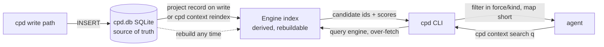
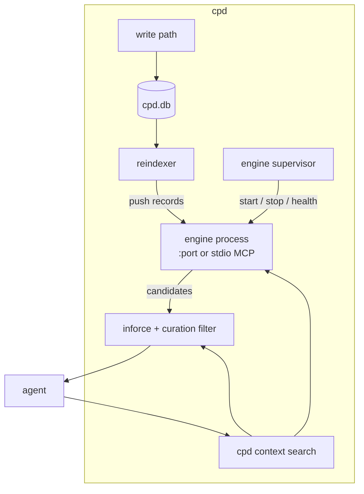
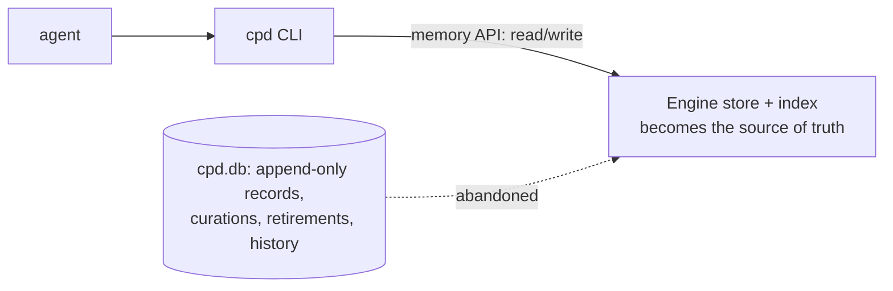

# Adopting a local memory engine for cpd's on-demand retrieval

Evaluation and design for Job `engine-docs`, Plan `context-on-demand`. Direction (User,
2026-10-25, answering hs-d655): cpd adopts a **local memory engine** for on-demand Context
retrieval instead of building retrieval on its own store. This file evaluates the engines
against cpd's constraints, runs the two most promising of them on real cpd records, and
designs how cpd could adopt one. It proposes no code change and picks no engine for the
User.

The prior art is in [`context-memory.md`](context-memory.md) and one build design in
[`context-retrieval-design.md`](context-retrieval-design.md) (both on main). They are read,
not redone; this file only revisits them where the engine question needs it.

## Method

- **Question.** Which local memory engines can serve cpd's on-demand Context retrieval
  under cpd's constraints (machine-local, one Rust binary, a single SQLite store, no hosted
  service), how would cpd write its records into one and read them back, and how would
  cpd's record semantics (append-only typed records, in-force/supersession, retirement, the
  curated `topic`/`short`) survive?
- **Sources.** Metadata comes from the GitHub REST API (`api.github.com/repos/<owner>/<repo>`,
  read **2026-10-25**) and each project's own README fetched from
  `raw.githubusercontent.com` (read **2026-10-25**); every Candidate row carries its source
  and the read date. Claims from a source are stated as such; claims I could not verify
  from a source or a run are labelled `unverified` in the same sentence; claims inferred
  from a source are labelled `inferred`.
- **cpd corpus.** Exported **read-only** from the live `$CPD_HOME/cpd.db` on **2026-10-25**:
  1,462 `context_records` (Context `building-cpd` 1,359, `dotfiles` 71, `homeserver` 32),
  1,011 `record_curations`, all with a `topic` and `short`. A record's text plus `kind`,
  `topic` and `short` was fed to each engine; the corpus is the same for every run.
- **Hands-on.** The two most promising candidates for cpd — **supermemory** (one binary,
  local embeddings) and **holographic** (SQLite, no model) — were run on the corpus; a third,
  **RetainDB Local** (local-first, no keys), was also run and is reported because it is the
  one the earlier survey called local-first. All work happened **outside the repo**, under
  `/tmp/engdocs`, under `timeout`; every process was killed and the temporary tree removed
  before submit. No test depends on any of this.
- **Scope.** Every number below is from that run or a dated source. The other candidates
  (mem0 OSS self-hosted, honcho, hindsight, OpenViking, byterover, Basic Memory) were **not
  run**; each is labelled `unverified` with the reason (a server, an LLM/embedding provider,
  a second runtime, or an archived repo ruled it out of hands-on scope). Their rows come
  from the dated sources only.

## Candidates

Constraints restated from the Job: **no hosted service**; a local engine may bring its own
DB **or a local embedding model**; cpd is one Rust binary on one machine. "Server" below
means a long-running network/listening process (an embedded library, or a stdio MCP server
with no socket, does not count as one).

| Engine | Source (read 2026-10-25) | License / stars / last push | How it runs locally | Storage | Retrieval | LLM / embedding needed | How cpd would write → read |
|---|---|---|---|---|---|---|---|
| **supermemory** | [github.com/supermemoryai/supermemory](https://github.com/supermemoryai/supermemory); GitHub API; **run** | MIT; 31,393★; pushed 2026-10-25 | One self-contained binary (`https://supermemory.ai/install`, 312 MB linux-x64) that serves a local HTTP API on `:6767`; or Docker | Encrypted local store in `$SUPERMEMORY_DATA_DIR` + an embedded graph engine | Hybrid: learned memories + source chunks (vectors + keyword), `searchMode` `hybrid`/`memories`/`chunks` | **LLM required to start** (verified: refuses to boot without an OpenAI/Anthropic/Gemini/Groq key; a local OpenAI-compatible endpoint works); embeddings local `Xenova/bge-base-en-v1.5` (768 d) by default, or hosted | HTTP `POST /ns/<ns>/document` (or `/document/batch`), `POST /ns/<ns>/search`; JS/Python SDK; MCP (`https://mcp.supermemory.ai/mcp`, hosted, or the local server) |
| **retaindb** | [github.com/RetainDB/RetainDB](https://github.com/RetainDB/RetainDB); GitHub API; **run** | Apache-2.0 (`packages/local`, `sdk`, `mcp`); BSL 1.1 (`packages/server`); 55★; pushed 2026-06-12 | `npx @retaindb/local` (Node) starts a local API on `:3111` and a viewer on `:3113`; or Docker | Local: atomic JSON snapshot `~/.retaindb/local-store.json` + append-only `.journal.jsonl`; server: Postgres+pgvector | BM25 + vector + concept graph, RRF fusion, rerank, reinforcement/decay | No LLM and no keys in local mode: hash embeddings by default, `local-transformers` optional; the server path uses Postgres and an extraction model | HTTP `POST /v1/memory`, `/v1/memory/bulk`, `/v1/memory/search`, `/v1/context/query`; MCP tools `remember`/`recall`/`context`/`forget`; TS SDK |
| **holographic** (Hermes provider) | [github.com/bysc1000/holographic-memory](https://github.com/bysc1000/holographic-memory); GitHub API; **run** | MIT; 9★; pushed 2026-06-11 | Pure-Python library (`pip install -e .`, zero required deps); a stdio MCP server and a dashboard are optional extras | SQLite + WAL: `facts`, `entities`, `fact_entities`, `entity_relationships`, an FTS5 table | FTS5 full-text + Jaccard rerank + optional HRR phase vectors (numpy); trust score, temporal decay | Standalone: no LLM, no embedding model (numpy is optional); the separate Hermes plugin build adds BGE/OpenAI embeddings, a cross-encoder and LLM extraction (`unverified`; not run) | Python `MemoryStore.add_fact`/`add_facts_batch`, `FactRetriever.search`/`probe`; or the MCP tools (`add`, `search`, `probe`, `update`, `remove`, …) |
| **Basic Memory** | [github.com/basicmachines-co/basic-memory](https://github.com/basicmachines-co/basic-memory); GitHub API; **not run** | **AGPL-3.0**; 4,349★; pushed 2026-10-25 | Python tool (`uv tool install basic-memory`, needs Python 3.12+) run as a **stdio** MCP server; no network server by default; cloud optional | Markdown notes on disk + a local SQLite index (Postgres/Milvus optional) | Full-text + FastEmbed vector search (hybrid), a wikilink knowledge graph, optional cross-encoder rerank | No LLM for the engine; a **local embedding model** (FastEmbed) for semantic search, downloaded on first use; the host agent is the LLM | cpd would have to write Markdown notes (its sync watches files) and read via the MCP `bm_search`/`bm_find` tools; there is no HTTP API and no library call into cpd's store |
| **mem0 OSS self-hosted** | [github.com/mem0ai/mem0](https://github.com/mem0ai/mem0); GitHub API; **not run** | Apache-2.0; 67,790★; pushed 2026-10-23 | Self-hosted server (`docker compose up`) or a library | Vector store (default Qdrant) + SQLite history; server uses Postgres/pgvector | Hybrid vectors + BM25 + entity matching | **Yes, both**: an LLM (`gpt-5-mini` default) and an embedder (`text-embedding-3-small` default; local Ollama possible) | HTTP/SDK; ruled out: a server **and** a model, against "no hosted service" + one binary |
| **honcho** | [github.com/plastic-labs/honcho](https://github.com/plastic-labs/honcho); GitHub API; **not run** | AGPL-3.0; 7,768★; pushed 2026-10-25 | FastAPI server + background "deriver"; `honcho start` runs Docker with API + deriver + Postgres + Redis | Postgres + pgvector (+ Redis) | Peer representations, session context, semantic search, LLM insights | **Yes, both**: LLM derivations + `text-embedding-3-small` | HTTP/SDK; ruled out: Postgres+Redis+LLM |
| **hindsight** | [github.com/vectorize-io/hindsight](https://github.com/vectorize-io/hindsight); GitHub API; **not run** | MIT; 53,686★; pushed 2026-10-25 | Docker (`docker run`), or an embedded Python `HindsightServer` that still runs a server | Postgres + pgvector (or Oracle 23ai), embedded `pg0` option | Four strategies — vector, BM25, graph, temporal — merged with RRF + cross-encoder rerank | **Yes, both**: 25+ LLM providers (local Ollama possible) + an embedder | HTTP/`pip`; ruled out: a server/Postgres and an LLM+embedder |
| **OpenViking** (`ovenviking`) | [github.com/volcengine/OpenViking](https://github.com/volcengine/OpenViking); GitHub API; **not run** | AGPL-3.0; 40,792★; pushed 2026-10-25 | `openviking-server` (Python/uv, foreground) or Docker; a desktop console | Server-side virtual filesystem (`viking://`) + a vector index | Directory-scoped semantic vector search + `grep`/read | **Yes**: an embedding model **and a VLM**, per the README | Server API/CLI; ruled out: server + embedding + VLM |
| **byterover** (`brv`) | [github.com/campfirein/byterover-cli](https://github.com/campfirein/byterover-cli); GitHub API; **not run** | Elastic License 2.0 per README (GitHub: NOASSERTION); **archived**; 4,946★; pushed 2026-06-25 | Node daemon + interactive REPL; `brv` | Local daemon store under the XDG data dir; cloud optional | Agentic map + indexed search | **Yes**: an LLM (20 providers, local Ollama listed) | CLI/MCP; ruled out: archived + a daemon + an LLM |

**Not run, and why (unverified rows).** mem0 OSS self-hosted, honcho, hindsight and
OpenViking each need a server and/or an LLM+embedder, so they cannot meet "no hosted
service" without a second runtime and a model; byterover is archived and needs a daemon and
an LLM; Basic Memory needs Python 3.12+, a downloaded FastEmbed model and an MCP host, and
is **AGPL-3.0**. None of their locally-observed behaviour, cost or latency was measured
here, so every such figure is `unverified: not run in this Job`.

**Memory MCP server as the integration mechanism.** holographic, Basic Memory, retaindb and
supermemory all ship (or document) an MCP server; pi speaks MCP over stdio or HTTP and reads
project servers from `.pi/mcp.json` (pi docs, `docs/mcp.md`, read 2026-10-25). So the cheapest
integration is to let the **agent** connect to the engine's MCP server directly. That is a
real option, but it **bypasses cpd**: the engine answers with its own ranking and no cpd
in-force/supersession/retirement filter, and the curated `topic`/`short` is not applied.
An MCP server is therefore only safe here when cpd brokers it (Design 2), or when it is used
as a pure index that cpd filters (Designs 1 and 2) — not when the agent is pointed at it
directly.

### cpd's semantics, and how each candidate maps them

cpd's records are **append-only** (`context_records_immutable` refuses every `UPDATE`),
typed, with force computed by `supersedes` and approved `record_retirements` in
`core/src/context/inforce.rs`, and a separate `record_curations` table for the `topic` and
`short` the distiller writes. No engine models that exactly; the mapping is what decides
whether an engine can be a *store* (no) or only an *index* (maybe).

- **supermemory** models documents and *learned memories*; it resolves contradictions and
  "forgets" automatically, and search labels a recalled memory with `isLatest`. It has no
  caller-controlled `supersedes`/retirement API and no curation table. `inferred`: cpd's
  append-only contract would have to be enforced by cpd, and cpd would have to over-fetch
  and filter `isLatest`. The engine may also rewrite its derived memories when it ingests —
  fine for an index, fatal for a store.
- **retaindb** has memory types (`decision`, `constraint`, `preference`, …), relations
  (`updates`, `contradicts`, …), reinforcement/decay, and (server/cloud) `validFrom`/
  `validUntil`; the local mode has `remember`/`forget`. `inferred`: a cpd record maps to a
  memory with `metadata {cpd_id, kind, topic, short}`, retirement to a deactivation; but the
  local retrieval is O(N) per query (Hands-on), which is the binding problem.
- **holographic** has `facts` with `category`, `tags`, `trust_score`, a `superseded_by:{id}`
  tag, entity relations and temporal decay — but **no** retirement table and no curation
  table, and `add_fact` *merges near-duplicates by Jaccard* (a cpd restatement could collapse
  two records). `inferred`: one fact per record, `category` = `topic`, `tags` = `kind`/`id`,
  and cpd must own force and retirement; the batch insert skips only exact duplicate content.
- **Basic Memory** models Markdown notes and wikilinks; a record would be a note and a
  supersession a wikilink, but there is no `record_curations`, no retirement, and the notes
  live in a second store (its own files), so cpd would lose its single source of truth.

## Hands-on

Method for all three: the same 1,462-record corpus under `/tmp/engdocs`; each engine was
indexed, queried with the same 15 real terms, and measured with `time`/wall clock; data was
read-only from `$CPD_HOME/cpd.db`. All processes were then killed and the data removed.

| Engine | Version / commit | Accepted | Index (wall) | Query (min–median) | Disk | RSS | Needs to run |
|---|---|---:|---:|---|---:|---:|---|
| **supermemory** | server 0.0.9 linux-x64 | 1,462 docs | 26.1 s to accept; **115.7 s** until searchable | **52–80 ms** client (42–324 ms server) | **400 MB** installed (≈13 MB cpd data + 106 MB `bge-base` model + 280 MB runtime) | **1.6 GB** | local embedding model **and** an LLM (Ollama `MiniCPM5-1B` used here) |
| **holographic** | 0.16.0 (repo head) | 1,462 facts | **27.2 s** | **0.06–15 ms** | **17.5 MB** | **35 MB** | nothing (numpy only) |
| **RetainDB Local** | `@retaindb/local` 0.2.1 | 1,462 memories | `unverified` (write wall time lost to a timed-out run) | **31–46 s** | 4.6 MB store | 130 MB | nothing (hash embeddings; no keys) |

**supermemory (verified).** Installed the 312 MB binary into `/tmp`. It refused to start with
no model provider key; with `OPENAI_API_KEY=ollama OPENAI_BASE_URL=http://localhost:11434/v1`
pointed at a local Ollama (`MiniCPM5-1B`), it booted, downloaded the local
`Xenova/bge-base-en-v1.5` embedding model (106 MB) and served `:6767`. `taskType: "superrag"`
was used (documents indexed for retrieval, **no memory extraction**), so the LLM was needed
only to start, not on the query path. Adding 1,462 documents took 26.1 s; the index was fully
queryable at 115.7 s (2-concurrent ingest). `searchMode: "hybrid"` returned the right records
(e.g. `retriev*` found `hs-d655`, `hs-d675`, `hs-b67`), 20 hits, 52–80 ms end-to-end. One
integration defect found: a `null` metadata value (`cpd`'s nullable `topic`/`short`) is
rejected (HTTP 400) and **rejects the whole batch** — the caller must omit null metadata.

**holographic (verified).** `pip install -e .` from a clone, with numpy. Indexed all 1,462
records with `add_facts_batch` (entity extraction + HRR vectors) in 27.2 s; the SQLite +
WAL file was 17.5 MB; a search process peaked at 35 MB RSS. `FactRetriever.search` returned
the right records in 0.06–15 ms (single terms like `decision` are ~15 ms because they hit the
20-hit cap and rerank; rare terms are sub-millisecond). Runs with **no server, no model and
no network**.

**RetainDB Local (verified, and rejected at this size).** `node @retaindb/local` (via the
`retaindb` bin; `npx @retaindb/local` collides with the shell's `local` builtin) served
`:3111`/`:3113`. All 1,462 memories were stored (4.6 MB `local-store.json` + journal), no
keys, hash embeddings. But a single `POST /v1/memory/search` over the project took
**31–46 s** and grew the server to 130 MB RSS. `inferred` from the bundled source: `search`
maps over every memory and, per memory, calls `relatedConceptBoost`, which calls `graph()`
and rebuilds the whole concept graph from all memories — O(N²) in the corpus — and then
persists the whole JSON store per query. At cpd's ~1.5 k records this is unusable for an
interactive `context search`; it may be fine for a handful of memories, which is the scale
the README targets.

**Not run (unverified).** Basic Memory, mem0, honcho, hindsight, OpenViking and byterover
were not run: each needs a server and/or an LLM/embedder and/or a second runtime, and the
Job asks for the 1–2 most promising. Their latency, disk and CPU are `unverified`.

## Integration designs

Three concrete ways cpd could adopt an engine. In all three the **agent-facing command is
the same planned command** (from `context-retrieval-design.md`, not yet built in this
checkout): `cpd context search <query> [--context <c>] [--limit <n>] [--kind <k,k>] [--all]`.
What differs is who owns the records and the index.

### Design 1 — cpd is the source of truth, the engine is a projection cpd syncs

cpd keeps writing `context_records`, `record_curations` and `record_retirements` to its
SQLite store exactly as today. cpd also **projects** each record to the engine (on write, or
in a `cpd context reindex` pass). `cpd context search` asks the engine for candidate ids and
then applies cpd's own in-force/kind filter and the curated `short` before rendering.

- **Source of truth:** `cpd.db`. The engine is a derived, rebuildable index; deleting it and
  reindexing loses nothing.
- **Command surface:** `cpd context search <query> [--context <c>] [--limit <n>] [--kind
  <k,k>] [--all]` (agent); `cpd context reindex [--context <c>]` (rebuild/verify); `cpd
  context show --record <id>` (unchanged, reads cpd).
- **Pros:** cpd's semantics are never delegated — force, retirement and curation stay in
  `inforce.rs`/`record_curations`; the engine is replaceable (supermemory today, another
  tomorrow); no second source of truth; the agent's surface is unchanged if `search` already
  exists.
- **Cons:** the write path must project *every* change, including a curation update and a
  retirement decision, not just a record insert; projection lag or a missed write makes the
  index silently stale; a failed projection after a committed write needs a reconcile
  (`reindex`) or a startup check.
- **Failure modes:** engine down → `search` errors (or cpd falls back to a built-in scan);
  projection drift → missing or stale hits, caught only by `reindex`; engine returns an
  out-of-force record → cpd filters it, so correctness survives but `--limit` needs an
  over-fetch.

### Design 2 — the engine is a cpd-supervised retrieval index, `cpd context search` calls it

Same source-of-truth rule, but cpd owns the engine's process lifecycle: it starts the engine
when needed (or keeps one supervised daemon), builds the index over cpd's rows, and stops
it. cpd still filters force/curation on the way out. This is Design 1 with the engine as an
implementation detail cpd supervises rather than a user-installed service.

- **Source of truth:** `cpd.db`. The engine is an ephemeral index cpd starts and stops; its
  store is disposable.
- **Command surface:** `cpd context search <query> [...]` as the agent's only command, plus
  `cpd context engine start|stop|status|reindex` for operators/debug. The engine's own MCP/HTTP
  tools are **not** exposed to the agent.
- **MCP variant (2b):** cpd writes a project `.pi/mcp.json` that exposes the engine's MCP
  server, so the agent calls it directly. Cheaper, but cpd is then out of the query path and
  the agent sees the engine's ranking without cpd's in-force filter — only acceptable if the
  index contains **only in-force records** and cpd re-projects on every supersede/retire.
  It is named here, not recommended.
- **Pros:** the user installs nothing; one owner of lifecycle and ports; no orphan daemon;
  cpd can enforce cpd's semantics even if the engine has none; the engine can be swapped
  behind the supervisor (a Rust-native FTS5 index is the degenerate case of this design).
- **Cons:** cpd grows process management (spawn, health, restart, teardown on crash and on
  `cpd` exit); a child process and its port can leak if cpd dies; cold start adds latency to
  the first search; and it still adds the engine's runtime (binary/Node/Python) to a
  one-binary tool.
- **Failure modes:** engine crash mid-query; port already in use; orphan process after a
  `SIGKILL`; engine/index schema drift after an engine upgrade; index built over a snapshot
  that missed a concurrent write.

### Design 3 — the engine is the store (cpd reads and writes it) — a bad idea

- **Source of truth:** the engine. **Rejected, plainly.** cpd would stop being cpd:
  - It gives up the contract it is built on — append-only typed `context_records`
    (`context_records_immutable`), force computed in `inforce.rs` from `supersedes` and
    approved `record_retirements`, the `record_curations` table for `topic`/`short`, the
    `history`/audit triggers, the schema hash and the migration machinery, `cpd context show
    --record/--topic/--since`, and the Event protocol.
  - No engine models those semantics. Several **rewrite on write** — holographic merges
    near-duplicate facts by Jaccard, supermemory resolves contradictions and "forgets"
    automatically — which would silently destroy cpd's append-only history and recency rule.
    None exposes `supersedes`/retirement/curation as first-class.
  - It makes cpd depend on a server, an embedding model and (for supermemory, honcho,
    hindsight, mem0, OpenViking, byterover) an LLM, breaking "one binary, machine-local, no
    hosted service".
  - It is a one-way door: migrating back would have to reconstruct the append-only history
    and force state the engine never stored.
- **Command surface if it were done:** `cpd context add`/`cpd context show` would proxy the
  engine's `remember`/`search`. Named to show why it is wrong, not proposed.

## Options for the User

The choice is the User's. Costs are the measured ones (or `unverified`); "Integration" names
a design above.

| Engine | How it runs | What it needs | Integration | Measured cost (1,462 records) | Risk |
|---|---|---|---|---|---|
| **supermemory** | one 312 MB binary, local HTTP `:6767` | a **local LLM** to boot (Ollama) + a local embedding model; no hosted service | 1 or 2 (cpd syncs/supervises; engine filtered by cpd) | index 115.7 s; query 52–80 ms; 400 MB disk (13 MB data); 1.6 GB RSS | third-party binary; **LLM requirement and RAM**; lite licence caps at 10 k docs (`git.new/memory`, `unverified`); null metadata rejects a whole batch; auto-forgetting can rewrite derived memories |
| **holographic** | pure-Python library (or stdio MCP); **no server** | Python + numpy; **no LLM, no embedding model** | 1 (projection) or 2 (subprocess) | index 27.2 s; query 0.06–15 ms; 17.5 MB disk; 35 MB RSS | **9★, last push 2026-06-11**, one maintainer, beta; adds a Python runtime to a Rust tool; own schema, no cpd semantics; Jaccard merge can collapse restatements |
| **RetainDB Local** | one Node process, local HTTP `:3111` | **nothing** — no keys, hash embeddings; no LLM | 1 or 2 | query **31–46 s** at 1.5 k records; 4.6 MB store; 130 MB RSS; index time `unverified` | **O(N²) per query** (graph rebuilt per memory) makes it unusable at cpd's size without an upstream fix; 55★ |
| **Basic Memory** | Python + stdio MCP; no network server | Python 3.12+, a downloaded FastEmbed model, an MCP host | direct MCP (2b) only — its own Markdown store | `unverified: not run` | **AGPL-3.0**; a second store and second runtime; no cpd semantics; semantic search needs the model |
| **mem0 / honcho / hindsight / OpenViking / byterover** | server / Docker / daemon | a server **and** an LLM and/or embedder (OpenViking also a VLM) | — | `unverified: not run` | all fail "no hosted service + one binary"; byterover is archived |
| **(no engine) cpd FTS5 index** — the existing design, for reference | embedded in cpd's SQLite | nothing | 2, with the engine replaced by cpd's own index | from `context-retrieval-design.md`: build 78 ms, query 0.01–0.33 ms | requires building `context search`; no engine dependency at all |

**Recommended default.** Design **2** (cpd stays the source of truth and supervises the
index; the agent only ever runs `cpd context search`). For the engine inside it, the two that
actually met cpd's constraints on this machine are **supermemory** (a self-contained binary
that works at cpd's scale, at the cost of a local LLM, ~1.6 GB RAM and ~400 MB disk) and
**holographic** (no server, no model, 17 MB/35 MB, but a beta 9★ Python project). **RetainDB
Local is not viable at ~1.5 k records** (31–46 s/query) without an upstream fix. If the User
would rather not add a second runtime or an LLM at all, the measured fallback is the
existing cpd-owned FTS5 index — same Design 2 shape, zero external engine.

## Open questions

- **Does the User allow a *local* LLM (e.g. Ollama), or only a local embedding model?** The
  direction permits a local engine that brings a DB or an embedding model but bars a hosted
  service. supermemory needs an LLM to *start* (verified); honcho, hindsight, mem0,
  OpenViking and byterover need one too. If a local LLM is out, supermemory and that group
  are out, and only holographic (and the cpd-owned index) remain.
- **Is a second runtime acceptable to a one-binary Rust tool** — Python for holographic/Basic
  Memory, Node for RetainDB? This is the main non-semantic cost of every candidate.
- **How much disk and RAM is acceptable?** supermemory (400 MB / 1.6 GB) vs holographic
  (17.5 MB / 35 MB) is a 20×–45× gap.
- **Who owns the engine's process and index lifecycle** — cpd supervises it (Design 2) or a
  user-installed daemon (Design 1)? The Job's "no leaked process" rule argues for cpd owning
  it, but that puts process management into the CLI.
- **Is direct MCP to the agent acceptable (Design 2b)?** It skips cpd's in-force/retirement
  filter unless the index holds only in-force records and is re-projected on every change.
- **supermemory's local licence and its 10 k-document lite cap** — the startup banner points
  at `git.new/memory`; not read here (`unverified`). It matters before adopting.
- **RetainDB Local's slowness** — is the per-memory graph rebuild configurable upstream, or
  fixed only by a version bump? Not answered here; only the 0.2.1 behaviour is measured.
- **holographic ambiguity** — the earlier findings noted the name may mean another project;
  this file, like the design, reads it as the Hermes provider `bysc1000/holographic-memory`.
