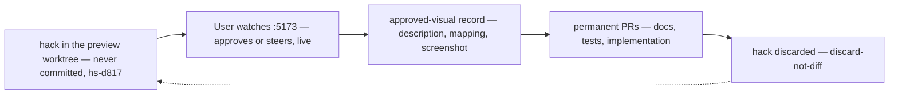

# The dev-mode live-visual loop: how the web UI was previewed, approved and shipped

Sources: the Context records hs-d814, hs-d817, hs-d819, hs-d824, hs-d826, hs-d827, hs-d829, hs-d830, hs-n666, hs-n698, hs-n699, hs-p168, hs-b145; the merged PRs #732, #733, #739, #741, #743, #745, #747, #748, #749; `web/README.md`; `docs/ui-preview.md`; `docs/research/web-client-api.md`.

Status: this is a research document, not a contract. It records the dev-mode live-visual loop **as it actually ran** during Plan `web-chat-live` (hs-d819) and its successor `web-chat-bugs` (hs-p168), faithful to the evidence: every claim about the loop cites a Context record id or a PR number, every quote is verbatim or a faithful gist, and the ad hoc, hand-run parts are named as such. It is input for a later integration Plan; nothing here is implemented.

## 1. The loop as it ran

The loop has two roles: a **Lead** who hacks and dispatches, and a **User** who watches the LAN URL in a browser and steers. Seven steps, each with its evidence:

**(a) The Lead runs the Vite dev server (HMR) on the LAN from a preview worktree.** The server is started from the repo root with `pnpm --filter cpd-web-client run dev` (`web/README.md`, "Run the dev server") with `CPD_WEB_LIVE=1` in its environment, on port 5173; the User's URL is `http://192.168.3.3:5173` (hs-d814, hs-d817). What the flag mounts — the dev-mode-only live adapter, the `CPD_WEB_TOKEN` default `dev-token`, the `/__cpd/` routes including the `/__cpd/health` probe and the SSE frames stream — is documented in `web/README.md`, section "The dev live adapter (dev mode only)"; this document does not repeat it.

**(b) Visual changes are HACKED in that worktree.** Throwaway code, written only in the Lead's preview worktree: never committed, never pushed, never on main (hs-d817).

**(c) The User watches the LAN URL and steers, live.** The User opens `http://192.168.3.3:5173` in a browser and approves or steers while the Lead iterates; the HMR server applies each change on the spot (hs-d817).

**(d) Each APPROVED visual is RECORDED before dispatch.** The record carries the description, the component mapping and, where possible, a screenshot; that record is the spec the permanent work is built from (hs-d817). The loop's first run produced four such decisions: hs-d824, hs-d826, hs-d827, hs-d829 (each with its PR in section 4).

**(e) The permanent PRs are dispatched with the record as spec.** Production quality — docs, tests and implementation — per hs-d817. Example: hs-d824's record is the spec of PR #741 "Wrap the chat in the resizable three-column shell" and PR #743 "Wire the Context tree into the left rail and select the Chat from it", whose body states it was "approved from a working dev preview on `:5173`".

**(f) The hack is DISCARDED, never diffed into the branch.** The throwaway code is thrown away; nothing of it is carried into the permanent PRs (hs-d817).

**(g) The preview branch redeploys to :5173 so the User re-verifies.** The Lead iterates on the spot (hs-d814); the prototype commits lived on the local branch `preview/chat-shell` — e.g. `8597fd602` — and the manual redeploy to :5173 serves the updated build (`web/README.md`, "The chat surface", notes the prototype commit; hs-d814).

## 2. What it is for, and what it is not for

The loop is for **visual and layout iteration — presentation only** (hs-d817). It is not for behaviour: behaviour changes go the normal job route, and three things are never part of a hack — the fold's data semantics, the mock contract, and the API (hs-d817). The dev adapter leaves the production web API contract unchanged (`docs/research/web-client-api.md`; hs-d780, hs-d819).

One explicit exception is on record: hs-d819 is the separate, deliberate dispatch exception for Plan `web-chat-live`, the one Plan that wired a **functional** dev-mode chat (real transcript read, real send) through the Vite CLI adapter. It was a scoped exception, not a change of the rule above: hs-d780's production contract is unchanged (hs-d819, `web/README.md` "The dev live adapter (dev mode only)").

The loop has a sibling pattern for the TUI: the earlier preview loop of `docs/ui-preview.md` (decisions hs-d504, hs-d323, hs-d341) — a throwaway prototype PR and `scripts/preview-tui.sh on/off`, with the cockpit's view panes swapped to the preview build. It is named here once as the precedent; the subject of this document is the web/Vite loop.

## 3. The rules as invariants

Four rules govern the loop, verbatim from hs-d817:

1. hacks live only in the Lead's worktree, never on main, never pushed;
2. each approved visual is recorded (description, component mapping, screenshot) BEFORE dispatch, and the record is the spec;
3. discard-not-diff;
4. the LAN dev server is the delivery surface the User actually opens.

Rules 1 and 3 together are what keep main clean: the worktree's uncommitted state is the only place a hack exists, and the permanent PRs are written from the record, not from the diff.

## 4. The evidence trail

Times below are the Context record `at`, UTC. Where the brief gives the User's local time it is stated: 2026-11-02 14:35 EST = 2026-11-01T19:35Z.

### 4.1 The loop's statement

| Record | At (UTC) | What it established |
|---|---|---|
| hs-d814 | 2026-11-01T03:15:21Z | The loop's first statement: LAN dev server on :5173, User re-verifies, the Lead iterates on the spot. |
| hs-d817 | 2026-11-01T03:44:54Z | The loop as standing protocol; supersedes hs-d814 (whose invalid short broke Context curation; `distill_invalid`). Carries the four invariants of section 3. |

### 4.2 The Plan that ran it: `web-chat-live`

Plan `web-chat-live` (hs-d819, decision 2026-11-01T05:32:14Z) is the dispatch exception of section 2: a functional dev-mode chat over the Vite CLI adapter. Created 2026-11-01T05:32:26Z, locked 05:52:33Z, `done` 2026-11-01T19:20:28Z. hs-n666 notes the Plan's files and the `:5173 CPD_WEB_LIVE=1` server.

### 4.3 The dev-adapter foundation (what made the live preview possible)

Before the visual loop, two PRs built the dev adapter — they are the loop's precondition, not its output:

- #732 "Read a real cpd Session in the web Chat over a dev CLI adapter" (chat-live, merged 2026-11-01T14:17:59Z).
- #733 "Read a durable cpd Session in the web Chat over its host socket" (chat-host, merged 2026-11-01T14:26:59Z).

### 4.4 The four preview decisions and the PRs they produced

| Decision | At (UTC) | What the User approved | PR it produced |
|---|---|---|---|
| hs-d824 | 2026-11-01T15:30:23Z | Resizable three-column layout Context \| Chat \| Inbox; the Context column is the shadcn `sidebar-03` block copied verbatim; default 20rem; double-click restores 20rem; dark is the default. | #741 "Wrap the chat in the resizable three-column shell" (chat-shell, merged 2026-11-01T16:18:40Z) and #743 "Wire the Context tree into the left rail and select the Chat from it" (chat-tree, merged 2026-11-01T16:33:28Z; body: "approved from a working dev preview on `:5173`") |
| hs-d826 | 2026-11-01T16:41:33Z | The right column is the Inbox rail: shadcn `sidebar-09`'s mail list vendored 1:1 (`new-york-v4`) — header and ten sample mails verbatim; the block's icon column and Unreads switch deliberately not vendored; 25rem default, resizable, double-click restores 25rem. Record gist: "Decided by the User 2026-11-01 from the dev preview (preview/chat-shell, 1624176c7); PR chat-inbox". | #745 "Show shadcn's sidebar-09 Inbox list in the shell's right rail" (chat-inbox, merged 2026-11-01T17:04:59Z) |
| hs-d827 | 2026-11-01T16:41:33Z | The rail shows the ten sample mails verbatim for now; reading the real Inbox is registered as the follow-up PR chat-inbox-live. | #747 "Read the real Inbox into the shell's right rail" (chat-inbox-live, merged 2026-11-01T18:01:03Z) |
| hs-d829 | 2026-11-01T16:57:16Z | The live Inbox row mapping: name = actor; date = relative age; subject = label line 1; teaser = line 2; href = url else `#`; empty Inbox = empty list. | Fed PR #747 (above) |

### 4.5 The other loop PRs of `web-chat-live`

- #739 "Single-screen chat on the new shadcn AI Elements" (chat-ui, merged 2026-11-01T15:31:34Z).
- #748 "Render a Session's whole turn in the Chat column" (chat-thread, merged 2026-11-01T19:20:25Z).
- #749 "The Inbox row's relative age in the singular" (inbox-age, merged 2026-11-01T19:20:26Z) — found in the dev preview 2026-11-01, "seen in the dev preview ... next to the `building-cpd: 226 doc candidates` item".

### 4.6 The second mode of use: the User as tester

On 2026-11-02 14:35 EST (= 2026-11-01T19:35Z) the User reported three chat-webui bugs **from the live preview** — no auto-scroll, verbose cpd blocks, native scrollbar. The Manager opened Plan `web-chat-bugs` for them: records hs-p168 and hs-b145, "Fix the three chat-webui bugs: no auto-scroll, verbose cpd blocks, native scrollbar (User, 2026-11-02)". This is the loop run from the User's side: the User reports, the Lead hacks the fix in the preview, the User re-verifies, the permanent PRs follow.

The Plan reuses the same shared dev preview worktree `/home/clayton/projects/cpd.preview.chat-shell` (branch `preview/chat-shell`) and the already-running :5173 server. Its throwaway hacks touch `web/src/index.css`, `web/src/components/ui/message-scroller.tsx`, `web/src/components/ui/sidebar.tsx` and `web/src/views/live-chat.tsx` and are never committed; another Lead on the same worktree must build on the uncommitted changes and never run `git checkout`/`reset`/`clean` there (hs-n698, note 2026-11-01T19:39:11Z).

The bug-report round produced its own approved visual, the same (b)→(d)→(e) shape in miniature: **hs-d830** (decision 2026-11-01T19:41:02Z = 2026-11-02 14:45 EST, seen live at :5173) — a bug report became a preview hack, then an approved-visual record with a component mapping, then a permanent PR. The record: every scrolling surface of the web shell uses a thin themed scrollbar — one authored Tailwind v4 utility `scrollbar-themed` in `web/src/index.css` — applied to the MessageScrollerViewport (`web/src/components/ui/message-scroller.tsx`), both rails' SidebarContent (`web/src/components/ui/sidebar.tsx`) and the Code Block's overflow surface (`web/src/components/ui/code-block.tsx`), with the Chat viewport keeping the primitive's `data-autoscrolling` thumb-transparent override. hs-n699 settled scroll-styling ownership to `web-chat-bugs`.

### 4.7 Today's friction, named

The loop ran end to end, but every join in it is manual:

- the preview worktree is chosen by hand;
- the redeploy to :5173 is manual;
- the approved-visual records are written by hand with `cpd context decide`;
- the dev server must already be running.

## 5. Integration candidates (survey only)

Where the loop could become first-class in cpd protocols. **Implementing any of this is out of scope here** — this section surveys; a later Plan decides.

- **A visual Plan/PR mode.** A Plan or PR mode for visual work, with a designated preview worktree and its lifecycle rules — codifying what hs-d817 and hs-n698 currently carry as prose: hacks never committed, building on uncommitted changes, no `checkout`/`reset`/`clean` on the shared worktree.
- **Preview deploy/redeploy as a `cpd` command.** A resource-backed dev server — `cpd resource run` — would replace today's friction: the manual redeploy to :5173 and the requirement that the server "must already be running" (section 4.7).
- **The approval record as a protocol artifact.** Today an approved visual is recorded by hand as a Context decision (`cpd context decide`; hs-d824, hs-d826, hs-d827, hs-d829, hs-d830). A first-class approved-visual record that precedes dispatch — description, component mapping, screenshot — would make rule 2 of section 3 structural instead of remembered.
- **The shape as a Job mapping.** The loop maps onto Jobs/PRs as: hack → record → docs/test/impl → open. That shape is already how `web-chat-live` ran (sections 4.4–4.5); a named mode would make it repeatable instead of emergent.

**Open questions for the User** — what must be answered before adopting any of the above:

1. What designates a Plan as visual/dev-mode?
2. Who owns the preview worktree, and what is its lifecycle?
3. Is the dev server a declared resource?
4. Is the approval record a Context decision or a new artifact?
5. Is discard-not-diff enforceable (a check), or only a rule?

Sources: hs-d814, hs-d817, hs-d819, hs-d824, hs-d826, hs-d827, hs-d829, hs-d830, hs-n666, hs-n698, hs-n699, hs-p168, hs-b145; PRs #732, #733, #739, #741, #743, #745, #747, #748, #749; `web/README.md` ("The dev live adapter (dev mode only)", "Run the dev server", "The chat surface"); `docs/ui-preview.md`; `docs/research/web-client-api.md`.
