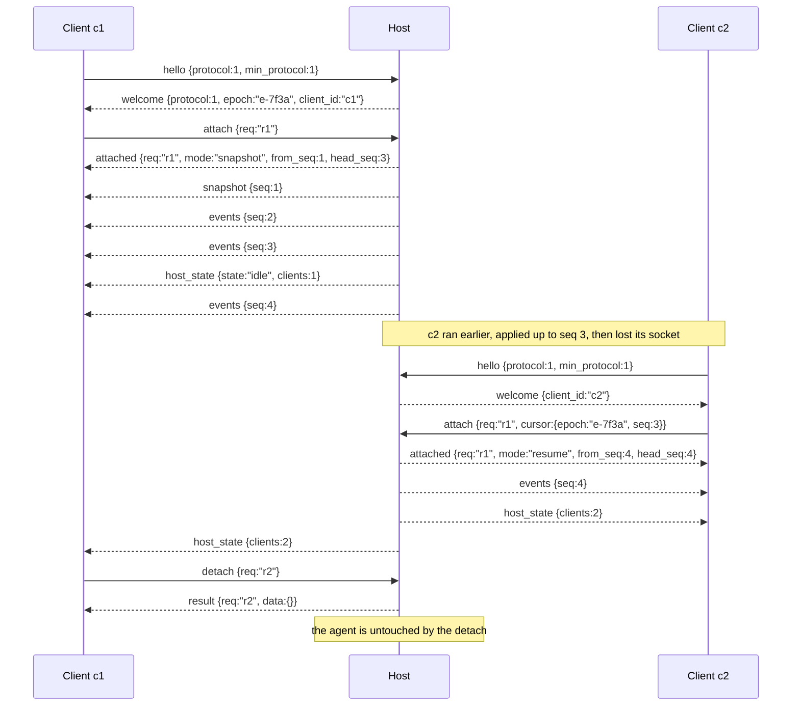
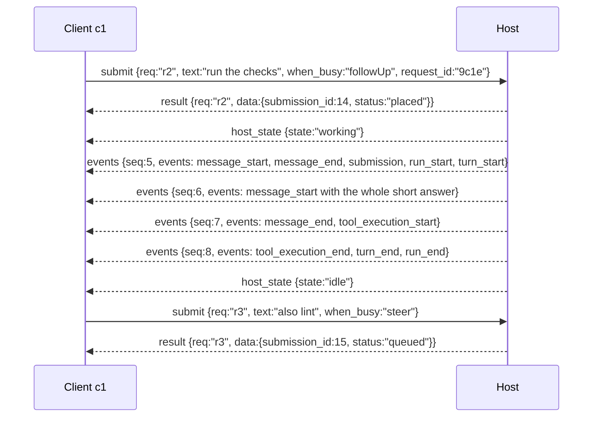
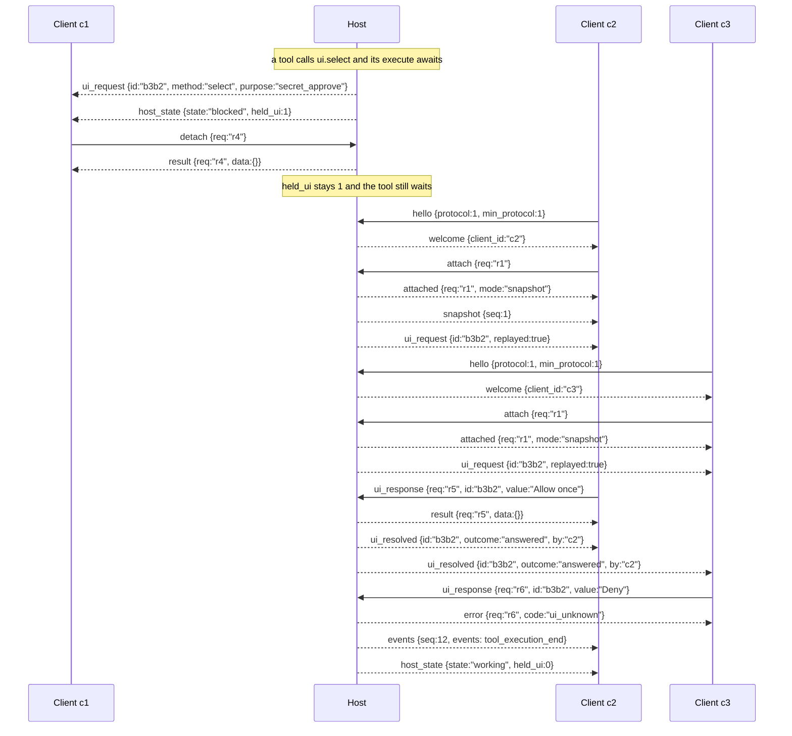
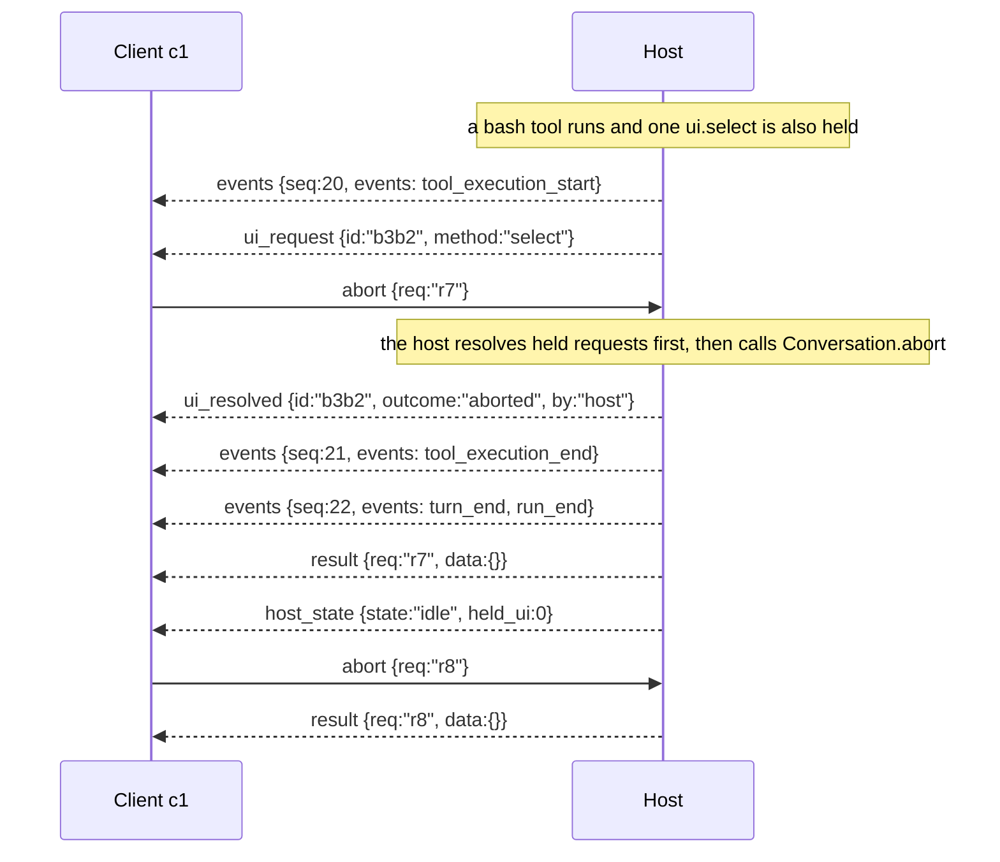
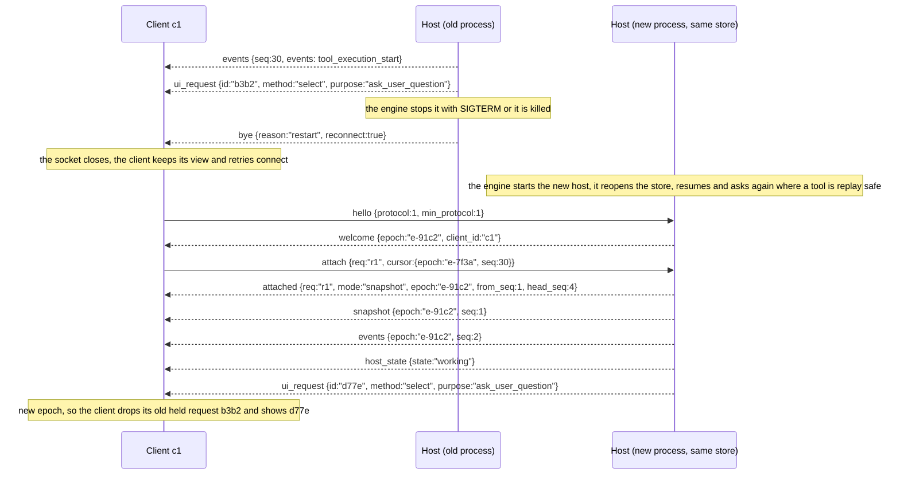
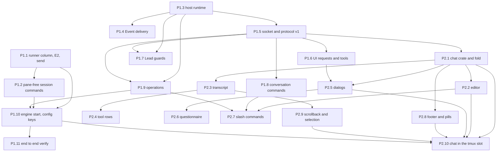

# Leads and Managers on pi-durable with a cpd chat client: P0 findings

## Summary

**Verdict.** Yes: Leads and Managers can run on pi-durable 1.3.0 behind a ratatui `cpd chat`, reversibly, by a Node durable session host plus 21 PRs (11 for the host, 10 for the client) and the 34 decisions of section 8 (inferred from sections 3 to 7).
**Gaps (3.9).** 101 rows: offered 29, partial 35, absent 20, none-needed 17; built by host 47, client 38, engine 1, none 15; size S 83, M 16, L 2 (G20 the socket server, G41 the questionnaire).
**Host and protocol (4).** One Node process per Session owns its SQLite store and one `watchEvents` stream, and holds a `flock`.
It serves any number of clients on a unix socket `$CPD_HOME/run/host/<session>.sock` in newline JSON: pi-durable's events pass through with a `seq` ring and an `epoch`, and the client folds them.
Attach is a snapshot or a resume from a cursor; UI requests are held in the host, so a question outlives a detach.
**Spike (5.2, faux provider: host overhead only, no model latency).** Host RSS median 103.12 MB, start to socket 277.29 ms, to first snapshot 281.11 ms.
Event to first frame at the client median 2.60 ms, to the assistant message 5.60 ms; plain submit to `result` 1.52 ms.
Attach mid-stream, a UI request across a detach and `kill -9` mid-turn with resume passed 5 of 5 each; `kill` to resumed answer median 594 ms.
**Reversibility (6).** A Session's runner is fixed at creation and the config key defaults to `pi`; flipping it back makes new Sessions pi again and no data migrates.
The one engine step that must change first is E2 liveness, which restarts a paneless non-Worker Session as pi (P1.1, 6.2).
**The cut (7.1 to 7.3, sizes are a guess)**

| Phase | PRs | Non-test lines |
|---|---|---|
| P1 durable session host | 11 | 4,700 to 8,950 |
| P2 `cpd chat` | 10 | 7,300 to 13,000 (5,800 to 10,500 without P2.6) |

**Risks that matter most (7.5).** pi-durable is experimental and changes without notice; the agent's own bash can answer an approval over the socket (Q6); E2 restarts a paneless Lead as pi until P1.1 lands; the spike used a faux provider on 30 entries, so a real Lead's snapshot and tools are unmeasured.
**Open questions.** 34, in section 8; the User answers them, this Plan decides none.

## 1. Scope, sources and labels

Goal (the User's requirement of 2026-10-30 22:52 EDT, records hs-n586 and hs-d752):

- Leads and Managers, today pi sessions in tmux panes driven by the pi adapter `pi/lib/*`, run on pi-durable 1.3.0 as Workers already do (contract 6.12), reversibly.
- pi-durable has no interface, so cpd builds its own ratatui chat client; one pi-durable storage has one owning process, so a Node durable session host owns the Session's store and serves clients over a local socket.
- This is P0 only: findings, no product code. Dropping tmux is out of scope (P3). A Session's runner is fixed at creation; the default stays `pi`.

The doc answers four requirements: the gap list (section 3), the host and protocol (4 and 5), reversibility (6) and the cut into P1 (durable session host) and P2 (`cpd chat`) (7). Sections 4 to 8 and the Summary are written by later Jobs.

Pinned versions: pi-durable 1.3.0, pi-coding-agent 1.3.0, cpd origin/main at commit `943a11337`. Every `file:line` is of that commit unless it names a package.

Labels, on every claim:

| Label | Meaning |
|---|---|
| read | a `file:line` or a README section cite |
| measured | the command and the number |
| inferred | a judgement, stated as one; a size is `guess` unless derived from a cited line count |

Gap-table legend (the same header in every gap section; IDs G01, G02, ... run on across sections in file order):

- `pi-durable 1.3.0 offers` starts with `offered`, `partial`, `absent` or `none-needed` (no equivalent need), then the README section or `.d.ts` file:line.
- `cpd builds` starts with `host` (the Node durable session host), `client` (the Rust ratatui client `cpd chat`), `engine` (the Rust engine or core) or `none`.
- `Size`: S under 300 non-test lines, M 300 to 1,000, L over 1,000, then the line count it derives from or `guess`. `Basis`: read, measured or inferred. A finding marked unverified keeps that word in its row.

Evidence: the finding files are at `/home/clayton/.cpd/run/durable-leads/explore/`, one per question; they are a machine-local source, as in `docs/research/chat-render-cost.md`.

## 2. What exists today

Sources: the Manager's evaluation of 2026-10-30 22:52 EDT (`/tmp/cpd-building-cpd/durable-leads-eval.md`, copied and tightened here because `/tmp` is not durable); `a-dialogs.md`; `c-conv.md`.

What exists (read in the evaluation; line counts are the evaluation's, not remeasured, except the two rows that say measured):

| Piece | Today | Size (non-test lines) |
|---|---|---|
| Durable Worker runner | `pi/durable-worker/` (contract 6.12): headless Node, pi-durable 1.3.0 SQLite store per Attempt, Event delivery as `followUp` inputs, Worker guards (`workerVerdict`), MCP, crash resume, end report | ~580 |
| Runner seam | `attempts.runner` `pi`/`durable`, `worker_runner` config and status-line pill toggle (pro-d165, pro-d199) | done |
| pi adapter for Leads and Managers | `pi/lib/*`: delivery, turn-start context, guards (main, secret, noblock, ask, test, loop), plan review, review chat, MCP, reload, render (compact-tools, balloon, pad, pill, cursor) | ~5,700 |
| Dialogs and ask tool | `pi/ask-user-question` and the dialog modules of `pi/lib` | 5826 and 587 (measured by `a-dialogs.md`, totals of its tables) |
| Cockpit | `tui/src` (already ratatui: tree, plan, widgets, dialogs) | ~24,000 |
| tmux host | `core/src/host/tmux*`, `core/src/session/*` (chat slot, parked windows, moves), engine restart and ensure | ~9,000 and many tests |

What pi-durable 1.3.0 gives a UI (read, evaluation): everything as committed state: `viewState()`, `watch()` (Chord ops) and `watchEvents()` (pi-style `message_update` and `tool_execution_*` deltas over a snapshot), `submit` with `followUp`, `steer` and `write`, `abort`, `compact`, `reset`, `fork`, and a per-conversation agent (model, thinking). Constraints: README says "Experimental. The API changes without notice"; one process owns a storage, so a Rust UI cannot open the store and must talk to the Node process that owns it.

No storage lock (measured, `c-conv.md` "Storage: two processes, one SQLite file"): two processes opened one SQLite file with `Harness.open(await openNodeSqliteStorage(file), ...)`; the second open succeeded silently, process A's view went stale, and A's next write failed with `Error: ID 11 already belongs to entry`; `PRAGMA integrity_check` returned `ok`. README says "there is no cross-process locking" (read, `c-conv.md`). So the host must hold its own lock; pi-durable offers none (inferred from the grep of `storage/sqlite/*.js` and `storage/jsonl/*.js`, which `c-conv.md` reports found only `BEGIN IMMEDIATE` and a busy timeout).

Shape (read, evaluation):

```
cpd engine ── starts/keeps ──► durable session host (Node, one per Session; owns <session>.sqlite)
                                   │ unix socket: events stream (watchEvents), submit/steer/abort,
                                   │ UI requests (ask_user_question, plan review, approvals), commands
cpd chat <session> (ratatui) ◄────┘  any number of clients attach/detach; the agent never depends on one
```

The agent no longer lives in a terminal: closing the UI does nothing to the Session (what tmux gives today, done by the host instead).

## 3. Gap list

### 3.1 Runtime and Event delivery

Sources: `a-hooks.md`, `d-worker.md`, `c-conv.md`.

| ID | Feature | Used today (file:line) | pi-durable 1.3.0 offers | cpd builds | Size | Basis |
|---|---|---|---|---|---|---|
| G01 | Delivery of an Event while idle: stored custom message (`customType`, `details`), starts a turn | `pi/lib/handle.ts:94`, `pi/lib/delivery.ts:25-30` | partial: `submit` starts a run when idle; `entry:{kind,data}` stores an app kind while the model sees `content` (README Busy Conversations; `harness/types.d.ts:23-36`). That `customType` and `details` map onto it is inferred | host: map Event to `submit` with `requestId` `event:<id>` | S (guess) | inferred |
| G02 | Delivery of an Event while busy: steer (pr-feedback, escalation, Plan Lead) or follow-up | `pi/lib/delivery.ts:10-17,20`, `pi/lib/handle.ts:103,133,138,179` | offered: `submit({whenBusy:"steer"})` and default follow-up (README Busy Conversations; `harness/types.d.ts:23-36`) | host: the per-kind rule table | S (guess) | read |
| G03 | Silent queue: store a message without a turn; hold for the next turn while the first message is pending or the loop guard is tripped | `pi/lib/delivery.ts:23,25`, `pi/lib/host.ts:114` | partial: `submit` type `write` appends an entry without asking the model (README Busy Conversations; `types.d.ts:307`); a hold-for-next-turn (`nextTurn`) is not found | host: its own gate over the submission queue | S (guess) | read |
| G04 | Adapter errors as a chat message (Manager) or a ledger report (Lead) | `pi/lib/host.ts:82-115`, `pi/lib/delivery.ts:33-38` | partial: write entry as G03; `cpd session report` is a CLI call, already in the Worker runner (`pi/durable-worker/mcp.ts:51`) | host | S (guess) | read |
| G05 | Hidden first message of a by-user Session (section 15.7a), persisted with `details`, counted by the cursor | `pi/lib/first-message.ts:12-39`, `pi/lib/startup.ts:149-150` | partial: `GenerationTask.beforeRequest` replaces the messages of one request (README Hooks, `types.d.ts:690`); a hidden persisted message is not a named feature, so the host would store it as an entry through G03 (inferred). The Worker's first message is a spec line, not this (`pi/durable-worker/run.ts:105`) | host: `cpd session first-message` call, dedupe by entry | S (guess) | inferred |
| G06 | Context updates at turn start (`cpd-context`): visible persisted message, read of the cursor, `cpd` reads | `pi/lib/turns.ts:66-73` (hook :69), `pi/lib/updates.ts:266-325` | partial: `beforeRequest` can alter messages (`types.d.ts:690`), but it fires per request attempt including recovery (so it over-counts) and the entry must still be committed for the cursor (inferred). No named turn-start hook (`a-guards.md`) | host: submit-time hook in the host before each run | M (guess; `updates.ts` is 330 lines, cited `updates.ts:5-335`) | inferred |
| G07 | Agent state for the cockpit: idle, working, blocked, waiting, `reply` flag, reported by `cpd session state` | `pi/lib/agent-state.ts:20-91`, `pi/lib/state.ts:2,101-112`, `pi/lib/reply.ts:12-21` | partial: `viewState`/`watch` give `docs["pi.live"]` with `run` and `tools[].status` (README Watching; measured in `c-conv.md` and `c-tools.md`); no event that a human question is open (no `ui_prompt_*` analogue, inferred from the README sections read, grep `ask`/`prompt` not done in `d-worker.md`). The Worker runner sends only working, idle, stopped (`pi/durable-worker/run.ts:88,95,104,155`) | host: derive blocked and waiting from its own UI requests; `reply` flag new | M (guess) | inferred |
| G08 | Resume cursor: highest delivered Event id among prior messages with `details.delivered_to` | `pi/lib/startup.ts:145-146`, `pi/lib/cursor.ts:8-16` | partial: stored entries are readable fork-aware (`viewState` entries, README Watching) and `requestId` dedupes a resubmit, also after restart (measured in `c-conv.md`: second submit returned the same id 8). The Worker's cursor is in memory from `registered_event` (`pi/durable-worker/run.ts:111`) | host: persist the cursor in an entry or store doc | S (guess) | measured |
| G09 | Start-up replay: Events since the cursor after follower start | `pi/lib/startup.ts:145-146,203`, `pi/lib/follower.ts:98` | offered: `resume()` continues unfinished runs (README Persist and Resume; `harness/types.d.ts:646`); the follower is pure cpd code the Worker runner reuses (`pi/durable-worker/run.ts:111-136`) | none: reuse | S (guess) | read |
| G10 | Start-up and shutdown: start hook with a reason, `stopped` on exit with a bounded wait (about 2 s) | `pi/lib/adapter.ts:45-64`, `pi/lib/startup.ts:221-236`, `pi/lib/follower.ts:14` | partial: no session-start or shutdown hook is named; the Worker runner exits 143 on SIGTERM and never closes the harness (a call with no end had not returned from `Harness.close()` after 3 s, spiked, `contract.md:3749,3758`; `pi/durable-worker/run.ts:49,147-156`) | host: reuse the exit-143 convention | S (guess) | read |
| G11 | Turn-end reminder (Lead with a Plan): hidden message at the next run start | `pi/lib/turns.ts:82-110`, `pi/lib/reminder.ts:5,67-68` | partial: `GenerationTask.onYield` may `continue` the run with another user message (README Hooks); the reminder would be a user message, not hidden (inferred) | host | S (guess) | inferred |
| G12 | Policy prompt section (section 15.10) | `pi/lib/agent-state.ts:30-41`, `pi/lib/policy.ts:4-12` | offered: `section(name, fn)` (README System Prompt); the text is constant per run. Already done by the Worker (`pi/durable-worker/extension.ts:6-17`) | none: reuse | S (guess) | read |
| G13 | Time-zone prompt section, rebuilt each turn | `pi/lib/agent-state.ts:44-47`, `pi/lib/time.ts:51-56` | offered: `section(name, fn)`; README warns a section that changes every call defeats prompt caching (README System Prompt, l.284). What `zoneLine` prints is unverified. The Worker does it (`pi/durable-worker/extension.ts:6-17`) | none: reuse | S (guess) | read |
| G14 | Compaction ratio (section 15.19): reserve tokens from a ratio, by a prototype patch | `pi/lib/compaction-ratio.ts:30-69`, `pi/lib/adapter.ts:29` | partial: settings `compaction:{enabled,reserveTokens,keepRecentTokens,backgroundTokens}` and `beforeCompact` (README Compaction, `types.d.ts:445,728`); a ratio setting is not found, unverified beyond the README lines read | host: compute reserve from the window | S (guess) | read |
| G15 | Session-name sync, both ways | `pi/lib/startup.ts:142`, `pi/lib/handle.ts:124-130`, `pi/lib/agent-state.ts:84-91` | absent: no session display name in the sections read (inferred) | host: store name in its own doc; client shows it | S (guess) | inferred |
| G16 | One owner per storage; second open | none (pi sessions are files) | absent: no lock, no error on a second open (README "no cross-process locking"; measured in `c-conv.md`: ID 11 error, integrity ok) | host: its own lock | S (guess) | measured |
| G17 | Runner parts reusable as is: `harness.ts`, `mcp.ts`, `pi-mcp.ts` | `pi/durable-worker/harness.ts:12-37`, `pi/durable-worker/mcp.ts:15-117`, `pi/durable-worker/pi-mcp.ts:20-55` | offered: `Harness.open`, `resume`, `root` (README Quick Start; `harness/harness.d.ts:15`) | none | S (38 + 118 + 56 lines, read in `d-worker.md`) | read |
| G18 | Runner parts to generalise: `config.ts` (Attempt, spec), `deliver.ts` (`attempt-nudge`), `extension.ts` (Worker guard), `main.ts`, `run.ts` (end report, spec first message) | `pi/durable-worker/config.ts:5-39`, `deliver.ts:6-14`, `extension.ts:6-17`, `main.ts:22-52`, `run.ts:40-157` | none-needed: these are cpd code; the store path becomes per Session | host: a Session-keyed variant | M (guess; the five files total 39+15+17+52+157 = 280 lines read) | read |
| G19 | Worker-only parts: end report, terminate-time report, spec first message, `workerVerdict` as a whole | `pi/durable-worker/report.ts:27-51`, `pi/durable-worker/run.ts:94,105,147-153`, `pi/durable-worker/guards.ts:17-36` | none-needed | none: drop | S (51 lines of `report.ts`) | read |
| G20 | Socket server for a client: submit, view, watch, interrupt, abort | none (pi draws in-process) | partial: `viewState`, `watch`, `watchEvents`, `abort`, `submit` exist (README Watching, Agent Events; `harness/events.d.ts:184`), with no resume cursor and a fresh snapshot after 100 frames behind (measured shapes in `c-conv.md`); the `Conversation` of `pi/durable-worker/harness.ts` exposes only `submit/install/entries/closed`; no socket anywhere in pi-durable | host: the socket protocol | L (guess) | read |
| G21 | Liveness and restart of a paneless Lead or Manager: engine step E2 exempts only a durable Worker; a Lead host has no Attempt driver, `worker_pid` or `MAX_RESTARTS` | `docs/contract.md:1132`, `core/src/driver/runner.rs:34,116-122,126-153` | none-needed | engine: Session-level pid and restart bound | M (guess) | read |

Reading: of 21 rows, 5 are offered, 11 partial, 2 absent and 3 none-needed (counted in the table).
No hook gives a turn start with its origin or a human-question signal, so G01, G05, G06, G07 and G11 are host code on top of `submit` and `beforeRequest` (inferred).
The cost is the socket server and its protocol (G20, L, guess), because pi-durable has no resume cursor and no socket. The lock, by a lock file or by the socket bind: see Q14.

### 3.2 Guards

Sources: `a-guards.md`, `c-tools.md`. The Worker runner ports its guards in one `beforeTool` hook, `hook(ToolTask, { beforeTool: (call) => workerVerdict(call, where) })` (`pi/durable-worker/extension.ts:15`, `pi/durable-worker/guards.ts:17-36`). `beforeTool` can block (first `block` wins, a throw blocks) or rewrite arguments (`harness/types.d.ts:714-717`; README Hooks). The adapter runs all but loop in one `tool_call` handler (`pi/lib/adapter.ts:67-102`).

| ID | Feature | Used today (file:line) | pi-durable 1.3.0 offers | cpd builds | Size | Basis |
|---|---|---|---|---|---|---|
| G22 | Guard main (section 15.16): no change to a primary checkout by edit, write or bash | `pi/lib/adapter.ts:71-77`, `pi/lib/mainguard.ts:10-28,117-123` | offered: `beforeTool` (README Hooks; `harness/types.d.ts:714`). Already ported by the Worker: `pi/durable-worker/guards.ts:22-29`. That pi-durable's built-in tools are named `edit`, `write`, `bash` is unverified | none: reuse; the host passes the conversation cwd | S (guess) | read |
| G23 | Guard secret (section 15.17): refuse raw `op` and `cpd secret approve` in bash | `pi/lib/adapter.ts:78-79`, `pi/lib/secretguard.ts:5-16` | offered: `beforeTool`. Ported by the Worker: `pi/durable-worker/guards.ts:30-31` | none: reuse | S (guess) | read |
| G24 | Guard noblock (section 15.11): a Lead or Manager bash may not wait over 30 s, and a missing `timeout` is set to 30 | `pi/lib/adapter.ts:94-98`, `pi/lib/noblock.ts:6,42-82` | offered: `beforeTool` can block and rewrite `arguments` (`harness/types.d.ts:714-717`), so the default-timeout rewrite fits (inferred). Not ported: `pi/durable-worker/guards.ts:1-5` has no `noblock`. Whether pi-durable's `bash` has a `timeout` input is unverified | host: add to a Lead verdict | S (guess; the rule is `noblock.ts:42-82`, 41 lines) | inferred |
| G25 | Guard ask G2: an `ask_user_question` call carries at most 1500 characters | `pi/lib/adapter.ts:83-90`, `pi/lib/askguard.ts:4,29-32` | offered: `beforeTool`. Not ported (no `askguard` import, `guards.ts:1-5`; the Worker has no `ask_user_question`) | host | S (guess) | read |
| G26 | Guard ask G4 (Lead and Manager): every label cited in the call (A1, B2-B4) must be stated in the call or the visible chat so far | `pi/lib/adapter.ts:86`, `pi/lib/askguard.ts:86-104` | partial: needs conversation history; `beforeTool` gets `(call, api, context)` and `call.parent` (`harness/types.d.ts:705-714`), but whether `Context` exposes entries in the shape G4 reads (`askguard.ts:91-98`) was not read, unverified. `viewState` entries (README Watching) are the other source (inferred) | host: keep the visible chat in the host and pass it in | S (guess) | inferred |
| G27 | Guard test (section 15.12): a Worker may not run an unfiltered `cargo test` or `npm test` | `pi/lib/adapter.ts:100-101`, `pi/lib/testguard.ts:47-83` | offered: `beforeTool`. Ported by the Worker, applied unconditionally: `pi/durable-worker/guards.ts:34-35`. A Lead host must not apply it (`docs/commands.md:4216`) | host: a role switch around the shared verdict | S (guess) | read |
| G28 | Guard loop (section 15.15): more than 20 self-started turns in 600 s trips; deliveries are held; reason `loop-guard`; entry `cpd-loop-guard` | `pi/lib/loop-guard.ts:14-59`, `pi/lib/adapter.ts:42` | absent: the guard runs on pi `before_agent_start`, not `tool_call`; no named pi-durable hook is a turn start with who started it. `beforeRequest` fires per request attempt and over-counts retries (`harness/types.d.ts:690`); `afterResponse`, `afterTools`, `onYield` are the other generation hooks (`types.d.ts:696-702`). The host, which submits the input, may count there (inferred). State persists via "Your Own State" (README, inferred fit) | host: window, trip, gate and entry | M (guess) | inferred |
| G29 | Guard host-approve (section 15.18): refuse raw `cpd host approve`; the model uses the tool `cpd_host_approve` | `pi/lib/adapter.ts:80-81`, `pi/lib/hostapprove.ts:9-17,28-59` | offered: `beforeTool` for the guard; ported by the Worker: `pi/durable-worker/guards.ts:32-33`. The tool is not in the runner: it opens `host.ctx.ui.select` (`hostapprove.ts:51-54`) | host: the guard (reuse). client: the approval dialog. Same for `cpd_secret_approve` (`pi/lib/secret.ts:46-49`) | M (guess) | read |
| G30 | Guard explore (section 15.22): scout and research Workers, keyed on `CPD_JOB_KIND` | `pi/lib/adapter.ts:69-70`, `pi/lib/explore.ts:94-173` | offered: `beforeTool`. Ported: `pi/durable-worker/guards.ts:18-21`. Never applies to a Lead or Manager (`explore.ts:171`) | none: leave out | S (guess) | read |

Reading: of 9 rows, 7 are offered, 1 partial (G26) and 1 absent (G28) (counted in the table).
The Worker already ports main, secret, host-approve (guard only), test and explore; a Lead host adds noblock, ask G2 and G4, loop and a role switch.
The loop guard costs most (G28, M, guess): no named pi-durable hook gives a turn start with its origin; ask G4 needs history `beforeTool` may not carry (unverified).

### 3.3 Operations

Sources: `a-ops.md`, `c-env.md`. The durable Worker runner has none of reload, `/mcp login`, skill notice, retier and mentions (grep `reload\|skill\|mention\|retier` in `pi/durable-worker` finds only `thinkingLevel`, read in `a-ops.md`); it has MCP attach and replay.

| ID | Feature | Used today (file:line) | pi-durable 1.3.0 offers | cpd builds | Size | Basis |
|---|---|---|---|---|---|---|
| G31 | Reload after an install (section 15.6): poll the adapter path every 5 s, validate the package, reload only when idle, no pending message, state idle, editor empty | `pi/lib/reload.ts:14,70-76,97-132,173-300`, `pi/lib/reload-command.ts:7-23`, `pi/lib/startup.ts:204-216` | partial: `registry.install(ext)` with an installed name replaces it in place; a running call keeps the old code (README Reload). No file watch, validation or idle guard. A changed file needs a cache-busting import URL (inferred, not in README). Worker: none | host: watch, validate, guard, `install` | M (guess; the poll alone is `reload.ts:173-300`, 128 lines) | read |
| G32 | MCP attach and replay: Event `mcp-attached` registers a server; replay at every start | `pi/lib/mcp.ts:14-53`, `pi/lib/handle.ts:114-123`, `pi/lib/startup.ts:195` | partial: tools via `defineExtension` and `conversation.install` (README Extensions); no MCP client in pi-durable. The Worker runner has it: `pi/durable-worker/mcp.ts:43-117`, replay `:92-109`, wired `run.ts:107-109`, via pi's client `pi/durable-worker/pi-mcp.ts:20-55` | none: reuse the Worker's handler as is | S (118 lines, `mcp.ts`) | read |
| G33 | `/mcp login`: pi's own command and manager UI; sign-in picked up on the next turn | pi's `extensions/mcp/index.js:939-969,1121` (pi-coding-agent); cpd only mounts it, `pi/lib/mcp.ts:9` | absent: no UI. The Worker fails a `needs-auth` server with "run pi mcp login" (`pi/durable-worker/pi-mcp.ts:32-38`), told as a follow-up (`mcp.ts:48-59`) | client: a `/mcp login` command (relay to a host or the shell `pi mcp login`: see Q18) | M (guess) | read |
| G34 | Skill-changed notice (section 15.23): sha256 of the skill files against a baseline entry; message at the next turn | `pi/lib/skills.ts:18-107`, `pi/lib/startup.ts:197-198` | absent: no skill notion in pi-durable (grep `skill` in `dist` finds only a test helper; README has 0 hits, `c-env.md`). `appendEntry` and `before_agent_start` have no shown equivalent (inferred). A Worker runs without skills (`docs/commands.md:4469`) | host: digest and baseline in its own doc | S (guess) | read |
| G35 | Skills in the prompt: name, description and path of `cpd-lead` or `cpd-manager` in the system prompt; the model `read`s `SKILL.md` | pi's skill loader (`docs/skills.md` in pi-coding-agent); cpd role skills `pi/lib/skills.ts:18-20` | absent: the host supplies a prompt section. pi exports `formatSkillsForPrompt` and `loadSkills` (`PC/dist/core/skills.d.ts:47,62`, exported `PC/dist/index.d.ts:23`); a section is `section(key, fn)` (README System Prompt). `/skill:name` is a client command the host expands (inferred) | host: one section. client: `/skill` | S (guess) | read |
| G36 | Project context files (AGENTS.md and the like) in the prompt | pi's loader `PC/dist/core/resource-loader.d.ts:63-69` | absent in pi-durable; the Worker reads them once at start with `loadProjectContextFiles` (`pi/durable-worker/main.ts:32`, `run.ts:36-37,68`) into the section `cpd-context-files` (`extension.ts:8`) | none: reuse; a re-read on reload is the host's choice (inferred) | S (guess) | read |
| G37 | Retier at idle (section 10.15): `session-retiered` Event, switch model and thinking when idle and nothing queued; `switched` or `switch-failed` back to cpd | `pi/lib/retier.ts:6-73`, `pi/lib/agent-state.ts:80`, `pi/lib/handle.ts:110-113` | partial: `configure({model, thinkingLevel})` in one commit, applied from the next request (README Per-Conversation Agent; `harness/types.d.ts:378-396`, read only, not run). Idle detection is not offered; whether durable clamps a thinking level is unverified (`c-conv.md`). The Worker drops the Event (`pi/durable-worker/deliver.ts`, `contract.md:3709`) | host: idle test, `configure`, report to cpd | S (guess) | read |
| G38 | Mention highlighting: Lead and Manager ids in answers, magenta italic outside code | `pi/lib/mentions.ts:8-66`, `pi/lib/mentions-refresh.ts:9-26`, `pi/compact-tools/extensions/compact-tools-silent.ts:44-47,350-351` | none-needed: pi-durable has no render or UI | client: paint at render; id set from `cpd` lists | S (guess) | read |

Reading: of 8 rows, 0 are offered, 3 partial (G31, G32, G37) and 4 absent (G33, G34, G35, G36), 1 none-needed (G38) (counted in the table).
Only MCP attach (G32) is already built for pi-durable; everything else here is host or client work with no pi-durable support.
Reload (G31) costs most (M, guess): watch, validation and the idle guard all move to the host.

### 3.4 Dialogs and UI requests

Sources: `a-dialogs.md`, `b-extui.md`, `c-tools.md`. Abbreviations: `HT` = pi-durable `dist/harness/types.d.ts`; `R` = pi-coding-agent `dist/modes/rpc/rpc-mode.js`; `D` = pi-coding-agent `docs/rpc-extension-ui.md`.
pi-durable 1.3.0 has no UI API: a grep of its README and `dist` for `ui_request`, `ctx.ui` and `hasUI` finds nothing, and its README says a UI reads committed state with `viewState()` (README l.380; read in `a-dialogs.md`). So every dialog below is host plus client work.

| ID | Feature | Used today (file:line) | pi-durable 1.3.0 offers | cpd builds | Size | Basis |
|---|---|---|---|---|---|---|
| G39 | `ask_user_question` as a tool: 1 to 4 questions of 2 to 4 options, validation, the G2 and G4 guards, the answer text and `details` | `pi/ask-user-question/tool/types.ts:41-157`, `validate-questionnaire.ts:19-55`, `ask-user-question.ts:322,339-345`, `askguard.ts:4-103`, `adapter.ts:83-90` | partial: a tool is a `defineTool` whose `execute` may await (README Tools l.155-170; `HT:238-271`); a guard maps to `beforeTool` (`HT:714`). The tool itself is not shipped | host: port the tool to a `defineTool` | M (422 lines in `tool/` plus 104 in `askguard.ts`, both measured) | measured |
| G40 | `ask_user_question` at walker parity: one `select` per single-choice question with a "Type something." row, one `input` for multi-select | `pi/ask-user-question/rpc-fallback.ts:88-202` (select `:123`, input `:140,171`) | absent: no dialog request (`a-dialogs.md` section 5) | client: render `select` and `input` requests | S (203 lines of `rpc-fallback.ts`, measured) | measured |
| G41 | `ask_user_question` full questionnaire: tab bar, option list, preview pane, submit tab, notes, global note, external editor, collapse key | `pi/ask-user-question/ask-user-question.ts:241-257,362-382` (`ctx.ui.custom`); TUI code in `view/`, `state/`, `selectors/` | absent: `ctx.ui.custom` has no RPC form (`R:152-155`; `D:16`) | client: a `questionnaire` request kind (see the closing table). see Q19 | L (guess; the TS view, state and selectors are 4,362 lines, measured) | inferred |
| G42 | `ask_user_question` with no UI: the reconciler removes the tool, `execute` returns `no_ui`, a missing `custom` returns `no_custom_ui` | `pi/ask-user-question/reconcile.ts:25-47`, `ask-user-question.ts:70-73,89,270-275,336` | absent: the host knows whether a client is attached; pi-durable does not | host: no client attached, so the call fails with `no_ui` as today. or the tool waits for a client: see Q20 (G50 shows a tool can wait) | S (guess) | inferred |
| G43 | Plan review flow: tool `cpd_plan_review`, summary message, pending entry, `cpd plan decide`, supersede, decided-elsewhere | `pi/lib/review.ts:51-159,179-195`, `pi/lib/plan-review.ts:10-63` | partial: an app entry `entry:{kind,data}` and `submit` write store state (`HT:23-36`; README Busy Conversations); `customType` and `display` have no equivalent (inferred) | host: the flow and the `cpd plan` calls | S (262 lines: `review.ts` 198 plus `plan-review.ts` 64, measured) | measured |
| G44 | Plan review dialog and review chat: `select` Approve or Change, on Change an `editor` "What should change?", Esc leaves it pending with a `notify` | `pi/lib/review-chat.ts:8-67` (select `:50`, editor `:58`, notify `:53`) | absent: no UI | client: a select and an editor dialog | S (67 lines, measured) | measured |
| G45 | `/plan-review`: reopen the waiting review dialog (Plan Lead only) | `pi/lib/plan-review-command.ts:15-33`, registered `pi/lib/startup.ts:16` | absent: no command surface | client: send `command` `plan-review`; host: resend the pending dialog | S (36 lines, measured) | measured |
| G46 | `cpd_secret_approve`: a `select` "Allow once" or "Deny" inside the tool; denial and approval texts | `pi/lib/secret.ts:20-55` (select `:49`, `no_ui` `:47`), `pi/lib/state.ts:56-63` (`ownPrompt`) | partial: the tool may await a human answer (G50); no dialog | host: the tool awaits a `select` request; client: renders it as an approval | S (58 lines, measured) | measured |
| G47 | `cpd_host_approve` (Manager only): a `select` "Allow once" or "Deny" before a host repair | `pi/lib/hostapprove.ts:36-57` (select `:54`, `no_ui` `:52`) | partial: same as G46 | host: as G46; client: as G46 | S (60 lines, measured) | measured |
| G48 | The `ctx.ui` members cpd uses: `select`, `editor`, `notify`, `input`, `setStatus`; `confirm` is used by none | `pi/lib/review-chat.ts:50,58`, `pi/lib/secret.ts:49`, `pi/lib/handle.ts:129`, `pi/compact-tools/extensions/compact-tools-silent.ts:476,498` | absent: no UI context; pi's RPC mode serialises 9 of 29 members as `extension_ui_request` (`R:83-225`; `D:12-25`) | host: reuse pi's request and response shapes as they are (inferred); client: render them | S (guess) | inferred |
| G49 | `ctx.ui` members with no RPC equivalent: `custom`, `onTerminalInput`, `setWorkingIndicator`, `setWorkingMessage`, `setWorkingVisible`, `setHiddenThinkingLabel`, factory `setWidget`, `setFooter`, `setHeader`, theme calls | `pi/ask-user-question/ask-user-question.ts:241`, `pi/compact-tools/extensions/compact-tools-progress.ts:99-139`, `pi/lib/pad.ts:82` | none-needed: pi's RPC mode makes them no-ops (`R:97-221`); with no pi in the client there is nothing to patch | none: the client draws its own working pill and footer (section 3.5) | S (guess) | read |
| G50 | A tool that waits for a human answer | `pi/ask-user-question/ask-user-question.ts:336-391`, `pi/lib/secret.ts:49` | offered: `execute` may await; no tool timeout field (`HT:238-271`). Measured: a tool awaiting a 2 s timer returned its answer and the run went on. Pending state: `tool_execution_start` in `watchEvents` and `pi.live.tools` `status:"running"`, no "waiting for human" state. A restart marks it interrupted and does not rerun it unless `replay:"safe"` (measured; `tool.js:101-118`) | host: choose `replay` per tool. see Q8: `safe` re-asks the question after a restart, `unsafe` tells the model it was interrupted | S (guess) | measured |
| G51 | Dialog persistence: cpd stores the pending review with `appendEntry` and reopens it at `session_start`; the ask, secret and host dialogs are not stored | `pi/lib/review.ts:67,86,123`, `docs/commands.md:3976-3977` | partial: app entries are stored; there is no pending-dialog notion, and `watch` replays nothing to a late client (README l.402) | host: hold the map of open requests by id and resend them to a client that attaches or reconnects | M (guess) | inferred |
| G52 | Dialog cancel: a newer review or a decision elsewhere closes the open select | `pi/lib/review-chat.ts:16-31,47,59` (`AbortSignal`) | absent: pi's RPC sends no cancel to the client (`R:57-60`); an `editor` has no signal (`R:174-192`) | host: a `cancel` message by request id; client: close the dialog | S (guess) | inferred |

Smallest set of UI request kinds over the socket (inferred from the rows above; `questionnaire` is the only one beyond pi's own shapes, and it is needed only for G41):

| Kind | Payload | Response | Used by |
|---|---|---|---|
| `select` | `id`, `title`, `options`, `timeout?` | `value` or `cancelled` | G44, G46, G47, G40 |
| `input` | `id`, `title`, `placeholder?` | `value` or `cancelled` | G40 |
| `editor` | `id`, `title`, `prefill?` | `value` or `cancelled` | G44 |
| `cancel` (host to client) | `id` | none | G52 |
| `notify` | `message`, `level?` | none | G44, G45 |
| `questionnaire` | `id`, `questions` with `options` and `preview?` | `answers`, `cancelled`, `globalNote?` | G41 |
| `command` (client to host) | `name`, `args` | none | G45 |
| `message` (host to client) | `customType`, `content`, `display`, `details` | none | G43 |

Reading: `confirm` and `custom` are carried by no feature. Of 14 rows, 1 is offered (G50), 5 partial, 7 absent and 1 none-needed (G49).

### 3.5 Rendering

Sources: `a-render.md`. `EXT-<name>.ts` = `pi/compact-tools/extensions/compact-tools-<name>.ts`. Line counts are measured (`git show origin/main:<file> | wc -l`, non-test) and are the TypeScript counterpart; the Rust size is a judgement, so every Size here says guess and cites the counterpart. All rows are built in the client. pi-durable offers data only: the `pi.tool-result` entry (`dist/entries.js:20`), the `pi.live` and `pi.usage` docs (README l.378-402), and no render. Mention highlight is G38 (3.3) and is not repeated.

| ID | Feature | Used today (file:line) | pi-durable 1.3.0 offers | cpd builds | Size | Basis |
|---|---|---|---|---|---|---|
| G53 | Tool rows: head `╭─[pill] title`, body rails, closing `╰` row, pill colour by state, running loader row, `ask_user_question` in magenta | `pi/compact-tools/extensions/compact-tools.ts:187,255,272,276,285,296,361,567`, `compact-tools-custom.ts:51` | partial: data only (entry plus `pi.live`) | client: draw from entry and live doc | M (guess; TS 996 + 295 + 574 + 85 lines) | measured |
| G54 | Per-tool argument summaries and the shell "calm label" parse | `EXT-invocation.ts:81,329,395,` `EXT-shell.ts:29,245` | partial: data only (tool args) | client: show the command; classify nothing | S (guess; TS 531 + 277 lines) | measured |
| G55 | Tool grouping: `Run date + 16 more steps` head, count, running hint, failures | `EXT-grouping.ts:44,133,150,157,199,270` | partial: data only | client: the compact group head and count | S (guess; TS 487 lines) | measured |
| G56 | Nested call summary under a parent tool | `EXT-nested.ts:17,87` | partial: child conversation found through the call's `details` (README l.560) | client: a count line | S (guess; TS 168 lines) | measured |
| G57 | Thinking fold: one pill `Thinking…`, folded, body on rails, time `HH:MM`, Ctrl+T | `EXT-thinking.ts:52-56,62,124,184,253,348` | partial: data only (thinking blocks of the assistant entry) | client: two states, fold and time | S (guess; TS 385 lines) | measured |
| G58 | User and assistant balloons: rounded box, tail, time, text wrapped to width minus 8 or 7 | `EXT-balloon.ts:10,14,29,` `EXT-silent.ts:72,114,302` | partial: data only (`pi.user` entry `dist/entries.js:11`) | client: balloon widget | S (guess; TS 49 + 501 lines) | measured |
| G59 | Markdown in balloons: headings, code, lists, tables, syntax colours | pi-tui `Markdown` (`EXT-silent.ts:12`), `pi/themes/dango.json` | none-needed: input text is data; the renderer is not | client: a markdown to ratatui renderer, new work | M (guess; no TS counterpart of ours) | inferred |
| G60 | cpd message fold (`cpd`, context, decision, summary, skills): pill, first-sentence summary, `Message from <name> (<id>) (<HH:MM>)` | `pi/lib/render.ts:23,37-99,143` | partial: an app entry carries `content` and `details` (README l.416); the mapping from pi's `customType` is inferred | client: fold widget | S (guess; TS 238 lines) | measured |
| G61 | Compaction fold: `[compaction]` pill, `Compacted from N tokens` | `EXT-compaction.ts:31,71,84` | partial: `pi.compaction` entry (`dist/entries.js:30`); whether it carries `tokensBefore` was not found | client: fold widget | S (guess; TS 91 lines) | measured |
| G62 | Editor box: rounded, border colour by working, focused, unfocused, `↑ n more` labels | `EXT-editor.ts:88,137,145-151,163` | none-needed: no UI | client: box and colours over its own editor (G88) | S (guess; TS 231 lines) | measured |
| G63 | Header working pill in the editor's top border: moon frames, words from run events; animation clock | `EXT-editor.ts:68,` `EXT-progress.ts:38,132,` `EXT-loader.ts:8,` `EXT-clock.ts:7` | partial: run state from `pi.live` and events `run_start`, `tool_execution_start` (`events.d.ts`) | client: pill and a tick | S (guess; TS 146 + 43 + 55 lines) | measured |
| G64 | Pills and the Dango palette: 16 indexed colours, pill spec JSON | `pi/lib/pill.ts:41`, `pi/themes/dango.json`, `pill-spec.json` | none-needed: static JSON | client: map to indexed colours; reuse the JSON as is | S (guess; TS 53 lines) | measured |
| G65 | Footer: cwd, branch, session name, tokens, cost, context, statuses (pi's own) | pi-coding-agent `dist/modes/interactive/components/footer.js:130-168,253` | partial: `pi.usage` (`dist/harness/usage.js:4`); branch and cwd are client facts | client: footer line | S (guess) | inferred |
| G66 | Chat padding: one blank cell around the root | `pi/lib/pad.ts:62-80` | none-needed | client: a margin | S (guess; TS 83 lines) | measured |
| G67 | Anchored scrolling: keep the reader's place when rows resize | `EXT-viewport.ts:79,130,200,212-216` | none-needed: no UI | client: anchor by entry id and offset, not by line content (inferred) | S (guess; TS 234 lines) | measured |
| G68 | Fold state and toggles: Ctrl+O, Ctrl+T, click on a row | `EXT-config.ts:35,` `pi/lib/render.ts:95`, `EXT-compaction.ts:17,60` | none-needed: client state | client: expanded flag per row | S (guess; TS 195 lines) | measured |

May simplify (inferred in `a-render.md`): per-tool argument summaries and the shell parse (G54); the failure line; the thinking hint and the 3-step Ctrl+T cycle (two states); the input cursor (ratatui's own; blink optional); nested summaries (G56); viewport anchoring by entry id (G67); silent mode.
Can drop (inferred): the claude and codex grouping vocabularies (1,187 code lines, not the default: cpd sets `style: compact`); the eased dot ramp of `compact-tools-activity.ts:100` (contract 6.9 already lists it as removed, yet it is still in the tree); the hint patch `pi/lib/hint.ts`; render caching (`EXT-layout.ts:24,59,111`); config, `/compact-tools`, double-load and the hook utility (they exist because the renderer patches pi); status pills (cockpit, not chat).
What depends on pi-tui and cannot be exported as data (read, `a-render.md` section 3; pi-tui's source is not under `node_modules`, so this is from cpd's imports): the `Editor` text buffer and key handling, the alt-screen driver and layout (`TuiAltScreen`, `ScrollView`), `Markdown`, `MouseRegion`, ANSI width and wrap helpers, the key map, and the pi component classes that cpd patches (`AssistantMessageComponent`, `ToolExecutionComponent` and others). With no pi in the client those hooks have no target; only the drawing rules carry over. Everything else (row text, times, counts, status, token numbers, mention ids, palette, pill spec, glyphs) is data from entries, `pi.live` and `pi.usage`.
A ratatui editor crate or our own: see Q21 (G88).

### 3.6 Slash commands, keys and input forms

Sources: `b-commands.md`, `c-env.md`. `IM` = pi-coding-agent `dist/modes/interactive/interactive-mode.js`, `SC` = `dist/core/slash-commands.js`. pi's table `BUILTIN_SLASH_COMMANDS` has 23 entries (`SC:2-27`, read). Three hidden commands are dispatched but not in the table: `/debug`, `/arminsayshi`, `/dementedelves` (`IM:2663-2673`). Of the commands cpd names (`/reload`, `/plan-review`, `/mcp login`), `/plan-review` is G45 and `/mcp login` is G33 (3.3); both are not repeated here. Commands cpd does not name in `pi/skills`, `pi/lib` or `docs/commands.md` are "not named in cpd" (a grep of those paths only; a User can still type them in a pane, inferred).

The 23 built-in commands (read, `SC` order not kept; grouped as in `b-commands.md`):

| Group | Commands | Row |
|---|---|---|
| Session and tree | `/tree`, `/fork`, `/clone`, `/resume`, `/new`, `/name`, `/session`, `/import` | G74, G75, G77 |
| Context | `/compact` | G71 |
| Model and thinking | `/model`, `/thinking`, `/scoped-models`, `/login`, `/logout` | G72, G73, G78 |
| Extension and tool control | `/reload`, `/settings`, `/trust`, `/hotkeys`, `/changelog`, `/quit` | G76, G78, G79 |
| Export and report | `/copy`, `/export`, `/share`, `/bug` | G79 |

| ID | Feature | Used today (file:line) | pi-durable 1.3.0 offers | cpd builds | Size | Basis |
|---|---|---|---|---|---|---|
| G69 | Command dispatch, autocomplete and extension commands (they run while streaming) | `IM:467,2542-2683,2707`; command `pi/lib/plan-review-command.ts:15` | absent: no command surface | client: parse `/name args`, complete names | S (guess) | read |
| G70 | `/skill:<name>` and prompt templates by name | `IM:535`; pi `docs/slash-commands.md:56-58` | absent: no skill notion (`c-env.md` row 7); see G35 | client: expand `/skill:name` into the input text (inferred) | S (guess) | read |
| G71 | `/compact [instructions]`: manual compaction | `IM:2652,5941`; not named in cpd | offered: `compact(instructions, ctx)` (`HT:610`; README Compaction) | client: the command; host: call it (see G91) | S (guess) | read |
| G72 | `/model [provider/model]`: selector or argument | `IM:2558,4320,4454`; not named in cpd (`pi/lib/models-list.ts` lists models, a different thing) | offered: `configure({model})` (`HT:378-396`; README Per-Conversation Agent) | client: selector; host: model list from pi's `ModelRuntime` as the Worker does (`pi/durable-worker/main.ts:24-31`) | S (guess) | read |
| G73 | `/thinking [level]` | `IM:2564,4282`; not named in cpd | offered: `configure({thinkingLevel})`; levels `off` to `max` | client: the command; host: `configure` | S (guess) | read |
| G74 | `/fork`: new session from an earlier user message (pi's; cpd's `cpd session fork`, `docs/commands.md:4691`, is a different command) | `IM:2616,4593`; not named in cpd | offered: `fork(at, opts, ctx)` (`HT:622`); see G89 | client: message selector; host: `fork` | S (guess) | read |
| G75 | `/tree`: switch branches in the same session file | `IM:2626,4641`; not named in cpd | partial: see G90 | client: tree selector | M (guess) | inferred |
| G76 | `/reload`: reload extensions, skills, prompts, themes (and the `cpd-reload-after-install` command that cpd sends itself) | `pi/lib/reload-command.ts:7-23`, `pi/lib/reload.ts:17`, `docs/commands.md:3986` | partial: `registry.install(ext)` (README Reload); see G31 | client: `/reload` sends a reload request; host: re-install | S (guess) | read |
| G77 | `/clone`, `/resume`, `/new`, `/name`, `/session`, `/import` | `IM:2575,2596,2601,2621,2647,2678`; not named in cpd | none-needed: a cpd Session is cpd's own object (`cpd session ...`), not a pi file | none: cpd's commands stay. see Q22 (`/new` and `reset`, G94) | S (guess) | inferred |
| G78 | `/scoped-models`, `/login`, `/logout`, `/settings`, `/trust` | `IM:2548,2553,2631,2636,2642`; not named in cpd | absent: settings and provider auth are pi's files; pi-durable takes a plain `settings` object (`c-env.md` row 2) | none: the User keeps the shell `pi` for sign-in. see Q23 | S (guess) | inferred |
| G79 | `/hotkeys`, `/changelog`, `/quit`, `/copy`, `/export`, `/share`, `/bug` and the hidden three | `IM:2583-2683`; not named in cpd | none-needed | client: `/quit`, `/copy`, `/hotkeys` only (inferred) | S (guess) | inferred |
| G80 | Commands the doc and the source disagree on: `/llama` is in `docs/slash-commands.md:17` but is an extension command (`dist/extensions/llama/index.js:163`); `/mcp` is in neither the table nor `slash-commands.md`, only `docs/mcp.md:28,88,90` (source `dist/extensions/mcp/index.js:1121`) | `docs/commands.md:5848` names `/mcp login <name>` (G33); `/llama` is not named in cpd | absent | none: `/llama` is not used by a Lead; `/mcp` is G33 | S (guess) | read |
| G81 | Keys: Esc abort and double-Esc, Ctrl+C, Ctrl+D, Ctrl+Z, Ctrl+L, Ctrl+P, Shift+Tab, Ctrl+T, Ctrl+O, Ctrl+X, Alt+Enter, Alt+Up; user-configurable in `keybindings.json` | `IM:2418-2479` (`pi-coding-agent/docs/keybindings.md:124-167`); not named in cpd | none-needed: no UI | client: a key map and a config file | S (guess) | read |
| G82 | Images in a submit: the model can take images; the Worker passes text only | `pi/durable-worker/harness.ts:31`, `docs/contract.md:3709` (text only); pi `IM:2500-2534`, `dist/utils/clipboard-image.js` | offered: `submit` takes `content: string or (TextContent or ImageContent)[]`, `ImageContent = {type:"image", data, mimeType}` (`HT:13,17-35`; pi-ai `dist/types.d.ts:260-264,357-361`). Resizing an image the User submits directly: not found | host: accept base64 and `mimeType`, build `ImageContent[]`; client: read the file or clipboard | S (guess) | read |
| G83 | Paste: Ctrl+V of files, image or text; right-click paste; bracketed paste; drag | `IM:2486-2534`; pi `docs/usage.md:19`; the editor is pi-tui (not read) | none-needed: the client's own input | client: bracketed paste and clipboard | S (guess) | inferred |
| G84 | `!cmd` and `!!cmd`: run a shell command, output into the context or excluded | `IM:2690-2702,5869`; not named in cpd | partial: `submit` write appends an entry without asking the model (`HT:307`); `ExecutionEnv` runs a command (`c-env.md` row 2) | host: run through the env and write the entry (inferred); client: bash input mode | M (guess) | inferred |
| G85 | `@file`: fuzzy file search and path completion | `IM:543`; pi-tui `autocomplete.js:90-115` | absent | client: file completion over the Lead's cwd | S (guess) | read |
| G86 | External editor: Ctrl+G opens `$VISUAL` or `$EDITOR` | `IM:3771-3786`; not named in cpd | none-needed | client: spawn and read back | S (guess) | read |
| G87 | Queued input: Enter steers, Alt+Enter queues a follow-up, Alt+Up and Esc bring queued messages back, input queued during compaction | `IM:2704-2723,3655-3693,3893`; not named in cpd | partial: `whenBusy` (see G95); `Submission.abort` withdraws a queued one (`HT:44-49`); no "restore to editor" | client: the keys and the editor restore; host: list and withdraw queued submissions | S (guess) | read |
| G88 | Editor behaviour: multi-line, history, cursor, wrap, autocomplete | pi-tui `Editor` (`EXT-editor.ts:145-151`) | none-needed: no UI | client: write one or take a ratatui crate (Open) | M (guess) | inferred |

### 3.7 Conversation operations

Sources: `c-conv.md`, `b-commands.md`. Of the operations below only submit with `requestId`, `watch`, `watchEvents` and usage were run (`c-conv.md`); `steer`, `followUp`, `compact`, `reset`, `fork`, `configure` and `abort` were read only, so each such row says unverified.

| ID | Feature | Used today (file:line) | pi-durable 1.3.0 offers | cpd builds | Size | Basis |
|---|---|---|---|---|---|---|
| G89 | Fork from an earlier entry | pi `/fork` `IM:2616,4593` (not named in cpd) | offered: `fork(entryId, {ownership, agent?, init?}, ctx)` returns a `Conversation` seeing entries up to the entry; `context(ctx,{at})` previews it (`HT:622`; README More Conversations and Forks). Unverified: not run | host: `fork`; client: message selector (G74) | S (guess) | read |
| G90 | The session tree: branches in one file, switch between them | pi `/tree` `IM:2626,4641`; double-Esc `IM:2418-2447` | partial: `ConversationRecord.parent` (`HT:267`) and fork-aware paged `entries(query, limit, cursor, ctx)`; no switch of the leaf inside one conversation found | host: serve the entry tree from `entries`; client: tree selector (G75). see Q24 (a branch is a fork or not supported) | M (guess) | inferred |
| G91 | Compaction, manual: `compact(instructions)` | pi `/compact` `IM:2652,5941` (not named in cpd) | offered: `compact(instructions, ctx)` returns a `TaskId`; the summary is placed at once when idle, else at the next boundary; appends `pi.compaction`; Esc cancels (`HT:610`; README Compaction). Unverified: not run | host: `compact` and the wait on the task | S (guess) | read |
| G92 | Auto-compaction and cpd's reserve ratio | `pi/lib/compaction-ratio.ts` (`docs/commands.md:4405`: hooks `getCompactionReserveTokens`) | offered: `settings.compaction {enabled, reserveTokens, keepRecentTokens, backgroundTokens}` (`HT:476-497`); a context overflow compacts and retries once | host: the ratio as a live `settings` getter | S (guess) | read |
| G93 | The `beforeCompact` hook (decline or supply a summary) | not used by cpd today (`c-tools.md` finds only `beforeTool` in `pi/durable-worker/extension.ts:15`) | offered: `beforeCompact({reason, entries, messages, firstKept, instructions?})` returns `{decline:true}` or `{summary}` (`HT:728`) | none: no use found | S (guess) | read |
| G94 | Reset and handoff | pi `/new` `IM:2647` (not named in cpd) | offered: `reset(handoff, ctx)` writes `pi.reset`; the model no longer sees older entries, which stay in storage; a tool can ask for it with `control:{handoff}` (`HT:605,91`). Unverified: not run | host: `reset`. see Q22 (G77) | S (guess) | read |
| G95 | Steer versus follow-up when busy | pi `IM:2715-2723`; Events `pi/lib/delivery.ts:10-20` (G02) | offered: `whenBusy` `"followUp"` (default), `"steer"` or `"reject"`; settings `steeringMode` and `followUpMode` `"all"` or `"one-at-a-time"` (`HT:23-36,484-485`; README Busy Conversations). Unverified: not run | host: pass `whenBusy` from the client's key (G87) | S (guess) | read |
| G96 | Abort | pi Esc `IM:2418-2447` | offered: `abort(ctx, {background?})` withdraws queued inputs, aborts the tasks and the owned children (`HT:627`). Whether it fires a running tool's `abortSignal` was not tested | client: Esc; host: `abort`. see Q25 (restore the withdrawn text to the editor as pi does) | S (guess) | read |
| G97 | Model and thinking switching at runtime | pi `/model` and `/thinking` (G72, G73); Ctrl+L, Ctrl+P, Shift+Tab | offered: `configure({model, thinkingLevel, ...}, ctx)` in one commit; applies from the next request (`HT:593,378-396`). Whether a level is clamped to the model: unverified | host: `configure` | S (guess) | read |
| G98 | Usage and cost | pi footer `footer.js:166-168`, `/session` `IM:2601` | offered: `docs["pi.usage"]` per conversation, `harness.usage(ctx)` summed, events `usage_changed` (`harness/usage.d.ts:6-11`; README Usage and Cost). Measured: cost is inside each `Usage` | host: forward the doc; client: footer (G65) | S (guess) | measured |
| G99 | Context-window usage (the footer's fill) | pi footer `footer.js:130-168` | absent: not found as a field of `UsageState` or the snapshot | host: compute from the last assistant `usage` and the model's window (inferred) | S (guess) | inferred |

### 3.8 Code mode and tool search

Sources: `c-env.md`. Today the Worker runner installs neither (grep of `codemode` in `pi/durable-worker/` finds nothing; `c-env.md` rows 5 and 6). Whether pi's interactive Lead uses code mode: the finding did not read the cpd pi extensions and marks it unverified. The Spec says the `codemode` tool is in the Lead's tool list; that comes from the Spec, not from a finding, so it is unverified here.

| ID | Feature | Used today (file:line) | pi-durable 1.3.0 offers | cpd builds | Size | Basis |
|---|---|---|---|---|---|---|
| G100 | Code mode: a `codemode` tool that runs a script calling `tools.<name>()` in a sandbox; unverified for the Lead | none in `pi/durable-worker/`; the Lead's use is unverified | offered (optional): `createCodemodeExtension({sandbox, namespaces?})` from `@earendil-works/pi-durable/codemode`, QuickJS sandbox, survives a restart through a journal (README Code Mode l.259-272; `dist/codemode/codemode.d.ts:47-48,154-171`) | host: install it with a `CodemodeSandbox`, namespaces for `mcp__<server>__` tools. see Q26 | S (guess) | read |
| G101 | Tool search: `deferred: true` tools stay out of the prompt until `tool_search` loads them; aimed at large MCP sets | none: MCP tools are installed direct and all offered (`pi/durable-worker/mcp.ts:31-39`; `docs/contract.md:3762`) | offered: `createToolSearchExtension()` adds `tool_search` (limit 8); loaded tools go to `modelTools` and survive compaction (README Tools l.253; `dist/tool-search/tool-search.d.ts:8-19`; `HT:264,362`) | host: mark MCP tools `deferred` and install it if the Lead's tool list is large. see Q27 (pi's own MCP exposure modes are not mapped: unverified) | S (guess) | read |

### 3.9 Parity summary

Counted over every gap row of section 3 (3.1 to 3.8) with:

```sh
timeout 30 awk -F'|' '/^\| G[0-9]+ /{n++; split($5,a," "); split($6,b," "); split($7,c," "); gsub(/:/,"",a[1]); gsub(/:/,"",b[1]); s[a[1]]++; w[b[1]]++; z[c[1]]++} END{print n; for(k in s) print "offers",k,s[k]; for(k in w) print "builds",k,w[k]; for(k in z) print "size",k,z[k]}' docs/research/durable-leads.md
```

The command printed 101 rows, G01 to G101 with no gap in the IDs (checked with a second awk over the ID column).

| By pi-durable 1.3.0 status | Rows | | By build site | Rows | | By size | Rows |
|---|---|---|---|---|---|---|---|
| offered | 29 | | host | 47 | | S | 83 |
| partial | 35 | | client | 38 | | M | 16 |
| absent | 20 | | engine | 1 | | L | 2 |
| none-needed | 17 | | none | 15 | | | |
| **total** | **101** | | **total** | **101** | | **total** | **101** |

Size range, a guess (the sum of the band bounds, S under 300, M 300 to 1,000, L over 1,000): the lower bound is 83 x 0 + 16 x 300 + 2 x 1,000 = 6,800 lines; the upper bound of the S and M rows is 83 x 300 + 16 x 1,000 = 40,900 lines, and the 2 L rows (G20, G41) have no upper bound in the band. Most S rows are `(guess)` in their own cell, so this is a spread, not an estimate.

The largest gaps, by row ID:

- G41: the full questionnaire (L, client); G40 is the cheap walker-parity substitute, so the first cut can ship that.
- G20: the socket server for a client (3.1, host, L), the largest host row.
- G88, G59 and G53: the editor, the markdown renderer and the tool rows are the biggest client builds (M each); the pi-tui parts cannot be exported as data.
- G90: the session tree has no in-place branch switch in pi-durable (M, inferred); a branch would be a fork.
- G51 and G52: the host must hold open dialogs and cancel them, which pi's protocol does not (M and S).
- G84: `!cmd` needs the host to run a command and write an entry (M, inferred).
- G99: context-window usage has no field in pi-durable (absent, S).

## 4. The durable session host and its socket protocol

Sources: `g-proto.md`, `g-spike.md`, `c-conv.md`, `c-tools.md`. `PD` is `/home/clayton/.local/share/cpd/node_modules/@earendil-works/pi-durable` (1.3.0), `PI` is the sibling `pi-coding-agent` package. Every wire name below is our own design (labelled `inferred` in the Basis column); what is `read` is the pi-durable or cpd fact a message maps to. Where the spike built and ran a message the basis says `measured`. The protocol is **v1**.

### 4.1 The host

The durable session host (the host) is one Node process per Session. It is the one process that owns that Session's pi-durable store and its Event follower. A client (the Rust `cpd chat`, any number of them) is a view: closing it never stops the agent.

| Fact | Basis |
|---|---|
| The host holds one `watchEvents(harness, conversationId, ctx)` stream for the root conversation (`PD/dist/harness/events.d.ts:184`). It gives an atomic `snapshot`, then one `AgentEvent[]` batch per commit (`events.d.ts:173-179`). | read (c-conv) |
| pi-durable has **no resume cursor**: `watch` and `watchEvents` take no revision argument (`PD/dist/harness/types.d.ts:784-793`, `events.d.ts:173-184`). A late watcher gets the current view and nothing is replayed (`PD/README.md` "Watching a Conversation", l. 403). | read (c-conv: not found) |
| pi-durable exports **no reducer** that applies an `AgentEvent` batch to a `SnapshotEvent` (`grep -n "apply\|reduce\|fold" PD/dist/harness/events.d.ts PD/dist/index.d.ts` finds nothing). The fold is new Rust code in the client (4.3). | measured (g-proto, grep) |
| So the host keeps `base` (the newest `SnapshotEvent` and its `seq`) and `ring` (every batch delivered since `base`, each with its `seq`), and stamps every stream frame with its own `epoch` and `seq`. A client attaching gets `base`, then the ring, then live frames. | inferred (design) |
| Everything except the store and the stream (ring, held UI requests, client list) is in memory and dies with the process. | inferred |
| cpd Events enter only through the host's follower (`pi/lib/follower.ts`: a `cpd events follow` child with back-off) and `Conversation.submit({type:"input", content, requestId:"event:<id>", whenBusy})`, as the Worker runner does (`pi/durable-worker/deliver.ts:6-15`, contract 6.12 steps 5 and 6). An Event shows to clients only as an entry in the transcript. No client message carries an Event. | read (deliver.ts) / inferred |
| `requestId` is the deduplication key scoped to the conversation (`PD/dist/harness/types.d.ts:24,333`); a second `submit` with `requestId:"r1"` returned the same submission id 8. Event submits use `event:<id>`, client submits `chat:<id>`. | measured (c-conv) |
| One host per Session is the invariant that makes this safe, because pi-durable has no storage lock (4.7). | read / measured |

Gap rows served: G20 (socket server), G16 (one owner), G21 (liveness), G01 to G09 (Event delivery in the host).

### 4.2 Transport, framing and handshake

Sources: g-proto, c-conv.

| Item | Rule | Basis |
|---|---|---|
| Socket | `AF_UNIX`, `SOCK_STREAM`, path `$CPD_HOME/run/host/<session>.sock`. `<session>` is the cpd Session id, a lowercase UUID v4. With `CPD_HOME=/home/clayton/.cpd` the path is 69 bytes (`python3 -c "print(len('/home/clayton/.cpd/run/host/596d007f-6775-4134-b77a-b356cc523842.sock'))"`). The Linux `sun_path` limit of 107 bytes is from memory of `unix(7)`; the host refuses a longer path with exit 2 `socket_path_too_long`. | measured (69) / inferred (107) |
| Framing | NDJSON: one JSON object per line, UTF-8, ended by `\n`. A serializer never emits a raw newline, so a reader splits on `0x0A`. | inferred |
| Size | client to host line at most 1 MiB, host to client line at most 64 MiB (a `snapshot` carries every entry). Over the limit the reader closes with `error frame_too_large`. | inferred |
| Message shape | Every message is an object with a string `type`, names in `snake_case`. Unknown fields are ignored by both sides. A client ignores (and logs) an unknown host to client `type`; the host answers an unknown client to host `type` with `error unknown_type` and keeps the connection. | inferred |
| Correlation | Every client to host message except `hello` and `ping` carries `req`, a string unique on the connection. The host answers with **exactly one reply carrying the same `req`**: `result`, `error`, or for `attach` the `attached` message (changed by the spike, 4.9 row 2). Stream and state messages carry no `req`. | inferred; measured (spike: a client that waited for `result` on `attach` hung 10 s) |
| Ordering | Per connection the host writes in the order of 4.3. A `result` is written after the stream frames the command caused that the host has already queued for that connection. | inferred; measured (spike CLI: `events` seq 2, then `result`) |
| Numbers | JSON numbers. Ids pi-durable keeps as numbers (`EntryId`, `SubmissionId`, `TaskId`) stay numbers. Timestamps are Unix ms. | read (c-conv frames) |
| Permissions | `$CPD_HOME/run/host/` mode 0700, socket mode 0600, both owned by the User; no TCP listener. The host creates the socket under `umask 0177`, then `chmod 0600`, and checks the directory owner and mode at start. The client checks the socket owner and mode before `connect`. The pattern exists: `core/src/secret/grants.rs:1` and `core/src/host_repair_approval.rs:2` ("directories 0700, files 0600"). The spike only set 0600; the checks were not built. | read (precedent) / inferred |
| Keep-alive | Silence is allowed. The client may `ping`. The host closes a connection with no `hello` within 5 s (`error hello_timeout`); not built in the spike. | inferred |
| Backpressure | A client whose unsent output exceeds 8 MiB gets `bye {reason:"slow_client"}` and is closed; it reattaches with its cursor. Not built in the spike. | inferred |

**Handshake and version.**

1. The client connects and sends `hello` at once; the host sends nothing first.
2. The host answers `welcome` (the connection is open), or `error protocol_mismatch` and closes.
3. The client sends `attach` to get state. A connection that never attaches still gets `pong`, `list_models` and `history`; stream, state and UI messages go only to attached clients.

`protocol` is one integer, the **major** version of the wire. `hello.protocol` is the highest version the client speaks and `hello.min_protocol` the lowest. The host speaks a set (today `{1}`) and picks the highest in the intersection; `welcome.protocol` is the pick. Adding an optional field or a new message type is not a version change. Removing or retyping a field, or changing a message's meaning, bumps the integer. On an empty intersection the host writes `{"type":"error","code":"protocol_mismatch","message":"...","details":{"host":[1],"client":[2,3]}}`, flushes, closes and touches nothing in the store; the client prints "this host speaks protocol 1, the client speaks 2-3: restart the host with the installed cpd" and exits non-zero. A host that outlives a cpd upgrade is stopped (SIGTERM) and started again by the engine; a stop loses nothing durable (contract 6.12 "Crash resume"). The spike ran `protocol_mismatch` (measured). `welcome` carries `protocol`, `host_version`, `pi_durable` (read from `PD/package.json`), `session`, `role` (`lead` or `manager`), `epoch`, `client_id`, `cwd` and `limits`.

**Rust shape.** `#[derive(Deserialize)] #[serde(tag = "type", rename_all = "snake_case")] enum ToClient { Welcome{..}, Attached{..}, Snapshot{..}, Events{..}, .. }` and the same for `ToHost`; `AgentEvent` is a second enum tagged on `type`; absent fields are `Option<T>` with `#[serde(default)]`; `#[serde(other)] Unknown` gives the "ignore unknown type" rule. No Rust was built (inferred).

Gap rows served: G20. Where the peer uid of a connection is available in Node was not looked up; until then the directory mode is the only access control (see Q6).

### 4.3 Attach, snapshot and resume

Sources: g-proto, g-spike, c-conv.

**Sequence numbers and epoch.** `seq` counts stream frames only, the `snapshot` frame and each `events` frame. It starts at 1 when the host opens its stream and grows by 1 per frame, so a client detects a gap. `epoch` names the host process: a new process starts a new `epoch` and `seq` 1. A **cursor** is `{"epoch":"...","seq":N}`: "I applied every frame up to N of that epoch".

**Attach.** `attach {req, cursor?}`. The host answers `attached` (the reply for that `req`), then writes in this order:

| Case | `attached.mode` | Frames after `attached` |
|---|---|---|
| no cursor, or `cursor.epoch` differs from this epoch, or `cursor.seq` < `base.seq`, or `cursor.seq` > `head` | `snapshot` | the `snapshot` frame (`seq` = base seq, the stored `SnapshotEvent`), then every ring frame as `events` in `seq` order up to `head_seq` |
| `base.seq` <= `cursor.seq` <= `head` | `resume` | every ring frame with `seq` > `cursor.seq` as `events` (none when equal to head) |

Then `host_state`, one `status` per held status key, one `ui_request` per held request (each with `"replayed":true`), then live `events` frames. `attached.head_seq` is the `seq` at the moment of attach; the client is **caught up** when it has applied the frame with that `seq` (changed by the spike, 4.9 row 4). Frames reach a connection in `seq` order with none skipped: the host appends to the connection queue in the same synchronous step that appends to the ring (Node is single threaded: inferred).

Why it is consistent (inferred from the read stream semantics): `base` is captured atomically with the stream's registration (`events.d.ts:180-183`) and the ring is exactly the batches that stream delivered afterwards, so `base` plus the ring applied in order equals the live state at `head`. No snapshot of an arbitrary moment is needed. Measured by the spike: a client attaching mid-stream got `mode:"snapshot"`, `head_seq:22`, 25 frames, no seq gap, and equal final state to the first client (5 of 5 runs); a cursor reattach got `mode:"resume"` and exactly the missed frames (5 of 5).

**Rebase (the only broadcast snapshot).** When the ring holds more than 256 frames at a `run_end`, or more than 4096 frames at any time, the host closes its stream and opens a new `watchEvents`. Its fresh snapshot becomes `base` (`seq` continues at `head+1`), the ring is emptied, and the host sends that `snapshot` frame to **every attached client**; a client replaces its whole view on any `snapshot`. The new snapshot is atomic with the new registration, so nothing is lost (inferred). 256 and 4096 are design defaults, not measured; the spike has no rebase. A pi-durable overflow (more than 100 undelivered batches) arrives inside `events` as an `AgentEvent` of `type:"snapshot"` (`events.d.ts:66`; read in c-conv, not run); the host treats such a batch as a rebase point and forwards it unchanged.

**The fold.** The client keeps a `SnapshotEvent` as its state (`entries`, `run`, `generation`, `tools`, `nestedTools`, `compactions`, `compactionFailure`, `inbox`, `agent`, `usage`: `events.d.ts:35-64`) and applies each `AgentEvent` of an `events` frame in order. Event types: `snapshot`, `run_start/end`, `turn_start/end`, `message_start/update/end`, `tool_execution_start/update/end`, `inbox_update`, `submission`, `auto_retry_start/end`, `deferred_poll`, `entry_appended`, `agent_changed`, `usage_changed`, `task_failed`, `compaction_start/end` (`events.d.ts:66-171`, read via c-conv). Text deltas are `MessageChange` (`text_delta`, `thinking_delta`, `toolcall_delta`: `events.d.ts:14-33`). **Changed by the spike:** a short answer has no `message_update` at all. The assistant message arrives whole in `message_start`, `message_end` follows in the same or the next commit, and `message_update` appears only when generation outlasts the commit interval (default 100 ms: `PD/README.md:406`). So the fold takes a complete message from `message_start` and replaces it at `message_end`, and a client never waits for a delta. The per-event fold is not specified here: it is the Rust client's Job, reading `events.d.ts:66-171`, and its size is unknown (who folds, the client or the host: see Q9).

**Not in the seq space.** `ui_request`, `ui_resolved`, `notice`, `status` and `host_state` are state or one-shot and are never replayed from the ring. An attaching client receives the current held set (UI requests, statuses, `host_state`) after `attached`. A `notice` missed while detached is gone.

**Ring size at attach (spike, 4.9 row 6).** The spike's ring holds every frame since the start snapshot: 25 frames and 17,303 bytes for a 30-entry conversation after 6 turns, received 0.9 ms after `attached` (measured, run 0). The 256-frame bound is what limits it; a burst at that size was not measured. Whole history or a window with paging: see Q5.

Gap rows served: G20, G98 (usage in the snapshot), G87 (queued inputs in `inbox`).

### 4.4 UI requests

Sources: g-proto, g-spike, c-tools.

pi-durable has no UI API (no `ctx.ui`, `hasUI` or `ui_request` in its README or `dist`: not found, a-dialogs). The host supplies the dialogs to the extensions it loads, as pi's RPC mode does (`PI/dist/modes/rpc/rpc-mode.js:40-80,231`, read via b-extui). A `ui_request` has a `method` of `select`, `confirm`, `input`, `editor` or `questionnaire`. The first four use pi's field names (`PI/dist/modes/rpc/rpc-types.d.ts:406-476`, read): `select{title,options[],timeout?}`, `confirm{title,message,timeout?}`, `input{title,placeholder?}`, `editor{title,prefill?}`. `questionnaire` is cpd's addition so a Rust client can show the tabbed questionnaire (pi's `ui.custom` has no RPC form: `rpc-mode.js:152-155`); its fields are the tool's input and answer shapes (`pi/ask-user-question/tool/types.ts:41-91,109-157`, read in a-dialogs). A client that cannot render `questionnaire` is not a v1 client (inferred). Added fields: `id` (host `crypto.randomUUID()`), `purpose` (`ask_user_question`, `plan_review`, `secret_approve`, `host_approve`, `mcp_login`, `other`), `created_at`, `expires_at?` (absolute ms, because pi's relative `timeout` would lie after a reattach), `tool_call_id?`, `replayed?`.

Rules:

1. **Held by the host.** An extension calls `select` and the like; the host creates the request, stores it in `held` (a map by id), broadcasts `ui_request` to every attached client and awaits a promise. The tool's `execute` is suspended: a waiting tool is an ordinary running tool, nothing in pi-durable depends on a watcher and nothing times it out (c-tools: no tool timeout field, `grep -in timeout tool.js define.js` found nothing; a measured `answer` run returned the answer after 2 s and the run continued).
2. **First `ui_response` wins.** The host removes the request from `held`, resolves the promise (`cancelled` gives `undefined` or `false`, as pi), answers the sender with `result` and broadcasts `ui_resolved {id, outcome:"answered", by}` to **all** attached clients, the sender too. Measured by the spike: `result`, then `ui_resolved {outcome:"answered"}`, then the tool returned its value (5 of 5 runs).
3. **A late answer** gets an `error`. **Changed by the spike:** the host keeps no resolved ids, so the late `ui_response` got `ui_unknown` (observed). v1 therefore drops `ui_resolved` as an error code and uses `ui_unknown` for an id not currently held, whether never seen or already resolved. The client learned of the resolution from the broadcast. Whether to remember a bounded set of resolved ids (the spike suggests 64, inferred) to tell the two cases apart: see Q16.
4. **The host resolves a request itself** when `timeout` or `expires_at` passes (`outcome:"timeout"`; pi honours `timeout` for select, confirm and input but not `editor`: `rpc-mode.js:51-70,174-192`), when the extension's `AbortSignal` fires, such as a newer plan review closing the older select (`pi/lib/review-chat.ts:26-31`) (`outcome:"superseded"`), and when a run is aborted (`outcome:"aborted"`, `by:"host"`). pi sends no cancel to the client in these cases, so `ui_resolved` is the host's addition. Measured by the spike: `abort` with a request held gave `ui_resolved {outcome:"aborted", by:"host"}` and `held_ui:0` (run 0, 1 of 1). Not tested: whether `root.abort()` fires `context.abortSignal` in a waiting tool, so the host resolves held requests itself before it calls `abort`.
5. **Detach never touches `held`.** A client that attaches later receives one `ui_request` per held request with `replayed:true` and the same id. Measured: 5 of 5 runs (4.9 and 5.3). A client that Esc-closes a dialog without answering hides it and keeps it reopenable; no message. `cancelled:true` is an explicit decline. For plan review an Esc on the select leaves the review pending (`pi/lib/review-chat.ts:52-55`), so a client sends `cancelled` only when the User means decline (a UX rule, inferred).
6. **Host restart.** `held` is memory and is lost with the process. On reopen the default `replay:"unsafe"` tells the model `Tool ... was interrupted and may have partially run` and does not re-run; `replay:"safe"` re-runs `execute()`, which asks again with a **new** id (both measured in c-tools after `kill -9`). A request is re-sent after a restart only if its tool is `replay:"safe"`. The plan-review dialog is not tool-bound: the adapter writes a pending `cpd-plan-review` entry and reopens the dialog at session start, so the host's start hook recreates it with a fresh id. A client that reattaches after a restart gets a new `epoch` and clears its held list. Ask again or tell the model it was interrupted, per tool (ask, secret approval, host approval): see Q8.

`notify` is not held: it is the `notice` message. `setStatus` is `status`. The other `ExtensionUIContext` members (`setWidget`, `setTitle`, `custom`, `onTerminalInput`, working indicators) have no message; the host gives extensions the same no-op stubs as `rpc-mode.js:97-221` (read via b-extui).

Gap rows served: G39 to G41, G43 to G47 (dialogs), G48 and G49 (`ctx.ui` members), G50 (a tool that waits), G51 (persistence), G52 (cancel).

### 4.5 Messages

Sources: g-proto, g-spike, c-conv. Direction is C to H (client to host) or H to C. Examples are single JSON lines with sample ids and text. Gap IDs are those of section 3. Basis is `read` (the pi-durable or cpd fact at the cite), `measured` (the spike ran it) or `inferred` (our design; the wire name is ours in every row). 16 client to host messages (rows 1 to 16) and 13 host to client messages (rows 17 to 29), 29 in all.

Every Example cell was parsed as JSON with `node -e` under `timeout 20`: the command reads this file, takes the second backticked cell after the Type column of each row of this table (the Example column) and calls `JSON.parse` on it. Result: 29 of 29 rows valid (check run before the commit).

| # | Direction | Type | Fields | Example (one JSON line) | Serves gap row | Basis |
|---|---|---|---|---|---|---|
| 1 | C to H | `hello` | `protocol` (max int), `min_protocol` (int), `client` (string), `name?` | `{"type":"hello","protocol":1,"min_protocol":1,"client":"cpd-chat 0.1.0"}` | G20 | inferred; measured (spike) |
| 2 | C to H | `attach` | `req`, `cursor?:{epoch,seq}`, `conversation?` (v1: absent or `"root"`) | `{"type":"attach","req":"r1","cursor":{"epoch":"e-7f3a","seq":412}}` | G20, G09 | `watchEvents` `events.d.ts:173-184` read, plus the host ring (inferred); measured (spike) |
| 3 | C to H | `submit` | `req`, `text` (v1 text only), `when_busy` = `"followUp"` (default) \| `"steer"` \| `"reject"`, `request_id?` | `{"type":"submit","req":"r2","text":"run the checks","when_busy":"steer","request_id":"9c1e"}` | G95, G87 | `Conversation.submit({type:"input",content,whenBusy,requestId:"chat:"+request_id})` `PD/dist/harness/types.d.ts:600`, `SubmissionDraft` :23-36 read; `UserInput` :13 allows images, v1 sends text; measured (spike) |
| 4 | C to H | `abort` | `req`, `background?` (bool, default false) | `{"type":"abort","req":"r3"}` | G96 | `Conversation.abort(ctx,{background})` `types.d.ts:627`, `ConversationAbortOptions` :68-76 read; withdraws queued inputs, aborts live tasks, resolves when idle; measured (spike: events ended `message_end, turn_end, run_end`, idle 51 ms later) |
| 5 | C to H | `abort_submission` | `req`, `submission_id` (number) | `{"type":"abort_submission","req":"r4","submission_id":14}` | G95 | `Submission.abort(ctx)` :48, `Harness.abortSubmission` :660, outcomes `aborted`, `already_placed`, `settled`, `not_found`; read (c-conv) |
| 6 | C to H | `compact` | `req`, `instructions?` | `{"type":"compact","req":"r5","instructions":"keep the plan decisions"}` | G71, G91 | `Conversation.compact(instructions\|undefined,ctx): Promise<TaskId<CompactionResult>>` `types.d.ts:610`; progress as `compaction_start/end` events; read (c-conv) |
| 7 | C to H | `configure` | `req`, `model?:{provider,model_id}\|null`, `thinking_level?` (`off`, `minimal`, `low`, `medium`, `high`, `xhigh`, `max`) `\|null` | `{"type":"configure","req":"r6","model":{"provider":"anthropic","model_id":"claude-opus-4-5"},"thinking_level":"high"}` | G72, G73, G97 | `Conversation.configure(AgentChange,ctx)` `types.d.ts:593`, `AgentChange` :378-396, levels `pi-ai/dist/providers/model-schema.js:2-3`; applies from the next request (read, c-conv); clamping to model support is unverified, so the host validates against `list_models` and refuses with `bad_args`; measured (spike, model only: persists across a restart, `chk-agent-persist.mjs`); `thinking_level` not built |
| 8 | C to H | `list_models` | `req` | `{"type":"list_models","req":"r7"}` | G72, G73 | the host's model registry (`pi/durable-worker/harness.ts:20-28`), per-model levels `getSupportedThinkingLevels` `pi-ai/dist/models.d.ts:267-268` (read via c-conv); result shape inferred; not built in the spike |
| 9 | C to H | `reload` | `req` | `{"type":"reload","req":"r8"}` | G76, G31 | the host re-reads the adapter package and replaces the extension in place with the Registry's `install` (README Reload l. 366-376, via a-ops); the idle and pending guard of `reload.ts:70-76` is host code; all inferred, pi-durable has no file watch or validation |
| 10 | C to H | `mcp` | `req`, `action` = `"list"\|"login"\|"logout"\|"reconnect"`, `server?` | `{"type":"mcp","req":"r9","action":"login","server":"atlassian"}` | G33, G32 | pi's `/mcp` (`PI/dist/extensions/mcp/index.js:1121,1161-1177`, a-ops); a non-TUI login prints the URL (`notify`) and asks for the redirect URL (`input`, :955-957), so the host sends a `notice` and a `ui_request` `input` with `purpose:"mcp_login"`; beyond the pi form it is inferred |
| 11 | C to H | `fork` | `req`, `at` (entry id), `ownership?` | `{"type":"fork","req":"r10","at":7}` | G74, G89 | `Conversation.fork(at,{ownership,agent?,init?},ctx): Promise<Conversation>` `types.d.ts:622`, `ConversationCreateOptions` :417-423; read (c-conv); v1 does not serve the new conversation (a new Session with its own host, or a second conversation in the same store: see Q7) |
| 12 | C to H | `history` | `req`, `before?` (opaque cursor from a previous `result`), `limit` (default 50) | `{"type":"history","req":"r11","limit":50}` | G90, G89 | `Conversation.entries(query,limit,cursor,ctx): Promise<Page<EntryRecord,Cursor>>`, fork aware, newest first (`types.d.ts` near :619, line number from c-conv); `Cursor` is opaque; read |
| 13 | C to H | `rename` | `req`, `name` | `{"type":"rename","req":"r12","name":"Plan lead: durable-leads"}` | G15 | the host calls `cpd session rename` (the adapter's pi to cpd direction, `pi/lib/agent-state.ts:84-91`); no pi-durable member; inferred |
| 14 | C to H | `ui_response` | `req`, `id` (the request's), one of `value` (string) \| `confirmed` (bool) \| `answer` (object, for `questionnaire`) \| `cancelled:true` | `{"type":"ui_response","req":"r13","id":"b3b2e6f0-2a41-4c0e-9d52-6c1d8a0b7e11","value":"Allow once"}` | G39, G40, G41, G44, G46, G47 | pi's `extension_ui_response` shapes `rpc-types.d.ts:464-476` read (a-dialogs); `answer` is the questionnaire result (`tool/types.ts:109-157`); measured (spike) |
| 15 | C to H | `ping` | `req?` | `{"type":"ping"}` | G20 | inferred; measured (spike) |
| 16 | C to H | `detach` | `req` | `{"type":"detach","req":"r14"}` | G20 | inferred; closing the socket does the same, neither stops the agent; measured (spike) |
| 17 | H to C | `welcome` | `protocol`, `host_version`, `pi_durable`, `session`, `role`, `epoch`, `client_id`, `cwd`, `limits:{client_line}` | `{"type":"welcome","protocol":1,"host_version":"2.7.0","pi_durable":"1.3.0","session":"596d007f-6775-4134-b77a-b356cc523842","role":"lead","epoch":"e-7f3a","client_id":"c1","cwd":"/home/clayton/projects/cpd","limits":{"client_line":1048576}}` | G20 | inferred; `pi_durable` read from `PD/package.json` (`"version": "1.3.0"`); measured (spike) |
| 18 | H to C | `attached` | `req`, `mode` = `"snapshot"\|"resume"`, `epoch`, `from_seq`, `head_seq`, `client_id` | `{"type":"attached","req":"r1","mode":"resume","epoch":"e-7f3a","from_seq":413,"head_seq":420,"client_id":"c2"}` | G20 | the single reply to `attach` (changed by the spike); inferred; measured (spike) |
| 19 | H to C | `snapshot` | `epoch`, `seq`, `snapshot` (a pi-durable `SnapshotEvent`, unchanged) | `{"type":"snapshot","epoch":"e-7f3a","seq":1,"snapshot":{"type":"snapshot","entries":[{"model":[{"role":"user","content":"hello","timestamp":1793415893061}],"kind":"pi.user","id":7,"conversationId":1}],"tools":[],"nestedTools":[],"compactions":[],"inbox":[],"agent":{"model":{"provider":"faux","modelId":"faux-1"}},"usage":{"models":{},"tools":{}}}}` | G20, G98 | `AgentEventStream.snapshot` `events.d.ts:173-179`, `SnapshotEvent` :35-64 read; the shape is the snapshot measured in c-conv; measured (spike) |
| 20 | H to C | `events` | `epoch`, `seq`, `events` (array of `AgentEvent`, one commit, unchanged) | `{"type":"events","epoch":"e-7f3a","seq":2,"events":[{"type":"message_start","message":{"role":"user","content":"yo","timestamp":1793415925997}},{"type":"run_start","inputs":[8]},{"type":"turn_start"}]}` | G20, G98 | the `start(listener(events[],ctx))` batch `events.d.ts:173-179` read; the events are the batch measured in c-conv, shortened by hand; measured (spike) |
| 21 | H to C | `result` | `req`, `data` (object, by command, below) | `{"type":"result","req":"r2","data":{"submission_id":14,"status":"queued"}}` | G20 | inferred; `submit` gives `{submission_id,status}` (`SubmissionRecord.status` queued, placed, done, unanswered: `types.d.ts:336-389`), `abort` `{}`, `abort_submission` `{outcome}`, `compact` `{task_id}`, `configure` `{agent}`, `list_models` `{models:[{provider,model_id,name,thinking_levels,context_window}]}` (inferred), `reload` `{reloaded,reason?}`, `mcp` `{servers?}`, `fork` `{conversation_id}`, `history` `{entries,next?}`, `rename`, `ui_response`, `detach` `{}`; measured (spike) |
| 22 | H to C | `error` | `req?`, `code`, `message`, `details?` | `{"type":"error","req":"r2","code":"busy","message":"the conversation is busy and when_busy was reject"}` | G20 | inferred; codes in the error-code table below; `busy` is `ConversationBusy` (`errors.d.ts:28`, read in c-conv); measured (spike: `unknown_type`, `bad_frame`, `ui_unknown`, `protocol_mismatch`) |
| 23 | H to C | `ui_request` | `id`, `method` (`select`, `confirm`, `input`, `editor`, `questionnaire`), pi's fields for the method, `purpose`, `created_at`, `expires_at?`, `tool_call_id?`, `replayed?` | `{"type":"ui_request","id":"b3b2e6f0-2a41-4c0e-9d52-6c1d8a0b7e11","method":"select","title":"lead-1 asks to get in vault cpd: item gh, field token. Reason: open a PR","options":["Allow once","Deny"],"purpose":"secret_approve","created_at":1793416000123,"tool_call_id":"call_7"}` | G39, G40, G41, G43, G44, G46, G47, G50 | pi's `extension_ui_request` shapes `rpc-types.d.ts:406-476` read; title and options as `pi/lib/secret.ts:48-49` (a-dialogs); `questionnaire` carries `questions:[{question,header,multiSelect,options:[{label,description,preview?}]}]` (inferred from `tool/types.ts:41-91`); measured (spike, `select`) |
| 24 | H to C | `ui_resolved` | `id`, `outcome` = `"answered"\|"cancelled"\|"timeout"\|"superseded"\|"aborted"`, `by?` (client id, or `"host"`) | `{"type":"ui_resolved","id":"b3b2e6f0-2a41-4c0e-9d52-6c1d8a0b7e11","outcome":"answered","by":"c2"}` | G51, G52 | inferred; closes pi's gap that an abort or timeout sends nothing to the client (`rpc-mode.js:57-60`); measured (spike: `answered`, `aborted`) |
| 25 | H to C | `notice` | `level` = `"info"\|"warning"\|"error"`, `message` | `{"type":"notice","level":"warning","message":"adapter update not loaded: no extension.ts"}` | G48, G76, G33 | pi `notify(message, type?)` `types.d.ts:80` and RPC `notify` (read, b-extui); not built in the spike |
| 26 | H to C | `status` | `key`, `text` (string, or null to clear) | `{"type":"status","key":"cpd","text":"working"}` | G48 | pi `setStatus(key,text\|undefined)` (read, b-extui); only host-side extensions that call it produce it; not built in the spike |
| 27 | H to C | `host_state` | `state` = `"idle"\|"working"\|"waiting"\|"blocked"`, `name?`, `clients` (int), `held_ui` (int), `agent?` (an `AgentState`) | `{"type":"host_state","state":"working","name":"Plan lead: durable-leads","clients":2,"held_ui":0,"agent":{"model":{"provider":"anthropic","modelId":"claude-opus-4-5"},"thinkingLevel":"high"}}` | G07, G15, G97 | the Session state the host reports with `cpd session state` (contract 6.12 step 7); `stopped` is never sent, the host is gone then; `agent` mirrors `agent_changed` (read, c-conv); measured (spike: `blocked` with `held_ui:1`, `idle` after abort); at attach `working` is derived from the snapshot (changed by the spike, inferred) |
| 28 | H to C | `pong` | `req?` | `{"type":"pong"}` | G20 | inferred |
| 29 | H to C | `bye` | `reason` = `"shutdown"\|"restart"\|"storage_failed"\|"slow_client"\|"detached"`, `reconnect` (bool) | `{"type":"bye","reason":"shutdown","reconnect":true}` | G10, G21 | inferred; `storage_failed` is pi-durable ending the Harness (`closed` settles `{reason:"failed"}`, README Errors l. 711, c-conv); sent at SIGTERM in the spike, not exercised |

**4.5.1 Error codes**

| Code | When | Connection |
|---|---|---|
| `protocol_mismatch` | no common version | closed |
| `hello_timeout` | no `hello` in 5 s | closed |
| `bad_frame` | a line that is not a JSON object, or has no `type` | kept, line skipped |
| `frame_too_large` | line over the limit | closed |
| `unknown_type` | client to host type the host does not know | kept |
| `bad_args` | a field missing, mistyped or invalid (such as a `thinking_level` the model does not support) | kept |
| `not_attached` | a command that needs `attach` first | kept |
| `busy` | `submit` with `when_busy:"reject"` while busy | kept |
| `ui_unknown` | `ui_response` for an id that is not held, never seen or already resolved (changed by the spike: replaces `ui_resolved`) | kept |
| `unsupported` | `attach.conversation` other than root, or images in `submit` | kept |
| `refused` | `reload` while busy (the guard of `reload.ts:70-76`), with `details.reason` | kept |
| `storage_failed` | the Harness failed (`SessionFailed`); always followed by `bye` | closed |
| `shutting_down` | a command arrived after SIGTERM | closed |
| `internal` | an uncaught host error in a command | kept |

Features with no message by design: cpd's `before_agent_start` hooks (G06, G11 to G13) run inside the host as pi-durable hooks and extension sections; they are gap rows, not wire.

### 4.6 Sequences

Sources: g-proto, g-spike. Each arrow is a message of the 4.5 table. `H` is the host. The store is not a participant. Diagram 4.6.1 and 4.6.5 were run by the spike in the shapes of rows 5 and 7 of 5.2 (measured); the others follow the same code paths.

**4.6.1 Attach: a fresh client, then a second one resuming from a cursor**



**4.6.2 A submit with streaming**



**4.6.3 A UI request answered by a second client after the first detached**



**4.6.4 Abort during a tool**



**4.6.5 Host restart with resume**



In 4.6.5 after a `kill -9` there is no `bye`: the socket just closes, the stale socket file stays, and the new host unlinks it (measured, 5.3). The resumed answer can arrive after the first snapshot, so the client keeps reading frames after a restart snapshot (measured: the answer was not yet in the first snapshot in 2 of 5 runs of an earlier spike version, and was in it in 5 of 5 of the last).

### 4.7 Host lifecycle

Sources: g-proto, g-spike, c-conv, c-tools.

| Question | Rule | Basis |
|---|---|---|
| Who starts it | The **engine**, as it starts an Attempt driver: a detached `setsid` process at idle priority, stdout and stderr appended to `$CPD_HOME/run/host/<session>.log` (the pattern of contract 3.4 "Start, `durable`", `docs/contract.md:1008`, and the Worker's log). The command is `<pi node> <pi_adapter>/durable-host/main.ts --session <id>` with the Session's environment (`CPD_HOME`, `CPD_SESSION`, `PATH`). `cpd session open` asks the engine and waits until the socket accepts. | read (pattern) / inferred (names); the liveness column that copies `attempts.worker_pid` is inferred (f-seam), the schema is the cut Job's |
| Session-keyed store | `$CPD_HOME/run/host/<session>.sqlite`. A Worker's store is keyed by Attempt (`run/<plan>/durable/<attempt>.sqlite`, contract 6.12 `config.ts`); a Lead or Manager may have no Plan, so its path is keyed by Session. | read / inferred |
| One host per Session | pi-durable has **no storage lock**: a second process opens the same SQLite file silently and the first process's next write fails `ID 11 already belongs to entry` (measured in c-conv: `two2.mjs`, `B exit 0`, `[A] ERROR Error ID 11 already belongs to entry`, `integrity_check` ok; README: "there is no cross-process locking"). So cpd enforces ownership: the engine takes an exclusive non-blocking `flock` on `$CPD_HOME/locks/host-<session>.lock` and starts the host with that open file inherited (fd 3), so the lock lives as long as the host process even if the engine dies. A second start fails `host_running` (exit 3) before it opens the store. That an inherited `flock` stays held by the child after the parent closes its copy is POSIX behaviour (the lock belongs to the open file description) but **unverified**: the spike did not test it (5.3). | measured (no lock) / inferred (flock design) |
| Stale socket | With the lock held the starter knows no host is alive, so a socket file at the path is stale; the host unlinks it, then listens. It never connect-probes. | measured (spike: `kill -9` left the socket and the new host unlinked it and listened, 5 of 5) |
| Start-up order | 1 the engine takes the lock. 2 `resolveModel`, `cpd session show`, `cpd policy show` (contract 6.12 steps 1 to 3). 3 open the store and `resume()` (`harness/types.d.ts:646`). 4 install the extension (prompt sections, guards, the ask and approval tools with `replay:"safe"` where chosen). 5 open `watchEvents` (the base snapshot). 6 start the follower and replay MCP attaches. 7 recreate a pending plan-review dialog from its entry. 8 report `idle`. 9 `listen`. A client that connects earlier gets `ECONNREFUSED` or `ENOENT` and retries. A host that loads pi's `ModelRuntime` (as `pi/durable-worker/main.ts:24`) starts in 0.67 s and uses 55 MB more than one that does not; loading it lazily on the first `list_models` or `configure` is **unverified** because resolving a real model at start may need it (4.9 row 9). | read (steps) / inferred (order) / measured (0.67 s) |
| Clients | Any number, no limit in v1. A client closing never stops the agent. | inferred |
| Shutdown (SIGTERM, SIGINT) | Stop accepting, write `bye {reason:"shutdown", reconnect:true}` to each client, stop the follower, report `stopped` (best effort, bounded wait of about 2 s like the adapter's), unlink the socket, exit **143**. It does **not** call `Harness.close()`: with a tool call that never ended `close()` had not returned after 3 s and SQLite commits survive a kill (contract 6.12 "No close()"). Held requests and the ring are dropped. | read (the runner's rule) / inferred |
| Crash | SIGKILL: the kernel releases the lock, the socket file stays and is cleaned at the next start, interrupted tools are not re-run unless `replay:"safe"`. The conversation resumes with no resubmit: the crash turn's user entry appears once and exactly one assistant entry follows (measured by the spike, 5 of 5; `docs/contract.md:3754` "Crash resume"). | measured |
| Storage failure | `closed` settles `{reason:"failed"}`: the host sends `bye {reason:"storage_failed", reconnect:true}` and exits **1**; the engine restarts it as the driver restarts a Worker runner (contract 6.12 step 8). | read (rule) / inferred |
| Exit codes | 0 never (a host does not end by itself), 1 storage failure or a step error, 2 usage (`usage`, `socket_path_too_long`), 3 `host_running`, 143 terminate. | read (the Worker runner's 143, 1, 2) / inferred |
| Restart policy | The engine's tick restarts a host that is gone while its Session is meant to be open, with a back-off. pi-durable 1.3.0 has no restart limit (contract 6.12 "Restart limit"); any bound is the engine's. That bound: see Q15. | read / inferred |
| Events | The host alone owns the follower and the store; the follower is the only way an Event enters. The real `cpd events follow` polls: `Duration::from_millis(config.events.poll_ms)` (`core/src/events/mod.rs:160`), default 200 ms, range 20 to 10,000 (`core/src/config/file.rs:338`), so an Event reaches the Follower after 0 to 200 ms (mean 100 ms, inferred), plus the spike's 5.6 ms host path (5.2). | read / inferred / measured |
| Client connect | Compute the path from the Session id, check mode and owner (4.2), connect; on `ENOENT` or `ECONNREFUSED` ask the engine to start the host and retry with back-off; on `bye {reconnect:true}` reconnect and `attach` with the cursor. | inferred |

Gap rows served: G16, G21, G10, G08, G09, G17, G18.

### 4.8 Security

Sources: g-proto.

What holds: the socket is 0600 in a 0700 directory under `$CPD_HOME/run/host/`, owned by the User; there is no TCP listener; both ends check owner and mode (4.2; the spike set only 0600). The host never writes a secret to a frame: the approval title carries vault, item, field and reason, not a value (read, a-dialogs `secret.ts:48-49`).

What does not hold, in plain words: **every process of the same uid can connect to the socket, including the Lead's or Manager's own `bash` tool** (a child of the host: inferred from how a Worker's tools run). Such a process can `attach` and send `ui_response` to a `secret_approve` or `host_approve` request, so the agent could answer the approval that is meant to be the human's. Today the raw `cpd secret approve` in bash is refused by a guard (`pi/lib/secretguard.ts`, G23; `cpd host approve` by G29); the socket would be a second route around it. This was not tested. No option is free, because any file the User can read, the agent can read. See Q6.

### 4.9 What the spike changed

Sources: g-spike. Nine changes; each row says whether it was applied above.

| Message | Change | Why | Applied above |
|---|---|---|---|
| `events` (the fold) | A short answer has no `message_update`: the assistant message arrives whole in `message_start`, then `message_end`; `message_update` only when generation outlasts the 100 ms commit interval (`PD/README.md:406`). The fold takes a complete message from `message_start` and replaces it at `message_end`; clients never wait for a delta | measured: `node client.mjs SOCK --submit hi`: seq 4 is `message_start` (assistant, `ok: hi`) with no `message_update`; with the slow provider 8 `message_update` frames at gaps of 135, 148, 152, 116, 132, 151, 101 ms (ad hoc run) | yes, changed by the spike: 4.3 "The fold", diagram 4.6.2 |
| `attach` and `attached` | `attached` is the single reply to `attach`, with the same `req`; the rule "exactly one `result` or `error`" is widened | measured: the first spike client waited for `result` and `attach` hung 10 s | yes, changed by the spike: 4.2 correlation, row 18 |
| `ui_response` error | The host keeps no resolved ids, so a late answer got `ui_unknown`. Chosen: drop `ui_resolved` as an error code, `ui_unknown` for both | observed in the spike; the alternative (a bounded set of about 64 resolved ids, inferred size) stays an Open line in 4.4 | yes, changed by the spike: 4.4 rule 3, 4.5.1, diagram 4.6.3 |
| `attach` and `attached` | Define "caught up" as having applied `head_seq`; a snapshot-only attach whose `head_seq` equals the base `seq` has no later frame that signals it. Low priority, a note | observed in `bench.mjs` (`c3.until(lastSeq >= att.head_seq)`) | yes, changed by the spike: 4.3 |
| `host_state` | Derive `working` from the snapshot (`run` or `inbox` non-empty) at attach, not only from `run_start` and `run_end` the host has seen; after a restart do not report `idle` until `resume()` has had its first commit | inferred from the spike code: `running` flips only on stream `run_start`/`run_end`, so the first `host_state` after a restart says `idle` until `run_start` arrives; in 2 of 5 runs of an earlier version the resumed answer was still pending at the first snapshot; the `host_state` in that window was not logged | yes, changed by the spike: row 27 |
| Ring | On a host that has just started, an attach burst is the base snapshot plus every frame since: 25 frames and 17,303 bytes for a 30-entry conversation after 6 turns. The 256-frame bound limits it; measure at the bound before fixing the numbers | measured: `c3_frames_in_attach_burst:25`, `c3_attach_burst_bytes:17303`, 0.9 ms; the largest burst was not built | yes, as a note in 4.3 (numbers 256 and 4096 stay unmeasured) |
| Crash (4.6.5, 4.7) | Keep as written. Add that the resumed answer can arrive after the first snapshot | measured: row 7 of 5.2, `stale_socket_left_by_kill:true`, `new_epoch:true`, `mode:"snapshot"` | yes, changed by the spike: note under 4.6.5 |
| `configure` | Works as specified and persists across a restart. Nothing to change; the spike built `model` only | measured: row 5, row 7, `chk-agent-persist.mjs` (`faux-slow` kept after reopen, with and without `root(C,{agent})`) | no change needed |
| Start-up order | A host with `ModelRuntime` starts in about 0.67 s against 0.28 s and uses 55 MB more; load it lazily if `list_models` is the only reason | measured: rows 1d and 2c of 5.2. Whether lazy loading works is unverified: the worker resolves the model before opening the store (contract 6.12 step 1) | noted in 4.7 as unverified; no design change. Lazy `ModelRuntime`: see Q17 |

No change contradicts the design. Confirmed as written, no change: `result` after the events the command caused; `host_state` `blocked` with `held_ui` while a request is held; `epoch` and cursor resume; `ui_resolved {outcome:"aborted", by:"host"}` on `abort`.

## 5. The spike and its numbers

Sources: `g-spike.md`. All numbers are copied from it; its raw output is `spike/last-run.json`.

### 5.1 What was built

A working host and client of the 4.5 protocol subset on pi-durable 1.3.0, in `/home/clayton/.cpd/run/durable-leads/explore/spike/`. The spike is **outside every repo and machine-local**; nothing of it was committed.

| File | Bytes | What |
|---|---|---|
| `host.mjs` | 9,886 | Node host. Owns the SQLite store (`openNodeSqliteStorage`), one shared `watchEvents` stream, the `base` and `ring` with `seq` and `epoch`, held UI requests, the real `Follower`, `parseLine` and `inputOf` of cpd (imported read-only from `pi/lib/follower.ts`, `pi/lib/event.ts`, `pi/durable-worker/deliver.ts`), the faux provider, and a `replay:"safe"` tool `ask_user` that raises a `select` UI request |
| `client.mjs` | 5,142 | Plain Node client and small CLI. Folds `snapshot` and `events` into an entry map and a partial-text string, counts seq gaps |
| `stub-follow.mjs` | 1,193 | Stands in for `cpd events follow`: prints one `session-message` Event line per SIGUSR1 and never calls cpd; passed to `Follower` as its `spawn` argument |
| `bench.mjs` | 16,106 | Spawns hosts, clients and the stub, measures, prints one JSON object |
| `run.sh` | 517 | Wrapper: runs bench, a trap kills the process group and any `host.mjs` or `stub-follow.mjs` left |
| `README.md` | 1,355 | |
| `last-run.json` | 13,540 | Raw output of the rerun command |
| `chk-agent-persist.mjs` | 1,534 | Checks that `configure` persists across a reopen |
| `node_modules` | symlink | |

The files' sizes were read with `ls -l` for this section. Subset: client to host `hello`, `attach` (with `cursor`), `submit`, `abort`, `detach`, `ui_response`, `configure` (model only), `ping`; host to client `welcome`, `attached`, `snapshot`, `events`, `result`, `error` (`unknown_type`, `bad_frame`, `ui_unknown`, `protocol_mismatch`), `ui_request`, `ui_resolved`, `host_state`, `bye` (sent at SIGTERM only, not exercised). **Not built**: `compact`, `reload`, `mcp`, `fork`, `history`, `rename`, `abort_submission`, `list_models`, `notice`, `status`, the ring rebase, `hello_timeout`, the backpressure close, the socket mode and owner checks, the flock. The spike only sets the socket to 0600. The host runs as `node host.mjs --sock S --store F [--follow stub] [--model-runtime]`; the `--model-runtime` variant loads pi's `ModelRuntime` only to measure memory, with `PI_CODING_AGENT_DIR` on an empty temp dir so no credential is read.

Rerun, the one command of `run.sh`:

    cd /home/clayton/.cpd/run/durable-leads/explore/spike && timeout 30 ./run.sh > last-run.json

Measured: it took 19.1 s (earlier runs 17.0, 18.3, 18.4 s), and afterwards `ps` showed no `host.mjs`, `stub-follow` or `bench.mjs` and no `g-spike` temp dir was left.

### 5.2 Numbers

**The model is pi-ai's faux provider** (`fauxProvider()` from `pi-ai/providers/faux`, as `pi/durable-worker/harness.ts` does for tests): no model call and no credential. **Every number below is the host's overhead only. It excludes model latency, network, and the cost of real tool execution, and faux streaming is not a real provider's.** Command for every row: the rerun command of 5.1 (`timeout 30 ./run.sh`); the "How" column says what `bench.mjs` read. 5 runs each unless `n` says otherwise; each run starts a fresh host, store, stub and clients. One machine, node v22.23.2, load average about 1.2 on 16 cores; not a statistical study.

| # | Measurement | n | min | median | max | How measured |
|---|---|---|---|---|---|---|
| 1a | Host RSS after start, 0 clients (MB) | 5 | 101.79 | 103.12 | 103.33 | `/proc/<pid>/status` VmRSS, 50 ms after a probe client closed |
| 1b | RSS after one faux turn, 1 client (MB) | 5 | 102.66 | 103.98 | 104.21 | same, after the first turn went idle |
| 1c | RSS with 2 clients (MB) | 5 | 102.66 | 103.99 | 104.21 | same, after the second client attached |
| 1d | RSS with pi `ModelRuntime` loaded, 0 clients (MB) | 3 | 157.57 | 158.04 | 160.29 | `host.mjs --model-runtime`, `ModelRuntime.create({refreshOnCreate:false})` as `main.ts:24`, 300 ms after the first snapshot |
| 2a | Start: spawn to socket accepting (ms) | 5 | 272.97 | 277.29 | 280.60 | `spawn()` to a successful `net.connect` (2 ms retry loop, up to 2 ms quantisation) |
| 2b | Start: spawn to first `snapshot` frame (ms) | 5 | 278.05 | 281.11 | 285.95 | same, to the `snapshot` frame after `hello` and `attach` |
| 2c | Start to first snapshot with `ModelRuntime` (ms) | 3 | 660.29 | 671.33 | 675.36 | same, with `--model-runtime` |
| 3a | Event path: stub prints the line to first frame at the client (ms) | 15 | 1.14 | 2.60 | 32.56 | stub stamps `performance.timeOrigin+performance.now()` before `write`, the client stamps receipt; real `Follower`, `parseLine`, `inputOf`, `submit({requestId:"event:<id>",whenBusy:"followUp"})`; frame content checked to hold `event-ping <id>` |
| 3b | same, to the first frame carrying the assistant message (ms) | 15 | 4.07 | 5.60 | 36.82 | first `events` frame with `message_update`, or a `message_start` whose role is assistant |
| 4a | Plain client submit: send to `result` (ms) | 15 | 1.10 | 1.52 | 2.74 | client stamps send and `result` receipt |
| 4b | send to first `events` frame (ms) | 15 | 0.92 | 1.32 | 2.66 | same |
| 4c | send to first frame carrying the assistant message (ms) | 15 | 4.54 | 5.76 | 9.79 | same |
| 4d | cold first turn of a host, as 4c (ms) | 5 | 14.44 | 14.57 | 16.25 | the first submit after start |
| 5 | Attach mid-stream | 5 of 5 pass | | | | see 5.3 |
| 6 | UI request survives detach | 5 of 5 pass | | | | see 5.3 |
| 7 | `kill -9` mid-turn and resume | 5 of 5 pass | | | | see 5.3 |
| 8 | Baseline pi processes, RSS (MB) | 5 | 159.07 | 232.40 | 279.66 | `ps -eo pid,rss,etimes,args \| grep -E ' pi( \|$)' \| grep -v grep \| head -5`, read only, run inside `bench.mjs` |

Notes. Rows 3 and 4 have 3 samples per run (15). The 3a and 3b maxima (32.56 and 36.82 ms) are the **first Event of each host**, a cold code path: the first samples of the 5 runs were 34.7, 32.9, 35.4, 36.8 and 32.6 ms (3b); the other 10 samples were 4.2 to 6.0 ms (3b) and 1.1 to 2.9 ms (3a). Row 3 measures only what happens after the stub prints (the line is printed on SIGUSR1 from `bench.mjs`). Restart timing in row 7 (5 runs): spawn to accept 273, 277, 281 ms (min, median, max), restart to snapshot 278, 282, 323 ms, `kill` to resumed answer at a client 587, 594, 634 ms.

Read, not measured: the latency of the real `cpd events follow` is 0 to 200 ms of poll (4.7: `core/src/events/mod.rs:160`, `core/src/config/file.rs:338`); the spike's 5.6 ms median (3b) is added to that. The Follower's restart timing (`DEFAULT_TIMING`, `pi/lib/follower.ts:14`: 1 s doubling to 30 s) was not exercised.

Row 8 detail: five processes, all with args exactly `pi`: RSS 232.40, 279.66, 227.49, 159.07 and 261.58 MB, aged 20,474, 19,451, 12,144, 2,432 and 1,942 s. The start command is the bare `pi` binary; the session and role are in the environment, which was not read. That they are Lead or Manager Sessions is inferred (cpd starts them in tmux panes; the pane was not checked). A durable Worker for comparison (`node .../pi/durable-worker/main.ts`) read 150,932 and 189,676 kB over two reads, about 147 and 185 MB. The host with `ModelRuntime` (158 MB) is in the range of the lightest `pi`; a host without it (104 MB) is about 40% below the median `pi` RSS (inferred from rows 1a and 8). They are different workloads (a host has no TUI and no real context), so this is a baseline, not a comparison of equals.

Limitations (from g-spike): faux provider only, so no real tool execution, no real extension set of a Lead (the cpd extension, MCP, about 20 tools) and no real context size, and a real Lead's snapshot is far larger than the 30-entry one here; the Follower's input is a stub; client and host share one machine; subset only, no security checks, no backpressure, no rebase; the `ModelRuntime` row used an empty agent dir, and a real one with auth and models would load more (not measured).

### 5.3 What it showed and what is still unverified

| Scenario | Result | Observed? |
|---|---|---|
| Attach and detach of two clients (row 5) | A second client `c3` attaching mid-stream got `mode:"snapshot"`, `head_seq:22`, 25 frames (17,303 bytes) in 0.9 ms, no seq gap, 88 characters of the in-flight answer folded at `head_seq`, and the same final text and entries as `c1` (269 characters). A cursor reattach got `mode:"resume"`, `from_seq:28`, `head_seq:30`, exactly 3 frames. `detach` is a `result`; the agent is untouched. 5 of 5 runs | observed |
| A UI request survives a detach (row 6) | `ask_user` raised a `select`; `c1` detached; `c4` attached and got the same id with `replayed:true`; `host_state` was `blocked` with `held_ui:1`; the answer got `result` then `ui_resolved {answered, by:"c6"}`; the tool returned `blue` and the final text was `tool said: blue`. A second answer got `ui_unknown`. 5 of 5 runs | observed |
| `abort` with a request held, and mid-stream (run 0) | `ui_resolved {aborted, by:"host"}` and `idle`, `held_ui:0`; a mid-stream `abort` gave `result`, `idle` 51 ms later, events ending `message_end, turn_end, run_end`, no `message_update` in the next 300 ms | observed, 1 of 1 |
| `kill -9` mid-turn, restart on the same store and socket path (row 7) | The socket file stayed and the new host unlinked it; new `epoch`, `mode:"snapshot"`; 30 entries in the first snapshot, 29 before the kill; the crash turn's user entry once and exactly one assistant entry from the same provider, no resubmit. 5 of 5 runs. The resumed answer finished about 0.3 s after the host was up, less than the roughly 1 s the slow provider needs from scratch; why was not found (partial text committed before the kill may be reused: inferred, unverified), and whether the answer is the full 269 characters was not checked | observed |
| `configure` persistence | after `configure({model})` and a reopen, `root(C)` and `root(C,{agent:<default>})` both keep the configured model (`node ./chk-agent-persist.mjs`, three output lines) | observed |
| A crash during a held `ask_user` request | not tested with a host (c-tools measured the tool without a host) | not observed |
| `bye` at SIGTERM | sent, not exercised | not observed |

Of the g-proto items marked unverified, the spike resolved none of the three the plan named (flock inheritance, peer credentials, abort signal): it built no flock, did not look up peer credentials, and did not test whether `root.abort()` fires the tool's abort signal. What it did settle are the observed rows above (stale socket after `kill -9`, a held request across a detach, `abort` with a request held, `configure` persistence). Every g-proto item, and its status:

| Item | Status after the spike |
|---|---|
| `flock` inherited through `spawn` and held after the parent closes its copy (4.7) | still unverified: the spike built no flock |
| Whether Node gives the peer uid of a unix-socket connection (4.2) | still unverified: not looked up, the spike has no checks |
| Whether `root.abort()` fires `context.abortSignal` in a waiting tool (4.4) | still unverified: the host resolved held requests itself, which works (observed, run 0) |
| A second concurrent `watchEvents` on one conversation | still unverified: the design needs one |
| The overflow `snapshot` `AgentEvent` (more than 100 undelivered batches) | still unverified: not run |
| A run with a waiting tool and no watcher at all | still unverified: not timed separately (g-spike does not say it ran with no client attached) |
| A real Lead's snapshot size | still unverified: the spike has 30 entries |
| The 107-byte `sun_path` limit and the 256 and 4096 ring bounds | still unverified: the spike has no rebase and the limit was not measured |
| `Harness.close()`-free shutdown leaves the WAL clean | still unverified: a `kill -9` and reopen worked (row 7), the WAL state was not inspected |

## 6. Reversibility

Sources: `f-engine.md`, `f-session.md`, `f-cockpit.md`, `f-seam.md`, `d-worker.md`. Every `file:line` is of cpd `943a11337`. Nothing here was run against a live store: every verdict is read from code, and what a durable Lead would do is inferred. In the tables of 6.2 to 6.4 the verdict (works, breaks or degrades) is the first word of the column "A Session with no pane"; "no pane" means a Lead or Manager whose `sessions.tmux_pane` is NULL and which has no `@cpd_session` pane.

### 6.1 The runner per Session

The User's decision (hs-d752): a Session's runner is fixed at creation, a config key picks the runner of NEW Sessions, the default stays `pi`, there is no live switch and no converter. pi's JSONL and durable's SQLite are different transcripts (inferred), so a Lead moves by a handoff summary into a new Session (6.5).

| Item | Where | Basis |
|---|---|---|
| Today `sessions` has no `runner` column; its last rebuild lists id, role, context, plan, attempt, name, file, forked_from, cwd, tier, `tmux_pane`, state, state_label, state_at, created_at, archived_at, title, titled_at, asleep_at | `core/src/store/migrations/20261022T0028-session-title-length.sql:12-35` | read |
| `attempts.runner` is the template: `ALTER TABLE attempts ADD COLUMN runner TEXT NOT NULL DEFAULT 'pi' CHECK (runner IN ('pi', 'durable'));` under the first line `-- cpd-migration: additive` | `core/src/store/migrations/20261102T1700-worker-runner.sql:1-2` | read |
| New column: `sessions.runner`, same form: first line `-- cpd-migration: additive`, `DEFAULT 'pi'`, the same CHECK. An ADD COLUMN with CHECK and DEFAULT is additive (the attempts migration is the proof). Whether `sessions` triggers block the additive form is not checked (the `working_pr` migration `20261102T2100-session-working-pr.sql` is `breaking after 82` and adds triggers: read in f-seam) | `docs/contract.md` §4.5 (rules, from f-seam) | read; additive for `sessions`: inferred, unverified |
| The file name must sort after every existing migration (#596 had to rename its file for that); `SCHEMA_HASH` is repinned | `core/src/store/schema.rs:113` | read |
| Config key: a closed enum plus `r.get("worker_runner", WorkerRunner::Pi, ...)` is the template for `lead_runner` and `manager_runner` (the Manager's evaluation names them so). The key names are an open choice. One key for both roles or two: see Q10; whether a Manager may run durable before a Lead: see Q11. | `core/src/config/runner.rs:13` (enum), `core/src/config/file.rs:59` (field), `:274` (parse) | read |
| The Worker stores the runner at creation and never reads today's flag afterwards: Attempt creation reads `ctx.config.worker_runner` and `insert` writes `attempts.runner`; the driver reads the stored value | `core/src/driver/start.rs:197,440`; `core/src/driver/runner.rs:43-50` | read |
| Doctor check: the Worker's check takes `Config` and a `Runner` port and is registered in the doctor list; a Lead check copies it | `engine/src/doctor/worker_runner.rs:17-23`; `engine/src/doctor/mod.rs:81` | read; what the Lead check would test: inferred |

Where a Session is created today, and so where the column is written; each is a pane starter that must read the runner (rows in 6.2 and 6.3):

| Pane starter | file:line | What it does | Row |
|---|---|---|---|
| `plan new` | `core/src/plan/new.rs:96` (INSERT), `:169-186`, `:180-185` (`None if state == "stopped"` starts the Lead), `core/src/plan/lead.rs:57-80` | registers the Lead `stopped`, starts a parked window, writes `tmux_pane` and `session-moved parked` | 6.2 C-15 |
| `context manager` | `core/src/context/manager.rs:158` (INSERT), `:41-54,106-118` | the same for the Manager in `ctx-<context>` | 6.2 C-15 |
| E2 restart | `engine/src/watch/liveness.rs:448-450,500-532`; `core/src/session/mod.rs:388-392`; `core/src/session/moves.rs:417-450` (`start_parked`) | a Lead or Manager E2 stopped is started again in a parked window | 6.2 E2-f |
| `cpd session send` (`needs_pane`) | `core/src/session/send.rs:138-146,172,201` | a message to a `stopped` Lead or Manager starts a pane after the commit | 6.2 C-1 |
| `session fork` | `core/src/session/moves.rs:101-164` (INSERT `:139`) | registers a Lead and opens a window | 6.3 `fork` |
| `session open` | `core/src/session/moves.rs:218-233` | starts a window for a stopped Session | 6.3 `open` |
| tmux restart `reopen` | `core/src/session/moves.rs:386-390` | puts each placed Lead back in a parked window | 6.2 TMUX-restart |
| `inbox claim` | `core/src/inbox/cmd.rs:476` into `send.rs:151-175` | `send_as_user` to a Manager, then as `send` | 6.3 `inbox claim` |

Other INSERT sites, not through one helper: `core/src/driver/run.rs:543` (Worker Session), `core/src/inbox/rules.rs:763` (read in f-seam). With a DEFAULT they need no edit (inferred).

Equivalent change (the mirror of #596 plus #604, from f-seam section 4; every size is a guess, as f-seam labels them, not derived from a line count of this change):

| Area | Files | Guess, non-test lines |
|---|---|---|
| Migration | new `core/src/store/migrations/<ts>-session-runner.sql` | 3-5 |
| Schema pin and tests | `core/src/store/schema.rs`, `core/src/store/schema/tests.rs` (default clause, `:1849` pattern), a new `schema/<x>_tests.rs` | 90 |
| Config | `core/src/config/runner.rs`, `file.rs`, `config/mod.rs` | 30 |
| Session rows | the INSERT sites above; `core/src/session/row.rs` (show, list) | 40 |
| Launch seam for Leads and Managers (the analogue of `core/src/driver/runner.rs`, 286 lines measured for the Worker seam) | not investigated in f-seam | 300 (wild guess) |
| Cockpit toggle, status-line option, engine feed | `core/src/config/runner.rs`, `tui/src/cockpit.rs`, `core/src/host/tmux.rs`, `engine/src/watch/workers.rs` | 120 |
| Doctor | `engine/src/doctor/worker_runner.rs` generalised | 20 |
| Contract and commands docs | `docs/contract.md`, `docs/commands.md` | 60 |
| Total non-test | | about 300 to 700 (guess); tests 500 to 1,000 (guess) |

For scale, measured with `git show --stat`: #596 was 50 files, +2123 −152; #604 was 16 files, +600 −34. The Worker's durable runner (`pi/durable-worker/*`) does not carry over as a Lead host unchanged: `d-worker.md` marks its `config.ts`, `deliver.ts`, `extension.ts`, `main.ts` and `run.ts` "generalise", and `report.ts` and `guards.ts` Worker-only; that is section 4's and 7's matter.

The Rust start, restart and stop of a durable Worker, which a Lead host would copy or replace (read, `d-worker.md`): launch `core/src/driver/runner.rs:60-88`; restart up to `MAX_RESTARTS = 3` per driver run (`runner.rs:34`, `core/src/driver/run.rs:723-746`); stop by SIGTERM, naps of 1 s, then SIGKILL (`runner.rs:156-191`); the signal guard proves the process by its command line holding the runner file and the Attempt's spec path (`runner.rs:136-140`). A Lead has no Attempt and no spec, so that proof and the restart owner are new (inferred). Who restarts a crashed durable Lead host, and what bounds it: see Q15.

### 6.2 What assumes a pane

Engine and core, from `f-engine.md`. Headline: E2 liveness treats a paneless non-Worker Session as dead (`engine/src/watch/liveness.rs:391-395`, `(None, _) => "it has no pane"`), stops it (`:437-452`) and restarts it as a pi in a parked tmux window (`:448-450`, `:500-532`) until the 10-minute guard (`RESTART_GUARD`, `:455`) raises `session_restart_loop` (`:518-525`). The only exemption, R9, is for `role == "worker"` joined to `attempts.runner = 'durable'` (`:418,424,430`). So a durable Lead needs E2 to branch on the runner BEFORE any durable Lead is created (read; the effect on a live durable Lead is inferred, nothing was run).

The branch needs a `sessions.runner` column: none exists (`f-engine.md` section 0), and a Lead has no Attempt to join (CHECK `(role='worker') = (attempt IS NOT NULL)`, migration `20261022T0028-session-title-length.sql:33`).

| File:line | Function | Assumes | A Session with no pane | Branch keyed on sessions.runner |
|---|---|---|---|---|
| `engine/src/watch/liveness.rs:344-345` | E2-a `LIVE_SESSIONS` | selects every Session with `state <> 'stopped' OR tmux_pane IS NOT NULL` | works for a `stopped` paneless Session (not selected); any other state is selected and reaches E2-b | none |
| `engine/src/watch/liveness.rs:381,389-396` | E2-b `sessions` | alive only if its `tmux_pane` is in `tmux list-panes -a` and not dead; `(None, _)` is dead (`:395`) | breaks: an idle, working, waiting or blocked paneless Lead is declared dead on the first tick; a tmux list failure (`:387`) fails E2's Session half for every Session | `if session.runner == "durable" && role != "worker" { continue }` before `:397` (inferred) |
| `engine/src/watch/liveness.rs:398-406,415-431` | E2-c `live_durable_worker` | the exemption is `role == "worker"`, `attempts.runner = 'durable'`, `status <> 'ended'` (`:418,424,430`) | breaks: the exemption does not apply to a Lead or Manager (`:418`) | widen on the new column; the Worker form joins `attempts`, a Lead has none |
| `engine/src/watch/liveness.rs:437-452`, `:548-556`; `core/src/session/state.rs:129-152` | E2-d `stop_and_clean` / `stop` / `pane_gone` | compare-and-set on `state` and `tmux_pane IS ?3`; with `pane=None` writes `stopped` and a `session-state` Event (`state.rs:143-146`), no `session-moved` (`:147`) | breaks: the host's `idle` or `working` is overwritten with `stopped`; later host writes flip it back and E2 stops it again (inferred) | covered by E2-b |
| `engine/src/watch/liveness.rs:407-408,438-446,536-545` | E2-e `dead_lead` / `in_slot` | cleanup only when the found pane is dead: `kill_window` or `replace_with_placeholder` | works: a paneless Session finds no pane, so nothing is killed | none |
| `engine/src/watch/liveness.rs:448-450,500-532`; `core/src/session/mod.rs:388-392`; `core/src/session/moves.rs:417-450` | E2-f `restart` / `start_parked_as` / `start_parked` | after the stop, a lead or manager that was not `stopped` is started as pi `cpd session run <id>` in a new parked window, `tmux_pane` written (`moves.rs:429`); skipped if archived, Plan done, or restarted within 10 minutes (`:455,507`) | breaks, worst case: a durable Lead gets a second runtime, a pi on the same Session id (the same file: inferred from `moves.rs:32`); after 10 minutes one `error` per loop; with no cockpit `new_window` (`moves.rs:424`) errors | skip `restart` (`:448`) when the runner is durable |
| `engine/src/watch/liveness.rs:461,466` | E2-g `run/session-restarts.json` | map of Session to the last restart time | works (a file); never written for a durable Lead if E2-f is skipped | none |
| `engine/src/watch/titles.rs:81-85,126-131,151-155` | E10 titles | selects idle Leads and Managers; no pane of the Session, but no retitle starts unless the cockpit's chat slot pane exists (`:129`) | degrades: a paneless Lead is titled only while some cockpit pane holds the slot (the width is the slot's); with none, no title is ever made | none for the Session; the slot gate is a client matter (inferred) |
| `engine/src/watch/sleep.rs:94-104` | E13 sleep | `list_panes` (`:96`, `?`), skip the chat-slot Session (`:97`), `close_lead` (`:100`), then writes `asleep_at` | works for the row (`close_lead` returns `already`, `moves.rs:481-483`); degrades: asleep means "pane closed" (`sleep.rs:2-3`) and nothing stops the durable runtime; a `list_panes` error fails the Session's step | after `:100`, stop the host for durable (inferred) |
| `engine/src/watch/archive_leads.rs:30-71` | E14 `archive_plan` | calls `plan::archive::archive` (`:66`), which reads panes (C-5, C-6) | works | none |
| `engine/src/watch/parked.rs:32,57-72`; `core/src/session/send.rs:132-134` | E20 parked drafts | idle Lead of the Plan; wakes by `tell`, which only writes a `session-message` Event | works, if the host writes `state='idle'`: a Lead E2 stopped is not `idle` and is not woken | none |
| `engine/src/watch/closed.rs:14`, `report.rs:30,192`, `asks.rs:8`; `core/src/session/send.rs:111-128` | closed, report, asks, inbox: `tell`, `tell_managers`, `tell_manager_of` | Events only (`write` plus `session-message`) | works: no pane is read | none |
| `engine/src/watch/restart.rs:164-167,237-262`; `core/src/session/moves.rs:316-400` | TMUX-restart drain; `placed`, `gone`, `reopen` | the safety check reads `working` or `blocked` Leads and Managers with no pane filter (`restart.rs:164-167`); `placed` is Sessions with a live or recorded pane (`moves.rs:316-320`) | degrades: a paneless Lead is never reopened (works), but while it is `working` or `blocked` it holds the tmux restart (inferred: indefinitely) | exclude durable from the `:164` query |
| `engine/src/watch/ensure.rs:19-21,198-261`; `engine/src/watch/engine.rs:55`; `host_alert.rs:48`; `workers.rs:97` | the engine's own window and tmux handle | about the engine's pane; the engine needs a tmux server to set status options each tick | works (not about a Lead) | none |
| `core/src/session/send.rs:138-146,159-173,187-201` | C-1 `needs_pane` | `wake = state == "stopped"` and no live `@cpd_session` pane (`:140-141`); with no cockpit `no_cockpit` refuses before any write (`:142-143`); then `start_parked` | breaks: a message to a stopped durable Lead (E2-d makes it so) starts a pi window or refuses with `no_cockpit`; a message to a non-stopped paneless Lead only writes the Event (`:105`) | `wake = false` if durable |
| `core/src/session/moves.rs:417-450` | C-2 `start_parked` | creates the window, writes `tmux_pane` and `session-moved parked` | breaks if called for a durable Lead; its callers are E2-f, C-1 and `reopen` | the callers branch |
| `core/src/session/moves.rs:463-505` | C-3 `close_lead` | no `tmux_pane` returns `Closed{pane:None, already:true}` (`:481-483`); in the chat slot or `place == "chat"` refuses (`:473`); calls `list_panes` (`:471`) | works; a durable Lead must never write `place: chat` (inferred); tmux failing errors | none |
| `core/src/session/retitle.rs:161-171`; `core/src/session/row.rs:300-308` | C-4 `set_header` | finds a live pane with `cpd_session == id` and sets `@cpd_title` | degrades: none found returns `Ok(None)`, the title is still written (`retitle.rs:145-146`), only the header is not shown | none |
| `core/src/plan/archive.rs:151-180,185-215` | C-5 `refuse_chat_slot` | `place == "chat"` or `chat_slot(...) == id` refuses; `list_panes` (`:167`, `?`) | works; fails if tmux is unreachable | none |
| `core/src/session/archive.rs:136-182,216-240` | C-6 `archive_lead` and the quit path | `close_lead` (`:159`); `:234-238` parks on pi quit | works for `archive_lead`; the quit path is unreachable without a `session run` pane | none |
| `core/src/session/history.rs:30-48` | C-7 `session history` | parks the Lead in the slot, respawns the placeholder | breaks if a durable Lead occupies the slot: no pane to park | branch on `place` (inferred) |
| `core/src/session/state.rs:129-152` | C-8 `pane_gone` | writes `stopped` and a NULL pane | degrades: the one writer that nulls the pane; see E2-d | see E2 |
| `core/src/session/row.rs:83,108,129,157,204,239` | C-9 `Row.tmux_pane` | read and returned by `show` and `list` | works (`None`) | none |
| `core/src/session/reload.rs:122-143` | C-10 `reload_due_with` | reload exists only inside `session run` (`:1-3`) | works: no wrapper, no reload | none |
| `core/src/host/layout.rs:84-101` | C-11 `chat_slot`, `view_pane`, `session_pane` | find a pane by `@cpd_session` or `@cpd_view` in `<cockpit>:main` | works: absent returns `None` | none |
| `core/src/host/tmux.rs` | C-12 the typed tmux wrapper | the only way the rows above reach tmux | works: infrastructure; a durable host needs none of it, every row above calls it | none |
| `core/src/host/pi/launch.rs:23,81,138`; `core/src/host/spawn.rs:44` | C-13 the pi launch | `new-window ... -- pi ...`; the Lead's pi owns the pane's terminal | works: not used by a durable Lead | none |
| `core/src/store/migrations/20261022T0028-session-title-length.sql:12-35` | C-14 schema | `tmux_pane` nullable; `sessions_live` index keeps `stopped` and paneless rows out | works: no CHECK forbids a paneless live Lead (only the `state_label` check) | none |
| `core/src/plan/lead.rs:57-80`; `core/src/plan/new.rs:169-186`; `core/src/context/manager.rs:41-54,110` | C-15 Lead and Manager start | `plan new` and `context manager` start a parked window, `set_pane_session`, write `tmux_pane` and `session-moved parked` | breaks: creating a Lead always starts a pi pane when the new row is `stopped` with no pane (`new.rs:180-185`) | start the host instead, at `new.rs:180` and `lead.rs:57` |
| `core/src/inbox/rules.rs:654` (the rule text is `docs/contract.md:654`) | C-16 `unread` | idle and not in the chat slot, by `session-moved place` | works: no pane and not chat counts as unread when idle (inferred) | none |

Not read (wrappers that only host pi in a pane, `f-engine.md` section 4): `core/src/session/run.rs` (`check_pane` `:321-346`), `fork_wait.rs`, `reload.rs`, `moves.rs` `fork`, `open`, `park`, `park_lead` (`:101-298`). None is reached for a durable Lead except where listed above.

Net (inferred from the table): E2 is the one engine step that breaks, and its restart branch (E2-f) makes a second pi runtime. The other breaks are core: `needs_pane` (C-1) and the Lead and Manager start (C-15). The tmux restart drain and E13 degrade; E10, E14, E20, `tell*` and the schema work.

### 6.3 The `cpd session *` commands

From `f-session.md`; the 20 variants of `Command` are at `core/src/session/mod.rs:70-118`, dispatched at `:361-382`. Delivery fact (read): no command uses `send-keys` (`git grep send-keys` in `core/src` and `cli/src` finds only the mouse binding `core/src/host/tmux.rs:170,204` and the tmux fake). Every message to a Lead is an Event row (`core/src/session/send.rs:85-106`; `resume.rs:31`; `retier.rs:75`; `core/src/ask/reply.rs:50-56`), and the pi adapter delivers it by spawning `cpd events follow --session <id> --since <cursor>` (`docs/commands.md:3853`, `pi/lib/follower.ts:50`). A durable host delivers the same Events: the durable Worker already does, through `inputOf` (`pi/durable-worker/deliver.ts:6-15`) and the follower started at `pi/durable-worker/run.ts:112-136` (read). What it must widen is `inputOf`, which maps only `attempt-nudge` and `session-message`, where the adapter's `handleEvent` also delivers `session-resumed`, `session-retiered`, `escalation`, `pr-feedback` and more (`pi/lib/handle.ts:97-145`; inferred, a gap for section 3). With no pane the Events queue safely and replay from the cursor (inferred); the only pane-coupled part is the wake (`needs_pane` and E2-f), which a host replaces with "load the Session when an Event for it is pending" (inferred).

| File:line | Function | Assumes | A Session with no pane | Branch keyed on sessions.runner |
|---|---|---|---|---|
| `core/src/session/row.rs:314` | `list` | store read (includes `place`, `tmux_pane`) | works: `place` is `none`, `tmux_pane` null | none; the columns are meaningless for durable |
| `core/src/session/row.rs:343-377` | `show` | store read; the adapter calls it at start (`docs/commands.md:3846`) | works | none |
| `core/src/session/moves.rs:101-164` (`:127-129`, `:153`, `:159`) | `fork` | needs the cockpit (`has_session`, else `no_cockpit`) and a window running `cpd session run`; `session run` then waits for the source to be idle (`fork_wait.rs:31-67`) | breaks | a host-side "new Session from a fork of the source's transcript" (inferred) |
| `core/src/session/moves.rs:180-256` (`:174-177,195,218-233`) | `open` | brings the Session into the chat slot: starts a window if none, `swap-pane`, writes `session-moved chat`, clears `asleep_at` (`:242`) | breaks: no cockpit or slot gives `no_cockpit`; for a stopped Session with a cockpit it starts a pane (`:218-233`) | `open` becomes "a client attaches"; it must still write `session-moved chat` for the cockpit (6.4) |
| `core/src/session/moves.rs:259-298` (`:266-274`) | `park` | moves the slot Session to a `park-*` window | breaks without a cockpit; a Session not in the slot returns `already` | no slot to park |
| `core/src/session/moves.rs:520-531`; `:463-505` | `close` | kills `sessions.tmux_pane`, writes `pane_gone`; refuses the chat-slot Session (`:473-480`) and the Worker role (`:468-470`) | degrades: NULL pane returns `{pane: null, already: true}` (`:481-483`); the durable runtime is not stopped | stop the host's Session |
| `core/src/session/history.rs:19-49` (`:24-28,33,45`) | `history` | reads the file, then parks the slot's Lead and respawns the placeholder | breaks without a cockpit; needs `session.file` | a client reads the store |
| `core/src/session/archive.rs:125-182` (`:136-160`) | `archive` | `close_lead` unless `keep`, then writes `archived_at` | degrades: the pane close is a no-op, the row write happens; whether `list_panes` errors with no tmux server is not checked | stop the host's Session |
| `core/src/session/archive.rs:254-289` | `unarchive` | store only | works | none |
| `core/src/session/send.rs:138-146,177-206` (`:142-144,201`); `moves.rs:417-450` | `send` | appends `session-message`; a `stopped` target with no live pane gets a parked pane started after the commit | breaks (as C-1): starts a pi window or `no_cockpit` | `wake = false` if durable |
| `core/src/session/resume.rs:17-35` | `resume` | writes `session-resumed` if `blocked` with the label `φ: loop guard` | works as a write; effective only with a consumer; a stopped Session gives `not_loop_guarded` | the host needs the adapter's loop guard (`pi/lib/loop-guard.ts`), not read here |
| `core/src/session/retier.rs:49-89` (`:75`) | `retier` | sets `sessions.tier` and writes `session-retiered`; a Session with no pi gets the Tier at `run` start (`run.rs:168-175`) | works (row only) | the host reads `tier` when it opens; the switch at next idle needs a host handler (inferred) |
| `core/src/session/state.rs:206-224`; `core/src/session/row.rs:303-311` | `rename` | writes `name`, then `row::retitle` calls `tmux.list_panes()?` unguarded (`row.rs:307`) | works for the row; a missing tmux server may make the command error after the write (not checked) | none |
| `core/src/session/state.rs:174-203` (`:121-152`) | `state` (hidden) | transition with a `session-state` Event; called by the adapter (`pi/lib/agent-state.ts`) | works; `pane_gone` is the one writer that nulls the pane | the host writes the same transitions |
| `core/src/session/run.rs:47-162` (`:55,321-330`) | `run` (hidden) | is the pane: `wrong_pane` unless `$TMUX` and `@cpd_session` match | breaks outside a pane | replaced by the host; its reload, watchdog (`reload.rs:75-102`) and archive-on-quit (`archive.rs:222-251`) have no durable counterpart read here |
| `core/src/session/first_message.rs:16-57` | `first-message` (hidden) | renders the first message, writes `run/<plan>/lead-message.md` | works | the host seeds its first input from it |
| `core/src/session/retitle.rs:123-147` (`:163-173`) | `retitle` (hidden) | writes the title; tmux only in `set_header` | degrades: no live pane, `pane: null`; a tmux error is printed, the write stays | none |
| `core/src/session/report.rs:69-85` | `report` (hidden) | one `error` Event, no Plan | works | the host reports its errors the same way |
| `core/src/session/switch.rs:16-37` | `switch-failed` | writes `switch_failed` on the row | works | the host calls it when a model switch fails |
| `core/src/session/switch.rs:39-41` | `switched` | clears `switch_failed` | works | same |

Commands outside `cpd session` that act on a Lead (read in `f-session.md`):

| File:line | Function | Assumes | A Session with no pane | Branch keyed on sessions.runner |
|---|---|---|---|---|
| `core/src/plan/new.rs:169-186,271-275`; `core/src/plan/lead.rs:51-88` | `plan new` | creates the cockpit tmux session if missing, starts the Lead's pane; a rerun on a stopped Lead restarts it (`new.rs:181-184`) | breaks: creates a pane | spawn or load a durable Session; `lead-message.md` is its first input |
| `core/src/context/manager.rs:20,106-118` | `context manager` | `lead_spawn` plus `tmux.new_window` | breaks: creates a pane | same |
| `core/src/ask/reply.rs:14-67` | `answer` | store only; the Lead runs it | works | none |
| `core/src/ask/question.rs` | `ask` | a Worker writes an Escalation; the Lead's follower delivers it as a steered message | works as a write; unread until a follower runs; the host follower must deliver `escalation` with steer | none |
| `core/src/inbox/cmd.rs:476` | `inbox claim` | `send_as_user` to a Manager, then as `send` | breaks (as `send`) | as `send` |
| `core/src/plan/archive.rs:218`; `core/src/plan/cancel.rs:70,77`; `engine/src/watch/sleep.rs:100` | `plan archive`, `plan cancel`, E13 | `close_lead` on each Lead | degrades: a NULL pane is a no-op | stop the host |
| `core/src/board.rs:78` | `board` move | `session::plan_inactive` guard only | works | none |

### 6.4 The cockpit

From `f-cockpit.md`. Headline (read): the cockpit never reads a Session's pane. Every "in the slot, parked, gone" fact comes from the `place` of the latest `session-moved` Event (`tui/src/read/shared.rs:116-119,262-269,284`; `read/widgets.rs:175-188`; `read/flow.rs:622-633`; `read/pulse.rs:45-55`; `tui/src/cockpit.rs:500-510`). `sessions.tmux_pane` is selected and stored (`shared.rs:223,263,296`) but no non-test tui code branches on it. The dot comes from `sessions.state` (`shared.rs:287`; `read/tree.rs:292`), so it works without a pane. No `sessions.runner` is read anywhere in `tui/src`.

What a paneless Session shows (inferred from the rows below, all DB and Event based):

| Place | What it shows |
|---|---|
| Tree | the row exists, the dot from `sessions.state`, not blue (`place` is `none` or `parked`, `shared.rs:284`), muted if `asleep_at` (`tui/src/tree/rows.rs:10-11,354,394,406`) |
| Click or Enter | runs `session open <id>` (`tui/src/tree/view.rs:500`, `tui/src/tree/actions.rs:147`), then `select-pane` on the slot; everything depends on `session open` |
| Plan view centre | ` no Lead session in the centre` (`tui/src/plan/mod.rs:218`) until a `session-moved place=chat` Event names it (`plan/mod.rs:164-170`, `read/flow.rs:608-644`) |
| Inbox | `unread` and dialog items still come from Events; a click runs `session open` (`tui/src/widgets/inbox.rs:233-270`) |
| `x` (Close) | allowed unless `place == Chat` (`tui/src/tree/view.rs:68-76`); the outcome depends on `session close`, whose behaviour on a paneless Session is unverified in f-cockpit; 6.3 reads it as a no-op |
| Dots | work (`state`); an engine E2 stop would turn it into `stopped` (6.2 E2-d) |

A `cpd chat` in the chat slot must make `session open` write `session-moved{place:"chat"}`, else every row shows "not in slot" (inferred in f-cockpit); who writes it: see Q31.

| File:line | Function | Assumes | A Session with no pane | Branch keyed on sessions.runner |
|---|---|---|---|---|
| `tui/src/cockpit.rs:55,167-186` | `LAYOUT`, `build` | a 4-pane `main` window with the `Chat` placeholder pane | works: the layout is cockpit-owned | none |
| `tui/src/cockpit.rs:190-226` | `add_missing_panes` | the slot counts as present when it holds a Lead (`chat_slot`); re-adds the placeholder if missing | works; a `cpd chat` pane that `chat_slot` does not recognise would get a second Chat pane (`chat_slot` is core, not read here) | confirm `chat_slot` accepts the `cpd chat` pane |
| `tui/src/cockpit.rs:139-143,497-516` | `ensure` and `last_chat_lead` | re-opens the newest `place=chat` Lead with `session open` (`s.role='lead'`, plan not null) | degrades: Managers are never restored; a durable Lead restores only if `session open` handles it | none |
| `tui/src/cockpit.rs:453-483` | `respawn_live_views` | restarts panes with `@cpd_view`; a Lead's pane is not touched | works | none |
| `tui/src/cockpit.rs:251-263,454-460,486-495` | `remove_old_panes`, `respawn_dead` | layout panes only | works | none |
| `tui/src/tree/actions.rs:147,326-328,333-341` | `Action::Open`, `run_all`, `Runner::focus_chat` | after `session open <id>`, `select-pane` on the slot | works if `session open` succeeds; breaks if it refuses (the flow stops with an error dialog); no-op with no slot | none in tui; `session open` must support the runner |
| `tui/src/tree/view.rs:478-505` | `View::click` | a Context row runs `OpenManager` (`actions.rs:148`), a Plan or fork row `Open`, an archived row `Resume{unarchive, Open}` (`rows.rs:225-244`) | works as a command; the effect is the CLI's | none |
| `tui/src/tree/view.rs:68-76` | `close_of` | refuses with `IN_CHAT_SLOT` if `place == Chat`, else `session close` | degrades: `session close` on a paneless Session is unverified here (6.3: a no-op) | hide Close for durable unless in the slot (inferred) |
| `tui/src/tree/view.rs:433-461` | `free_for` | archiving the slot's Lead first runs `session open <next>`, else `session park` (`actions.rs:203-209`) | degrades: reads place only; `session park` for a durable Lead in the slot is unverified (6.3: breaks) | route by runner |
| `tui/src/tree/actions.rs:77-94,149` | `Action::Park`, `Free::Park` | a Lead in the slot goes back to a parked window | breaks: no window to park to (inferred) | route by runner |
| `tui/src/tree/actions.rs:223,321-325` | `Action::NewPlan` | the log text names `park-{id}`; then `session open` and `focus_chat` | degrades: log text only | none |
| `tui/src/read/tree.rs:54-55,288-295,326-327` | `manager_place`, `manager_asleep` | a Manager's place from sessions and Events; default dot `Stopped` | works | none |
| `tui/src/read/shared.rs:248-250,257,236` | `is_active`, `is_asleep` | `place == Chat`; `asleep_at` | works | none |
| `tui/src/widgets/inbox.rs:233-270,404-407` | `open_or_history`, `jump`, `open_lead` | `session open` or `history` if archived; `LoopGuard` runs `session resume` | works as commands | none |
| `tui/src/widgets/mod.rs:217-225,529-538` | `jump`, `open_lead` | `session open`, then `select-pane` on the slot | works (as `focus_chat`) | none |
| `tui/src/plan/actions.rs:39-43`; `tui/src/plan/mod.rs:651-659,684-690` | Plan view Pulse row click | `open_lead`; failure shows an "Open Lead" error dialog | works; breaks only if `session open` fails | none |
| `tui/src/plan/mod.rs:164-170,206-211`; `tui/src/read/flow.rs:608-644`; `tui/src/read/pulse.rs:36-65` | `chat_slot` read, `Watching::concerns`, `manager_slot` | the centre is the Plan of the newest `place=chat` Lead, else Pulse for a Manager | degrades: `no Lead session in the centre` (`plan/mod.rs:218`) without the Event | the host's `open` writes the Event |
| `tui/src/host_click.rs:38-47`; `tui/src/incident_click.rs:18-22` | the `host` and `incident` pills | `open_lead` (`session open` plus `select-pane`); `tmux display-message` if none | works (as Open) | none |
| `tui/src/chat.rs:1-18,31-32`; `tui/src/history/mod.rs:61-62` | the chat placeholder and history view | the slot's occupant pads itself by 1 cell (`docs/contract.md:2862,3085`); `session open` kills the placeholder (`chat.rs:4`) | works; a ratatui `cpd chat` must pad itself | none |
| `tui/src/tree/mod.rs:272` | engine-down notice, `live_managers` | tells live Managers; the body was not located in f-cockpit | degrades: unverified | read it before acting |
| `tui/src/tree/ask.rs:331-346`; `tui/src/merge/mod.rs:62-69`; `tui/src/lib.rs:264-265` | popups, merge, the `pane-died` hook | the cockpit's own tmux (popups on `list-clients`, layout views) | works: not about a Session | none |

The `worker_runner` pill toggle is the template for a `lead_runner` toggle (read, `f-cockpit.md` section 3):

| Step | file:line |
|---|---|
| Config field, default `Pi` | `core/src/config/file.rs:59,274` |
| Closed enum, `parse`, `as_str`, `flipped` | `core/src/config/runner.rs:11-42` |
| `toggle(home)`: reads `config.toml`, flips, `set_in_text` (replaces the line, else inserts after the last top-level key), re-parses, `write_atomic` | `core/src/config/runner.rs:44-88` |
| Click entry: `cpd tui action runner --client <c>`, `Action::Runner` | `tui/src/cockpit.rs:334-358`, dispatched before config load `:396-399` |
| Handler: `toggle_runner` flips, then `tmux set -g @cpd_runner` and `refresh-client -S` | `tui/src/cockpit.rs:421-426` |
| Option name `@cpd_runner` | `core/src/host/tmux.rs:81` |
| Display: the status format shows the pill, range `runner`, with a width macro | `core/src/host/tmux.rs:240-241,352,358,1312,1324,1346` |
| Engine feed each tick: `Config::load`, sets `@cpd_runner` | `engine/src/watch/workers.rs:83-107` |
| Test and doctor | `cli/tests/tui/tui_runner_toggle.rs:1-88`; `engine/src/doctor/worker_runner.rs:17-23` |

A `lead_runner` toggle copies (inferred): a closed enum with `flipped`; a `Config` field and parse line; an `Action` arm; a second tmux option and pill; the engine feed. `set_in_text` is hard-wired to `"worker_runner"` (`runner.rs:51-52`), so it is generalised or duplicated. As the Worker's pill, an open Lead keeps its runner until it is recreated. A Lead pill, or the config key alone: see Q29.

### 6.5 Rollback and what stays one-way

Rollback, in 5 lines:

1. Flip the config key back to `pi` (or delete it: the default is `pi`); new Sessions are pi again, as for `worker_runner` (read: the stored runner decides, never today's flag, `core/src/driver/runner.rs:43-50`).
2. Live durable Sessions keep running on durable: the Session's runner is fixed at creation, so there is no live switch.
3. `cpd chat` shows the live durable Sessions (inferred: the client is section 4 and 7's).
4. There is no data migration back: pi's JSONL and durable's SQLite are different transcripts (the decision of hs-d752); `sessions.runner` stays, its default is `pi`.
5. The engine branch of 6.2 stays in place for the durable Sessions that are still alive (inferred).

The Session handoff: to move a Lead from durable to pi, or the reverse, the old Lead writes a handoff summary and a new Session is created on the other runner that starts from it (the User's decision, hs-d752; the summary format is not designed here). Where the handoff summary lives and who writes it: see Q30.

What stays one-way: P3, deleting the tmux code, is out of scope and is its own decision. Until then every tmux row in 6.2 to 6.4 stays and the `pi` runner works as today (inferred). Adding `sessions.runner` itself is additive and is not undone by the flag (read for the form, `20261102T1700-worker-runner.sql:1-2`).

### Order of safety

The minimal changes that must land before the first durable Lead is created, so that the engine, `cpd session send`, `plan new` and the cockpit do not start a pi in a pane for it. Each cites its row above.

| Step | Change | Row |
|---|---|---|
| 1 | `sessions.runner` migration (additive, default `pi`) and the column in the session row; no code reads it yet, and every existing Session is `pi` | 6.1; 6.2 E2-c (needs the column); 6.2 C-14 |
| 2 | E2 skips a durable non-Worker Session in the liveness decision and does not restart it | 6.2 E2-b, E2-c, E2-d, E2-f |
| 3 | `session send` does not wake a stopped durable Lead (`wake = false`), and `inbox claim` with it | 6.2 C-1; 6.3 `send`, `inbox claim` |
| 4 | `plan new` and `context manager` create a durable Lead or Manager without `start_parked` | 6.2 C-15, C-2; 6.3 `plan new`, `context manager` |
| 5 | `session open`, `park`, `close`, `history` and `fork` handle a Session with no pane (a client attach, or a clear refusal) | 6.3 `open`, `park`, `close`, `history`, `fork` |
| 6 | The cockpit: `session open` writes `session-moved place=chat` for a Session in `cpd chat`; Close and Park route by runner | 6.4 `last_chat_lead`, `close_of`, `free_for`, `Action::Park`, Plan view centre |
| 7 | The tmux restart drain ignores durable Leads; E13 sleep stops the host | 6.2 TMUX-restart, E13 |
| 8 | The config key and the doctor check, last, so no durable Session exists until steps 1 to 6 are in | 6.1; 6.4 pill template |

Steps 2 to 4 are the ones that prevent a second pi runtime (6.2 E2-f, C-1, C-15); the rest are visible failures (a refusal or an error dialog) rather than a silent second runtime (inferred).

## 7. The cut: P1 and P2

Sources: `durable-leads-eval.md` (phases and risks), `f-seam.md` (the sizing template), `g-proto.md` (section 11, the open choices), `g-spike.md` (numbers and suggested changes), and sections 3 to 6 of this doc. Sizes are non-test lines and a guess unless a row cites a measured line count. A PR here is one Plan-sized deliverable; tests are extra and are not counted (f-seam: tests were about 1.4k lines in #596 and about 460 in #604, measured; the same ratio is a guess here).

The cut is derived from the gap table (3.1 to 3.8), the order of safety (6, "Order of safety") and the protocol (4.5): the PRs follow what must exist before the next thing can be tried, not the file layout of today.

### 7.1 Phases

| Phase | What | Reversible? | PRs and size (guess) |
|---|---|---|---|
| P0 | This doc: the gap list, the protocol, the spike, the reversibility audit and the cut. No product code | yes: docs only | 1 PR (this one) |
| P1 | The durable session host: the safety changes, the Lead and Manager host, the socket server and protocol v1, the guards, the operations, the engine start and supervision, an end-to-end verify with no chat UI (7.2) | yes: per new Session; `sessions.runner` is additive, the default stays `pi`, flip the config key back (6.5) | 11 PRs, about 4,700 to 8,950 non-test lines (7.2 sum) |
| P2 | `cpd chat`: the ratatui client, shown in the existing tmux chat slot for a durable Session (7.3) | yes: a `pi` Session still shows pi; a durable Session can still be read through the socket | 10 PRs, about 7,300 to 13,000 non-test lines; 5,800 to 10,500 if the questionnaire P2.6 is not built (7.3 sum) |
| P3 | A cockpit without tmux. Out of scope here: its own decision (hs-d752), cut after durable Leads have run long enough | one-way if tmux code is deleted; reversible while it is a second front-end (the evaluation) | not cut: the evaluation's guess is 6 to 10 PRs plus a large deletion |

The evaluation guessed 4 to 6 PRs for P1 and 6 to 10 for P2. This cut has 11 and 10: the P1 count is higher because section 3 found 101 gap rows and section 6 found a safety step set that has to merge before any durable Lead exists (inferred; the evaluation was written before the gap list).

Reuse of f-seam's template (the runner seam of PRs #596 and #604, about 300 to 700 non-test lines, a guess there):

| f-seam row | Reused by | How |
|---|---|---|
| Migration (3 to 5 lines) and schema pin and tests | P1.1 | the same additive form for `sessions` (6.1) |
| Config (30) | P1.10 | `lead_runner` and `manager_runner` copy `worker_runner` (`core/src/config/file.rs:274`) |
| Session rows (40) | P1.1 and P1.10 | the INSERT sites of 6.1 |
| Seam (300, a wild guess there) | P1.10 | the host start and stop copies `core/src/driver/runner.rs` (286 lines, measured, #596) |
| Liveness (`engine/src/watch/liveness.rs`, 31 lines changed in #596, measured) | P1.1 | E2 branches on the runner |
| Cockpit toggle (120) | none | see Q29 (6.4); the cut leaves it out |
| Doctor (20) | P1.10 | generalise `engine/src/doctor/worker_runner.rs` |
| Contract and commands docs (60) | every PR | each PR edits the sections it changes |

### 7.2 P1: the durable session host

Sources: sections 3.1 to 3.4, 3.7, 3.8, 4 and 6.5; `d-worker.md`; `f-engine.md`; `f-seam.md`.

PRs in merge order. Area is one of host (Node), engine, core, cli, tui, docs. Needs point only at earlier rows.

| # | PR title (at most 72 characters) | Area | Size (lines, guess unless derived) | Needs | Closes gap rows | Proves / checkpoint |
|---|---|---|---|---|---|---|
| P1.1 | Add sessions.runner and make E2 and send skip durable Sessions | engine | 200 to 400 (guess; the migration is 3 to 5 lines, the E2 change is of the size of `liveness.rs` in #596, 31 lines, measured there) | none | G21 (the E2 half; closed in P1.10) | Step 1 to 3 of the order of safety (6, "Order of safety"): no existing Session changes; with the column set by hand to `durable`, E2 does not stop or restart it and `session send` does not start a pane. Checkpoint CP1 |
| P1.2 | Make session open, park, close, history and fork work with no pane | core | 200 to 400 (guess) | P1.1 | none (6.3 rows `open`, `park`, `close`, `history`, `fork`, `archive`; 6.2 TMUX-restart and E13) | Step 5 and 7 of the order of safety: each command refuses clearly or acts without a pane for a durable Session; the tmux restart drain ignores durable Leads; E13 sleep stops the host. Tests with a fake tmux |
| P1.3 | Generalise pi/durable-worker into a Session-keyed Lead and Manager host | host | 350 to 700 (guess; the five files to generalise are 280 lines, read: G18) | none | G10, G18; reuses G09, G12, G13, G17, G19 (drop), G22, G23, G30 | A host process opens `<session>.sqlite`, resumes, installs the policy and time sections and the Worker guards, and reports `idle` for a Lead or Manager. No Events yet |
| P1.4 | Deliver every Event kind to a durable Lead and Manager, with context | host | 500 to 1,000 (guess; `updates.ts` alone is 330 lines, G06) | P1.3 | G01, G02, G03, G04, G05, G06, G08, G11 | The follower delivers `session-message`, `session-resumed`, `session-retiered`, `escalation`, `pr-feedback` and the others the adapter handles (`pi/lib/handle.ts:97-145`) with the per-kind steer or follow-up rule; the first message of a by-user Session; context updates at turn start; the turn-end reminder; the cursor survives a restart |
| P1.5 | Add the host socket server and protocol v1 (attach, submit, abort) | host | 1,000 to 1,800 (guess; G20 is L) | P1.3 | G15, G20, G95, G98, G99 | Messages 1 to 5, 15 to 22, 27 to 29 of 4.5: hello, attach with snapshot and resume, the ring and its rebase, submit and abort, state, usage, `bye`; the spike's three scenarios pass again in a test with a mocked pi-durable. Checkpoint CP2 |
| P1.6 | Hold UI requests in the host and port the ask and approval tools | host | 500 to 900 (guess; G39 is 526 lines measured, G43 262) | P1.5 | G07, G29, G39, G42, G43, G46, G47, G48, G50, G51, G52 | Messages 14, 23 and 24: `ui_request`, `ui_response`, `ui_resolved`, replay at attach, `blocked` state, cancel and supersede; `ask_user_question`, `cpd_plan_review`, `cpd_secret_approve` and `cpd_host_approve` as tools whose `execute` awaits. `replay:"safe"` or `unsafe` per tool: see Q8 (4.4 rule 6) |
| P1.7 | Add the Lead guards: noblock, ask G2 and G4, loop and a role switch | host | 350 to 650 (guess; G24 rule is 41 lines, G28 is M) | P1.3, P1.5 | G24, G25, G26, G27, G28 | The Lead verdict adds noblock, the ask guards and the loop guard to the shared Worker verdict and does not apply the test guard; the loop guard counts the host's own submits (where it counts, since pi-durable has no turn-start hook with an origin, G28: see Q32); a loop trip reports `blocked` with the label `φ: loop guard` that `cpd session resume` clears |
| P1.8 | Serve compact, configure, models, fork, history and reset | host | 300 to 600 (guess; each of G89 to G97 is S) | P1.5 | G82, G89, G90, G91, G94, G97 | Messages 6 to 8, 11, 12: `compact`, `configure`, `list_models`, `fork`, `history` and images in `submit` (G82; v1 gave `unsupported`, 4.5.1); `reset` when `/new` is chosen as it (see Q22, G77). A fork is a new Session with its own host or a second conversation: see Q7 |
| P1.9 | Add the operations: reload, skills, retier and the compaction ratio | host | 600 to 1,100 (guess; the reload poll alone is 128 lines, G31) | P1.3, P1.5 | G14, G31, G34, G35, G37, G92 | Messages 9 and 10 for the host half (`reload`, the `mcp` relay if chosen); the skills prompt section and the skill-changed notice; retier at idle with `switched` and `switch-failed`; the reserve from the ratio. MCP attach is reused as is (G32) |
| P1.10 | Start and supervise the host from the engine; branch plan new on runner | engine | 500 to 1,000 (guess; reuses the seam row and the config, doctor and session rows of f-seam) | P1.1, P1.2, P1.9 | G16, G21 | The engine starts the host with the inherited `flock` and a restart bound, `cpd session open` waits for the socket; `plan new` and `context manager` start the host instead of a pane for a durable Session; `lead_runner` and `manager_runner` (default `pi`) and the doctor check land last (steps 4 and 8 of the order of safety in 6). See Q14 (lock file or socket bind), Q15 (the restart bound) and Q10 (one config key or two) |
| P1.11 | Verify a durable Lead end to end with session send and a read-only tail | cli | 200 to 400 (guess) | P1.10 | none | A flow test with a mocked pi-durable: `plan new` with the key at `durable`, `cpd session send`, a reply in the transcript, `kill -9` of the host and a resume, E2 leaving it alone, `session archive` stopping it. The read path is a small socket tail (that tail, or `cpd session history` reading the store: see Q33). Checkpoint CP3 |

Sum of the sizes, a guess: the lower bounds are 200 + 200 + 350 + 500 + 1,000 + 500 + 350 + 300 + 600 + 500 + 200 = 4,700 non-test lines; the upper bounds are 400 + 400 + 700 + 1,000 + 1,800 + 900 + 650 + 600 + 1,100 + 1,000 + 400 = 8,950. With tests at the f-seam ratio (a guess) about twice that. The only row derived from a measured count is the E2 part of P1.1 and the seam copy in P1.10; the rest are the bands of section 3.

### 7.3 P2: the chat client

Sources: sections 3.4 to 3.7, 4.2 to 4.4, 6.4; `a-render.md`, `b-commands.md`, `g-proto.md` section 11.

| # | PR title (at most 72 characters) | Area | Size (lines, guess unless derived) | Needs | Closes gap rows | Proves / checkpoint |
|---|---|---|---|---|---|---|
| P2.1 | Add the cpd chat crate, the socket client and the event fold | tui | 800 to 1,400 (guess; the fold of about 20 event types was not sized, 4.3) | P1.5 | none (the fold and the protocol types serve G20; the Rust shape is in 4.2) | `cpd chat <session>` connects, handshakes, attaches, folds `snapshot` and `events` (a whole message at `message_start`, a delta only when streamed), reconnects with its cursor after `bye` or a lost socket, and prints the transcript as plain lines. Detach and resume work. see Q9 (the client folds) |
| P2.2 | Add the editor: multi-line, history, paste, images, queue and keys | tui | 900 to 1,600 (guess; the TS editor is 231 lines, G62, and the pi-tui `Editor` is not exported, 3.5) | P2.1 | G62, G81, G83, G85, G86, G87, G88, G96 | The User submits a message, steers with Enter and queues with Alt+Enter, aborts with Esc, pastes text or an image, opens `$EDITOR`, completes `@file`. See Q21 (a ratatui editor crate or our own, G88) and Q25 (restore the withdrawn text on abort, G96). `cpd chat` is now usable for a conversation. Checkpoint CP4 |
| P2.3 | Render the transcript: markdown, balloons, folds, palette and mentions | tui | 1,000 to 1,800 (guess; the TS counterparts total about 1,600 lines measured in 3.5 for balloons, thinking, folds, palette, padding and fold state; markdown has no counterpart, G59) | P2.1 | G38, G57, G58, G59, G60, G61, G64, G66, G68 | User and assistant balloons, markdown (headings, code, lists, tables), the thinking fold with the time, the cpd message and compaction folds, the Dango palette, padding, Ctrl+O and Ctrl+T, mention colours |
| P2.4 | Render tool rows, grouping and nested summaries | tui | 1,000 to 1,800 (guess; the TS counterparts total about 3,000 lines measured in 3.5 for rows, summaries, grouping and nesting, much of it the claude and codex vocabularies that need no port) | P2.3 | G53, G54, G55, G56 | Head, rail, closing row, pill by state, a running row, `Run date + 16 more steps` grouping, the nested count, a calm label for a shell command |
| P2.5 | Show dialogs: select, input, editor, plan review and approvals | tui | 400 to 700 (guess; G40 203 lines, G44 67, G45 36, measured as TS) | P2.1, P1.6 | G40, G44, G45 | `ui_request` of `select`, `input` and `editor` with a replay after attach, a cancel on `ui_resolved`, the Plan review dialog and `/plan-review`, the approval as a select with Allow once and Deny; walker parity for `ask_user_question` (G40). The agent can ask and the User can answer from the client |
| P2.6 | Add the full ask_user_question questionnaire | tui | 1,500 to 2,500 (guess; the TS view, state and selectors are 4,362 lines, measured, G41) | P2.5 | G41 | The `questionnaire` request: tabs, options, preview, notes, submit. see Q19 (whether the first cut ships G40 only and this PR waits) |
| P2.7 | Add slash commands: compact, model, thinking, reload, mcp, fork, skill | tui | 600 to 1,100 (guess; ten S rows and G33 M) | P2.2, P1.8, P1.9 | G33, G69, G70, G71, G72, G73, G74, G76, G79 | Dispatch and autocomplete; `/compact`, `/model` and `/thinking` with a list from `list_models`, `/reload`, `/fork`, `/skill:name`, `/quit`, `/copy`, `/hotkeys`; `/mcp login` as a relay (relay to the host or the shell `pi mcp login`, G33: see Q18) |
| P2.8 | Add the footer, the status pills and the working indicator | tui | 300 to 600 (guess; TS 146 + 43 + 55 lines for the pill, G63) | P2.1 | G63, G65 | Cwd, branch, name, tokens, cost, context fill, the host state pill (idle, working, waiting, blocked) and the working pill with its tick |
| P2.9 | Add scrollback, mouse selection, copy and anchored scrolling | tui | 500 to 900 (guess; the TS anchoring is 234 lines, G67) | P2.3 | G67 | Scroll back through the whole transcript, keep the reader's place while rows resize, select with the mouse and copy; the terminal features tmux copy-mode gives today (7.5) |
| P2.10 | Show cpd chat in the tmux chat slot for a durable Session | core | 300 to 600 (guess) | P2.1, P2.2, P2.5, P2.8, P2.9, P1.10 | none (6.4 rows `last_chat_lead`, `close_of`, `free_for`, Park and the Plan view centre) | `cpd session open` puts `cpd chat <id>` in the slot and writes `session-moved place=chat`; the cockpit tree, the Plan view centre and Close and Park route by runner; `chat_slot` recognises the pane; the chat pads itself by 1 cell. Checkpoint CP5 |

Sum of the sizes, a guess: lower bounds 800 + 900 + 1,000 + 1,000 + 400 + 1,500 + 600 + 300 + 500 + 300 = 7,300 non-test lines; upper bounds 1,400 + 1,600 + 1,800 + 1,800 + 700 + 2,500 + 1,100 + 600 + 900 + 600 = 13,000. Without P2.6 the range is 5,800 to 10,500. The Rust sizes are judgements from the TypeScript line counts of 3.5; the Manager's evaluation called P2 the largest phase, which holds.

Gap rows not built:

| Row ID | Reason |
|---|---|
| G75 | `/tree` has no in-place branch switch in pi-durable (G90) and cpd does not name it. See Q24 (a fork, G74, or not supported). |
| G84 | `!cmd` is not named in cpd and the host has no run-a-shell path today. Wanted at all: see Q28. |
| G100 | Code mode is optional and the Lead's use of it is unverified. See Q26. |
| G101 | Tool search is optional and aimed at large MCP sets. See Q27. |

Check of the closing rule: the command below extracts every ID of section 3 whose `cpd builds` is host, client or engine, and every ID in the `Closes gap rows` column of 7.2 and 7.3 plus the Not built table, and prints the difference.

```sh
timeout 30 sh -c "awk -F'|' '/^\| G[0-9]+ /{split(\$6,b,\" \"); gsub(/[:,]/,\"\",b[1]); gsub(/ /,\"\",\$2); if(b[1]==\"host\"||b[1]==\"client\"||b[1]==\"engine\") print \$2}' docs/research/durable-leads.md | sort -u > /tmp/built.txt; awk '/^## 7\./{s=1} /^## 8\./{s=0} s' docs/research/durable-leads.md | grep -E '^\| (P[12]\.[0-9]+|G[0-9]+) ' | awk -F'|' '{print (\$2 ~ /^ G/ ? \$2 : \$7)}' | grep -o 'G[0-9]\+' | sort -u > /tmp/closed.txt; comm -23 /tmp/built.txt /tmp/closed.txt"
```

It printed nothing (every one of the 86 rows is closed or in Not built; see the commit message for the count).

### 7.4 Order and checkpoints



P2.1 needs only P1.5, so the client can be built in parallel with P1.6 to P1.9 once the socket is merged; the merge order is the table order. The tmux chat slot (P2.10) needs the engine start of P1.10.

| Checkpoint | After | What is true | Roll back (section 6) |
|---|---|---|---|
| CP1 | P1.1 and P1.2 | Nothing the User sees changes. A `sessions.runner` column exists with every row `pi`; E2, `session send` and the session commands treat a durable Session correctly, but no code can create one. | Nothing to flip. The column is additive (6.1) and stays. |
| CP2 | P1.5 | A host with a mocked pi-durable serves protocol v1; a client library can attach, submit, abort and resume. Still no durable Lead in a real Plan. | Nothing is wired to the engine; delete nothing, do not start the host. |
| CP3 | P1.11 | The User sets `lead_runner = "durable"` (or `manager_runner`), runs `cpd plan new`, and the Lead runs in a host with no pane; they drive it with `cpd session send` and read it through the read path of P1.11. There is no chat UI. | Set the key back to `pi`: new Sessions are pi again; live durable Sessions finish as they are; no data migration back (6.5 lines 1, 2, 4). |
| CP4 | P2.2 | `cpd chat <session>` run in any terminal drives a durable Lead: send, steer, abort, paste. Transcript is plain until P2.3. | The same flip; the client is a separate binary of its own. |
| CP5 | P2.10 | A durable Lead or Manager shows in the existing tmux chat slot as `cpd chat`, and a `pi` Session still shows pi; the cockpit tree, Plan view and Close and Park work for both. | The same flip (6.5 line 1); a durable Session already alive stays readable with `cpd chat` (6.5 line 3). A handoff summary moves a Lead to the other runner (6.5; the summary format is open). |

P3 starts after CP5 and after durable Leads have run long enough; it is not cut here.

### 7.5 Risks

| Risk | Evidence | Mitigation | How it shows early |
|---|---|---|---|
| pi-durable is experimental and its API changes without notice | README "Experimental. The API changes without notice" and `watchEvents` "Experimental" (`events.d.ts:181-183`); the Worker runner pins 1.3.0 (read, section 2) | Pin the one version in the host, as the Worker does, and upgrade by one PR that reruns the spike scenarios of 5.3 against a mocked pi-durable; the protocol's `pi_durable` field in `welcome` (4.5 row 17) names what a host runs. The upgrade procedure and who owns it: see Q13 | A type error or a changed event shape in the fold test after a version bump; a `welcome.pi_durable` that the client does not know |
| Parity gaps | 101 gap rows (3.9): 20 absent, 35 partial. Largest: G20 (L, host), G41 (L, client), G88, G59, G53 (M, client), G90, G51, G84, G06, G28, G31 (M) | The cut closes G20 in P1.5, G41 in P2.6 (with G40 as the cheap substitute in P2.5), and defers G75, G84, G100, G101 (7.3). A feature a Lead uses and the client lacks keeps a `pi` Session as the way back | The Lead's tool list of a durable Session against a `pi` one in the P1.11 flow test; a User report of a missing command |
| The terminal features tmux gives today (scrollback, mouse selection and copy, detach and reattach, the ssh case of BACKLOG) | The Manager's evaluation (risks); 6.4: the cockpit never reads a Session's pane | Detach and reattach are covered by the host and client split: closing a client never stops the agent (4.1) and a client reattaches with its cursor (4.3). Not covered: a reachable socket from another machine (the socket is a unix path, 4.2: there is no TCP listener, so ssh needs a forward of the socket or a remote `cpd chat`; not tested; the ssh case: see Q34). P2.9 must build scrollback, mouse selection, copy and anchored scrolling; P2.2 builds paste and the external editor | P2.9 is the PR that proves it; a User who loses selection or the scroll position in the slot |
| The approval bypass: the agent's own bash tool, a child of the host, can connect to the socket and answer a `secret_approve` or `host_approve` request (4.8) | `g-proto` choice 6; not tested | Options (section 8, Q6): A accept same-user trust and add a bash guard that refuses a command naming `run/host/`, B a per-host secret, C answer approvals only out of band. The cut builds none: see Q6. The guard of A would be added only on seen misbehaviour (the axiom) | A `ui_response` from a client id that is not a `cpd chat` (the host logs `by`); the host's `clients` count rising with no User attached |
| A long Lead's snapshot size | Not measured: the spike had 30 entries and 17,303 bytes in the attach burst (5.3); `g-proto` choice 5 | The wire has `history` so a windowed first snapshot can be added without a version bump (4.3). Measure a real Lead's snapshot in P1.5 before the ring bounds 256 and 4096 are fixed. Whole history or a window: see Q5 | The attach time and the burst size of a Lead with weeks of history; `slow_client` closes (4.2) |
| The restart loop of E2 for a paneless Lead | E2 treats a paneless non-Worker Session as dead and restarts it as pi until `session_restart_loop` (6.2: `liveness.rs:391-395`, `:448-450`, `:455`) | P1.1 lands the E2 skip before any durable Lead exists; P1.10 adds the host's own restart bound. That bound: see Q15 (4.7) | `session_restart_loop` errors in the engine log; a Lead's `state` flipping to `stopped` while its host runs |
| The missing hook for the loop guard | G28 absent: no pi-durable hook is a turn start with its origin; `beforeRequest` over-counts retries (`harness/types.d.ts:690`) | The host counts the submits it makes (the host is the only submitter) in P1.7. Where the host counts: see Q32. The tripped state and its release are tested against the adapter's rule (`pi/lib/loop-guard.ts:14-59`) | A Lead that loops with no trip; or a trip with no `blocked` label in the cockpit |
| The spike's limits | Faux provider only: no model latency, no real tool execution, no real extension set or context size, a stub Follower, one machine, no flock, no peer credentials, no rebase (5.2, 5.3) | P1.5 reruns the scenarios with a mocked pi-durable (no real model in a test); a real-model soak is not in the cut. The unverified items of 5.3 (flock inheritance, peer uid, abort signal, the overflow snapshot) are each tested in the PR that depends on them (P1.10, P1.5, P1.6, P1.5) | A scenario of 5.3 that passes on the spike and fails in the PR's test |
| Parallel Rust and Node work on one wire | The protocol is ours (4.5) and v1 is not yet exercised by a second implementation | One protocol document, section 4.5, with the example lines parsed as JSON; the client and the host tests both read those examples. A version bump is the integer of 4.2 | A host test and a client test that disagree on a field |

Open questions raised here, for section 8 (each also stands in the row or PR above): who folds events (P2.1); a ratatui editor crate or our own (P2.2); restore withdrawn text on abort (P2.2); `replay:"safe"` per tool (P1.6); where the loop guard counts (P1.7); a fork as a new Session or a second conversation (P1.8); `/new` as `reset` (P1.8); relay `/mcp login` (P2.7); whether the first cut ships the questionnaire (P2.6); lock file or socket bind, the restart bound and one config key or two (P1.10); how P1.11 reads the transcript; whole history or a windowed snapshot (7.5); the ssh case; the approval bypass (Q6); the pi-durable upgrade procedure; whether a Lead runner pill is wanted (7.1).

## 8. Open design choices

Sources: `g-proto.md` section 11 (Q1 to Q9), `g-spike.md` (what changed an option), sections 3 to 7 of this doc (Q10 onward, one for each place a section said "see Qn"). Each question is for the User; "Recommended" is this doc's judgement (inferred), never a decision. Where the spike changes an option, the question says so.

### Q1. Who may command: one controller at a time, or any attached client?

- A. Any client may send any command (v1 as written in 4.5).
- B. One controller at a time; others are viewers until they take control (`attach {role}` and a `take_control` message).
- C. Any client may command, but only the longest-attached client may answer approvals (`secret_approve`, `host_approve`).

Recommended: A. First answer wins already settles the one real conflict (observed in the spike: the second answer got `ui_unknown`, 5.3), and A adds no message or state. B costs two messages and a controller state for two humans on one machine, which cpd's single-User model does not have; revisit with a `viewer` role if a log tailer must attach and not submit.

Evidence: `g-proto.md` choice 1; 4.4 rule 3; 5.3 row "A UI request survives a detach" (read, observed).

### Q2. Who renders markdown: the host or the client?

- A. The client; the host sends the raw text of entries and deltas.
- B. The host sends pre-rendered text (ANSI or styled spans).
- C. Both: raw text and a rendered copy.

Recommended: A. The wire is pi-durable's data unchanged; width, theme and cells are the client's, and B breaks with several clients of different widths; C doubles every frame.

Evidence: `g-proto.md` choice 2; plan summaries are `.md` files (`a-dialogs.md` 2.2); G59 (3.5).

### Q3. What is the socket path scheme?

- A. `$CPD_HOME/run/host/<session>.sock`, flat (69 bytes measured with the example UUID and `~/.cpd`).
- B. `$CPD_HOME/run/host/<session>/host.sock`, a directory per Session.
- C. `$XDG_RUNTIME_DIR/cpd/<hash>.sock` (short, tmpfs).

Recommended: A, with C only as the fallback when A is over 107 bytes. A derives from the Session id with no registry and sits in the tree cpd already owns and cleans (`$CPD_HOME/run`). C is outside cpd's tree and `$XDG_RUNTIME_DIR` can be unset (not verified). The spike did not change this; the 107-byte `sun_path` limit is still unverified (5.3).

Evidence: `g-proto.md` choice 3; 4.2.

### Q4. Reuse pi's RPC shapes or a cpd-native vocabulary?

- A. Hybrid: cpd-native envelope and message names, pi's field names for the dialogs, pi-durable's `AgentEvent` and `SnapshotEvent` passed through unchanged.
- B. pi's RPC verbatim (`extension_ui_request`, `{"type":"prompt"}`).
- C. A cpd-native view model: the host reshapes events into its own types.

Recommended: A. pi's RPC is built for pi's `AgentSession` and has no cursor, snapshot or multi-client; its dialog shapes fit the three dialogs plus `editor` and `notify` exactly, so those are taken as they are. C is the largest build and renames upstream. The spike ran the hybrid subset end to end (5 of 5 runs, 5.3) and found no reason to change it (4.9).

Evidence: `g-proto.md` choice 4; `b-extui.md` ("Reuse question"); 4.5, 4.9.

### Q5. Is the first snapshot the whole history, or a window with paging?

- A. The whole history (`SnapshotEvent.entries`).
- B. The host trims to the last N entries; the client pages older ones with `history`.
- C. The whole history, gzipped over a size.

Recommended: A for v1, B if a real Lead's snapshot is slow. The spike measured an attach burst of 25 frames and 17,303 bytes in 0.9 ms for 30 entries (5.3), which does not decide it: a Lead with weeks of history was not measured. `history` is in the wire, so B needs no version bump.

Evidence: `g-proto.md` choice 5; 4.3; 5.3; risk "A long Lead's snapshot size" (7.5). Measure a real Lead's snapshot in P1.5.

### Q6. The agent can reach the socket (same uid): how are approvals protected?

- A. Accept same-user trust; add a bash guard that refuses a command naming `run/host/`.
- B. A per-host secret from the engine at open, presented in `attach`.
- C. Approvals (`secret_approve`, `host_approve`) are answered only out of band, by a cockpit command that needs a TTY, never through the socket.

Recommended: A now, added only when the bypass is seen (the repo's rule: a guard on raw tools is for proven misbehaviour). B still fails if the agent can read `/proc/<pid>/environ` of the client (inferred); C is the only complete fix and changes the approval UX the User has today. Not tested: whether an agent's `bash` can answer an approval over the socket (4.8). Whether Node gives the peer uid of a connection was not looked up (4.2), so until it is, the directory mode is the only access control.

Evidence: `g-proto.md` choice 6; 4.8; risk "The approval bypass" (7.5); guards G23 and G29 (3.2).

### Q7. Fork: a new Session with its own host, or a second conversation in the same store?

- A. A new cpd Session with its own host and store (pi's `/fork` makes a new file; cpd has `cpd session fork`).
- B. A second pi-durable conversation served by the same host (`attach.conversation`).

Recommended: A. One host is one conversation is one store, and the cockpit's rows and state are per Session (6.4). B is what `Conversation.fork` does natively (`types.d.ts:622`) but leaves two live conversations under one Session row that nothing models. With A the `fork` message returns an id the host does not serve, or is replaced by a `session fork` call.

Evidence: `g-proto.md` choice 7; 4.5 row 11; G74 and G90; P1.8 (7.2).

### Q8. A held UI request when the host restarts: ask again, or tell the model it was interrupted?

- A. Ask again: `replay:"safe"` on `ask_user_question`, `cpd_secret_approve` and `cpd_host_approve`.
- B. Interrupted: the model reads `Tool ... was interrupted and may have partially run` (the default, `replay:"unsafe"`).
- C. Safe for `ask_user_question` only; interrupted for the approvals.

Recommended: C. Both behaviours are measured with a bare tool (`c-tools.md`): `safe` re-asks with a new id, `unsafe` marks it interrupted. A question has no side effect, so asking again is harmless; an approval re-asked after a restart the User did not see could be answered by a client they did not mean to consent to. This is a judgement. The spike used a `safe` tool but did not crash a host with a request held (5.3, "not observed"), so the host-level behaviour is still unverified.

Evidence: `g-proto.md` choice 8; 4.4 rule 6; G50; P1.6.

### Q9. Who folds the events into a view: the Rust client or the host?

- A. The Rust client folds each `AgentEvent` batch onto the `SnapshotEvent`.
- B. The host folds and sends a ready transcript plus small patches.
- C. Use `watch` (Chord ops) instead of `watchEvents` and apply the ops in Rust.

Recommended: A. `watchEvents` is shaped for this and the host forwards it untouched, so the host stays small; B needs a fold in Node and a second wire shape; C needs a Chord applier in Rust and commits output at most every 100 ms. The spike changed the fold, not the choice: a short answer has no `message_update` at all, the message arrives whole in `message_start` (4.3, 4.9), and its Node client folds the subset in 5,142 bytes (5.1). The size of the full Rust fold of about 20 event types is unknown. `watchEvents` is marked experimental (risk 1 in 7.5).

Evidence: `g-proto.md` choice 9; 4.3; 4.9; `events.d.ts:66-171`.

### Q10. One config key for the runner of new Leads and Managers, or one per role?

- A. Two keys, `lead_runner` and `manager_runner`, each a closed enum defaulting to `pi`.
- B. One key for both roles.

Recommended: A. The Manager's evaluation names the two keys, the Worker's `worker_runner` is one key for one role, and a key per role is the unit of rollback (6.5 line 1). The template is `core/src/config/runner.rs:13`, `core/src/config/file.rs:59,274` (read).

Evidence: 6.1 row "Config key"; P1.10.

### Q11. May a Manager run durable before any Lead does?

- A. Yes: the two keys are independent.
- B. No: `manager_runner = "durable"` is refused unless `lead_runner` is `durable`.

Recommended: A. Each role is flipped and rolled back alone, and a refusal is code nothing needs (YAGNI). Whether a Manager and a pi Lead exchange anything that assumes a pane was not checked beyond `session send` (6.3, inferred), so the first durable Manager runs the P1.11 flow test too.

Evidence: 6.1; 6.3 `send` and `inbox claim`; Q10.

### Q12. Which Session is the first durable Lead, and when?

- A. A Lead of a scratch Plan, made by hand at CP3 (7.4), driven by `cpd session send`; a real Plan's Lead only after CP5.
- B. The next real Plan's Lead right after CP3.
- C. A Manager first (Q11).

Recommended: A. CP3 has no chat UI (7.4), so a real Lead would be unreadable except through the read path of Q33; CP4 is the first point where `cpd chat` can drive one. The spike's limits (faux provider only, 5.2) mean the first real-model run is this one.

Evidence: 7.4 checkpoints; 6.5 "Order of safety"; risk "The spike's limits" (7.5).

### Q13. What is the pin and upgrade policy for pi-durable?

- A. Pin one exact version (1.3.0 today) in the host as the Worker does; upgrade by one PR that reruns the spike scenarios of 5.3 against a mocked pi-durable.
- B. A caret range, upgraded by the package manager.

Recommended: A. The API "changes without notice" and `watchEvents` is "Experimental" (`events.d.ts:181-183`), so a range can break the fold silently; `welcome.pi_durable` (4.5 row 17) lets a client see what the host runs. Who owns the upgrade PR is for the User to name.

Evidence: risk 1 in 7.5; section 2 (the Worker pin).

### Q14. How does the host hold its one-owner lock: a lock file or the socket bind?

- A. A lock file `run/host/<session>.lock` held by `flock`, taken by the engine and inherited by the host.
- B. The socket bind: a second host fails to bind.

Recommended: A. After `kill -9` the socket file stayed (measured, 5 of 5, 5.3), so a bind alone cannot tell a stale socket from a live host without a connect-probe; with the lock held, the new host knows the socket is stale and unlinks it (4.7). That `flock` survives `spawn` is still unverified (5.3), and P1.10 must test it first.

Evidence: 3.1 (G16); 4.7; 5.3.

### Q15. Who restarts a crashed host, and what bounds it?

- A. The engine's tick restarts it with a back-off and a bound of N restarts in a window, then marks the Session `stopped` with a label.
- B. The engine restarts with no bound, like E2 does for a pi Session until `session_restart_loop`.
- C. The Worker's rule: `MAX_RESTARTS = 3` per run (`core/src/driver/runner.rs:34`).

Recommended: A, with N and the window for the User to set (no number here is measured). C counts per driver run and a Lead lives for weeks, so a fixed 3 would strand it (inferred); B can loop. pi-durable has no restart limit (contract 6.12), so the bound is the engine's.

Evidence: 4.7 "Restart policy"; 6.1 (the start, restart and stop of a Worker); risk "The restart loop of E2" (7.5).

### Q16. Does the host remember resolved UI request ids?

- A. No: `ui_unknown` for an id not currently held, never seen or already resolved (the spike's choice).
- B. A bounded set (the spike suggests 64, inferred) so a late answer can be told from a bad id.

Recommended: A. The client learns of a resolution from the `ui_resolved` broadcast (observed, 5.3), so nothing needs the distinction.

Evidence: 4.4 rule 3; 4.9 row 3.

### Q17. Is `ModelRuntime` loaded at host start or lazily?

- A. At start: 0.67 s and 158 MB against 0.28 s and 104 MB without it (medians, rows 1a, 1d, 2b and 2c of 5.2).
- B. Lazily, on the first `list_models`.

Recommended: A for v1. The lighter host is 104 MB against 159 to 280 MB for the pi processes read (row 8), so the cost is small; whether lazy loading works is unverified because the worker resolves the model before opening the store (contract 6.12 step 1).

Evidence: 4.7; 4.9 row 8; 5.2.

### Q18. `/mcp login`: relayed to the host, or left to the shell?

- A. The User keeps the shell `pi mcp login`; the client says so.
- B. The client relays `/mcp login` to a host that runs the flow (G33, M guess).

Recommended: A. The Worker already tells the model to "run pi mcp login" (`pi/durable-worker/pi-mcp.ts:32-38`) and the sign-in is picked up on the next turn, so no code is needed.

Evidence: G33 (3.3); P2.7.

### Q19. Does the first cut ship the questionnaire (G41), or G40 only?

- A. G40 only (walker parity); the full questionnaire (P2.6) waits.
- B. Both.

Recommended: A. P2.6 is 1,500 to 2,500 lines of the 7,300 to 13,000 of P2 (guess); 5,800 to 10,500 without it (7.3). The agent can ask and the User can answer with G40.

Evidence: G40 and G41 (3.4); 7.3 P2.5 and P2.6.

### Q20. With no client attached, does `ask_user_question` fail or wait?

- A. Fail with `no_ui`, as a pi with no UI does today.
- B. Wait: the host holds the request until a client attaches.

Recommended: B. Today a Lead in a pane always has a UI, so a question waits for the User; the spike observed a held request survive a detach and replay at attach (5 of 5, 5.3), and the host reports `blocked`. A would change what a Lead does when the User is away (inferred).

Evidence: G42 and G50 (3.4); 4.4.

### Q21. The editor: a ratatui crate or our own?

- A. Take an existing crate.
- B. Write one (the TS editor is 231 lines, G62; the pi-tui `Editor` is not exported).

Recommended: A, chosen in P2.2 by checking the crate for multi-line, history, paste and `@file` completion. No crate was looked up in P0 (unverified); the rule is to take a dependency that fits before building.

Evidence: G88 (3.6); P2.2.

### Q22. Is `/new` pi-durable's `reset`?

- A. Yes: `/new` calls `reset(handoff, ctx)`; older entries stay in storage but the model no longer sees them.
- B. No: a new context is a new cpd Session (Q30).

Recommended: B. A cpd Session is cpd's object, G77 is `none-needed`, and `reset` was read but not run (G94, unverified).

Evidence: G77 and G94 (3.6, 3.7).

### Q23. Do `/login`, `/logout`, `/settings`, `/scoped-models` and `/trust` stay in the shell `pi`?

- A. Yes; the client names them as unavailable.
- B. The host relays them.

Recommended: A. Settings and provider auth are pi's files; pi-durable takes a plain `settings` object (`c-env.md`), and a Worker needs none of this either.

Evidence: G78 (3.6).

### Q24. A branch of the session tree: a fork, or not supported?

- A. Not supported; a branch is a fork (Q7).
- B. Switch the leaf inside one conversation (no API found in pi-durable).

Recommended: A. pi-durable has `ConversationRecord.parent` and fork-aware `entries`, and no way to switch a leaf (G90, inferred); G75 stays unbuilt.

Evidence: G75 (3.6) and G90 (3.7); 7.3 "Gap rows not built".

### Q25. On abort, is the withdrawn text restored to the editor?

- A. Yes, as pi does on Esc.
- B. No.

Recommended: A. The User would lose a queued message otherwise, and it is small (S, guess). `abort` withdraws queued inputs (`HT:627`); whether it fires a running tool's abort signal was not tested.

Evidence: G96 (3.7); P2.2.

### Q26. Do Leads get code mode?

- A. No.
- B. Yes: `createCodemodeExtension` with a QuickJS sandbox, namespaces for `mcp__<server>__` tools.

Recommended: A. It is optional and the Lead's use of it is unverified (G100).

Evidence: G100 (3.8); 7.3 "Gap rows not built".

### Q27. Do Leads get tool search?

- A. No: MCP tools stay installed direct and all offered.
- B. Mark MCP tools `deferred` and install `createToolSearchExtension()`.

Recommended: A until a Lead's tool list is measured as large; pi's own MCP exposure modes are not mapped (unverified).

Evidence: G101 (3.8); 7.3 "Gap rows not built".

### Q28. Is `!cmd` (run a shell command from the editor) wanted?

- A. No.
- B. Yes: the host runs it and writes an entry (M, inferred).

Recommended: A. cpd does not name it and the host has no run-a-shell path today (G84).

Evidence: G84 (3.6); 7.3.

### Q29. Is a Lead runner pill in the cockpit wanted?

- A. No: the config key is enough; the cut leaves it out.
- B. Yes: copy the Worker's pill (a second tmux option and pill; 120 lines in the f-seam sizing, read).

Recommended: A. An open Lead keeps its runner until recreated, so a pill shows what the key already says.

Evidence: 6.4; 7.1 reuse table; `f-seam.md`.

### Q30. Where does the handoff summary live, and who writes it?

- A. The old Lead writes it as the first message of the new Session, sent with `cpd session send`.
- B. A file in `$CPD_HOME/run/` keyed by the old Session.
- C. An entry in the old Session's store, read by the new one.

Recommended: A. It needs no new storage and no format beyond text (inferred). The User decided the handoff exists (hs-d752); its format is not designed here.

Evidence: 6.5.

### Q31. Who writes `session-moved{place:"chat"}` for a `cpd chat` in the slot?

- A. `session open`, after it puts `cpd chat <id>` in the slot.
- B. `cpd chat`, when it starts.

Recommended: A. Step 6 of the order of safety (6.5) and P2.10 give it to `session open`, which already owns the move; one writer.

Evidence: 6.4; P2.10 (7.3); `f-cockpit.md`.

### Q32. Where does the loop guard count?

- A. In the host, on the submits it makes (it is the only submitter).
- B. In `beforeRequest`, which over-counts retries (`harness/types.d.ts:690`).

Recommended: A. No pi-durable hook is a turn start with its origin (G28).

Evidence: G28 (3.2); P1.7; risk "The missing hook for the loop guard" (7.5).

### Q33. How does P1.11 read a durable Lead's transcript before `cpd chat` exists?

- A. A small socket tail.
- B. `cpd session history` reads the store.

Recommended: A. The host is the one owner of the store; pi-durable has no storage lock and a second process corrupts it (measured, `c-conv.md`, 4.7), and a read-only open was not tested.

Evidence: 4.7; P1.11.

### Q34. The ssh case: how is a Lead reached from another machine?

- A. Forward the unix socket, or run `cpd chat` on the remote; no TCP listener.
- B. A TCP listener in the host.

Recommended: A. A TCP listener needs authentication the socket gets from directory modes (4.2, 4.8). Not tested.

Evidence: 7.5 risk "The terminal features tmux gives today"; 4.2.

The User answers these after reading the doc; this Plan decides none.


## Appendix A. Evidence index

The finding files are written by earlier explore Jobs and are machine-local sources, as in `docs/research/chat-render-cost.md`: nothing here is committed to a repository. Each is cited to `file:line` of cpd origin/main at commit `943a11337` and to the pi packages. Paths are under `/home/clayton/.cpd/run/durable-leads/explore/`; sizes are lines, measured with `wc -l`.

| Path | Question it answers | Lines |
|---|---|---|
| `a-dialogs.md` | Which dialogs and custom UI a Lead or Manager opens (ask, plan review, approvals) | 135 |
| `a-guards.md` | Which adapter guards exist and which the durable Worker already has | 43 |
| `a-hooks.md` | Which pi runtime hooks the adapter uses for a Lead or Manager (Event delivery, context) | 85 |
| `a-ops.md` | Which operations a Lead or Manager Session has beyond a Worker (reload, skills, retier) | 95 |
| `a-render.md` | What a Lead's chat draws and what a ratatui client must reproduce | 74 |
| `b-commands.md` | pi 1.3.0 slash commands, keys and input forms | 114 |
| `b-extui.md` | pi's `ctx.ui`, its RPC extension-UI sub-protocol and what a pi-durable host carries | 59 |
| `c-conv.md` | What pi-durable 1.3.0 offers a host that owns a conversation (watch, snapshot, submit, one owner) | 88 |
| `c-env.md` | What pi-durable 1.3.0 offers a Lead host and what the host supplies (settings, environment) | 29 |
| `c-tools.md` | pi-durable tools that wait, restart semantics (`replay`), hooks | 97 |
| `d-worker.md` | What of the durable Worker runner a Lead or Manager host can reuse | 90 |
| `f-cockpit.md` | Cockpit code that assumes a Lead or Manager pane or chat slot | 71 |
| `f-engine.md` | Where the engine and core assume a Lead or Manager has a tmux pane | 83 |
| `f-seam.md` | `attempts.runner`, `worker_runner`, the pill and what `sessions.runner` would touch (sizing template) | 92 |
| `f-session.md` | Which `cpd session *` commands assume a tmux pane | 76 |
| `g-proto.md` | The durable session host's socket protocol v1 and its open design choices | 427 |
| `g-spike.md` | The spike: the smallest host and client of that protocol, its numbers and the protocol changes it suggests | 171 |

The spike directory is `/home/clayton/.cpd/run/durable-leads/explore/spike/` (`host.mjs`, `client.mjs`, `stub-follow.mjs`, `bench.mjs`, `run.sh`, `chk-agent-persist.mjs`, `last-run.json`; 5.1). The one command that reruns it, about 18 s, prints one JSON object and leaves no process or temp dir (5.1):

```sh
cd /home/clayton/.cpd/run/durable-leads/explore/spike && timeout 30 ./run.sh > last-run.json
```

It needs node 22.18 or later and is machine-local, as is the whole directory.
