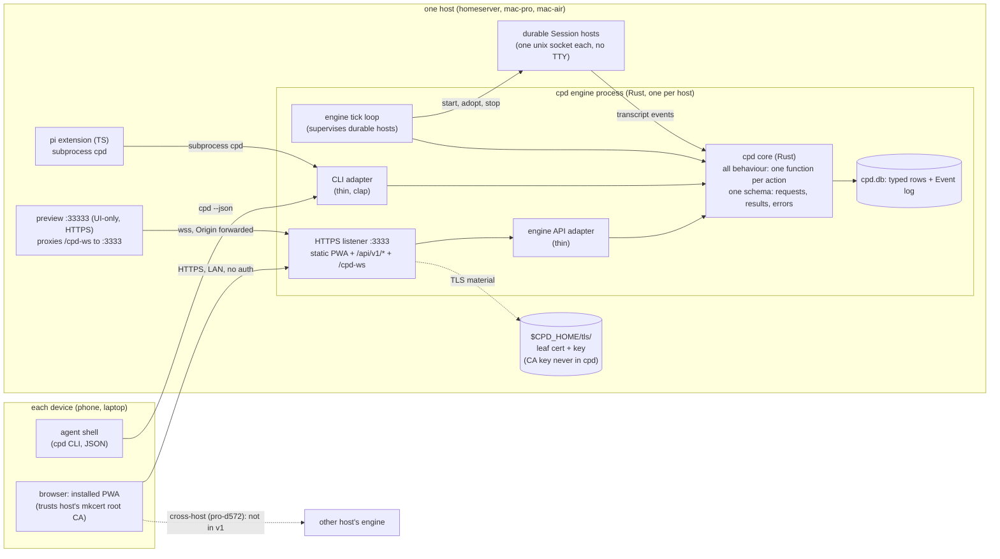

Historical design and gap report, retained as evidence rather than active
product authority. The [core contract](../contract.md), [WebUI contract](../../web/CONTRACT.md)
and [access policy](../architecture/webui-access.md) own current requirements.
The unauthenticated LAN assumptions below are superseded by the owner’s
2026-11-14 access decision. Unverified implementation gaps in this report do not
establish current delivery status.

# Historical end-game design

Status: **proposed design** for Plan `endgame-arch`, Job `arch-docs`. This page decides nothing that is not already a Context record. It states the target, the gap to it, and the order to reach it. Implementation is out of scope (Plan assumption A1): each migration step in §7 is a future Plan.

The [core contract](../contract.md) presents the resolved product rules; [WebUI access](../architecture/webui-access.md) governs current binding and authentication. This page does not override either through file recency or machine-local IDs. Decisions are cited by Context id: pro-d571, pro-d572, pro-d573 (below), and the earlier pro-d566, pro-d567, pro-d570 and pro-d552 that this design builds on.

Operational points settled here (assumption A2) are in §6.

Evidence: every gap row in §3 was read from `origin/main` at `410cf7186` (2026-11-12, fetched during this Job). The scout findings in `run/endgame-arch/explore/verify-arch.md` were re-checked against that SHA. The only commits after the scout's `7c0fdc2c5` are README and research docs, checked with `git diff --stat`.

## 1. Decisions this design rests on

| Id | Decision (verbatim gist) | What it means here |
|---|---|---|
| pro-d571 | The end-game is a PWA client served by the Rust engine, over the Rust cpd core and the TS cpd pi extension, with pi durable for every role. (1) PWA on the LAN over HTTPS with a local mkcert CA trusted on each device; ports 3333 and 33333 stay, LAN-open, fail loud on port in use. (2) No auth. (3) No terminals in the client: durable agents have no TTY; the client streams transcripts. (4) One PWA with a host switcher. | Target stack (§2). Point (4) is narrowed by pro-d572. |
| pro-d572 | The first PWA release drops cross-host access. Each host's PWA talks only to its own engine. Cross-host coordination uses ssh and cpd CLI commands. A host switcher may come in a later release. | Narrows pro-d571 point 4. The later record stands. §6.5 gives the future path. |
| pro-d573 | cpd keeps two interfaces over one Rust core: an engine API for the PWA and the CLI (JSON) for agents. (1) Both are thin adapters; each action is one core function, and composition lives in core. (2) One schema of requests, results and errors generates the CLI JSON, the API and the PWA's TS types. (3) An enforced parity check fails when an action exists in one interface and not the other, or when shapes differ. | §4. |
| pro-d566 | No containers. | Each host runs its own cpd build. |
| pro-d567 | Each host runs its own cpd. No login. The browser is the official interface. | Separate hosts, separate stores. |
| pro-d570 | The preview on 33333 is UI-only. It serves the branch's WebUI and forwards `/cpd-ws` to the production engine on 3333 of the same host. It opens no store and runs no engine. | §6.3. The current code does not do this (§3, row 3). |
| pro-d552 | Browser entry on 3333 serves `web/dist`; `/cpd-ws` is same-origin on 3333. | The PWA is this browser entry, given a manifest and a service worker (§7 step d). |

Citation note: pro-d571 point (1) says it "replaces pro-d96's plain HTTP". In the context store, `pro-d96` reads as a PR-template decision (unverified whether it was meant to be another id). The plain-HTTP decisions in the store are pro-d541 (ports), pro-d542 (port in use), pro-d543 and pro-d552 (LAN origins, browser entry; `web/CONTRACT.md` §15.1). This page cites those for plain HTTP and leaves the pro-d96 reference for the Lead to resolve.

## 2. Target architecture

One Rust process per host, the engine, serves the PWA and the API over HTTPS on 3333. The same core functions answer the CLI and the API. The pi extension stays TypeScript and talks to the core through the CLI JSON it already uses. Each durable agent runs under a host process with no TTY; the client reads transcripts, not terminals.

What the diagram says, in words:

- The PWA reaches only its own host's engine (pro-d572). The dashed edge to another host is not in v1.
- The engine API and the CLI are two thin adapters over one core (pro-d573). Neither holds logic.
- Durable hosts report to the core, not to a Node process. Nothing in the target needs tmux or Node.
- The preview is UI-only (pro-d570). It opens no store.

## 3. Gap table (re-verified against origin/main `410cf7186`)

Status key: **gap** = target not met; **contradiction** = a page says the code does X and the code does Y; **unverified** = read but not run.

| # | Area | Target | Actual on origin/main | Evidence | Status |
|---|---|---|---|---|---|
| 1 | Production server | The engine serves the PWA and API on HTTPS 3333 (pro-d571, serve.md §1) | Node server `web/src/server/serve.ts` serves static files and `/cpd-ws` over plain HTTP, listening on `0.0.0.0:3333` (`PROD_PORT`, serve.ts:16; `listen` :150). It does not proxy. The engine supervises it (`engine/src/watch/webui.rs:210`). `core/src/serve.rs` is a 300-line stub: `run_serve` takes the lock, checks the port, and returns `Ok(())` (serve.rs:269). It binds nothing and opens no store. | serve.rs:241–269; serve.ts:16,150; webui.rs:210 | gap |
| 2 | `cpd serve` at start | Runs | README on main says it panics at start (exit 101) because `ServeConfig::default()` calls `CpdHome::resolve(None, None).expect(...)` (serve.rs:38). Source confirms the `expect`. Not run: the installed binary is 0.27.133 and has no `serve` subcommand. | serve.rs:38; README.md (#1093) | unverified at runtime; source-confirmed |
| 3 | Preview on 33333 | UI-only proxy to 3333's `/cpd-ws`, opens no store (pro-d570, serve.md §5) | Vite dev server with `strictPort`, `host: 0.0.0.0` (vite.config.ts:105). Its plugin `cpdWebPlugin()` (vite.config.ts:104) starts its own cockpit (plugin.ts:370) and its own `/cpd-ws` (plugin.ts:382). No `proxy` entry exists. `run_preview` in serve.rs:280–285 is a stub. | vite.config.ts:104–105; plugin.ts:355,370,382 | **contradiction**: serve.md §5 says proxy; code is an in-process dev server |
| 4 | Transport | HTTPS everywhere on the LAN (pro-d571 (1)) | No TLS anywhere. No mkcert, no rustls, no HTTP-server crate in any `Cargo.toml` on main. The engine's `/cpd-ws` binds `127.0.0.1:0` (`engine/src/watch/ws.rs:258`), so the engine's socket is loopback only. The Node `ws.ts` origin rule accepts only plain `http:` on ports 3333 and 33333 (ws.ts:157–159; `web/CONTRACT.md` §15.1). | ws.ts:157–159; ws.rs:258 | gap |
| 5 | WebSocket handshake | A maintained dependency (convention over configuration) | The engine hand-rolls SHA-1 for the WebSocket handshake (`engine/src/watch/ws.rs:1–30`, "Pure Rust SHA-1 implementation"). | ws.rs:1–30 | gap: replace with a dependency at step (b) |
| 6 | PWA | Manifest, service worker, installable (pro-d571) | Absent. No manifest, no `sw.js`, no `serviceWorker` or `registerSW` in `web/src`. `web/index.html` has no `<link rel="manifest">` and no `apple-touch-icon`. | web/index.html:1–14 | gap |
| 7 | CPD.app / Electron | Retired (pro-d567). #1092 implements the retirement. | Still on main: `web/package.json:49` `electron` 45.2.2; `web/electron-builder.yml`; `web/src/electron/main.ts`. #1092 (commit `31feefabf`) is not an ancestor of `origin/main`; it exists only on `origin/simple-install/upgrade`. | `git merge-base --is-ancestor 31feefabf origin/main` = not an ancestor | gap: #1092 not merged |
| 8 | node-pty | Gone with terminals (pro-d571 (3)) | Not in `web/src/server` (zero matches). Only in the Electron main process (`web/src/electron/main.ts:19`, `web/package.json:34`). The scout's "node-pty under the Node server" is wrong. | git grep `node-pty` | correction (verify-arch item 4) |
| 9 | Completion service | Core-owned, no Node-side classifier | Node: `web/src/server/completion-*.ts`, 333 production lines. The classifier spawns a pi script through `child.execFile` (plugin.ts:217; completion-classify.ts). Core already has a classifier port: `core/src/classifier.rs:47` `trait ClassifierPort` with `PiClassifier`. Whether completion can use it is unverified. | completion-*.ts; classifier.rs:47 | gap |
| 10 | Durable hub | Engine supervises durable hosts; PWA reads transcripts from the engine | Node: `web/src/server/durable/*`, 2,165 production lines (`frames.ts` 1,117; `backend.ts` 570; `client.ts` 288; `ops.ts` 190). It connects to host sockets itself (`connectHost`, durable/client.ts:94). The engine already supervises one host per live Session (`engine/src/watch/hosts.rs`, "P1.10"; `engine/src/watch/engine.rs:94`). Core has the host-socket seam (`core/src/host/host_socket.rs`). Two supervisors exist. | line counts; hosts.rs:1 | gap: duplicate supervision |
| 11 | tmux, Rust | Removed, once durable Leads and Managers run everywhere (pro-d571; interfaces.md "removal-marked") | 148 `.rs` files under `core/` and `engine/` mention tmux (`git grep -l -i tmux`). Name-filtered to non-test files: 68 files, 805 matching lines. That is an upper bound: several files mix `#[cfg(test)]` modules. `core/src/host/tmux.rs` is the typed wrapper. `#1074` ("Supervise durable Managers directly from engine and retire tmux") is on main. | git grep; verify-arch §4 (reproduced 148) | gap; the count of 805 is an upper bound |
| 12 | tmux, web | Removed | 12 non-test lines in 3 files: `cockpit/status.ts` (4), `pi/backend.ts` (3), `plugin.ts` (5). | git grep | gap |
| 13 | Default runner | Durable (target) | `core/src/config/runner.rs:10` documents `pi` (pi in a tmux pane) as the default. Runtime default not verified. | runner.rs:10, 21–22 | unverified |
| 14 | Interface parity | One schema; enforced parity test (pro-d573) | No schema shared by CLI and PWA. The error envelope is one Rust type (`core/src/error.rs`: `CpdError`, 297 `ErrorCode` variants, printed as `{"ok":false,"error":{code,message,details}}`). The CLI has 36 top-level `Command` variants (`cli/src/cli.rs`). The PWA reaches core only by running CLI argv: `web/src/server/cockpit/actions.ts` `runAction` maps each action to argv and calls `cpd.json`. ts-rs exports five types, plus a `PlanPhase` alias, to `web/src/generated/types.ts` (AgentKey, Phase, Urgency, JobKind, JobStatus; `core/tests/contract_types.rs`). No API route exists on the Rust side. No parity test exists. | error.rs; cli.rs; actions.ts; contract_types.rs | gap: largest one |
| 15 | Cockpit composition in TS | Composition lives in core (pro-d573 (1)) | `runAction` in `actions.ts` sequences two CLI calls for `context.new` (create, then `context.manager`) and retries `session.park` on `in_chat_slot`. Both are multi-step logic in TypeScript. | actions.ts:86–115 | gap |
| 16 | Dead code | — | `web/src/server/core-ws.ts` (`CoreWsClient`, 100 lines): imported only by its own test. | git grep `core-ws` | unused; remove with the Node server (step c) |
| 17 | Size of the Node server | — | `web/src/server`: 78 files, 15,179 lines in total. 32 production files, 7,357 lines. 46 tests, 7,822 lines. The scout's "32 files, ~15k lines" mixes the two; the production figure is 7,357. | git ls-tree + wc -l | correction (verify-arch item 3) |
| 18 | Port constants | Fixed, never configurable (pro-d542) | Hard-coded in `web/src/server/serve.ts:16,19`, `engine/src/watch/webui.rs:22,24`, `core/src/serve.rs` and `web/src/server/ws.ts`. | git grep | ok: matches the decision |

Corrections to the review (verify-arch.md, re-checked): row 8 (node-pty), row 3 (preview), row 17 (file counts), row 6 (no PWA), row 7 (#1092 not merged). The review's SHA `a9ed84882` is one commit behind main.

## 4. Dual interfaces over one core (pro-d573)

### 4.1 Rule

Every action is one function in `core`. The CLI and the engine API are adapters: each parses its input into the shared request type, calls the core function, and prints or sends the shared result. An adapter holds no logic. Composition of several core calls is a core function that both adapters expose (pro-d573 (1)).

### 4.2 Single schema

The schema is the Rust type set in `core`, with `#[derive(Serialize, Deserialize, TS)]` (ts-rs, already pinned at `12.0.1` in the workspace `Cargo.toml`). No second schema language. JSON Schema or a new codegen crate is not added unless ts-rs cannot express a shape (YAGNI).

| Layer | Owner | Location (planned, Plan (b)) |
|---|---|---|
| Action registry: name, request type, result type, `interfaces: Both \| CliOnly \| ApiOnly`, reason | core | `core/src/api/registry.rs` |
| Request and result types per action | core | `core/src/api/<area>.rs` |
| Error envelope | core (exists) | `core/src/error.rs` (`CpdError`, `ErrorCode`) |
| Action functions | core | `core/src/api/<area>.rs`, one `pub fn` per action |
| CLI adapter | cli | `cli/src/` (clap args → request → `Output`) |
| Engine API adapter | engine | `engine/src/api/router.rs` (`POST /api/v1/<action>`, JSON in, JSON out) |
| TS types for the PWA | generated | `web/src/generated/api.ts`, from the same ts-rs derives; generator alongside `core/tests/contract_types.rs` |

Wire shapes (both adapters):

- Success: `{"ok": true, ...fields}`, the existing `Output::Success` shape.
- Failure: `{"ok": false, "error": {"code", "message", "details"}}`, the existing `CpdError` shape.
- The API body is byte-identical to the CLI stdout for the same action. This is the parity rule the test enforces (§5).
- HTTP status comes from one function in core, `ErrorCode` to status, decided here: `usage` 400, `not_found` 404, `refused` 409, `timeout` 504, `failure` 500, success 200. The engine maps through that function and nowhere else.

Actions that stream (events, transcripts) use the `/cpd-ws` channel with the same `Event` JSON. No second event shape.

### 4.3 Parity test

- **File**: `cli/tests/tooling/interface_parity.rs` (new), registered in `cli/tests/tooling/main.rs`. Same pattern as `cli/tests/tooling/interface.rs`, which generates `docs/interface.md` from the command tree.
- **Fakes, no sockets**: the test calls the engine router in process, without binding a port, and the CLI through `cpd::main_with` (`cli/src/lib.rs:19`). Ports are the core fakes (`core/src/fakes`, feature `fakes`). This follows the test policy: no real tmux, no network, no real pi.
- **Checks** (one test each):

| Test | Passes when | Fails with |
|---|---|---|
| `every_both_action_is_on_both_interfaces` | every action with `Both` has a CLI command and an engine route | the action name, and which interface lacks it |
| `every_cli_command_is_an_action_or_declared_cli_only` | each runnable CLI command (from the command tree, as `interface.rs` does) is in the registry, or is `CliOnly` with a reason | the command path, unregistered |
| `every_route_is_an_action` | each `/api/v1/*` route is a registry entry | the route, unregistered |
| `request_and_result_types_match_generated_ts` | regenerated `web/src/generated/api.ts` equals the checked-in file | a diff; fix with `CPD_BLESS=1 scripts/cargo.sh test -p cpd --test tooling interface_parity` (same bless pattern as `interface.rs`) |
| `cli_stdout_equals_api_body` | for each `Both` action, a fixture request gives identical JSON from both adapters | the action name, and both bodies |
| `errors_share_one_envelope` | for a fixed set of failing requests, CLI and API return the same `error` object and the status from §4.2 | the action name and the differing field |

- **Failure modes the test must catch**, each with a named case in the test: action added to CLI only; route added with no registry entry; request field renamed in core but not in the TS file (stale generation); result field present in one adapter's output only; error code mapped to a different status than §4.2; composition done in an adapter (caught by `cli_stdout_equals_api_body`, which fails when the two adapters disagree).
- **Not in the test**: whether an action is good. Only that the two interfaces agree.

## 5. Single-host PWA over LAN HTTPS

- One engine per host, one store per host (pro-d567). The PWA on a device reaches only the host it was installed from (pro-d572).
- The PWA is the existing browser build (`web/dist`, pro-d552) plus a manifest and a service worker (§7 step d). It is served over HTTPS (§6.1). A service worker requires a secure context, so HTTPS is a prerequisite for step (d), not an option.
- No terminals. Durable agents have no TTY; the PWA shows transcripts streamed over `/cpd-ws` (pro-d571 (3)).
- No auth (pro-d571 (2)). TLS authenticates nothing here: it protects the transport on the LAN. The `Origin` rule (`web/CONTRACT.md` §15.1) limits which pages may connect; it is not access control. This is the accepted risk of pro-d571, restated.
- Origins that the engine accepts: the LAN rule of `web/CONTRACT.md` §15.1 (pro-d543) remains, with the scheme changed from `http` to `https`. The Node rule (ws.ts:157–159) is replaced at step (b) and must accept `https://` on 3333 and 33333.

## 6. Settled operational points (A2)

### 6.1 mkcert CA: setup and renewal

Decided here.

- **One CA per host.** Each host creates its own local CA. A device trusts the CA of each host it uses. The alternative, one CA shared by all hosts, couples the hosts' trust: a leaked key or a revoked root affects all three. Per-host costs one extra trust install per device pair. Decided for blast radius; reversible by re-issuing (cheap).
- **Setup**: `cpd install` (commands.md §14.4) checks that `mkcert` is on `PATH` and fails loud if it is not. It runs `mkcert -install` once, creating the CA in mkcert's `CAROOT`. It then issues the leaf certificate into `$CPD_HOME/tls/` (leaf cert and key). The CA key stays in mkcert's `CAROOT`; the engine never reads it.
- **Device trust**: the root certificate (`rootCA.pem`) is exported once and installed by hand on each device (macOS keychain, iOS profile, Android settings). cpd does not automate this; it prints the path and the steps.
- **Leaf SANs**: `localhost`, `127.0.0.1`, `::1`, the host's `.local` name, and the host's RFC 1918 addresses at issue time. Loopback is included so the preview's proxy (§6.3) verifies against the same leaf.
- **Renewal**: `cpd tls renew`, a new command in step (b), re-issues the leaf. It runs when the leaf is within 30 days of expiry or when the host's addresses no longer match the SANs. The engine checks at start and on each tick: an expired leaf stops HTTPS with `error` (fail loud), and a SAN mismatch raises an `error` Event naming the missing address. The engine never runs mkcert itself.
- **Lifetimes**: mkcert's leaf and root validity are unverified here. Read mkcert's source at the entry of Plan (b) and record the numbers in that Plan.

### 6.2 HTTPS server

- Engine process binds `0.0.0.0:3333`, with the leaf from `$CPD_HOME/tls/`.
- Dependency choice (convention over configuration): an existing HTTP/TLS stack, not hand-rolled. The candidates are `axum` with `axum-server` and `rustls`, or `hyper` with `tokio-rustls`. The choice is pinned in Plan (b), after checking current versions. This page does not pin a version (unverified).
- The hand-rolled SHA-1 in `engine/src/watch/ws.rs` is removed with the same change.

### 6.3 Preview on 33333 over HTTPS

- The preview stays a Vite process on `0.0.0.0:33333`, `strictPort`, served over HTTPS with the same leaf (`server.https` in `web/vite.config.ts`).
- It forwards `/cpd-ws` to `https://127.0.0.1:3333/cpd-ws` with Origin unchanged (pro-d570). Mechanism, proposed here: Vite's built-in `server.proxy` with `ws: true`. The alternative, a small forwarder, adds a module with no benefit (KISS). Unverified that Vite's proxy forwards the Origin header unchanged on the upgrade path; Plan (c) must test this. This closes serve.md open point 4 as a proposal, not a proof.
- The preview's own `cockpit` and `/cpd-ws` (plugin.ts:370, 382) are removed. The preview opens no store and runs no engine.
- The proxy target's certificate is trusted through `NODE_EXTRA_CA_CERTS` pointing at the host's CA root, set by the supervisor (`engine/src/watch/webui.rs`). Unverified until Plan (c) runs it.
- The preview's rewiring is part of step (c), where the Node server goes. Until then the preview remains the in-process dev server (row 3).

### 6.4 Replacements for the Node completion service and durable hub

- **Completion**: moves to the core classifier port (`core/src/classifier.rs:47`). The engine runs it on the tick. The result is an action, `completion.get`, in the registry. The Node `completion-*.ts` files and the `execFile` classifier are deleted in step (c). Whether the existing core classifier can express the completion question is unverified; the question text is in `completion-classify.ts`.
- **Durable hub**: the engine's host supervisor (`engine/src/watch/hosts.rs`) and the core host-socket seam (`core/src/host/host_socket.rs`) are the one supervisor. Transcript reads go to core and out over `/cpd-ws`. The Node `durable/*` files are deleted in step (c), after the core path passes the parity test for every durable action.

### 6.5 Future cross-host path (not v1)

pro-d572 defers cross-host access. The future path, stated so v1 does not block it:

- A host switcher is a second origin talking to another host's engine. That needs CORS on the engine, and each host's CA already exists for trust (§6.1).
- With no auth (pro-d571 (2)), any LAN browser page could call any engine. A cross-host release needs a new decision on auth before it ships. This design does not make that decision.
- Until then, cross-host work uses ssh and the CLI (pro-d572).

## 7. Migration plan

Ordered, small, reversible. Each step is a named future Plan. A step starts only when its entry criteria hold, and each step's reversal is listed.

Prerequisite (already in flight, not a numbered step): **#1092** (retire CPD.app and Electron, pro-d567) must merge first. Electron holds `node-pty` and a second client; step (d) cannot ship a single PWA while it exists.

Reversal mechanism for every step: `cpd upgrade` rollback (merged in #1091: "build from green main, dry-run, swap and rollback"). Each step lands as a single revertable commit set, so `git revert` of that Plan's merge is the code-level undo.

Open blocker before step (a): **the fate of the TUI cockpit.** The cockpit design in [contract §6.1](../contract.md#61-the-server) is tmux-hosted. pro-d571 says there are no terminals in the client. Nothing decides whether `cpd tui` survives. Step (a) cannot delete tmux while the TUI depends on it. This is a question for the Lead, not an assumption this page makes.

### (a) Durable Leads and Managers, then delete tmux

- **Plan name**: `durable-roles`.
- **Scope**: run every Lead and Manager on the durable runner; then remove the tmux host (`core/src/host/tmux.rs` and the 68 non-test files of §3 row 11), once the TUI question is answered.
- **Entry**: #1074 on main (verified). A decision on the TUI cockpit (blocker above). The default runner changed to durable, verified at runtime, not from the doc comment (row 13).
- **Exit**: no tmux references in `core/` or `engine/` outside tests; the default runner is durable; durable Leads pass the existing durable-flow tests (`engine/src/watch/durable_flow_tests.rs`).
- **Reversibility**: the runner toggle (`core/src/config/runner.rs` `toggle`, which flips `[experimental] durable_workers`) lets the old runner come back until the tmux code is deleted. Delete tmux in its own commit, last in the Plan, so a revert restores it in one step.

### (b) Engine HTTPS server and typed API, migrating the cockpit routes

- **Plan name**: `engine-https-api`.
- **Scope**: the HTTPS listener (§6.2) on 3333; `cpd tls renew` (§6.1); the action registry, the request and result types, the engine API adapter and the parity test (§4); the cockpit's actions moved from `actions.ts` to core, including the composition in row 15; the `/cpd-ws` handshake replaced by a dependency (row 5); the `ErrorCode`-to-status function (§4.2).
- **Entry**: the schema of §4.2 accepted. The mkcert lifetimes read (§6.1). The dependency pinned.
- **Exit**: `interface_parity` passes for every `Both` action. The cockpit's actions run through the engine API. The Node server still serves static files and the old `/cpd-ws`; both run in the same release, behind the same port, with the Node server replaced only in step (c).
- **Reversibility**: the Node server remains in the tree and in the build until step (c). Rollback is `cpd upgrade` to the previous build.

### (c) Delete the Node server

- **Plan name**: `delete-node-server`.
- **Scope**: delete `web/src/server` (32 production files, 7,357 lines, and their 46 tests) and `web/src/electron` if #1092 has not already; delete `core-ws.ts`; rewire the preview to the proxy of §6.3; move the completion classifier (§6.4) and the durable hub (§6.4) into core and the engine.
- **Entry**: step (b) exited. Each durable and completion action has a registry entry and a parity test. The preview's proxy verified under the same leaf.
- **Exit**: no file in `web/src/server` is imported by a production path; `serve.ts` is gone; `cpd serve` serves the PWA and the API from Rust alone.
- **Reversibility**: one deletion commit per area (completion, durable, server), so each can be reverted alone.

### (d) PWA manifest and service worker

- **Plan name**: `pwa-shell`.
- **Scope**: `manifest.webmanifest` and icons; `<link rel="manifest">`, theme colour and `apple-touch-icon` in `web/index.html`; a service worker that caches the shell and never caches `/api/v1/*` or `/cpd-ws`.
- **Entry**: step (b) live on HTTPS (a service worker requires a secure context, §5). Step (c) not required.
- **Exit**: the PWA installs on macOS, iOS and Android from the host's HTTPS origin, and loads its shell offline. The service worker never serves stale API data (a test).
- **Reversibility**: additive. Revert the manifest and the registration. A service worker that unregisters itself is the in-field kill switch: ship it before any change to caching.

### (e) Embed PWA assets in the cpd binary

- **Plan name**: `embed-pwa`.
- **Scope**: the built `web/dist` is compiled into the binary (`include_bytes` or a crate such as `rust-embed`, chosen in the Plan). The engine serves from memory. The installed checkout no longer needs `web/dist` (serve.md open point 3).
- **Entry**: step (d) exited, so the asset list is stable. Step (c) exited, so there is no second static server to keep in sync.
- **Exit**: `cpd` serves the PWA with the `web/` directory absent. `cpd install` no longer copies `web/dist`.
- **Reversibility**: a binary rollback via `cpd upgrade` restores the previous build, which reads from disk.

### Order and why

(a) and (b) can run in parallel after the TUI decision, because (a) removes tmux from the runner and (b) changes the transport. (c) needs (b). (d) needs (b) for HTTPS. (e) needs (c) and (d). The order keeps every step reversible on its own.

## 8. Evidence and limits

- **Read, not run**: every gap row is source-read at `410cf7186`. Nothing was built or run. The one runtime claim (row 2, `cpd serve` panics) is source-confirmed only; the installed binary (0.27.133) has no `serve` subcommand, so it could not be run.
- **Counts**: the tmux count of 805 lines is an upper bound (name filter, not a `cfg(test)` parse). The 148 file count reproduces. The Node server's 32 production files and 7,357 lines reproduce.
- **Not verified**: that the Mermaid diagram of §2 renders (no `mmdc` on this machine; syntax checked by reading only); the runtime default runner (row 13); whether the core classifier can express the completion question (row 9); mkcert's validity periods (§6.1); the current versions of the HTTP/TLS crates (§6.2); whether the TUI cockpit must survive (§7, blocker).
- **Context records read**: pro-d571, pro-d572, pro-d573, pro-d570, pro-d566, pro-d567, pro-d552, pro-d541, pro-d542. pro-d96 was read and found to be unrelated (citation note, §1).
- **Freshness**: `origin/main` was fetched during this Job; the SHA is `410cf7186`. A later push to main can change rows 1–18; re-check them before a step's entry.
