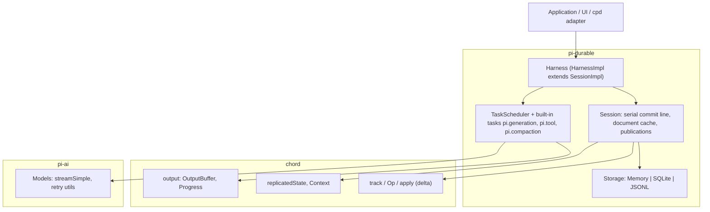
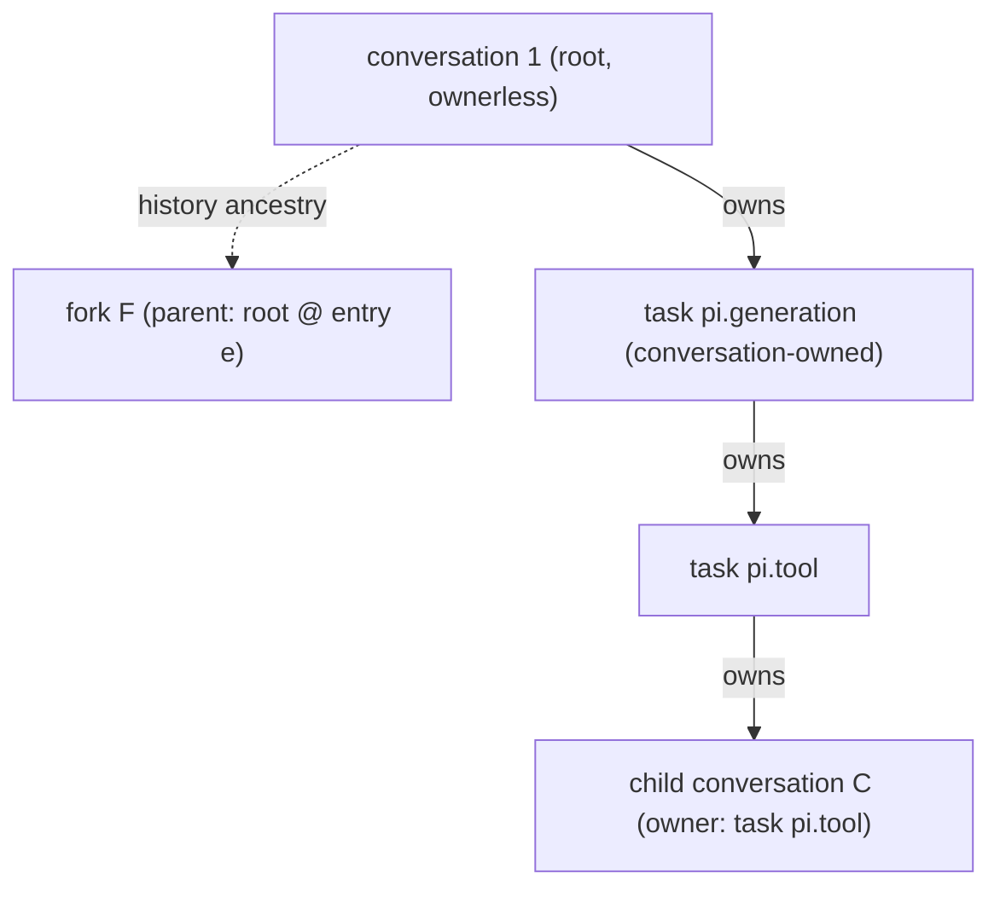
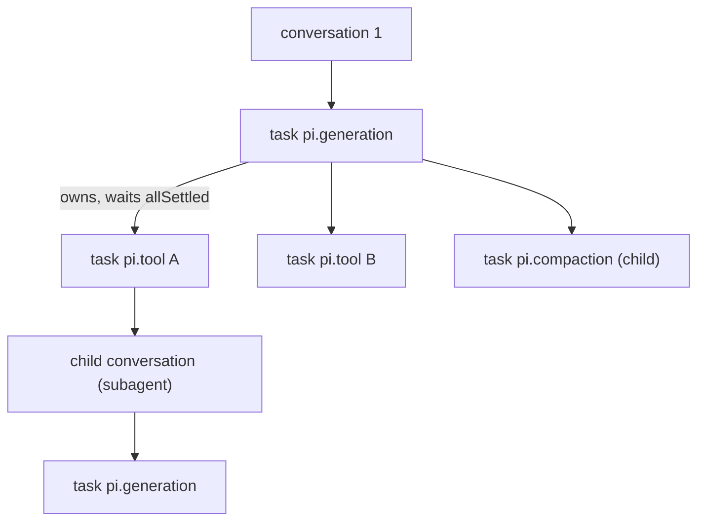
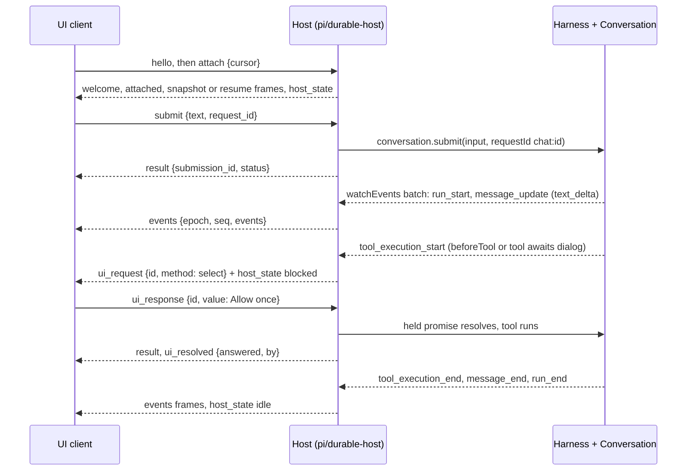

# pi-durable deep dive

Commissioned by Context record pro-d7 (User, 2026-11-03 EST). Built in three docs Jobs: Job 1 wrote sections 0 (draft) and 1, Job 2 section 2, Job 3 sections 3 and 4 and the final section 0.

## 0. TL;DR and evidence labels

**TL;DR.** Answers to the three questions of pro-d7: how it works (sections 1), how applications and UIs communicate with it (section 2), how it compares with pi-agent (section 3). Every bullet points to the section that proves it.

1. **What it is.** pi-durable is an in-process library: `Harness.open(storage, options, context)` returns a `Harness` that stores every conversation, entry, task and document, and re-runs unfinished work from its last committed checkpoint after `resume()` (read: `pi-durable/dist/harness/scheduler.js:1230-1234`, `1266-1270`). Proof: 1.1, 1.6, 1.8.
2. **Stack.** pi-ai (models) under chord (JSON delta and context primitives) under pi-durable; pi-durable uses chord's values, contexts and output helpers, not chord's hosts or links (measured by scout: 0 dist files reference `createHost`, `webSocketLink` or `ipcLink`). Proof: 1.1.
3. **Atomic state.** One serial commit per callback writes entries, tasks, submissions and document deltas to `Storage.commit()` as one batch (read: `pi-durable/dist/session/session.js:534-536`, `653-657`); streaming text is committed to `pi.live` at most every 100 ms (read: `pi-durable/dist/harness/agent.js:16-19`). Proof: 1.4, 1.5, 2.2.
4. **Crash recovery.** After a crash a model request is re-sent, the committed partial becomes an `aborted` entry, and a tool reruns only if both its stored intent and its definition say `replay: "safe"`, else the model gets an `interrupted` error (read: `pi-durable/dist/harness/tool.js:95`, `105`, `115`). There is no exactly-once guarantee. Proof: 1.8.
5. **Talking to it in process.** An application calls `submit`, `abort`, `compact`, `reset`, `fork` on a `Conversation` and watches it with `viewState`, `watch` or `watchEvents`; all three channels carry committed state only, with no replay and no cursor (read: `pi-durable/README.md:404`). Extensions, hooks and tools plug in through a `Registry`. pi-durable has no approval or question API; a pause is built from primitives. Proof: 2.1 to 2.4.
6. **Talking to it from outside.** One process owns a storage and nothing enforces it: "no cross-process locking" (read: `pi-durable/README.md:682`; measured by scout: no lock, lease or fence in dist). A UI must therefore go through a host process. cpd's `pi/durable-host` is that host: an NDJSON unix socket, protocol v1, snapshot or resume attach from `{epoch, seq}`, many clients, dialogs replayed on attach. Proof: 1.7, 2.5.
7. **Versus pi-agent.** pi-coding-agent persists completed messages as JSONL lines and does nothing on reopen; pi-durable persists intent, partials and queues and resumes. The price is a single owning process, an experimental API (read: `pi-durable/README.md:3`) and no skills, MCP, templates or export (3.1, 3.5). Headless cpd Workers switch between `pi` and `durable` because they share only a contract: spec in, report out, no UI, one process (3.2).
8. **For cpd-webui.** A web chat for Leads and Managers is a client of the host, not of the store; the host already gives snapshot, resume, history, submit, abort and dialogs, and a web client adds a browser transport, auth, reconnect, a fold of events and dialog rendering (3.3). Claims I could not settle are listed in section 4.

**Evidence labels.** Every claim carries one of these in its sentence or table cell.

| Label | Meaning |
|---|---|
| `read` | I (or a scout, then re-read by me in the cases noted) read the cited line. Package files cite `pi-durable/dist/<file>:<line>` or `chord/dist/<file>:<line>`; cpd files cite repo-relative paths. |
| `measured` | A command ran and gave the quoted number. |
| `inferred` | My reasoning from read code; nothing was run. |
| `guess:` | Unverified. |

Nothing in this document was executed against pi-durable: no model, storage or test ran. The only `measured` values are `grep` counts from the scouts (artefacts under `$CPD_HOME/run/pi-durable-how/explore/`) and `grep`/`sed` checks by the document's authors. Section 4 lists every `inferred` and `guess:` label.

**Versions covered.** pi-durable 1.3.0 (`pi-durable/package.json:3`, read), chord 1.3.0 (`chord/package.json:3`, read by scout x-chord), pi-coding-agent 1.3.0 (`pi-coding-agent/package.json:3`, read). pi-durable depends on `@earendil-works/pi-ai` 1.3.0 (`pi-durable/package.json:147`, read). Older cpd notes (`docs/research/pi-durable.md`, `pi-durable-resume.md`, `chord.md`, `durable-leads.md`) cite 1.4.0 (read: `chord.md:3-6` per scout x-chord); features they name that are absent here: read-only watch, `restartLimit`, IndexedDB storage (measured by scout x-store: `grep` in dist returned no match).

Path shorthand: `pi-durable/` = `@earendil-works/pi-durable` 1.3.0 package root; `chord/` = `@earendil-works/chord` 1.3.0 package root. The package ships compiled `dist/` only (chord `src/` holds only `delta/README.md`, measured by scout x-chord via `ls -R`).

## 1. What pi-durable is and how it works

### 1.1 Stack: pi-ai > chord > pi-durable

pi-durable is a library, not a service: you call `Harness.open(storage, options, context)` in your process (`pi-durable/dist/harness/harness.js:309-331`, read). Three layers:



| Layer | What pi-durable takes from it | Evidence |
|---|---|---|
| pi-ai | model streaming (`runtime.models.streamSimple`), retry classification | `pi-durable/dist/harness/generation.js:315` (scout x-sched, read), `generation.js:3` import of `pi-ai/utils/retry` (scout, read) |
| chord | `track`, `apply`, `applyImmutable`, `applyImmutableBatches`, `replicatedState`, `copyJson`, `Context` and its combinators, `OutputBuffer`, `Progress`, `boundOutput` | 22 dist `.js` files import chord (measured by scout x-chord: `grep -rl "@earendil-works/chord" dist --include=*.js`) |
| pi-durable | Harness, Session, Storage, Tasks, built-in documents and entries | sections 1.2 to 1.8 |

Chord ships no `Document` type: the word appears only as `## Documentation` in chord's README (measured by scout x-chord: grep over `README.md`, `docs/`, `src/`, `dist/`). pi-durable's document model is its own, built on chord's tracker (`pi-durable/dist/session/transaction.js:349`, `453`, read by scout; adoption checks the revision and base at `chord/dist/delta/tracker.js:141-149` and then swaps one pointer at `152-154`, read).

Chord objects, hosts, links, contracts and reload are **not** used by pi-durable 1.3.0 (measured by scout x-chord: 0 dist files reference `createHost`, `defineFacet`, `webSocketLink`, `ipcLink`, `memoryLinkPair`, `hostNamed`, `remote(`, `withCancel` or `chord/node`). Chord's guide sample that hosts pi-durable as `DurableHarness` / `durableRegistry` does not match 1.3.0 (measured: both names appear in 0 dist files).

### 1.2 Harness and Conversation (root, children, forks)

- **Harness.** `Harness.open` checks the registry holds every built-in task, builds the object, then calls `openTasks` (`pi-durable/dist/harness/harness.js:311-331`, read by scout; `openTasks` at `harness.js:145-147`, read). It owns the guarded storage, scheduler, submissions and views. Scheduling starts only on `resume()` or a progress call such as `submit` (`harness.js:148-151` read; `scheduler.js:159-162` read: `resume()` sets `#enabled = true` and kicks).
- **Conversation handle.** A `Conversation` holds only `id` and a host reference; compare by id (`pi-durable/README.md:83`, read by scout x-model).
- **Record.** `ConversationRecord = { id, parent?: {conversationId, at}, owner?: {conversationId, taskId} }`, immutable (`pi-durable/dist/types.d.ts:263-276`, read by scout).
- **Root.** Reserved id 1: `export declare const ROOT_CONVERSATION_ID` (`pi-durable/dist/types.d.ts:29`, read; value 1 per `dist/types.js:2`, scout grep). `Harness.root()` returns it, creating it with `agent` and `init` only when absent (`harness.js:219-241`, scout read; that `agent`/`init` are ignored when the root exists is `inferred` from the early return).
- **Children.** A child is a conversation created inside a commit with task ownership; ownership is required, never optional (`pi-durable/dist/harness/types.d.ts:417-423`, scout read). Ownership drives attribution, subtree abort and idle waits (`dist/types.d.ts:271`, scout read). A task-owned child copies its owner's `pi.agent` (`dist/harness/agent.js:137-146`, scout read).
- **Forks.** `fork(at, {ownership})` needs an entry `at` visible from the parent; it copies only documents whose fork policy matches, and the rest start from `initial()` (`pi-durable/dist/session/forks.js:4-12`, `19`, scout read). Per policy: `pi.agent` is `asOf` (copied as of the entry), while `pi.provider`, `pi.usage`, `pi.live`, `pi.inbox` are `initial` (fresh) (`harness/agent.js:27-28`, `provider.js:9`, `usage.js:8`, `live.js:8`, `inbox.js:9`, scout read). A fork therefore gets a fresh provider `sessionId` (`README.md:532`, scout read).
- **Ids.** One Session-wide counter for conversations, entries, tasks, submissions and document incarnations: `mintId()` returns `idFromNumber(this.nextId++)` from memory (`pi-durable/dist/storage/sqlite/storage.js:127-131`, read). It is loaded once at open (`storage.js:92-95`, scout read), which is why a second writer collides (1.7).



### 1.3 Entries

An entry is an immutable transcript record: `{ id, conversationId, kind, model?, data?, head?, edits?, byTaskId? }` (`pi-durable/dist/types.d.ts:290-305`, scout read). `EntryDraft` allows `head: "self"` (starts the active context at the new entry) (`types.d.ts:306-310`, scout read; resolved at `dist/session/transaction.js:155-172`, scout read).

| Kind | Carries | Written by (read, scout x-model) |
|---|---|---|
| `pi.user` | `[UserMessage]` | idle input, or a queued input placed at a boundary (`harness/inbox.js:35-76`, `submissions.js:188`) |
| `pi.assistant` | `[AssistantMessage]`, any stop reason | `appendAssistant` (`generation.js:549-551`): answer, tool round, retry/error, or the aborted partial (`generation.js:269-275`, which I re-read) |
| `pi.system` | empty `content`, with section and tool patches | `generation.js:83-86` in `prepare` (re-read at `generation.js:83-85`) |
| `pi.tool-result` | `[ToolResultMessage]`, `data: {diagnostics}` | `appendToolResult` (`tool.js:684-704`) |
| `pi.reset` | optional handoff user message, `head: "self"` | `Conversation.reset()` as a write submission (`harness.js:42-47`) |
| `pi.compaction` | summary user message, `head: firstKept` | `placeSummary` (`compaction.js:356-372`) |

Application kinds are allowed; the `pi.` prefix is rejected for input entries only (`submissions.js:128`, scout read; that write submissions skip the check is `inferred`, untested).

**Active range and context.** A *head marker* is an entry with `head` set; the model sees the marker plus entries from its `head` to the tail (`pi-durable/dist/harness/context.js:195-198`, scout read). `selectActive` keeps the marker first and drops later head markers: `head === undefined ? range : [head, ...range.filter((entry) => entry.head === undefined)]` (`context.js:211-213`, read). `edits` (`omit` or `replace`) change model context only, never the stored entry (`types.d.ts:278-288`, scout read). Assistant messages with stop reason `aborted`, `error` or `deferred` are excluded from context (`context.js:4`, `164-165`, scout read). Tool results are reordered after their assistant, and a missing result is synthesized as an error `Tool result unavailable: history ends before this call completed.` (`context.js:218-254`, scout read).

### 1.4 Commits

`Session.commit(change, context)` runs `change(tx)` on a serial line and then persists all writes as one batch.

1. **Serial line.** `#enqueue` chains each job on a promise tail, so commits and scheduler decisions are totally ordered in one process (`pi-durable/dist/session/session.js:653-657`, read).
2. **Algorithm** (`session.js:503-555`, scout read): run `change(tx)`; if it throws, abort every open change and rethrow with no write; assemble writes; if there are none, return without touching storage; else `storage.commit(writes, withoutAbortSignal(context))` (`session.js:534-536`, read: "Once admitted, caller cancellation does not interrupt Storage settlement"); then adopt prepared document values and publish.
3. **Batch contents.** conversation and entry records, submissions, task records, then per document a base or delta write and optional retire (`pi-durable/dist/session/transaction.js:584-606`, scout read). `StorageWrite` variants: `conversation`, `entry`, `task`, `submission`, `document.create|copy|change|retire` (`dist/types.d.ts:647-676`, scout read).
4. **Atomicity.** SQLite: one `db.transaction` per commit (`storage/sqlite/storage.js:107-125`, scout read). Memory: `prepareCommit(writes).apply()` (`storage/memory.js:169-199`, scout read). That all rows land together is `inferred` from these two paths.
5. **Read-after-write guard.** After a table write in the same commit, a table read throws `ReadAfterWrite`: `if (this.#hasTableWrite) throw new ReadAfterWrite(method)` (`transaction.js:676-684`, read). Document access is not gated (`transaction.js:275-337`, scout read).
6. **Publication.** `CommitPublication = { seq, changes }` (`dist/types.d.ts:702-705`, scout read) fires after adoption; internal listeners run first and a throw fails the Session, host listeners run next and a throw is only reported (`session.js:557-581`, scout read).
7. **Failure is final.** The first error a Storage method throws fails the Session; nothing retries (`session.js:42-46`, scout read; `types.d.ts:856-859`, scout read).

Document values are chord drafts: `tracker.beginChange()`, `prepare()`, `adopt()`; adopting a stale preparation throws "Prepared change is stale" (`chord/dist/delta/tracker.js:141-149`, scout read; swap at `152-154`, read). Ops are `r s d a t p m` (`chord/dist/delta/index.d.ts:19`, scout read).

### 1.5 Chord Documents

A document is a versioned JSON value addressed `[kind, scope, owner, key]` (`pi-durable/dist/documents.js:17-47`, scout read), declared with `defineDoc` / `defineDocFamily`. Fields: `kind`, `version` (positive integer), `initial()`, `migrate?`, `checkpointWhen?`, and for conversation scope `history: "latest" | "rewindable"` and `fork` policy (`dist/types.d.ts:31-76`, scout read). An older stored version without `migrate` throws; a newer one throws (`documents.js:78-98`, scout read). Storage keeps a *base* plus *deltas*; `checkpointWhen` makes a change store a full base instead of a delta (`transaction.js:740-790`, scout read). Observed documents are never evicted from the cache; others age out after `documentRetentionMs` (default 600 000) (`session.js:18`, `27-29`, `585-596`, scout read).

Every conversation gets five built-in documents in its creating commit (`pi-durable/dist/harness/harness.js:243-250`, scout read):

| Document | Scope / history / fork | Holds (read, scout x-model) | Written by |
|---|---|---|---|
| `pi.agent` | conversation, rewindable, `asOf` (`agent.js:23-31`) | `model`, `thinkingLevel`, `extensions`, `tools`, `modelTools`, `instructions`, `cwd` (`types.d.ts:347-376`) | `configure` (`agent.js:55-58`), `addTools` (`agent.js:66-96`) |
| `pi.provider` | conversation, latest, `initial` (`provider.js:4-12`) | `{ sessionId }` (uuidv7), forwarded to pi-ai | `conversationCreated` |
| `pi.live` | conversation, latest, `initial` (`live.js:3-18`) | `run`, `generation` (attempt, streaming `message`, retry, deferred), `tools[]` slots, `nestedTools[]`, `compactions` (`live.d.ts:76-110`) | generation, tool settlement, compaction, scheduler outcomes |
| `pi.inbox` | conversation, latest, `initial` (`inbox.js:4-12`) | `items[]`: queued `steer`/`followUp` inputs and `write`s | `admitSubmission` when busy, `applyBoundary` |
| `pi.usage` | conversation, latest, `initial` (`usage.js:3-11`) | `models` and `tools` token/cost maps | `appendAssistant`, compaction, tool results |

`pi.live`'s `checkpointWhen` stores a full base only when no generation or tool is running (`live.js:15-18`, read), so deltas stream while work runs. Other built-ins: task-scoped `pi.tool.nested-call` (`tool.js:25-33`), `pi.codemode.run`/`journal` (task) and `pi.codemode.store` (conversation, rewindable) (`codemode/codemode.js:55-76`), all scout read. Applications add their own with `defineDoc` and `HarnessOptions.conversationCreated(tx, conversation)` (`types.d.ts:527-531`, scout read). Custom documents are the extension point; section 2 covers it.

### 1.6 Tasks and checkpoints

**Task record.** `TaskRecord` = `id, conversationId, kind, version, input, owner?, background, abortRequested, abortReason?, abandonOnRestart?, startedAt?, endedAt?, state` (+ `memos`) (`pi-durable/dist/types.d.ts:474-518`, scout read). `state` is one of `pending`, `running`, `waiting` (with `on`, `policy`), `completing` (outcome held, runs no code), `terminal` (`types.d.ts:443-472`, scout read). Outcomes: `completed`, `failed`, `aborted`, `orphaned`, `faulted` (`types.d.ts:408-441`, scout read). Live statuses reloaded at open: `const LIVE_STATUSES = ["pending", "running", "waiting", "completing"]` (`scheduler.js:10`, read).

**Definition.** `{ name, version, initial(input), phases, abort, migrate? }` where `phases` has one handler per checkpoint `phase` (`types.d.ts:199-216`, scout read). Built-ins: `pi.generation` v1 (`initial: prepare`, attempt 1), `pi.tool` v2 (`initial: call`) (`generation.js:21-24`, `tool.js:38-46`, scout read).

**Checkpoint rule.** The scheduler loops *step then phase*: it re-reads the committed checkpoint, decides on the Session line, runs the handler for `checkpoint.phase`, repeats (`scheduler.js:1230-1247`, read). A handler must commit a changed checkpoint or an outcome; otherwise `Task <kind> phase <p> returned without durable progress` faults the task (`scheduler.js:1266-1270`, read). Hence a phase's effects and its successor checkpoint are one storage commit (`inferred` from this rule plus `runtime.commit`; `runtime.commit` is gated at `scheduler.js:1651-1670`, scout read).

| Task / phase | Durable step (read, scout x-sched) | Next checkpoint |
|---|---|---|
| `pi.generation` `prepare` | append `pi.system` entries, one commit (`generation.js:83-100`) | `request` with `cutoff` |
| `request` | commit converts old partial, then stream (`generation.js:107-128`) | classify decides |
| `retry` | `sleep(until)`, then commit (`generation.js:132-143`) | `prepare`, attempt + 1 |
| `poll` | `sleep(pollAt)`, `fetchDeferred`, classify (`generation.js:145-155`) | classify decides |
| `tools` | create next tool task, `waiting` on it (`generation.js:155-174`) | `tools` or `finishToolRound` |
| `pi.tool` `call` | validate, hooks, commit intent `{phase:"execute", arguments, replay}` (`tool.js:95-98`) | `execute` |
| `execute` | run, or rerun if replay-safe (`tool.js:101-121`) | settle to terminal |

**Ownership graph.** A task's parent is its `owner` task, else its conversation; a conversation's parent is its owner task (`scheduler.js:18-20`, scout read). Tasks always name an owner (`TaskOptions.ownership` is required, `types.d.ts:239-255`, scout read). A generation is conversation-owned (`generation.js:559`), its tool tasks are task-owned (`generation.js:214-216`), a compaction child is task-owned (`compaction.js:185`) (scout read).



**Abort and cancel.** Cancel is a durable mark: `abortRequested` (+ `abortReason: "restart"`) written in one commit, then the invocation is signalled (`scheduler.js:179-209`, scout read). A cancelling owner marks every live non-background task below it; a task with live owned work holds as `completing`; the abort handler runs bottom-up after owned work ends (`scheduler.js:438-497`, `1095-1100`, `1339-1350`, scout read). `restart`-abandoned work: tasks with `abandonOnRestart` found live at open get a `restart` mark before any phase runs (`scheduler.js:143-144`, `1024-1027`, read). A tool that is not replay-safe creates its child tasks with `abandonOnRestart: true`: `const child = options.ownership.kind === "task" && !resumes ? { abandonOnRestart: true, ...options } : options` (`tool.js:246-250`, read; `resumes = tool.replay === "safe"` at `tool.js:188`, read).

**Retry.** Only model-stream errors retry, never overflow, up to `maxRetries` (default 3), with the backoff stored as a `retry` checkpoint, so the wait is durable (`generation.js:384-411`, `396-402`, scout read). Tools never retry; a throw ends the tool task `failed` (`tool.js:298-309`, scout read). The retry delay formula lives in pi-ai and was not read (unverified).

**Concurrency.** Tool calls of one round run in parallel unless `settings.toolExecution === "sequential"` or a tool has `executionMode: "sequential"`; no concurrency cap was found (`agent.js:47`, `generation.js:451-486`, `scheduler.js:999`, scout read; "no cap" is `inferred` from absence).

### 1.7 Storage and single-process ownership

One `Storage` interface (`pi-durable/dist/types.d.ts:861-911`, scout read) with these backends:

| Backend | Factory | Notes (read, scout x-store) |
|---|---|---|
| Memory | `MemoryStorage` | no persistence (`storage/memory.js:144`; `README.md:660`) |
| SQLite (Node) | `openNodeSqliteStorage(path, options?)` | WAL, `synchronous = NORMAL`, busy timeout 5000 ms (`sqlite/node.js:7`, `153-175`); commits survive process crashes, the newest may be lost on power loss (`README.md:661`) |
| SQLite (portable, Cloudflare DO) | `SqliteStorage.open`, `openDurableObjectSqliteStorage` | `sqlite/storage.js:88-106`, `cloudflare.js:139-141` |
| JSONL | `openNodeJsonlStorage(dir, context, options?)` | append-only; the `main.jsonl` commit marker append is the commit point (`jsonl/storage.js:198-200`); keeps whole history in memory (`README.md:662`) |

SQLite schema: 9 tables, one migration, all `STRICT` (`sqlite/migrations.js:5-84`, scout read): `durable_metadata`, `record_ids`, `conversations`, `entries`, `tasks`, `submissions`, `documents`, `document_revisions`, plus `durable_schema`. Typed columns duplicate what scans filter on; the `record` column holds the full JSON (`sqlite/storage.js:138-196`, scout read).

**Single-process ownership.**
- `README.md:682` (read by scout): "One process owns a storage at a time; there is no cross-process locking."
- Measured by scout x-store: grep over every dist `.js` and `.d.ts` found no `flock`, `lockfile`, `lease`, `fence`, `process.pid` or pid field in `storage/`, `harness/`, `session/`, `env/`. The only cross-process exclusion is SQLite's own write lock per transaction: `this.database.exec("BEGIN IMMEDIATE")` (`sqlite/node.js:114`, read), waiting up to `DEFAULT_BUSY_TIMEOUT_MS = 5_000` (`sqlite/node.js:7`, read). A second process can open the same file and is not refused (`openNodeSqliteDatabase` takes no lock, `node.js:153-175`, scout read).
- Why one owner (inferred from read code, not run): (a) ids come from the in-memory counter loaded at open (`sqlite/storage.js:127-131`, read), so a second writer collides and its commit throws `ID n already belongs to ...` (`storage.js:469-473`, scout read), which fails that Session; (b) open rewrites every `running` task to `pending`: `tx.setTask(withState(record, { status: "pending", checkpoint: record.state.checkpoint }))` (`scheduler.js:145-147`, read), correct only when no other process runs it; (c) task, entry and submission writes are unconditional upserts with no version check (`storage.js:576-606`, scout read); (d) the scheduler and session caches are never refreshed from storage after open (`scheduler.js:56-113`, `session.js:50`, scout read).
- Inside one process, ordering comes from the Session `#tail` chain (`session.js:653-657`, read) and a serial operation queue in the SQLite adapter (`sqlite/node.js:13-56`, scout read).
- JSONL takes no file lock either (scout x-store grep, `jsonl/`). Cloudflare Durable Object single ownership comes from the platform, not this code (`guess:`, not verified).

Consequence for applications (inferred): a second UI or tool must go through the owning process; section 2.5 covers how cpd does that.

### 1.8 resume() recovery

**What is persisted, re-derived, re-executed.** Each row is labelled; evidence is `pi-durable/dist/...`.

| Item | On reopen | Label and evidence |
|---|---|---|
| Conversations, entries, submissions, documents, task records, `next_id` | persisted; read back from storage | read: `storage/sqlite/storage.js:92-95`, `scheduler.js:137-142` |
| Live tasks (`pending`, `running`, `waiting`, `completing`) | re-derived: scanned and tracked into the scheduler's in-memory indexes | read: `scheduler.js:10`, `137-142` (scout) |
| `running` tasks | persisted state rewritten to `pending`, same checkpoint | read: `scheduler.js:145-147` |
| `abandonOnRestart` tasks | persisted state gets a `restart` abort mark before any phase | read: `scheduler.js:143-144`, `1024-1027` |
| Phase in flight at crash | re-executed from its last committed checkpoint | read: `scheduler.js:1230-1247` (the loop reads the stored checkpoint) |
| Phases whose successor checkpoint committed | skipped | inferred from the checkpoint rule (1.6) and the phase table |
| Task invocations, `AbortController`s, scheduler indexes, `#failedMigrations`, streaming closure state (`pending`, `timer`) | lost, rebuilt or empty | read: `scheduler.js:57-62`, `69-70` (scout); `generation.js:283-286` (scout) |
| Agent definition and registry snapshot | re-resolved at each phase | read: `scheduler.js:1236` (scout) |
| Repeated `submit` with the same `requestId` | not re-executed; returns the existing submission | read: `submissions.js:129-136` (scout) |

**Sequence.** `Harness.open` loads and reconciles but dispatches nothing: one commit rewrites `running` to `pending`, queues abandoned and fail-fast checks, schedules a cascade reconcile (`scheduler.js:130-157`, scout read; `#enabled` starts false, `scheduler.js:110`, `159-162`). `resume()` sets `#enabled = true` and kicks (`scheduler.js:159-162`, read). `#reserve` then, in one commit, writes `running` with the stored checkpoint and creates the in-memory invocation (`scheduler.js:1065-1070`, read), and `#run` re-enters the loop (`scheduler.js:1230-1247`, read). Submit, wait and abort also enable scheduling (`submissions.js:31-33`, scout read).

**Mid-turn crash (model streaming, `pi.generation` at checkpoint `request`).** Label: read.
- *Re-executed:* the `request` phase runs again, so **a new model request is sent** and the response is regenerated (`generation.js:103-131`, scout read).
- *Preserved:* the partial text last flushed. Streaming commits `live.generation.message` throttled to `partialIntervalMs`, default 100 ms: `assignJson(live.generation, "message", message)` (`generation.js:296-301`, read; default `agent.js:16-19`, read). On the rerun the first commit calls `convertPartial` and then resets `live.generation = { attempt }` (`generation.js:107-111`, read): the partial becomes a `pi.assistant` entry with `stopReason: "aborted"` (`generation.js:269-275`, read), and the context excludes `aborted` assistants (`context.js:164-165`, scout read).
- *Lost:* text produced after the last flush, at most about one interval (`README.md:406`, scout read).
- *Skipped:* `prepare` (its commit stored the `request` checkpoint and system entries) (`generation.js:83-100`, read; skip is inferred from the checkpoint rule).
- *Deferred responses* (`stopReason: "deferred"`) resume at the `poll` phase and poll instead of re-requesting (`generation.js:145-155`, scout read).
- Cost of the re-request: not measured; `guess:` it costs tokens again.

**Mid-tool crash (`pi.tool`).** Label: read.
- *Before the intent commit:* the `call` phase reruns, including `beforeTool` hooks; `prepareArguments` must be pure because it "runs again when a call is retried before its intent is recorded" (`harness/types.d.ts:244-248`, scout read). The intent is `{ phase: "execute", arguments: final, replay: tool.replay ?? "unsafe" }` (`tool.js:95`, read).
- *After the intent commit, checkpoint `execute`:* the tool is **re-executed only if** `replay === "safe" && tool?.replay === "safe"` (`tool.js:105`, read); it restarts from scratch and the published progress slot is cleared (`tool.js:107-112`, scout read).
- *Otherwise it is skipped, not rerun:* the task settles `failed` with `Tool <name> was interrupted and may have partially run` (`tool.js:115`, read) and the model receives an `interrupted` error result carrying the output committed so far (`tool.js:632-644`, `README.md:181`, scout read).
- *After a settled tool:* skipped; completed tool tasks are listed in the generation checkpoint and are not recreated (`generation.js:167-172`, scout read).
- *Children of an unsafe tool* (nested calls it created) are abort-marked `restart` before any phase runs (`tool.js:246-250`, read; `scheduler.js:1024-1027`, read).

**Replay-safety contract of tools.**

- Default is `unsafe`: "Whether an interrupted execution may rerun on recovery. Default `unsafe`." (`pi-durable/dist/harness/types.d.ts:239-240`, scout read). Built-in tools declare no `replay:` (measured by scout x-store: grep in `tools/`), so they are `unsafe`.
- Both sides must say `safe`: the stored intent (set at call time) and the current definition (`tool.js:95`, `105`, read). Changing a tool to `safe` later does not rerun a call already recorded `unsafe` (inferred from the same condition).
- There is no exactly-once guarantee: "this is not exactly-once execution" (`harness/types.d.ts:211-214`, scout read). A safe tool must tolerate being run again after its intent was recorded, at any point of its own execution (inferred from "may rerun"; the framework cannot check external effects).
- `prepareArguments` must be pure and must not mutate `args` (`harness/types.d.ts:244-248`, scout read).
- Nested calls are keyed by position or an explicit `key`; a rerun in the same order gets the earlier nested call back (`harness/types.d.ts:209-216`, scout read). `runtime.memo(name, candidate)` gives first-write-wins values across reruns (`scheduler.js:1539-1551`, scout read).

## 2. How applications communicate with pi-durable

Short answer. In-process, an application calls methods on a `Conversation` handle and observes it through one of three per-commit channels (2.1, 2.2). It extends behaviour with registered `Extension`s (2.3). pi-durable 1.3.0 has no pause, approval or question API; a tool pause is built from primitives (2.4). Out of process, pi-durable offers nothing: cpd's `pi/durable-host` is the process that owns the store and speaks an NDJSON socket protocol (2.5).

### 2.1 In-process commands

Every command takes a chord `Context` as its last argument: `{ abortSignal: AbortSignal | undefined; value(key); toString() }` (read: `chord/dist/context/index.d.ts:8-12`). Cancelling the signal cancels the wait or the commit admission of that call; a commit already admitted still settles (read: `pi-durable/dist/session/session.js:534-536`, quoted in 1.4). `BACKGROUND_CONTEXT` is a context with no signal (read: `chord/dist/context/index.d.ts:13`; cpd passes it for every call, `pi/durable-worker/harness.ts:3`).

| Context helper | Effect | Evidence |
|---|---|---|
| `withAbortSignal(signal, ctx)` | derived context cancelled by the parent or the new signal | read: `chord/dist/context/index.d.ts:22` |
| `withoutAbortSignal(ctx)` | keeps values, drops caller cancellation; "mandatory cleanup only" | read: `chord/dist/context/index.d.ts:24` |
| `withCancel(ctx)` | independently cancellable child: `{ context, cancel(reason?) }` | read: `chord/dist/context/index.d.ts:26-29` |
| `awaitWithContext(promise, ctx)` | rejects only the waiter on cancel, never the underlying promise | read: `chord/dist/context/index.d.ts:34` |

Cancelling a `Context` is not the same as aborting work. `abort()` (below) writes a durable abort mark; a signal on a caller's context only stops that caller waiting (inferred from the two code paths: `scheduler.js:242-265` marks tasks in a commit, `awaitWithContext` rejects a waiter).

**Handle.** `Harness.open(storage, options, context)` returns the `Harness`; `harness.root(context, {agent?, init?})` returns the root `Conversation` (read: `pi-durable/dist/harness/harness.js:309-331`; `harness.js:219-241` per 1.2). The handle holds no state; compare by `id` (read: `pi-durable/dist/harness/types.d.ts:587`, per scout). Methods (read: `pi-durable/dist/harness/types.d.ts:600-638`):

```ts
submit(submission: SubmissionDraft, context): Promise<Submission>
reset(handoff: string | undefined, context): Promise<void>
compact(instructions: string | undefined, context): Promise<TaskId<CompactionResult>>
fork(at: EntryId, options: ConversationCreateOptions, context): Promise<Conversation>
abort(context, options?: { background?: boolean }): Promise<void>
waitForIdle(context): Promise<void>
```

**`submit` draft** (read: `pi-durable/dist/harness/types.d.ts:23-36`):

```ts
type SubmissionDraft = { requestId?: string } & (
  | { type: "input"; content: UserInput; whenBusy?: "steer"|"followUp"|"reject"; entry?: InputEntry }
  | { type: "write"; entry: EntryDraft; content?: never; whenBusy?: never });
```

| Option | Values and behaviour | Evidence |
|---|---|---|
| `type: "input"` | a user message; idle: places the entry and starts a run; busy: queued in `pi.inbox` | read: `submissions.js:147`, `167`, `188-191` (`pi-durable/dist/harness/`) |
| `type: "write"` | appends an `EntryDraft` without starting a run; a display-only write (only `kind` and `data`) is appended and settled `done` at once, even while busy | read: `pi-durable/dist/harness/submissions.js:138-145`, doc `113-125` |
| `whenBusy` | `"followUp"` (default: any value other than `"steer"` queues as follow-up), `"steer"`, `"reject"` (throws `ConversationBusy`, writes nothing) | read: `submissions.js:148`, `167` |
| `entry` on input | places the input as `{kind, data?}` instead of `pi.user`; kind must not start with `pi.` | read: `pi-durable/dist/harness/types.d.ts:25-26` (comment), check at `submissions.js:110-116` per scout |
| `requestId` | idempotency key scoped to the conversation; a known id returns the existing submission and writes nothing; reusing it with the other `type` throws | read: `pi-durable/dist/harness/submissions.js:129-137` |
| delivery when busy | steers are placed after the current tool round, follow-ups when the run answers; modes default `one-at-a-time` | read: `pi-durable/README.md:419-420` (scout), `agent.js:48-49` (scout) |

**`Submission`** handle: `id`, `status(ctx)`, `wait(ctx)`, `abort(ctx)` (read: `pi-durable/dist/harness/types.d.ts:44-49`). `wait` resolves to a record with status `done` or `unanswered` (read: `types.d.ts:40-42` per scout). `abort` returns `"aborted"` (was queued), `"already_placed"` or `"settled"`; a queued submission settles `unanswered` with reason `aborted` (read: `types.d.ts:48`; behaviour `submissions.js:64-76`, scout). `submit` also enables scheduling, so it resumes a harness that was never `resume()`d (read: `submissions.js:31-33`, per 1.8).

**`abort`** (read: `pi-durable/dist/harness/scheduler.js:242-265`): one commit marks every live non-background task below the conversation and withdraws queued inputs of conversations in scope; with `background: true` it also crosses background boundaries and waits for those tasks; it then waits for idle. Queued `write` submissions survive (read: `inbox.js:110-119` skips `mode === "write"`, scout; doc `types.d.ts:623-626`). A tool must honour `context.abortSignal` for the abort to finish (inferred: `abort` joins the running invocation, `scheduler.js:204-209` per scout).

**`compact(instructions)`** admits a manual `pi.compaction` task owned by the conversation and returns its `TaskId`; the summary is placed by a write submission, at once when idle, else at the next boundary (read: `pi-durable/dist/harness/harness.js:37-41`; doc `types.d.ts:607-609`). Result is `{ entryId?, submissionId? }`; wait with `harness.waitForTask(id, ctx)` (read: `types.d.ts:471-474`, `667` per scout). `conversation.abort()` cancels a manual compaction (read: README claim `README.md:467`, per scout; mechanism inferred).

**`reset(handoff)`** submits a `write` of a `pi.reset` entry with `head: "self"`, carrying `handoff` as a user message when given; while busy it is placed at the next boundary (read: `pi-durable/dist/harness/harness.js:42-48`). Older entries stay stored; the model sees entries from the newest reset (read: 1.3 and `context.js:195-213`).

**`fork(at, {ownership, agent?, init?})`** creates a child conversation whose history is the parent's up to and including entry `at`; `ownership` is required (`{kind:"ownerless"}` is the README example) (read: `pi-durable/dist/harness/types.d.ts:622`, `417-421` per scout; copy rules in 1.2). Whether `at` must be visible from the parent was not verified (guess:, scout did not read storage validation).

### 2.2 Observing state: viewState, watch, watchEvents

All three attach to one per-conversation mount fed by the publication of every commit, so each starts from an atomic snapshot and sees only durable (committed) state (read: `pi-durable/dist/harness/view.js:87-102`, atomic on the Session line via `readOnLine`; publication after `storage.commit`, `session.js:535`, 1.4).

**Streaming is committed, not ephemeral.** The in-flight answer is `pi.live` document data: `assignJson(live.generation, "message", message)` inside `runtime.commit` (read: `pi-durable/dist/harness/generation.js:296-299`); tool output is `pi.live.tools[i].output` (read: `pi-durable/dist/harness/tool.js:355-370`, scout). Only three things are in memory: text produced since the last flush (`pending`, `generation.js:321`, scout), the tool's output buffer until its next progress commit, and per-observer frame buffers (read: `pi-durable/dist/session/observation.js:207-222`). No ephemeral document class exists (measured by scout x-api: the only `ephemeral` hit in dist is a comment, `session.js:45`).

| | `viewState(ctx)` | `watch(ctx)` | `watchEvents(harness, id, ctx)` |
|---|---|---|---|
| Returns | `AttachedReplicatedState<ConversationView>`: `value`, `subscribe`, `dispose` (read: `chord/dist/state.d.ts:81-85`, scout) | `WatchHandle<ConversationView>`: `value`, `start(listener(value, ops, ctx))`, `stop()`, `closed` (read: `pi-durable/dist/types.d.ts:784-793`) | `AgentEventStream`: `snapshot`, `start(listener(events[], ctx))`, `stop()`, `closed`; experimental (read: `pi-durable/dist/harness/events.d.ts:173-184`, scout) |
| Payload | whole new value each time | Chord ops plus the new value; `["r", value]` means whole replacement | typed `AgentEvent` batches: `message_update` with `text_delta`, `tool_execution_*`, `run_start/end`, `entry_appended`, `inbox_update`, and so on (read: `events.d.ts:66-157`, scout) |
| Granularity | one value per delivery; intermediate values can be skipped | one frame per commit; exact ops | one batch per commit (read: `pi-durable/dist/harness/events.js:52-57`); deltas inside a batch are per flush, not per provider token (inferred from the 100 ms throttle below) |
| Committed vs ephemeral | all committed | all committed | all committed (events are derived from commit publications, `events.js:52-57`) |
| Backpressure | at most 100 deliveries wait; overflow keeps the newest (read: `chord/dist/state.d.ts:19-22`, scout) | at most 100 pending frames; overflow replaces them with one `["r", newest view]` frame (read: `observation.js:4`, `212-217`) | same 100 limit; overflow delivers one fresh `snapshot` event (read: `events.js:50`; `README.md:502`) |
| Reconnect | no replay: re-attach, first value is current state (read: `README.md:404`) | same | same; the `snapshot` is the first value (read: `events.js:48`) |
| Ends with | `dispose()` | `WatchEnd.reason`: `stopped`, `cancelled`, `session_closed`, `retired`, `listener_error`, `session_failed` (read: `pi-durable/dist/types.d.ts:772-782`, scout) | same `WatchEnd` |
| Best fit | simple render-on-change UI; framework state | UI that forwards exact ops to a remote client | transport to a remote client or a log: typed deltas, no diffing (cpd host uses it, `pi/durable-host/run.ts:248`, via `pi/durable-worker/harness.ts:49-57` per scout) |

`ConversationView` is `{ conversation, entries, docs }`; `entries` is the active transcript (head marker first), `docs` holds only the five built-in documents `pi.agent`, `pi.live`, `pi.inbox`, `pi.provider`, `pi.usage` (read: `pi-durable/dist/harness/view.js:13-19`, scout; `view.d.ts:6-13`, scout). Task-scoped documents, such as nested-call documents, are not in it (read: same). Other single documents can be watched with `Session.watchDoc` (read: `pi-durable/dist/types.d.ts:798-804`).

**Throttle.** `DEFAULT_PROGRESS_POLICY = { partialIntervalMs: 100, outputIntervalMs: 100 }` (read: `pi-durable/dist/harness/agent.js:16-19`). The first partial after idle waits one interval before its commit (read: `generation.js:322-323`), so a UI sees text in steps of at least 100 ms; set `settings.progress` to commit less often (read: `types.d.ts:456-458`, scout). Tool output also pauses by size at 100 KiB/s (read: `chord/dist/output.js:273-340`, scout); the README's "at most every 100 ms" omits this (scout x-api §8).

**Render a streaming turn** (inferred from the state shape; no shipped UI was read):
1. Attach once and render the first value. Draw `entries` as the transcript.
2. If `docs["pi.live"].run` is set, the conversation is busy. Draw `docs["pi.live"].generation.message` as the in-flight answer, `generation.retry` and `deferred` as status, and `tools[]` (name, status, `output`, `details`, `droppedBytes`) as the tool round.
3. Draw `docs["pi.inbox"].items` as queued inputs.
4. Apply each update: under `watch` apply ops and treat `["r", v]` as replace (read: `observation.js:216`); under `viewState` re-render the value; under `watchEvents` apply `message_update.changes` to a local model and replace the model on any `snapshot` event.
5. When the committed entry arrives (`message_end`, or the entry in `entries`), drop the live partial.

**Resume after a disconnect** (read: `README.md:404`, `502`): nothing is replayed and there is no cursor in pi-durable. After any `WatchEnd`, call the attach method again and replace local state with the first value. After a process crash, a new `Harness.open` plus `resume()` is needed first; the committed partial becomes an `aborted` assistant entry (read: `pi-durable/dist/harness/live.js:133-156`, scout; 1.8). A cursor and replay across clients exist only in cpd's host (2.5).

### 2.3 Extensibility

An `Extension` is `{ name, tools?, sections?, hooks?, wraps?, tasks? }` (read: `pi-durable/dist/harness/types.d.ts:305-314`). The helpers are identity or shape builders with no runtime checks (read: `pi-durable/dist/harness/define.js:1-25`).

| API | What it does | Evidence |
|---|---|---|
| `createRegistry()` | registry holding only the built-in tasks `pi.generation`, `pi.tool`, `pi.compaction`; `Harness.open` throws if one is missing | read: `pi-durable/dist/harness/registry.js:98-100` (scout), `harness.js:316-318` (scout) |
| `registry.install(ext)` / `uninstall(ext)` | replaces the same-named extension in place, else appends; publishes at once | read: `pi-durable/dist/harness/registry.js:58-64` |
| `defineExtension(ext)` | identity, types the object | read: `define.js:2-4` |
| `defineTool(tool)` | identity; a tool is a pi-ai `Tool` plus `replay?`, `executionMode?`, `prepareArguments?`, `callers?`, `deferred?`, `outputLimits?`, `execute(args, api, ctx)` | read: `define.js:6-8`; `types.d.ts:238-271` (scout) |
| `section(key, render, {tag?})` | system-prompt section; key matches `/^[a-z][a-z0-9_-]*$/`, `instructions` is reserved; `undefined` omits it; rendered at each generation `prepare` | read: `registry.js:5` ; `define.js:10-13`; `prompt.js:18-43`, `generation.js:67-68` (scout) |
| `hook(Task, handlers)` | handlers for tasks by name, run only in conversations that select the extension | read: `define.js:14-17`; `agent.js:147-155` (scout) |
| `wrapTool(tool, fn)`, `wrapSection(key, fn)` | decorate whichever tool or section won; a wrapper that throws or renames removes the target; wrappers must be pure | read: `define.js:18-25`; `agent.js:250-264` (scout) |
| `Extension.tasks` | custom `defineTask` tasks, registry-wide, names unique | read: `pi-durable/dist/harness/registry.js:17-25` |
| `defineDoc` / `defineDocFamily`, `HarnessOptions.conversationCreated` | custom documents, initialised per new conversation | read: see 1.5 |

Selection is per conversation: `AgentState.extensions` is an array (exact list) or `{add, remove}` over the default (all installed, in install order) (read: `pi-durable/dist/harness/agent.js:232-249`, scout). Later extensions win a tool-name clash (read: `agent.js:163-165`).

**Hooks.** All hook handlers run in selected-extension order; an ordinary throw is reported and the next handler runs, but once the invocation is aborted the error propagates (read: `pi-durable/dist/harness/scheduler.js:1511-1514`). `HookApi` extends `DocumentReader` only: it reads documents, has no `watchDoc` and no `sleep` (read: `pi-durable/dist/harness/types.d.ts:678-685`).

| Task | Hook | Runs when | Can do | Evidence |
|---|---|---|---|---|
| `pi.generation` | `beforeRequest` | before every request attempt, recovery included | return `{messages}` to replace this request's messages | read: `generation.js:117`; `types.d.ts:689-694` (scout) |
| | `afterResponse` | each terminal provider message, not a `deferred` stop | observe | read: `generation.js:357` |
| | `onYield` | a final answer, before its commit | return `{continue: UserInput}`; first wins; dropped if the boundary chose a user item or reset | read: `generation.js:420`; semantics `types.d.ts:697-700` (scout) |
| | `afterTools` | all tools of a round terminal, before the boundary | observe | read: `generation.js:502` |
| `pi.tool` | `beforeTool` | `call` phase, before intent is recorded | `{block}` (first wins) or `{arguments}`; a throw blocks; a block settles an error result `Tool call blocked: <reason>` | read: `pi-durable/dist/harness/tool.js:61-83`; `types.d.ts:712-720` |
| | `afterTool` | after `execute`, before commit | return a replacement result | read: `tool.js:403`; `types.d.ts:712-720` |
| `pi.compaction` | `beforeCompact` | before summarizing | return `{decline: true}` or `{summary}`; first decision wins | read: `pi-durable/dist/harness/compaction.js:82-89` |

`afterTool` does not run for harness-written results (unavailable tool, invalid arguments, blocked) or on the recovery path (inferred from control flow `tool.js:51-83`, `101-119`, scout). `beforeTool` reruns after a crash before intent was committed (read: 1.8; `tool.js:95`).

### 2.4 Interactive tool pauses (approval, question)

**Absent from source.** pi-durable 1.3.0 has no approval, question, confirm or pause API: `grep -rn -i "approv\|question\|pause" dist` matches only codemode classifier text, sampling comments and one README example string (measured by scout x-ext: grep over dist and README). Every pattern below is a design built from primitives and is `inferred` unless it cites cpd code.

**How a human answer can reach a running tool** (read unless noted; scout x-ext §8.5):

| Route | Reaches a running tool? | Evidence |
|---|---|---|
| `submit({type:"input"})` while busy | No: queued in `pi.inbox`, placed after the round | read: `submissions.js:147-178`; placement only in `finishToolRound` after all tools are terminal (inferred, `generation.js:491-544`, scout) |
| `submit({type:"write"})` with `model`, `head` or `edits` | No: waits for a boundary | read: `README.md` Busy Conversations (scout) |
| `submit({type:"write"})` display-only | Appended at once, but a tool sees it only if it also watches a document | read: `submissions.js:138-145` |
| `conversation.commit(tx => tx.doc(...))` into a document the tool watches | Yes: `watchDoc` delivers the new value | read: `pi-durable/dist/types.d.ts:798-804`, `784-793`; host commits are not task-gated (inferred, `scheduler.js:1650-1670`) |

A submission that is not display-only, sent while the round runs, lands only after that round, so a tool that waits for it deadlocks (inferred from the first row).

**Patterns.** A waiting tool keeps its task `running` with a live invocation; a task parks as `waiting` only on other task ids and wakes only when they end (read: `pi-durable/dist/harness/scheduler.js:1313-1319` and `waiting` state `types.d.ts:455-461`, scout). Nothing in the scheduler times a task out (measured by scout x-ext: `grep -n "timeout" dist/harness/*.js | wc -l` gives 0).

| Pattern | Shape | Restart behaviour | Label |
|---|---|---|---|
| P1 in-execute await | tool `execute` awaits an answer; shows the question with `api.details({awaiting})`; durable form: per-call document created by `api.commit`, watched by `api.watchDoc`, answered by host `conversation.commit` | `execute` is the checkpoint after intent; reruns only if the tool declares `replay: "safe"` (read: `tool.js:95`, `105`), else the model gets an `interrupted` error (read: `tool.js:115-118`) | inferred; `api.details` read: `tool.js:228-236` |
| P2 `beforeTool` gate | `{block: reason}` denies, `undefined` allows | gate reruns if the crash was before intent (read: `tool.js:61-97`); a throw blocks (read: `tool.js:71-75`) | read for mechanics; durable wait inside the hook is not possible because `HookApi` has no `watchDoc` (read: `types.d.ts:678-685`); free-text answers do not fit (inferred) |
| P3 child task | tool creates a custom task that watches a document; waits with `api.waitForTask` | child of a non-replay-safe tool gets `abandonOnRestart` (read: `tool.js:246-250`), so the tool must be `replay: "safe"`; `createTask` has no key, so a rerun can create a second child (inferred) | inferred |
| P4 human resolves a `waiting` task | not available: only a task's own invocation commits its terminal state | | inferred (scout x-ext P4) |

**How cpd's host does it** (read, all in `pi/durable-host/`): the host uses P1 with an in-memory held map, not a document. `ask_user_question` is an `execute` that awaits `dialogs.questionnaire(...)` (`tools.ts:52`) and is `replay: "safe"` (`tools.ts:37`); `cpd_secret_approve` and `cpd_host_approve` await a `select` and are `replay: "unsafe"` (`tools.ts:62`, `100`), so after a restart the model gets `interrupted` and the User is never re-asked silently; `cpd_plan_review` returns at once and the dialog is reopened from a cpd Event (`tools.ts:118`, `plan-review.ts`). The held map is process memory only: "memory only (4.4 rule 6), dies with the process" (`held.ts:44`, per scout). The answer arrives as a socket `ui_response` (2.5), resolves the held promise (`held.ts:100-113`) and the tool returns, so the answer never touches `Conversation.submit`.

### 2.5 Out of process and multi-client

**Why an external client cannot open the SQLite file.** pi-durable states "One process owns a storage at a time; there is no cross-process locking" (read: `pi-durable/README.md:682`). Nothing stops a second open: no lock, lease or fence in dist (measured by scout x-store: grep, see 1.7); the only exclusion is SQLite's own per-transaction `BEGIN IMMEDIATE` (read: `pi-durable/dist/storage/sqlite/node.js:114`). A second process would be a second Harness over the same rows, and it is unsafe (inferred from 1.7: the id counter is loaded once at open, so writers collide; `resume()` rewrites `running` tasks to `pending` and re-runs them; caches never refresh). A client that opens the file for reading only is not offered either: `readOnly` is absent from 1.3.0 (measured by scout x-ext: grep of `.d.ts` gives 0). cpd's host does not lock the file; its only owner check is a socket probe, `guardSocket` (read: `pi/durable-host/net.ts:19-30`), run before the store opens (`run.ts:131` before `run.ts:247`) and the socket is bound after (`run.ts:573`), so a narrow race exists (inferred, not run). Hence cpd puts one host process per Session in front of the store and clients talk to it (read: `pi/durable-host/config.ts:25-27` for the per-Session store path).

**Protocol v1** (read: `pi/durable-host/protocol.ts`, `server.ts`, `ring.ts`, `net.ts`, `held.ts`). Socket `<CPD_HOME>/run/host/<session>.sock`, umask `0o177` then `chmod 0600`, directory `0700` (read: `pi/durable-host/net.ts:19-25`, `45-51`, per scout; path from `config.ts:29-34`).

*Framing.* One JSON object per line, UTF-8, `encode(msg) = JSON.stringify(msg) + "\n"` (read: `protocol.ts:251-253` per scout). Client line limit 1 048 576 bytes (`LIMITS.clientLine`, `protocol.ts:3`), host line limit 67 108 864 (`protocol.ts:4`, used to cap history pages). A line over the limit gets `error frame_too_large` and a drop (read: `server.ts:207-211`, per scout). A write buffer above 8 388 608 bytes sends `bye slow_client` (`reconnect: true`) and drops the client (read: `server.ts:79-86`; `protocol.ts:5`).

*Handshake.* The host waits 5000 ms for `hello` (`LIMITS.helloMs`, `protocol.ts:6`; `server.ts:199-203`). Before `hello` only `ping` and `hello` are accepted, else `error hello_required` (read: `server.ts:218-223`). `negotiate` picks the highest host version within `[min_protocol, protocol]`; no match gives `error protocol_mismatch` with `details {host, client}` and a drop (read: `server.ts:224-229`; `PROTOCOL_VERSIONS = [1]`, `protocol.ts:1`). After `hello` a client must `attach` before any command except `hello`, `ping`, `detach` (read: `server.ts:138-141`, per scout).

*Client to host (`ToHost`, 14 types; read: `protocol.ts:39-53`).*

| `type` | Fields | Effect |
|---|---|---|
| `hello` | `protocol`, `min_protocol`, `client`, `name?` | reply `welcome` (read: `server.ts:224-244`, scout) |
| `attach` | `req`, `cursor?: {epoch, seq}`, `conversation?` | only `"root"` is accepted, else `error unsupported`; replies `attached`, then replay frames, then held `ui_request`s, then `host_state` (read: `server.ts:117-131`) |
| `submit` | `req`, `text`, `when_busy`, `request_id?`, `images?` | becomes `conversation.submit` with `requestId = chat:<request_id>` and entry `{kind: "cpd-chat", data: {client_id, request_id}}`; busy-reject gives `error busy` (read: `run.ts:452-465`); result `{submission_id, status}` (read: `server.ts:142-147`) |
| `compact` | `req`, `instructions?` | result `{task_id}` (read: `server.ts:148-149`) |
| `configure` | `req`, one of `model?`, `thinking_level?` | result `{agent}`; refused while a run is pending (read: `server.ts:150-156`; `run.ts:468-491` per scout) |
| `list_models` | `req` | result `{models}` (read: `server.ts:157-158`) |
| `fork` | `req`, `at`, `ownership?` | creates a new cpd Session, not a pi-durable fork; result `{conversation_id}`; any `ownership` gives `bad_args` (read: `server.ts:159-160`; `run.ts:493-507` per scout) |
| `history` | `req`, `before?`, `limit?` (1..500, default 50) | newest-first page, `{entries, next?}` (read: `server.ts:161-165`; `protocol.ts:17-18`) |
| `abort` | `req`, `background` | resolves every held request as `aborted` (broadcast `ui_resolved by:"host"`), then `conversation.abort` (read: `run.ts:530-538`; `server.ts:166-170`) |
| `abort_submission` | `req`, `submission_id` | outcome `aborted`, `already_placed`, `settled` or `not_found` (read: `protocol.ts:49`; `run.ts:539` per scout) |
| `ping` | `req?` | `pong`; allowed before hello and attach (read: `server.ts:218-219`) |
| `detach` | `req` | `result`, then `bye {detached, reconnect:false}`, close (read: `server.ts:132-136`, per scout) |
| `reload` | `req` | reloads host config; `refused` if not allowed (read: `protocol.ts:52`; `reload.ts:26-38` per scout) |
| `ui_response` | `req`, `id`, one of `value`, `confirmed`, `answer`, `cancelled` | `result {}`, then broadcast `ui_resolved` with `by` = this client (read: `server.ts:175-186`) |

*Host to client (`ToClient`, 13 types, five of them `ui_request` methods; read: `protocol.ts:82-99`).*

| `type` | Fields | Sent when |
|---|---|---|
| `welcome` | `protocol`, `host_version`, `pi_durable`, `session`, `role`, `epoch`, `client_id`, `cwd`, `limits` | after a valid `hello` (read: `protocol.ts:83`) |
| `attached` | `req`, `mode: snapshot` or `resume`, `epoch`, `from_seq`, `head_seq`, `client_id` | reply to `attach` (read: `server.ts:124`) |
| `snapshot` | `epoch`, `seq`, `snapshot` | base frame on a snapshot attach; after a rebase (read: `ring.ts:33`; `run.ts:561`) |
| `events` | `epoch`, `seq`, `events[]` | each `watchEvents` batch, unchanged (read: `run.ts:552-554`) |
| `result` | `req`, `data` | reply to a command (read: `protocol.ts:87`) |
| `error` | `req?`, `code`, `message`, `details?` | failure; codes `protocol_mismatch`, `hello_timeout`, `bad_frame`, `frame_too_large`, `unknown_type`, `bad_args`, `not_attached`, `busy`, `unsupported`, `storage_failed`, `shutting_down`, `internal`, `refused`, `hello_required`, `ui_unknown` (read: `protocol.ts:23-27`, `88`) |
| `host_state` | `state`: `idle`, `working`, `waiting` or `blocked`, `name?`, `clients`, `held_ui`, `agent?` | attach and every state change; host code sets only `idle`, `working`, `blocked` (read: `protocol.ts:89`; `run.ts:543-546`) |
| `ui_request` | `id`, `purpose`, `created_at`, `expires_at?`, `tool_call_id?`, `replayed?` plus `method`: `select`, `confirm`, `input`, `editor`, `questionnaire` | a dialog opens, or replayed on attach with `replayed: true` (read: `protocol.ts:72-94`; `server.ts:126-128`) |
| `ui_resolved` | `id`, `outcome`: `answered`, `cancelled`, `timeout`, `superseded` or `aborted`, `by?` | answer, timeout, supersede or abort (read: `protocol.ts:95`) |
| `notice` | `level`, `message` | plain broadcast (read: `protocol.ts:96`; `dialogs.ts:93`) |
| `status` | `key`, `text` (string or null) | plain broadcast (read: `protocol.ts:97`; `dialogs.ts:94`) |
| `pong` | `req?` | reply to `ping` (read: `protocol.ts:98`) |
| `bye` | `reason`: `shutdown`, `restart`, `storage_failed`, `slow_client` or `detached`, `reconnect` | shutdown (`reconnect: true`), slow client, detach (read: `protocol.ts:99`; `server.ts:261-267`). Nothing sends `restart` (grep by scout) |

*Cursor, epoch, replay, ring.* The ring is in memory: a base `snapshot` at `seq` 1 plus an array of `events` frames; `head = base.seq + frames.length`; each frame's `seq` is the previous head plus one, and a frame is one pi-durable batch, not one event (read: `pi/durable-host/ring.ts:12-25`). `attach(cursor)` resumes only when `cursor.epoch` equals the ring's epoch and `base.seq <= cursor.seq <= head`, replying frames from `cursor.seq + 1`; any other cursor gets `snapshot` mode: the base then every frame (read: `ring.ts:27-34`). The epoch is a fresh `randomUUID()` per host process (read: `run.ts:440`; `main.ts:47` per scout), so a host restart always forces a snapshot (inferred from `ring.ts:30`). The ring is rebased when frames exceed 4096, or exceed 256 at a batch that contains `run_end` (read: `ring.ts:36-39`; `protocol.ts:7-8`; `run.ts:555`): the host retires the stream, calls `watch()` again, and sends the new snapshot as a live frame (read: `run.ts:557-562`). The host stores no per-client cursor; the client sends `{epoch, seq}` on each attach (inferred: `attach` carries the cursor, `protocol.ts:41`).

*Multiple clients.* Any number of connections may attach; there is no leader (read: `server.ts:98-100`, `254-259`, per scout). Every attached client gets every `events`, `snapshot`, `host_state`, `ui_request`, `ui_resolved`, `notice` and `status` frame (read: `server.ts:254-259`). Submissions carry the sending `client_id` in the entry data (read: `run.ts:459`). Any client may answer any held request and the first answer wins (read: `held.ts:100-110`).

*Reconnect.* A dropped socket changes nothing in the Session (read: `net.ts:42`, per scout). The client reconnects, sends `hello`, then `attach` with its last `{epoch, seq}`: it gets `resume` frames if the host is the same process and the ring still covers `seq`, else a snapshot (read: `ring.ts:27-34`). After the attach the held `ui_request`s are replayed, oldest first, flagged `replayed: true` (read: `server.ts:126-128`; order `held.ts:46`, per scout). Reconnect logic of a client is not part of the host (unverified: not in the read set).

*Dialogs, held, plan review.* A dialog is a held request: `create` stores an id, a promise and an optional unref-ed timer, broadcasts `ui_request`, and `stateChanged` makes `host_state` `blocked` while any is held (read: `held.ts:74-97`; `run.ts:543-546`). Method results: `select`, `input`, `editor` give a string or `undefined`; `confirm` a boolean; `questionnaire` a result or `{answers: [], cancelled: true}` (read: `dialogs.ts:73-92`). A client `cancelled` answer is broadcast as `ui_resolved cancelled` but leaves the request held until the host settles it (read: `held.ts:111-113`); no caller passes the expiry option, so nothing expires (grep by scout x-host). Plan review: `cpd_plan_review` returns at once; a `plan-review` Event opens a `select` (Approve / Change) and, for Change, an `editor`; the decision runs `cpd plan decide` (read: `pi/durable-host/plan-review.ts:118-147`, `67-96`, per scout). After a host restart the held map is empty; a pending plan review is reopened with a new id and an `ask_user_question` is asked again (read: `run.ts:587-595` and `tools.ts:33-34`, per scout).



## 3. pi-durable vs pi-agent

Short answer. pi-agent (`pi-agent-core` plus `pi-coding-agent`) is a finished agent with a TUI, RPC mode and many batteries; it writes completed messages to a JSONL file and repairs nothing after a crash. pi-durable is an engine with none of those batteries, which commits intent, partials, queues and task checkpoints to storage and resumes them. Paths for pi-coding-agent are `pi-coding-agent/dist/<file>` (1.3.0). The TUI feature inventory is out of scope (sibling Plan pi-chat-features, pro-d8).

### 3.1 Side-by-side

| Dimension | pi-agent (pi-coding-agent / pi-agent-core) | pi-durable | Label |
|---|---|---|---|
| Durability | Session JSONL: a completed message is appended at `message_end` with `appendFileSync` (`core/agent-session.js:756-768`, `core/session-manager.js:812`); no `fsync` in core or modes (measured: `grep -rl fsync core modes` gives 0 files). Streaming partials, tool events and queued steer/follow-up inputs are not persisted | One atomic `Storage.commit` per callback for entries, tasks, submissions and document deltas (`session/session.js:534-536`); SQLite WAL `synchronous = NORMAL`, "commits survive process crashes" (`README.md:661`); partials committed at most every 100 ms (`harness/agent.js:16-19`) | read |
| Crash recovery | Reopen loads the transcript; no code calls `agent.continue()` on open (measured: `grep -n "\.continue()"` finds only `core/agent-session.js:1423`, `1430`, inside the run loop); no repair of a tool call without a result was found (measured by scout x-pi: grep for `orphan\|interrupted\|dangling\|unanswered`). The user must prompt again. Whether pi-ai repairs unmatched calls was not read | `harness.resume()` re-enters unfinished tasks from their stored checkpoint (`harness/scheduler.js:145-147`, `1230-1234`); a model request is re-sent; a tool reruns only if `replay: "safe"` on both sides (`harness/tool.js:95`, `105`); else an `interrupted` error result (`tool.js:115`) | read; pi-ai part unverified |
| Process model | One Node process per `AgentSession`; extensions run inside it (`docs/extensions.md:5` per scout); RPC mode is a child process over stdin and stdout JSONL (`modes/rpc/rpc-mode.js`, 33 `case` labels, measured: `grep -c 'case "'`) | A library inside the application's process; "One process owns a storage at a time; there is no cross-process locking" (`README.md:682`); a second process is not refused (measured by scout, see 1.7) | read |
| State management | Transcript is a tree of entries in a file; extension state via `appendEntry` custom entries (`core/extensions/types.d.ts:1272`); queues in memory | Immutable entries plus typed JSON documents (`pi.agent`, `pi.live`, `pi.inbox`, `pi.usage`, custom) committed together (1.5); durable inbox with `whenBusy` (2.1) | read |
| Streaming | In-process `subscribe(listener)`; in RPC mode stdout records; no sequence numbers or replay; a client refetches with `get_messages` or `get_entries` (`modes/rpc/rpc-mode.js:265-270`, `503-536`) | `viewState`, `watch`, `watchEvents`; all committed, at most 100 undelivered frames then one whole-view frame; "nothing is replayed" (`README.md:404`); 2.2 | read |
| Extensibility | `ExtensionAPI.on` has 41 overloads, plus tools, commands, flags, providers and MCP servers (`core/extensions/types.d.ts:1186-1406`; measured: `grep -c "on(event"` = 41); `ctx.ui` dialogs answered over RPC by `extension_ui_response` (`modes/rpc/rpc-mode.js:47-79`, `602-624`) | `Extension { tools, sections, hooks, wraps, tasks }` in a registry the process owns (2.3); six hooks; no dialog or approval API (measured by scout x-ext, 2.4) | read |
| Built-in batteries | Tools `read bash edit write` default, plus `grep find ls powershell`; skills, prompt templates, MCP, codemode, tool search, export and share, cache warming, project trust (`core/settings-manager.js:35`, `core/tools/index.js:19-28`; scout x-pi 6.1 to 6.8) | `read write edit bash` and `CodingTools` (`README.md:151`), codemode with journal, `tool_search`, compaction; no skills, MCP, templates or export in the README (measured by scout x-pi: `grep -c -i "skill"` and MCP only in tool-name examples) | read |
| Stability | Released CLI 1.3.0 | "Experimental. The API changes without notice between releases." (`README.md:3`) | read |

The pi-durable column describes the package, not cpd's use of it: cpd re-adds its own context files, policy, zone and guards as an extension (read: `pi/durable-worker/extension.ts:6-17`).

### 3.2 Why headless cpd Workers switch between `pi` and `durable`

A cpd Worker is the same thing to the driver under both runners. Four things are shared and nothing else.

| Shared contract | `pi` runner | `durable` runner | Label |
|---|---|---|---|
| Spec in: one first prompt naming a spec file and the attempt id | `Read {spec} and follow it exactly. Your attempt id is {attempt}.` as pi's last argument (`core/src/host/pi/launch.rs:230`) | the same sentence, submitted with `requestId: config.attempt` (`pi/durable-worker/run.ts:107`) | read |
| Same launch environment | `worker_env(home, session, plan, attempt)` defined at `core/src/host/pi/launch.rs:241` | the durable launch calls the same `pi::worker_env` (`core/src/driver/runner.rs:82-83`) and adds `CPD_JOB_KIND` only for explore Jobs (`runner.rs:84`, `105-110`) | read |
| Report out | metrics read from pi's session file | metrics read from the end report `run/<plan>/attempts/<attempt>.report.json`, rewritten after every settled submission and at terminate (`pi/durable-worker/run.ts:96`, `149-155`; `core/src/driver/runner.rs:296-323`) | read |
| One process owns everything | a tmux window per Attempt (`core/src/driver/runner.rs:3`) | one child process per Attempt, its own store `run/<plan>/durable/<attempt>.sqlite` (`pi/durable-worker/config.ts:33-35`; `runner.rs:4`) | read |

Both runners are produced by one value: the driver's end report is one `Report` with two producers, `pi_report` and `durable_report` (read: `core/src/driver/runner.rs:7-9`). The driver follows the Attempt's stored `runner`, never today's `worker_runner` setting, so an Attempt keeps its runner across a config change (read: `core/src/driver/runner.rs:6`); the setting has exactly two values and `flipped()` swaps them (read: `core/src/config/runner.rs:10-16`, `36-40`).

Why this works for headless Workers (all `read` of cpd source unless noted):
- **No UI.** The durable Worker opens no socket and installs no dialog: measured, `grep -n -i "dialog\|ui_\|socket\|listen" pi/durable-worker/*.ts` gives 3 hits, all `listener` parameter types in `harness.ts:28`, `36`, `53`. A refused action is a `beforeTool` block, never a question (`pi/durable-worker/extension.ts:15`; `guards.ts:17-35`).
- **Input is events, not a person.** The follower turns cpd Events into submissions (`pi/durable-worker/run.ts:114-137`); the only first input is the spec sentence.
- **One process, one owner.** The single-owner rule of 1.7 is satisfied by construction: the driver starts one process per Attempt and holds it by pid (`core/src/driver/runner.rs:3-4`). The adapter never closes the Harness, so exit is by `process.exit` (`pi/durable-worker/harness.ts:89`, `pi/durable-worker/main.ts:50`).
- **Restart is the same launch.** "The same launch starts the runner again (A4), so the store and the conversation resume" (`core/src/driver/runner.rs:63-64`), up to `MAX_RESTARTS = 3` (`runner.rs:34`); the adapter calls `harness.resume()` at open (`pi/durable-worker/harness.ts:104`). On the restart the worker submits the spec sentence again with the same `requestId`, and pi-durable returns the existing submission without a second run (`pi-durable/dist/harness/submissions.js:129-137`, read; that this is what happens on a driver restart is `inferred` from the two lines, not run).
- **A kill is cheap.** A dead driver's durable Worker gets SIGKILL at once, because "the runner's commits survive a kill and the last report is on disk" (`core/src/driver/runner.rs:237-239`).

The seam is the contract, not equal behaviour. Under a crash the runtimes differ (3.1: pi leaves an unmatched tool call, pi-durable skips or re-runs it), and the driver does not care (`inferred`: the driver code reads only the pid or window and the report). The pi runner's own restart handling was not read (`guess:` it differs).

### 3.3 Why interactive Leads and Managers need a host plus a client

An interactive session has three needs a headless Worker lacks: a human answers questions while the agent runs, more than one observer watches, and the observer can vanish and come back. pi-durable alone offers none of these across processes (1.7, 2.5), so cpd runs one host process per Session and puts clients on its socket.

- **A host exists only for Leads and Managers.** `runHost` refuses any other role: "the host runs a lead or a manager only" (`pi/durable-host/run.ts:145`). It is a separate entry point with its own store `run/host/<session>.sqlite` (`pi/durable-host/config.ts:25-27`) and a socket guard (`pi/durable-host/net.ts:19-30`).
- **The Worker is the host minus the socket.** Both call the same `openConversation` (`pi/durable-host/main.ts:43`, `pi/durable-worker/main.ts:37`; read), so the Harness behaves identically; the host adds the protocol, ring, held dialogs and four host tools (`pi/durable-host/tools.ts:30-134`).

**What the host already gives a web client** (all in 2.5; read from `pi/durable-host/`):
- one NDJSON stream of a snapshot then `events` batches, resumable from `{epoch, seq}` (`ring.ts:27-34`);
- paged history, newest first, 1 to 500 entries (`server.ts:161-165`);
- `submit` with an idempotency key, `abort`, `abort_submission`, `compact`, `configure`, `list_models` (`protocol.ts:39-53`);
- dialogs as `ui_request` frames, replayed on attach, first answer wins (`server.ts:126-128`, `held.ts:100-110`);
- `host_state` (`idle`, `working`, `blocked`) and any number of attached clients (`run.ts:543-546`, `server.ts:98-100`);
- a slow-client drop and size limits (`server.ts:79-86`, `protocol.ts:3-8`).

**What a web client must add** (a browser cannot open a unix socket: `inferred`):
- a bridge process that connects to `<CPD_HOME>/run/host/<session>.sock`; the dev bridge does this in `web/src/api/host.ts` with one connect, `hello`, `attach` per attach (read: `web/README.md:88-91`, `web/src/api/host.ts:1-5`);
- authentication: the socket is protected by file mode `0600` only (read: `pi/durable-host/net.ts:45-51`); the dev bridge checks a token before a WebSocket upgrade (read: `web/README.md:63-66`);
- reconnect and cursor: the host keeps no per-client cursor (`inferred`, 2.5); the client sends its last `{epoch, seq}` and the bridge backs off 100 ms doubling to 1 s over 30 s (read: `web/src/api/host.ts:42`);
- a fold of `events` into a chat view, and replacement on any `snapshot` (read: `web/README.md:22`; protocol in 2.2);
- rendering and answering `ui_request`: the socket client of the dev bridge handles neither `ui_request` nor `ui_response` (measured: `grep -c "ui_request\|ui_response" web/src/api/host.ts` gives 0; `web/src/api/actions.ts:15-17` names `ui_response` as a planned POST action, read).

**What raw pi-durable and `pi/durable-host` lack** (pointers only; the full inventory belongs to pro-d8):
- raw pi-durable: no transport, no cursor or replay, no read-only open, no approval API, no multi-client (2.2, 2.4, 2.5);
- host: ring in memory and a new epoch per process, so a host restart forces a snapshot (`ring.ts:30`, `run.ts:440`; 2.5);
- host: held dialogs live in memory and never expire (`held.ts:44`; 2.5);
- host: `attach` accepts only the root conversation (`server.ts:117-121`);
- host: `fork` makes a new cpd Session, not a pi-durable fork (`server.ts:159-160`, per scout);
- host: a narrow window lets a second host open the store before the first binds its socket (`run.ts:131`, `247`, `573`; `inferred`, not run);
- web side: no client-side reconnect logic is part of the host (2.5).

### 3.4 Advantages

Each bullet is labelled; "vs pi" means against the pi-coding-agent column of 3.1.

- **Crash recovery is built in.** Work resumes from the last committed checkpoint and a partial answer survives to within 100 ms (read: `scheduler.js:1230-1247`, `agent.js:16-19`, 1.8). Vs pi: no automatic continue and no tool repair (measured: `.continue()` only in the run loop).
- **Intent is committed before a tool runs.** The model learns that a tool was interrupted instead of seeing a dangling call (read: `tool.js:95`, `115`; 1.8). Vs pi: no such record (read: pi persists only `message_end` records, so a running tool leaves none, `core/agent-session.js:756-768`).
- **One atomic commit for transcript and state.** Entries, tasks, submissions and documents land together, so a reader never sees half a turn (`inferred` from the SQLite single-transaction path, 1.4; read for `session.js:534-536`).
- **Durable queues.** Steer and follow-up inputs persist in `pi.inbox`; `requestId` makes a retried `submit` idempotent (read: `submissions.js:129-137`). Vs pi: queues are in memory (read: scout x-pi 3.8).
- **Committed streaming gives every observer the same state.** `viewState`, `watch` and `watchEvents` all derive from commits, so a UI renders partials and tool output from state (read: `observation.js:207-222`, 2.2). Vs pi: stdout events and no replay.
- **Task graph with ownership and abort marks.** Abort is a durable mark and runs bottom-up; subagents are child conversations (read: `scheduler.js:179-209`, 1.6). Vs pi: no subagents built in (read: scout x-pi section 7).
- **Typed extension points over an owned registry.** Hooks can block, rewrite or continue a run; documents carry application state with versions and migrations (read: 2.3, `documents.js:78-98`).
- **Several storage backends** (memory, SQLite, JSONL, Durable Object SQLite; read: `README.md:660-663`). Vs pi: JSONL files only.
- **cpd already runs it** as both the headless runner and the interactive host, with a tested socket protocol (read: `core/src/driver/runner.rs:3-4`, `pi/durable-host/protocol.ts`).

### 3.5 Trade-offs

- **One process owns a storage; nothing enforces it.** A second opener corrupts or collides (read: `README.md:682`; `inferred` consequences, 1.7). Every UI needs a host. pi has no such rule but also no lock on its session file (measured by scout x-pi: no lock in `core/session-manager.js`).
- **Experimental API.** "The API changes without notice between releases" (read: `README.md:3`); the cpd notes cite 1.4.0 features absent in 1.3.0, such as read-only watch (measured by scout x-store: `grep` in dist returned no match, see section 0).
- **No exactly-once.** A `safe` tool must tolerate being run again; built-in tools declare no `replay`, so they are `unsafe` and a crash mid-call yields `interrupted` (read: `harness/types.d.ts:211-214`, `239-240`; measured by scout: no `replay:` in `tools/`).
- **A crash costs a model request.** The `request` phase reruns (read: `generation.js:103-131`); the extra token cost was not measured (`guess:` tokens are spent again).
- **No built-in interactivity.** No approval, question or pause API; cpd built them in the host with a memory-only held map (measured by scout x-ext; read `held.ts:44`), so a restart loses an open dialog unless the tool is `replay: "safe"` (read: `tools.ts:37`, `62`).
- **No batteries.** No skills, MCP, prompt templates, export or cache warming in the package; cpd re-implements what it needs (read: `pi/durable-host/skills.ts`, `codemode.ts`, `pi/durable-worker/mcp.ts`). pi has them (3.1).
- **Observation is committed, so it is bounded by commit rate.** A UI sees text in steps of at least 100 ms and nothing between (read: `agent.js:16-19`, `generation.js:322-323`), unless `settings.progress` is lowered (2.2).
- **No replay or cursor in the engine.** Resume of an observer is a re-attach; only the host adds a cursor, and only in memory (read: `README.md:404`, `ring.ts:27-34`).
- **Failure is final for a Session.** The first storage error fails the Session and nothing retries (read: `session.js:42-46` per scout, 1.4); the host exits with `storage_failed` (read: `run.ts:249-258`, per scout).
- **More moving parts.** SQLite file, ring, held map, epoch and a socket protocol (read: 1.7, 2.5), against pi's single JSONL file.

## 4. Unverified claims and open questions

TODO (later Job)
