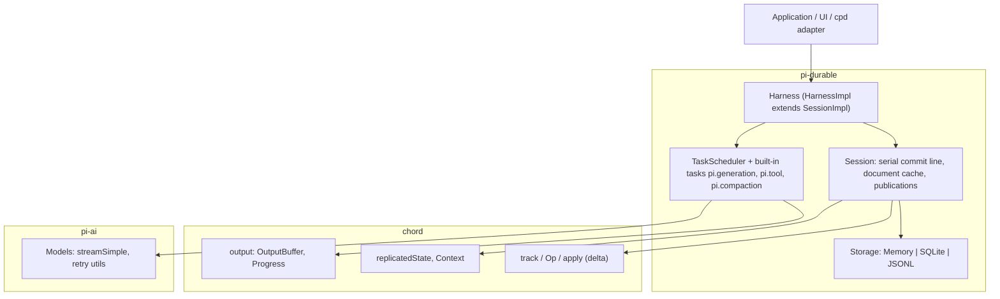
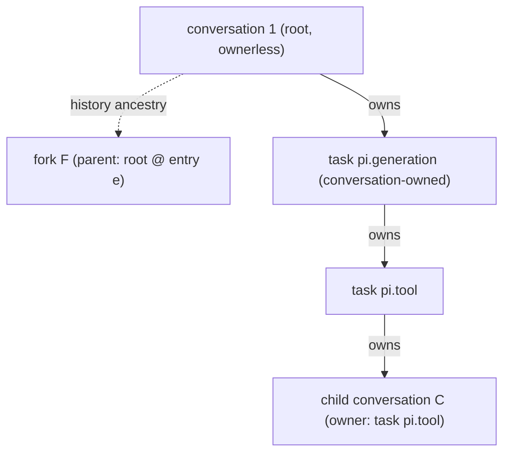
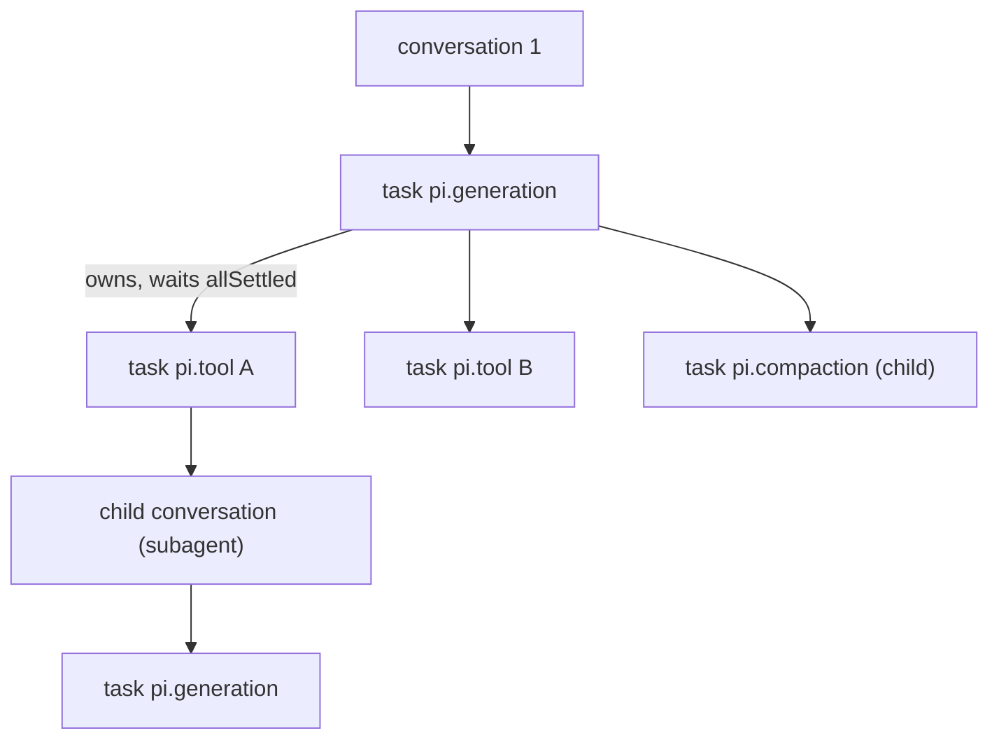

# pi-durable deep dive

Commissioned by Context record pro-d7 (User, 2026-11-03 EST). Built in three docs Jobs; this file is Job 1 (sections 0 and 1). Sections 2 to 4 are filled by later Jobs.

## 0. TL;DR and evidence labels

**Draft TL;DR (Job 3 finalizes).**

- pi-durable is a crash-recoverable agent runtime: a `Harness` that keeps every conversation, entry, task and document in a `Storage`, and re-runs unfinished work from the last committed checkpoint (`pi-durable/dist/harness/scheduler.js:1230-1234`, read).
- Stack: pi-ai (models) under chord (JSON delta/state primitives) under pi-durable. pi-durable uses only chord's values, contexts and output helpers, not chord's objects, hosts or links (measured: 0 dist files reference `createHost`, `webSocketLink`, `ipcLink`; see section 1.1).
- All state changes are one serial commit per callback: entries, tasks, submissions and document deltas reach `Storage.commit()` as one atomic batch (`pi-durable/dist/session/session.js:534-536`, `653-657`, read).
- Durable progress is a task checkpoint committed in the same batch as the phase's effects; a phase that commits no new checkpoint faults (`pi-durable/dist/harness/scheduler.js:1266-1270`, read).
- Streaming text is committed to the `pi.live` document at most every 100 ms, so a crash loses at most that window (`pi-durable/dist/harness/agent.js:16-19`, read).
- After a crash a model request is re-sent; a tool reruns only if both its stored intent and its definition say `replay: "safe"`, else the model gets an `interrupted` error (`pi-durable/dist/harness/tool.js:105`, `115`, read).
- One process owns a storage. No lock, lease or fence exists in 1.3.0 (measured by the scout: grep over all dist files, see 1.7), so applications must front it with one host process.
- Consequence for cpd-webui (inferred): a web UI is a client of a host process that owns the Harness; it cannot open the SQLite file itself.

**Evidence labels.** Every claim carries one of these in its sentence or table cell.

| Label | Meaning |
|---|---|
| `read` | I (or a scout, then re-read by me in the cases noted) read the cited line. Package files cite `pi-durable/dist/<file>:<line>` or `chord/dist/<file>:<line>`; cpd files cite repo-relative paths. |
| `measured` | A command ran and gave the quoted number. |
| `inferred` | My reasoning from read code; nothing was run. |
| `guess:` | Unverified. |

Nothing in sections 0 and 1 was executed: no model, storage or test ran. The only `measured` values are `grep` counts from the scouts (artefacts under `$CPD_HOME/run/pi-durable-how/explore/`) and `ls`/`sed` checks in this Job.

**Versions covered.** pi-durable 1.3.0 (`pi-durable/package.json:3`, read), chord 1.3.0 (`chord/package.json:3`, read by scout x-chord), pi-coding-agent 1.3.0 (`pi-coding-agent/package.json:3`, read). pi-durable depends on `@earendil-works/pi-ai` 1.3.0 (`pi-durable/package.json:147`, read). Older cpd notes (`docs/research/pi-durable.md`, `pi-durable-resume.md`, `chord.md`, `durable-leads.md`) cite 1.4.0 (read: `chord.md:3-6` per scout x-chord); features they name that are absent here: read-only watch, `restartLimit`, IndexedDB storage (measured by scout x-store: `grep` in dist returned no match).

Path shorthand: `pi-durable/` = `@earendil-works/pi-durable` 1.3.0 package root; `chord/` = `@earendil-works/chord` 1.3.0 package root. The package ships compiled `dist/` only (chord `src/` holds only `delta/README.md`, measured by scout x-chord via `ls -R`).

## 1. What pi-durable is and how it works

### 1.1 Stack: pi-ai > chord > pi-durable

pi-durable is a library, not a service: you call `Harness.open(storage, options, context)` in your process (`pi-durable/dist/harness/harness.js:309-331`, read). Three layers:

| Layer | What pi-durable takes from it | Evidence |
|---|---|---|
| pi-ai | model streaming (`runtime.models.streamSimple`), retry classification | `pi-durable/dist/harness/generation.js:315` (scout x-sched, read), `generation.js:3` import of `pi-ai/utils/retry` (scout, read) |
| chord | `track`, `apply`, `applyImmutable`, `applyImmutableBatches`, `replicatedState`, `copyJson`, `Context` and its combinators, `OutputBuffer`, `Progress`, `boundOutput` | 22 dist `.js` files import chord (measured by scout x-chord: `grep -rl "@earendil-works/chord" dist --include=*.js`) |
| pi-durable | Harness, Session, Storage, Tasks, built-in documents and entries | sections 1.2 to 1.8 |

Chord ships no `Document` type: the word appears only as `## Documentation` in chord's README (measured by scout x-chord: grep over `README.md`, `docs/`, `src/`, `dist/`). pi-durable's document model is its own, built on chord's tracker (`pi-durable/dist/session/transaction.js:349`, `453`, read by scout; the tracker's compare-and-swap is at `chord/dist/delta/tracker.js:152-154`, read).

Chord objects, hosts, links, contracts and reload are **not** used by pi-durable 1.3.0 (measured by scout x-chord: 0 dist files reference `createHost`, `defineFacet`, `webSocketLink`, `ipcLink`, `memoryLinkPair`, `hostNamed`, `remote(`, `withCancel` or `chord/node`). Chord's guide sample that hosts pi-durable as `DurableHarness` / `durableRegistry` does not match 1.3.0 (measured: both names appear in 0 dist files).

### 1.2 Harness and Conversation (root, children, forks)

- **Harness.** `Harness.open` checks the registry holds every built-in task, builds the object, then calls `openTasks` (`pi-durable/dist/harness/harness.js:311-331`, read by scout; `openTasks` at `harness.js:145-147`, read). It owns the guarded storage, scheduler, submissions and views. Scheduling starts only on `resume()` or a progress call such as `submit` (`harness.js:148-151` read; `scheduler.js:159-162` read: `resume()` sets `#enabled = true` and kicks).
- **Conversation handle.** A `Conversation` holds only `id` and a host reference; compare by id (`pi-durable/README.md:83`, read by scout x-model).
- **Record.** `ConversationRecord = { id, parent?: {conversationId, at}, owner?: {conversationId, taskId} }`, immutable (`pi-durable/dist/types.d.ts:263-276`, read by scout).
- **Root.** Reserved id 1: `export declare const ROOT_CONVERSATION_ID` (`pi-durable/dist/types.d.ts:29`, read; value 1 per `dist/types.js:2`, scout grep). `Harness.root()` returns it, creating it with `agent` and `init` only when absent (`harness.js:219-241`, scout read; that `agent`/`init` are ignored when the root exists is `inferred` from the early return).
- **Children.** A child is a conversation created inside a commit with task ownership; ownership is required, never optional (`pi-durable/dist/harness/types.d.ts:417-423`, scout read). Ownership drives attribution, subtree abort and idle waits (`dist/types.d.ts:271`, scout read). A task-owned child copies its owner's `pi.agent` (`dist/harness/agent.js:137-146`, scout read).
- **Forks.** `fork(at, {ownership})` needs an entry `at` visible from the parent; it copies only documents whose fork policy matches, and the rest start from `initial()` (`pi-durable/dist/session/forks.js:4-12`, `19`, scout read). Per policy: `pi.agent` is `asOf` (copied as of the entry), while `pi.provider`, `pi.usage`, `pi.live`, `pi.inbox` are `initial` (fresh) (`harness/agent.js:27-28`, `provider.js:9`, `usage.js:8`, `live.js:8`, `inbox.js:9`, scout read). A fork therefore gets a fresh provider `sessionId` (`README.md:532`, scout read).
- **Ids.** One Session-wide counter for conversations, entries, tasks, submissions and document incarnations: `mintId()` returns `idFromNumber(this.nextId++)` from memory (`pi-durable/dist/storage/sqlite/storage.js:127-131`, read). It is loaded once at open (`storage.js:92-95`, scout read), which is why a second writer collides (1.7).

### 1.3 Entries

An entry is an immutable transcript record: `{ id, conversationId, kind, model?, data?, head?, edits?, byTaskId? }` (`pi-durable/dist/types.d.ts:290-305`, scout read). `EntryDraft` allows `head: "self"` (starts the active context at the new entry) (`types.d.ts:306-310`, scout read; resolved at `dist/session/transaction.js:155-172`, scout read).

| Kind | Carries | Written by (read, scout x-model) |
|---|---|---|
| `pi.user` | `[UserMessage]` | idle input, or a queued input placed at a boundary (`harness/inbox.js:35-76`, `submissions.js:188`) |
| `pi.assistant` | `[AssistantMessage]`, any stop reason | `appendAssistant` (`generation.js:549-551`): answer, tool round, retry/error, or the aborted partial (`generation.js:269-275`, which I re-read) |
| `pi.system` | empty `content`, with section and tool patches | `generation.js:83-86` in `prepare` (re-read at `generation.js:83-85`) |
| `pi.tool-result` | `[ToolResultMessage]`, `data: {diagnostics}` | `appendToolResult` (`tool.js:684-704`) |
| `pi.reset` | optional handoff user message, `head: "self"` | `Conversation.reset()` as a write submission (`harness.js:42-47`) |
| `pi.compaction` | summary user message, `head: firstKept` | `placeSummary` (`compaction.js:356-372`) |

Application kinds are allowed; the `pi.` prefix is rejected for input entries only (`submissions.js:128`, scout read; that write submissions skip the check is `inferred`, untested).

**Active range and context.** A *head marker* is an entry with `head` set; the model sees the marker plus entries from its `head` to the tail (`pi-durable/dist/harness/context.js:195-198`, scout read). `selectActive` keeps the marker first and drops later head markers: `head === undefined ? range : [head, ...range.filter((entry) => entry.head === undefined)]` (`context.js:211-213`, read). `edits` (`omit` or `replace`) change model context only, never the stored entry (`types.d.ts:278-288`, scout read). Assistant messages with stop reason `aborted`, `error` or `deferred` are excluded from context (`context.js:4`, `164-165`, scout read). Tool results are reordered after their assistant, and a missing result is synthesized as an error `Tool result unavailable: history ends before this call completed.` (`context.js:218-254`, scout read).

### 1.4 Commits

`Session.commit(change, context)` runs `change(tx)` on a serial line and then persists all writes as one batch.

1. **Serial line.** `#enqueue` chains each job on a promise tail, so commits and scheduler decisions are totally ordered in one process (`pi-durable/dist/session/session.js:653-657`, read).
2. **Algorithm** (`session.js:503-555`, scout read): run `change(tx)`; if it throws, abort every open change and rethrow with no write; assemble writes; if there are none, return without touching storage; else `storage.commit(writes, withoutAbortSignal(context))` (`session.js:534-536`, read: "Once admitted, caller cancellation does not interrupt Storage settlement"); then adopt prepared document values and publish.
3. **Batch contents.** conversation and entry records, submissions, task records, then per document a base or delta write and optional retire (`pi-durable/dist/session/transaction.js:584-606`, scout read). `StorageWrite` variants: `conversation`, `entry`, `task`, `submission`, `document.create|copy|change|retire` (`dist/types.d.ts:647-676`, scout read).
4. **Atomicity.** SQLite: one `db.transaction` per commit (`storage/sqlite/storage.js:107-125`, scout read). Memory: `prepareCommit(writes).apply()` (`storage/memory.js:169-199`, scout read). That all rows land together is `inferred` from these two paths.
5. **Read-after-write guard.** After a table write in the same commit, a table read throws `ReadAfterWrite`: `if (this.#hasTableWrite) throw new ReadAfterWrite(method)` (`transaction.js:676-684`, read). Document access is not gated (`transaction.js:275-337`, scout read).
6. **Publication.** `CommitPublication = { seq, changes }` (`dist/types.d.ts:702-705`, scout read) fires after adoption; internal listeners run first and a throw fails the Session, host listeners run next and a throw is only reported (`session.js:557-581`, scout read).
7. **Failure is final.** The first error a Storage method throws fails the Session; nothing retries (`session.js:42-46`, scout read; `types.d.ts:856-859`, scout read).

Document values are chord drafts: `tracker.beginChange()`, `prepare()`, `adopt()`; adopting a stale preparation throws "Prepared change is stale" (`chord/dist/delta/tracker.js:141-149`, scout read; swap at `152-154`, read). Ops are `r s d a t p m` (`chord/dist/delta/index.d.ts:19`, scout read).

### 1.5 Chord Documents

A document is a versioned JSON value addressed `[kind, scope, owner, key]` (`pi-durable/dist/documents.js:17-47`, scout read), declared with `defineDoc` / `defineDocFamily`. Fields: `kind`, `version` (positive integer), `initial()`, `migrate?`, `checkpointWhen?`, and for conversation scope `history: "latest" | "rewindable"` and `fork` policy (`dist/types.d.ts:31-76`, scout read). An older stored version without `migrate` throws; a newer one throws (`documents.js:78-98`, scout read). Storage keeps a *base* plus *deltas*; `checkpointWhen` makes a change store a full base instead of a delta (`transaction.js:740-790`, scout read). Observed documents are never evicted from the cache; others age out after `documentRetentionMs` (default 600 000) (`session.js:18`, `27-29`, `585-596`, scout read).

Every conversation gets five built-in documents in its creating commit (`pi-durable/dist/harness/harness.js:243-250`, scout read):

| Document | Scope / history / fork | Holds (read, scout x-model) | Written by |
|---|---|---|---|
| `pi.agent` | conversation, rewindable, `asOf` (`agent.js:23-31`) | `model`, `thinkingLevel`, `extensions`, `tools`, `modelTools`, `instructions`, `cwd` (`types.d.ts:347-376`) | `configure` (`agent.js:55-58`), `addTools` (`agent.js:66-96`) |
| `pi.provider` | conversation, latest, `initial` (`provider.js:4-12`) | `{ sessionId }` (uuidv7), forwarded to pi-ai | `conversationCreated` |
| `pi.live` | conversation, latest, `initial` (`live.js:3-18`) | `run`, `generation` (attempt, streaming `message`, retry, deferred), `tools[]` slots, `nestedTools[]`, `compactions` (`live.d.ts:76-110`) | generation, tool settlement, compaction, scheduler outcomes |
| `pi.inbox` | conversation, latest, `initial` (`inbox.js:4-12`) | `items[]`: queued `steer`/`followUp` inputs and `write`s | `admitSubmission` when busy, `applyBoundary` |
| `pi.usage` | conversation, latest, `initial` (`usage.js:3-11`) | `models` and `tools` token/cost maps | `appendAssistant`, compaction, tool results |

`pi.live`'s `checkpointWhen` stores a full base only when no generation or tool is running (`live.js:15-18`, read), so deltas stream while work runs. Other built-ins: task-scoped `pi.tool.nested-call` (`tool.js:25-33`), `pi.codemode.run`/`journal` (task) and `pi.codemode.store` (conversation, rewindable) (`codemode/codemode.js:55-76`), all scout read. Applications add their own with `defineDoc` and `HarnessOptions.conversationCreated(tx, conversation)` (`types.d.ts:527-531`, scout read). Custom documents are the extension point; section 2 covers it.

### 1.6 Tasks and checkpoints

**Task record.** `TaskRecord` = `id, conversationId, kind, version, input, owner?, background, abortRequested, abortReason?, abandonOnRestart?, startedAt?, endedAt?, state` (+ `memos`) (`pi-durable/dist/types.d.ts:474-518`, scout read). `state` is one of `pending`, `running`, `waiting` (with `on`, `policy`), `completing` (outcome held, runs no code), `terminal` (`types.d.ts:443-472`, scout read). Outcomes: `completed`, `failed`, `aborted`, `orphaned`, `faulted` (`types.d.ts:408-441`, scout read). Live statuses reloaded at open: `const LIVE_STATUSES = ["pending", "running", "waiting", "completing"]` (`scheduler.js:10`, read).

**Definition.** `{ name, version, initial(input), phases, abort, migrate? }` where `phases` has one handler per checkpoint `phase` (`types.d.ts:199-216`, scout read). Built-ins: `pi.generation` v1 (`initial: prepare`, attempt 1), `pi.tool` v2 (`initial: call`) (`generation.js:21-24`, `tool.js:38-46`, scout read).

**Checkpoint rule.** The scheduler loops *step then phase*: it re-reads the committed checkpoint, decides on the Session line, runs the handler for `checkpoint.phase`, repeats (`scheduler.js:1230-1247`, read). A handler must commit a changed checkpoint or an outcome; otherwise `Task <kind> phase 
 returned without durable progress` faults the task (`scheduler.js:1266-1270`, read). Hence a phase's effects and its successor checkpoint are one storage commit (`inferred` from this rule plus `runtime.commit`; `runtime.commit` is gated at `scheduler.js:1651-1670`, scout read).

| Task / phase | Durable step (read, scout x-sched) | Next checkpoint |
|---|---|---|
| `pi.generation` `prepare` | append `pi.system` entries, one commit (`generation.js:83-100`) | `request` with `cutoff` |
| `request` | commit converts old partial, then stream (`generation.js:107-128`) | classify decides |
| `retry` | `sleep(until)`, then commit (`generation.js:132-143`) | `prepare`, attempt + 1 |
| `poll` | `sleep(pollAt)`, `fetchDeferred`, classify (`generation.js:145-155`) | classify decides |
| `tools` | create next tool task, `waiting` on it (`generation.js:155-174`) | `tools` or `finishToolRound` |
| `pi.tool` `call` | validate, hooks, commit intent `{phase:"execute", arguments, replay}` (`tool.js:95-98`) | `execute` |
| `execute` | run, or rerun if replay-safe (`tool.js:101-121`) | settle to terminal |

**Ownership graph.** A task's parent is its `owner` task, else its conversation; a conversation's parent is its owner task (`scheduler.js:18-20`, scout read). Tasks always name an owner (`TaskOptions.ownership` is required, `types.d.ts:239-255`, scout read). A generation is conversation-owned (`generation.js:559`), its tool tasks are task-owned (`generation.js:214-216`), a compaction child is task-owned (`compaction.js:185`) (scout read).

**Abort and cancel.** Cancel is a durable mark: `abortRequested` (+ `abortReason: "restart"`) written in one commit, then the invocation is signalled (`scheduler.js:179-209`, scout read). A cancelling owner marks every live non-background task below it; a task with live owned work holds as `completing`; the abort handler runs bottom-up after owned work ends (`scheduler.js:438-497`, `1095-1100`, `1339-1350`, scout read). `restart`-abandoned work: tasks with `abandonOnRestart` found live at open get a `restart` mark before any phase runs (`scheduler.js:143-144`, `1024-1027`, read). A tool that is not replay-safe creates its child tasks with `abandonOnRestart: true`: `const child = options.ownership.kind === "task" && !resumes ? { abandonOnRestart: true, ...options } : options` (`tool.js:246-250`, read; `resumes = tool.replay === "safe"` at `tool.js:188`, read).

**Retry.** Only model-stream errors retry, never overflow, up to `maxRetries` (default 3), with the backoff stored as a `retry` checkpoint, so the wait is durable (`generation.js:384-411`, `396-402`, scout read). Tools never retry; a throw ends the tool task `failed` (`tool.js:298-309`, scout read). The retry delay formula lives in pi-ai and was not read (unverified).

**Concurrency.** Tool calls of one round run in parallel unless `settings.toolExecution === "sequential"` or a tool has `executionMode: "sequential"`; no concurrency cap was found (`agent.js:47`, `generation.js:451-486`, `scheduler.js:999`, scout read; "no cap" is `inferred` from absence).

### 1.7 Storage and single-process ownership

One `Storage` interface (`pi-durable/dist/types.d.ts:861-911`, scout read) with these backends:

| Backend | Factory | Notes (read, scout x-store) |
|---|---|---|
| Memory | `MemoryStorage` | no persistence (`storage/memory.js:144`; `README.md:660`) |
| SQLite (Node) | `openNodeSqliteStorage(path, options?)` | WAL, `synchronous = NORMAL`, busy timeout 5000 ms (`sqlite/node.js:7`, `153-175`); commits survive process crashes, the newest may be lost on power loss (`README.md:661`) |
| SQLite (portable, Cloudflare DO) | `SqliteStorage.open`, `openDurableObjectSqliteStorage` | `sqlite/storage.js:88-106`, `cloudflare.js:139-141` |
| JSONL | `openNodeJsonlStorage(dir, context, options?)` | append-only; the `main.jsonl` commit marker append is the commit point (`jsonl/storage.js:198-200`); keeps whole history in memory (`README.md:662`) |

SQLite schema: 9 tables, one migration, all `STRICT` (`sqlite/migrations.js:5-84`, scout read): `durable_metadata`, `record_ids`, `conversations`, `entries`, `tasks`, `submissions`, `documents`, `document_revisions`, plus `durable_schema`. Typed columns duplicate what scans filter on; the `record` column holds the full JSON (`sqlite/storage.js:138-196`, scout read).

**Single-process ownership.**
- `README.md:682` (read by scout): "One process owns a storage at a time; there is no cross-process locking."
- Measured by scout x-store: grep over every dist `.js` and `.d.ts` found no `flock`, `lockfile`, `lease`, `fence`, `process.pid` or pid field in `storage/`, `harness/`, `session/`, `env/`. The only cross-process exclusion is SQLite's own write lock per transaction: `this.database.exec("BEGIN IMMEDIATE")` (`sqlite/node.js:114`, read), waiting up to `DEFAULT_BUSY_TIMEOUT_MS = 5_000` (`sqlite/node.js:7`, read). A second process can open the same file and is not refused (`openNodeSqliteDatabase` takes no lock, `node.js:153-175`, scout read).
- Why one owner (inferred from read code, not run): (a) ids come from the in-memory counter loaded at open (`sqlite/storage.js:127-131`, read), so a second writer collides and its commit throws `ID n already belongs to ...` (`storage.js:469-473`, scout read), which fails that Session; (b) open rewrites every `running` task to `pending`: `tx.setTask(withState(record, { status: "pending", checkpoint: record.state.checkpoint }))` (`scheduler.js:145-147`, read), correct only when no other process runs it; (c) task, entry and submission writes are unconditional upserts with no version check (`storage.js:576-606`, scout read); (d) the scheduler and session caches are never refreshed from storage after open (`scheduler.js:56-113`, `session.js:50`, scout read).
- Inside one process, ordering comes from the Session `#tail` chain (`session.js:653-657`, read) and a serial operation queue in the SQLite adapter (`sqlite/node.js:13-56`, scout read).
- JSONL takes no file lock either (scout x-store grep, `jsonl/`). Cloudflare Durable Object single ownership comes from the platform, not this code (`guess:`, not verified).

Consequence for applications (inferred): a second UI or tool must go through the owning process; section 2.5 covers how cpd does that.

### 1.8 resume() recovery

**What is persisted, re-derived, re-executed.** Each row is labelled; evidence is `pi-durable/dist/...`.

| Item | On reopen | Label and evidence |
|---|---|---|
| Conversations, entries, submissions, documents, task records, `next_id` | persisted; read back from storage | read: `storage/sqlite/storage.js:92-95`, `scheduler.js:137-142` |
| Live tasks (`pending`, `running`, `waiting`, `completing`) | re-derived: scanned and tracked into the scheduler's in-memory indexes | read: `scheduler.js:10`, `137-142` (scout) |
| `running` tasks | persisted state rewritten to `pending`, same checkpoint | read: `scheduler.js:145-147` |
| `abandonOnRestart` tasks | persisted state gets a `restart` abort mark before any phase | read: `scheduler.js:143-144`, `1024-1027` |
| Phase in flight at crash | re-executed from its last committed checkpoint | read: `scheduler.js:1230-1247` (the loop reads the stored checkpoint) |
| Phases whose successor checkpoint committed | skipped | inferred from the checkpoint rule (1.6) and the phase table |
| Task invocations, `AbortController`s, scheduler indexes, `#failedMigrations`, streaming closure state (`pending`, `timer`) | lost, rebuilt or empty | read: `scheduler.js:57-62`, `69-70` (scout); `generation.js:283-286` (scout) |
| Agent definition and registry snapshot | re-resolved at each phase | read: `scheduler.js:1236` (scout) |
| Repeated `submit` with the same `requestId` | not re-executed; returns the existing submission | read: `submissions.js:129-136` (scout) |

**Sequence.** `Harness.open` loads and reconciles but dispatches nothing: one commit rewrites `running` to `pending`, queues abandoned and fail-fast checks, schedules a cascade reconcile (`scheduler.js:130-157`, scout read; `#enabled` starts false, `scheduler.js:110`, `159-162`). `resume()` sets `#enabled = true` and kicks (`scheduler.js:159-162`, read). `#reserve` then, in one commit, writes `running` with the stored checkpoint and creates the in-memory invocation (`scheduler.js:1065-1070`, read), and `#run` re-enters the loop (`scheduler.js:1230-1247`, read). Submit, wait and abort also enable scheduling (`submissions.js:31-33`, scout read).

**Mid-turn crash (model streaming, `pi.generation` at checkpoint `request`).** Label: read.
- *Re-executed:* the `request` phase runs again, so **a new model request is sent** and the response is regenerated (`generation.js:103-131`, scout read).
- *Preserved:* the partial text last flushed. Streaming commits `live.generation.message` throttled to `partialIntervalMs`, default 100 ms: `assignJson(live.generation, "message", message)` (`generation.js:296-301`, read; default `agent.js:16-19`, read). On the rerun the first commit calls `convertPartial` and then resets `live.generation = { attempt }` (`generation.js:107-111`, read): the partial becomes a `pi.assistant` entry with `stopReason: "aborted"` (`generation.js:269-275`, read), and the context excludes `aborted` assistants (`context.js:164-165`, scout read).
- *Lost:* text produced after the last flush, at most about one interval (`README.md:406`, scout read).
- *Skipped:* `prepare` (its commit stored the `request` checkpoint and system entries) (`generation.js:83-100`, read; skip is inferred from the checkpoint rule).
- *Deferred responses* (`stopReason: "deferred"`) resume at the `poll` phase and poll instead of re-requesting (`generation.js:145-155`, scout read).
- Cost of the re-request: not measured; `guess:` it costs tokens again.

**Mid-tool crash (`pi.tool`).** Label: read.
- *Before the intent commit:* the `call` phase reruns, including `beforeTool` hooks; `prepareArguments` must be pure because it "runs again when a call is retried before its intent is recorded" (`harness/types.d.ts:244-248`, scout read). The intent is `{ phase: "execute", arguments: final, replay: tool.replay ?? "unsafe" }` (`tool.js:95`, read).
- *After the intent commit, checkpoint `execute`:* the tool is **re-executed only if** `replay === "safe" && tool?.replay === "safe"` (`tool.js:105`, read); it restarts from scratch and the published progress slot is cleared (`tool.js:107-112`, scout read).
- *Otherwise it is skipped, not rerun:* the task settles `failed` with `Tool <name> was interrupted and may have partially run` (`tool.js:115`, read) and the model receives an `interrupted` error result carrying the output committed so far (`tool.js:632-644`, `README.md:181`, scout read).
- *After a settled tool:* skipped; completed tool tasks are listed in the generation checkpoint and are not recreated (`generation.js:167-172`, scout read).
- *Children of an unsafe tool* (nested calls it created) are abort-marked `restart` before any phase runs (`tool.js:246-250`, read; `scheduler.js:1024-1027`, read).

**Replay-safety contract of tools.**

- Default is `unsafe`: "Whether an interrupted execution may rerun on recovery. Default `unsafe`." (`pi-durable/dist/harness/types.d.ts:239-240`, scout read). Built-in tools declare no `replay:` (measured by scout x-store: grep in `tools/`), so they are `unsafe`.
- Both sides must say `safe`: the stored intent (set at call time) and the current definition (`tool.js:95`, `105`, read). Changing a tool to `safe` later does not rerun a call already recorded `unsafe` (inferred from the same condition).
- There is no exactly-once guarantee: "this is not exactly-once execution" (`harness/types.d.ts:211-214`, scout read). A safe tool must tolerate being run again after its intent was recorded, at any point of its own execution (inferred from "may rerun"; the framework cannot check external effects).
- `prepareArguments` must be pure and must not mutate `args` (`harness/types.d.ts:244-248`, scout read).
- Nested calls are keyed by position or an explicit `key`; a rerun in the same order gets the earlier nested call back (`harness/types.d.ts:209-216`, scout read). `runtime.memo(name, candidate)` gives first-write-wins values across reruns (`scheduler.js:1539-1551`, scout read).

## 2. How applications communicate with pi-durable

TODO (later Job)

## 3. pi-durable vs pi-agent

TODO (later Job)

## 4. Unverified claims and open questions

TODO (later Job)
