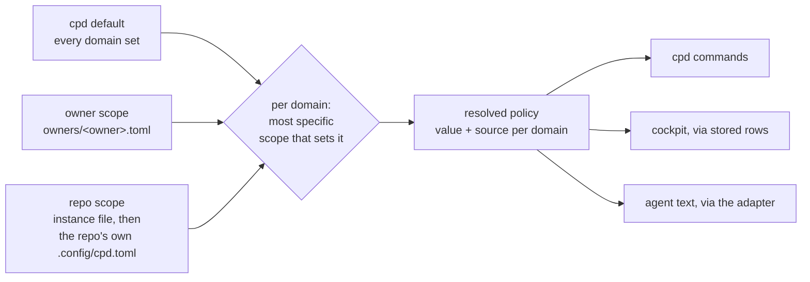

# Proposal: one CPD policy architecture (default, owner and repo overrides)

Job `policy-arch` of Plan `repo-policy` (attempt policy-arch-a1), run on hs. This file **proposes**; it decides nothing. The one thing stated as decided is what the User decided: precedence is most specific wins in every domain (repo > owner > cpd's default), and no domain adds up across scopes (User, 2026-10-19, under hs-d277).

Evidence base: [`docs/research/repo-policy.md`](repo-policy.md) (merged in #83), cited as "repo-policy §n" and by its item ids (I1-I25, B1-B14). Its Options A, B and C are used as material, not as a baseline (hs-d277 chose none of them).

Conventions in this file:

- `path:line` is this worktree at base commit `99d84c5`. repo-policy.md cited commit `14cc223`; 94 files changed since (`git diff --stat 14cc223 HEAD`), so every line number below was re-read at `99d84c5`, not copied from it.
- `$PI` is the pi 1.3.0 install on hs (`/home/clayton/.pi/agent/install/releases/1.3.0/node_modules/@earendil-works/pi-coding-agent`); unverified on pro and air.
- `<work-owner>` stands for any work GitHub owner. No missionlane or missionlane-scratch repo was read, cloned or queried, and no work policy is described.
- `unverified` and `guess:` mark every claim not checked.

## 1. Policy model

### 1.1 What a policy is

A **policy** is a fixed set of **domains**. Each domain is a typed slot with its own schema, owned by cpd's code. A domain value has up to two parts:

- **typed keys**: values cpd's own code branches on (a command's result, the cockpit's interface). Closed enums and numbers, parsed once, unknown keys refused;
- **`text`**: Markdown delivered to agents, never parsed by cpd. Which roles a domain's text reaches is fixed per domain in code (table 1.2), not configurable: one place to read, no per-file audience lists.

A **scope** is where a domain value is set: cpd's built-in **default**, an **owner** (a GitHub login, user or org), or a **repo** (`<owner>/<name>`). A **resolved policy** is the result for one **key** (an owner, or an owner and a repo): every domain has exactly one value, and each value records the scope it came from.



### 1.2 The domains

The seven known domains of hs-d277, plus `hooks` (needed by the "repo that cannot hold a cpd file" case, section 3.3). Typed keys listed are **candidates**: each lands only with evidence (hs-d248, YAGNI), see section 10.

| Domain | Typed keys cpd branches on (candidates) | `text` reaches | Today's hard-coded behaviour it would carry |
|---|---|---|---|
| `pr` | `update = "rebase" \| "merge"` (how a Lead Branch catches up with its base, and so whether a push is forced); `feedback.checks = "any" \| "required"`; `feedback.comments = bool` (raise on a review comment without a decision); `title = "plan" \| "jira-prefixed"`; `body = "cpd" \| "repo-template"`; `draft = bool` | Lead, Worker | `pr rebase` force-with-lease (`core/src/pr/rebase.rs:60-61`), plain `pr push` (`core/src/pr/push.rs:31`), `pulls::attention` (`core/src/pr/pulls.rs:312-331`), title (`core/src/pr/open.rs:190`), body (`core/src/pr/open.rs:200-207`, `gh pr create --body`, `core/src/pr/gh.rs:204-205`), hs-d220 conflict procedure and "the User's reviewer bot" in skill text (`pi/skills/cpd-lead/SKILL.md:179`, `:269`, `:274`) |
| `deploy` | none yet (guess: later, which checks are deploys, so `feedback` can ignore them) | Lead | nothing in code; the `deploy` phase is Plan mechanics (`docs/contract.md:874`) |
| `code` (patterns and rules) | none | Lead, Worker | nothing; a repo's own `AGENTS.md` already reaches its Workers (repo-policy §3.2) |
| `tests` (how to run and write them) | none yet (guess: later, whether a Lead runs local tests after a conflict merge, hs-d220's "run no local tests") | Lead, Worker | hs-d220's "run no local tests" in skill text |
| `mcp` | `servers.<name> = {…}` in pi's `mcpServers` entry shape (`$PI/docs/extensions.md:197`): the servers **available** to a key, never attached by default (hs-d249) | (none: the adapter acts on it) | nothing; cpd has no MCP code (`git grep -n -i mcp -- core cli pi tui docs/contract.md docs/commands.md` prints nothing) |
| `monitor` (monitoring and debugging) | none | Lead, Worker | nothing |
| `instructions` (free text) | none | Manager, Lead, Worker | nothing (the role's skill is cpd mechanics) |
| `hooks` | `pre-start`, `pre-commit`, `pre-merge`, in `.config/wt.toml`'s shape (`core/src/git/hooks/def.rs`) | (none: cpd runs them) | `.config/wt.toml` only; no file means no setup, no quick check and no Gate (`docs/contract.md:1865`) |

The Manager gets only `instructions`: it works on a Context, not on a PR, so PR, code and test text has no use there (guess: the Manager needs no more; change the fixed audience if evidence shows otherwise).

### 1.3 Shape in code and on disk

One Rust type, `Policy`, with one field per domain; each domain is a struct with `#[serde(deny_unknown_fields)]`, as the tamper check's `RepoConfig` already is (`core/src/git/tamper.rs:18-24`). A scope file is TOML with one table per domain it sets:

```toml
# owners/<work-owner>.toml: sets two domains; every other domain resolves from the default.
[pr]
update = "merge"
text = """
Conflicts: merge origin/<base> in the Lead worktree, push plainly.
"""

[instructions]
text = "…"
```

The resolved value is a `Resolved { domain: (value, Source) … }` where `Source` is `Default | Owner(path) | RepoInstance(path) | RepoFile(rev)`, the same idea as `cpd config`'s per-key `sources` (`core/src/config/file.rs:20-29`, `docs/commands.md:2016-2030`).

### 1.4 Adding a domain

A new domain is one struct, one field of `Policy`, its default value in cpd's default file, its audience in the delivery table, and one row in `docs/contract.md`. Nothing else changes: loading, validation, resolution, `cpd policy show` and text delivery iterate over `Policy`'s fields. A test enforces it (prose is not enforcement): every field of `Policy` has a default, an audience and a contract row (guess: a `const DOMAINS: [&str; N]` checked against the parsed default and the contract's table, as `pi/skills/skill.test.ts:92` already checks skills against `docs/commands.md`).

Typed keys enter a domain the same way: one enum field, one default, the code that branches on it, and the reason it exists (convention over configuration).

## 2. Default and scopes

### 2.1 Precedence (decided)

Most specific wins, per domain: **repo > owner > cpd's default**. A repo's value for a domain replaces its owner's, which replaces the default. No domain adds up across scopes (User, 2026-10-19, under hs-d277). Domains resolve independently: a repo may set `pr` and inherit `instructions` from its owner.

### 2.2 What "replaces" means

The proposal: the **whole domain** is replaced, never key by key.

- A scope that has a `[pr]` table sets the whole `pr` domain. Its `text` replaces the less specific `text`; its typed keys replace theirs.
- A typed key the table leaves out takes **cpd's default value for that key** (the schema default), never the owner's. Example: the owner sets `pr.update = "merge"` and `pr.feedback.checks = "required"`; a repo of that owner sets `[pr] update = "rebase"`. The repo's resolved `pr.feedback.checks` is cpd's default, not the owner's `"required"`. `cpd policy show` prints that key with source `repo:<owner>/<name> (key default)`, so the effect is visible.
- Why not key by key: it would make `text` and keys of one domain come from different scopes (a repo's conflict text next to its owner's `update` key that contradicts it), which is the mixing hs-d277's "no domain adds up" excludes. The cost is repetition in a repo file that differs from its owner in one key. That trade-off is open question Q6.

### 2.3 An unset domain

A domain a scope does not set is **inherited** from the next less specific scope. cpd's default sets every domain, so a resolved policy is total: no domain is ever "missing" (illegal state unrepresentable). cpd's default carries today's behaviour, so introducing the system changes nothing until a scope file says otherwise:

| Domain | cpd default |
|---|---|
| `pr` | `update` = today's (`rebase`, `core/src/pr/rebase.rs:60`; whether the default should change is Q8); `feedback.checks = "any"`, `feedback.comments = false` (`core/src/pr/pulls.rs:317-328`); `title = "plan"` (`core/src/pr/open.rs:190`); `body = "cpd"`; `draft = false` (ready: `gh pr create` without `--draft`, `core/src/pr/gh.rs:205`); `text` = neutral (no conflict procedure beyond what the commands say) |
| `hooks` | none: the repo's `.config/wt.toml` or nothing, as today (`docs/contract.md:1865`) |
| `mcp` | no servers |
| `deploy`, `code`, `tests`, `monitor`, `instructions` | empty `text` |

An empty `[domain]` table in a scope is how it says "this domain is cpd's default here", explicitly, overriding an owner value.

## 3. Storage

### 3.1 The default

In cpd: `core/src/policy/default.toml`, compiled into the binary (`include_str!`), parsed by the same loader as every scope file. One source of truth for both the code and `cpd policy show`.

### 3.2 Owner and repo scopes, per instance

Each instance holds its own scopes (hs-d262: instances share only cpd; nothing shared carries a repo's policy). One directory per instance:

```
$CPD_HOME/policy/
  owners/<owner>.toml            # required for every owner the instance works on (section 4.4)
  repos/<owner>/<name>.toml      # optional
```

- The path is the key: a file carries no owner or repo field to disagree with its path (DRY).
- Any file may be a symlink. Where a file's content is kept (personal dotfiles, a private repo cloned on one machine, written by hand) is then a configuration choice of that machine, not a structural one; `cpd policy show` prints the resolved real path. This is how "where the missionlane files live" (deferred by the User) stays open: Q1.
- One instance may hold personal and work owners side by side (hs-d262); they never meet because every consumer resolves exactly one key (section 5).
- No machine name appears anywhere: scoping is by owner and repo only (hs-d263).

Alternative for the root: a `policy_dir` key in `config.toml`. Not proposed: `config.toml` is managed by the personal dotfiles (`docs/contract.md:1988`), and symlinks already make the location a choice without a schema change (`core/src/config/file.rs:1-7` refuses unknown keys).

### 3.3 The repo's own committed files

"A repo's own files win" (convention over configuration), so a repo's committed files are the most specific layer for what they cover:

| File | Takes part as | Rule |
|---|---|---|
| `AGENTS.md` (and pi's other context files) | read by pi itself, not by cpd | Reaches the repo's Workers through pi's cwd walk (repo-policy §3.2). cpd neither parses nor duplicates it. Leads and Managers do not get it (their cwd is no repo, `docs/contract.md:1730`); repo text for them goes in a repo scope's domain `text`. |
| `.config/wt.toml` | the `hooks` domain, repo file layer | When the repo has the file, its hooks are used and every scope's `hooks` is ignored (as today, `core/src/git/hooks/mod.rs:1-3`). Only a repo without it uses a scope's `hooks`. |
| `.config/cpd.toml` | the repo scope, committed form, plus today's `protected` | Proposed: it may also hold policy domain tables (`[pr]`, `[code]` …) next to `protected`. Read like the protected list: `git show <rev>:.config/cpd.toml` from the Lead Branch once it exists, else from the PR's `base` (`core/src/git/tamper.rs:26-40`), so a Worker's diff can never change it (it is always protected, `core/src/git/tamper.rs:13`). A domain set both in the committed file and in `repos/<owner>/<name>.toml` resolves to the committed one (the repo's own file wins). |

The committed form is a choice of the repo's maintainers; nothing requires it (Q10).

### 3.4 A work repo that cannot hold a cpd file

It needs nothing in the repo:

- its owner's `owners/<work-owner>.toml` and, if one repo differs, `repos/<work-owner>/<name>.toml`, for every domain;
- the `hooks` domain of either scope for setup, quick check and Gate, used because the repo has no `.config/wt.toml` (today such a repo gets no Gate at all, repo-policy B10);
- the team's own `AGENTS.md`, if the repo has one, still reaches Workers through pi (it is the team's file; cpd adds, never edits).

## 4. Resolution and keying

### 4.1 The key

```
PolicyKey = Owner(OwnerLogin) | Repo(OwnerLogin, RepoName)
```

Both are parsed newtypes (GitHub's login and name rules; guess: the same character set as `pull_requests.repo`'s `owner/name`, `docs/contract.md:887`). The key is never a machine, a path or a cwd (hs-d263).

`policy::resolve(home, &PolicyKey) -> Result<Resolved, CpdError>` is the one entry point; it is pure over the default, the instance files and (for a `Repo` key with a checkout) the committed `.config/cpd.toml`.

### 4.2 Where each consumer's key comes from

| Consumer | Key | Stored where | Set when |
|---|---|---|---|
| A PR of a Plan | `Repo(owner, name)` | new `prs.owner`, `prs.name` columns (`prs` today has only the realpath `repo`, `docs/contract.md:911`) | `pr add`, parsed once from `git remote get-url origin` at the boundary (repo-policy §4.1, step S1); `core/src/pr/add.rs:57` already resolves the main worktree there |
| A pull request row the poller found | `Repo(owner, name)` | `pull_requests.repo` (`owner/name`, exact, `docs/contract.md:887`) | already |
| A Context and its Manager | `Owner(owner)` | new `contexts.owner` (`docs/contract.md:837-844`) | `context new --owner <login>` (shape depends on Q4) |
| A Plan and its Lead | `Owner(owner)`, the Context's | derived from `plans.context` (no copy) | `plan new`, before the Lead starts: a Plan has no repo at creation (`docs/contract.md:1554`), so the owner must come from its Context |
| A Worker | `Repo(owner, name)` of its Job's PR | derived from the Attempt's Job's PR | the Attempt start |
| A cpd command | the key of the one PR, Session or Context it acts on | derived | per call |
| A cockpit row | the row's own key (PR or `pull_requests.repo`) | stored rows (section 5.2) | when the row is written |

So a Lead resolves `Owner`, never `Repo`: its owner's policy. Repo-scope `text` reaches a Lead only per PR, through output keyed by that PR (`cpd policy show --pr <key>`, section 6), never merged into its standing instructions.

### 4.3 Plans and Contexts that span repos or owners

Whether a Plan or Context may span owners is a User question (Q4). The options:

| Shape | Options | Mixing |
|---|---|---|
| Plan, several repos of **one owner** (R34 allows several repos, `docs/contract.md:1730`) | (a) allowed: the Lead holds its owner's policy and reads each repo's policy per PR | Owners never mix. Repo texts of that owner can meet in the Lead's chat, labelled by PR (prose, not construction). Workers and commands stay one repo each. |
| | (b) one repo per Plan | No repo text ever meets another; undoes R34's cross-repo Plans. |
| Plan, PRs of **several owners** | (c) refused: a trigger rejects a `prs` row whose owner is not its Plan's Context's owner (`owner_mismatch`) | None, by construction. A change across a personal and a work repo becomes two Plans in two Contexts. |
| | (d) allowed: the Lead gets no owner policy, only cpd's default plus per-PR output | Both owners' texts reach one agent; contradicts hs-d261. Listed for completeness. |
| Context of **several owners** | (e) refused: one `contexts.owner`; implied by (c) | Context records (`context_records.context`, `docs/contract.md:846-848`) and digests are single-owner by construction. |
| | (f) allowed: the Manager gets only cpd's default | Records and digests still mix: a work decision recorded in the Context reaches a personal Plan's Lead (repo-policy §4.3). No delivery rule can undo it. |

Only (c) with (e) makes owner mixing impossible for every role and for records. (a) versus (b) is the repo-within-owner question; hs-d261's text ("that repo's policies and no other's") reads as (b) (I infer), at the cost of R34.

### 4.4 Validation at the boundary

Every scope file is parsed once, at the first resolve of a command or at `cpd policy show`, and every failure is a typed error, never a silent default:

| Condition | Code | Where raised |
|---|---|---|
| A file is not TOML, names an unknown domain, an unknown key, a wrong type or an enum value outside its set | `policy_invalid` (exit 1), `details.file`, `details.key` | any resolve; `cpd policy show` |
| A key's owner has no `owners/<owner>.toml` | `owner_unknown` (exit 1), `details.owner` | `context new --owner`, `pr add`, any resolve. An empty file is the explicit "default in every domain" declaration. |
| `repos/<owner>/<name>.toml` exists but its owner file does not | `owner_unknown` | any resolve |
| A repo cpd cannot key: no `origin` (allowed today, `docs/contract.md:1844`), a non-`github.com` URL, an SSH host alias such as `git@github-work:<work-owner>/x.git` | `repo_unkeyed` (exit 1), `details.url` | `pr add`, before any row is written; the fix is Q3 |
| A PR's owner differs from its Context's (if Q4 chooses (c)) | `owner_mismatch` (exit 1) | `pr add`, and a DB trigger as the backstop |
| A typed key that references something absent (an `mcp` name the Session asks for and its key does not list) | `mcp_unknown` | the attach request (section 5.5) |

A repo without a repo scope file is not an error: the repo scope is optional; the owner scope is required.

## 5. Consumers

The rule that makes mixing impossible by construction: **every consumer takes exactly one `PolicyKey`, derived by cpd from the one row it acts on, and calls `policy::resolve` with it**. No consumer takes a policy from its cwd, its machine or another row. Free text the User or Manager writes about another repo (a brief, a Spec `context`, a record) is the one remaining channel; no mechanism can stop it (repo-policy §2.1, I23).

### 5.1 cpd commands

| Command | Today | Read path proposed | Why it cannot mix |
|---|---|---|---|
| `pr open` | title `title()` `core/src/pr/open.rs:190`, body `summary()` `:200-207`, `gh::create_pr` `core/src/pr/gh.rs:204-205` with `--body` | `open()` (`core/src/pr/open.rs:21`) resolves `Repo(prs.owner, prs.name)` of the one PR and passes `&PrPolicy` to `title`, `summary` and `create_pr` (`draft`) | One PR row, one key; the command acts on nothing else. |
| `pr poll` and `pr-feedback` | `tell()` `core/src/pr/poll.rs:182-190` calls `pulls::attention(before, after)` (`core/src/pr/pulls.rs:312`); text `core/src/pr/feedback.rs:33-39` | `attention(before, after, &PrPolicy)` with the policy of `pull_requests.repo` of that row; `feedback::data` adds `policy: {source}` so the Lead sees which policy judged it | The key is the row's own `owner/name`, written by GitHub; the search spans every repo of the `gh` account (`core/src/pr/gh.rs:273`), but each row is judged alone. |
| `pr rebase` | rebase, then `--force-with-lease` (`core/src/pr/rebase.rs:60-61`) | reads `pr.update`: `rebase` keeps today's path; `merge` refuses with a typed `update_policy` error naming the policy's procedure (guess: or performs the merge; which, is part of Q2 and Q8) | One PR row. |
| `pr push` | Gate, plain push (`core/src/pr/push.rs:28-31`) | unchanged; the policy only decides which of `pr rebase` / merge-then-`pr push` the Lead is told to use (`pr` `text`) | One PR row. |
| The Gate and quick check | `gate()` `core/src/pr/mod.rs:307-312` runs `Hook::PreMerge` from the Lead worktree's `.config/wt.toml`; the Spec's quick check `quick_check()` `core/src/spec/mod.rs:156` | `run_hook` (`core/src/git/hooks/mod.rs`) loads `.config/wt.toml`; only when the file is absent, the PR key's `hooks` domain | The PR's own tree first, then its own key. |

### 5.2 The cockpit (`tui/`)

The TUI reads the store in one `Store::read` transaction per view, "spawns nothing" and runs a fixed number of queries every second (`tui/src/read/mod.rs:14-18`). Reading scope files and running `git show` there would break that. Proposed read path:

- **Policy-dependent facts are computed by the command that writes the row**, with that row's key, and stored on the row. Example: if `pr.feedback.checks = "required"` lands, the poller stores the policy's verdict next to the raw `pull_requests.checks` (guess: a `checks_verdict` column), and the PRs section (`tui/src/read/widgets.rs:177-188`) and the Inbox's `pr_failing` (`core/src/inbox/rules.rs:365`) read that column. The cockpit's interface then changes per owner without the TUI ever holding a policy.
- **Display of the policy itself** is on demand: a palette action runs `cpd policy show --pr <key>` (guess: `tui/src/palette.rs`), so the TUI shows one key's policy at a time.
- Rows whose owner has no owner file (a review request from an owner the instance does not declare, `core/src/inbox/rules.rs:401-406`) carry `owner_unknown` in place of the policy-dependent value, not a default.

Mixing is impossible because each stored value was computed with its own row's key, and the TUI never resolves a key.

### 5.3 Agent instructions (Manager, Lead, Worker)

Read path: the **adapter**, once per pi session, at `session_start` (`pi/lib/adapter.ts:685`), after it reads `cpd session show` (`pi/lib/adapter.ts:83`, `:188`):

1. it runs `cpd policy show --session <id> --text`; cpd derives the key from the Session row (Manager: Context owner; Lead: Plan's Context owner; Worker: its Attempt's PR), resolves it and prints the domain texts whose audience includes the role (table 1.2);
2. it registers `before_agent_start` and adds them as one `cpd-policy` entry of `systemPromptOptions.sections` ("Additional XML-wrapped prompt sections keyed by tag name", `$PI/dist/core/system-prompt.d.ts:25-26`; repo-policy §3.4). A system-prompt section survives compaction, which a first-message paragraph would not (guess, from pi rebuilding the system prompt per run; unverified at runtime).

The adapter never chooses a key and never reads a scope file; it has the Session id only (`CPD_SESSION`, `core/src/host/pi.rs:172`). A failed `policy show` is delivered as an error message (as `contextUpdates` does, `pi/lib/adapter.ts:432-451`) and the Session gets no policy text: loud, not defaulted.

Alternative channel, same key: cpd passes `--append-system-prompt <run/…/policy.md>` in `core/src/host/pi.rs` (`lead()` `:179`, `worker()` `:225`). Simpler and adapter-free, but it suppresses any discovered `APPEND_SYSTEM.md` (`$PI/dist/core/resource-loader.js:480-484`, repo-policy §3.4). Choice: Q7.

The first messages (`core/src/context/manager.rs:144-148`, `core/src/plan/new.rs:241-258`) and the Worker Spec template (`core/src/spec/worker.md`, rendered by `core/src/spec/mod.rs:174`) stay policy-free: their headers are cpd mechanics, their free text (brief, Spec fields) is the Lead's and the User's.

### 5.4 Skills

The shared skills (`pi/skills/cpd-lead`, `pi/skills/cpd-manager`) reach every role, Workers included, because `-e` package skills survive `--no-skills` (repo-policy §3.3, I15). They become policy-neutral (section 7) and point to the policy where a procedure varies ("resolve a conflict as the PR's `pr` policy says: `cpd policy show --pr <key>`"). No owner or repo text lives in a skill, enforced by the guard test of section 7.2.

Per-owner skills are not proposed (YAGNI). If evidence asks for them, the adapter's `resources_discover` can add a key's skill directory per session (`$PI/dist/core/extensions/types.d.ts:551-561`, repo-policy §3.3), with the same Session-derived key.

### 5.5 MCP attachment (hs-d249)

- The `mcp` domain lists the servers **available** to a key; it attaches nothing.
- A Session asks for one by name (guess: an adapter command, `/cpd-mcp <name>`, or `cpd session mcp <name>`); the adapter checks the name against its Session's resolved `mcp` domain and calls `pi.registerMcpServer(name, config)` for that session only (`$PI/docs/extensions.md:197-204`: "Registrations are not saved"). An unlisted name is `mcp_unknown`.
- So a `<work-owner>` server can never be attached to a personal Session: the list it is checked against is the Session's own key's.
- Outside cpd's reach: pi connects every enabled server of `~/.pi/agent/mcp.json` and a trusted project's `.pi/mcp.json` in every session (`$PI/docs/mcp.md:32`, `:100`). Keeping owner servers out of the user-level file is the User's configuration; a `cpd doctor` check that warns on enabled user-level servers is possible later (guess; YAGNI until a leak is seen).
- Credentials: an `mcp` entry names environment variables or uses pi's OAuth store (`$PI/docs/mcp.md:117-131`), never inline secrets (guess: `policy_invalid` on a literal `headers` value is the enforcement).

### 5.6 Context records and digests

Records are rows of `context_records` keyed by `context` (`docs/contract.md:846-848`); the digest and the first messages render a Context's records only (`core/src/context/digest.rs:175`, `first_message`). With one owner per Context (Q4 options (c), (e)), every record of a Context is single-owner by construction, and so is every digest and every Lead's first message. Without it, nothing can make them single-owner (section 4.3 (f)). No change to the distiller (`distiller()`, `core/src/host/pi.rs:248-259`) is needed.

## 6. Introspection

One read-only command, modelled on `cpd config` (`docs/commands.md:2016-2030`, contract §8.1 "each value's source"):

```
cpd policy show [--owner <login> | --repo <owner>/<name> | --pr <key> [--plan <p>] | --session <id>] [--text]
```

- With a key: the key, then every domain's value with its `source` (`default`, `owner:<login> <realpath>`, `repo:<owner>/<name> <realpath>`, `repo-file <rev>:.config/cpd.toml`, and `(key default)` for keys left out of a set domain, section 2.2).
- `--session`: the key cpd derives for that Session, then as above. What the adapter runs (section 5.3).
- `--text`: only the domain texts for the role, as the adapter injects them.
- No key: parses every scope file of the instance and lists the declared owners and repos; any `policy_invalid` fails it. This is also the check to run after editing a file.

Errors as section 4.4. Idempotent; no effects.

Agents use the same command; the skills name it where they defer to a policy. The cockpit runs it on demand (section 5.2).

## 7. Migration

### 7.1 Where today's built-in personal choices go

| Today | Where (at `99d84c5`) | Goes to |
|---|---|---|
| hs-d220's conflict procedure (merge `origin/<base>`, plain push, no local tests, "the PR's CI is the check") | `pi/skills/cpd-lead/SKILL.md:179` (`pr-feedback` `conflict`), `:274` (`rebase_conflict`) | The `pr` domain (`update` key + `text`) of one scope; which scope is Q2. The skill keeps only "follow the PR's `pr` policy". |
| "The User's reviewer bot or colleagues review each PR" | `pi/skills/cpd-lead/SKILL.md:269` | `pr` `text` of the owner whose PRs the bot reviews (guess: `clayton-duarte`). The skill keeps "reviews arrive on GitHub while CI runs". |
| `attempt_minutes` "90 on the User's machines, hs-d11" | `pi/skills/cpd-lead/references/spec-files.md:37` | **Not a policy**: a machine config value (`core/src/config/file.rs:113`, built-in default 30 at `:242`). The skill says "the configured `timeouts.attempt_minutes` (`cpd config`)". |
| `hs-*` ids sent to models | `pi/skills/cpd-lead/SKILL.md:38`, `:67`, `:179`, `:274`, `:277`; `pi/skills/cpd-manager/SKILL.md:84`; `pi/skills/cpd-lead/references/questions.md:5`; `references/spec-files.md:37`, `:44`; `pi/lib/reminder.ts:8` (`REMINDER_TEXT`); `core/src/context/distill_prompt.md:10` (example ids) | Rules stated without an id (an id resolves only on hs, hs-d262); examples use a neutral `<machine>-d43`. `pi/skills/skill.test.ts:237-243`, which today pins `(hs-d239)`, changes in the same Job. Code comments and metadata never sent to a model (`pi/lib/adapter.ts:498` `details.rule`, repo-policy §2.3) are left. |
| `pr rebase`'s force-with-lease vs plain pushes | `core/src/pr/rebase.rs:60-61` vs `core/src/pr/push.rs:31`, `core/src/git/worktree.rs:175-186` (`push_lead_branch`, plain) | `pr.update`: `rebase` (force-with-lease after a rebase) or `merge` (merge the base, plain push). cpd's default keeps today's code (`rebase`) so migration is behaviour-neutral; whether the default should change is Q8. |

Where hs-d220 belongs (Q2), the choices:

| Choice | Effect |
|---|---|
| cpd's default `pr` | Every owner merges and pushes plainly unless it overrides; hs-d220 becomes cpd's convention. |
| Owner `clayton-duarte` | All personal repos; a `<work-owner>` gets cpd's default. |
| Repo `clayton-duarte/cpd`, instance file | Only the cpd repo, on each instance that holds the file. |
| Repo `clayton-duarte/cpd`, committed `.config/cpd.toml` | Only the cpd repo, travelling with the repo to every instance (hs-d262 allows: it is the repo's own file). |

### 7.2 Policy-neutral shared skills and adapter, with a guard

A test, not prose: in `pi/skills/skill.test.ts`, for every skill file it already reads (`skillFiles`, `pi/skills/skill.test.ts:15-22`), `assert.doesNotMatch(text, /\bhs-[dnqa][0-9]|clayton-duarte|missionlane/)`; and the same assertion over the strings the adapter sends to models (`REMINDER_TEXT`, `pi/lib/reminder.ts:8`, in `pi/test/reminder.test.ts`) and over `core/src/context/distill_prompt.md` and `core/src/spec/worker.md` (a Rust test next to `core/src/spec/mod.rs`). It fails first today on the hits of section 7.1 (the right reason), then passes once they are gone. A matching test rejects a non-empty `text` in `default.toml` that names an owner.

## 8. Prior art

Run on hs (hs-n242), each bounded by `timeout`:

| Command | Result |
|---|---|
| `timeout 60 npm search --json pi-package policy` | exit 0, 20 results. With keyword `pi-package`: `pi-background-tasks` (background shell tasks), `pi-bifrost` (model routing), `jorgex-pi` (runtime for another harness), `@narumitw/pi-plan-mode` (read-only plan mode), `@akagilnc/pi-workflow-roles` ("Soul-bound workflow roles", a role CLI per its README, `npm view … readme`). None scopes policies by repo or owner. Others: general policy engines (`@open-policy-agent/opa-wasm`, `@pulumi/policy`), HTTP header policies (`helmet`, `feature-policy`, CSP parsers). |
| `timeout 60 npm search --json pi-package rules` | exit 0, 20 results. With keyword `pi-package`: `@cratis/pi` ("Configuration-aware Cratis AI integration", product-specific), `agent-simple-english` (an English-style lint). Others: ESLint plugins, `json-rules-engine`, `@cynos-ai/rules` (an empty placeholder). None scopes agent rules by repo or owner. |
| `timeout 30 npm view <pkg> description keywords version repository.url` for `@akagilnc/pi-workflow-roles`, `@cratis/pi`, `jorgex-pi` | Descriptions as above; nothing about per-repo or per-owner scoping (unverified beyond the description and the first README lines). |

pi's own scopes (`$PI/docs/settings.md:3`, `$PI/docs/configuration.md:1-47`, `$PI/docs/mcp.md:32-34`): user level (`~/.pi/agent`) and project level (`.pi/` under the cwd, with trust); "Project settings override agent-directory settings. Resource lists are combined"; a project MCP entry replaces a user entry of the same name; context files walk from the cwd to `/`.

What can be taken:

- **Nothing as the mechanism.** pi's scopes are keyed by **cwd**, and cpd's Leads and Managers run in no repo by design (`docs/contract.md:1730`), so pi's project scope cannot reach them; nor does pi know an owner. The engines (`opa-wasm`, `json-rules-engine`) evaluate rules, which is not the problem here (scoping and delivery are), and would replace typed slots with an untyped rule language (against "make illegal states unrepresentable").
- **Taken as conventions:** pi's "a more specific entry replaces the same-named one" is the replace-not-merge semantics of section 2.2; pi's own `AGENTS.md` walk stays the delivery of a repo's committed instructions to its Workers; pi's `systemPromptOptions.sections` and `registerMcpServer` are the delivery hooks (sections 5.3, 5.5). The build is only the keying, the typed slots and the resolver.

## 9. Options and recommendation

All three share the key (section 4: `prs.owner/name` at `pr add`, one owner per Context if Q4 allows), the neutral skills with their guard (section 7.2) and `cpd policy show`.

### Option 1: typed domain registry in cpd, scope files per instance, repo files win

What sections 1-6 describe.

| | |
|---|---|
| Prevents mixing by construction | Every consumer resolves one key derived from its row; the key is stored once in the database; Context owner invariant for Managers, Leads and records. |
| Storage | Default compiled in; `$CPD_HOME/policy/{owners,repos}` per instance (symlinkable); optional committed `.config/cpd.toml` tables; `.config/wt.toml` and `AGENTS.md` unchanged. |
| Typing | Every domain a struct with `deny_unknown_fields`; behaviour as closed enums; text opaque. |
| Risks | A new parser and resolver (moderate code); scope files must exist on each instance (hs-d262), so a forgotten owner file blocks work loudly (`owner_unknown`) rather than silently; whole-domain replacement may surprise (Q6). |

### Option 2: text by convention, behaviour in `config.toml`

Owner text as `$CPD_HOME/owners/<owner>/AGENTS.md`, delivered by the adapter; behaviour as owner-keyed tables in the existing machine config (`[owners.<owner>.pr] update = "merge"`), read by the existing `Config` parser (`core/src/config/file.rs`).

| | |
|---|---|
| Prevents mixing by construction | Same keys as Option 1. |
| Storage | Two places per owner (a Markdown file and `config.toml` tables); repo scope only as `[repos."<owner>/<name>"]` tables. |
| Typing | Behaviour typed by `Config`'s key walk; text untyped. No domain slots: text is one blob per owner, so "repo replaces owner for PR text only" cannot be expressed. |
| Risks | `config.toml` is managed by the personal dotfiles (`docs/contract.md:1988`), so work behaviour would sit in a personal repo unless the file is split; machine config and repo policy in one file blur two concerns; adding a domain means new config keys and a new text file convention. |

### Option 3: directory convention, pi delivers text

Repos are checked out under `~/projects/<owner>/<name>`, owner text in `~/projects/<owner>/AGENTS.md`; pi's cwd walk delivers it to every Worker (whose worktree is a sibling, `core/src/git/worktree.rs:55-58`), and cpd starts a Lead and Manager with cwd `~/projects/<owner>`. Behaviour keys in the repo's committed `.config/cpd.toml` plus an owner TOML next to that `AGENTS.md`.

| | |
|---|---|
| Prevents mixing by construction | Only while every checkout follows the layout; a repo cloned elsewhere gets no owner text and no error (silent). The layout is prose, not a check, unless `pr add` refuses a repo outside `~/projects/<owner>/` (then it is enforced, but couples keys to paths). |
| Storage | Files beside the checkouts; no `$CPD_HOME` files. |
| Typing | Behaviour typed; text uses pi's own context files (no injection code). |
| Risks | Couples policy to disk layout; ancestor `AGENTS.md` files also reach non-cpd pi runs in those directories (repo-policy §1.1 I7); a Lead cwd inside the owner directory changes what pi loads for it (owner's project `.pi/` resources); keys come from paths, the opposite of section 4. |

### Comparison

| | Option 1 | Option 2 | Option 3 |
|---|---|---|---|
| Mixing impossible for Workers, commands, cockpit | yes | yes | yes for Workers; commands need the key anyway |
| Mixing impossible for Leads, Managers, records | yes, with Q4 (c)+(e) | yes, with Q4 (c)+(e) | only while the layout holds |
| Per-domain replace (repo replaces owner in one domain) | yes | no (text is one blob) | partly (repo `AGENTS.md` adds, never replaces, pi loads all ancestors) |
| Repo that cannot hold a cpd file | instance repo scope + `hooks` | config tables | owner files only |
| New code | resolver, scope files, `policy show`, adapter section | config keys, adapter file read | Lead/Manager cwd, `pr add` layout check |
| Unknown input is a typed error | yes | yes (`config_invalid`) | missing text is silent |

**Recommendation: Option 1.** It is the only one where each domain is a typed slot that replaces per scope (hs-d277's "one architecture", "not each case individually"), keys come from the database rather than a path or machine (hs-d263), a work repo needs no file, and every unknown input fails loud. Its extra cost over Option 2 is one loader; Option 3 trades that loader for a convention cpd cannot check.

## 10. First build

The PR differences are the one known need. Land the architecture with the `pr` domain only typed where there is evidence; everything else waits.

Lands first:

- docs before code (hs-d4): the policy model, keys, errors and `cpd policy show` in `docs/contract.md`, `docs/commands.md`, `CONTEXT.md`;
- neutral skills and the guard (section 7.2), independent of the rest;
- the resolver with the default and **two domains**: `pr` (keys `update`, `text`) and `instructions` (`text`); evidence: hs-d220's procedure and the reviewer-bot line exist today and contradict `pr rebase` (repo-policy B5, B13, B14);
- the keys: `prs.owner`/`prs.name` at `pr add`, `contexts.owner` (shape per Q4), `owner_unknown`, `repo_unkeyed`, `owner_mismatch`;
- `cpd policy show`;
- the adapter's `cpd-policy` section for Manager, Lead and Worker;
- `pr rebase` honouring `pr.update`.

Waits for evidence (each a later Job through section 1.4, no new mechanism):

- `pr.feedback.*` (hs-d263 names it; its shape waits for the first `<work-owner>` PR that shows which checks and review events matter) and the cockpit's stored verdict (section 5.2);
- `pr.title`, `pr.body`, `pr.draft`;
- the `deploy`, `code`, `tests`, `monitor` domains (text-only slots, each one struct when first needed);
- `hooks` (when a repo without `.config/wt.toml` is first worked on);
- `mcp` and attachment (when the first per-key server is asked for);
- the committed `.config/cpd.toml` layer (Q10).

Rough cut into Jobs (files per Job; the Lead drafts the Specs):

| Job | Needs | Files |
|---|---|---|
| `policy-docs` | none | `docs/contract.md` (model, `contexts.owner`, `prs.owner`/`name` DDL, errors, §7.6 `pr rebase`), `docs/commands.md` (`policy show`, `context new --owner`, `pr add` refusals), `CONTEXT.md` (Policy, Domain, Scope, Policy key) |
| `neutral-skills` | none | `pi/skills/skill.test.ts`, `pi/skills/cpd-lead/SKILL.md`, `pi/skills/cpd-lead/references/spec-files.md`, `pi/skills/cpd-lead/references/questions.md`, `pi/skills/cpd-manager/SKILL.md`, `pi/lib/reminder.ts`, `pi/test/reminder.test.ts`, `core/src/context/distill_prompt.md`, `core/src/spec/mod.rs` (guard test only) |
| `policy-core` | `policy-docs` | new `core/src/policy/mod.rs`, `domain.rs`, `load.rs`, `resolve.rs`, `default.toml`; `core/src/lib.rs`; `core/src/error.rs` (`policy_invalid`, `owner_unknown`) |
| `policy-keys` | `policy-docs` | new `core/src/store/migrations/<ts>-policy-keys.sql`; `core/src/store/schema.rs`; `core/tests/migrations.rs`; `core/src/pr/add.rs` (parse `origin`, `repo_unkeyed`, `owner_mismatch`); `core/src/git/run.rs` (origin URL); `core/src/context/mod.rs`, `core/src/context/contexts.rs` (`--owner`); `core/src/error.rs`; `cli/tests/` for `pr add` and `context new` |
| `policy-show` | `policy-core`, `policy-keys` | new `core/src/policy/show.rs`; the CLI wiring in `cli/src/`; new `cli/tests/policy.rs` |
| `policy-pr` | `policy-core`, `policy-keys` | `core/src/pr/rebase.rs`, `core/src/pr/mod.rs` (resolve per PR), `cli/tests/` for `pr rebase` |
| `policy-delivery` | `policy-show` | `pi/lib/adapter.ts`, new `pi/lib/policy.ts`, new `pi/test/policy.test.ts`, `pi/test/fake.ts` |
| `policy-migrate` | `neutral-skills`, `policy-show` | `pi/skills/cpd-lead/SKILL.md` (defer to `cpd policy show --pr`); hs-d220's text moves to the scope Q2 picks: an instance file is outside the repo (documented, not committed), a committed `.config/cpd.toml` is in the cpd repo |

`policy-docs` and `neutral-skills` can run in parallel; `policy-core` and `policy-keys` in parallel after the docs. Sizes unverified; the Lead sizes them.

## 11. Open questions for the User

Each with its choices; none is decided here.

- **Q1. Where do the `<work-owner>` policy files live?** (a) in the personal dotfiles, symlinked into `$CPD_HOME/policy` on each machine; (b) in a separate private repo cloned only where work happens; (c) written by hand on the work machine only; (d) in a repo the work owner holds. The architecture is the same for all four (section 3.2).
- **Q2. Where does hs-d220 belong?** cpd's default; owner `clayton-duarte`; repo `clayton-duarte/cpd` as an instance file; repo `clayton-duarte/cpd` committed in `.config/cpd.toml` (section 7.1).
- **Q3. How is a repo without a usable `origin` keyed?** (a) refused with `repo_unkeyed`; (b) an explicit `--owner <login> [--name <name>]` at `pr add`, stored like a parsed one; (c) resolved through `gh repo view --json owner,name` (network, the active `gh` account; resolves SSH aliases, repo-policy §4.1); (d) an alias map per instance (`github-work` → `github.com`). Cases: no `origin`, a non-GitHub host, an SSH host alias.
- **Q4. May a Plan or a Context span owners?** And within one owner, may a Plan span repos? Section 4.3: (c)+(e) refuse cross-owner Plans and Contexts (mixing impossible); (d)/(f) allow them (mixing possible). Within an owner: (a) allow several repos per Plan, (b) one repo per Plan.
- **Q5. Do `missionlane` and `missionlane-scratch` share one policy?** (a) one file, the second owner a symlink to the first; (b) two files; (c) an explicit `same_as = "<owner>"` key in the second (a new typed key, so a shared policy is visible in `policy show` rather than through the filesystem).
- **Q6. "Replaces" per domain:** (a) whole domain, left-out keys take cpd's default (proposed, section 2.2); (b) whole domain, every key required in a set domain (no key defaults, more repetition); (c) key by key within a domain, `text` replaced whole (less repetition, scopes mix inside a domain).
- **Q7. Delivery of policy text to agents:** (a) the adapter's `systemPromptOptions.sections` (keeps a repo's `APPEND_SYSTEM.md`, needs adapter code); (b) `--append-system-prompt` from `core/src/host/pi.rs` (simplest, suppresses `APPEND_SYSTEM.md`).
- **Q8. cpd's default for `pr.update`:** (a) `rebase` (today's code, behaviour-neutral migration); (b) `merge` (today's skill text, hs-d220). And what `pr rebase` does under `merge`: refuse with the policy's procedure, or merge the base itself.
- **Q9. Do work and personal PRs use different `gh` accounts on one instance?** If yes, the poller's single `author:@me` search (`core/src/pr/gh.rs:273`) sees one account, and the owner scope would also need to select the `gh` account (repo-policy Q6; unverified on pro).
- **Q10. May a repo's committed `.config/cpd.toml` carry policy domains**, or only `protected` as today? (a) yes, it is the repo's own file and wins over the instance repo file (section 3.3); (b) no, policy is only in instance files (one fewer layer).
