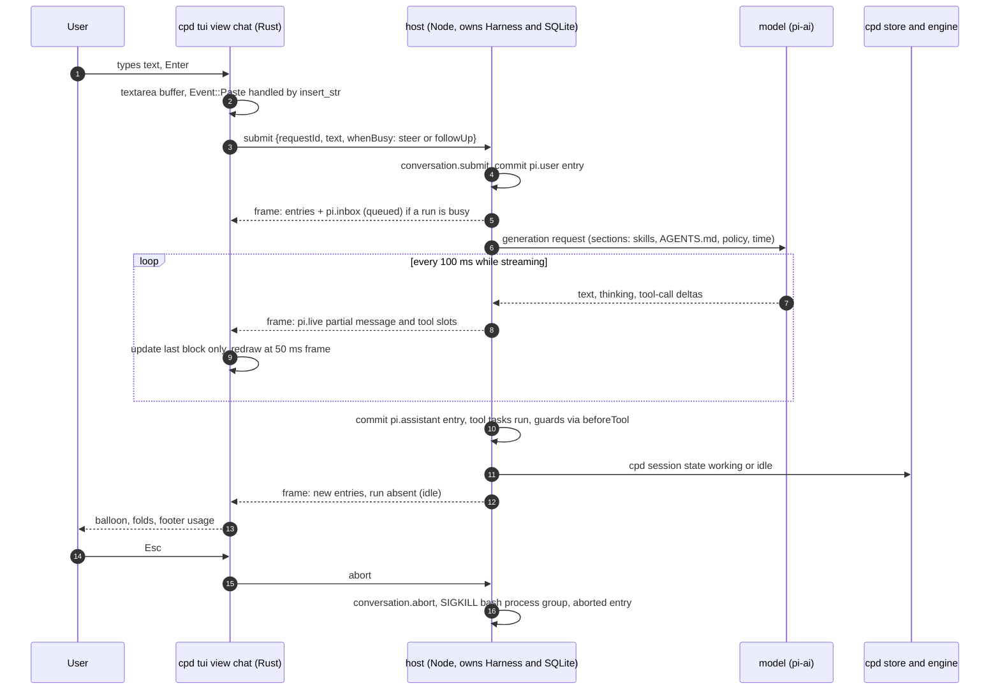
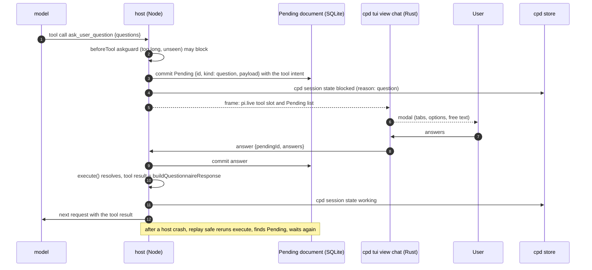

# Running Managers and Leads on pi-durable with a native ratatui chat: verdict, effort, migration

Synthesis of Plan `ratatui-chat-research` (decision pro-d166, User, 2026-10-28 EDT). Written 2026-10-28 EDT (about 15:15 to 16:00 EDT) by Attempt `chat-docs-a1`. Research only: no product code is changed. Evidence is in six part files, `docs/research/ratatui-chat-<part>.md`: `durable-ui`, `parity-core`, `parity-runtime`, `inventory`, `widgets`, `crates`.

Labels. **read** = a file and line I opened. **ran** = a command I ran (section 8 lists them). **unverified** = inferred, with why. `[part §n]` = a figure taken from that part file, which carries its own label there; I did not re-run it unless section 8 says so. Every number below is a part's number or my arithmetic on them (the arithmetic is shown).

## 1. Verdict

1. **Do it in phases behind a flag, not as a big bang, and put two cheap spikes before any product code.** It works on paper: pi-durable gives submit, steer, abort, a typed live view and built-in compaction (**read** durable-ui §1, §3; parity-core (e)). It is not a line-count saving, and it is not a quick job. [durable-ui, parity-core, inventory]
2. **Make it work.** The one thing no source shows working is a durable `ask_user_question`: pi-durable has no "wait for a human" primitive and no example (**read** durable-ui §4). Second: only the process that owns the Harness may write, so the ratatui chat needs an IPC to a Node host per Session; reading the SQLite file directly gives no submit or abort and is up to 1 s late on `main` (**read** durable-ui §2, §6). Third: the API is moving: `main` removed `watchEvents()` and `viewState()` that 1.4.0 has, and upstream deleted its own UI stack on 2026-10-12 for a reason nobody wrote down (**read** durable-ui §1, corrections 1-2).
3. **Make it fast.** Nothing was measured. The risks are per-token re-render of a long transcript, host start-up and RSS for N hosts, and frame size (**unverified**, widgets R2; durable-ui §6).
4. **Make it good.** Look parity needs about 7,150-12,450 production lines of Rust if written by hand, about 5,050-9,250 if the three crates of `crates.md` are accepted (my arithmetic, section 3), and each crate needs an exception to the closed dependency list.
5. **Effort, full parity:** about 8,200-14,600 production lines added (TypeScript 1,700-2,800; Rust 1,500-2,500 for the host side, 5,050-9,250 for the chat), plus 6,900-19,400 test lines, in about 31-37 PRs. First usable slice (a Lead or Manager with a text chat and a one-line input, no MCP, no plan review): about 3,300-5,700 production lines in 9-10 PRs (section 3).
6. **What it deletes** is 14,012 of 20,307 non-test lines of `pi/` and 15,866 test lines, but 82% of those lines are behaviour the widget must redraw, so net production lines are about **-5,900 to +400**, i.e. roughly flat. The gain is not lines: it is that the vendored forks (`pi/compact-tools`, `pi/ask-user-question`) and 23 prototype-patch call sites go, and 36 commits in 8 days stop landing on `pi/compact-tools` (**ran** inventory; section 4). tmux stays for Workers and the cockpit views.
7. **Biggest risk:** the durable human-wait tool and its restart behaviour (W1, section 5), then upstream API drift (W2).
8. **A path no part researched.** pi 1.3.0 already ships `--mode rpc` (JSONL commands: prompt, steer, follow_up, abort, compact, set_model, fork; streamed text and thinking deltas; a dialog sub-protocol), documented in its `docs/rpc*.md` and `docs/json.md` (**read**, section 2). A ratatui chat as an RPC client would keep the adapter, MCP, guards, skills, compaction and the session file, and shrink part A. It is the cheapest decisive spike (S1), listed under Decisions D1. This document does not choose between the two.
9. **Order:** S1 (pi RPC client, about 300 Rust lines), S2 (durable blocking tool plus kill and reopen), S3 (render budget on a long transcript); then phase 1 (native read-only viewer on today's pi sessions), phase 2 (Managers), phase 3 (Leads), phase 4 (default), phase 5 (delete).

## 2. The questions answered

### 2.1 How does pi-durable support an external UI? (`durable-ui`)

| Need | Answer | Evidence |
|---|---|---|
| Client API | None of its own. A "client" is code in the process that owns the `Harness`, calling `Conversation` methods. `submit({type:"input", whenBusy:"steer"\|"followUp"\|"reject"})`, `abort`, `watch()` | **read** durable-ui §1 |
| Versions | npm latest is 1.4.0; `main` is unreleased and differs (`readOnly`, `whenIdle`, entries window; `watchEvents`/`viewState` removed). A cpd build today can only take 1.4.0 | **ran** `npm view` + `npm pack` (section 8, items 1, 7) |
| Live view | `docs["pi.live"]` holds the partial answer (text, thinking, tool-call arguments), tool slots with running output, retry, queue, usage; committed at most every 100 ms | **read** durable-ui §1 |
| Second process | No wake-up across processes; `readOnly` is a replica mode, not a tail; stored partials lag up to `persistWithinMs` = 1,000 ms on `main` (100 ms at 1.4.0); layout is internal and needs a Rust port of 7 Chord delta ops | **read** durable-ui §2 |
| Steer / Esc | `steer` is placed after the whole tool round, never mid-request; `abort()` kills the model request and tools, `bash` with SIGKILL, keeps an `aborted` entry | **read** durable-ui §3 |
| Human wait | No primitive. Three patterns, none shipped: end the run and take the answer as the next submit (A); a `replay:"safe"` tool awaiting an in-process document the host writes (B); a task that parks in `waiting`/`sleeping` (C) | **read** durable-ui §4 |
| Hosting | One process owns a storage ("no cross-process locking"); one Harness can hold many conversations; no multi-session host or RPC server ships | **read** durable-ui §5 |
| IPC options | (a) Rust tails SQLite (viewer only), (b) Node host plus JSON lines over a Unix socket, (c) Rust spawns the host. Only (b) and (c) can write | **read** durable-ui §6 |
| Prior art | Upstream built and deleted `client`, `protocol`, `server` and two TUIs: 8,483 lines with tests, 5,529 without (`7472cda0`, 2026-10-12 06:19 EDT) | **ran** durable-ui §1 counts; why it was removed: **unverified** |

Corrections to `docs/research/pi-durable.md` are in durable-ui "Corrections" (nine items; the main ones: `readOnly` does not tail; `watchEvents` is gone on `main`; partials are stored 1 s late on `main`).

**The unresearched path (RPC).** **read** `~/.pi/agent/install/releases/1.3.0/node_modules/@earendil-works/pi-coding-agent/docs/rpc.md` line 3: "RPC mode runs Pi as a long-lived subprocess controlled through JSON records on stdin and stdout. Use it for ... custom user interfaces". **read** `docs/rpc-commands.md` headings: `prompt`, `steer`, `follow_up`, `abort`, `compact`, `set_model`, `set_thinking_level`, `fork`, `get_entries`, `get_state`. **read** `docs/json.md:41-121`: delta-only `message_update` with `text_delta`, `thinking_delta`, `toolcall_delta`; `tool_execution_update`; `queue_update`; compaction events. **read** `docs/rpc-extension-ui.md:16-25`: `select`, `confirm`, `input`, `editor` work through an `extension_ui_request` sub-protocol, but `custom()` returns `undefined`, and `setFooter`, `setWorkingMessage` and the like are no-ops; `ctx.hasUI` is true. So the vendored `ask_user_question` (which mounts a `custom()` component) would use its existing RPC fallback (`pi/ask-user-question/rpc-fallback.ts`, 203 lines, **read** parity-runtime §2.2): a select/input walker without tabs or previews. Whether the adapter, the reload poll and `judge` behave the same under `--mode rpc` is **unverified**: nobody ran it.

### 2.2 What does running Managers and Leads on pi-durable require? (`parity-core`, `parity-runtime`)

| Area | pi-durable gives | cpd must build or take | Evidence |
|---|---|---|---|
| Skills, AGENTS.md | nothing (**ran** `git grep` in both parts) | a `section()` calling pi-coding-agent's exported `loadSkills`, `formatSkillsForPrompt`, `loadProjectContextFiles` (about 50 lines) | parity-core (a), (b) |
| Policy, time zone | `section(key, render)` with async render | port two registrations, reuse the pure functions (about 40 lines) | parity-core (c) |
| MCP | nothing | an extension over `@earendil-works/pi-mcp` (one dependency, `cross-spawn`): 350-600 lines; pi's own MCP extension cannot load (different API) | parity-core (d) |
| Compaction | built in: auto thresholds, `compact()`, overflow retry, a committed `pi.compaction` entry, `beforeCompact` | cpd's ratio reserve (about 30 lines, a `modelOverrides` provider, Proxy unverified); the 1.4.0 summary-cap fix is missing in durable | parity-core (e) |
| Models, auth | `Models` interface, `configure({model, thinkingLevel})` | pass pi-coding-agent's `ModelRuntime` as `models` (reads `auth.json`, `models.json`); type compatibility at run time unverified | parity-core (f) |
| Tools, guards | `read write edit bash` only (same four as pi's defaults); `beforeTool` can `block` | seven guard decision functions are pure and reused (649 lines); about 100-200 lines of glue; `cwd` and transcript access from the hook is unverified | parity-core (g) |
| Blocking tools | no primitive | `ask_user_question`, `cpd_plan_review`, `cpd_secret_approve`, `cpd_host_approve` rebuilt on a `Pending` document, 200-350 lines | parity-runtime §2 |
| Slash commands | no UI | `plan-review` and `silent` become cockpit actions; `cpd-reload-after-install` and `compact-tools` dropped; the other built-in pi commands dropped unless asked | parity-runtime §3 |
| Event loop | none | `follower.ts` (160) and the Event decoders are runner-neutral and kept; delivery and state reporting ported (about 250-400 lines) | parity-runtime §4 |
| Session file | SQLite (JSON rows), not pi JSONL | 9 Rust call sites (A5 `judge`, A9 metrics, `fork_wait`) move to a store reader; `pi.usage` document replaces the metrics parser | parity-runtime §5 |
| Fork | `Conversation.fork` inside one Harness; not across processes | cross-runner fork impossible; same-runner fork done by the owner's host | parity-runtime §3.3 |
| Hosting | library only | one Node host per Session keeps every cpd lifecycle rule (pid replaces pane) | parity-runtime §7 |

Correction made in this synthesis: parity-runtime first sized guard porting at about 550 TypeScript lines from the 589 lines of the guard files, but those are pure functions that parity-core reuses unchanged (about 100-200 glue lines); I edited item (3) and the size row of `ratatui-chat-parity-runtime.md` (section 8).

### 2.3 What does a native ratatui chat require and eliminate? (`widgets`, `crates`, `inventory`)

| | Number | Evidence |
|---|---|---|
| Requires, minimum viable (read-only view plus one-line input) | 1,510-2,550 production Rust lines, 4 PRs | [widgets §6] |
| Requires, full parity (no images, no LaTeX, no one-process cockpit) | 7,150-12,450 production lines, 16-18 PRs | [widgets §6] |
| Largest items | markdown 1,400-2,500 (no parser in the lock), editor 1,700-2,900, `ask_user_question` modal 1,200-2,000 | [widgets §4] |
| What `tui/` has today | `history/render.rs` 65 production lines (skips thinking, no markdown), `scroll.rs` 135, `input_box.rs` 103, `fold.rs` 81, `dialog/` 1,449 | **ran** widgets §3 (line counts re-run for `scroll.rs`, `input_box.rs`, `fold.rs`: section 8, item 10) |
| Crates | take `ratatui-textarea` 0.9.3 (1 new crate), `tui-markdown` 0.3.12 (23 new, with `syntect`/`onig`), `ansi-to-tui` 8.0.1 (2 new); each needs a closed-list exception; defer images (88 new crates) | [crates §1, §8] |
| Eliminates (scenario A: chat as `cpd tui view chat`, Workers stay tmux) | 14,012 non-test `pi/` lines, 15,866 test lines (+48,744 golden data lines), 130 Rust lines | [inventory §6] |
| Does not eliminate | `tmux.rs` (1,227 non-test lines), Worker panes, cockpit views, `session send`, the adapter's CLI glue (KEPT 3,778 + MOVED 2,517 lines) | [inventory §7] |

Stale premises found: pi's chat is already a fullscreen alt-screen TUI with its own selection and copy, so a native view does not lose terminal scrollback; `tuiMode` default is `fullscreen` (**ran** `grep -n tuiMode .../dist/core/settings-defaults.js` → line 61 `tuiMode: "fullscreen"`), and whether the User switched to `regular` is **unverified** (widgets R1). The patch-site count is 23 `hookMethod(` call lines, not 12 (**ran**, section 8 item 5).

## 3. Effort

Ranges are production lines unless stated. Test lines use the repo's own ratios: Rust `tui/src` tests over production 0.79 (external test files) to 1.24 (with inline tests) (**ran** [widgets §3]); TypeScript `pi/lib` mapped tests 9,489 over 5,579 production = 1.70 (**read** inventory §1 `lib` subtotal; 9,489 / 5,579 = 1.70 is my arithmetic), used as 1.0-1.7. Both are **unverified** as predictors for new code (a mocked host should need fewer test lines than adapter tests).

### 3.1 (A) the pi-durable host, IPC protocol, MCP, compaction

My item-level table. I took each module's range from the part that sized it, and removed double counting between `parity-core` and `parity-runtime` (guards, prompt, models, compaction appear in both).

| Module | Lang | Lines | PRs | Confidence | Basis (measured comparable) |
|---|---|---|---|---|---|
| A1 host process + IPC server (open Harness, root conversation, first message, model, extension set, `resume`, `closed` reopen, framing, request handlers, `watch` forwarding) | TS | 450-750 | 2 | low-medium | old durable TUI `runtime.ts` 373 lines + 100-200 framing [durable-ui §6]; **ran** `wc -l` on `pi/lib/follower.ts` 160 as the process-supervision comparable |
| A2 prompt sections (skills, AGENTS.md, policy, time zone, first message, reminder) | TS | 250-350 | 1 | medium | `policy.ts` 25, `agent-state.ts:30-46`, `first-message.ts` 40, `reminder.ts` 83 [parity-core, parity-runtime §4] |
| A3 guards and loop guard as `beforeTool` / generation hooks | TS | 100-200 | 1 | medium (cwd/transcript access unverified) | `adapter.ts:70-103` 34 lines; 649 lines of pure guard functions reused [parity-core (g)] |
| A4 Event delivery, state reporting, follower reuse | TS | 250-400 | 1-2 | medium | `delivery.ts` 44 + `event.ts` 98 + `agent-state.ts` 92 + `state.ts` 164 [parity-runtime §4] |
| A5 blocking tools and `Pending` document (`ask_user_question`, plan review, secret and host approve) | TS | 200-350 | 2 | low | `secret.ts` 58 + `hostapprove.ts` 60, same one-dialog shape; no human-wait example exists [parity-runtime §2.5] |
| A6 MCP extension over `pi-mcp` | TS | 350-600 | 1-2 | medium | `runtime.ts` 454 + `tools.ts` 391 + `config.ts` 243, about half kept [parity-core (d)] |
| A7 compaction ratio, `/compact`, models, retier | TS | 90-180 | 1 | medium | `compaction-ratio.ts` 69, `retier.ts` 73 [parity-core (e), (f)] |
| **TypeScript production** | | **1,690-2,830** (about 1,700-2,800) | 9-11 | | sum of the rows |
| **TypeScript tests** (x 1.0-1.7) | | 1,700-4,800 | in the same PRs | low | ratio above |
| A8 IPC client thread, reconnect, serde model of the view, controller commands | Rust | 500-800 | 2 | low-medium | [durable-ui §6 (b)]; cpd `follow_loop` about 90 lines and `watch.rs` 46 as comparables |
| A9 `SessionStore` port for the 9 call sites (A5 `judge`, A9 metrics, `fork_wait`) | Rust | 250-370 | 1 | medium | **ran** call-site grep [parity-runtime §5]; `fork_wait.rs` 109 |
| A10 launcher for a host process, Session row `pid` / store path, one migration | Rust | 100-300 | 1-2 | medium | `fn worker` 26 lines, `launch.rs` 548 [parity-core, parity-runtime §8.3] |
| A11 chat slot, `session open/park/fork/close`, liveness and sleep rewritten for host processes | Rust | 600-1,000 | 2-3 | low-medium | inventory MOVED rows 907 lines; `moves.rs` 572 [inventory §2] |
| **Rust production** | | **1,450-2,470** (about 1,500-2,500) | 6-8 | | sum of the rows |
| **Rust tests** (x 0.79-1.24) | | 1,200-3,100 | in the same PRs | low | ratio above |

**A, minimum viable first slice** (a Lead or Manager that chats, no MCP, no plan review, no review-Job fork, default compaction): A1 + A2 + A3 + A4 + `ask_user_question` only from A5 (120-200) + models from A7 (60-100); Rust A8 + A9 + A10. TypeScript 1,130-1,900, Rust 850-1,470 (500+250+100 to 800+370+300; arithmetic mine). 5-6 PRs.

**A, full parity:** all rows: TypeScript 1,700-2,800, Rust 1,500-2,500, 15-19 PRs. The old double-counted range (parity-runtime 2.5-3.5k TypeScript before this synthesis) is not used.

### 3.2 (B) the ratatui chat viewport and input editor

Source: `widgets` §4-6. "With crates" is my adjustment for `crates.md` (markdown 1,400-2,500 becomes 300-700; editor 1,700-2,900 becomes 700-1,500), **unverified**: the crates give no streaming, no OSC 8 links and no TOML/TypeScript highlighting, and the editor still needs history, completion, paste and keys.

| Module | Rust production, hand-written | With crates | MVP | Confidence |
|---|---|---|---|---|
| B1 transcript viewport (block model, per-block row cache, anchor, scrollbar) | 600-1,000 | same (no crate fits: `tui-scrollview` holds a whole `Buffer`) | 350-550 | low-medium |
| B2 markdown, tables, code highlight, streaming | 1,400-2,500 | 300-700 | 250-400 | low (no parser to measure) |
| B3 balloons, tool rows, thinking and compaction folds, groups, cpd messages | 1,150-2,000 | same | 350-600 | low-medium |
| B4 multi-line input editor (selection, undo, kill ring, paste, history, completion, external editor) | 1,700-2,900 | 700-1,500 | 250-400 | low |
| B5 `ask_user_question` modal | 1,200-2,000 | same | 80-150 (glue to the existing `dialog select`) | medium (`dialog/` 1,449 lines comparable) |
| B6 plan-review handoff | 150-300 | same | 0 | medium |
| B7 footer, loader, cursor blink | 300-600 | same | 80-150 | medium |
| B8 selection, copy, links | 500-850 | same | 0 | low |
| B9 chat view process (`cpd tui view chat`, option A) | 150-300 | same | 150-300 | medium |
| **Total production** | **7,150-12,450** [widgets §6] | **5,050-9,250** (sum of the column) | **1,510-2,550**; with crates about 1,300-2,350 | |
| **Tests** (x 0.79-1.24) | 5,650-15,440 | 3,990-11,470 | 1,190-3,160 | low |
| **PRs** | 16-18 | 16-18 | 4 | |

### 3.3 Totals

| | Production lines | Test lines | PRs |
|---|---|---|---|
| (A) full | TS 1,700-2,800 + Rust 1,500-2,500 | 2,900-7,900 | 15-19 |
| (B) full, with crates | 5,050-9,250 | 3,990-11,470 | 16-18 |
| **Both, full parity** | **8,250-14,550** (verdict says about 8,200-14,600) | **6,890-19,370** | **31-37** |
| **Both, first slice** | A 1,980-3,370 + B 1,300-2,350 = **3,280-5,720** (the verdict rounds to 3,300-5,700) | not itemised | 9-10 |

### 3.4 One user message, from keyboard to screen (design, **unverified**: no part ran it)

### 3.5 One `ask_user_question` (design, pattern B of durable-ui §4, **unverified**; S2 tests it)

## 4. What is deleted and what is not

Measured at `origin/main` `f69f1eb0` by the inventory part [inventory §1, §2, §6]; section 8 item 11 re-ran the non-test total at this branch's base (20,272 against 20,307; the 35-line gap is the one `compact-tools-silent.ts` change of `f69f1eb0`).

| | `pi/` non-test lines | `pi/` test lines | Rust lines (measured rows) |
|---|---|---|---|
| Deleted | 14,012 (11,459 redrawn by the widget, 2,553 pure workaround) | 15,866 (+48,744 golden data) | 130 (`swap_pane`, parked windows, placeholder, `history` pane) |
| Moved (rewritten for the host) | 2,517 | 2,642 mapped | 907 |
| Kept | 3,778 | 5,495 mapped + 858 | 1,356 |

**Net production effect** (my arithmetic): added 8,250-14,550 (section 3.3), deleted 14,012 + 130 = 14,142. Net = 8,250 - 14,142 = **-5,892** to 14,550 - 14,142 = **+408**. Net test lines: added 6,890-19,370 against deleted 15,866: **-8,976 to +3,504**. The moved lines are inside the added figure (they are rewritten), so they are not subtracted twice.

Maintenance burden removed (**ran**, [inventory §3, §4]): 23 `hookMethod(` call lines plus 4 hand-wrapped prototypes and 2 in `lib/hint.ts`; 27 `Symbol.for` lines in 15 files that exist so patches survive a reload; both double-load guards; the prototype-patch, reload, thinking, padding and fold research documents (8 files, 1,560 lines, **unverified** as classified by title); 36 commits to `pi/compact-tools` since 2026-10-12 against 1 to `pi/ask-user-question`; 277 of 683 commits (41%) touch the embedded-chat area, 52 (8%) only pi-drawing files. Both vendored forks go: compact-tools is at its upstream latest 0.16.6; ask-user-question is two minor versions behind (2.13.8 against 2.15.0) [inventory §4].

What remains, stated plainly:

- **tmux stays**: Worker panes (`worker.rs`, the tmux fake of 3,425 lines, `PANE_DIED_HOOK`), the cockpit views and status line, `cockpit.rs` (690 non-test lines), and `pi launch` for Workers [inventory §7]. Workers stay pi.
- **The adapter's CLI glue stays**, about 6,300 lines (KEPT 3,778 + MOVED 2,517): follower, delivery, Event kinds (`PROTOCOL = 17`), guards, policy, Slack, Jira and model-list helper scripts, skills (818 lines).
- **`lib/reload.ts` and `session/reload.rs` are MOVED, not deleted** (474 lines): the host must still pick up a new adapter. They join the deleted set only if a host restart proves cheap (**unverified**, no measurement). Delete first, but check the fence.
- `pi/lib/cursor.ts` is the Event cursor, not a UI cursor; `pill-spec.json` is shared with Rust. Neither is deleted [inventory §1, §5].

## 5. Risks and gaps

Ranked make it work, make it fast, make it good. "Spike" is a proposal, not something run here.

| # | Risk | Evidence | Mitigation | Cheap experiment that retires it |
|---|---|---|---|---|
| W1 | Durable human-wait tool: no primitive, no example; restart count and resume semantics of a waiting `replay:"safe"` tool unverified | **read** durable-ui §4; parity-runtime §2.4 | Pattern A (end the run, answer is the next submit) is durable for free; B is richer | **S2**: about 150 lines of TypeScript on a faux provider: tool commits `Pending`, `kill -9` the host, reopen, answer, check the tool result and `restartLimit` |
| W2 | Upstream drift: 1.4.0 and `main` differ in the watch surface; `main` is unreleased (pi `main` moved again to `b5fc6dc84` while I worked, **ran**); upstream deleted its UI stack | **read** durable-ui §1; **ran** section 8 item 13 | Pin 1.4.0; the host emits cpd-owned plain values (`DurableView`-style) so drift stays inside A1 | read `CHANGELOG.md` Unreleased against the host's imports; a contract test of the cpd frame schema with the Harness mocked |
| W3 | One writer: the chat cannot write the store; SQLite tail is up to 1 s late and its layout is internal | **read** durable-ui §2, §6 | IPC to the owner (b); tail only as a viewer | S2 also measures a Rust read of the file while the host writes (`rusqlite` read-only on WAL: unverified) |
| W4 | Fork and review Jobs cannot cross runners or processes | **read** parity-runtime §3.3 | Decision D5; same-runner fork through the owner's host | none needed: decide first |
| W5 | Host lifecycle: Node start time, RSS per host (TypeBox about 23 MB unbundled plus Node, unmeasured), liveness by pid, `session` row migration | **read** parity-runtime §7; durable-ui §6 | One host per Session; bundle | start 10 idle hosts, `ps -o rss`, `time` of a reopen |
| W6 | Parity probes unverified: `HookApi` access to `cwd` and transcript (mainguard, askguard), `ModelRuntime` as `Models`, `mcp-auth.json` reuse, `modelOverrides` Proxy, pi 1.3.0 exports of the loaders, plannotator outside pi | **read** parity-core "Risks"; parity-runtime §9 | pin pi-coding-agent equal on both sides | one probe program on pi-ai's faux provider covering all six |
| W7 | Steering differs: placed after the tool round, not after the current call; Esc kills with SIGKILL, no grace | **read** durable-ui §3 | accept, or abort then resubmit | none: a Decision for pr-feedback latency (**unverified** whether it matters) |
| W8 | Native selection and copy must be rewritten (400-700 lines); if the User runs `regular` mode, native scrollback cannot be kept | **read** widgets R1 | ask the User which mode | `/settings` check, one question |
| W9 | RPC path unverified (section 2.1) | **read** pi docs | S1 | **S1**: a Rust RPC client of about 300 lines that spawns `pi --mode rpc` with the adapter, prints deltas, answers one `extension_ui_request`, and checks the adapter, `judge` and reload still work |
| F1 | Long transcript: `Scroller::set_lines` drops the wrapped cache, so a per-token update is O(transcript); frame loop is 50 ms | **read** widgets R2 | per-block cache keyed by (block, width, revision) | **S3**: render a 5,000-entry fixture under `timeout`, measure `draw_us` p50 and p95 against the 3.0-4.7 ms tree budget already measured |
| F2 | Frame size and IPC latency: the full `pi.live` message repeats every 100 ms unless Chord ops are used (adds about 150-200 Rust lines) | **read** durable-ui §6 | send ops after the first frame | measure bytes per frame in S2 |
| F3 | `tui-markdown` re-renders the whole message per chunk, no streaming API | **read** crates §6.2 | split blocks at blank lines outside a fence; re-render the last block only | S3 with a 200-line message streamed token by token |
| G1 | Look parity: ANSI-string wrapping in pi against cell wrapping in Rust | **read** widgets R3 | snapshot tests of one fixture | none cheap (needs pi side) |
| G2 | Graphemes, IME, bracketed paste never enabled (`BracketedPaste` 0 matches) | **ran** section 8 item 8; **read** widgets R4, R5 | `EnableBracketedPaste` in `Restore`; `insert_str` on `Event::Paste` | a 20-line probe in a macOS terminal |
| G3 | Closed dependency list: three crates and 26 new lock entries (1+23+2), one C build (`onig`); `ansi-to-tui` drops text after an OSC 8 `ESC \` link; `tui-markdown` has no TOML or TypeScript syntax | **read** crates §1, §6 | User exception per crate; strip OSC first | none |
| G4 | Docs: contract A5, A9, §6.6, §6.7 and `commands.md` refusals (`in_chat_slot`) must be reworded | **read** parity-runtime §5, §7.5 | per phase | n/a |
| G5 | Dropped features: `/tree`, `/export`, images, LaTeX, `claude` and `codex` styles, in-chat `/login` | **read** parity-runtime §3.2; widgets §8 | Decision D12 | ask |

## 6. Phased migration

Proposed, not decided. Each phase ships alone and reverses alone. Tests: the pi-durable host, the model and pi are mocks in every product test (axiom: only authored code is tested); the spikes are the only places a real external dependency runs, and they merge no product code.

### 6.1 The feature flag (proposal)

| Question | Proposal | Source |
|---|---|---|
| Name and value | `chat.runner = "pi" \| "native"`, cpd default `"pi"` | new; a closed enum parsed once and unknown values refused, like every typed policy key (**read** `docs/research/policy-architecture.md` §1.1; `docs/contract.md` §8.3 "Model") |
| Where it lives | a typed key of a new policy domain `chat`, exposed to the **machine** scope (`$CPD_HOME/policy/host.toml`) and the default; not owner or repo (a Session is not an owner's PR) | **read** `docs/contract.md` §8.3 "Model" (scopes, exposure) |
| Scope | per machine and per role (`manager`, `lead`); copied onto the Session row at registration (a `runner` column, one migration, A10) | **unverified** design |
| Open Session when the flag changes | nothing: the row's runner decides `session resume` and `session run`; the flag affects Sessions registered afterwards. A pi Session cannot become native, because pi-durable cannot import a pi file (**read** parity-runtime §3.3), so a move is a new Session | **read** contract §6.6 "A Session's Tier while it runs" is the precedent: the row, not the config, decides a running Session |
| `cpd session fork` | source and fork must share a runner; across runners the command refuses with a typed error (a new code, to be named in `commands.md`); a native fork is made by the owner's host and its idle wait reads `pi.live.run` | **read** `docs/commands.md` `session fork` §10.3; parity-runtime §3.3 |
| Review Jobs (B2) | Workers stay pi. A review Worker is a fork of the Lead's pi file today (**read** contract §6.6 table, row "Worker (review Job, B2)"). For a native Lead there is no pi file to fork: it starts from the Spec plus the diff, or the Lead's host forks, or native Leads wait: Decision D5. Until D5 is made, no Lead is native | **read** contract §6.6; parity-runtime §3.3 |
| Retier, MCP attach | `session retier` becomes `configure({model, thinkingLevel})` in the host; `mcp attach` re-installs the MCP extension in the host (same-name install replaces) | **read** `docs/commands.md` §10.16, §24.1; parity-core (d), (f) |

### 6.2 The phases

| Phase | What ships | PR slices | Exit criterion | Deletes | Rollback |
|---|---|---|---|---|---|
| **P0 spikes** (cheapest and most decisive first) | S1 pi RPC client; S2 durable blocking tool plus kill and reopen plus a Rust read of the live file; S3 render budget on a long transcript; one probe for W6. Throwaway; no product code merges | one branch per spike, one report each | S1: deltas, one dialog, adapter and `judge` still work, yes or no. S2: tool result correct after `kill -9`, restarts not exhausted. S3: p95 draw under the measured tree budget | nothing | delete the branch |
| **P1 native read-only chat view** on today's pi sessions | the History view becomes the chat view: B1, minimal B2 and B3 (widgets PR 1-3, 5, 7) over the pi session file, live-followed; no runner change; `Event::Paste` and bracketed paste enabled | 4-6 (B1; B3 balloons and tool rows; B2 minimal; B2 parser; folds) | a real Lead's session renders with folds and balloons at the S3 budget; no pi Session changes | `tui/src/chat.rs` placeholder only when the view replaces it | the view is read-only; `git revert`; pi pane untouched |
| **P2 native chat for Managers** (flag `chat.runner`, role `manager`) | A1, A2, A3, A4, A7 (models), A8, A9, A10; B4 one-line input, B5 as `dialog select` glue; `ask_user_question` from A5; skills and AGENTS.md sections | about 9 | a Manager runs a working day: crash and resume by `kill`, blocked state shown as today, A5 judge and metrics read the store, `cpd session send` delivers; Managers have no Plan, no PR hooks, no review-Job fork (**read** contract §6.6 Manager row) | nothing yet | set `manager = "pi"` for new Sessions; a Manager is recreated from its Context records (**read** contract §6.6: first message renders the Context) |
| **P3 native chat for Leads** | A5 rest (plan review, secret and host approve), A6 MCP, compaction ratio, fork on the host (A11 `session fork`), D5 chosen, plannotator handled (D7); B3 rest, B4 full, B5 full modal, B6, B8 | about 12-15 | one whole Plan, lead start to merge, on native on a real repo, including `session fork` of a native Lead and a review Job per D5 | nothing yet | `lead = "pi"` for new Sessions; a native Lead in flight finishes natively |
| **P4 native by default** | flip the cpd default of `chat.runner` to `"native"`; pi stays the fallback | 1 | User-chosen period of use without a rollback | nothing | flip the default back |
| **P5 delete** | `pi/compact-tools`, `pi/ask-user-question` TUI, `lib/{render,pad,hint,pill,mentions,mentions-refresh,italic,balloon}.ts` and `themes`, chat-slot swap code, `moves.rs` pane moves, the flag | one PR per directory (about 6) | `git grep hookMethod -- pi` prints nothing; Gate green; Workers still run on pi | the 14,012 `pi/` lines and 130 Rust lines of section 4 | `git revert` of each PR (one-way only after P5; do P5 last) |

Per-phase deletion is zero until P5 on purpose: reversibility is the flag, so nothing the pi path needs is removed while the flag exists.

## 7. Decisions for the User

This file decides none of them; the recommendation column is a recommendation only.

| # | Decision | Options | Recommended |
|---|---|---|---|
| D1 | Runner behind the native chat | (a) pi-durable host (as asked); (b) `pi --mode rpc` as the runner (keeps adapter, MCP, session file; unresearched, S1); (c) RPC first, durable later | Run S1 and S2 before choosing; if S1 passes, (c) |
| D2 | IPC from Rust to a durable host | (a) Rust tails SQLite plus cpd Events in (viewer only); (b) host started by cpd, JSON lines on a Unix socket per Session; (c) host as a child of the cockpit | (b): Managers and Leads outlive a cockpit today (**read** `launch.rs:25`) |
| D3 | Process model | one host per Session; one host per machine | one per Session (deletes no cpd invariant, parity-runtime §7.2) |
| D4 | Flag home and scope | `config.toml` key per machine; policy domain `chat` at machine scope per role, copied onto the Session row; per Session only | policy key per role at machine scope, copied onto the row |
| D5 | Review Jobs of a native Lead | Spec plus diff on pi; the Lead's host forks and runs the Worker on durable; native Leads wait until solved | Managers first (no review Jobs); decide D5 at P3 |
| D6 | Durable `ask_user_question` pattern | A end the run and take the answer as the next submit; B replay-safe tool awaiting a `Pending` document; C parked task | B, with A as the fallback if S2 fails |
| D7 | plannotator and plan review | keep plannotator as a subprocess plus a durable tool; in-cockpit plan review; drop plannotator for native | keep as subprocess if it runs outside pi (unverified) |
| D8 | Closed dependency list | accept `ratatui-textarea`, `tui-markdown` (with `syntect`, `onig`), `ansi-to-tui`; write own; accept some | accept the three (each one row in `docs/implementing.md`); do not enable `unstable-rendered-line-info` |
| D9 | Where the chat lives | `cpd tui view chat` pane in the existing tmux layout (option A, 150-300 lines); one-process cockpit (option B, one-way, not estimated) | A |
| D10 | Storage | one SQLite per Session; one per Plan | one per Session (rows stay 1:1) |
| D11 | pi-durable pin | 1.4.0 from npm; `main` as a git dependency | 1.4.0; revisit at the next release |
| D12 | Dropped features | drop `/tree`, `/export`, images, LaTeX, `claude` and `codex` styles; keep `/login` in pi | drop; ask only if the User uses one |
| D13 | Steer latency | accept "after the tool round"; abort then resubmit for urgent messages | accept; revisit if pr-feedback delay shows |

## 8. Sources and verification

### Re-run by this Job, 2026-10-28 EDT (worktree base `0f140a56`, all under `timeout`)

| # | Command | Result | Part's claim | Matched |
|---|---|---|---|---|
| 1 | `npm view @earendil-works/pi-durable version dist-tags` | `version = '1.4.0'`, `latest: '1.4.0'` | durable-ui versions | yes |
| 2 | `npm view @earendil-works/pi-mcp@1.4.0 dependencies peerDependencies` | `{ 'cross-spawn': '7.0.6' }` | parity-core (d) | yes |
| 3 | `cat $(ls pi/lib/*.ts \| grep -v test) pi/extension.ts pi/mcp-extension.ts \| wc -l` | 5484 | parity-runtime §8.2: 5484 | yes |
| 4 | `find pi/compact-tools -name '*.ts' \| xargs cat \| wc -l`; same for `pi/ask-user-question` (and `\| wc -l` of files) | 7705; 5892; 45 files | widgets, parity-runtime: 7,705; 5,892; inventory: 45 | yes |
| 5 | `grep -rn 'hookMethod(' pi --include=*.ts \| grep -v '^pi/test' \| grep -v 'export function' \| wc -l` | 23 | inventory §3: 23 | yes |
| 6 | `git grep -l -i tmux -- core/src engine/src tui/src cli/src` filtered for tests; `git grep -n 'tmux_pane\|chat_slot'` same filter | 88 files and 116 lines (152 files unfiltered) | parity-runtime §7.1: 89 files, 103 lines | **no, partly**: the filter was not stated; I added the filter and my numbers to the part (minimal edit) |
| 7 | `npm pack @earendil-works/pi-durable@1.4.0`; `grep -rl readOnly dist/harness/types.d.ts \| wc -l`; `grep -c watchEvents dist/index.d.ts`; `npm view ...@1.4.0 dependencies` | `readOnly=0`, `watchEvents=1`; seven dependencies, `chord`, `pi-ai`, `pi-codemode`, `pi-telemetry` at 1.4.0 | durable-ui; pi-durable.md | yes |
| 8 | `grep -c '"--tools"' core/src/host/pi/launch.rs`; `git grep -n BracketedPaste -- tui core cli \| wc -l` | 0; 0 | parity-core (g); crates §1 | yes |
| 9 | `grep -c '^name = ' Cargo.lock`; `grep -n rusqlite Cargo.toml` | 272; `Cargo.toml:23 rusqlite = { version = "0.40", ... }` | crates §2; parity-runtime §6 | yes |
| 10 | `wc -l tui/src/scroll.rs input_box.rs fold.rs core/src/host/pi/launch.rs core/src/session/moves.rs pi/lib/follower.ts pi/lib/delivery.ts` | 187, 103, 130, 548, 572, 160, 44 | crates §5; parity-runtime §8.2 | yes |
| 11 | `git ls-files pi \| grep -v '^pi/test' \| grep -v '\.test\.ts$' \| xargs cat \| wc -l` (151 files) | 20,272 | inventory §6: 20,307 at `f69f1eb0` | yes after the known diff: **ran** `git diff --stat d943c49c f69f1eb0 -- pi` shows `compact-tools-silent.ts` +38 -3 = +35 |
| 12 | crates.io API `ratatui-textarea`, `tui-markdown` | 0.9.3 (972,530 downloads); 0.3.12 (585,428) | crates §4 | yes |
| 13 | `git ls-remote https://github.com/earendil-works/pi HEAD` | `b5fc6dc84f28...` | durable-ui: `main` `33385f95` at 14:53 EDT | no, as expected: upstream moved; durable-ui's pointer is dated, its facts were read at `33385f95` |
| 14 | `grep -n tuiMode .../pi-coding-agent/dist/core/settings-defaults.js`; same grep over `*.ts *.rs *.json` of the repo | `61: tuiMode: "fullscreen"`; no cpd file sets it | widgets R1 | yes |
| 15 | `git log --oneline --since=2026-10-01 -- pi/compact-tools \| wc -l` | 35 | inventory §4: 36 at `f69f1eb0` | yes (+ the #572 commit) |

Commands I ran for sections 2.1 and 5 that no part had: `ls dist/modes/rpc`, `ls docs \| grep -i rpc`, `grep -n '^###' docs/rpc-commands.md`, `grep -n -i 'custom\|no-op' docs/rpc-extension-ui.md`, `grep -n 'text_delta\|thinking_delta\|queue_update' docs/*.md` in the installed pi 1.3.0 (`~/.pi/agent/install/releases/1.3.0/node_modules/@earendil-works/pi-coding-agent`).

### Edits to part files (minimal)

- `ratatui-chat-parity-runtime.md`: item (3) guard glue from about 550 to 100-200 TypeScript lines (the 589 lines are pure functions reused, per `parity-core`); the size row now says the itemised lines sum to 1,390 (**ran** arithmetic `250+250+150+150+200+320+70`); the tmux file count line carries my re-run (88 files, 116 lines). No other part file was changed.

### Unverified (the verdict depends on them)

- Durable human-wait tool and its restart count (S2); `pi --mode rpc` as a runner (S1); render budget (S3).
- Host start time and RSS; `rusqlite` read of a live WAL file; `HookApi` access to `cwd` and transcript; `ModelRuntime` as `Models`; `mcp-auth.json` reuse; plannotator outside pi; pi 1.3.0 exports of the context loaders.
- Why upstream deleted its UI stack; whether the User runs pi in `fullscreen` mode.
- Test-line predictions (ratios from different code); the crate savings in section 3.2 (my judgement); all Rust estimates for code that does not exist (no comparable for the parser, editor or selection).
- Question left for the Lead: whether S1 should be added to this Plan's follow-up as the first Job; this file lists it, it does not plan it.
