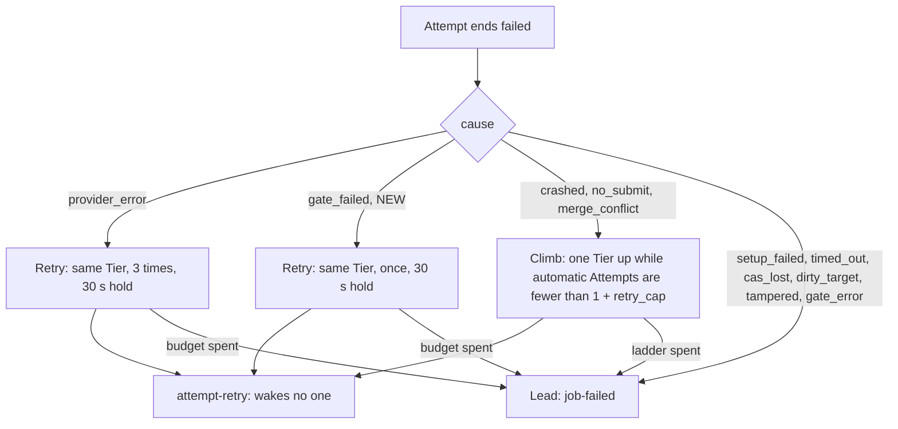

# Board routing: audit, measurements, evaluation and roadmap (Plan rfm-board-routing, research 3 of 4)

Research and architecture only. No code, test or measurement changes with this document.

## Contents

1. What cpd already built
2. Measurements (Appendix A: commands)
   - Appendix B: the extra queries of sections 3 and 4
3. Evaluation of the proposal items
4. Roadmap, and the Context notes

## Method and sources

- Read `origin/main` at `77b80a89` (`git rev-parse origin/main`, 2026-10-30 EDT). Every `file:line` below is a line of that commit; paths are repo-relative.
- Code first, docs second. Where `docs/contract.md` (`contract`) and code disagree, the code line is cited and the disagreement is named.
- Context record ids come from `cpd context search` and `cpd context show --record <id>` (run in this worktree). The Lead's brief gave five ids; four were wrong (see 1.2).
- Section 7 was read whole from the extract `/tmp/cpd-rfm-board-routing/section7.md`.
- Not done by Section 1 (its method; Sections 2 to 4 are the later Jobs `measure` and `design`): no `~/.cpd/cpd.db` read, no ledger numbers, no evaluation of the proposal.
- Labels: `unverified` = not checked in code or by command; `guess:` = inference.

## Source

- Proposal: `/tmp/cpd-rfm-board-routing/proposal.md` (a copy of the User's file), "CPD Context: Retrieval-First Memory Proposal".
- Section 7 = the two sections "Agent coordination: message board improvements" and "Agent coordination: what a small local model can do", lines 205-251 of the copy (`/tmp/cpd-rfm-board-routing/section7.md`).
- Bullets of the first section, by name: **Typed messages**, **Failure classes with routed escalation** (plus its 7-row table), **Retry budgets and timeouts**, **Storm grouping**, **Digests, not raw dumps**, **Reference, don't copy**, **Structured completions**, **Stuck detection**.
- Second section: a 7-row job table (Failure summarizer and classifier, Message triage, Root-cause clustering, Inbox digest, Worker first-line responder, Plan coverage check, GitHub event summary), "Keep with the larger models", **Order of adoption**, **Metrics for this part** (4 bullets).
- Sibling Plans own the memory, curation and planning ladder. Section 7 touches them only through context entry ids and `entry_reads`; this document only cites those.

## 1. What cpd already built

**Answer.** cpd has no typed board and no model in the loop, but it already routes most failure causes by deterministic rules: a ladder with budgets, same-Tier provider retry, an auto-retry when a fix merges, a stuck-Job message grouped per PR, deduped engine errors, and a Manager digest with counts. What is absent is the board's schema (`kind`, `thread_id`, `status`, refs), cross-PR cause grouping, escalation timeout climb, ping-pong detection, and every small-model job.

### 1.1 Current mechanisms

| Mechanism | What it does today | Wakes? | Evidence |
|---|---|---|---|
| `session send` | One message to a Lead or Manager as a `session-message` Event. `--unblocks <reason>` is required. Always wakes: an idle target starts a turn, a busy one gets it after its turn. Guards: no same text to two Sessions or twice to one within 60 min (`broadcast`, `duplicate`); Plan must be live | Always | `core/src/session/send.rs:56-81` (guard), `:87-104` (write), `:172-201` (command); `core/src/session/mod.rs:205-219` (`--unblocks` required); `core/src/events/typed.rs:450-453`; contract `docs/commands.md:2792` ("The message always wakes") |
| Engine message to a Session | The engine writes the same Event from the User's side (`from` null): `tell_managers` (one live Manager) and `tell` (a Lead, for E20) | Always | `core/src/session/send.rs:111-130` |
| `board post` / `list` / `take` | A row in `board_posts` addressed to a Session (`manager`, a Plan id or a Session id), 1-2000 chars, no Event, never starts a turn. `take` marks all unread posts read; the adapter calls it at turn start | Never | `core/src/board.rs:84-105` (post), `:142-153` (take); `docs/commands.md:3048-3075` |
| Events and who they wake | A Plan Lead is turned by `job-merged` (only when `data.turn`), `job-failed`, `pr-feedback`, `plan-done`, `error`, `escalation`; `pr-feedback` and `escalation` are steered, the rest follow-ups. `attempt-retry` and every other kind add nothing | Per kind | `pi/lib/delivery.ts:11-21`; contract `docs/contract.md:2635-2653` |
| Manager delivery | A Manager is woken only by `session-message` to it; Plan Events reach it as the turn-start digest | Only by message | contract `docs/contract.md:2627`; `docs/commands.md:4011-4062` |
| Turn-start digests (contract 15.7) | Lead: new decision records by others (`- <id>: <first sentence>`), pending board posts in full, PRs opened of its Plan. Manager: records, board posts in full, `Plans:` (counts per Plan by kind), `Pending work:`, `Errors: N (code xK)` with the command for the rest. Cap is lines (`MAX_LISTED = 20`), not tokens. `escalation` Events are not counted | No (folded into a turn) | `pi/lib/updates.ts:35` (cap), `:56` (counted kinds), `:196-213` (Plans), `:226-240` (Pending work), `:242-250` (Errors), `:262-290` (Lead update); `docs/commands.md:4011-4062` |
| Worker Escalations (`ask` / `answer`) | `cpd ask` blocks the Worker, opens an `escalations` row, sets the Worker `waiting`; the Lead is turned (steered) by `escalation`. Expiry: `ask` itself at `timeouts.ask_minutes` (default 60, exit 5 `ask_timeout`); engine E1 expires when the asker pid is dead (`asker_dead`). No climb to the Manager | Lead, at once | `core/src/ask/question.rs:47-69` (timeout), `:145-150` (waiting); `engine/src/watch/escalations.rs:1-75` (E1); `docs/contract.md:1055-1062`, `:4115` |
| Retry ladder (Job/Attempt) | `crashed`, `no_submit`, `merge_conflict` are ladder causes: the Job is requeued one Tier up while automatic Attempts < `1 + retry_cap` (default 2). A driver that never started, or one ended by an install, is requeued at the same Tier and not counted. `provider_error` retries at the same Tier at most 3 times, 30 s apart. Every other cause fails the Job | Not until the Job fails | `core/src/attempt/ledger.rs:233-235`, `:239-242`, `:462-495` (end of a failed Attempt), `:517-541` (counts), `:545-575` (`next_rung`); `engine/src/watch/schedule.rs:25-64` (spawn back-off `min(2^k, 300)` s), `:247` (hold); `engine/src/watch/provider_hold.rs:10-31`; contract `docs/contract.md:889`, `:974-979` |
| Attempt causes (all) | `setup_failed`, `timed_out`, `crashed`, `no_submit`, `merge_conflict`, `cas_lost`, `dirty_target`, `tampered`, `gate_failed`, `gate_error`, `provider_error` (plus `merged`, `cancel_requested`) | See 1.5 | `core/src/attempt/ledger.rs:163-186`; schema in 1.4 |
| Inbox rules | `core/src/inbox/rules.rs` has no failure kind. Kinds it computes: `dialog` (a blocked Session asking the User), `loop-guard` (a Session blocked by the self-turn breaker), `plan-review`, `review-waiting`, `unread`, `curate-*`, `deploy`, `drafts-parked`, `models-changed`, `review-requested`, `pr-ready`. A stuck Job is explicitly no condition: `stuck_jobs` is read by E8 and sent to the Manager as a message. `job-stuck`, `question`, `pr-failing`, `pr-changes` open nothing | Inbox is for the User; no agent wake | `core/src/inbox/rules.rs:1-5`, `:67-91` (list), `:297` (dialog), `:318` (loop-guard), `:486-540` (stuck Jobs), `:1250` (test: a stuck Job opens no condition), `:1356`, `:1385` (tests: failed checks and changes-requested open nothing); `engine/src/watch/inbox.rs:12-40` |
| Stuck-Job message (E8) | A `failed` Job whose latest `job-failed` is older than `inbox.stuck_job_minutes` (default 10) and not being worked on (pro-d88) is told to the Context's Manager once per PR, one message listing each Job with its minutes and cause; sent again only after a newer failure | Manager, waking | `core/src/inbox/rules.rs:486-568`; `engine/src/watch/report.rs:154-213`; `core/src/job/worked_on.rs:1-47`; `docs/contract.md:4134` |
| Fix auto-retry | A merged non-open, non-update Job requeues failed `open`/`update` Jobs of its PR when no other newer Job is queued or running | No | `core/src/job/fix_retry.rs:11-39`; called at `core/src/attempt/ledger.rs:501-503` |
| Engine `error` Event dedup | One `error` Event per (step, scope, code) until it clears, and at most one per `watch.error_repeat_seconds` (default 600), also across engine restarts (reads the store). No message is sent for it | `error` turns a Lead; Manager sees a count | `engine/src/watch/report.rs:231-292` (in-memory and store windows), `:326` (test); `docs/contract.md:1134`, `:4129` |
| E20 parked drafts | The one engine wake of a Lead by rule: a message when a Plan has parked drafts and its Lead is idle; the message is the record it was sent | Lead, waking | `engine/src/watch/parked.rs:17-104`; `docs/contract.md:1100` |
| Loop guard | Blocks a Session's further self-started turns past `loop_guard_turns` (default 20) | Opens a red Inbox row | `core/src/session/mod.rs:54`; `core/src/inbox/rules.rs:318-331`; `docs/contract.md:4108` |

Note, contract vs code: `docs/contract.md:2602` says the engine's session-message has `wake` false, and `:2627` says the engine's step errors reach the Manager as messages. The code always wakes (`core/src/session/send.rs:87-104`, `:111-130`) and sends no message for a step error (`engine/src/watch/report.rs:430` test `a_step_error_is_an_event_and_sends_no_message`; `:231-292`). `docs/contract.md:2653` ("a turn always, whatever `data.wake`") agrees with the code.

### 1.2 The five items the brief listed

Ids checked with `cpd context show --record <id>`. The brief's ids did not match its Plan names; the right records are below.

| Brief | Verdict | What it does | Evidence | Covers (a)-(d) of the proposal |
|---|---|---|---|---|
| Worker Escalations dropped from Manager digests (pro-d30 / esc-digest, pro-p5) | pro-d30 is wrong ("No test limit"). Right: **pro-d24** (decision, 2026-10-23) and **pro-p5** (Plan, "Manager digest: drop Worker Escalations"); Plan name `esc-digest` is in pro-d24's text | The Manager's `Plans:` digest no longer counts Worker `escalation` Events: the Lead answers or asks the User, the Manager has no action | `pi/lib/updates.ts:56` (the six counted kinds; `escalation` is not one); `docs/commands.md:4011-4062`; `docs/contract.md:2627` | (c) digests, partly: routes by role, removes a class of noise. (a) typed routing, partly (by Event kind). Not (b) |
| Provider errors retry at the same Tier (pro-d99 / outage-retry) | pro-d99 is wrong (deploy-inbox). Right: **pro-d101** (no ladder climb) and **pro-d102** (Plan `outage-retry`: N=3, 30 s, same Tier) | A pi stop on `Connection error.`, `Request timed out.` or HTTP 5xx ends the Attempt `provider_error`; the Job is requeued at the same Tier at most 3 times, held 30 s by E3; the 4th fails the Job and the Lead decides | `core/src/driver/run.rs:122-136` (classify), `:811-814` (end); `core/src/attempt/ledger.rs:239-242`, `:462-495`, `:551-556`; `engine/src/watch/schedule.rs:247`; `engine/src/watch/provider_hold.rs:10-31` | (b) retry budget before anyone is woken: BUILT for this one class. Also the proposal's "flaky, transient infra -> engine retry" row, for provider outages |
| Engine auto-retries a failed open/update Job when its fix merges (pro-d92 / fix-retry) | pro-d92 is wrong (resources). Right: **pro-d89** (Plan `fix-retry`, 2026-10-27) | The Job whose fix merged is requeued at its last Tier with a `job-retried` Event; no Lead action | `core/src/job/fix_retry.rs:11-39`; `core/src/attempt/ledger.rs:501-503` | (b), partly: removes a wake (the Lead's idle gap) and a Manager nudge. Not a retry-for-flakiness |
| Suppress "not retried" nudges while a fix is underway (pro-d90 / fail-handled) | pro-d90 is wrong (build-cap). Right: **pro-d88** (Plan `fail-handled`, 2026-10-26 EDT) | A failed Job is "being worked on" while the Lead is `working`, a newer Job of its PR is queued or running, or a retry is queued; one predicate drives the TUI red loader and E8's stuck-Job message | `core/src/job/worked_on.rs:1-47`; `core/src/inbox/rules.rs:486-520` | (d) stuck detection, partly (the false-positive guard), and (b) |
| Repeated engine `error` Events deduped (pro-d187 / pr-and-bot-error-dedup) | pro-d187 confirmed (2026-10-29): bot detection plus restart dedup. Plan name `pr-and-bot-error-dedup`: unverified (not in the record text read) | One `error` Event per (step, scope, code) per window, window held across engine restart | `engine/src/watch/report.rs:231-292`; `docs/contract.md:1134` | (c) digests, partly: bounds the `Errors:` count. (d) none |

### 1.3 Where cpd is stronger than the proposal

| Proposal item | What cpd already does, deterministically | Where the proposal would be worse | Evidence |
|---|---|---|---|
| Wake derived by rule from kind, not chosen by sender | Wake is a table by Event kind (`LEAD_MESSAGES`), not sender input; `attempt-retry` never wakes | A `task`/`fyi` board message that wakes would add a wake path beside two that already exist (`session send` always, `board post` never). `session send` already refuses broadcasts and duplicates | `pi/lib/delivery.ts:11-21`; `core/src/session/send.rs:56-81` |
| Failures route by class | The class is the Attempt `cause`, a CHECK-constrained column, set by the code that sees the failure (driver, merge, E2), not inferred from a log | A model classifier reading a CI log infers a class cpd already stores | `core/src/attempt/ledger.rs:163-186`; `core/src/driver/run.rs:385-817`; `core/src/merge/mod.rs:148-423` |
| Retry budget "K before anyone is woken" | `retry_cap`, 3 provider retries, spawn back-off are in code; a retry appends `attempt-retry`, which wakes no one | A K per class in a message router duplicates the ledger's own counters (`automatic_attempts`, `provider_errors`) | `core/src/attempt/ledger.rs:517-541`; `pi/lib/delivery.ts:11-21` |
| Merge conflict goes to the Lead | A conflict with the base queues an `update` Job (no Lead wake); a conflict inside an Attempt climbs the ladder with the conflict files in the next Spec; the Lead is told only when the Job fails | The proposal's row wakes the Plan Lead on every cross-PR conflict | `core/src/pr/poll.rs:432-447`; `core/src/spec/mod.rs:71-72`; `core/src/attempt/ledger.rs:233-235` |
| Storm grouping | One stuck-Job message per PR; one `error` Event per (step, scope, code) per window, restart-safe | Grouping by embedding plus a pairwise model check where a key (PR, step, code) already exists | `core/src/inbox/rules.rs:540-568`; `engine/src/watch/report.rs:231-292` |
| Dedup and fix-retry | The engine retries a failed open/update Job when its fix merges; it does not ask anyone | Anything that messages a Lead "your fix merged, retry" adds a wake | `core/src/job/fix_retry.rs:11-39` |
| Escalation to a higher level | The stuck-Job message is the climb for failed Jobs: Lead first (job-failed turn), Manager after `stuck_job_minutes`, and only when not worked on | A time-based climb of every unacknowledged message would wake the Manager for Jobs a Lead is fixing (pro-d88 was written for exactly that false alarm) | `core/src/inbox/rules.rs:486-520`; Context record pro-d88 |
| Digest | The Manager already gets counts per kind plus an errors summary, with the command for the rest | A free-text digest drops the structure the counts keep. Note: cpd's cap is 20 lines, not tokens | `pi/lib/updates.ts:35`, `:196-250` |

### 1.4 Actual schema (columns only)

Source: `docs/contract.md` section 4.4 (`CREATE TABLE` blocks), which `docs/contract.md:2404` and the migrations in `core/src/store/migrations/` keep in step. The first migration holds the original columns (`0001-initial.sql:152`, `:196`, `:218`, `:242`; `board_posts` in `20261021T1200-board-posts.sql:4`); later migrations add the columns marked. `unverified` for any later migration's column not named in the contract block (the contract block, not a live database, is the source: no `~/.cpd/cpd.db` was read).

| Table | Columns, in order | Evidence |
|---|---|---|
| `board_posts` | `id`, `at`, `context`, `from_session`, `to_session`, `text`, `read_at` | `core/src/store/migrations/20261021T1200-board-posts.sql:4-12`; `docs/contract.md:1860-1869` |
| `events` | `id`, `txn`, `at`, `kind` (references `event_kinds(name)`), `context`, `plan`, `job`, `attempt`, `session`, `text`, `data` (JSON object) | `docs/contract.md:1752-1766`; original `0001-initial.sql:242-260` (kind was a CHECK list) |
| `attempts` | `plan`, `id`, `job`, `number`, `tier`, `origin`, `status`, `outcome`, `cause`, `branch`, `worktree`, `base_sha`, `driver_pid`, `worker_session`, `spec_path`, `submitted_sha`, `submitted_at`, `check_tail`, `merged_sha`, `nudged`, `stop_request`, `metrics` (JSON), `started_at`, `ended_at`, `runner`, `worker_pid` | `docs/contract.md:1615-1655`; original `0001-initial.sql:152-186` (no `runner`, `worker_pid`; `cause` lacked `gate_failed`, `gate_error`, `provider_error`) |
| `sessions` | `id`, `role`, `context`, `plan`, `attempt`, `name`, `file`, `forked_from`, `cwd`, `tier`, `tmux_pane`, `state`, `state_label`, `state_at`, `created_at`, `archived_at`, `title`, `titled_at`, `asleep_at`, `by_user`, `switch_failed` | `docs/contract.md:1719-1746`; original `0001-initial.sql:218-238` |
| `escalations` | `plan`, `id`, `attempt`, `number`, `question`, `status` (`open`/`answered`/`expired`), `answer`, `asker_pid`, `asked_at`, `answered_at`, `expired_at` | `docs/contract.md:1697-1713`; `0001-initial.sql:196-214` |

What the board schema lacks next to Section 7: no `kind`, `thread_id`, `status`, `refs`, `priority`, `wake`. `board_posts.read_at` is the only state. `session-message` has `data.{from, text, wake}`, and a `session send` one has `{from, text, unblocks}` instead of `wake`; neither has a thread or refs (`core/src/events/typed.rs:446-453`). `events` already holds refs as columns (`plan`, `job`, `attempt`, `session`).

### 1.5 Failure cause map (baseline for the proposal's failure classes)

`attempts.cause` values and what the code does next. "Fails the Job" appends `job-failed`, which turns the Lead (`pi/lib/delivery.ts:12`), is counted in the Manager digest (`pi/lib/updates.ts:56`, `:213`), and after `stuck_job_minutes` without work becomes one message per PR to the Manager (`core/src/inbox/rules.rs:486-568`).

| Cause | Set where | Next, in code | Wake | Evidence |
|---|---|---|---|---|
| `setup_failed` | driver: worktree or `pre-start` hook failed | Not a ladder cause: fails the Job | Lead (job-failed) | `core/src/driver/run.rs:385`, `:400-416`, `:454`, `:462`; `core/src/attempt/ledger.rs:233-235`, `:551-560` |
| `timed_out` | E2 sets `stop_request` after `attempt_minutes` (30; explore 20); the driver ends it | Fails the Job | Lead | `engine/src/watch/liveness.rs:215-240`; `core/src/driver/run.rs:710-714` |
| `crashed` | pane dead, pi stopped badly, driver died (E2), merge recovery | Ladder: requeue one Tier up while automatic Attempts < `1 + retry_cap`; driver never started or ended by install: same Tier, uncounted, E3 back-off | None until the ladder is spent, then Lead | `core/src/driver/run.rs:738-817`; `engine/src/watch/liveness.rs:160-180`; `core/src/merge/recover.rs:101`; `core/src/attempt/ledger.rs:462-495`, `:551-575`; `engine/src/watch/schedule.rs:25-64` |
| `no_submit` | idle twice without `attempt submit`, nudged once between | Ladder, as `crashed` | None until spent | `core/src/driver/run.rs:122-135`, `:806-810`; `core/src/attempt/ledger.rs:233-235` |
| `merge_conflict` | merge step 5: rebase conflicted | Ladder; next Spec lists the conflict files | None until spent | `core/src/merge/mod.rs:235-255`; `core/src/spec/mod.rs:71-72` |
| `provider_error` | pi stop on connection error, timeout or 5xx | Same Tier, at most 3 per Job since the last `job retry`, 30 s hold; 4th fails the Job | None until spent, then Lead | `core/src/driver/run.rs:131-134`, `:811-814`; `core/src/attempt/ledger.rs:239-242`, `:462-495`; `engine/src/watch/provider_hold.rs:10-31` |
| `cas_lost` | merge step 8: Lead Branch kept moving | Not a ladder cause: fails the Job | Lead | `core/src/merge/mod.rs:312` |
| `dirty_target` | named in the type and the CHECK; `rg` finds no producer outside the definition and `spec/mod.rs:81` | None found: unverified whether any path sets it | n/a | `core/src/attempt/ledger.rs:178`; `core/src/spec/mod.rs:81` |
| `tampered` | diff touches protected paths (merge, or earlier at `attempt submit`) | Fails the Job (the submit-time check refuses to the Worker instead) | Lead | `core/src/merge/mod.rs:148`, `:160`, `:207`, `:221`; `core/src/attempt/submit.rs:228` |
| `gate_failed`, `gate_error` | merge step 6: the quick check or Gate exited non-zero, or could not be judged | Not ladder causes (contract: "the Lead decides"): fails the Job | Lead | `core/src/merge/mod.rs:413-423`; `docs/contract.md:979` |
| `merged`, `cancel_requested` | merge succeeds, or cancel | Not failures. A merge also requeues failed open/update Jobs it fixes. An incident-mode stop requeues at the same Tier | none | `core/src/attempt/ledger.rs:395-420`, `:501-503`; `core/src/job/fix_retry.rs:11-39` |
| (not an Attempt cause) escalation | Worker `cpd ask` | Lead is steered; expires at `ask_minutes` or when the asker dies; no climb | Lead | `core/src/ask/question.rs:47-69`; `engine/src/watch/escalations.rs:1-75`; `pi/lib/delivery.ts:16` |
| (not an Attempt cause) PR conflict | E5 poll sees `mergeable` become `conflicting` | Queues an `update` Job; no Lead wake | none | `core/src/pr/poll.rs:432-447` |
| (not an Attempt cause) PR checks failed or review changed | E5 poll | `pr-feedback` Event: Lead steered | Lead | `pi/lib/delivery.ts:13`; `docs/contract.md:2573` |
| (not an Attempt cause) engine step error | any step | one `error` Event (deduped); Lead turned if about its Plan; Manager counts it | Lead (if its Plan) | `engine/src/watch/report.rs:231-292`; `pi/lib/delivery.ts:15` |

Proposal's 7-row table against this map: "lint, format, simple compile -> Worker retry with the error" has no engine path: those fail at merge as `gate_failed` and the Lead decides (the Worker sees a refusal only for the tamper, red-test-guard and kind checks at submit, `core/src/attempt/submit.rs:228-236`). "Flaky -> engine retry" exists only for provider and spawn failures; a flaky test is `gate_failed`. "Requirement conflict" and "cross-feature dependency" have no class, only the manual `board post --to manager` and `session send`.

### 1.6 Section 7 element -> what cpd has today

| Section 7 element | Status | What exists, and what is missing | Evidence |
|---|---|---|---|
| Typed messages: `kind` | PARTLY | Events are typed (`events.kind` references `event_kinds`; the adapter has a delivery table); board posts and `session-message` are free text with no kind | `docs/contract.md:1752-1766`; `pi/lib/delivery.ts:11-21`; `core/src/board.rs:84-105` |
| Typed messages: `thread_id` | ABSENT | no column or field; `rg thread_id` in `core`, `pi`, `docs` hits only `docs/research/rfm-curation-*` | `core/src/store/migrations/20261021T1200-board-posts.sql:4-12`; `rg -l 'thread_id\|entry_reads' core pi docs` |
| Typed messages: `status` open/acked/resolved | ABSENT for messages; PARTLY for Escalations (`open`/`answered`/`expired`) | `board_posts` has only `read_at`; `escalations.status` exists | `docs/contract.md:1697-1713`; `core/src/board.rs:147` |
| Typed messages: refs to entry ids, PRs, jobs | PARTLY | Events carry `plan`, `job`, `attempt`, `session` columns and texts end in a `Next:`/`See:` command; no refs on board posts; Lead update shows record ids | `docs/contract.md:1752-1766`; `pi/lib/updates.ts:262-290`; `core/src/attempt/ledger.rs:440-495` |
| Typed messages: wake derived by rule from kind and priority | PARTLY | Wake is by Event kind (BUILT); no priority; `session send` always wakes and `board post` never does, so the sender picks the channel | `pi/lib/delivery.ts:11-21`; `core/src/session/send.rs:87-104`; `core/src/board.rs:1-3` |
| Failure class: flaky or transient -> engine retry | PARTLY | provider errors, spawn failures and install kills retried by the engine; a flaky test is `gate_failed` and wakes the Lead | 1.5 rows `provider_error`, `crashed`, `gate_failed` |
| Failure class: lint, format, simple compile -> Worker retry with the error | PARTLY | submit-time refusals (tamper, red-test guard, kind check) go to the Worker; the quick check and Gates run at merge and fail the Job | `core/src/attempt/submit.rs:3`, `:228-236`; `core/src/merge/mod.rs:413-423` |
| Failure class: code bug or test failure -> Plan Lead | BUILT | `job-failed` turns the Lead | `pi/lib/delivery.ts:12` |
| Failure class: ambiguous spec, missing context -> Plan Lead | BUILT | Worker `ask` steers the Lead; `answer` returns to the Worker | `core/src/ask/question.rs:47-69`; `pi/lib/delivery.ts:16` |
| Failure class: merge conflict across PRs -> Plan Lead | PARTLY (cpd routes differently) | conflict with base -> auto `update` Job; conflict in an Attempt -> ladder; Lead on failure only. No class for a conflict between two PRs | `core/src/pr/poll.rs:432-447`; `core/src/merge/mod.rs:235-255` |
| Failure class: requirement conflict or scope change -> Context Manager | ABSENT as routing | no engine class; a Lead may `board post --to manager` or `session send` by hand | `core/src/board.rs:61-80`; `docs/commands.md:3048-3075` |
| Failure class: cross-feature dependency -> Manager relay | ABSENT | no relay path between managers; Manager sees touched files read-side in `Pending work` (`cpd context pending`) | `pi/lib/updates.ts:226-240`; `core/src/context/pending.rs:155` |
| Retry budgets (K before anyone is woken) | BUILT | `retry_cap` (2), 3 provider retries, spawn back-off; `attempt-retry` wakes no one. K is fixed per cause, not configurable per class (provider N is a constant) | `core/src/attempt/ledger.rs:239-242`, `:545-575`; `pi/lib/delivery.ts:11-21`; `docs/contract.md:4098` |
| Timeout: unacknowledged escalation climbs one level after N min | PARTLY | Failed Jobs climb Lead -> Manager after `stuck_job_minutes` (10) unless worked on; Escalations only expire at `ask_minutes` (60) with no climb; messages have no ack | `core/src/inbox/rules.rs:486-568`; `core/src/ask/question.rs:47-69`; `engine/src/watch/escalations.rs:1-75` |
| Storm grouping (12 jobs, one cause, one message) | PARTLY | One stuck-Job message per PR and one `error` Event per (step, scope, code) per window; 12 failures on 12 PRs stay 12 messages; grouping is by key, not cause | `core/src/inbox/rules.rs:540-568`; `engine/src/watch/report.rs:154-213`, `:231-292` |
| Digests with token cap, folded at next turn | PARTLY | Manager and Lead turn-start digests exist (counts, errors summary); cap is 20 lines, board posts are in full, and `job-failed` reaches a Lead as one turn per Event; no token cap | `pi/lib/updates.ts:35`, `:196-290`; `docs/commands.md:4011-4062` |
| Reference, don't copy: entry ids | PARTLY | Lead update shows `- <id>: <first sentence>` and the pointer to `cpd context show --record <id>`; board posts hold text | `pi/lib/updates.ts:262-290`; `docs/commands.md:4011-4020` |
| Reference, don't copy: log bundles as `entry_reads` | ABSENT | no `entry_reads` table or code in `core`, `pi`, `engine` (belongs to the memory sibling Plan) | `rg -l 'entry_reads' core pi engine docs` -> only `docs/research/rfm-curation-*` |
| Structured completions (proof artifacts in typed fields) | PARTLY | `job-merged` has `{sha, tier, kind, turn}`; explore Jobs carry `summary` and `artefact`; `attempts.check_tail` and `metrics` are stored. No screenshots, test output or contract status as typed proof fields | `docs/contract.md:2563`, `:2621`; `core/src/attempt/submit.rs:146-175`; schema 1.4 |
| Stuck detection: unacknowledged message | ABSENT | board and `session-message` have no ack and no age check | `core/src/board.rs:1-3`; `core/src/session/send.rs:87-104` |
| Stuck detection: two agents ping-pong | ABSENT | `session send` refuses same-text repeats in 60 min; loop guard counts one Session's self-started turns, not a pair | `core/src/session/send.rs:56-81`; `core/src/inbox/rules.rs:318-331` |
| Stuck detection: lead blocked on manager | ABSENT | `blocked` Leads show as Inbox `dialog` for the User; nothing relates a Lead to a Manager message | `core/src/inbox/rules.rs:297-316` |
| Stuck detection: failed Job nobody handles (not in proposal) | BUILT | E8 stuck-Job message | `core/src/inbox/rules.rs:486-568` |
| Small model: failure summarizer and classifier | ABSENT | causes are set by code; `check_tail` and the gate log are the raw tail; the spec gives a rule-built sentence per cause | `core/src/spec/mod.rs:60-95`; `core/src/merge/mod.rs:395-425` |
| Small model: message triage | ABSENT | no model reads a message; wake is a rule by kind | `pi/lib/delivery.ts:11-21` |
| Small model: root-cause clustering | ABSENT | grouping is by PR key, not embeddings (the curator's embeddings belong to a sibling Plan) | `core/src/inbox/rules.rs:540-568` |
| Small model: inbox digest | ABSENT as a model; a rule digest exists | counts and first sentences, no model | `pi/lib/updates.ts:196-290` |
| Small model: Worker first-line responder | ABSENT | `ask` goes to the Lead; nothing answers from the plan | `core/src/ask/question.rs:47-69` |
| Small model: Plan coverage check | ABSENT | `rg -n coverage core/src/plan` finds no file; no brief-to-PR coverage check found (other places unverified) | `rg -n coverage core/src/plan` (no match) |
| Small model: GitHub event summary | PARTLY (rule-built, no model) | the poll turns PR checks, reviews and comments into `pr-feedback` Events with Rust-built text | `docs/contract.md:2573`; `core/src/pr/poll.rs:432-447` |
| Adoption order, each stage in shadow mode | ABSENT for this part | no shadow mode for board routing; shadow and `off`/`on` exist for context curation (sibling Plan) | `docs/research/rfm-curation-models.md` (cited only) |
| Metrics: wake-ups per feature by role | ABSENT | no counter of wakes; Events and `session-message` rows could be counted (Job `measure`) | `core/src/session/send.rs:87-104`; `pi/lib/delivery.ts:11-21` |
| Metrics: tokens read per lead and manager turn | PARTLY | `attempts.metrics` holds tokens per Worker Attempt only | `core/src/metrics/mod.rs:1-12` |
| Metrics: share of escalations that reached a higher level than needed | ABSENT | no level or need marker on a message | schema 1.4 |
| Metrics: classifier agreement with a human label | ABSENT | no classifier, no label | n/a |

### Findings that change the later Jobs

- The brief's ids pro-d30, pro-d99, pro-d92 and pro-d90 point at other decisions; use pro-d24, pro-d101/pro-d102, pro-d89 and pro-d88.
- The proposal's classes map onto `attempts.cause`, a column cpd already fills by code. The classifier's job would be the one gap: `gate_failed` and `gate_error` carry the CI/test log, which is where bloat and misrouting sit.
- Three Section 7 stuck rules (ping-pong, unacknowledged message, Lead blocked on Manager) have no data to run on: board posts have no ack, thread or age field.
- `dirty_target` is declared but has no producer found by `rg`; contract line 979 and the code agree it is not a ladder cause.

## 2. Measurements

Snapshot: `/tmp/cpd-rfm-board-routing/` (Contexts `cpd` and `eec-general`, Events 2026-10-23 16:32 UTC to 2026-10-30 00:23 UTC, i.e. 2026-10-23 12:32 EDT to 2026-10-29 20:23 EDT; 29,194 + 7,085 Events, 1,083 + 217 Attempts, 77 + 32 board posts). Every table's source is a numbered command in Appendix A (`python3 m.py <n>` unless noted). Nothing here is estimated; a metric the snapshot cannot give says so. Percentages are of the column's own total. Wake rules cited: `pi/lib/delivery.ts:11-16`, `docs/commands.md:3847-3864` (the "Plan Lead" and "Worker" columns of the §15.3 table; the spec's "§5.3" is that table in this checkout).

### What the data says

- **97.3% of Events wake no one.** 971 of 36,279 Events wake an agent (794 a Lead, 159 a Manager, 18 a Worker); 31,897 (87.9%) are written by the engine or adapter, and `session-state`, `attempt-status` and `session-moved` alone are 57.9%. Bears on *Digests*: volume is not the load; the wake kinds are (2.1).
- **A Lead is woken mostly by escalations, failures and messages**: 212 escalations (26.7% of Lead wakes), 154 `job-failed` (19.4%), 150 `session-message` (18.9%). The wake is already derived from the Event kind by rule (`delivery.ts:11-16`); a `session-message` ignores its `wake` field and always starts a turn (`commands.md:3864`). Bears on *Typed messages* (2.1).
- **The failure mix is 47.3% transient/infra, 39.9% test failure, 3.9% lint or compile, 2.7% merge conflict, 6.2% fits no class; classes 4, 6 and 7 are 0 of 258 failure signals** (rubric, A.8). 113 of 154 `job-failed` (73.4%) are `gate_failed`, whose text is a log tail. Bears on *Failure classes* and the *failure summarizer/classifier* (2.3, 2.8).
- **90.0% of Jobs (958 of 1,064) take one Attempt.** 106 Jobs took more, 24 used 3 or more Tiers, 38 had more than 3 Attempts. Bears on *Retry budgets*: `retry_cap` is 2 by default (`core/src/config/file.rs:273`) (2.2).
- **24 candidate storms (3+ Jobs or Plans in 10 minutes), 98 failure Events, 98 Lead wakes; the largest is 9 Jobs; none reaches 12.** 16 are `gate_failed` windows whose log tails name different failing tests. Bears on *Storm grouping* and *root-cause clustering* (2.3).
- **Escalations: 212, 183 answered (86.3%), 29 expired (13.7%), 0 unanswered; median time to answer 0.3 min (cpd) and 1.2 min (eec-general).** 10 Jobs have 3 or more; one has 19. Bears on *Retry budgets and timeouts* (an unanswered escalation never occurs in the snapshot) and *stuck detection* (2.4).
- **The board is agent prose, not engine events**: 109 posts, 4 unread (3.7%), 0 engine-event-like, 90 (82.6%) carry a PR or record id. Engine-to-Manager traffic goes through `session-message` (49 messages with no sender). Bears on *Reference, don't copy* and *Digests* (2.6, 2.7).
- **0 stuck candidates at the snapshot end** (8 live Jobs in cpd, none silent for 60 minutes; 0 in eec-general). Bears on *Stuck detection*: the data has nothing to trigger on; the ping-pong and unacknowledged-message rules cannot be tested on it (2.5).
- **Not measurable from the snapshot**: tokens read per Lead or Manager turn, share of escalations that reached a higher level than needed, and escalations already settled by the Spec (2.8).

### 2.1 Event volume, writers and wakes

Top 20 kinds (both Contexts). "Written by" is the rubric of A.1 (kind name only; `guess:` for the mixed kinds `plan-phase`, `session-titled`, `context-curated`, `plan-created`, which either side can write).

| Kind | cpd | % | eec-general | % | combined | % | written by (rubric) |
|---|---|---|---|---|---|---|---|
| `session-state` | 8820 | 30.2% | 2580 | 36.4% | 11400 | 31.4% | engine/adapter |
| `attempt-status` | 4207 | 14.4% | 710 | 10.0% | 4917 | 13.6% | engine/adapter |
| `session-moved` | 3711 | 12.7% | 975 | 13.8% | 4686 | 12.9% | engine/adapter |
| `inbox-opened` | 1114 | 3.8% | 291 | 4.1% | 1405 | 3.9% | engine/adapter |
| `inbox-closed` | 1110 | 3.8% | 286 | 4.0% | 1396 | 3.8% | engine/adapter |
| `session-registered` | 1158 | 4.0% | 229 | 3.2% | 1387 | 3.8% | engine/adapter |
| `session-archived` | 1147 | 3.9% | 232 | 3.3% | 1379 | 3.8% | engine/adapter |
| `job-added` | 1032 | 3.5% | 276 | 3.9% | 1308 | 3.6% | Worker/Lead/Manager/User |
| `attempt-started` | 1083 | 3.7% | 217 | 3.1% | 1300 | 3.6% | engine/adapter |
| `job-merged` | 839 | 2.9% | 163 | 2.3% | 1002 | 2.8% | engine/adapter |
| `session-titled` | 689 | 2.4% | 162 | 2.3% | 851 | 2.3% | engine/adapter |
| `job-edited` | 633 | 2.2% | 89 | 1.3% | 722 | 2.0% | Worker/Lead/Manager/User |
| `context-record` | 559 | 1.9% | 148 | 2.1% | 707 | 1.9% | Worker/Lead/Manager/User |
| `plan-phase` | 290 | 1.0% | 24 | 0.3% | 314 | 0.9% | engine/adapter |
| `session-message` | 257 | 0.9% | 52 | 0.7% | 309 | 0.9% | Worker/Lead/Manager/User |
| `job-cancelled` | 185 | 0.6% | 113 | 1.6% | 298 | 0.8% | Worker/Lead/Manager/User |
| `plan-review` | 232 | 0.8% | 16 | 0.2% | 248 | 0.7% | Worker/Lead/Manager/User |
| `escalation` | 165 | 0.6% | 47 | 0.7% | 212 | 0.6% | Worker/Lead/Manager/User |
| `pr-added` | 164 | 0.6% | 30 | 0.4% | 194 | 0.5% | Worker/Lead/Manager/User |
| `escalation-answered` | 154 | 0.5% | 29 | 0.4% | 183 | 0.5% | engine/adapter |

Engine/adapter versus agent kinds:

| Writer | cpd | % | eec-general | % | combined | % |
|---|---|---|---|---|---|---|
| engine/adapter kinds | 25627 | 87.8% | 6270 | 88.5% | 31897 | 87.9% |
| agent/User kinds | 3567 | 12.2% | 815 | 11.5% | 4382 | 12.1% |
| total | 29194 |  | 7085 |  | 36279 |  |

Events that wake a Lead (rule of `pi/lib/delivery.ts:11-16`; `job-merged` only when `data.turn` is true; `error` only when it has a Plan, since a Lead is turned only for errors about its Plan, `engine/src/watch/report.rs:231-292`; `session-message` only when the recipient session is a Lead in `sessions-<context>.json`):

| Lead-waking kind (pi/lib/delivery.ts:11-16) | cpd | eec-general | combined |
|---|---|---|---|
| job-merged (turn=true) | 12 | 4 | 16 |
| job-failed | 150 | 4 | 154 |
| pr-feedback | 14 | 71 | 85 |
| plan-done | 92 | 5 | 97 |
| error (plan set) | 39 | 41 | 80 |
| escalation | 165 | 47 | 212 |
| session-message (to a Lead) | 119 | 31 | 150 |

|  | cpd | eec-general | combined |
|---|---|---|---|
| Lead-waking Events | 591 | 203 | 794 |
| share of all Events | 2.0% | 2.9% | 2.2% |

`job-merged`: 827 + 159 have `turn` false (no wake). `error` with no Plan: 27 (cpd) and 24 (eec-general), no Lead wake.

### 2.2 Attempt outcomes by cause

| Attempt cause | cpd | % | eec-general | % | combined | % |
|---|---|---|---|---|---|---|
| `merged` | 839 | 77.5% | 163 | 75.1% | 1002 | 77.1% |
| `gate_failed` | 113 | 10.4% | 0 | 0.0% | 113 | 8.7% |
| `crashed` | 42 | 3.9% | 11 | 5.1% | 53 | 4.1% |
| `provider_error` | 31 | 2.9% | 29 | 13.4% | 60 | 4.6% |
| `no_submit` | 7 | 0.6% | 3 | 1.4% | 10 | 0.8% |
| `timed_out` | 3 | 0.3% | 0 | 0.0% | 3 | 0.2% |
| `setup_failed` | 5 | 0.5% | 1 | 0.5% | 6 | 0.5% |
| `merge_conflict` | 6 | 0.6% | 1 | 0.5% | 7 | 0.5% |
| `cas_lost` | 0 | 0.0% | 0 | 0.0% | 0 | 0.0% |
| `dirty_target` | 0 | 0.0% | 0 | 0.0% | 0 | 0.0% |
| `tampered` | 0 | 0.0% | 0 | 0.0% | 0 | 0.0% |
| `cancel_requested` | 36 | 3.3% | 9 | 4.1% | 45 | 3.5% |
| `running (no cause yet)` | 1 | 0.1% | 0 | 0.0% | 1 | 0.1% |
| total | 1083 |  | 217 |  | 1300 |  |

Origin and outcome (`cause` of `merged` and `cancel_requested` are not failures):

| origin x outcome | cpd | eec-general |
|---|---|---|
| ladder/cancelled | 35 | 9 |
| ladder/failed | 151 | 44 |
| ladder/merged | 767 | 161 |
| ladder/None | 1 | 0 |
| retry/cancelled | 1 | 0 |
| retry/failed | 56 | 1 |
| retry/merged | 72 | 2 |

Attempts per Job (a Job is a `(plan, job)` pair). "Whole ladder" is measured two ways: Jobs that used 3 or more distinct Tiers (the Tier range of a kind has 3 rungs, `docs/contract.md:974`), and `job-failed` Events with `attempts` of 2 or more.

| Attempts of one Job | cpd | eec-general | combined |
|---|---|---|---|
| 1 | 801 | 157 | 958 |
| 2 | 38 | 5 | 43 |
| 3 | 25 | 0 | 25 |
| 4 | 12 | 9 | 21 |
| 5 | 11 | 0 | 11 |
| 6+ | 4 | 2 | 6 |
| Jobs | 891 | 173 | 1064 |
| Attempts / Job | 1.22 | 1.25 | 1.22 |

| Whole-ladder measure | cpd | eec-general |
|---|---|---|
| Jobs with 3 or more distinct Tiers among their Attempts | 22 | 2 |
| Jobs with a `job-failed` Event | 95 | 3 |
| `job-failed` Events with `data.attempts` of 2 or more | 75 (of 150) | 3 (of 4) |
| Failed Jobs that had a ladder-cause Attempt (`crashed`, `no_submit`, `merge_conflict`) | 19 | 2 |

Reading: eec-general's 29 `provider_error` Attempts are the same-Tier provider retries (at most 3 per Job, `docs/contract.md:979`), which is why 9 of its Jobs have exactly 4 Attempts. `cas_lost`, `dirty_target` and `tampered` never occur (0 in both Contexts).

### 2.3 `job-failed` and `error` Events, storms, duplicates

Counts: cpd 150 `job-failed` and 66 `error` (39 with a Plan); eec-general 4 `job-failed` and 65 `error` (41 with a Plan). Of the 285, 234 have a Plan and so wake a Lead (82.1%).

| job-failed cause/code | cpd | eec-general | combined |
|---|---|---|---|
| `gate_failed` | 113 | 0 | 113 |
| `crashed` | 14 | 2 | 16 |
| `setup_failed` | 5 | 1 | 6 |
| `provider_error` | 6 | 0 | 6 |
| `no_submit` | 3 | 1 | 4 |
| `timed_out` | 3 | 0 | 3 |
| `its need review-ready-tests was cancelled` | 3 | 0 | 3 |
| `its need inbox-link-docs was cancelled` | 2 | 0 | 2 |
| `its need tiers-use-tests was cancelled` | 1 | 0 | 1 |

| error cause/code | cpd | eec-general | combined |
|---|---|---|---|
| `model_unavailable` | 7 | 21 | 28 |
| `description_required` | 11 | 9 | 20 |
| `tool_timeout` | 0 | 19 | 19 |
| `session_mismatch` | 14 | 0 | 14 |
| `store_failed` | 10 | 0 | 10 |
| `push_failed` | 5 | 4 | 9 |
| `cleanup_failed` | 1 | 7 | 8 |
| `git_failed` | 5 | 0 | 5 |
| `follower_exit` | 1 | 3 | 4 |
| `policy_invalid` | 4 | 0 | 4 |
| `gh_failed` | 3 | 0 | 3 |
| `adapter_missing` | 2 | 1 | 3 |
| `lead_worktree_stale` | 2 | 0 | 2 |
| `protocol_mismatch` | 1 | 0 | 1 |
| `jira_required` | 0 | 1 | 1 |

**Candidate storms**: 3 or more distinct Jobs or Plans with one (cause or code, text prefix) inside a 10-minute window anchored at the window's first Event. 24 windows (21 cpd, 3 eec-general), 98 Events, 98 Lead wakes (every Event has a Plan). Times are UTC; subtract 4 hours for EDT. The text prefix is the first 30 characters with digits and paths masked (A.3).

| Context | Window start (UTC) | Window end | cause/code, text prefix | Events | Jobs | Plans | Lead wakes | Probable root cause (Event text) |
|---|---|---|---|---|---|---|---|---|
| cpd | 2026-10-26T03:56 | 03:56 | `crashed` `Its driver died while it was s` | 5 | 5 | adopt, italic, late-needs, local-time (4) | 5 | Its driver died while it was starting. |
| cpd | 2026-10-26T14:04 | 14:11 | `gate_failed` `pre-merge failed (exit #). log` | 3 | 3 | cause-parse, local-time (2) | 3 | gate red; 24 distinct failing tests in 2 tails; most shared: cpd::tooling testkit_screen::keys_hand_out_the_scripted_even in 1 |
| cpd | 2026-10-26T15:36 | 15:45 | `gate_failed` `pre-merge failed (exit #). log` | 4 | 3 | input-focus, stale-tree, worker-tiers (3) | 4 | gate red; 14 distinct failing tests in 4 tails; most shared: cpd-tui worker::view::tests::a_failure_replaces_the_status in 1 |
| cpd | 2026-10-26T16:33 | 16:37 | `gate_failed` `pre-merge failed (exit #). log` | 3 | 3 | pr-links, stale-tree, user-commands (3) | 3 | gate red; 2 distinct failing tests in 2 tails; most shared: cpd::pr git::rule_s_two_merges_synced_in_the_reverse_order_e in 1 |
| cpd | 2026-10-26T17:51 | 17:54 | `gate_failed` `pre-merge failed (exit #). log` | 3 | 3 | inbox-widget, pr-links, review-intake (3) | 3 | gate red; 8 distinct failing tests in 3 tails; most shared: cpd::flow context_inbox_cyan::an_urgency_is_parsed_as_cyan_a in 1 |
| cpd | 2026-10-27T02:25 | 02:30 | `gate_failed` `pre-merge failed (exit #). log` | 6 | 6 | drop-h4, escalate-send, locked-edit, pr-links… (6) | 6 | gate red; 109 distinct failing tests in 4 tails; most shared: cpd::tooling fx::cpd_with_sets_the_variables_for_the_call_an in 2 |
| cpd | 2026-10-27T02:44 | 02:52 | `gate_failed` `pre-merge failed (exit #). log` | 4 | 3 | locked-edit, old-pr, pr-links (3) | 4 | gate red; 8 distinct failing tests in 4 tails; most shared: cpd::tui tui_widgets_inbox_actions::a_click_on_a_plan_review in 2 |
| cpd | 2026-10-27T02:54 | 03:00 | `gate_failed` `pre-merge failed (exit #). log` | 3 | 3 | fail-handled, repo-lock, retier-truth (3) | 3 | gate red; 56 distinct failing tests in 1 tails; most shared: cpd-tui read::pulse_tests::max_is_the_largest_bucket_over_al in 1 |
| cpd | 2026-10-27T03:16 | 03:25 | `gate_failed` `pre-merge failed (exit #). log` | 3 | 3 | cancel-cleanup, pr-post, retier-truth (3) | 3 | gate red; 1 distinct failing tests in 1 tails; most shared: cpd::store store::the_schema_is_contract_4_4_as_written in 1 |
| cpd | 2026-10-27T03:45 | 03:48 | `gate_failed` `pre-merge failed (exit #). log` | 5 | 4 | locked-edit, pr-post, repo-lock, retier-truth (4) | 5 | gate red; 58 distinct failing tests in 4 tails; most shared: cpd-tui read::pulse_tests::max_is_the_largest_bucket_over_al in 2 |
| cpd | 2026-10-27T03:48 | 03:48 | `git_failed` `git reset exited #.` | 4 | 3 | locked-edit, pr-post, retier-truth (3) | 4 | git reset exited 128. |
| cpd | 2026-10-27T13:04 | 13:07 | `gate_failed` `pre-merge failed (exit #). log` | 3 | 3 | pr-post, repo-lock, retier-truth (3) | 3 | gate red; 60 distinct failing tests in 3 tails; most shared: cpd::tooling version::cargo_version_is_zero_protocol_migrati in 1 |
| cpd | 2026-10-27T14:04 | 14:05 | `crashed` `pi stopped with stopReason err` | 3 | 3 | deploy-inbox, pr-post, pr-template (3) | 3 | pi stopped with stopReason error. |
| cpd | 2026-10-27T14:32 | 14:41 | `gate_failed` `pre-merge failed (exit #). log` | 4 | 3 | deploy-inbox, pr-post, pr-template (3) | 4 | gate red; 27 distinct failing tests in 3 tails; most shared: cpd::tui tui_inbox_blue::the_blue_tier_glyph_is_f0368_in_bri in 1 |
| cpd | 2026-10-27T15:01 | 15:02 | `gate_failed` `pre-merge failed (exit #). log` | 3 | 3 | deploy-inbox, outage-retry, pr-template (3) | 3 | gate red; 6 distinct failing tests in 2 tails; most shared: cpd-core store::schema::tests::event_pr_base_changed_is_addi in 1 |
| cpd | 2026-10-27T15:13 | 15:21 | `gate_failed` `pre-merge failed (exit #). log` | 4 | 4 | deploy-inbox, fix-chain, outage-retry, pr-template (4) | 4 | gate red; 3 distinct failing tests in 4 tails; most shared: cpd::tooling version::cargo_version_is_zero_protocol_migrati in 3 |
| cpd | 2026-10-27T18:29 | 18:38 | `gate_failed` `pre-merge failed (exit #). log` | 3 | 3 | auto-merge, review-react, two-clicks (3) | 3 | gate red; 15 distinct failing tests in 3 tails; most shared: cpd::store store::every_table_index_and_trigger_of_4_4_exist in 1 |
| cpd | 2026-10-27T18:49 | 18:56 | `gate_failed` `pre-merge failed (exit #). log` | 3 | 3 | auto-merge, branch-name, mig-order (3) | 3 | gate red; 61 distinct failing tests in 3 tails; most shared: cpd-tui read::pulse_tests::max_is_the_largest_bucket_over_al in 2 |
| cpd | 2026-10-27T19:05 | 19:09 | `gate_failed` `pre-merge failed (exit #). log` | 3 | 3 | auto-merge, branch-name, stacked-ready (3) | 3 | gate red; 58 distinct failing tests in 3 tails; most shared: cpd::tooling version::cargo_version_is_zero_protocol_migrati in 2 |
| cpd | 2026-10-27T21:11 | 21:11 | `its need review-ready-tests was cancelled` `its need review-ready-tests wa` | 3 | 3 | review-item (1) | 3 | its need review-ready-tests was cancelled |
| cpd | 2026-10-27T23:05 | 23:14 | `provider_error` `pi stopped on a provider error` | 5 | 5 | inbox-prs (1) | 5 | pi stopped on a provider error: "Request timed out.". |
| eec-general | 2026-10-29T14:56 | 15:04 | `tool_timeout` `git ran past its deadline of #` | 9 | 9 | vitest-migration (1) | 9 | git ran past its deadline of 60s and was killed: git -C /Users/Clayton.Duarte/projects/card-dashboard.vitest-migration.c |
| eec-general | 2026-10-29T15:06 | 15:10 | `push_failed` `git push of vitest-migrationPA` | 3 | 3 | vitest-migration (1) | 3 | git push of vitest-migration/convert to origin failed: git push exited 1. |
| eec-general | 2026-10-29T15:07 | 15:14 | `tool_timeout` `git ran past its deadline of #` | 9 | 9 | vitest-migration (1) | 9 | git ran past its deadline of 60s and was killed: git -C /Users/Clayton.Duarte/projects/card-dashboard.vitest-migration.c |

Reading the clusters (`guess:` where marked): the 16 `gate_failed` windows (57 Events) show failing-test sets that differ from Job to Job (for example 109 distinct names in 4 tails), so no single failing test is the cause; `guess:` they come from the shared host's load, which three board posts name (load 17-23, "load 30.8 on 14 cores", LEAK-FAIL with 4-5 Gates running; `board posts 35, 139, 150, 187 and 220 in `board-cpd.jsonl`). The eec-general `tool_timeout` and `push_failed` windows are all one Plan (`vitest-migration`), one cause: `git` past its 60 s deadline.

**Duplicates (baseline for pro-d187 dedup)**: an `error` that repeats an earlier one with the same (code, message, Plan, Job).

| Context | `error` Events | Distinct | Repeats of an earlier identical one | Repeats within 10 min of the previous | Repeats by source |
|---|---|---|---|---|---|
| cpd | 66 | 40 | 26 (39.4%) | 26 | adapter 20, attempt run 6, watch 0 |
| eec-general | 65 | 40 | 25 (38.5%) | 17 | adapter 22, watch 3 |
| combined | 131 | 80 | 51 (38.9%) | 43 | adapter 42, attempt run 6, watch 3 |

Reading: the duplicates left are almost all `source: adapter` (`session_mismatch` 11 on 2026-10-26, `model_unavailable` 26 on 2026-10-27); the engine's own `watch` source repeats 3 times. Whether pro-d187's dedup covers the `adapter` and `attempt run` sources is **verified in Job `design`: it does not.** The dedup is `Report::fail` (`engine/src/watch/report.rs:231-262`), which only the engine's own steps call. The `adapter` error is appended directly by `session report` (`core/src/session/report.rs:81`, no Plan column, no dedup) and the `attempt run` error by `append_error` (`core/src/attempt/ledger.rs:579-588`), guarded only per Attempt and code (`has_error`, `:590-598`), so the same error for another Attempt of the same Plan is appended again. Whether the dedup was in force on those dates: not measurable from the snapshot (the Plan's merge Event is not in the snapshot).

### 2.4 Escalations

| Measure | cpd | eec-general | combined |
|---|---|---|---|
| `escalation` Events | 165 | 47 | 212 |
| answered (`escalation-answered`) | 154 (93.3%) | 29 (61.7%) | 183 (86.3%) |
| expired (`escalation-expired`) | 11 (6.7%), all `asker_dead` | 18 (38.3%): 15 `asker_dead`, 3 `timeout` | 29 (13.7%) |
| neither answered nor expired | 0 | 0 | 0 |
| time to answer, median | 0.3 min | 1.2 min | n/a (not pooled) |
| time to answer, p90 | 1.1 min (corrected, see below) | 10.5 min | n/a |
| time to answer, max | 5.6 min (corrected: was 5,558.9) | 18.0 min | 18.0 min |
| answered in under 1 minute | 137 (corrected: was 131) | 12 | 149 |
| Jobs with an escalation | 131 | 25 | 156 |
| Jobs with 2 or more | 22 | 3 | 25 |
| Jobs with 3 or more (ping-pong candidates) | 7 (`open-layout-2` 6, `expand-tests` 5, then 3 each: `open-dotfiles`, `open-italic`, `open-adopt`, `deploy-act-impl`, `sync-queue`) | 3 (`convert-snaps` 19, `succ-back-i2` 3, `routes2-i` 3) | 10 |

**Correction (Job `design`, verified by Appendix B, R4).** An escalation id is `<attempt>-q<n>` and a Job key can repeat across Plans (6 repeated ids in cpd), so `m.py` section 4, which matched `escalation-answered` to `escalation` by id alone, paired some answers with another Plan's question: that made the cpd maximum 5,558.9 min (92.6 h) and inflated the p90. Keyed by `(plan, id)`, all 154 cpd answers pair: median 0.31, p90 1.06, p95 1.64, p99 5.4, max 5.6 min; eec-general (47 asked, 29 answered, no repeated ids) is unchanged: median 1.19, p90 10.5, max 18.0 min. The fix to `m.py` is the key `(e['plan'], e['data']['escalation'])` in section 4's `an` and `ex` maps; the cells above are corrected, the 92.6 h figure no longer exists.

`escalation-answered` carries only the escalation id (`data.escalation`), so the answer text, the answerer and the answer's content are not in the snapshot. Unanswered escalations that climb after N minutes: none exist to measure (0 neither answered nor expired); "ping-pong" here is only repeated escalations on one Job, not agent-to-agent message exchange (a thread id does not exist: 1.4).

Escalations answered by a Lead that the Spec/Context already settled: **not measurable from the snapshot**: the answers and the Specs are not in it. A sample of 10 answered questions (seed 11, A.9, read by me) is labelled by what the Worker asked:

| # | Escalation id | What the Worker asked (from the Event text) | Label |
|---|---|---|---|
| 1 | `open-lead-stack-a1-q1` | base `stack-default/base-key` not on the remote; which base | missing context |
| 2 | `counter-impl-view-a1-q1` | guarded test unsatisfiable with the Spec | Spec/test contradiction |
| 3 | `terms-misc-a1-q1` | Spec says fix every link but forbids two files that hold them | Spec contradiction |
| 4 | `ready-impl-a1-q1` | guarded test contradicts the contract (A4) | Spec/test contradiction |
| 5 | `open-toggle-a1-q1` | `base_not_found`; which base | missing context |
| 6 | `deploy-act-impl-a1-q3` | test expects a behaviour the code pins the other way | Spec/test contradiction |
| 7 | `deploy-act-impl-a1-q2` | test reads menu rows wrongly, "cannot pass with any implementation" | Spec/test contradiction |
| 8 | `rerun-impl-a1-q1` | guarded tests deadlock or cannot pass | Spec/test contradiction |
| 9 | `sync-policy-a1-q1` | test contradicts a contract rule (§8.3) | Spec/test contradiction |
| 10 | `select-fb2-a1-q1` (eec-general) | preferred fix breaks an existing test | Spec/test contradiction |

10 of 10 are the proposal's class 4 ("ambiguous spec, missing context") in kind, and none asks a question whose answer is a quotable passage; whether the Spec held the answer: not measurable (no answer text). `guess:` these need reasoning, not retrieval.

### 2.5 Stuck candidates

| Measure | cpd | eec-general |
|---|---|---|
| Snapshot end (UTC) | 2026-10-30 00:23 | 2026-10-30 00:16 |
| Jobs seen in Events | 1,032 | 276 |
| Live Jobs at the end (last lifecycle Event is not `job-merged`, `job-cancelled` or `job-failed`) | 8 (7 `job-added`, 1 `attempt-started`) | 0 |
| Live Jobs with no Event for more than 60 minutes | 0 | 0 |
| Stuck candidates | 0 | 0 |
| Jobs with more than 3 Attempts | 27 (`open-italic` 10, `open-verify` 6, `open-post` 6, `open-describe` 6, `open-claim-2` 5, `open-janitor` 5) | 11 (`convert-snaps` 7, `cleanup-docs-fix-3` 7, then 4 each) |

An earlier draft of the rule counted a Job whose last Event was an `error` as live; 18 eec-general Jobs of `vitest-migration` looked stuck that way but had merged (`job-merged`) before the later driver `error` (A.5 uses lifecycle kinds only). One Attempt (cpd) has no cause yet (status `running`).

### 2.6 Board posts

| Measure | cpd | eec-general | combined |
|---|---|---|---|
| Posts | 77 | 32 | 109 |
| To a Manager / to a Lead | 34 / 43 | 6 / 26 | 40 / 69 |
| Distinct recipients | 17 | 5 | 22 (sum, may overlap) |
| Unread (`read_at` null) | 3 (3.9%) | 1 (3.1%) | 4 (3.7%) |
| Median age of unread, hours (to the snapshot end) | 78.3 | 82.4 | n/a |
| Median minutes to read (read posts) | 11.0 | 19.6 | n/a |
| Median length, characters | 618 | 387 | n/a |
| Engine-event-like (text starts `Inbox item`, `PR #`, `Job `, `Attempt `, `Escalation`) | 0 | 0 | 0 |
| Carry a PR number or record id (`pro-d12`, `PR #n`, `#nnn`, attempt id) | 61 (79.2%) | 29 (90.6%) | 90 (82.6%) |
| Name a known Job id | 23 (29.9%) | 4 (12.5%) | 27 (24.8%) |
| FYI-shaped (rubric A.6: FYI or status word, no question or request word) | 13 (16.9%) | 7 (21.9%) | 20 (18.3%) |
| of which a status the Events already hold (DONE, merged, locked, approved, installed) | 8 | 7 | 15 (13.8%) |

Top 5 text prefixes (text up to the first `:`, `,`, `.` or `(`, 28 characters; both Contexts): `From the cpd Manager` 45, `Manager` 19, `repo-config Lead` 7, `policy-scopes Lead` 6, `From policy-scopes Lead` 4. Every post is written by a Manager or Lead session in prose; posts per target: the cpd Manager 34 (44.2% of cpd's posts).

How many FYIs the reader could have found from Events: the 15 status-FYI posts are `guess:` findable (a `plan-done`, `job-merged` or `pr-merged` Event exists for a merge or Plan-done claim); a post saying "locked" or "installed" has no Event of its own (`plan-phase` carries lock, installs are not Events: unverified). A firm number: not measurable from the snapshot (the rubric is a text match, not a link between a post and an Event).

### 2.7 `session-message` wakes

Every `session-message` always starts a turn (`commands.md:3864`). Sender kind: `data.from` is a session id (looked up in `sessions-<context>.json`, both lists) or null. A null `from` is the User's side: the engine writes its step-error and stuck-Job messages that way (`commands.md:2792`), so the User and the engine cannot be told apart except by text (rubric A.7). Every null-`from` message has `data.wake`; every session-sent one has `data.unblocks` (A.7).

| Sender kind | cpd | eec-general | combined |
|---|---|---|---|
| Lead | 54 | 9 | 63 |
| Manager | 97 | 37 | 134 |
| User or engine, other text | 2 | 0 | 2 |
| engine (text rule) | 48 | 1 | 49 |
| sender not in the snapshot sessions | 56 | 5 | 61 |
| total | 257 | 52 | 309 |

Recipients: cpd 138 to the Manager and 119 to Leads; eec-general 21 and 31. Plans receiving a Lead message: cpd 45 of 97 Plans with Events (median 2.0, max 12: `pr-adopt` 12, `italic` 12, `policy-scopes` 10, `repo-config` 9); eec-general 6 of 12 (median 3.0, max 16: `preco-connected-flow` 16, `vitest-migration` 5). "Sender not in the snapshot sessions" (61) are sessions that are in neither Context's list, `guess:` another Context's Manager or Lead (for example `gatemac`); unverified.

### 2.8 What the proposal's metrics need

**Wake-ups per Plan (the proposal's "per feature"; one Plan is one feature), by recipient role and Event kind.**

| Role | Wake source | cpd | eec-general | Rule |
|---|---|---|---|---|
| Lead | the 7 kinds of 2.1 | 591 | 203 | `delivery.ts:11-16`; `commands.md:3849-3864` |
| Manager | `session-message` to the Manager | 138 | 21 | a Plan's Events never wake it (`commands.md:3885`) |
| Worker | `attempt-nudge` | 14 | 4 | `commands.md:3863` |
| (none) | all other Events | see 2.1 | | |

Lead wakes per Plan (Plans with at least one): cpd 96 of 97 Plans, median 4.0, p90 14, max 36; eec-general 8 of 12 Plans, median 8.5, p90 71, max 88.

| Plan (Context) | Lead wakes | job-merged | job-failed | pr-feedback | plan-done | error | escalation | session-message |
|---|---|---|---|---|---|---|---|---|
| preco-connected-flow (eec-general) | 88 | 1 | 0 | 44 | 1 | 11 | 15 | 16 |
| vitest-migration (eec-general) | 71 | 0 | 4 | 7 | 0 | 27 | 28 | 5 |
| italic (cpd) | 36 | 0 | 7 | 0 | 1 | 3 | 13 | 12 |
| policy-scopes (cpd) | 30 | 0 | 4 | 0 | 1 | 2 | 13 | 10 |
| pr-adopt (cpd) | 22 | 0 | 0 | 1 | 0 | 1 | 8 | 12 |
| repo-config (cpd) | 18 | 0 | 1 | 0 | 1 | 0 | 7 | 9 |
| review-intake (cpd) | 17 | 0 | 8 | 0 | 1 | 0 | 6 | 2 |
| pr-links (cpd) | 17 | 1 | 10 | 0 | 1 | 1 | 2 | 2 |
| jira-sync (cpd) | 16 | 1 | 1 | 0 | 1 | 2 | 8 | 3 |
| pr-post (cpd) | 15 | 0 | 7 | 0 | 1 | 3 | 4 | 0 |

The Manager is woken only by messages, so the Manager's per-Plan split is not defined (its messages are not tied to a Plan: `session-message` has no `plan`); the Worker's wakes are the engine's own nudges (the Worker's `cpd ask` unblock, 183 `escalation-answered`, is not counted as a wake, `guess:` it is a returned command, not a turn).

**Not measurable from the snapshot:**

| Metric | Why |
|---|---|
| Tokens read per Lead or Manager turn | no token counts in Events, board or sessions; `attempts.metrics` holds Worker Attempt tokens only (1.4) and the snapshot has no such key |
| Share of escalations that reached a higher level than needed | no level, need marker or answerer on an escalation; `escalation-answered` has the id only |
| Escalations answered by a Lead that the Spec/Context already settled | answers and Specs are not in the snapshot (2.4 gives a labelled sample of what was asked) |
| Classifier agreement with a human label | no classifier exists; the table below is a rubric's labels, not a human's |

**Failures against the proposal's 7 classes.** Population: the 154 `job-failed` Events plus the 104 `attempt-retry` Events whose outcome is `failed` (258 failure signals; one failure can be both). Each is assigned a class from its `cause` and, for `gate_failed`, its log tail (rubric A.8). The class is the rubric's, not a human's.

| Class (rubric) | cpd | eec-general | combined | % |
|---|---|---|---|---|
| 0 no class fits | 13 | 3 | 16 | 6.2% |
| 1 flaky / transient infra | 81 | 41 | 122 | 47.3% |
| 2 lint / format / simple compile | 10 | 0 | 10 | 3.9% |
| 3 code bug or test failure | 103 | 0 | 103 | 39.9% |
| 4 ambiguous spec / missing context | 0 | 0 | 0 | 0.0% |
| 5 merge conflict across PRs | 6 | 1 | 7 | 2.7% |
| 6 requirement conflict / scope change | 0 | 0 | 0 | 0.0% |
| 7 cross-feature dependency | 0 | 0 | 0 | 0.0% |
| total | 213 | 45 | 258 |  |

Classes 4, 6 and 7 are 0: no failure signal expresses them. A Worker's class-4 problems arrive as escalations (2.4: 10 of 10 in the sample), and class 6 and 7 arrive as board posts and `session-message` (2.6, 2.7), not as failures. `merge_conflict` is a rebase onto the Lead Branch (`core/src/merge/mod.rs:235-255`, 1.5), so class 5 "across PRs" is `guess:` only partly the same thing.

Labelled sample of 40 (`random.seed(7)`, sorted by time). I read the log tail of all 16 `gate_failed` rows: 14 hold `FAIL [`/`# fail N` lines (class 3), 2 a cargo compile error (class 2).

| # | Context | Event id | Kind | cause | Rubric class | Why | Text (first 90 chars) |
|---|---|---|---|---|---|---|---|
| 1 | cpd | 19470 | attempt-retry | no_submit | 0 | no class: Worker idle without submit | `Attempt open-layout-2-a1 of Job open-layout-2 failed (no_submit): The Worker went idle twi` |
| 2 | cpd | 19883 | attempt-retry | crashed | 1 | cause crashed | `Attempt open-adopt-a1 of Job open-adopt failed (crashed): Its driver died while it was run` |
| 3 | cpd | 19884 | attempt-retry | crashed | 1 | cause crashed | `Attempt open-expand-a1 of Job open-expand failed (crashed): Its driver died while it was r` |
| 4 | cpd | 19887 | attempt-retry | crashed | 1 | cause crashed | `Attempt open-research-a1 of Job open-research failed (crashed): Its driver died while it w` |
| 5 | cpd | 19934 | job-failed | crashed | 1 | cause crashed | `Job open-adopt failed (crashed): Its driver died while it was starting. Decide: cpd job re` |
| 6 | cpd | 19936 | attempt-retry | crashed | 1 | cause crashed | `Attempt open-italic-a4 of Job open-italic failed (crashed): Its driver died while it was s` |
| 7 | cpd | 19938 | job-failed | crashed | 1 | cause crashed | `Job open-research failed (crashed): Its driver died while it was starting. Decide: cpd job` |
| 8 | cpd | 20188 | attempt-retry | merge_conflict | 5 | cause | `Attempt open-italic-a6 of Job open-italic failed (merge_conflict): 85e047ea7ddb of PR ital` |
| 9 | cpd | 20218 | job-failed | gate_failed | 3 | test failure text | `Job open-italic failed (gate_failed): pre-merge failed (exit 64). log: /Users/Clayton.Duar` |
| 10 | cpd | 20233 | attempt-retry | crashed | 1 | cause crashed | `Attempt open-italic-a8 of Job open-italic failed (crashed): Its driver failed: Unknown Att` |
| 11 | cpd | 21808 | job-failed | gate_failed | 3 | test failure text | `Job open-render failed (gate_failed): pre-merge failed (exit 64). log: /Users/Clayton.Duar` |
| 12 | cpd | 28036 | job-failed | its need inbox-link-docs was | 0 | no class: in-Plan dependency cascade | `Job inbox-link-impl failed (its need inbox-link-docs was cancelled): Spec replaced: the In` |
| 13 | cpd | 28235 | job-failed | gate_failed | 3 | test failure text | `Job open-claim failed (gate_failed): pre-merge failed (exit 64). log: /Users/Clayton.Duart` |
| 14 | cpd | 29501 | job-failed | gate_failed | 3 | test failure text | `Job open-pill failed (gate_failed): pre-merge failed (exit 64). log: /Users/Clayton.Duarte` |
| 15 | cpd | 29831 | job-failed | gate_failed | 3 | test failure text | `Job open-fix-path failed (gate_failed): pre-merge failed (exit 64). log: /Users/Clayton.Du` |
| 16 | cpd | 33268 | job-failed | gate_failed | 2 | lint/compile text | `Job open-edit failed (gate_failed): pre-merge failed (exit 64). log: /Users/Clayton.Duarte` |
| 17 | cpd | 34151 | job-failed | gate_failed | 2 | lint/compile text | `Job open-janitor failed (gate_failed): pre-merge failed (exit 64). log: /Users/Clayton.Dua` |
| 18 | cpd | 34496 | attempt-retry | crashed | 1 | cause crashed | `Attempt up-truth-a2 of Job up-truth failed (crashed): pi stopped with stopReason error. Th` |
| 19 | cpd | 34977 | job-failed | gate_failed | 3 | test failure text | `Job up-resources-2 failed (gate_failed): pre-merge failed (exit 64). log: /Users/Clayton.D` |
| 20 | cpd | 35019 | job-failed | gate_failed | 3 | test failure text | `Job up-truth-3 failed (gate_failed): pre-merge failed (exit 64). log: /Users/Clayton.Duart` |
| 21 | cpd | 35582 | attempt-retry | merge_conflict | 5 | cause | `Attempt open-verify-a2 of Job open-verify failed (merge_conflict): 2ad73c8cee39 of PR veri` |
| 22 | cpd | 36653 | job-failed | timed_out | 1 | cause timed_out | `Job cap-m1 failed (timed_out): It used its 90 minutes of active time. Decide: cpd job retr` |
| 23 | cpd | 37436 | job-failed | gate_failed | 3 | test failure text | `Job open-deploy failed (gate_failed): pre-merge failed (exit 64). log: /Users/Clayton.Duar` |
| 24 | cpd | 37667 | job-failed | gate_failed | 3 | test failure text | `Job open-retry failed (gate_failed): pre-merge failed (exit 64). log: /Users/Clayton.Duart` |
| 25 | cpd | 37988 | job-failed | gate_failed | 3 | test failure text | `Job up-deploy failed (gate_failed): pre-merge failed (exit 64). log: /Users/Clayton.Duarte` |
| 26 | cpd | 38204 | job-failed | gate_failed | 3 | test failure text | `Job open-tenancy-2 failed (gate_failed): pre-merge failed (exit 64). log: /Users/Clayton.D` |
| 27 | cpd | 39349 | attempt-retry | merge_conflict | 5 | cause | `Attempt lead-branch-impl-a1 of Job lead-branch-impl failed (merge_conflict): The rebase on` |
| 28 | cpd | 39456 | job-failed | gate_failed | 3 | test failure text | `Job open-tui failed (gate_failed): pre-merge failed (exit 64). log: /Users/Clayton.Duarte/` |
| 29 | cpd | 40510 | job-failed | gate_failed | 3 | test failure text | `Job up-lead-branch failed (gate_failed): pre-merge failed (exit 64). log: /Users/Clayton.D` |
| 30 | cpd | 40585 | job-failed | gate_failed | 3 | test failure text | `Job open-ready failed (gate_failed): pre-merge failed (exit 64). log: /Users/Clayton.Duart` |
| 31 | cpd | 42896 | job-failed | its need review-ready-tests  | 0 | no class: in-Plan dependency cascade | `Job review-ready-impl failed (its need review-ready-tests was cancelled): Superseded by pr` |
| 32 | cpd | 42897 | job-failed | its need review-ready-tests  | 0 | no class: in-Plan dependency cascade | `Job tui-tests failed (its need review-ready-tests was cancelled): Superseded by pro-d130 (` |
| 33 | cpd | 51271 | job-failed | setup_failed | 1 | cause setup_failed | `Job peer-impl-review failed (setup_failed): Setting up the worktree failed: pre-start fail` |
| 34 | eec-general | 54602 | attempt-retry | provider_error | 1 | cause provider_error | `Attempt convert-aux-a2 of Job convert-aux failed (provider_error): pi stopped on a provide` |
| 35 | eec-general | 54698 | attempt-retry | provider_error | 1 | cause provider_error | `Attempt convert-01-a3 of Job convert-01 failed (provider_error): pi stopped on a provider ` |
| 36 | eec-general | 54703 | attempt-retry | provider_error | 1 | cause provider_error | `Attempt convert-06-a3 of Job convert-06 failed (provider_error): pi stopped on a provider ` |
| 37 | eec-general | 55809 | attempt-retry | provider_error | 1 | cause provider_error | `Attempt convert-snaps-a3 of Job convert-snaps failed (provider_error): pi stopped on a pro` |
| 38 | eec-general | 57025 | attempt-retry | crashed | 1 | cause crashed | `Attempt cleanup-docs-fix-3-a2 of Job cleanup-docs-fix-3 failed (crashed): The durable runn` |
| 39 | cpd | 57069 | attempt-retry | crashed | 1 | cause crashed | `Attempt durable-cpd-args-config-a1 of Job durable-cpd-args-config failed (crashed): The du` |
| 40 | cpd | 57074 | attempt-retry | crashed | 1 | cause crashed | `Attempt durable-cpd-args-config-a2 of Job durable-cpd-args-config failed (crashed): The du` |


### Appendix A. Commands (reproduce the tables)

Data files are the Lead's exports in `/tmp/cpd-rfm-board-routing/`. The script at the end (`m.py`, kept outside the repo, not committed) is run as `cd <dir with m.py> && timeout 60 python3 m.py <n>`: `1` = 2.1 tables and Lead wakes, `1b` = wakes per Plan, `2` = 2.2, `3` = 2.3 clusters, `3b` = duplicate sources, `4` = 2.4, `5` = 2.5, `6` = 2.6, `7` = 2.7, `8` = 7-class rubric and sample, `9` = escalation sample. Python 3 standard library only. Quick checks with `jq` alone:

```sh
cd /tmp/cpd-rfm-board-routing
# 2.2 Attempt cause counts (cpd: merged 839, gate_failed 113, crashed 42, provider_error 31, cancel_requested 36 ...)
timeout 60 jq -r '.cause // "running"' attempts-cpd.jsonl | sort | uniq -c | sort -rn
timeout 60 jq -r '.cause // "running"' attempts-eec-general.jsonl | sort | uniq -c | sort -rn
# 2.6 Board posts (cpd: 77 posts, 3 unread; eec-general: 32 posts, 1 unread)
timeout 60 jq -s '{posts: length, unread: (map(select(.read_at == null)) | length)}' board-cpd.jsonl
timeout 60 jq -s '{posts: length, unread: (map(select(.read_at == null)) | length)}' board-eec-general.jsonl
# 2.1 Event kinds
timeout 60 jq -r .kind events-cpd.jsonl | sort | uniq -c | sort -rn | head -20
# 2.4 escalation counts
timeout 60 jq -r 'select(.kind|startswith("escalation"))|.kind' events-cpd.jsonl | sort | uniq -c
```

Rubrics:

- **A.1 writer** (kind name only; `guess:` for mixed kinds, not read from code): engine/adapter = `attempt-*`, `job-merged`, `job-failed`, `session-state`, `session-moved`, `session-registered`, `session-archived`, `session-asleep`, `session-retiered`, `session-titled`, `inbox-*`, `pr-started`, `pr-opened`, `pr-merged`, `pr-feedback`, `pr-base-changed`, `pr-cancelled`, `error`, `escalation-expired`, `escalation-answered`, `plan-created`, `plan-done`, `plan-archived`, `plan-phase`, `mcp-attached`, `records-retired`, `context-curated`, `job-cancel-requested`. Agent or User = `job-added`, `job-edited`, `job-retried`, `job-cancelled`, `context-record`, `plan-review`, `plan-outlined`, `pr-added`, `pr-described`, `pr-edited`, `escalation`, `session-message`, `plan-renamed`, `context-owner`, `context-created`.
- **A.3 storm**: key = (`data.cause` for `job-failed`, `data.code` for `error`; first 30 characters of `data.detail` or `data.message` with UUIDs, paths and digits masked). Sorted by time; a window starts at the first Event of a key and takes every Event of that key within 600 s of it; a candidate storm has 3 or more distinct Jobs or 3 or more distinct Plans. Lead wakes = Events in the window that have a Plan.
- **A.5 stuck**: Job state from its last lifecycle Event (`job-added`, `job-merged`, `job-cancelled`, `job-failed`, `job-retried`, `attempt-started`, `attempt-retry`); live = the last is none of `job-merged`, `job-cancelled`, `job-failed`; silence = snapshot end minus the Job's last Event of any kind; a Job whose Plan was archived or done afterward is excluded.
- **A.6 board**: id regex and FYI regexes are the `IDS`, `FYI` and `ASK` lines of `m.py` section 6. FYI-shaped = matches `FYI` or a status word and no question or request word; status-FYI = the subset matching `DONE|done|merged|locked|approved|installed`.
- **A.7 sender**: `from` null and text matches the `ENGTXT` line of section 7 = engine (text rule); other null = User or engine; else the sender session's `role`.
- **A.8 7-class rubric** (first match wins): `provider_error`, `crashed`, `timed_out`, `setup_failed` -> 1; `merge_conflict` -> 5; `no_submit` -> 0; `its need ... was cancelled` -> 0; `gate_failed`: lint or compile words and no `FAIL [`, `LEAK-FAIL` or `# fail N` -> 2; `LEAK-FAIL`, `Permission denied` or `leaked` with no `FAIL [` -> 1; `FAIL [`, `LEAK-FAIL`, `^not ok`, `panicked`, `AssertionError`, `failures:`, `test run failed` or `# fail N` -> 3; else 0. Classes 4, 6 and 7 have no rule because no failure text names them. The exact regexes are `FIX`, `TESTF` and `classify` in `m.py`.

Script (`m.py`):

```python
import json, re, sys, statistics as st, collections as C, random
from datetime import datetime
D='/tmp/cpd-rfm-board-routing/'
CX=['cpd','eec-general']
def jl(f): return [json.loads(l) for l in open(D+f)]
def T(s): return datetime.fromisoformat(s.replace('Z','+00:00'))
ev={c:jl(f'events-{c}.jsonl') for c in CX}
bd={c:jl(f'board-{c}.jsonl') for c in CX}
at={c:jl(f'attempts-{c}.jsonl') for c in CX}
ss={c:{s['id']:s for s in json.load(open(D+f'sessions-{c}.json'))['sessions']} for c in CX}
allss={}
for c in CX: allss.update(ss[c])
END={c:max(T(e['at']) for e in ev[c]) for c in CX}
def pct(a,b): return f'{100*a/b:.1f}%' if b else '-'
def med(x): return f'{st.median(x):.1f}' if x else '-'
def tab(h,rows):
    o='| '+' | '.join(h)+' |\n|'+'---|'*len(h)+'\n'
    for r in rows: o+='| '+' | '.join(str(x) for x in r)+' |\n'
    return o
sec=sys.argv[1]
# ---------- 1
ENGINE={'attempt-status','attempt-started','attempt-retry','attempt-nudge','job-merged','job-failed','session-state','session-moved','session-registered','session-archived','session-asleep','session-retiered','inbox-opened','inbox-closed','inbox-snoozed','pr-started','pr-opened','pr-merged','pr-feedback','pr-base-changed','pr-cancelled','error','escalation-expired','escalation-answered','plan-created','plan-done','plan-archived','mcp-attached','records-retired','context-curated','session-titled','job-cancel-requested','plan-phase'}
# plan-created/plan-phase/plan-archived/titled/curated are mixed; rubric in appendix
AGENT={'job-added','job-edited','job-retried','job-cancelled','context-record','plan-review','plan-outlined','pr-added','pr-described','pr-edited','escalation','session-message','plan-renamed','context-owner','context-created'}
def kinds(c): return C.Counter(e['kind'] for e in ev[c])
if sec=='1':
    k={c:kinds(c) for c in CX}; tot=k['cpd']+k['eec-general']
    n={c:len(ev[c]) for c in CX}; N=sum(n.values())
    rows=[]
    for kd,v in tot.most_common(20):
        side='engine/adapter' if kd in ENGINE else 'Worker/Lead/Manager/User' if kd in AGENT else '?'
        rows.append((f'`{kd}`',k['cpd'][kd],pct(k['cpd'][kd],n['cpd']),k['eec-general'][kd],pct(k['eec-general'][kd],n['eec-general']),v,pct(v,N),side))
    print(tab(['Kind','cpd','%','eec-general','%','combined','%','written by (rubric)'],rows))
    unk=[kd for kd in tot if kd not in ENGINE and kd not in AGENT]; print('unclassified kinds:',unk)
    eng=lambda c:sum(v for kd,v in k[c].items() if kd in ENGINE)
    print(tab(['Writer','cpd','%','eec-general','%','combined','%'],[('engine/adapter kinds',eng('cpd'),pct(eng('cpd'),n['cpd']),eng('eec-general'),pct(eng('eec-general'),n['eec-general']),eng('cpd')+eng('eec-general'),pct(eng('cpd')+eng('eec-general'),N)),
      ('agent/User kinds',n['cpd']-eng('cpd'),pct(n['cpd']-eng('cpd'),n['cpd']),n['eec-general']-eng('eec-general'),pct(n['eec-general']-eng('eec-general'),n['eec-general']),N-eng('cpd')-eng('eec-general'),pct(N-eng('cpd')-eng('eec-general'),N)),('total',n['cpd'],'',n['eec-general'],'',N,'')]))
    # wake
    def lead_wake(e):
        kd=e['kind']
        if kd=='job-merged': return e['data'].get('turn') is True
        if kd=='error': return e['plan'] is not None   # Lead only if about its Plan
        if kd in('job-failed','pr-feedback','plan-done','escalation'): return True
        if kd=='session-message':
            s=allss.get(e['session']); return bool(s and s['role']=='lead')
        return False
    W={}
    for c in CX:
        W[c]=C.Counter(e['kind'] for e in ev[c] if lead_wake(e))
    rows=[]
    for kd in ['job-merged (turn=true)','job-failed','pr-feedback','plan-done','error (plan set)','escalation','session-message (to a Lead)']:
        key=kd.split(' ')[0]
        rows.append((kd,W['cpd'][key],W['eec-general'][key],W['cpd'][key]+W['eec-general'][key]))
    print(tab(['Lead-waking kind (pi/lib/delivery.ts:11-16)','cpd','eec-general','combined'],rows))
    tw={c:sum(W[c].values()) for c in CX}
    print(tab(['','cpd','eec-general','combined'],[('Lead-waking Events',tw['cpd'],tw['eec-general'],sum(tw.values())),('share of all Events',pct(tw['cpd'],n['cpd']),pct(tw['eec-general'],n['eec-general']),pct(sum(tw.values()),N)),('share of non-session-state/moved/attempt-status Events','','','')]))
    # job-merged turn true vs false
    for c in CX: print(c,'job-merged turn',C.Counter(e['data'].get('turn') for e in ev[c] if e['kind']=='job-merged'),'error plan null',sum(1 for e in ev[c] if e['kind']=='error' and e['plan'] is None))
# ---------- 1b wakes per plan by role
if sec=='1b':
    for c in CX:
        pass
    rows=[]
    lead_by_plan=C.defaultdict(C.Counter); 
    mgr_ids={i for i,s in allss.items() if s['role']=='manager'}
    mgr=C.Counter(); wk=C.Counter(); mgr_all=C.Counter(); lead_kind=C.defaultdict(C.Counter)
    for c in CX:
        for e in ev[c]:
            kd=e['kind']; p=(c,e['plan'])
            if kd=='job-merged' and e['data'].get('turn') is True or kd in('job-failed','pr-feedback','plan-done','escalation') or (kd=='error' and e['plan']):
                lead_by_plan[p][kd]+=1
            if kd=='session-message':
                s=allss.get(e['session'])
                if s and s['role']=='lead': lead_by_plan[(c,s['plan'])]['session-message']+=1
                elif s and s['role']=='manager': mgr[c]+=1
                else: mgr['unknown-recipient '+c]+=1
            if kd=='attempt-nudge': wk[(c,e['plan'])]+=1
    for c in CX:
        ps=[(p,sum(v.values())) for p,v in lead_by_plan.items() if p[0]==c]
        vals=[v for _,v in ps]
        plans=len({e['plan'] for e in ev[c] if e['plan']})
        print(c,'plans with any Event',plans,'plans with a Lead wake',len(ps),'total Lead wakes',sum(vals),'median/plan',med(vals),'max',max(vals),'p90',sorted(vals)[int(.9*len(vals))-1])
        print(' manager wakes (session-message to manager):',mgr[c],'; recipient unknown',mgr['unknown-recipient '+c]); print(' worker nudges',sum(v for p,v in wk.items() if p[0]==c))
    allp=sorted(((sum(v.values()),p,v) for p,v in lead_by_plan.items()),reverse=True)[:10]
    kd_all=['job-merged','job-failed','pr-feedback','plan-done','error','escalation','session-message']
    print(tab(['Plan (Context)','Lead wakes']+kd_all,[(f'{p[1]} ({p[0]})',n)+tuple(v[k] for k in kd_all) for n,p,v in allp]))
    # per kind by role table
    print('lead kinds:',sum((v for v in lead_by_plan.values()),C.Counter()))
# ---------- 2
if sec=='2':
    CAUSES=['merged','gate_failed','crashed','provider_error','no_submit','timed_out','setup_failed','merge_conflict','cas_lost','dirty_target','tampered','cancel_requested']
    cnt={c:C.Counter((a['cause'] or 'running (no cause yet)') for a in at[c]) for c in CX}
    n={c:len(at[c]) for c in CX}
    allc=set(cnt['cpd'])|set(cnt['eec-general'])
    order=CAUSES+sorted(allc-set(CAUSES))
    rows=[(f'`{k}`',cnt['cpd'][k],pct(cnt['cpd'][k],n['cpd']),cnt['eec-general'][k],pct(cnt['eec-general'][k],n['eec-general']),cnt['cpd'][k]+cnt['eec-general'][k],pct(cnt['cpd'][k]+cnt['eec-general'][k],sum(n.values()))) for k in order]
    rows.append(('total',n['cpd'],'',n['eec-general'],'',sum(n.values()),''))
    print(tab(['Attempt cause','cpd','%','eec-general','%','combined','%'],rows))
    # failures only
    print(tab(['origin x outcome','cpd','eec-general'],[(f'{o}/{x}',sum(1 for a in at['cpd'] if (a['origin'],a['outcome'])==(o,x)),sum(1 for a in at['eec-general'] if (a['origin'],a['outcome'])==(o,x))) for o,x in sorted({(a['origin'],a['outcome']) for c in CX for a in at[c]},key=str)]))
    # retries per job
    for c in CX:
        J=C.defaultdict(list)
        for a in at[c]: J[(a['plan'],a['job'])].append(a)
        dist=C.Counter(min(len(v),6) for v in J.values())
        print(c,'jobs with attempts',len(J),dist)
    rows=[]
    R={}
    for c in CX:
        J=C.defaultdict(list)
        for a in at[c]: J[(a['plan'],a['job'])].append(a)
        R[c]=J
    ks=[1,2,3,4,5,6]
    rows=[(('6+' if k==6 else k),sum(1 for v in R['cpd'].values() if min(len(v),6)==k),sum(1 for v in R['eec-general'].values() if min(len(v),6)==k),sum(1 for c in CX for v in R[c].values() if min(len(v),6)==k)) for k in ks]
    rows.append(('Jobs',len(R['cpd']),len(R['eec-general']),len(R['cpd'])+len(R['eec-general'])))
    rows.append(('Attempts / Job',f"{len(at['cpd'])/len(R['cpd']):.2f}",f"{len(at['eec-general'])/len(R['eec-general']):.2f}",f"{sum(len(at[c]) for c in CX)/sum(len(R[c]) for c in CX):.2f}"))
    print(tab(['Attempts of one Job','cpd','eec-general','combined'],rows))
    # whole ladder: job has job-failed event whose data.attempts>=2 ; and tiers climbed
    for c in CX:
        jf=[e for e in ev[c] if e['kind']=='job-failed']
        jobs={(e['plan'],e['job']) for e in jf}
        hist=C.Counter(e['data']['attempts'] for e in jf)
        # jobs with distinct tiers>=3 among attempts
        t3=[k for k,v in R[c].items() if len({a['tier'] for a in v})>=3]
        ladder=[k for k,v in R[c].items() if any(a['cause'] in('crashed','no_submit','merge_conflict') for a in v) and k in jobs]
        print(c,'job-failed Events',len(jf),'distinct Jobs',len(jobs),'data.attempts hist',sorted(hist.items()),'jobs with >=3 distinct Tiers',len(t3),'failed Jobs that had a ladder-cause Attempt',len(ladder))
        # jobs that failed after ladder causes only
        lc=C.Counter(e['data']['cause'] for e in jf if e['data']['attempts']>=2)
        print('  job-failed with attempts>=2 by cause',dict(lc))
        # jobs with >3 attempts
        print('  jobs >3 attempts',sum(1 for v in R[c].values() if len(v)>3))
# ---------- 3
FT=re.compile(r'(?:FAIL|LEAK-FAIL) +\[[^\]]*\] +\([^)]*\) +(\S+ +\S+)')
def rootcause(w):
    if w[0]['kind']=='job-failed' and w[0]['data']['cause']=='gate_failed':
        per=[set(FT.findall(e['data'].get('detail',''))) for e in w]
        cn=C.Counter(t for p in per for t in p); nf=sum(1 for p in per if p)
        if not cn: return f'gate red; no FAIL line in the {len(w)} log tails'
        t,k=cn.most_common(1)[0]
        return f'gate red; {len(cn)} distinct failing tests in {nf} tails; most shared: {t[:60]} in {k}'
    t=(w[0]['data'].get('message') or w[0]['data'].get('detail') or w[0]['text']).replace('\n',' ')
    return t[:120]
def norm(s,n=30):
    s=re.sub(r'[0-9a-f]{8}-[0-9a-f-]{27}','ID',s or ''); s=re.sub(r'/[^\s]+','PATH',s); s=re.sub(r'\d+','#',s); return s.strip()[:n]
def failrow(e):
    d=e['data']
    if e['kind']=='job-failed': return (d['cause'],norm(d.get('detail')))
    return (d['code'],norm(d.get('message')))
if sec=='3':
    for c in CX:
        jf=[e for e in ev[c] if e['kind']=='job-failed']; er=[e for e in ev[c] if e['kind']=='error']
        print(c,'job-failed',len(jf),'error',len(er),'errors with plan',sum(1 for e in er if e['plan']))
    rows=[]
    # cause tables
    for kd in('job-failed','error'):
        cc={c:C.Counter(failrow(e)[0] if kd=='job-failed' else e['data']['code'] for e in ev[c] if e['kind']==kd) for c in CX}
        keys=sorted(set(cc['cpd'])|set(cc['eec-general']),key=lambda k:-(cc['cpd'][k]+cc['eec-general'][k]))
        print(tab([kd+' cause/code','cpd','eec-general','combined'],[(f'`{k[:44]}`',cc['cpd'][k],cc['eec-general'][k],cc['cpd'][k]+cc['eec-general'][k]) for k in keys]))
    # clusters
    out=[]; 
    for c in CX:
        es=sorted([e for e in ev[c] if e['kind'] in('job-failed','error')],key=lambda e:e['at'])
        g=C.defaultdict(list)
        for e in es: g[failrow(e)].append(e)
        for key,L in g.items():
            i=0
            while i<len(L):
                t0=T(L[i]['at']); w=[L[i]]; j=i+1
                while j<len(L) and (T(L[j]['at'])-t0).total_seconds()<=600: w.append(L[j]); j+=1
                jobs={(e['plan'],e['job']) for e in w if e['job']}; plans={e['plan'] for e in w if e['plan']}
                sess={e['session'] for e in w if e['session']}
                if len(jobs)>=3 or len(plans)>=3:
                    out.append((c,L[i]['at'],L[j-1]['at'],key,len(w),len(jobs),sorted(plans),sum(1 for e in w if e['plan']),rootcause(w)))
                i=j
    out.sort(key=lambda r:r[1])
    print('candidate storms',len(out),'events in them',sum(o[4] for o in out),'lead wakes',sum(o[7] for o in out),'by context',C.Counter(o[0] for o in out),'gate_failed windows',sum(1 for o in out if o[3][0]=='gate_failed'),'events',sum(o[4] for o in out if o[3][0]=='gate_failed'),'total failure+error Events',sum(1 for c in CX for e in ev[c] if e['kind'] in('job-failed','error')),'lead-waking of them',sum(1 for c in CX for e in ev[c] if e['kind'] in('job-failed','error') and e['plan']))
    print(tab(['Context','Window start (UTC)','Window end','cause/code, text prefix','Events','Jobs','Plans','Lead wakes','Text'],[(c,a[:16],b[11:16],f'`{k[0]}` `{k[1]}`',n,nj,', '.join(p[:3] if False else p for p in pl[:4])+('…' if len(pl)>4 else '')+f' ({len(pl)})',lw,t.replace('|','/')) for c,a,b,k,n,nj,pl,lw,t in out]))
    # duplicates
    for c in CX:
        er=sorted([e for e in ev[c] if e['kind']=='error'],key=lambda e:e['at'])
        keyf=lambda e:(e['data']['code'],e['data']['message'],e['plan'],e['job'])
        seen={}; dup10=0; dupany=0; 
        cnt=C.Counter(keyf(e) for e in er)
        for e in er:
            k=keyf(e)
            if k in seen:
                dupany+=1
                if (T(e['at'])-seen[k]).total_seconds()<=600: dup10+=1
            seen[k]=T(e['at'])
        print(c,'errors',len(er),'distinct (code,message,plan,job)',len(cnt),'repeat of an earlier identical one',dupany,'... within 10 min of the previous identical',dup10,'top',[(k[0],v) for k,v in cnt.most_common(3)])
# ---------- 4
if sec=='4':
    allrows=[]
    for c in CX:
        es=[e for e in ev[c] if e['kind']=='escalation']; an={e['data']['escalation']:e for e in ev[c] if e['kind']=='escalation-answered'}
        ex={e['data']['escalation']:e for e in ev[c] if e['kind']=='escalation-expired'}
        dts=[]; 
        for e in es:
            a=an.get(e['data']['escalation'])
            if a: dts.append((T(a['at'])-T(e['at'])).total_seconds()/60)
        un=[e for e in es if e['data']['escalation'] not in an and e['data']['escalation'] not in ex]
        both=[k for k in an if k in ex]
        pj=C.Counter((e['plan'],e['job']) for e in es)
        rs=C.Counter(e['data']['reason'] for e in ex.values())
        dts.sort()
        print(c,'esc',len(es),'answered',sum(1 for e in es if e['data']['escalation'] in an),'expired',sum(1 for e in es if e['data']['escalation'] in ex),dict(rs),'neither',len(un),'both',len(both),'answer-minutes median',med(dts),'p90',f'{dts[int(.9*len(dts))-1]:.1f}','max',f'{dts[-1]:.1f}','jobs with esc',len(pj),'jobs >=3 esc',sum(1 for v in pj.values() if v>=3),'jobs>=2',sum(1 for v in pj.values() if v>=2), 'max per job',max(pj.values()))
        print('  jobs >=3:',[(k[1],v) for k,v in pj.items() if v>=3])
        print('  answered <1 min',sum(1 for d in dts if d<1),'<5',sum(1 for d in dts if d<5),'>=30',sum(1 for d in dts if d>=30))
        print('  unanswered ids',[(e['data']['escalation'],e['at'][:16]) for e in un])
# ---------- 5
def jobstate(c):
    last={}; plan_end={}
    for e in sorted(ev[c],key=lambda e:e['at']):
        if e['kind'] in('plan-archived','plan-done'): plan_end[e['plan']]=e['at']
        if e['job'] and e['plan']:
            k=(e['plan'],e['job']); prev=last.get(k)
            life=e['kind'] in('job-added','job-merged','job-cancelled','job-failed','job-retried','attempt-started','attempt-retry')
            last[k]=(e['at'],e['kind'] if life else (prev[1] if prev else e['kind']),e)
    return last,plan_end
if sec=='5':
    for c in CX:
        last,pe=jobstate(c); E=END[c]
        TERM={'job-merged','job-cancelled','job-failed'}
        live=[(k,v) for k,v in last.items() if v[1] not in TERM]
        old=[(k,v,(E-T(v[0])).total_seconds()/60) for k,v in live if (E-T(v[0])).total_seconds()>3600]
        ended=[x for x in old if x[0][0] in pe and pe[x[0][0]]>=x[1][0]]
        stuck=[x for x in old if x not in ended]
        # queued vs running
        att=C.defaultdict(list)
        for a in at[c]: att[(a['plan'],a['job'])].append(a)
        print(c,'snapshot end',E.isoformat(),'jobs',len(last),'live (last Job Event not merged/cancelled/failed)',len(live),'with >60 min silence',len(old),'of which Plan archived/done after (not stuck)',len(ended),'stuck candidates',len(stuck))
        for k,v,m in sorted(stuck,key=lambda x:-x[2])[:12]: print('   ',k,v[1],f'{m/60:.1f} h',v[0][:16], 'attempts',len(att[k]))
        print('  last kinds of live jobs',C.Counter(v[1] for k,v in live))
        print('  >3 attempts:',sum(1 for v in att.values() if len(v)>3),[ (k[1],len(v)) for k,v in sorted(att.items(),key=lambda x:-len(x[1]))[:6]])
# ---------- 6
if sec=='6':
    ENG=re.compile(r'^(Inbox item|PR #|Job |Attempt |Escalation|Plan \S+ (is|was) )')
    IDS=re.compile(r'\bpro-[dn]\d+|\bPR #\d+|(?<![\w#])#\d{2,4}\b|\b(?:[a-z]+-)+a\d+\b')
    FYI=re.compile(r'\bFYI\b|\b(DONE|done|merged|locked|approved|installed|resumed|ended|cancelled)\b'); ASK=re.compile(r'\?|BUG|\bbug\b|\bneed|please|[Rr]equest|Decide|URGENT|\bask\b|question|infra')
    jobs={a['job'] for c in CX for a in at[c]}
    pref=C.Counter(); rows=[]; tot=C.Counter()
    for c in CX:
        b=bd[c]; E=END[c]; unread=[x for x in b if x['read_at'] is None]
        ages=[(E-T(x['at'])).total_seconds()/3600 for x in unread]
        tg=C.Counter()
        for x in b:
            s=allss.get(x['to_session']); tg[('manager' if s and s['role']=='manager' else 'lead' if s and s['role']=='lead' else 'unknown')]+=1
        eng=sum(1 for x in b if ENG.match(x['text'])); ids=sum(1 for x in b if IDS.search(x['text']))
        jid=sum(1 for x in b if any(re.search(r'\b'+re.escape(j)+r'\b',x['text']) for j in jobs if len(j)>5))
        fy=[x for x in b if FYI.search(x['text']) and not ASK.search(x['text'])]
        fy2=[x for x in b if re.search(r'\b(DONE|done|merged|locked|approved|installed)\b',x['text']) and not ASK.search(x['text'])]
        for x in b: pref[re.sub(r'\s+',' ',re.split(r'[:,.(]',x['text'])[0])[:28]]+=1
        lat=[(T(x['read_at'])-T(x['at'])).total_seconds()/60 for x in b if x['read_at']]
        print(c,'posts',len(b),'targets',dict(tg),'distinct recipients',len({x['to_session'] for x in b}),'unread',len(unread),pct(len(unread),len(b)),'median unread age h',med(ages),'engine-like',eng,'with PR/record id',ids,'with a known Job id',jid,'FYI-shaped',len(fy),'status-FYI',len(fy2),'median read latency min',med(lat),'len median chars',med([len(x['text']) for x in b]))
        print('  unread by recipient',C.Counter(allss.get(x['to_session'],{}).get('role','?')+':'+str(allss.get(x['to_session'],{}).get('plan')) for x in unread).most_common(5), 'first/last',b[0]['at'][:10],b[-1]['at'][:10])
        print('  FYI sample',[x['text'][:70] for x in fy2[:4]])
    print(pref.most_common(8))
# ---------- 7
if sec=='7':
    ENGTXT=re.compile(r'^Message for \S+ from the User: (Jobs of PR .* failed and their Lead|Drafts of Plan .* parked|.*engine)')
    kinds_=C.defaultdict(C.Counter); perplan=C.defaultdict(C.Counter); recip=C.defaultdict(C.Counter)
    for c in CX:
        for e in ev[c]:
            if e['kind']!='session-message': continue
            f=e['data']['from']
            if f is None:
                k='engine (text rule)' if ENGTXT.match(e['text']) else 'User or engine, other text'
            else:
                s=allss.get(f); k={'lead':'Lead','manager':'Manager','worker':'Worker'}.get(s['role'] if s else None,'sender not in the snapshot sessions')
            kinds_[c][k]+=1
            r=allss.get(e['session']); rr=r['role'] if r else '?'
            recip[c][rr]+=1
            if r and r['role']=='lead': perplan[c][r['plan']]+=1
    ks=sorted({k for c in CX for k in kinds_[c]})
    print(tab(['Sender kind','cpd','eec-general','combined'],[(k,kinds_['cpd'][k],kinds_['eec-general'][k],kinds_['cpd'][k]+kinds_['eec-general'][k]) for k in ks]+[('total',sum(kinds_['cpd'].values()),sum(kinds_['eec-general'].values()),sum(kinds_['cpd'].values())+sum(kinds_['eec-general'].values()))]))
    print({c:dict(recip[c]) for c in CX})
    for c in CX:
        v=list(perplan[c].values()); print(c,'plans receiving',len(v),'median',med(v),'max',max(v),perplan[c].most_common(4),'plans with Events',len({e['plan'] for e in ev[c] if e['plan']}))
# ---------- 8 : 7-class rubric
FIX={'lint':re.compile(r'clippy|rustfmt|cargo fmt|\bfmt\b|eslint|prettier|\blint|warning: unused|error\[E\d+\]|could not compile|TS\d{4}|typecheck|tsc\b',re.I)}
TESTF=re.compile(r'\bFAIL \[|LEAK-FAIL|^not ok|panicked|AssertionError|\bfailures:|test run failed|# fail [1-9]',re.M)
FLAKY=re.compile(r'timed out|timeout|ECONN|connection|\b5\d\d\b|rate limit|LEAK-FAIL|leaked|deadline|Permission denied|model_unavailable|session_mismatch|store_failed|git_failed|stopReason error|driver died|setup',re.I)
def classify(kind,d,text):
    if kind=='job-failed':
        cause=d['cause']; det=d.get('detail','')
        if cause in('provider_error','crashed','timed_out','setup_failed'): return 1,'cause '+cause
        if cause=='merge_conflict': return 5,'cause'
        if cause=='no_submit': return 0,'no class: Worker idle without submit'
        if cause.startswith('its need'): return 0,'no class: in-Plan dependency cascade'
        if cause=='gate_failed':
            if FIX['lint'].search(det) and not re.search(r'\bFAIL \[|LEAK-FAIL|# fail [1-9]',det): return 2,'lint/compile text'
            if re.search(r'LEAK-FAIL|Permission denied|leaked',det) and not re.search(r'\bFAIL \[',det): return 1,'LEAK-FAIL/environment only'
            if TESTF.search(det): return 3,'test failure text'
            return 0,'no class: log tail has no verdict'
    if kind=='attempt-retry':
        cause=d['cause']
        if cause=='merge_conflict': return 5,'cause'
        if cause in('crashed','provider_error','timed_out'): return 1,'cause '+cause
        if cause=='no_submit': return 0,'no class: Worker idle without submit'
        return 0,'no class'
    return 0,'?'
def failures():
    L=[]
    for c in CX:
        for e in ev[c]:
            if e['kind'] in('job-failed','attempt-retry') and (e['kind']=='job-failed' or e['data'].get('outcome')=='failed'):
                cl,why=classify(e['kind'],e['data'],e['text']); L.append((c,e,cl,why))
    return L
NAMES={0:'0 no class fits',1:'1 flaky / transient infra',2:'2 lint / format / simple compile',3:'3 code bug or test failure',4:'4 ambiguous spec / missing context',5:'5 merge conflict across PRs',6:'6 requirement conflict / scope change',7:'7 cross-feature dependency'}
if sec=='8':
    L=failures()
    print(len(L),'failure signals')
    cnt={c:C.Counter(cl for cc,e,cl,w in L if cc==c) for c in CX}
    print(tab(['Class (rubric)','cpd','eec-general','combined','%'],[(NAMES[k],cnt['cpd'][k],cnt['eec-general'][k],cnt['cpd'][k]+cnt['eec-general'][k],pct(cnt['cpd'][k]+cnt['eec-general'][k],len(L))) for k in range(8)]+[('total',sum(cnt['cpd'].values()),sum(cnt['eec-general'].values()),len(L),'')]))
    print('by kind',C.Counter(e['kind'] for c,e,cl,w in L))
    random.seed(7); S=random.sample(L,40); S.sort(key=lambda r:r[1]['at'])
    print(tab(['#','Context','Event id','Kind','cause','Rubric class','Why','Text (first 90 chars)'],[(i+1,c,e['id'],e['kind'],e['data']['cause'][:28],cl,w,'`'+re.sub(r'\s+',' ',e['text'])[:90].replace('|','/').replace('`',"'")+'`') for i,(c,e,cl,w) in enumerate(S)]))
    # check gate_failed sample details: print first FAIL line for review
    for i,(c,e,cl,w) in enumerate(S):
        if e['data']['cause']=='gate_failed':
            d=e['data']['detail']; m=re.findall(r'(?:FAIL|LEAK-FAIL)[^\n]{0,110}',d)[:2]; print(i+1,cl,m or [l for l in d.split('\n') if l.strip()][-2:])
# ---------- 9
if sec=='9':
    random.seed(11); es=[(c,e) for c in CX for e in ev[c] if e['kind']=='escalation']
    an={(c,e['data']['escalation']):e for c in CX for e in ev[c] if e['kind']=='escalation-answered'}
    ansd=[(c,e) for c,e in es if (c,e['data']['escalation']) in an]
    for c,e in random.sample(ansd,10): print(c,e['data']['escalation'],'|',re.sub(r'\s+',' ',e['data']['question'])[:420]); print()
if sec=='3b':
    for c in CX:
        pd=[e['at'] for e in ev[c] if e['kind'] in('plan-done','plan-archived') and e['plan']=='pr-and-bot-error-dedup']
        jm=[e['at'] for e in ev[c] if e['kind']=='pr-merged' and e['plan']=='pr-and-bot-error-dedup']
        print(c,'dedup plan done/archived',pd,'pr-merged',jm)
    cut=None
    for c in CX:
        er=sorted([e for e in ev[c] if e['kind']=='error'],key=lambda e:e['at']); seen={}; rows=C.Counter()
        for e in er:
            k=(e['data']['code'],e['data']['message'],e['plan'],e['job'])
            if k in seen: rows[(e['data']['source'],e['data']['code'],e['at'][:10])]+=1
            seen[k]=1
        print(c,rows.most_common(12))
    # storm totals
    # (recompute from sec 3 output is manual)
```

### Appendix B. Extra queries of sections 3 and 4

Reuse of Section 2's data (`/tmp/cpd-rfm-board-routing/*.jsonl` and `sessions-*.json`); nothing else is read. `r.py` is kept outside the repo (not committed), standard library only; run `cd <dir with r.py> && timeout 60 python3 r.py <n>`. Each query feeds the table named:

| n | Query | Feeds |
|---|---|---|
| `1` | `session-message` by sender, recipient, FYI-shaped and id-carrying; record and PR refs of board posts | 3.1 (a), 3.2, 3.6 |
| `2` | what the Lead did after a `gate_failed` `job-failed`; exit codes; Event text size | 3.1 (b), 3.3, 3.6 |
| `3 <window s> <threshold>` | the storm replay: `3 600 3`, `3 600 4`, `3 300 3`, `3 1800 3` | 3.4 |
| `4` | answer times keyed by `(plan, id)`, escalations per Job, board latency, recipient `working`, alternating runs, failure to Lead action | 3.5, Section 2.4 correction |
| `5` | the `error` dedup replay | 3.4 |
| `6` | the three timed-out escalations and `convert-snaps` | 3.5 |
| `7` | R-A and R-B replayed | 3.5 |
| `8` | board posts taken together | 3.6 |
| `9` | Event text size of the six Lead-waking kinds | 3.6, 3.7 |
| `10` | the 8 FYI-shaped `session-message`s read by hand (seed 5) | 3.2 |

Rubrics: FYI-shaped, record and PR ids, the 60-character question key and the `norm` mask are the `FYI`, `ASK`, `REC`, `PR` and `norm` lines of the script (the FYI and ASK regexes are those of Section 2's A.6). "Confirmed group" (3.4): one failing test name is shared by at least half of a group's members (the `FT` regex of Section 2's `m.py`). R-B's "Lead turned" is any `session-state` Event of the Plan's Lead to `working`, `waiting` or `blocked` after `asked_at`. Other commands used: `rg check_tail`, `ls core/src/store/migrations | wc -l`, `cpd context show --record <id>`, `cpd context search <text>` (pro-d78, pro-n64, pro-n94, pro-d88, pro-d89, pro-d101, pro-d102, pro-d24, pro-d187 read in this worktree).

```python
# r.py: the extra queries of sections 3 and 4 (python3 standard library only).
# Run: cd <dir with r.py> && timeout 60 python3 r.py <n> [window_seconds threshold]
import json, re, sys, statistics as st, collections as C
from datetime import datetime, timedelta
D = '/tmp/cpd-rfm-board-routing/'
CX = ['cpd', 'eec-general']
def jl(f): return [json.loads(l) for l in open(D + f)]
def T(s): return datetime.fromisoformat(s.replace('Z', '+00:00'))
ev = {c: jl(f'events-{c}.jsonl') for c in CX}
bd = {c: jl(f'board-{c}.jsonl') for c in CX}
at = {c: jl(f'attempts-{c}.jsonl') for c in CX}
ss = {c: {s['id']: s for s in json.load(open(D + f'sessions-{c}.json'))['sessions']} for c in CX}
allss = {}
for c in CX: allss.update(ss[c])
def q(x, p):
    x = sorted(x); return x[min(len(x) - 1, int(p * len(x)))] if x else None
def norm(s, n=30):
    s = re.sub(r'[0-9a-f]{8}-[0-9a-f-]{27}', 'ID', s or ''); s = re.sub(r'/[^\s]+', 'PATH', s); s = re.sub(r'\d+', '#', s); return s.strip()[:n]
FYI = re.compile(r'\bFYI\b|\b(DONE|done|merged|locked|approved|installed|resumed|ended|cancelled)\b')
ASK = re.compile(r'\?|BUG|\bbug\b|\bneed|please|[Rr]equest|Decide|URGENT|\bask\b|question|infra')
ENGTXT = re.compile(r'^Message for \S+ from the User: (Jobs of PR .* failed and their Lead|Drafts of Plan .* parked|.*engine)')
REC = re.compile(r'\b(pro|hs|eec)-[dnpq]\d+\b'); PR = re.compile(r'\bPR #\d+|(?<![\w#])#\d{2,4}\b')
FT = re.compile(r'(?:FAIL|LEAK-FAIL) +\[[^\]]*\] +\([^)]*\) +(\S+ +\S+)')
sec = sys.argv[1]

if sec == '1':   # FYI-shaped and id-carrying session-messages by sender and by recipient; record/PR refs of board posts
    tot = C.Counter(); fy = C.Counter(); ids = C.Counter(); to = C.Counter(); fyto = C.Counter()
    for c in CX:
        for e in ev[c]:
            if e['kind'] != 'session-message': continue
            f = e['data']['from']; t = e['data']['text']
            who = 'engine' if (f is None and ENGTXT.match(e['text'])) else ('user/engine-other' if f is None else (allss.get(f) or {}).get('role') or 'unknown')
            tot[who] += 1
            if who in ('lead', 'manager', 'unknown'):
                r = (allss.get(e['session']) or {}).get('role', '?'); to[r] += 1
                shaped = bool(FYI.search(t) and not ASK.search(t)); fy[who] += shaped; fyto[r] += shaped; ids[who] += bool(REC.search(t) or PR.search(t))
    print('session-message by sender', dict(tot), '| agent-sent to', dict(to), '| FYI-shaped by sender', dict(fy), 'total', sum(fy.values()), 'by recipient', dict(fyto), '| with record or PR id', dict(ids), sum(ids.values()))
    bt = [b['text'] for c in CX for b in bd[c]]
    mt = [e['data']['text'] for c in CX for e in ev[c] if e['kind'] == 'session-message' and e['data']['from']]
    for n, t in (('board', bt), ('agent session-message', mt)):
        print(n, len(t), 'record id', sum(bool(REC.search(x)) for x in t), 'PR ref', sum(bool(PR.search(x)) for x in t))

if sec == '2':   # what the Lead did after a gate_failed job-failed
    for c in ['cpd']:
        E = sorted(ev[c], key=lambda e: e['id']); byjob = C.defaultdict(list)
        for e in E:
            if e['job'] and e['plan']: byjob[(e['plan'], e['job'])].append(e)
        n = 0; res = C.Counter(); gaps = []; edits = 0
        for k, L in byjob.items():
            for i, e in enumerate(L):
                if e['kind'] == 'job-failed' and e['data']['cause'] == 'gate_failed':
                    n += 1; nxt = next((x for x in L[i + 1:] if x['kind'] in ('job-retried', 'job-cancelled', 'job-failed')), None)
                    if not nxt or nxt['kind'] != 'job-retried':
                        res['cancelled' if nxt and nxt['kind'] == 'job-cancelled' else 'other'] += 1; continue
                    gaps.append((T(nxt['at']) - T(e['at'])).total_seconds() / 60)
                    edits += any(x['kind'] == 'job-edited' and x['id'] < nxt['id'] for x in L[i + 1:])
                    end = next((x for x in L if x['id'] > nxt['id'] and x['kind'] in ('job-merged', 'job-failed', 'job-cancelled')), None)
                    rel = 'same Tier' if e['data']['tier'] == nxt['data']['tier'] else 'other Tier'
                    res[(rel, end['kind'] if end else None)] += 1
        print(c, 'gate_failed job-failed', n, dict(res), 'Spec edits between failure and retry', edits)
        print('  minutes failure->retry p50', round(st.median(gaps), 1), 'p90', round(q(gaps, .9), 1), 'p95', round(q(gaps, .95), 1), '>10 min', sum(g > 10 for g in gaps), 'of', len(gaps))
        d = [(T(a['ended_at']) - T(a['started_at'])).total_seconds() / 60 for a in at[c] if a.get('ended_at') and a.get('started_at')]
        dg = [(T(a['ended_at']) - T(a['started_at'])).total_seconds() / 60 for a in at[c] if a.get('ended_at') and a.get('started_at') and a['cause'] == 'gate_failed']
        print('  Attempt minutes: all p50', round(st.median(d), 1), 'p90', round(q(d, .9), 1), '| gate_failed Attempts p50', round(st.median(dg), 1))
        g = [e for e in E if e['kind'] == 'job-failed' and e['data']['cause'] == 'gate_failed']
        print('  exit codes', C.Counter(re.findall(r'failed \(exit (\d+)\)', e['data']['detail'])[0] for e in g))
        L = [len(e['text']) for e in g]; o = [len(e['text']) for e in E if e['kind'] == 'job-failed' and e['data']['cause'] != 'gate_failed']
        print('  Event text chars: gate_failed median', st.median(L), 'p90', q(L, .9), 'max', max(L), 'total', sum(L), '| other job-failed median', st.median(o), 'n', len(o))

if sec == '3':   # storm replay: key (cause or code, text[:30] masked); window from the first member; threshold in distinct Jobs
    W = int(sys.argv[2]) if len(sys.argv) > 2 else 600; TH = int(sys.argv[3]) if len(sys.argv) > 3 else 3
    before = after = groups_n = inside = mgr = 0; conf = unconf = 0; plans1 = plans2 = 0; nongate = []
    for c in CX:
        es = sorted([e for e in ev[c] if e['kind'] in ('job-failed', 'error') and e['plan']], key=lambda e: e['at'])
        before += len(es); g = C.defaultdict(list)
        for e in es:
            d = e['data']
            g[(d['cause'], norm(d.get('detail'))) if e['kind'] == 'job-failed' else (d['code'], norm(d.get('message')))].append(e)
        for key, L in g.items():
            i = 0
            while i < len(L):
                t0 = T(L[i]['at']); w = [L[i]]; j = i + 1
                while j < len(L) and (T(L[j]['at']) - t0).total_seconds() <= W: w.append(L[j]); j += 1
                jobs = []
                for e in w:
                    if (e['plan'], e['job']) not in jobs: jobs.append((e['plan'], e['job']))
                if len(jobs) >= TH:
                    first = set(jobs[:TH - 1]); kept = sum((e['plan'], e['job']) in first for e in w)
                    after += kept; mgr += 1; groups_n += 1; inside += len(w)
                    pl = {e['plan'] for e in w}; plans1 += len(pl) == 1; plans2 += len(pl) >= 2
                    if key[0] == 'gate_failed':
                        cn = C.Counter(t for e in w for t in set(FT.findall(e['data'].get('detail', ''))))
                        if (max(cn.values()) if cn else 0) >= max(2, (len(w) + 1) // 2): conf += 1
                        else: unconf += 1
                    else: nongate.append((key[0], len(w), len(pl)))
                else: after += len(w)
                i = j
    print(f'window {W}s, threshold {TH} Jobs: failure+error Events with a Plan (Lead wakes today) {before}; groups {groups_n}; Events inside groups {inside}; Lead wakes after {after}; Manager messages added {mgr}; total after {after + mgr}; saved {before - after - mgr}')
    print('  gate_failed groups: a failing test shared by at least half the members', conf, '| no such test', unconf, '| groups of one Plan', plans1, 'of >=2 Plans', plans2, '| non-gate', nongate)

if sec == '4':   # distributions behind the thresholds of 3.5
    for c in CX:
        E = ev[c]; S = ss[c]
        es = {(e['plan'], e['data']['escalation']): e for e in E if e['kind'] == 'escalation'}
        an = {(e['plan'], e['data']['escalation']): e for e in E if e['kind'] == 'escalation-answered'}
        v = [(T(an[k]['at']) - T(es[k]['at'])).total_seconds() / 60 for k in an if k in es]
        print(c, 'escalations', len(es), 'answered', len(an), 'paired', len(v), 'answer min p50', round(st.median(v), 2), 'p90', round(q(v, .9), 2), 'p95', round(q(v, .95), 2), 'p99', round(q(v, .99), 2), 'max', round(max(v), 1))
        pj = C.Counter((e['plan'], e['job']) for e in es.values()); x = list(pj.values())
        print('  escalations per Job p50', q(x, .5), 'p90', q(x, .9), 'p95', q(x, .95), 'p99', q(x, .99), 'max', max(x), '| Jobs with >=4', sum(i >= 4 for i in x))
        lat = [(T(b['read_at']) - T(b['at'])).total_seconds() / 60 for b in bd[c] if b['read_at']]
        print('  board read minutes p50', round(st.median(lat), 1), 'p90', round(q(lat, .9), 1), 'p95', round(q(lat, .95), 1))
        wk = C.defaultdict(list)
        for e in E:
            if e['kind'] == 'session-state' and e['data'].get('to') == 'working': wk[e['session']].append(T(e['at']))
        lag = []
        for e in E:
            if e['kind'] == 'session-message':
                nx = [t for t in wk.get(e['session'], []) if t >= T(e['at'])]; lag.append((min(nx) - T(e['at'])).total_seconds() / 60 if nx else 1e9)
        print('  session-message with no recipient `working` within 10/30/60/120 min:', {m: sum(l > m for l in lag) for m in (10, 30, 60, 120)}, 'of', len(lag))
        msgs = sorted([e for e in E if e['kind'] == 'session-message' and e['data']['from']], key=lambda e: e['at'])
        pair = C.defaultdict(list)
        for e in msgs: pair[frozenset((e['data']['from'], e['session']))].append(e)
        runs = C.Counter()
        for L in pair.values():
            run = mx = 1
            for a, b in zip(L, L[1:]):
                run = run + 1 if a['data']['from'] != b['data']['from'] and (T(b['at']) - T(a['at'])).total_seconds() <= 3600 else 1; mx = max(mx, run)
            runs[mx] += 1
        print('  pairs', len(pair), 'longest alternating run (gaps <= 60 min):', sorted(runs.items()))
        byjob = C.defaultdict(list)
        for e in sorted(E, key=lambda e: e['id']):
            if e['job'] and e['plan']: byjob[(e['plan'], e['job'])].append(e)
        gaps = []
        for L in byjob.values():
            for i, e in enumerate(L):
                if e['kind'] == 'job-failed':
                    n = next((y for y in L[i + 1:] if y['kind'] in ('job-retried', 'job-cancelled')), None)
                    if n: gaps.append((T(n['at']) - T(e['at'])).total_seconds() / 60)
        print('  job-failed -> retried/cancelled minutes: n', len(gaps), 'p50', round(q(gaps, .5), 1), 'p90', round(q(gaps, .9), 1), 'p95', round(q(gaps, .95), 1), '>10', sum(g > 10 for g in gaps), '>60', sum(g > 60 for g in gaps),
              '| engine stuck-Job messages', sum(e['kind'] == 'session-message' and e['data']['from'] is None and e['data']['text'].startswith('Jobs of PR ') for e in E))

if sec == '5':   # error dedup: key (code, plan, text[:60] masked) within 600 s of the previous one with the key
    for src, kf in (('attempt run', lambda e: (e['data']['code'], e['plan'], norm(e['data'].get('message'), 60))), ('adapter', lambda e: (e['data']['code'], e['session'], norm(e['data'].get('message'), 60)))):
        n = sup = same = 0; byplan = C.Counter()
        for c in CX:
            seen = {}
            for e in sorted([e for e in ev[c] if e['kind'] == 'error' and e['data'].get('source') == src], key=lambda e: e['at']):
                n += 1; k = kf(e)
                if k in seen and (T(e['at']) - seen[k][0]).total_seconds() <= 600:
                    sup += 1; same += seen[k][1] == e['job']; byplan[(c, e['plan'])] += 1
                seen[k] = (T(e['at']), e['job'])
        print(src, 'errors', n, 'suppressed', sup, 'same Job', same, 'other Job', sup - same, 'by Plan', byplan.most_common(3))
    print('Lead-waking `error` Events (Plan set):', sum(1 for c in CX for e in ev[c] if e['kind'] == 'error' and e['plan']))

if sec == '6':   # the three escalations that timed out, and the Job that holds them
    for c in CX:
        E = sorted(ev[c], key=lambda e: e['id']); S = ss[c]; lead = {s['plan']: s['id'] for s in S.values() if s['role'] == 'lead'}
        es = {(e['plan'], e['data']['escalation']): e for e in E if e['kind'] == 'escalation'}
        for e in E:
            if e['kind'] == 'escalation-expired' and e['data']['reason'] == 'timeout':
                k = (e['plan'], e['data']['escalation']); a = es[k]
                st_ = [(x['at'][11:16], x['data']['to'], x['data'].get('label')) for x in E if x['kind'] == 'session-state' and x['session'] == lead.get(e['plan']) and a['at'] <= x['at'] <= e['at']]
                print(c, k, 'asked', a['at'][:16], 'Lead states while open', st_[:4])
        for j in ('convert-snaps',):
            L = [e for e in E if e['job'] == j]
            if L: print(c, j, C.Counter(e['kind'] for e in L if e['kind'] in ('escalation', 'escalation-answered', 'escalation-expired', 'attempt-started', 'job-merged')), 'distinct question prefixes', len({norm(e['data']['question'], 60) for e in L if e['kind'] == 'escalation'}), 'first', L[0]['at'][:16], 'last', L[-1]['at'][:16])

if sec == '7':   # the predicates of 3.5 replayed: R-A same question 3x on a Job; R-B open >= 30 min and the Lead not turned in 30 min
    for c in CX:
        E = sorted(ev[c], key=lambda e: e['id']); S = ss[c]; lead = {s['plan']: s['id'] for s in S.values() if s['role'] == 'lead'}
        es = [e for e in E if e['kind'] == 'escalation']
        a = [(k[1], v) for k, v in C.Counter((e['plan'], e['job'], norm(e['data']['question'], 60)) for e in es).items() if v >= 3]
        turned = C.defaultdict(list)
        for e in E:
            if e['kind'] == 'session-state' and e['data'].get('to') in ('working', 'waiting', 'blocked'): turned[e['session']].append(T(e['at']))
        done = {(e['plan'], e['data']['escalation']): e for e in E if e['kind'] in ('escalation-answered', 'escalation-expired')}
        fired = []; open30 = 0
        for e in es:
            k = (e['plan'], e['data']['escalation']); t0 = T(e['at']); d = done.get(k)
            if d and (T(d['at']) - t0).total_seconds() / 60 < 30: continue
            open30 += 1
            if not any(t0 <= x <= t0 + timedelta(minutes=30) for x in turned.get(lead.get(e['plan']), [])): fired.append((k[1], d['kind'] if d else 'open'))
        print(c, 'R-A fires', a, '| escalations open >= 30 min', open30, '| R-B fires', fired)

if sec == '8':   # digest sizes: board posts taken together
    for c in CX:
        g = C.defaultdict(list)
        for b in bd[c]:
            if b['read_at']: g[(b['to_session'], b['read_at'])].append(len(b['text']))
        n = [len(v) for v in g.values()]; ch = [sum(v) for v in g.values()]
        print(c, 'takes', len(g), 'posts per take max', max(n), 'chars per take median', st.median(ch), 'p90', q(ch, .9), 'max', max(ch), '| longest post', max(len(b['text']) for b in bd[c]))

if sec == '9':   # Event text size of the Lead-waking kinds (job-merged excluded: only turn=true wakes)
    tot = {}
    for k in ('job-failed', 'escalation', 'session-message', 'error', 'pr-feedback', 'plan-done'):
        x = [len(e['text']) for c in CX for e in ev[c] if e['kind'] == k]
        tot[k] = sum(x); print(k, len(x), 'median', st.median(x), 'p90', q(x, .9), 'max', max(x), 'total', sum(x))
    print('job-failed share of these six kinds:', round(100 * tot['job-failed'] / sum(tot.values()), 1), '% of', sum(tot.values()), 'chars')

if sec == '10':   # the 8 FYI-shaped session-messages read by hand (3.2): seed 5
    import random
    rows = []
    for c in CX:
        for e in ev[c]:
            if e['kind'] == 'session-message' and e['data']['from'] and FYI.search(e['data']['text']) and not ASK.search(e['data']['text']):
                rows.append(((allss.get(e['session']) or {}).get('role', '?'), e['data'].get('unblocks') or '', e['data']['text']))
    random.seed(5)
    for r, u, t in random.sample(rows, 8): print('-', r, '| unblocks:', u[:70], '|', t[:110].replace('\n', ' '))
```

## 3. Evaluation of the proposal items

Every verdict is argued from Sections 1 and 2 and from the axioms: convention over configuration, YAGNI, KISS, DRY, one source of truth, validate at the boundary, make illegal states unrepresentable, prose is not enforcement, idempotence, "blocked means it needs the human", and the standing decision pro-d78 (2026-10-26, Context record, in force: `session send --unblocks` wakes, `board post` never wakes). Extra queries are in Appendix B (`r.py <n>`, run against `/tmp/cpd-rfm-board-routing/*.jsonl`). Cites are lines of the base `77b80a89` (the worktree; `git diff 77b80a89 origin/main` touches no file cited here).

**Corrections this Job made to Sections 1 and 2, each verified.** (1) `pi/lib/delivery.ts`: `job-failed` is line 12 and `pr-feedback` line 13 (Section 1 said 13 and 14), the Lead rule is lines 11-16 (Section 2 said 13-18). (2) The escalation answer times of 2.4: matched by `(plan, id)` the cpd p90 is 1.1 min and the maximum 5.6 min, not 5,558.9 (the note in 2.4). (3) pro-d187's dedup does not cover the `adapter` and `attempt run` error writers (the note in 2.3).

### Verdict summary

- **(a) Typed messages, wake by rule: ADAPT, small.** Wake is already a rule by Event kind (`pi/lib/delivery.ts:10-20`); ship only typed `refs` on engine messages (no migration, no PROTOCOL bump) with the first rule that needs them; `kind`, `thread_id`, `status` stay out until a trigger (3.2).
- **(b) Failure classes: ADAPT, one change.** The class is the Attempt `cause`, already set by code; the only data-backed change is one same-Tier engine retry of `gate_failed` (the Lead retried 107 of 113 unchanged, 0 Spec edits); classes 4, 6 and 7 are 0 of 258 failures: SKIP (3.3).
- **(c) Storm grouping: SKIP the grouped message, ADOPT a per-Plan dedup.** No storm reaches 12 (max 9); grouping would save 22 of 234 Lead wakes with 12 of 16 gate groups unconfirmed, and needs PROTOCOL 18; a `(code, plan, text)` dedup of driver and adapter `error` Events saves 26 of 80 error wakes with no schema (3.4).
- **(d) Stuck detection: ADAPT, two rules.** Same question 3 times on a Job, and an Escalation open 30 minutes with its Lead not turned, both through E8's Manager message; they fire on 1 Job in the snapshot (19 escalations, 7 Attempts). Ping-pong (max run 5), unacked posts and "Lead blocked on Manager" have no data: SKIP (3.5).
- **Small local models: SKIP all seven jobs in this phase.** A deterministic rule exists for each (cause column, wake table, key dedup, text trim); the real bloat is `job-failed` text (74% of Lead-wake text, median 7,462 chars for `gate_failed`), fixed by pointing at the log; of the four metrics cpd computes one today (3.7).

**Coverage of Section 7, by bullet name.**

| Section 7 element | Where |
|---|---|
| **Typed messages** (kind, thread_id, status, refs, wake by rule) | 3.1 (a), 3.2 |
| **Failure classes with routed escalation**, and its 7-row table | 3.1 (b), 3.3 (row by row) |
| **Retry budgets and timeouts** | 3.6, 3.5 (R-B) |
| **Storm grouping** | 3.1 (c), 3.4 |
| **Digests, not raw dumps** | 3.6 |
| **Reference, don't copy** (entry ids, `entry_reads`) | 3.6, 3.2 (interface only) |
| **Structured completions** | 3.6 |
| **Stuck detection** (ping-pong, unacknowledged, Lead blocked on Manager) | 3.1 (d), 3.5 |
| Small-model jobs (failure summarizer and classifier, message triage, root-cause clustering, inbox digest, Worker first-line responder, plan coverage check, GitHub event summary), "Keep with the larger models", **Order of adoption**, **Metrics for this part** | 3.7 |

### 3.1 The four items

| Item | Verdict | What cpd already has (Section 1) | What the data says (Section 2) | Cost and risk | Reversibility |
|---|---|---|---|---|---|
| (a) Typed messages, rule-derived wake | **ADAPT**: stage 1 `data.refs` on engine messages; stage 2 (`kind`, `refs` column, refusal table) deferred | Wake by Event kind (1.1 "Events and who they wake", `delivery.ts:10-20`); `session send` always wakes and needs `--unblocks` (`core/src/session/mod.rs:205-219`); `board post` never wakes (pro-d78); Escalations have id, status, answer, expiry (1.4); no kind, thread, status, refs (1.6) | 109 posts, 4 unread (3.7%), 0 engine-like; 68 (62.4%) name a record id and 28 (25.7%) a PR in prose; 63 of 309 `session-message`s (20.4%) are FYI-shaped by rubric, but 7 of 8 sampled name something the recipient waits for (`r.py 1`); one mis-channel incident (pro-d78) | Stage 1: a typed constructor and one JSON field, 1 PR. Stage 2: one additive migration, `SCHEMA_HASH` repin, contract 4.4, 2 PRs. Risk: a `kind` that wakes by itself would add a third wake path beside the two of pro-d78 | Stage 1: an unknown `data` field is ignored by every reader. Stage 2: a column can never be dropped (frozen migrations N5, `DROP` is breaking), so it waits for its trigger (3.2.6) |
| (b) Failure classes, routed escalation | **ADAPT**: derive the route from `cause`; add `gate_failed` same-Tier retry once | `attempts.cause` CHECK column set by the code that sees the failure (`core/src/attempt/ledger.rs:163-186`); ladder, provider same-Tier (pro-d101/d102), fix-retry (pro-d89), Spec carries the cause (`core/src/spec/mod.rs:73-95`) | 258 failure signals: 47.3% transient, 39.9% test failure, 3.9% lint/compile, 2.7% conflict, classes 4/6/7 = 0; 113 `gate_failed`: Lead retried 107 (94.7%) with 0 Spec edits, median 1.2 min, 6 cancelled; next outcome merged 54 of 107; all 113 exit 64; Event text median 7,462 chars (`r.py 2`) | One branch in `next_rung`, one constant, one hold, a new User decision superseding `docs/contract.md:979` "the Lead decides". Risk: a second Gate run on a loaded host (load 17-68, pro-n64, pro-n94); 27 of 62 same-Tier retries failed again, so ~8 min (median `gate_failed` Attempt 7.9 min) is added before the Lead hears | Set the constant to 0: the old path. No schema, no stored class |
| (c) Storm grouping | **SKIP** the grouped message (**ADOPT** the per-Plan dedup, below) | One stuck-Job message per PR (`core/src/inbox/rules.rs:540-568`); engine `error` dedup per (step, scope, code) (`engine/src/watch/report.rs:231-262`); per Attempt and code for the driver (`ledger.rs:590-598`) | 24 candidate windows, 98 Events, max 9; none reaches 12; replay: 234 to 212 Lead wakes (-22); 12 of 16 gate groups share no failing test; dedup by `(code, plan, text)`: 26 of 52 `attempt run` errors and 36 of 51 `adapter` errors suppressed (`r.py 3`, `r.py 5`) | Grouping: an Event field, an adapter rule, PROTOCOL 18, a message that can hide a real bug in a flaky window. Dedup: one query in the two writers, no schema | Dedup: a constant window (`watch.error_repeat_seconds`, 600) set to 0 turns it off; a suppressed `error` Event is not written, so it cannot be recovered, as pro-d187 already accepts |
| (d) Stuck, ping-pong, unacked escalation | **ADAPT**: two rules on E8; SKIP the others | E8 tells the Manager of Jobs failed 10 min and not worked on (`inbox/rules.rs:486-568`, `engine/src/watch/inbox.rs:12-40`); Escalations expire at `ask_minutes` 60 or when the asker dies (`ask/question.rs:47-69`, `watch/escalations.rs:1-75`); loop guard (`session/mod.rs:54`) | Answers: p99 5.4 / 18.0 min, max 5.6 / 18.0; 3 timeouts, all one Job (`convert-snaps`: 19 escalations, 17 with the same question, 7 Attempts); ping-pong max run 5 of 84 pairs; 0 stuck candidates (`r.py 4`, `r.py 7`) | Two pure predicates and one message through `tell_managers`; no schema. Risk: a false alarm wakes a Manager (0 on 183 answered in the replay) | Remove the step: no state is kept, the message is its own record |

Reading across (c): the proposal's "12 jobs, one cause, one message" targets a symptom where cpd already has a key. The nearest real defect is that pro-d187's dedup (2026-10-29) never reached the two writers that produce most of the repeats (3.4).

### 3.2 (a) Typed messages and rule-derived wake

**Where each proposal field would live.**

| Proposal field | cpd today | Decision |
|---|---|---|
| `kind` task, question, escalation, fyi, engine_event, relay | Event `kind` (closed lookup `event_kinds`, contract 4.5 K1); `session-message` and `board_posts` have none | ADAPT, stage 2: closed set `fyi`, `task`, `question`, `relay`. **Reject** `escalation` (an Escalation row already has id, status, answer, expiry and wakes the Lead by the `escalation` Event, `ask/question.rs:47-69`, `delivery.ts:16`) and `engine_event` (the Event log is the engine's typed message; 0 of 109 posts are engine-like, 2.6) |
| `thread_id` | none; an Escalation id is `<attempt>-q<n>` (`core/src/ids.rs:212-218`) | SKIP: ping-pong is computable from `(from, to)` pairs (3.5); a Worker's thread is its Attempt |
| `status` open, acked, resolved | `board_posts.read_at`; `escalations.status` open, answered, expired | SKIP: acked is `read_at` (board) or the recipient's next `working` (send); `resolved` needs an agent to call a command, which is prose, not enforcement; `escalations.status` already covers the one request and answer flow |
| refs to entry ids, PRs, jobs | Event columns `plan`, `job`, `attempt`, `session`; texts end in `Next:` or `See:` (1.4) | ADAPT, stage 1 for engine messages, stage 2 for `board_posts` |
| wake from `kind` and priority | wake by Event kind; `send` wakes, `board` never; `--unblocks <reason>` is the sender's stated reason | ADAPT: one pure function (below). Priority: SKIP, the data has no priority axis and `--unblocks` is the declared reason |

**Stage 1 (ships with the first engine rule that needs it; no SQL).** An engine-written `session-message` gains `data.refs`, an array of typed refs parsed at the boundary by the existing id newtypes (`PlanId`, `JobKey`, `PrKey`, `EscalationId`, `AttemptId`, `core/src/ids.rs:97-258`); the `record` ref is checked against `context_records`:

```json
{"from": null, "text": "Job convert-snaps of Plan vitest-migration asked the same question 3 times ...", "wake": true,
 "refs": [{"type": "job", "plan": "vitest-migration", "key": "convert-snaps"},
          {"type": "escalation", "plan": "vitest-migration", "id": "convert-snaps-a2-q4"}]}
```

The once-record of an engine message (E8 `untold`, `engine/src/watch/report.rs:175-190`; E20, `core/src/plan/parked_wake.rs` prefix) is today `instr(json_extract(data, '$.text'), prefix) = 1`: a text match. With refs it is `json_extract(data, '$.refs')` equality, which survives a rewording of the text. The adapter reads `data.text` and `data.unblocks` only, so an added field raises no PROTOCOL (`docs/contract.md:2619`: "An addition the adapter ignores ... does not raise protocol").

**Stage 2 (deferred; SQL ready).** `session-message` is an Event and Events are immutable (`events_no_update`, contract 4.4), so its typed fields live in `data`, not in columns. Only `board_posts` is a mutable table:

```sql
-- cpd-migration: additive
-- file core/src/store/migrations/<YYYYMMDDTHHMM>-board-refs.sql, made by `scripts/new-migration.sh board-refs additive`
ALTER TABLE board_posts ADD COLUMN kind TEXT NOT NULL DEFAULT 'fyi'
  CHECK (kind IN ('fyi', 'task', 'question', 'relay'));
ALTER TABLE board_posts ADD COLUMN refs TEXT
  CHECK (refs IS NULL OR (json_valid(refs) AND json_type(refs) = 'array'));
```

Both statements are what additive allows: `ALTER TABLE <existing> ADD COLUMN`, `NOT NULL` with a constant `DEFAULT`, a `CHECK` on it (`docs/contract.md:2190`, A1). `board_posts` is already in `history_tables` (`20261021T1200-board-posts.sql:12`), so the reconcile (K4) regenerates its history triggers; no trigger is written by hand. Old posts read `kind = 'fyi'`, which is what they are (a board post never wakes). No table is added: a `messages` table would be a third store beside Events and `board_posts`, with a mutable `status` that Events cannot hold.

**Wake as a pure function.** `kind` does not wake by itself; the channel and the kind must agree, and the function refuses what pro-d78 forbids (a question on the board, which never wakes; an FYI by `send`, which always wakes). It does not take the recipient's state: state only decides when (start now, or after its turn, `deliverAs` in `delivery.ts:10`), not whether.

```rust
pub enum Channel { Board, Send, Engine }
pub enum Delivery { Wake, Wait, Refuse(ErrorCode) }
/// Pure. Both `board post` and `session send` call it before they write; so does `tell_managers`.
pub fn wakes(channel: Channel, kind: MessageKind, to: Role) -> Delivery
```

| channel | kind | to | result | Today |
|---|---|---|---|---|
| Board | `fyi` | Lead, Manager | `Wait`: taken at the next turn start (`board take`) | the only behaviour |
| Board | `task`, `question`, `relay` | any | `Refuse(kind_wakes)`: "send it with `session send --unblocks`" (pro-d78) | accepted silently |
| Send | `task` | Lead | `Wake` | any text wakes |
| Send | `question` | Lead, Manager | `Wake` | any text wakes |
| Send | `relay` | Manager | `Wake` | any text wakes |
| Send | `task` or `relay` | the other role | `Refuse(kind_recipient)`: a task is for a Lead, a relay is for a Manager | accepted |
| Send | `fyi` | any | `Refuse(kind_never_wakes)`: "post it to the board" | accepted: the 63 FYI-shaped messages, at most |
| Engine | `task` | Lead (`tell`), Manager (`tell_managers`) | `Wake` | `core/src/session/send.rs:111-130` |

The recipient is the same role set as today: `session send` takes a Lead or Manager only (`session/mod.rs:205-210`), a Worker is never a recipient.

**Why stage 2 waits (the measured case is thin).** The FYI-shaped share is 63 of 309 (20.4%; 37 to a Lead, 26 to a Manager) by a text rubric. I read 8 at random (`seed 5`): 7 name, in `--unblocks`, something the recipient was waiting for ("confirms pr-adopt is ended", "Manager asked to confirm ..."): legitimate wakes; 1 ("bug report received") is a bare acknowledgement. `guess:` about 1 in 8 is avoidable, so about 8 wakes in 6 days. The refusal also relies on the sender declaring `kind`: a sender who writes `--kind fyi` over "please fix X" is not stopped, because prose is not enforcement. One mis-channel incident is on record (pro-d78: a Lead posted an escalation to the board and the User sent the Manager an empty message). Trigger for stage 2: a second such incident, or a digest that renders refs. Measure first: label 30 of the 63 by hand.

**What typed refs buy that the free-text Event text does not.**

| Need | Free text today | Typed ref |
|---|---|---|
| Once-record of an engine message | text prefix match (`report.rs:175-190`); a rewording re-sends the message | equality on `refs` |
| Validation | none: a post can name a PR that does not exist | refused at the boundary by the id newtypes (62.4% of posts cite a record id, 25.7% a PR number, by hand) |
| Rendering | digest prints the whole post (`updates.ts:262-290`); the reader copies the id into a command | digest prints `ref` and its command (`cpd job show`, `cpd context show --record`) |
| Closing | none | a ref to a Job is resolved when that Job merges: derived, so no `resolve` command; this is why `status` is not stored |

Measured: in agent-sent `session-message`s 131 of 258 (50.8%) cite a record id and 85 (32.9%) a PR; in 109 board posts 68 (62.4%) and 28 (25.7%) (`r.py 1`). Agents already write refs; typing them is validation, not new information.

**Migration (stage 2).** Additive, versioned by `scripts/new-migration.sh board-refs additive` (contract 4.5 N1-N3); `scripts/sync-version.sh` then raises the migration count in `Cargo.toml` (`docs/versioning.md`: the version is `0.<protocol>.<migrations>`); `SCHEMA_HASH` is re-pinned with `scripts/repin.sh`; contract 4.4's `board_posts` block gains the two columns; the additive, orders and schema tests (A2, A3) cover it. PROTOCOL stays 17: `parseTaken` reads `at`, `from_session`, `text` only (`pi/lib/updates.ts:126-132`). Note: `docs/versioning.md:3-4` says "Today it is 13" and "45"; the code says `PROTOCOL = 17` (`core/src/events/kind.rs:38`) and `ls core/src/store/migrations | wc -l` is 80 (the doc's numbers are stale; not mine to fix).

**Rejected, because it duplicates what exists.** `escalation` kind and `thread_id` (Escalations: `docs/contract.md:1697-1713`); `engine_event` kind (the Event log); a `status` column (`escalations.status`, `read_at`); a new `messages` table (Events plus `board_posts`).

**Verdict (a): ADAPT.** Argued from: pro-d78 (two channels, decided), "one source of truth" (wake is `delivery.ts`), "validate at the boundary" (typed refs), YAGNI (no consumer for `kind`, `thread_id`, `status` in the data).

### 3.3 (b) Failure classes and routed escalation

**The class is the cause; the route is a pure function of it.** cpd tags a failure when it happens, in a CHECK-constrained column filled by the code that sees it (`ledger.rs:163-186`; driver `core/src/driver/run.rs:385-817`; merge `core/src/merge/mod.rs:148-423`). A model or a regex over a log would re-derive what is stored. What the proposal calls a class is, in cpd, *who acts next*, so the enum to add is the route, derived and never stored:

```rust
pub enum Route { Retry, Climb, Lead }   // Retry: same Tier, budgeted, no one woken. Climb: one Tier up. Lead: the Job fails.
pub fn route(cause: Cause, driver_started: bool) -> Route   // replaces `is_ladder` and the provider special case of `next_rung`
```



**Every current failure cause, one row each.**

| Cause (or non-Attempt failure) | Class (route) | Today's handler | Proposed handler | File to change |
|---|---|---|---|---|
| `provider_error` | Retry | same Tier, at most 3, 30 s hold, then the Lead (pro-d101, pro-d102) | unchanged | none (`ledger.rs:239-242`, `:551-556`; `watch/provider_hold.rs:10-31`) |
| `crashed`, driver never started or ended by an install | Retry (uncounted) | same Tier, uncounted, E3 back-off | unchanged | none (`ledger.rs:462-495`, `:551-575`; `watch/schedule.rs:25-64`) |
| `crashed`, otherwise | Climb | one Tier up while automatic Attempts < 1 + `retry_cap` (2) | unchanged | none |
| `no_submit` | Climb | as `crashed` | unchanged | none |
| `merge_conflict` | Climb | as `crashed`; the next Spec lists the conflict files (`spec/mod.rs:71-72`) | unchanged | none |
| `gate_failed` | Lead today | `job-failed` wakes the Lead (`delivery.ts:12`); the retry Spec carries the log path (`spec/mod.rs:83-87`) only after the Lead's `job retry` | **Retry once**, same Tier, 30 s hold; then the Lead as today | `core/src/attempt/ledger.rs` (constant `GATE_RETRIES = 1` beside `:239-242`; a branch in `next_rung` `:551-575`; `automatic_attempts` `:517-531` excludes gate retries as it excludes `provider_error`); `engine/src/watch/provider_hold.rs` (hold the cause list); `docs/contract.md:979` |
| `gate_error` | Lead | Job fails ("a problem of the Gate", `spec/mod.rs:91-95`) | unchanged: 0 occurrences in the snapshot (2.2) | none |
| `setup_failed` | Lead | Job fails | unchanged: 6 `job-failed` (0.5%) | none |
| `timed_out` | Lead | Job fails | unchanged: 3 | none |
| `cas_lost`, `dirty_target`, `tampered` | Lead | Job fails | unchanged: 0 in the snapshot; `dirty_target` has no producer (1.5) | none |
| in-Plan need cancelled (`its need X was cancelled`, not an Attempt cause) | Lead | `job-failed` from `core/src/job/cancel.rs:151` | unchanged: 6 | none |
| Worker `ask` (not a failure) | Lead, steered | Escalation (`ask/question.rs:47-69`) | unchanged; R-A and R-B in 3.5 add the stuck case | `inbox/rules.rs`, `watch/inbox.rs` |
| PR conflict with the base | engine | `update` Job (`pr/poll.rs:432-447`) | unchanged | none |
| PR checks failed, review changed | Lead, steered | `pr-feedback` (`delivery.ts:13`) | unchanged | none |
| engine step error | Lead if its Plan | `error` Event, deduped (`watch/report.rs:231-262`) | dedup extended to the driver and adapter writers (3.4) | `ledger.rs:579-598`, `core/src/session/report.rs:81` |

**Classes that exist only in the proposal.**

- Requirement conflict or scope change, cross-feature dependency: 0 of 258 failure signals (2.8). They arrive as `session send` and board posts (pro-d78), not as failures; nothing in a failure row could carry the tag. SKIP as classes. The `relay` message kind of 3.2 is the only place they would appear, and has no incident to justify it.
- Reasoning or code bug versus lint or compile error: this splits `gate_failed`, and only the log tail separates them.

| Signal | Separates a test failure from a lint or compile error? | Evidence |
|---|---|---|
| Gate exit code | No: 113 of 113 are `exit 64` (the quick check ends `\|\| exit 64`) | `r.py 2` |
| `attempts.check_tail` | No: `rg check_tail core engine` finds readers (`attempt/row.rs:80`, `job/show.rs:119-135`) and migrations, no writer; the docs say it holds the quick check at submit, but the check moved to the merge (`attempt/submit.rs:3`, hs-d679) | `rg`, run in this worktree |
| Gate tail (`detail`, up to 60 lines, `git::TAIL_LINES`) | Yes, by regex, per repo: of 16 tails I read, 14 test failures (`FAIL [`, `# fail`) and 2 compile errors | 2.8, rubric A.8 |
| Failing-test names across a window | Separates a host flake from a real bug: 12 of 16 gate windows share no test | 2.3 |
| Load and free disk at failure | Would separate environment (pro-n64: load 68, 3 flaky tests on a diff with no Rust; pro-n94: 38 tests, "No space left on device") | not recorded today |

**Deterministic classifier: none, and none is needed.** The handler for lint, compile and test failure is the same (retry once with the log, then the Lead), so a sub-class changes no route. If sub-classes ever need different routes, the patterns belong to the repo's policy (the Gate commands are the repo's), not to core, because cargo, vitest and eslint print different tails.

**Where a class changes the ladder: one place, `gate_failed`.** It does not violate the two decisions:

- **pro-d101/pro-d102 (provider errors do not climb, same Tier, 3 times).** `next_rung` tests `Cause::ProviderError` first (`ledger.rs:553-556`) and its counter `provider_errors` counts `cause = 'provider_error'` only (`:533-541`). The gate retry has its own counter of `cause = 'gate_failed'` since the last `job retry` and its own budget; the two never share a count; both stay on the Attempt's Tier.
- **pro-d89 fix-retry (the engine retries a failed `open`/`update` Job when its fix merges).** `retry_after_fix` selects Jobs with `status = 'failed'` and `NOT queued_or_running_after_failure` (`core/src/job/fix_retry.rs:17-23`). A gate-retried Job is `queued` at that moment, so it is never selected; if the retry fails the Job is `failed` and fix-retry applies as before. Both are idempotent.
- **pro-d88 (a failed Job being worked on is not stuck).** A queued retry already counts as worked on (`core/src/job/worked_on.rs:1-47`).
- **`docs/contract.md:979`** ("`gate_failed` and `gate_error` are not ladder causes: the Lead decides") stays true for the ladder (a gate retry does not climb) but not for "the Lead decides": a new User decision must supersede it (recency wins: supersede, do not edit).

**The evidence for the one change.** In cpd, of 113 `gate_failed` `job-failed` Events (Jobs failed once: 39; twice: 16; three or more: 11), the Lead retried 107 (94.7%), cancelled 6, and edited no Spec between failure and retry (0 `job-edited`); the median reaction is 1.2 min (p90 10.5, p95 21.3). The next outcome after the retry was `job-merged` for 54 (50.5%): 34 of 62 retries at the same Tier (54.8%), 20 of 45 at another Tier (44.4%): no sign that climbing helps. So an engine retry at the same Tier would have avoided at most 34 Lead wakes (4.3% of 794) and delayed 27 by one Attempt (median `gate_failed` Attempt 7.9 min). The Lead's decision, in 94.7% of cases, added nothing the engine could not do. Cost: a second Gate run on a host whose gate windows coincide with load 17-68 (pro-n64, 2.3 `guess:`); hence the 30 s hold of pro-d102 (convention, no new constant) and the measure-first Plan `gate-load-stamp` (Section 4).

**The proposal's 7-row table, row by row.**

| # | Proposal row | cpd's real handler | Measured | Verdict |
|---|---|---|---|---|
| 1 | Flaky test, transient infra: engine retry, wakes no one unless the budget is spent | Built for provider, spawn and install failures (`ledger.rs:239-242`, `:551-575`); a flaky test is `gate_failed` and wakes the Lead | class 1 is 122 of 258 (47.3%), nearly all by `cause`; gate flakes go to the Lead | ADAPT: gate retry once |
| 2 | Lint, format, simple compile: Worker retries with the error, wakes no one | the Gate runs at the merge, the Worker never sees it; the retry Spec carries the log, after the Lead's `job retry` | class 2 is 10 of 258 (3.9%) | ADAPT: the same gate retry gives the Worker the log without a Lead turn; no separate class |
| 3 | Code bug or test failure: Plan Lead | `job-failed` turns the Lead (`delivery.ts:12`) | class 3 is 103 of 258 (39.9%); but 107 of 113 gate failures were retried unchanged | KEEP, after the one retry |
| 4 | Ambiguous spec, missing context: Plan Lead | Worker `ask`: Escalation, Lead steered (`delivery.ts:16`), `answer` returns | 212 escalations, 183 answered (86.3%), median 0.3 / 1.2 min; 0 as failures | BUILT: keep |
| 5 | Merge conflict across PRs: Plan Lead | a conflict with the base queues an `update` Job (`pr/poll.rs:432-447`); a conflict in an Attempt climbs the ladder (`ledger.rs:233-235`) | 7 `merge_conflict` Attempts (0.5%) | SKIP: a Lead wake on each would add wakes |
| 6 | Requirement conflict or scope change: Context Manager | no failure carries it; a Lead sends `session send --unblocks` (pro-d78) | 0 of 258 | SKIP as a class |
| 7 | Cross-feature dependency: Manager relays | no relay path; `cpd context pending` is read-side (`pi/lib/updates.ts:226-240`) | 0 of 258; no signal in 309 messages | SKIP (YAGNI) |

**Verdict (b): ADAPT.** Convention over configuration (the cause enum is the upstream default), "fix the cause" (a class derived from `cause` cannot disagree with it), and measured: one handler changes.

### 3.4 (c) Storm grouping

**Verdict: SKIP the proposal's grouped message; ADOPT the per-Plan dedup of repeated `error` Events.** First the proposal's algorithm, replayed, then what to build.

**Algorithm P (the proposal's, specified so it can be replayed).**

| Part | Specification |
|---|---|
| Rows | `job-failed` and `error` Events with a Plan (the Lead-waking failures, 234 in the snapshot) |
| Key | (class = `cause` of a `job-failed`, `code` of an `error`; fingerprint = first 30 characters of the text with UUIDs, paths and digits masked, hashed; scope = the Context). The proposal's "repo/base sha or provider" is not in a failure Event: `base_sha` is an Attempt column and a provider name is only in the message text (`guess:` parse `bifrost` from it) |
| Window | 10 minutes from the group's first member |
| Threshold | 3 distinct Jobs |
| Emission | in E8 (`engine/src/watch/inbox.rs:35-37`), after `tell_stuck_jobs`: one `tell_managers` message (`core/src/session/send.rs:111-124`) listing the members with `refs`; the message is its own once-record, as `untold` (`report.rs:175-190`) |
| Suppression | at append: the ledger (`ledger.rs:480-495`) writes the third and later `job-failed` of a key inside the window with `data.storm = <first Event id>`; `leadRule` (`delivery.ts:20`) turns no Lead for an Event with `data.storm` (the adapter reads a new field: **PROTOCOL 18**). The first two members still wake their Lead |
| Closed | when the window passes with no new member; a later member opens a new group and a new message; the `job-failed` rows stay and reach the Lead's next turn-start digest as counts (`updates.ts:56`) |
| Tests (mock only) | a pure `group(events, now, window, threshold)` over literal Event rows; a ledger test on an in-memory store with a fake clock that the third failure is written with `storm`; an E8 test that one message goes per group and none on a quiet tick; a `leadRule` fixture in `pi/test`. No provider, GitHub or tmux: they appear only as scripted Events |

**Replay over the Section 2 storms** (`r.py 3 <window> <threshold>`; same key as the Section 2.3 candidates):

| Window | Threshold | Groups | Events in groups | Lead wakes before | Lead wakes + Manager messages after | Saved | Gate groups with a shared failing test / without |
|---|---|---|---|---|---|---|---|
| 10 min | 3 Jobs | 24 | 98 | 234 | 188 + 24 = 212 | **22 (9.4%)** | 4 / 12 |
| 10 min | 4 Jobs | 7 | 43 | 234 | 213 + 7 = 220 | 14 | 1 / 2 |
| 5 min | 3 Jobs | 20 | 75 | 234 | 200 + 20 = 220 | 14 | 2 / 9 |
| 30 min | 3 Jobs | 23 | 132 | 234 | 164 + 23 = 187 | 47 | 3 / 13 |

For the 24 groups of the first row: the 98 Events in them cost 98 Lead wakes before and 76 wakes after (52 Lead plus 24 Manager), minus 22. **False groups** (a group whose members share no failing test in at least half of them): 12 of 16 `gate_failed` groups (75%); the 8 other groups share a text prefix and a code but no verified root cause (`guess:` same cause, 2.3). 19 of the 24 groups span two or more Plans. So 4 of 24 groups (16.7%) are confirmed one-cause by the data, and the saving is 22 of 794 Lead wakes (2.8%).

**Why SKIP.** The two largest storms are 9 and 9 `tool_timeout` Events of one Plan (`vitest-migration`, 2026-10-29 14:56 and 15:07 UTC): a per-Plan matter, not a cross-Plan one. The 16 gate windows are `guess:` host load (pro-n64 load 68; Section 2.3) that no group message can fix; the Manager would be woken to learn "gate red on N Jobs". A grouped message that suppresses Lead wakes can also hide a real code bug inside a flaky window. The cost is an Event field, an adapter rule and PROTOCOL 18, for 2.8% of wakes. No storm reaches 12; the proposal's example does not occur.

**What to build (ADOPT): Algorithm D, the per-Plan dedup.** pro-d187's dedup is `Report::fail` (`engine/src/watch/report.rs:231-262`) and only the engine's own steps call it. Two writers bypass it: `append_error` for the driver (`ledger.rs:579-588`, guarded by `has_error`, `:590-598`, per Attempt and code only) and `session report` for the adapter (`core/src/session/report.rs:81`, no Plan, no guard).

| Part | Specification |
|---|---|
| Key | `attempt run`: (`code`, `plan`, text[:60] with paths and digits masked); `adapter`: (`code`, `session`, same text) |
| Window | `watch.error_repeat_seconds` (default 600, `core/src/config/file.rs:196,347`): the same window the engine uses; no new key |
| Threshold | the second occurrence inside the window is not appended |
| Where | the two writers, in the caller's transaction (a read of `events` then a skipped `append`): idempotent, no engine step, no new Event |
| Suppressed | the repeat `error` Event only; the Attempt's `attempt-retry` and `job-failed` Events are untouched, so each Job's own failure is still recorded and woken |
| Closed | stateless: the previous Event is the record (as `Report::recent`, `report.rs:231-262`); a repeat after the window is appended |
| Tests (mock only) | an in-memory store and a fake clock: two errors of one key inside the window write one Event; one after the window writes two; another Plan or text writes its own; a new writer test for `session report`. No tmux, no provider |

Replay (`r.py 5`): of 52 `attempt run` errors, **26 suppressed** (6 for the same Job, 20 for another Job; 19 of them in `vitest-migration`); Lead-waking `error` Events fall from 80 to 54 (-32.5%), and 794 Lead wakes by 26 (-3.3%), more than the 22 of grouping, with no schema, no adapter change and no PROTOCOL bump. Of 51 `adapter` errors, **36 suppressed** (all the same session and message); they carry no Plan, wake no Lead, and leave the Manager's `Errors: N (code xK)` count (`updates.ts:242-250`). False groups: 0 by construction (the key holds the code, the scope and the text); the 20 cross-Job suppressions hide only the Event, not the Jobs' own `job-failed`.

**Also (measure first): `gate-load-stamp`.** Append load average, core count and free disk to the Gate failure `detail` after its tail (so `parse_gate_detail`, `core/src/merge/mod.rs:380-391`, which reads the log between `LOG` and `TAIL`, is unaffected). It turns Section 2.3's `guess:` into a count and makes "environment" a deterministic fact for the retry and for any later cap on concurrent Gates.

**Verdict (c): SKIP grouping, ADOPT dedup.** "Fix the cause, not the symptom", "no flakes, no leaks": the repeats come from two writers that skip a dedup that already exists.

### 3.5 (d) Stuck, ping-pong and unacknowledged-escalation detection

**Verdict: ADAPT, two rules (R-A, R-B); SKIP R-C to R-F; R-G is built.** Thresholds come from the distributions of Section 2 and `r.py 4`, `r.py 6`, `r.py 7`.

**Measured distributions.**

| Measure | cpd | eec-general | Source |
|---|---|---|---|
| Escalation answer time p50 / p90 / p95 / p99 / max (min) | 0.31 / 1.06 / 1.64 / 5.4 / 5.6 (154 answered) | 1.19 / 10.5 / 10.9 / 18.0 / 18.0 (29 answered) | `r.py 4` |
| Escalations open 30 minutes or more | 0 | 3, all timeouts (60 min), all one Job | `r.py 7` |
| Escalations per Job p50 / p90 / p95 / p99 / max | 1 / 2 / 3 / 5 / 6 | 1 / 3 / 3 / 19 / 19 | `r.py 4` |
| Jobs with 4 or more escalations | 2 (`open-layout-2` 6 and `expand-tests` 5, all different questions) | 1 (`convert-snaps` 19, 3 different questions: one asked 17 times) | `r.py 4`, `r.py 6` |
| Longest alternating run of `session-message`s between two Sessions (gaps of 60 min or less) | 5 (2 pairs, 70 and 73 min), 4 (1 pair), 3 (3 pairs); of 67 pairs | 2; of 17 pairs | `r.py 4` |
| `session-message`s with no recipient `working` within 60 min | 24 of 257 | 2 of 52 | `r.py 4` |
| Board post read latency p50 / p90 / p95 (min) | 11.0 / 358 / 794 | 19.6 / 1,655 / 2,473 | `r.py 4` |
| `job-failed` to `job-retried` or `job-cancelled` p50 / p90 / p95 (min); over 10 min | 1.9 / 51 / 622; 46 of 150 | 7.9 / 10.8 / 10.8; 1 of 4 | `r.py 4` |
| Engine stuck-Job messages sent | 38 | 1 | `r.py 4` |

**The three escalations that timed out** are `convert-snaps-a2-q4` (asked 2026-10-29 17:31 UTC), `-a5-q5` (19:38) and `-a6-q5` (21:21): the same question ("which method, A or B?") of one Job, which asked it 17 times in 19 escalations over about 7.4 h (15:07 to 22:32 UTC) across 7 Attempts and then merged. For the first two the Lead session recorded no state change while the Escalation was open (`guess:` the session was stopped, so nobody was turned); for the third the Lead went `idle` then `waiting` ("Worker question") 20 minutes in, i.e. it had seen it and was waiting on the User. This is the one incident of the proposal's "unacknowledged escalation" and of "ping-pong" in the whole snapshot.

**Predicates** (each pure over rows cpd already has; each raises one waking message to the Context's Manager, `from` null, through `tell_managers` (`core/src/session/send.rs:111-124`); each is evaluated by E8):

| Rule | Predicate over rows | Threshold, from the data | Raises | Replay on the snapshot |
|---|---|---|---|---|
| **R-A repeated question** (ADOPT) | a Job with 3 or more `escalations` rows (any status) whose first 60 characters, digits masked, are equal | 3 = the p95 of escalations per Job in both Contexts; productive dialogues (`open-layout-2` 6, `expand-tests` 5) never repeat a question | `session-message` kind `task`, refs `[job]`: "Job J of Plan P asked the same question N times: answer it, nudge the Lead or ask the User"; once, until a newer escalation of the Job | fires on 1 Job (`convert-snaps`, at its 3rd ask); 0 on the other 155 Jobs with an escalation |
| **R-B unanswered escalation** (ADOPT) | an `escalations` row `status = 'open'`, `now - asked_at >= ask_minutes / 2` (30), and no `session-state` Event to `working`, `waiting` or `blocked` of the Plan's Lead since `asked_at` | 30 min = 1.7 times the longest answer in 183 (18.0 min) and half the Worker's own timeout (`ask_minutes` 60, `core/src/config/file.rs:330`): no new key | the same message, refs `[escalation]` | fires on 2 of the 3 escalations open 30 minutes (the third had a Lead turn at 20 min); 0 of 183 answered |
| R-C ping-pong (SKIP) | 6 or more alternating `session-message`s between the same two Sessions, each gap 60 min or less | 6 = one more than the longest observed run (5): it would fire 0 times | would be a `loop-guard`-style item | 2 pairs reach 5 (Manager and Lead, 70 and 73 min), 0 reach 6: no incident to catch |
| R-D unacked `session-message` (SKIP) | no `working` of the recipient within 60 min of a message | would be 60 min | none | 26 of 309 (8.4%), 20 of them to Leads; `guess:` stopped or asleep Leads, which `session send` starts (`send.rs:133`), or a Lead already mid-turn: the data cannot tell a lost wake from a busy recipient |
| R-E unacked board post (SKIP) | `read_at` null | none: by design it waits for the next turn | none | 4 unread (3.7%), median age 78-82 h: dormant recipients (`guess:`); an alert would wake no one |
| R-F Lead blocked on Manager (SKIP) | none: no row relates a Lead's state to a Manager message | n/a | n/a | a `blocked` Lead is an Inbox `dialog` for the User (`inbox/rules.rs:297-316`); 0 observed |
| R-G failed Job nobody handles (BUILT) | E8: `failed`, latest `job-failed` at least `stuck_job_minutes` (10) old, not worked on (`inbox/rules.rs:486-568`, pro-d88) | 10 min against p50 1.9 / p90 51 min to a Lead action | one message per PR | 39 messages in 6 days; keep |

**Why E8 and not a new step.** E8 already reads the store for "agent-clearable states that need a message", holds the once-record pattern (`untold`, `report.rs:175-190`) and sends through `tell_managers`; the sub-step `tell_stuck_asks` goes beside `tell_stuck_jobs` in `reconcile_inbox` (`engine/src/watch/inbox.rs:35-37`). E1 (`engine/src/watch/escalations.rs:1-75`) only tests whether the asker's pid is alive and writes Escalation rows; adding a message there would give E1 a second job. The predicates are pure functions in `core/src/inbox/rules.rs` beside `stuck_jobs` (`:486-520`), so they test on rows with a fake clock.

**Comparison with what exists.**

| Existing | What it does | Why the rules above are not duplicates |
|---|---|---|
| Inbox rules (`inbox/rules.rs:67-91`) | conditions for the User: `dialog`, `loop-guard`, `plan-review`, `unread`, `pr-ready` ... | R-A and R-B are agent-clearable (a Manager or Lead can act), and "blocked means it needs the human" (hs-d318, `docs/contract.md:653`): the engine sends the stuck Job to the Manager, not to the Inbox. A new Inbox kind is also a **breaking** migration (the CHECK list is rebuilt: `20261102T1600-drafts-parked-kind.sql:1` is `breaking after 77`) |
| Escalation expiry (`ask_minutes` 60; E1 `asker_dead`) | ends an Escalation: the Worker's `ask` exits 5 `ask_timeout` (`ask/question.rs:47-69`) | expiry ends the question; it tells no one that a Lead never turned. R-B fires at 30 min, 30 min before the Worker gives up |
| Loop guard (`session/mod.rs:54`, 20 self-started turns in 10 min) | blocks one Session | counts one Session's turns, not a pair, and not a repeated question |
| `session send` duplicate guard (`send.rs:56-81`) | refuses the same text twice in 60 min | R-A matches the same question in different words of the same 60 characters across Attempts |

**Verdict (d): ADAPT.** The two rules are measured against the only incident; the others are SKIP by YAGNI (no data) and by "guards only for proven bad behaviour". R-A would have told the Manager at the 3rd identical ask (16:10 UTC, during Attempt 1); 16 more escalations and 6 more Attempts followed in the next 6.4 h before the Job merged (`guess:` the Manager would have acted).

### 3.6 Other elements of Section 7

Same five columns, plus the element.

| Element | Verdict | What cpd already has | What the data says | Cost and risk | Reversibility |
|---|---|---|---|---|---|
| **Retry budgets (K before anyone is woken) and timeouts (N)** | **ADAPT**: one new K (`gate_failed`, K = 1) and one N (30 min, R-B). A K per class in config: SKIP | `retry_cap` 2 (`core/src/config/file.rs:273`); 3 provider retries and a 30 s hold (`ledger.rs:239-242`); spawn back-off `min(2^k, 300)` s (`watch/schedule.rs:25-64`); `attempt-retry` wakes no one (`delivery.ts:8`); `ask_minutes` 60 (`file.rs:330`); stuck Job 10 min (`file.rs:357`) | 958 of 1,064 Jobs (90.0%) take one Attempt; 106 take more; 24 use 3 or more Tiers; 38 have more than 3 Attempts (2.2); answers p99 5.4 / 18.0 min (3.5) | A per-class K table duplicates the ledger's own counters (`automatic_attempts`, `provider_errors`, `ledger.rs:517-541`) and adds config for 11 causes with 0 or 1 handler each. N = `ask_minutes / 2` adds no key | Constants; `GATE_RETRIES = 0` restores today |
| **Digests with a token cap** | **SKIP** the cap; **ADOPT** a text trim (Plan `gate-text-trim`) | Turn-start digests: Lead (records, board posts in full, PRs), Manager (counts per kind, `Pending work:`, `Errors: N (code xK)`), cap `MAX_LISTED = 20` lines (`pi/lib/updates.ts:35`, `:196-290`; `docs/commands.md:4011-4062`; contract 15.7) | Board posts taken together: at most 4 posts and 3,147 characters (cpd), 3 and 1,579 (eec-general), the longest post 1,943 (`r.py 8`): about 800 tokens (`guess:` 4 characters per token), nowhere near a cap. The bloat is the wake text: `job-failed` is 731,679 of 990,709 characters (73.9%) of the six Lead-waking kinds' Event text, and `gate_failed` has median 7,462 characters (61 lines) against 241 for other causes (`r.py 2`, `r.py 9`) | A cap that never binds is code for nothing (YAGNI). The trim cuts the Event text of a gate failure to its first line, the log path and `See: cpd job show <key>`; `data.detail` keeps the tail and `job show` prints it (the adapter renders `event.text` only, `docs/contract.md:2672`); `rg` finds no consumer of the tail inside the Event text (unverified beyond `rg` of `core`, `engine`, `pi/lib`, `tui`: check at the implementation) | Text only; one function in `ledger.rs:485`; the full tail stays in the data |
| **Reference, don't copy; `entry_reads`** (interface only) | **ADAPT**: the interface is `refs[{type: "record", id}]`; the memory design is the sibling Plan `rfm-memory-retrieval`'s | Lead update lists `- <id>: <first sentence>` with `cpd context show --record <id>` (`pi/lib/updates.ts:262-290`); `rg entry_reads core pi engine` finds only `docs/research/rfm-curation-*` | 62.4% of board posts cite a record id and 25.7% a PR; 50.8% / 32.9% of agent `session-message`s (`r.py 1`): agents already reference, in prose | The board guarantees only that a `record` ref parses against `context_records` at write (3.2). Whether following a ref writes an `entry_reads` row (`via = 'board'`), and whether a Lead's bundle of entries for a Worker is logged, is the memory Plan's; a bundle is a Spec, not a message | None now: stage 2 only |
| **Structured completions** | **SKIP** | `job-merged` `{sha, tier, kind, turn}`; explore Attempts carry `summary` and `artefact` (`core/src/attempt/submit.rs:146-175`; the adapter reads neither, `docs/contract.md:2672`); the Gate at the merge is the proof (`core/src/merge/mod.rs:413-423`) and `pr open` requires a description (`description_required`); `check_tail` has no writer | 1,002 merged Attempts, none escalated or failed for a missing proof (0 of 258 failure signals); cpd Workers produce no screenshots | Typed proof fields with no producer and no consumer. The proof-based review is the planning-ladder sibling's (`rfm-planning-ladder`): cited only | n/a |

### 3.7 The small local model (all seven jobs, adoption order, metrics)

Local models and their runner belong to the sibling `rfm-curation-models`; this table judges only whether a Section 7 job is needed once a rule exists. All seven are SKIP in this phase.

| Job | Verdict | What cpd already has | What the data says | Cost and risk | Reversibility |
|---|---|---|---|---|---|
| Failure summarizer and classifier | **SKIP** | the `cause` column replaces the classifier (1.5); the Spec states each cause in a rule-built sentence (`spec/mod.rs:60-95`); the log path is in the Event | 113 gate failures carry a median 7,462 characters; class by `cause` alone covers 47.3% transient, and 4, 6, 7 are 0; the one open split (test vs compile, 14 vs 2 of 16) changes no route | A model reading a 60-line tail to re-derive a stored cause; the bloat is fixed deterministically by the trim of 3.6 | n/a: nothing built |
| Message triage | **SKIP** | wake is a pure table by Event kind (`delivery.ts:10-20`); `--unblocks` is required; the wake function of 3.2 | 63 of 309 FYI-shaped, 7 of 8 sampled legitimate; one mis-channel incident | A classifier that overrides senders needs ground truth cpd does not hold (no label); `session send` already refuses broadcasts and duplicates | n/a |
| Root-cause clustering | **SKIP** | key dedup (3.4) | 12 of 16 gate groups share no failing test: the common cause is the host, not the text (`guess:`); embeddings would group by text | An embedding model to find what a load average states | n/a |
| Inbox digest | **SKIP** | the Manager's counts and `Errors:` (`updates.ts:196-250`) | board takes at most 3,147 characters | A lossy summary can drop refs; counts keep structure | n/a |
| Worker first-line responder | **SKIP** | the Lead's rule "Resolve first, ask second" (`pi/skills/cpd-lead/SKILL.md:45`, `:289`): prose, not enforced | 212 escalations, 86.3% answered, median 0.3 / 1.2 min: no latency to remove; of 10 sampled, 10 are a Spec/test contradiction or missing context (`guess:` reasoning, not a quotable passage, 2.4) | "Quote the plan" is retrieval: the memory Plan's. A wrong auto-answer costs a Worker Attempt | n/a |
| GitHub event summary | **SKIP**: already rule-built | the poll writes `pr-feedback` Events with Rust text (`core/src/pr/poll.rs:432-447`) | 85 `pr-feedback` Events, median 160 characters, max 209 (`r.py 9`): short already | nothing to compress | n/a |
| Plan coverage check (brief to PR) | out of scope | `rg -n coverage core/src/plan` finds nothing (1.6) | not measured here | planning-ladder sibling's | n/a |

**Keep with the larger models** (interpreting requirements, deciding when to escalate to the Context Manager, changing a plan): unchanged. R-A and R-B only tell a Manager a fact; they decide no scope, no escalation target beyond the Manager's own message, and no plan.

**Adoption order (classification, triage, grouping, each in shadow mode).** Not needed: the first label is free. A classifier's agreement with `cause` is 100% by construction for the 11 causes; the only unlabelled split is the gate tail, which has no handler. Shadow mode for triage needs a human label for each wake, which cpd does not store; grouping's truth is the host load, which `gate-load-stamp` records. If a model is ever wanted, run it as `off | shadow | on` like the curator (`docs/research/rfm-curation-models.md`, cited only).

**The four metrics, and what cpd computes today.**

| Metric | Computable today? | From | Value |
|---|---|---|---|
| Wake-ups per feature (Plan), by role | **Yes** | Events by the wake rule (`delivery.ts:11-16`; `session-message` to a Lead or Manager; `attempt-nudge`), 2.8 | Lead 794 (591 + 203), Manager 159 (138 + 21), Worker 18 (14 + 4); Lead wakes per Plan median 4.0, p90 14 (cpd). The script restates the TS rule: a recurring metric should read the one rule, so no Rust copy is proposed (DRY) |
| Tokens read per Lead and Manager turn | **No** | no token count in Events, board or sessions; `attempts.metrics` is Worker tokens only (`core/src/metrics/mod.rs:1-12`) | Proxy only: Event text characters, `job-failed` 731,679 of 990,709 |
| Share of escalations that reached a higher level than needed | **No** | no level, need marker or answerer on an Escalation; `escalation-answered` has the id only | With R-A and R-B, "reached the Manager" becomes a message with `refs`, countable from then on |
| Classifier agreement with a human label | **No** | no classifier, no label | The 40-row sample in 2.8 is a rubric's labels, not a human's |

## 4. Roadmap

Follow-up Plans in priority order, by the axiom "make it work, make it fast, make it good": first the holes and defects (1, 2), then measured performance (3 to 5), then quality (6). Plan ids are suggestions (lowercase, at most 24 characters). Every Plan is independent of the three sibling research Plans (`rfm-memory-retrieval`, `rfm-curation-models`, `rfm-planning-ladder`) except where the table says so. No Plan builds a local model (3.7).

### 4.1 The Plans

| # | Plan id | Goal | Verdict | Size | Depends on | Expected measured gain (6 days, cpd and eec-general) |
|---|---|---|---|---|---|---|
| 1 | `error-dedup-plan` | Repeated driver and adapter `error` Events are written once per window | ADOPT | 1 PR, 2 Jobs (test, impl; docs with impl) | none | Lead-waking `error` Events 80 to 54 (-26, -32.5%; -3.3% of 794 Lead wakes); 36 of 51 adapter errors leave the Manager's `Errors:` count |
| 2 | `stuck-asks` | Tell the Manager when a Job asks the same question 3 times, or an Escalation is open 30 minutes with its Lead not turned | ADAPT | 1 PR, 3 Jobs (predicates, E8 step with typed `refs`, docs) | none (carries stage 1 of 3.2) | catches the 1 incident (`convert-snaps`) 6.4 h before its merge; up to 16 escalations and 6 Attempts avoided (`guess:`); 0 false fires on 183 answered |
| 3 | `gate-text-trim` | A gate failure's wake text is one line, the log path and `See:`, not the 60-line tail | ADOPT | 1 PR, 2 Jobs | none | `gate_failed` Event text median 7,462 to about 300 characters: about -95% of 721,072 characters (about 180k tokens, `guess:` 4 characters per token) of Lead wake text |
| 4 | `gate-load-stamp` | Record load average, cores and free disk in every Gate failure (measure first) | ADAPT | 1 PR, 2 Jobs | none (before 5) | turns the `guess:` that the 16 gate windows (57 Events) are host load into a count; decides the hold and any cap on concurrent Gates |
| 5 | `gate-retry-once` | The engine retries a `gate_failed` Job once at the same Tier; the Lead hears only the second failure | ADAPT | 1 PR, 3 Jobs (decision record first, then test, impl) | 4 (soft); a User decision superseding `docs/contract.md:979` | at most 34 Lead wakes avoided (4.3% of 794); +7.9 min (median `gate_failed` Attempt) on the 27 retries that fail again |
| 6 | `board-refs` (deferred) | Typed `kind` and `refs` on `board_posts`; the refusal table of 3.2 | ADAPT | 2 PRs (migration, command and digest) | none to start; `rfm-memory-retrieval` for the `record` ref and `entry_reads` (interface only) | not claimed: about 8 avoidable wakes (`guess:`) until its trigger |

### 4.2 Exact changes, files and tests

| Plan | Schema and rule changes | Files touched | Tests (mocks only: fake clock, in-memory store, scripted Events; no tmux, git, gh, pi, network) |
|---|---|---|---|
| `error-dedup-plan` | **No schema.** Rule: a writer does not append an `error` Event when the store holds one of the same key appended less than `watch.error_repeat_seconds` (600) ago. Key `attempt run`: (`code`, `plan`, text[:60] with paths and digits masked); `adapter`: (`code`, `session`, same text). Read the Plan's or Session's `error` Events inside the window (index `events_plan`, `events_session`), mask in Rust, compare. The Attempt's own `attempt-retry` and `job-failed` are untouched | `core/src/attempt/ledger.rs:579-598` (`append_error`, `has_error`); `core/src/session/report.rs:68-83`; one text-mask function in `core` used by both writers (one source of truth); `docs/contract.md` §5.2 `error`; `docs/commands.md` `session report` | two errors of one key inside the window write one Event; one after the window writes two; another Plan, Session or text writes its own; `session report` twice writes once; the engine's `Report` tests keep passing |
| `stuck-asks` | **No schema.** Rules R-A and R-B of 3.5 as pure functions over `escalations` and `events`; the message is a `session-message` from the User's side with `data.refs` (typed `Ref`: `job`, `escalation`, `pr`, `record`, `attempt`, parsed with the id newtypes; no `kind` yet). Once-record: a message newer than the newest escalation of the Job whose `refs` contain it. Threshold `ask_minutes / 2`: no new config key | `core/src/inbox/rules.rs` (`repeated_asks`, `unanswered_asks`, beside `stuck_jobs` `:486-520`); `core/src/events/typed.rs:446-453` (`refs` on the two `session_message` constructors); `engine/src/watch/report.rs` (`tell_stuck_asks`; `untold` reads `refs`); `engine/src/watch/inbox.rs:35-37`; `docs/contract.md` §3.7 E8 and §5.2 `session-message`; `docs/commands.md` | predicates on literal rows (the `convert-snaps` shape: 19 asks, 17 equal, 2 answered, a Lead with no state change; a Lead turned at 20 min does not fire; `open-layout-2`: 6 different questions does not fire); E8 sends one message per Job and none on a quiet tick or after an engine restart (as `report_restart_tests.rs`); a `Ref` with an invalid id is refused; the adapter fixture still parses a message with `refs` |
| `gate-text-trim` | **No schema.** `job-failed` `text` for `gate_failed` and `gate_error`: first line (`pre-merge failed (exit N)`), `log: <path>`, then `See: cpd job show <key> --plan <plan>` (the `Next:`/`See:` convention of every other text); `data.detail` keeps the full tail; the failure `Decide:` line stays | `core/src/attempt/ledger.rs:480-488` (the one format string); `docs/contract.md` §5.2 `job-failed`; a check of `tui/src`, `pi/lib` and `core/src` for a reader of the tail inside the text (`rg` found none, unverified) | the Event text is at most 400 characters, holds the path and `See:`; `data.detail` is unchanged; `parse_gate_detail` (`core/src/merge/mod.rs:380-391`) and the Spec of the retry still read the tail |
| `gate-load-stamp` | **No schema.** After the tail, `detail` gains one line `host: load <1m> <5m> <15m>, <n> cores, <free> free on <dir>`; `parse_gate_detail` reads the log between `LOG` and `TAIL`, so it is unaffected | `core/src/merge/mod.rs:368-376` (`gate_detail`); a `HostLoad` port in `core/src/host/` beside `spawn` (real: `uptime` and `df` through the existing `Runner`); `docs/contract.md` §7.4 | `gate_detail` with a scripted `HostLoad` ends with the line; a `HostLoad` that fails writes `host: unknown` and the Gate result is unchanged; `parse_gate_detail` of the new detail returns the same hook and log |
| `gate-retry-once` | **No schema** (`attempts.cause` CHECK is unchanged). Rule: `Route::Retry` for `gate_failed`: `GATE_RETRIES = 1` since the last `job retry`, same Tier, hold `PROVIDER_RETRY_SECONDS` (30, reuse); the retry Attempt is excluded from `automatic_attempts` as `provider_error` is; `gate_error` is not retried. First Job: a `decision` record superseding the clause of `docs/contract.md:979` | `core/src/attempt/ledger.rs` (`GATE_RETRIES` beside `:239-242`; `next_rung` `:551-575`; `automatic_attempts` `:517-531`; a `gate_failures` counter beside `provider_errors` `:533-541`); `engine/src/watch/provider_hold.rs:10-31` (cause list); `docs/contract.md:979` and §3.4; `core/src/spec/mod.rs:83-87` (unchanged: the retry Spec already names the log) | first `gate_failed` requeues at the same Tier with `attempt-retry` and no Lead wake; the second ends `job-failed`; `job retry` resets the count; `provider_error` and `gate_failed` counts are independent; a failed `open` Job retried by this and then by a merged fix is requeued once (`fix_retry` selects `failed` only); E3 holds 30 s on a fake clock |
| `board-refs` | **Additive migration** of 3.2 (`kind`, `refs` on `board_posts`) and the `wakes` function of 3.2 called by `board post`, `session send` and `tell_managers`; `--kind` and `--ref` flags | `core/src/store/migrations/<ts>-board-refs.sql` (by `scripts/new-migration.sh board-refs additive`); `core/src/board.rs:84-105`; `core/src/session/send.rs:87-130`; `core/src/session/mod.rs:205-219`; `docs/contract.md` §4.4 and `SCHEMA_HASH` (`scripts/repin.sh`); `docs/commands.md` §10.13 and §10a; the skills `cpd-lead` and `cpd-manager`. **Trigger**: a second mis-channel incident after pro-d78, or a digest that renders refs. **Measure first**: label 30 of the 63 FYI-shaped `session-message`s by hand | `wakes` table-driven test over the 8 rows of 3.2; `board post --kind question` refused `kind_wakes`; `session send --kind fyi` refused `kind_never_wakes`; a store before the migration keeps every post with `kind = 'fyi'`; the additive, orders and schema tests (A2, A3) |

### 4.3 What to SKIP, because cpd already solved it better

| Proposal element | Skip because | Proof |
|---|---|---|
| Escalations in the Manager digest | already dropped (pro-d24); the Manager has no action on them | `pi/lib/updates.ts:56` (the six counted kinds) |
| A retry budget K per failure class | each cause has one fixed K in code, and the counters exist | `core/src/attempt/ledger.rs:239-242`, `:517-541`, `:545-575`; `engine/src/watch/provider_hold.rs:10-31` |
| A model, regex or stored column to classify a failure | the class is the `cause` column, set where the failure is seen | `core/src/attempt/ledger.rs:163-186`; `core/src/driver/run.rs:385-817` |
| Wake triage by a model, or a `kind` that wakes by itself | wake is a pure table by Event kind; the two channels are a User decision | `pi/lib/delivery.ts:10-20`; pro-d78 |
| "Merge conflict across PRs wakes the Plan Lead" | the engine handles it first and the Lead hears only when the ladder is spent | `core/src/pr/poll.rs:432-447`; `core/src/attempt/ledger.rs:233-235`; `core/src/spec/mod.rs:71-72` |
| An escalation climb for failed Jobs | already built, with the false-alarm guard | `core/src/inbox/rules.rs:486-568`; `core/src/job/worked_on.rs:1-47` (pro-d88) |
| "Your fix merged, retry" to a Lead | the engine retries it | `core/src/job/fix_retry.rs:11-39` (pro-d89) |
| Grouped storm message, cross-Plan grouping | 22 of 234 wakes saved, 12 of 16 gate groups unconfirmed, PROTOCOL 18 | Section 3.4; `r.py 3` |
| `thread_id`, `status` open/acked/resolved, an `escalation` or `engine_event` kind | Escalations, `read_at`, the Event log | `docs/contract.md:1697-1713`; `core/src/board.rs:147`; `core/src/events/typed.rs:327-336` |
| A token cap on digests | the longest board take is 3,147 characters; the digest already caps lines and counts kinds | `pi/lib/updates.ts:35`, `:196-290`; `r.py 8` |
| Ping-pong and unacked-post rules | no run over 5, no data on unacked posts; duplicates and loops are already guarded | `core/src/session/send.rs:56-81`; `core/src/session/mod.rs:54`; `r.py 4` |
| Worker first-line responder | answers arrive in a median 0.3 / 1.2 min; the Lead's "resolve first, ask second" is the rule | `pi/skills/cpd-lead/SKILL.md:45`, `:289`; `core/src/ask/question.rs:47-69` |
| GitHub event summary model | the poll writes 160-character texts in Rust | `core/src/pr/poll.rs:432-447`; `r.py 9` |
| Structured proof fields | the Gate at the merge is the proof; no producer for screenshots | `core/src/merge/mod.rs:413-423`; `core/src/attempt/submit.rs:3` |

### Context notes

NOTE: pro-d187 error dedup lives only in engine Report::fail (watch/report.rs:231-262); driver errors (ledger.rs:579-598) and adapter errors (session/report.rs:81) bypass it: 26 of 52 attempt-run and 36 of 51 adapter errors repeat within 600 s (6 days). Plan error-dedup-plan.
NOTE: 113 of 113 gate_failed Jobs exit 64; the Lead retried 107 (94.7%) with 0 Spec edits, median 1.2 min; 54 merged next (34 of 62 at the same Tier). Candidate: engine retries gate_failed once at the same Tier; needs a decision superseding contract.md:979.
NOTE: job-failed Event text is 731,679 of 990,709 chars (73.9%) of the Lead-waking kinds' text in 6 days: gate_failed median 7,462 chars (61 lines) vs 241 for other causes, since ledger.rs:485 inlines the Gate tail. Plan gate-text-trim: first line, log path, See:.
NOTE: Escalation answer times matched by (plan,id): cpd p50 0.31, p90 1.06, max 5.6 min; eec-general p50 1.19, max 18.0. The 92.6 h max in Section 2 came from id-only matching (6 ids repeat across Plans). Key every escalation metric by (plan,id).
NOTE: The one stuck-escalation incident in 6 days: Job convert-snaps (eec-general) asked one question 17 times in 19 escalations, 17 expired, 7 Attempts, 7.4 h, Lead silent. Rules: same question 3x per Job; open >= ask_minutes/2 with no Lead turn; E8 tell_managers.
NOTE: Storm grouping saves 22 of 234 Lead failure wakes (10 min, 3 Jobs), 12 of 16 gate groups share no failing test, needs PROTOCOL 18; no storm reaches 12 (max 9). Gate windows match host load (pro-n64 load 68, pro-n94 disk full): record load and disk in the Gate detail first.
NOTE: Decision pro-d78 stands: session send --unblocks wakes, board post never wakes. A kind-driven wake would add a third path; 7 of 8 sampled FYI-shaped session-messages name what the recipient waits for. Defer typed kind and board columns until a second mis-channel incident.
NOTE: An Inbox kind is a CHECK list: a new one is a breaking migration (20261102T1600-drafts-parked-kind.sql, breaking after 77); agent-clearable states go to the Manager as a message (hs-d318, contract.md:653), so new stuck rules need no Inbox kind.
