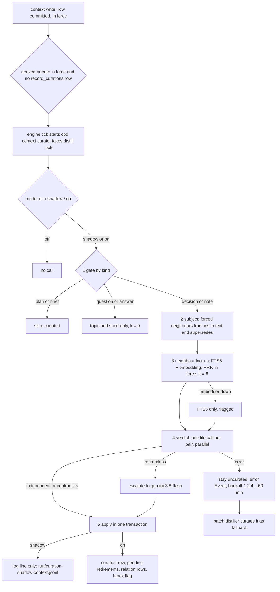

# RFM curation models: synthesis

Plan `rfm-curation-models` (Plan 2 of 4), Job `curation-synth`, attempt 1, 2026-10-29 (EDT). Research only: no code, no migration. It combines `rfm-curation-distiller.md` (cited as **D**), `rfm-curation-embeddings.md` (**E**) and `rfm-curation-judge.md` (**J**) by section; no measurement was rerun and no model was called. Plan 1 (`rfm-memory-retrieval`) owns sqlite-vec, FTS5 and the read log; its findings file is not in this checkout (`git ls-tree origin/main`, no `rfm-memory-retrieval*`), so what this file expects of it is `unverified`. Every local-hardware figure is `unverified` arithmetic (decision pro-d209).

## 1. Verdict

1. **Write-time neighbor curation: yes, built in shadow first, applied only after the switch gate (section 5).** The case is recall and a `contradicts` outcome, not cost: per write it is about $0.0095, flat in N (arithmetic from J, below), against $0.0034 per curated record for the batch at 357 records and $0.0074 at 1,000 (D 3.9); break-even is about 1,300 records (interpolation of D 3.9, unverified).
2. **v1 embedder: `vertex/gemini-embedding-2` via Bifrost, 768 dimensions, input `text` (first 2,000 chars), fused with FTS5 by RRF** (E "Recommendation"). Lexical alone found all 5 retirement targets in the top 10 (E), so the embedder is optional per write: FTS5-only is the fallback.
3. **v1 judge: `vertex/gemini-3.1-flash-lite` via Bifrost, one call per pair, parallel** (J "Recommendation": 95.0% on 40 proxy-labelled pairs, 1.1 s, $0.57 per 1,000 pairs). A `supersedes` or `duplicate` verdict is confirmed by `gemini-3.8-flash` before it becomes a pending proposal (J Step 4: no small model is safe alone).
4. **Where it runs: everything hosted** (Bifrost; OpenRouter only for offline evaluation). No local model in v1: hosted lite (1.1 s measured) beats every local estimate (J "Local run arithmetic", all `unverified`).
5. **`contradicts` is unmeasured**: 0 of about 160 real pairs got that verdict (J Step 1). Its recall is not claimed; the six real candidates of D 2.2/2.3 are the first hand-labelled pairs (section 5).
6. **Stays with the batch distiller:** the fallback when model or embedder is down, `documented` retirements (8 of 13, impossible at write time, D 1.6) as a deterministic `git grep` sweep (D 3.8), and topic/short for records the tick missed.
7. **Stays with the periodic audit:** open `contradicts` flags, stored low-confidence and escalation disagreements, a fixed random sample, old pending retirements; it never retires, supersedes or edits (D 4).
8. **Writes are pending-only**: the User approves every retirement (hs-d551); a `contradicts` opens a flag and retires nothing (D 3.5).
9. **Nothing is installed or pulled**; the homeserver question (section 3) does not block v1.
10. **Shadow gate:** over at least 300 logged pairs with at least 50 retire-class, retire precision against the larger model at least 95% and `independent` to retire at most 2% (J Step 4, a guess, not derived from data), then a 100-pair human sample.

## 2. Architecture of the write path



Placement (D 3.6): **enqueue, never inline.** `cpd context write` stays as fast and failure-free as today; the verdict is minutes late; the record is already in force and findable by FTS. The queue is derived (`State::uncurated`, no queue table), the engine tick starts `cpd context curate` like E9 starts `cpd context distill` (`engine/src/watch/mod.rs`, `ports_tests.rs` E9: through `Spawn`), one record at a time under `locks/distill-<context>.lock`; it defers when a batch holds the lock. Write rate to size for: 57 records/day, one per 25 minutes (D 3.6).

| Step | Name | What it does | Failure behaviour (D 3.7) |
|---|---|---|---|
| 1 | Gate | Rules only, no model (D 3.1): `plan`/`brief` never (not in force); `question`/`answer` get topic and short, k = 0; `decision`/`note` continue | skip is final, counted in the Event |
| 2 | Subject | **No `subject` column in v1** (D 3.2: the model would choose the key, so it is not deterministic). Forced neighbours: every in-force `[dnqa]<n>` id in the new text and the target of the record's own `supersedes` | unknown id ignored, never invented |
| 3 | Neighbour lookup | Context is a hard filter; topic and `by_plan` a soft boost. FTS5 (20 rarest terms, bm25, top 25) and embedding kNN (top 25), RRF, in force (pending retirements stay, flagged), forced neighbours added, cut to k = 8 (D 3.3, E "Recommendation"). Lexical ranked 10 of 11 real targets in the top 10 (D 2.3) | embedder down: FTS5-only, run line says `fts-only`; both empty: topic and short with k = 0 |
| 4 | Verdict | Per pair, full texts, J Step 2 prompt plus the rule "a partial overrule is `contradicts`, never `supersedes`" (D 3.4, D 2.2: `refines`/`completes` 30 against `supersedes` 16). Retire-class verdicts go once to `gemini-3.8-flash`; both must agree | a failed pair counts as `independent` and is counted; a failed curation leaves the record uncurated; model down: backoff 1, 2, 4 .. 60 min, reset on success (the 10 timeouts of D 1.4 fired once a minute) |
| 5 | Apply | One transaction (D 3.5): curation row, `record_retirements` as `pending` (`duplicate` keeps the older record, `supersedes` retires the older, a `supersedes` onto a higher `seq` is rejected), `record_relations`, Inbox flag for `contradicts` | rollback writes nothing; a record out of force at apply is dropped, not an error |

Where this file changes the findings:

| Point | D says | J says | Decision here |
|---|---|---|---|
| One call or per pair | one call, k verdicts, $0.0028 (D 3.9, a Flash-price estimate, no escalation) | per pair, parallel: 2 of 10 models broke the array format; batched is 2.4x cheaper (J "Per-pair versus batched") | **per pair for v1**; batch after the prompt is hardened (J). The $0.0028 is superseded by $0.0095 |
| Confidence | enum, `low` stored not applied | free-text confidence saturates at 0.95-1.0; only the classifier route's confidence tracks correctness (J "classifier route") | no confidence threshold for free text; **escalation replaces it**; classifier `confidence >= 0.8` is a later gate once 50 retire-class pairs exist |
| `quote` | a verbatim-substring check | J's prompt has `reason` only | add `quote` and the check in shadow and measure it; a rejected quote turns the verdict into `independent` (counted) |

Cost per write (arithmetic from J Step 3 and Step 4, unverified): 8 lite pairs at $0.57 per 1,000 = $0.0046; escalation of 22% of pairs (26 of 120, hard negatives included) = 1.76 Flash calls at $2.78 per 1,000 = $0.0049; one embedding about $0.00004 (E: 195 tokens at $0.20 per million). Total **about $0.0095**; $0.54/day at 57 writes against the batch's $0.19/day now (D 1.3). Latency off the write path: embed 0.4 s p50 (E) plus 1.1 s lite (J), plus 13.8 s mean Flash when escalated (J Step 2). The 2,020 input tokens per Gemini pair are about 4x those of OpenRouter models for the same text and nobody found out why (J Step 3 note), so the cost is itself `unverified`.

## 3. Hardware and routing

Hosts: mac-pro (M4 Pro, 48 GB; assumed to run the engine), homeserver (Ryzen 7 3800X, 62 GB, RTX 2060 6 GB, GTX 1050 Ti 4 GB, ollama installed and stopped), Bifrost (`ai-gateway.pennywise.cc`), OpenRouter. Columns: **M** = measured in the findings (by file and section), **U** = `unverified` arithmetic or proposal only.

| Case | Model class | Placement now | Local candidate later (all U) | Latency / cost | Adoption | Guard it needs |
|---|---|---|---|---|---|---|
| Embeddings | hosted embedding, 768-d, `text` | Bifrost `gemini-embedding-2` | 1050 Ti or Metal: bge-m3 (1.14 GB fp16, E): about 430 ms on the 1050 Ti, 180 ms on the M4 Pro (U); all-MiniLM about 17 ms (U, 512-token cap) | **M** 405 / 487 ms p50/p95 per call, one record per call (batch refused), about $0.00004 per write, $0.026 for all 579 records in both forms (E "Cost and speed") | 1 (shadow with the log) | store model and dims with each vector; FTS5-only fallback |
| Gate | rules | engine host, no model | none needed | none: kind rules (D 3.1) | 1 | skip counted; `independent` is the cheap exit |
| Pairwise verdict | small chat judge, or pi classifier route | Bifrost `gemini-3.1-flash-lite`; retire-class escalated to `gemini-3.8-flash` | 2060: an 8B at Q4 fits barely, about 11 s per 5 pairs (U); 1050 Ti: 3-4B only, about 37 s (U); M4 Pro 8B about 24 s (U) (J local table) | **M** 1.1 / 1.7 s, 95.0%, $0.57 per 1,000 pairs; open 8-14B models 82.5% (J Step 3); classifier route `jev-latest` 90%, `kev-4b` 92.5%, $0.035-0.048 per 1,000 (J) | 2 (shadow) | never retires alone; disagreement logged, never applied |
| Failure summarizer / classifier | classifier route (choice) for the class, a chat model for the 10-line digest | Bifrost, or OpenRouter classifier models (34 listed on homeserver, J) | 2060, 3-4B (U) | **not measured**: no CI log was ever sent to a model in the findings | 3 | keep a link to the raw log; classifier confidence gate; shadow against a human label on a sample of failures |
| Message triage | classifier (wake vs context, priority, target role) | pi classifier route | 1050 Ti 4B classifier (U, J local table) | **not measured**; the route itself works (J) | 4 | log every override for review |
| Root-cause clustering | embeddings + pairwise "same cause?" | same two ports as curation | as embeddings and verdict | **not measured**; reuses the measured ports | 5 | the message lists the group's members |
| Plan coverage check | embedding match + yes/no classifier | classifier route | none | **not measured** | 6 | flags gaps only, never judges quality |
| Inbox digest | free-text summary, lossy-tolerant | pi run on the existing Tier path (as the distiller, `runs.jsonl`) | M4 Pro 8-14B (U) | **not measured** | 7 | token cap, refs always kept |
| Worker first-line responder | retrieval + quote + yes/no | the larger model path, not local | none | **not measured** | 8, last | answers only with a quoted passage and a confidence threshold; else escalate |

**What the findings measured:** the embedding model on 5 retirement pairs and 363 topic queries (E), the pairwise judge on 40 proxy-labelled pairs plus 80 neighbours (J), the pi classifier route on those 40 pairs (J). **What they could not:** nothing ran on mac-pro or homeserver because no model was installed (pro-d209), so every local number is arithmetic, and failure classification, triage, clustering, plan coverage, digest and the responder have **no measurement at all**; the table only says which port each would reuse. The summarizer and the digest are free text and need no new port (they run as a pi run on the Runner seam, section 4).

**Question for the User (their call, not blocking v1): how would mac-pro reach homeserver if a local model is ever justified?**

| Option | Failure behaviour | Note |
|---|---|---|
| A. HTTP endpoint on Tailscale (`http://homeserver:<port>`, llama.cpp router or ollama, OpenAI-compatible) | connect timeout, then the port returns `Err(Unreachable)`; the engine caches "down" and re-probes with the same 1-60 min backoff; the verdict falls back to Bifrost or the record stays uncurated; never a per-write probe | same adapter as Bifrost with a different base URL; the endpoint has no auth beyond the tailnet (guess: ollama binds localhost by default and needs `OLLAMA_HOST`, unverified) |
| B. `ssh homeserver <command>` per call | ssh exit 255 maps to `Unreachable`; each call pays a handshake unless a ControlMaster is kept (a process to leak) | no open port; fits the Runner seam, but a socket and a lingering master conflict with "no orphans" |
| Recommendation | **A**, only after a local model beats hosted lite on the shadow log: hosted lite (1.1 s) is faster than every local estimate (J) | decide when a measurement justifies it |

## 4. Ports design

**Where the ports live.** `Ports` (`core/src/ports.rs`) holds three process-level seams, `clock`, `runner`, `spawn`, with `Ports::real()` and `Fakes`; `docs/implementing.md` ("Ports, Spawn and run_with") says a wrapper reads `Ports::current()` and the guard test `no_product_file_builds_the_real_ports_by_hand` fails on a hand-built real port. The new ports are domain ports, not process seams, like `ContextEngine` (`core/src/context/engine.rs`, fake `FakeContextEngine` in `core/src/fakes/context_engine.rs`). **Decision: beside `Ports`**, passed explicitly to `curate_with(&Ports, &dyn EmbeddingPort, &dyn ClassifierPort, ..)`; their real adapters are built over `Ports.runner`, so the process stays behind the existing fake. Move them into `Ports` only when a third consumer needs `Ports::current()` (rule of three; reversible, it adds two fields to `Ports::real` and `Fakes::new`).

```rust
// Shape for the follow-up Plan, not code to merge.
pub trait EmbeddingPort: Send + Sync {
    /// One vector of `dims` finite f32 for `text`. Err: Unreachable, Timeout, Refused(status), BadVector.
    fn embed(&self, text: &str, dims: usize) -> Result<Embedded, CpdError>;   // Embedded { vector, model, tokens }
}
pub struct Choice<'a> { pub state: &'a serde_json::Value, pub question: &'a str, pub labels: &'a [Label<'a>] } // Label { name, definition }
pub trait ClassifierPort: Send + Sync {
    /// One typed answer: a label of `labels`, its probability if the route has one, usage and model.
    fn choose(&self, q: &Choice) -> Result<Chosen, CpdError>;   // Chosen { label, confidence: Option<f32>, usage, model }
}
```

`embed` takes one text because Bifrost refuses batched input (HTTP 400, E "Candidates"). `choose` is the shape of pi's `models.classify` (state, a `choice` question, labels with definitions, an answer with probabilities and confidence; `docs/models.md#use-classifier-models`, J "pi classifier route"), so the same port serves the four-way verdict, failure class, triage and a yes/no plan check. `confidence` is `None` for a free-text chat judge, because its self-report does not separate right from wrong (J). Free-text digests are not a port: a pi run through `Runner`, as the distiller does (`run_pi_timed_with`).

**Real adapters.**

| Adapter | Reaches | Built on | Why |
|---|---|---|---|
| `BifrostEmbedding` | Bifrost `/openai/v1/embeddings` | a Node helper `pi/lib/embed.ts` run through `Runner`, text on stdin, one JSON line out | `models/mod.rs` states cpd has no HTTP client (pro-d20); `pi/lib/models-list.ts` already does `fetch` with the key resolved by pi, never in argv; `Helper` (`models/helper.rs`) is the Rust pattern. A `curl` call through `Runner` would put the key in argv unless fed by a config on stdin (unverified that curl takes the body from the same stdin) |
| `ChatJudge` (a `ClassifierPort`) | Bifrost chat completions, `gemini-3.1-flash-lite`, escalation `gemini-3.8-flash` | a helper `pi/lib/judge.ts`, same pattern, JSON parsed once at the Rust edge | the J prompt returns JSON; 100% valid for the lite model (J) |
| `PiClassifier` (a `ClassifierPort`) | pi's `models.classify` route | a helper calling pi's classify; docs show it for codemode scripts and extensions (`ctx.modelRegistry.classify()`), whether a bare `node` helper can reach it is `unverified` (the models helper receives pi's `ModelRuntime`, so likely) | the only calibrated confidence found (J) |
| local endpoint (later) | llama.cpp or ollama, OpenAI-compatible | the same helpers with another base URL | pi lists llama.cpp chat models as classifiers (`docs/llama-cpp.md#classification`); no Rust change |

**Crates checked** (`cargo search` on 2026-10-29, versions as listed; nothing was added or installed): `ureq` 3.5.0 (blocking HTTP, the only candidate if cpd wanted an in-process client; adds a TLS stack and a socket that no fake covers, so a port over it would still need a fake), `reqwest` 0.13.5, `async-openai` 0.42.2 and `rig-core` 0.46.0-rc.1 (async, pull a runtime; from memory, unverified), `ollama-rs` 0.3.6 (ollama only), `fastembed` 7.5.0 (local ONNX; would download models, barred by pro-d209), `sqlite-vec` 0.1.10-alpha.4 (Plan 1's; an alpha). The workspace has no HTTP crate (`Cargo.toml`, `core/Cargo.toml`). **Finding: no crate beats the existing Node-helper-through-Runner seam for v1; take no new dependency.** Revisit `ureq` only if a second Rust-side network caller appears.

**Fakes** (`core/src/fakes/`, behind the cargo feature `fakes`, registered in `fakes/mod.rs`): `FakeEmbedding` in `embedding.rs` and `FakeClassifier` in `classifier.rs`, in the shape of `FakeContextEngine`: `new(replies)` scripted in order, `answering(x)`, `calls()` returning every request, replies that are `Ok` or an `Err`, no process, no thread, no sleep. Adapter tests use `FakeRunner` replies (`Reply::ok`, `Reply::Exit` with `takes`, `Reply::Io`) on `ManualClock`.

**Tests a follow-up writes (all mocked; each pins a contract):**

| Test | Pins |
|---|---|
| `embedding_adapter_sends_the_text_on_stdin_and_no_key_in_argv_or_error` | the `Call` has the text in `stdin`, no secret in `args`, `envs` or an error string |
| `embedding_adapter_refuses_a_wrong_dimension_or_non_finite_vector` | the vector is validated once at the edge |
| `embedding_adapter_maps_timeout_exit_and_io_to_unreachable_errors` | each `Failed` and bad status has its own error code |
| `chat_judge_rejects_unknown_verdict_and_non_json_reply` | the verdict enum and the one-parse boundary |
| `pi_classifier_adapter_maps_choice_and_confidence` | `Chosen.confidence` equals the route's field, `None` for the chat judge |
| `gate_skips_plan_and_brief_with_no_port_call` | the gate is rules; fakes record zero calls |
| `question_and_answer_get_topic_and_short_with_no_neighbours` | k = 0 for those kinds |
| `ids_named_in_the_text_are_always_neighbours` | the D 2.3 miss (pro-d132 names pro-d116) cannot recur |
| `neighbours_are_in_force_capped_at_k_and_pending_ones_flagged` | the in-force rule of `inforce.rs`, over-fetch 25 keep 8 |
| `embedder_down_falls_back_to_fts_only_and_marks_the_run` | D 3.7 |
| `a_failed_pair_becomes_independent_and_is_counted` | one bad line never fails the record |
| `a_retire_class_verdict_is_escalated_once_and_applied_only_when_both_agree` | J Step 4 acceptance rule |
| `duplicate_keeps_the_older_record_and_supersedes_onto_a_newer_neighbour_is_rejected` | direction rules of `Batch::retire` |
| `contradicts_retires_nothing_and_opens_one_flag` | partial overrule is a flag, not a retirement |
| `apply_is_one_transaction_a_failure_leaves_no_row` | D 3.8 idempotence |
| `curating_a_curated_record_again_is_a_no_op` | `record_curations` presence is the marker |
| `model_failure_backs_off_one_two_four_minutes_up_to_an_hour_on_the_manual_clock` | no 1-minute retry loop (D 1.4); no sleep |
| `the_tick_defers_when_the_distill_lock_is_held` | one writer per Context |
| `shadow_mode_logs_the_pair_and_writes_no_curation_row` | shadow changes nothing |
| `off_mode_makes_no_port_call` | the kill switch |
| `no_record_of_another_context_reaches_a_port` | privacy: every id the fakes saw belongs to the Context |
| `the_verdict_prompt_defines_a_partial_overrule_as_contradicts` | the authored prompt file keeps that line |
| `embed.ts` and `judge.ts` tests in `pi/test/` with an injected `fetch` | like `models-list.test.ts`: the helper's output shape, no network |

**Not tested:** the model's quality (agreement, precision, recall) and the real Bifrost, OpenRouter, Vertex or Node behaviour. Quality is measured by the offline shadow harness (section 5), a tool run by hand against real endpoints, never a test and never in the Gate; "Only authored code is tested" (AGENTS) and the policy for tests (no real external dependency) hold. A manual smoke of each helper is a Lead action recorded in the PR, not a test.

## 5. Evaluation harness and shadow mode

**Harness** (a tool under `scripts/`, Python or Node, reads the JSON and endpoints, prints metrics; not run by `verify`).

**The 100-pair protocol.**

1. Start from the 40 pairs of `rfm-curation-judge-pairs.json` (29 `independent`, 7 `supersedes`, 4 `duplicate` by proxy; 5 retirement pairs, 10+10+10 sampled, 3+2 targeted; `human_verdict` null). Their proxy is one model, `gemini-3.8-flash`, which flipped one pair between sessions (J Step 2).
2. **Add the six real candidates of D 2.2 and D 2.3 first** (pro-d83/pro-n62, pro-d82/pro-d53, pro-d157/pro-d156, pro-d153/pro-d151, pro-d154/pro-d147, pro-d132/pro-d116). None is among the 40 (checked against the file's `incoming`/`neighbour` fields, 2026-10-29). They are the only partial-supersession and `contradicts` candidates seen, and the proxy never returned `contradicts`.
3. Add 54 pairs: 30 from the shadow log where the lite judge and Flash disagree, 14 from `contradicts` or `refines` text candidates, 10 random `independent` for the false-negative rate. (Counts are a proposal.)
4. **Who labels.** Every non-`independent` pair (proxy or either model), the six candidates and every pair where any two of {Flash, lite judge, classifier} disagree: the **User** (hs-d551: the User decides what leaves force; the labels are the ground truth for that decision). The rest keep the Flash label as a `silver` tag, never mixed into the human score. Expected User load: about 40 pairs (guess), one sitting.
5. A pair keeps its label forever; adding a pair never edits an old one. The file stays ids only, no record text.

**Metric and switch target** (J Step 4, a guess not derived from data): over at least 300 logged pairs including at least 50 retire-class pairs, retire-class precision against the larger model at least 95% and `independent` to retire at most 2%; then the 100 human labels must show the larger model itself at least 95%, and recall of the 6 candidates is reported next to it. Pair volume is not the constraint (57 writes/day times 8 is about 456 pairs/day, arithmetic); 50 retire-class pairs is: only 3.6% of curations were ever proposed for retirement (D 1.6), so it may take weeks (unverified).

**What is logged and where.** One JSON line per pair in `run/curation-shadow-<context>.jsonl`, next to `runs.jsonl` (no migration, no schema, cheap to undo): incoming id, neighbour id, model, prompt hash, verdict, `quote` check result, latency, tokens in and out, escalation verdict and model, `neighbours` mode (`fts-only` or `hybrid`), and later the User's or batch distiller's action on the pair (J "Shadow-mode protocol"). Ids and hashes only. Run-level lines go to `runs.jsonl` with `kind = "write-curate"` (D 3.7). A table is added only when `curate-apply` needs it.

**Kill switch.** One config key (name a guess, in the config file beside `timeouts.distill_minutes`), `context.write_curation = "off" | "shadow" | "on"`, **default `off`**, read at the start of every tick: `off` makes no call and writes nothing. `shadow` writes the log only. `on` applies. Going from `on` to `off` leaves written rows (append-only, records never edited); pending proposals stay for the User. A disagreement never retires (J).

## 6. Roadmap

Read-only and shadow steps first. Plan 1 is `rfm-memory-retrieval`. **Schema:** v1 needs no `subject` and no `scope` column (D 3.2: Context is the hard filter, topic and `by_plan` a soft boost); if Plan 1 adds `scope`, the boost swaps to it in `curate-index` and nothing else changes.

| # | Key | Goal | Repo and files | Shape | Depends on | Size | Acceptance |
|---|---|---|---|---|---|---|---|
| 1 | `curate-labels` | Grow the 40 proxy pairs to 100 with the six D 2.2 candidates and a harness that scores a judge against them | cpd: `docs/research/rfm-curation-judge-pairs.json` (new pairs, ids only), `scripts/curate-eval/*` | docs | none (offline, hosted calls by hand) | 2 | file holds 100 pairs; every non-`independent` and disputed pair has a `human_verdict` from the User; harness prints precision, recall, `independent`-to-retire from the file; no record text in the repo |
| 2 | `curate-ports` | The two traits, their fakes and the pure pipeline pieces (gate, neighbour cut, verdict validation, apply plan) with no adapter | cpd: `core/src/context/curate/{ports,gate,verdict}.rs`, `core/src/fakes/{embedding,classifier}.rs`, `core/src/fakes/mod.rs` | tdd | none | 3 | the port, gate, neighbour, validation and idempotence tests of section 4 fail first and pass; `Ports` unchanged; guard test still passes |
| 3 | `curate-adapters` | Real `EmbeddingPort` and chat-judge `ClassifierPort` over the Runner, plus the Node helpers | cpd: `core/src/context/curate/adapters.rs`, `pi/lib/embed.ts`, `pi/lib/judge.ts`, `pi/test/*` | tdd | `curate-ports` | 3 | the adapter tests of section 4 pass on `FakeRunner` and injected `fetch`; a manual smoke (one embed, one judge, `BIFROST_VIRTUAL_KEY` never printed) is recorded in the PR; no new crate |
| 4 | `curate-index` | An indexed in-force test and the neighbour selector (forced ids, FTS5, embedding kNN, RRF, k = 8) | cpd: a migration (index on `context_records.supersedes`), `core/src/context/curate/neighbours.rs` | tdd | Plan 1 (FTS5 table and triggers, sqlite-vec table, `context-retrieval-design.md` "Index and migration"); FTS5-only ships first if vec is late | 3 | `ids_named_in_the_text_are_always_neighbours` and `neighbours_are_in_force_..` pass; the in-force check no longer scans the Context (test on a seeded store); embedder-down gives FTS5-only |
| 5 | `curate-shadow` | `cpd context curate` and an engine tick, mode `shadow`, log file, backoff, kill switch | cpd: `core/src/context/curate/mod.rs`, `engine/src/watch/curate.rs`, `core/src/config/file.rs` | tdd | `curate-ports`, `curate-adapters`, `curate-index` | 4 | the shadow, off, lock, backoff and privacy tests pass; a live run on Context `cpd` fills the log; `scripts/curate-eval` reports the switch gate numbers; behaviour of `distill` unchanged |
| 6 | `curate-apply` | Mode `on`: `record_relations`, the apply transaction, pending retirements, the `curate-conflict` Inbox kind | cpd: a migration (`record_relations`, `inbox_items` kind check), `core/src/context/curate/apply.rs`, `core/src/inbox/*` | tdd | `curate-shadow` passing the gate, `curate-labels` | 4 | apply, direction, `contradicts` and idempotence tests pass; `context retire` stays `user_only`; the User approves the first week's proposals before `on` is the default |
| 7 | `curate-audit` | The weekly audit and the deterministic `documented` sweep; the batch distiller becomes the fallback | cpd: `core/src/context/audit.rs`, `core/src/context/distill.rs` (sweep only), docs | tdd | `curate-apply`; Plan 1's read log (`entry_reads`) for rule promotion, `unverified` until it exists | 3 | the audit lists flags, escalation disagreements and a fixed sample, and cannot write a retirement or edit a doc (test); the sweep proposes `documented` for in-force records named in a doc |
| 8 | `triage-classify` | Shadow failure classification and message triage on the classifier route | cpd: `core/src/inbox/*`, `engine/src/watch/*`, a shadow log, reuse `ClassifierPort` | tdd | `curate-ports`, `curate-adapters` | 3 | each class logs verdict beside current behaviour, changes nothing; agreement against a human label on a sample of failures is reported; override log exists |

Rows 1-4 change no behaviour, row 5 is shadow, only row 6 changes a store. Row 8 is independent of the memory rows and can run beside rows 4-5. Row numbers are not Plan numbers: "Plan 1" always means `rfm-memory-retrieval`. Not in the roadmap (YAGNI until measured): root-cause clustering, plan coverage, digest, first-line responder, the local endpoint.

## 7. Risks

1. **Privacy: more text leaves the machine than today.** Today the distiller sends, through pi, the full text of each batch record plus `known.md` (topic and `short` of every in-force curated record) to `bifrost/vertex/gemini-3.8-flash` (52 of 91 valid runs) and `github-copilot/gemini-3.8-flash` (39), per `runs.jsonl` (D Method). The new path sends the **full text of every record** once for embedding (579 records, about 113,000 tokens, E) and full text of up to 8 neighbours per write to Bifrost, i.e. old records' full text, not only their shorts. Same gateway and Context, but a larger exposure: the embeddings route and its retention are not checked (`unverified`). OpenRouter is for offline evaluation only; production calls go through Bifrost only. Guards: a Context's records go only to a model for that Context (`no_record_of_another_context_reaches_a_port`), cross-Context ids are shown as text, never resolved (D 2.2), `off` by default. **Decision for the User:** whether any Context must stay out of the hosted path.
2. **A wrong supersede hides a true record.** On hard negatives small models were 42-83% precise on retire-class verdicts at any usable confidence (J Step 4, against a proxy). Once approved, the old record leaves force (`inforce.rs`). The User approved 23 of 29 proposals, 7 of 11 in one pass (D 1.6, Lead count), which suggests approval is quick: a plausible false proposal may be approved (inference). Guards: escalation, pending-only, quote shown with the proposal, partial overrule is `contradicts`, shadow gate, records stay in the append-only store so approval is reversible by a new record.
3. **The evaluation is thin.** 5 retirement pairs, proxy labels from one model that is not deterministic, 0 `contradicts` (E, J). The 95% target is a guess. Guard: `curate-labels` before `curate-apply`; the gate reads human labels.
4. **Cost is not the reason to switch.** About $0.0095 per write against $0.0034 for the batch at 357 records; break-even about 1,300 (arithmetic); the Gemini token count is unexplained (J). If shadow shows no recall gain over the batch, stop at `curate-shadow`.
5. **Availability and lock-in.** 10 of 101 distiller runs failed on gateway timeouts (D 1.4); the embedder takes one call per record; the helpers depend on pi's runtime and key. Guards: backoff, FTS5-only, batch fallback, `off`. Changing the embedding model needs a re-embed (about $0.026 for 579 records, E), so store model and dims with each vector.

## 8. Findings to record

1. Write-time neighbor curation: yes for cpd, shadow first (`curate-labels` to `curate-apply`); the case is recall and `contradicts`, not cost: about $0.0095 per write (arithmetic) against $0.0034 per curated record for the batch at 357 records.
2. v1 stack, all hosted via Bifrost: `gemini-embedding-2` at 768-d on `text` plus FTS5 (E), `gemini-3.1-flash-lite` per pair as judge, retire-class verdicts confirmed by `gemini-3.8-flash` (J); no local model in v1.
3. Per-pair parallel calls win over one call per write for v1 (2 of 10 models broke the array format, J); this supersedes D's $0.0028 estimate with $0.0095 per write incl. 22% Flash escalation.
4. No finding measured failure classification, triage, clustering, plan coverage, digest or the responder; no model ran on mac-pro or homeserver (pro-d209); every local-GPU figure is `unverified` arithmetic.
5. Ports `EmbeddingPort` (one text per call: Bifrost refuses batches) and `ClassifierPort` (a typed choice, as pi's `models.classify`) sit beside `Ports`, real adapters on `Runner` through Node helpers; no new crate (cpd has no HTTP client, pro-d20).
6. The six real candidates of D 2.2 (pro-d83/n62, d82/d53, d157/d156, d153/d151, d154/d147, d132/d116) are in none of the 40 judge pairs and the proxy never returned `contradicts`: label them first in the 100-pair set.
7. The User hand-labels every non-`independent` and disputed pair; shadow log is `run/curation-shadow-<context>.jsonl` (ids and hashes only); kill switch `context.write_curation` (name a guess), default `off`.
8. Privacy: today only full batch text and shorts reach Bifrost; embeddings and neighbour verdicts send full text of every record, a larger exposure on the same gateway; retention unchecked. Decision for the User: any Context to keep off the hosted path?
9. Question for the User (not blocking): reach homeserver by an HTTP endpoint on Tailscale (recommended, after a local model beats hosted lite) or `ssh` per call; failure maps to `Unreachable` with backoff, never a per-write probe.
10. Pre-requisites found: an index on `context_records.supersedes` (in-force test is O(N), D 3.3), a `record_relations` table and a `curate-conflict` Inbox kind (D 3.5); v1 needs no `subject` or `scope` column.
