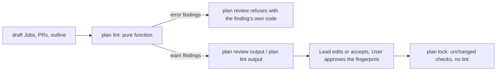

# Planning, plan lint and the model ladder: an audit of cpd against Section 8 of the retrieval-first memory proposal

## Question and scope

Section 8 of the "CPD Context: Retrieval-First Memory Proposal" ("Planning: parallelization, plan lint and the model ladder" and "Job log schema") proposes three things for cpd: declared Job footprints with engine-computed serialization (P1), draft-first incremental Plan lint keyed by a content hash (P2), and a model ladder driven by a per-attempt telemetry log (P3). This document asks what cpd already does today, so that the later sections can say what is worth building and what duplicates an existing mechanism.

This research is **read-only**: it writes no production code, no migration and no test. This file is built by three serial Jobs and each fills its own sections only:

- `research-docs` (this Job): Method, the audit (what cpd already built vs the proposal) and the findings on the existing code;
- `research-data`: "Data analysis" (live database and footprint numbers; none appear here);
- `research-design`: "Evaluation of the three sub-proposals" and "Roadmap".

## Method

**Proposal source.** `/tmp/rfm-proposal.md`, Section 8, lines 253-347 (the Spec of this Job reproduces it verbatim). The doc cites it as "Proposal, `<subsection>`" and quotes at most one line at a time.

**Code and docs read.** The worktree is the Job's branch cut from commit `77b80a89` (the `cpd` Rust workspace: `core/`, `cli/`, `engine/`, `tui/`, `pi/`). Every claim below cites a repo-relative path and a symbol or line, read with `rg`/`grep -n` and `sed -n`. Nothing was built or run, and no database was read: this Job has no access to `cpd.db`, so no database number is stated here (the 134 `gate_failed` Attempts with no `check_tail` are the Lead's figure, quoted as given and marked as such).

**Labels.** Anything not confirmed by reading the cited code is marked `unverified`, `guess:` or `I infer` in the same sentence. Where a doc and the code disagree, the code is taken as the truth and the disagreement is reported.

**The brief's names, corrected.** The brief used table names that do not all exist. The check below is against the contract DDL (`docs/contract.md`, section 4.4) and the migrations (`core/src/store/migrations/`):

| Name in the brief | What cpd has | Evidence |
| --- | --- | --- |
| `job_needs` | The table `dependencies(plan, job, needs)` | `docs/contract.md:1604`; read by `core/src/plan/jobs.rs` (`load`, `SELECT job, needs FROM dependencies`) |
| `pr_needs` (Lead's note: "there is no such table") | **It does exist**: `pr_needs(plan, pr, needs)` holds the needs between PRs (Workflows) | `docs/contract.md:1530`; `core/src/plan/prs.rs:99` (`SELECT pr, needs FROM pr_needs`); `core/src/store/migrations/20261021T1300-local-needs.sql` |
| `job_resources` | The JSON column `jobs.resources` (a Job's declared pools), plus `job_pools` (the pools a Job holds once started) and the view `job_tenants` | `docs/contract.md:1585`; `core/src/store/migrations/20261101T0901-job-tenancy.sql` |
| a Plan-review table | `plan_reviews(plan, id, number, fingerprint, status, feedback, requested_at, decided_at, title)` | `docs/contract.md:1540` |
| "Plannotator fingerprint caching" | `plannotator_reviews(session, pn_id, kind, subject, port, opened_at, closed_at, ended)`, a log of UI sessions with no fingerprint (item 3) | `docs/contract.md:1796`; `core/src/review/mod.rs:1` |

The proposal also reuses the name `jobs` for a different table. Its `jobs` is a per-Job record (`content_hash`, `declared_write`, `kind`, `language`, ...) and its `job_attempts` is one row per Attempt, while cpd's `jobs` is the Locked, mutable Job row and cpd's `attempts` is already one row per Attempt. Item 6 maps each proposed column onto cpd's `jobs`, `attempts`, `dependencies` and `plan_reviews`.

**Vocabulary.** The glossary (`CONTEXT.md:44`) calls the part of a Plan that lives in one repository and ends in one pull request a **Workflow**, and says the CLI, tables and Events still call it a "PR" until a rename lands (`CONTEXT.md:16`). This audit writes "PR" (as the code does) and says "Workflow" where it compares with the proposal's word.

## Audit: what cpd already built vs the proposal

### 1. Workflow and Job DAG

**The hierarchy.** A Plan holds one or more PRs (Workflows); a PR holds Jobs. Job `needs` are rows of `dependencies` and are **same-PR only** (`needs_other_pr`, `core/src/job/mod.rs`, `check_needs_same_pr`). PR-to-PR order is `pr_needs` plus the implied need of a stacked PR whose `--base` is another PR's Lead Branch (`core/src/pr/start.rs:56-101`, macro `needs_unmerged!`; `core/src/pr/add.rs:83-86`, field `needs`; `base_prs` in `core/src/plan/review.rs:121`). A PR stays `waiting` until every need is `merged`; `plan lock` starts the PRs that need nothing (`core/src/plan/lock.rs:93-102`).

**PR shapes.** `pr add --shape` lays out stub drafts (`core/src/pr/add.rs:52-70`, `fn template`): `tdd` is `<pr>-docs` (docs), `<pr>-tests` (test, needs docs), `<pr>-impl` (impl, needs tests); `docs` is one docs Job; `config` is one `work` Job; every shape ends with the stub `open-<pr>`. `core/src/plan/shape.rs` enforces them at review and lock: `test_job_required`, `impl_job_required`, `shape_incomplete` (`shape.rs:39-95`, `fn check`).

**Job kinds.** The `jobs.kind` CHECK lists `work`, `docs`, `test`, `impl`, `verify`, `open`, `update`, `scout`, `research` (`docs/contract.md:1581`). `verify` was added by the rebuild `core/src/store/migrations/20261101T0900-job-verify-kind.sql` (header: "pro-d80: a new Job kind `verify`"): a check-adding Job that needs an `impl` Job of its PR and changes no product behaviour (`docs/contract.md:440`). `open` and `update` are cpd's own: `job add --kind open|update` is `kind_reserved` (`core/src/job/mod.rs`, `check_kind_not_reserved`); E4 adds `open`, the PR poll adds `update` on a merge conflict, both at `open_tier` (`docs/contract.md:451-452`). The red-test guard (`core/src/job/guard.rs`; `core/src/merge/mod.rs:207-221`) makes an `impl` diff that touches a `test` Job's `test_files` fail `tampered`.

**How Ready Jobs are chosen and started** (engine step E3, `engine/src/watch/schedule.rs`):

- `READY` (line 80) is one SQL query: Job `queued`, Plan in `dispatch` or `deploy`, PR `dispatch` or `open`, every `dependencies` need `merged`; `open` and `update` have a derived rule from their PR's other Jobs. The result is ordered by `urgent DESC, seq`.
- `pick` (line 152) builds the pools (`workers` = `concurrency`, plus each resource the Job names; item 2) and calls the pure `schedule()` (`core/src/driver/schedule.rs`): urgent first, then previously skipped Jobs, then the queue; a Job that misses a pool is skipped and reserves nothing.
- `allocations` (line 102) decides, per PR, whether an Attempt is **linear** or **parallel**: a PR with no live Attempt and exactly one Ready Job starts it `Linear` (the Attempt works directly in the PR's workflow worktree on the Lead Branch); a PR with two or more Ready Jobs, or with live parallel Attempts, starts every Job `Parallel` (own worktree and branch); a PR with a live linear Attempt starts nothing. The decision uses only counts of Ready and live Jobs: **no file or footprint information enters it**.
- The starter `driver::start_with_allocation` (`core/src/driver/start.rs`) inserts the Attempt and spawns the driver `attempt run` (`core/src/driver/run.rs`, steps A1-A9).

So the DAG is declared by the Lead (`job add --needs`), stored in `dependencies`, and read as a Ready set on every E3 tick. There is no stored schedule and no engine-built graph object beyond `jobs::cycle` (`core/src/plan/jobs.rs:276`), which looks only at `draft` Jobs.

**How an Attempt reaches the Lead Branch** (`core/src/merge/mod.rs`, driver step A8, "no lock", module header and `merge()`):

1. Tamper check: the Attempt diff may not touch the policy's protected paths or, for an `impl` Job, the guarded red-test files (`touched_protected_over`, `touched_guarded`, lines 203-221) or the Attempt fails `tampered`.
2. A parallel Attempt is rebased onto the Lead Branch tip (line 238); a conflict ends it `merge_conflict` (lines 235-240). A linear Attempt is already on the Lead Branch and never rebases.
3. The Gates run in the Attempt worktree at HEAD, after the rebase and **before** the fast-forward: `gate.merge` (the repo's `pre-commit` hook, the quick check) at every Job merge, `gate.pr` (`pre-merge`) only for `open` and `update` Jobs (`run_gate`, line 400; calls at lines 260-269).
4. Fast-forward by ref compare-and-swap: `git update-ref <lead_ref> <new> <old>`. If the ref moved, the loop goes back to step 2 (which re-runs the rebase **and the Gates**), at most `CAS_RETRIES = 3` times (line 38), then ends `cas_lost` (line 312).
5. Rule S: `git::sync_lead` brings the Lead worktree to the new tip (`core/src/git/lead.rs:49`).

**What is protected, precisely.** The term `stale-tree` appears in neither `docs/contract.md` nor `docs/research/quality.md` (exact-string grep returned nothing); the concept is **rule S** (contract section 7.4, `docs/contract.md:3857-3863`, rationale in `docs/research/no-repo-lock.md:107,129`):

| Protection | What it protects | Where |
| --- | --- | --- |
| Ref CAS at step 8 | Two merges of one PR cannot overwrite each other's fast-forward; the loser retries from step 2, then fails `cas_lost` | `core/src/merge/mod.rs:290-317` |
| Tamper check | Protected paths and red tests are not changed by an Attempt | `core/src/merge/mod.rs:203-221`; `core/src/git/tamper.rs:54` |
| Rule S | After the ref moved, the Lead worktree is rewritten only when its tree equals an earlier tip of the branch (a stale tree). A Lead's own staged or unstaged edit is never overwritten: rule S stops with an `error` Event `lead_worktree_stale` and the merge stands | `core/src/git/lead.rs:49`; `docs/contract.md:3857-3863` |
| Branch check (step 0) | The submitted commit is still on the branch (`tampered` otherwise) | `core/src/merge/mod.rs:136-161` |
| Linear allocation | A linear Attempt is the PR's only live Attempt, so nothing else moves the Lead Branch under it; a failed linear Attempt resets the branch to its `base_sha` | `core/src/driver/start.rs:322`; `core/src/driver/run.rs:1038-1056` |

`dirty_target` is **declared but never produced**: the `Cause` enum documents it as "Merge step 3: the Lead worktree is not clean" (`core/src/attempt/ledger.rs:177`), the merge code says step 3 was removed by hs-d243 (`core/src/merge/mod.rs`, comment "3. Removed by hs-d243"), and a grep of `Cause::DirtyTarget` / `Failure::DirtyTarget` outside tests finds only the declaration and the Spec sentence (`core/src/spec/mod.rs:81`). The producers of the other merge causes are `tampered` (`merge/mod.rs:148,160,207,221`), `merge_conflict` (235: an `open`/`update` Job whose Lead Branch moved; 240: the rebase conflicted; 255: `base_check` found a base conflict), `cas_lost` (312), `gate_failed` (413), `gate_error` (417, 423 and 83) and `crashed` (336, 344: a failed push or a `gh` failure of an `open` Job).

**What the proposal assumes that is true / false / absent here.**

| Proposal assumption | State in cpd |
| --- | --- |
| Jobs form a DAG the engine reads | True: `dependencies` and the `READY` query |
| The engine serializes Jobs whose write sets overlap | Absent: serialization is by `needs` and by the count-based linear/parallel allocation only (`schedule.rs:102`); a Job's `touches` never enters scheduling (item 2) |
| Jobs of one workflow are integrated through a queue | False as worded: there is no queue or lock; parallel Attempts race a ref CAS and retry (`merge/mod.rs:38`, `docs/contract.md:3835`: "The merge takes no lock") |
| A bad integration is caught at its source by a build after each merge | True in effect, in a different order: the quick check runs on the rebased HEAD before the fast-forward, on every retry of the CAS loop, when `gate.merge = local` (`merge/mod.rs:260-263`) |

### 2. Resource pools, `touches` and the validations that exist

**Resource pools.** A Job may list `resources` in its Spec (`jobs.resources`, JSON array). Each name must be declared by the policy of its PR's repo as `[resources.<name>]` with `slots` (an integer from 1 to 64, `core/src/policy/load.rs:73`) at the machine (`host.toml`), owner or repo scope; an undeclared name is `resource_undeclared` at `job add` (`core/src/job/add.rs:320`). The built-in pool `workers` has `concurrency` slots (config default 3, `core/src/config/file.rs:272`; counted over Jobs of every Plan on the machine, `core/src/resource/mod.rs:39-56`). E3 gives a non-urgent Job a slot of every pool it needs, all or none; a Job that misses one is **skipped**, takes nothing, reserves nothing, and gets `jobs.skipped_n` (the E3 skip rule, `engine/src/watch/schedule.rs:191-205`; `core/src/driver/schedule.rs:50-79`), so skipped Jobs are walked before the rest of the queue. The tenancy is recorded in `job_pools` and the view `job_tenants` (`docs/contract.md:1669`). The value `slots = 3` for `cargo` in `host.toml` is the Lead's statement; I did not read `host.toml` (unverified). `job show` reports `waiting_for` for a queued Job (`core/src/job/show.rs:68`); `driver::start`'s `require_ready` reports the same as `details.waiting_for` of `job_not_ready` (`core/src/driver/start.rs:392`).

**Every consumer of `jobs.touches`** (`rg touches core/src engine/src cli/src`, non-test, non-SQL-fixture hits):

| Consumer | Use | Enforces anything? |
| --- | --- | --- |
| `core/src/job/add.rs:420` (`check_touches`), called at `add.rs:224` and `core/src/job/edit.rs:210` | At `job add` / `job edit --spec` each entry must exist in the tree the Job starts from (a literal path or its parent directory, a glob with a match or an existing prefix); else `touches_missing` | Checks the **declaration against the tree**, not the Worker's diff |
| `core/src/plan/overlap.rs` | Cross-Plan overlap warning | Warning only |
| `core/src/plan/jobs.rs:112,140`, `core/src/plan/fingerprint.rs` | Part of the Locked fields hashed into both fingerprints (item 3) | Detects a changed declaration |
| `core/src/spec/mod.rs:274`, `core/src/spec/worker.md:139-142` | Rendered to the Worker as "Files you may touch" | Prose only |
| `core/src/plan/render.rs:260,332`, `core/src/context/pending.rs:104-123`, `docs/commands.md:557` | Shown in `plan render`, `plan review` and `pending` output | Display |

**Nothing enforces `touches` at submit or merge.** The only diff-vs-path checks in `attempt submit` and in the merge are the protected-path check and the red-test guard (`core/src/git/tamper.rs:54,95`; `core/src/attempt/submit.rs`, `run_checks`); neither reads `jobs.touches`. The Worker contract says the opposite of a hard limit: a Worker "may change a file outside its `touches` when a test named in its acceptance cannot pass without it" and lists it in the commit message (`docs/commands.md:4495`). A reusable primitive exists, `git::tamper::changed_paths` (`core/src/git/tamper.rs:87`, `git diff --name-only --no-renames`), but no consumer compares it with `touches`.

**`overlap.rs` semantics, exactly.**

- Path match: `overlaps(a, b)` is equality, or one path ends in `/` and is a prefix of the other (`overlap.rs:55`). No globs, no normalisation (`docs/commands.md:928`). A glob in `touches` is therefore compared as a literal string.
- Which Jobs: this Plan's Jobs not `cancelled`, in PRs not `merged` or `cancelled` (`overlap.rs:94,103-110`), against the Jobs of **other** Plans (`WHERE p.plan <> ?1`, line 68) that are not `done` or archived, in PRs not `merged` or `cancelled`, Jobs not `cancelled`, in the same repo realpath (`o.repo == pr.repo`, `overlap.rs:118`). Any status of the other Job except `cancelled` counts (`draft`, `queued`, `running`, `failed`, `merged`).
- Where shown: `plan render` (the `## Overlaps` section and the `overlaps` field of its output, `core/src/plan/review.rs:147-163`) and the Plan review (`snapshot`, `review.rs:100-118`). `job add` does not warn (`docs/commands.md:928`). `plan lock` does not use it (`core/src/plan/lock.rs` has no reference to `overlap`).
- **Two Jobs of the same PR, or of two PRs of the same Plan, are never compared.** The SQL excludes the Plan's own Jobs, so same-PR overlap is checked neither at `plan lock` nor at any other point. The one same-PR serialization is `needs`.

**Validations that exist today.** There is no lint pass. The list below is exhaustive for the commands named, found by reading each command's code:

| Command | Validations (error code) | Where |
| --- | --- | --- |
| `job add` | tier and spec required unless `--draft` (`usage`); phase (`illegal_phase`); key unique (`job_key_exists`); self-need (`dependency_cycle`); `needs` known (`needs_unknown`) and same PR (`needs_other_pr`) and not cancelled/failed/open/update (`needs_unavailable`); kind reserved (`kind_reserved`); kind allowed by the PR shape (`shape_violation`); `impl` needs a `test` Job (`test_job_required`), `verify` needs an `impl` Job (`impl_job_required`); Spec grammar, no primary-checkout paths, relative `test_files` (`spec_invalid`); tier range (`tier_invalid`, `tier_not_allowed`); resources declared (`resource_undeclared`); `touches` exist (`touches_missing`); PR live (`pr_ended`); explore-kind rules | `core/src/job/add.rs`, `core/src/job/mod.rs:285-475`, `core/src/job/spec.rs` |
| `job edit` | nothing to edit (`nothing_to_edit`); Locked (`job_locked`, `not_a_lead`); the same Spec, tier, `needs` and `touches` checks; `dependency_cycle` over the draft graph (`jobs::cycle`) | `core/src/job/edit.rs:52-246` |
| `plan render` | none refused; it computes the overlap warning | `core/src/plan/review.rs:147` |
| `plan review` | phase (`illegal_phase`); at least one draft (`no_draft_jobs`); every draft has tier and Spec (`draft_incomplete`); outline present and covers each PR with a draft (`outline_missing`, `outline_incomplete`); shape (`test_job_required`, `impl_job_required`, `shape_incomplete`); stale-state CAS (`cas_lost`) | `core/src/plan/review.rs:166-230,280,316`; `shape.rs:39` |
| `plan lock` | phase (`illegal_transition`); `no_draft_jobs`; `draft_incomplete`; the shape checks; **an approved review for the current fingerprint (`plan_not_approved`)**; every live PR has a draft Job (`pr_empty`); `dependency_cycle`; the PR start (`start::prepare`); CAS (`cas_lost`) | `core/src/plan/lock.rs:51-130` |

`tests_unconfigured` is refused when a `tdd` PR is added without `[test-commands]` in the repo policy (`core/src/pr/add.rs:444,711`) and again at a `test` or `impl` Job's submit (`core/src/attempt/kind.rs:59`). Of the proposal's six lint checks (Proposal, "Checks in the lint"): cycles are checked only among `draft` Jobs (`jobs::cycle`); orphan Jobs, undeclared overlap between parallel Jobs, footprint vs likely files, Job size vs worker context, self-containedness, and brief coverage are **absent**.

### 3. Plan review fingerprinting

**What is hashed.** `plan_fingerprint` (`core/src/plan/fingerprint.rs:19`) is SHA-256 of canonical JSON (`sha256_of`, `core/src/plan/jobs.rs`, sorted keys because `serde_json` is built without `preserve_order`). `of_with` (`fingerprint.rs:42`) hashes:

- every Job that `is_under_review` (a draft that is not cpd's `open` stub; `jobs.rs:83`), sorted by key, with `tier, goal, context, touches, acceptance, out_of_scope` (`locked_fields`, `jobs.rs:105`), `key`, `pr`, `title`, sorted `needs`, and `kind` (only if not `work`), `tests`, `test_files` (`kind_fields`);
- every PR not `cancelled`: `key, repo, base, sorted needs`, and `shape` if not `free`; PRs are included only while the Plan is in phase `grounding` or `plan` (`reviews_prs`, `fingerprint.rs:26`);
- the Plan outline when set.

**In no fingerprint:** `jobs.resources`, `urgent`, `test_approved`, `skipped_n`, `summary`, and the PR's `title` and `jira` (a PR contributes only `key, repo, base, needs, shape`). `resources` is documented as guarded by `jobs_locked` but "in no fingerprint" (`docs/contract.md:1585`). Of these, `resources` changes what a Job may run alongside, so a pool change after approval does not invalidate the review (I infer this from the field list; I did not test it).

**How an edit invalidates approval.** `plan review` stores the fingerprint it computed in `plan_reviews.fingerprint` (`review.rs:220-224`) and returns `already: true` when the latest review is pending for the same fingerprint (`review.rs:180-193`). `plan lock` recomputes the fingerprint and accepts only a latest review that is `approved` with an equal fingerprint (`latest_approved_for`, `review.rs:459`), else `plan_not_approved` (`lock.rs:62`). After the lock, `plan decide --approve` queues the drafts only if the review's fingerprint still equals the current one (`review.rs:374-385`); otherwise nothing is queued and the text says the drafts changed.

**Per-Job hash today.** Yes, a second, per-Job fingerprint exists: `jobs.fingerprint` (TEXT of length 64, `docs/contract.md:1557-1590`). It is `locked_fingerprint(job)` (`jobs.rs:254`): SHA-256 of `{goal, tier, context, touches, acceptance, out_of_scope, needs}` (`needs` sorted). It is `NULL` while the Job is a `draft` and `NOT NULL` once it is `queued`, `running`, `merged` or `failed` (CHECKs `status <> 'draft' OR fingerprint IS NULL` and `status IN ('draft','cancelled') OR fingerprint IS NOT NULL`). It is set at `plan lock` (`lock.rs:121-125`), at an approved review that queues drafts (`review.rs:374-385`), at append (`core/src/job/add.rs`), and recomputed on a Locked Job's `job edit --spec`. The engine and the starter recompute it and refuse a Job whose stored hash differs (`jobs::tampered`, `jobs.rs:264`; `core/src/driver/start.rs` check before the Attempt). It differs from the proposal's `content_hash` in three ways: it does not exist while a Job is a draft (the proposal wants it for draft lint), it excludes `kind`, `title`, `pr`, `tests`, `test_files`, `resources`, and it is a tamper seal, not a cache key (no table stores results per hash).

**"Plannotator fingerprint caching" is a misnomer.** `plannotator_reviews` is an append-only log of Plannotator UI sessions a Session has open: columns `session, pn_id, kind, subject, port, opened_at, closed_at, ended` (`docs/contract.md:1796`), written by `cpd review open|close` (`core/src/review/mod.rs:1`) and read by the inbox rule `review-waiting` (`core/src/inbox/rules.rs:354-359`). It has no fingerprint column and caches nothing. The nearest thing to caching is the idempotence of `plan review` (`already: true` for an unchanged pending review) and the fingerprint comparison of `plan lock`; the pi adapter reads `review.fingerprint` and `current` from `plan show` (`pi/test/plan-review.test.ts:10`) and I found no other adapter code that keeps a fingerprint cache (a grep of `pi/**/*.ts` outside `test/` found only unrelated renderer fingerprints in `pi/compact-tools/extensions/compact-tools-rendering.ts`).

**Is there a plan-revision number?** Only `plan_reviews.number`, per Plan, starting at 1 and incremented on each `plan review` that is not a no-op (`review.rs:197`; `UNIQUE (plan, number)`, `docs/contract.md:1540-1556`). It numbers review requests, not plan edits: ten edits between two reviews add one. It is not copied to `jobs` or `attempts`. Row-level history of Job edits exists in the append-only `history(txn, tbl, pk, op, before, after)` table (`docs/contract.md:1355`), written by triggers; whether its `before`/`after` payloads hold enough of a Job row to rebuild past revisions is unverified.

### 4. Worker tier ladder and Attempt telemetry

**Tier syntax and ladder.** A Tier is `<letter><effort>`: `H` Haiku, `S` Sonnet, `O` Opus (Leads only), `G` auxiliary (`core/src/config/tier.rs:16-23`); effort 0-5 maps to pi thinking levels `off, low, medium, high, xhigh, max` (`tier.rs:55`). A Worker may have exactly `H0-H3` and `S0-S3` (pro-d82; `tier.rs:67,121`). `Catalog::next` (`tier.rs:265`) steps the effort up on the same model, then leaves H for the lowest valid S effort at or above 1, ending at `S3`: **H0 > H1 > H2 > H3 > S1 > S2 > S3** (pro-d83, `docs/contract.md:4402-4428`; asserted in `core/src/config/tier_tests.rs:201-218`). `Catalog::step_up` (`tier.rs:289`) repairs a Tier the model catalog refuses.

**Where the starting Tier comes from.** `jobs.tier` is chosen by the Lead per Job (`job add --tier`, required unless `--draft`, `core/src/job/add.rs:142`), and Attempt 1 of the Job uses it (`core/src/driver/start.rs:291-293`, `job.require_tier()`). The `open`/`update` Jobs use `open_tier`: the code default is **`H3`** (`core/src/config/file.rs:289`, recommended by `docs/research/opener-tier.md`), whereas `docs/contract.md:4107,4161` still says `S1`: a stale doc. `retry_cap` defaults to 2 (`file.rs:273`).

**What climbs, and when.** `Cause::is_ladder` is true for exactly `crashed`, `no_submit` and `merge_conflict` (`core/src/attempt/ledger.rs:233`). For those, `next_rung` (`ledger.rs:551`) gives the next Tier while `automatic_attempts < 1 + retry_cap` (`ledger.rs:517`, `ledger.rs:572`), so by default a Job gets at most **3 automatic Attempts**, i.e. from H0 it reaches H2 and no further without the Lead. An Attempt whose driver never started is not counted and does not climb. `provider_error` is retried at the **same** Tier up to `PROVIDER_RETRIES = 3` times after a 30 s hold (`ledger.rs:239-242,553-557`; pro-d101/pro-d102, `docs/contract.md:979`). **Every other cause fails the Job and the Lead decides** (`job retry --tier`, `job cancel`): `gate_failed`, `gate_error`, `timed_out`, `setup_failed`, `tampered`, `cas_lost` do not promote (`docs/contract.md:979`: "`gate_failed` and `gate_error` are not ladder causes"). The proposal's rule "only reasoning failures promote" is therefore **not** what cpd does: cpd promotes on a dead Worker (`crashed`), an idle Worker (`no_submit`) and a rebase conflict, and does not promote on a failed Gate.

**`origin`.** `attempts.origin` is `ladder` or `retry` (`docs/contract.md:1620`). `retry` means the Attempt was created after `job retry --tier` (`core/src/driver/start.rs:289`); `ladder` means every other Attempt, including Attempt 1, a same-Tier requeue after a provider error or a never-started driver, and each automatic climb (`start.rs:290-305`). It is not the proposal's `start_reason`, but `start_reason` is derivable from existing columns: `initial` is `number = 1`, `promoted` is a Tier above the previous Attempt's, `retry_same_tier` is an equal Tier, and a manual retry is `origin = 'retry'`.

**Does a promoted Attempt inherit the failed diff? No, it starts clean, with text.**

- Parallel Attempt: a new branch and worktree are cut from the **current Lead Branch tip** (`core/src/git/worktree.rs:706`, `rev_parse(lead_worktree, refs/heads/<lead>)` then `git worktree add -b <attempt branch> <path> <base_sha>`; called at `core/src/driver/run.rs:412`). The previous Attempt's branch and worktree are kept "for debugging" when it did not merge (`run.rs:933-960`, doc comment of `cleanup`) but nothing reads them again.
- Linear Attempt: it works on the Lead Branch itself, and a failed or cancelled one is `git reset --hard <base_sha>` at A9 (`run.rs:943-956,1038-1056`), discarding what it left. `base_sha` is the Lead tip at A2 (`run.rs:403-427`).
- What carries over is text only: the next Spec lists "Previous Attempts" with outcome, cause and one explanation sentence, plus the conflicting files for `merge_conflict` and the Gate hook name and log path for `gate_failed`/`gate_error` (`core/src/spec/mod.rs:54-103`, `core/src/spec/worker.md:172-186`, `core/src/driver/worker.rs:45-70`).

So the proposal's `inherited = 'diff_and_summary'` does not exist in cpd, and `inherited = 'none'` would be ambiguous: cpd's behaviour is "clean tree plus a summary and a log pointer", which is neither of the proposal's two options exactly. No column records it, because it is one constant.

**`runner` and the neutral `EndReport`.** `attempts.runner` (`pi`|`durable`, `NOT NULL DEFAULT 'pi'`) and `worker_pid` were added by `core/src/store/migrations/20261102T1700-worker-runner.sql`. Both runners end with the same neutral report: `struct EndReport { stop_reason, error_message, turns, tokens_in, tokens_out, cache_read, cache_write, cost_usd, model }` (`core/src/driver/runner.rs:225-235`, contract section 6.12). `runner::metrics` (`runner.rs:269`) reads it for `durable` and parses the pi session file for `pi` (`core/src/metrics/mod.rs`).

**`metrics`.** `attempts.metrics` is a JSON object `{turns, tokens_in, tokens_out, cache_read, cache_write, cost_usd, duration_s, model, thinking_level, stop_reason}` (`core/src/metrics/mod.rs:29-56`), written by the same UPDATE that ends the Attempt (`ledger.rs`, `end_opened`, `SET ... metrics = ?7`). It is `NULL` when none could be read (`runner.rs:277-294`). The proposal's `input_tokens`, `output_tokens`, `cost_usd` and `wall_seconds` already exist here as JSON keys (`tokens_in`, `tokens_out`, `cost_usd`, `duration_s`); `started_at` and `ended_at` are columns.

**Failure causes.** The `attempts.cause` CHECK lists `merged, cancel_requested, setup_failed, timed_out, crashed, no_submit, merge_conflict, cas_lost, dirty_target, tampered, gate_failed, gate_error, provider_error` (`docs/contract.md:1620-1630`); the Rust enum is `Cause` (`ledger.rs:163`, macro `causes!`, tested for completeness in `ledger.rs` `every_cause_is_listed_and_reads_back`). Producers:

| Cause | Produced by |
| --- | --- |
| `setup_failed` | Driver A1-A2: worktree, `pre-start` or policy read failed (`core/src/driver/run.rs:385,400,408,416`) |
| `timed_out` | A5 after `stop_request = timed_out`, the Attempt's active-time limit (`run.rs:713`) |
| `crashed` | Worker or driver died, pi stopped badly (`run.rs:738-817`), E2 liveness (`engine/src/watch/liveness.rs:174,177`), merge recovery (`core/src/merge/recover.rs:101`), a failed push or `gh` call of an `open`/`update` Job (`merge/mod.rs:336,344`) |
| `no_submit` | Worker idle twice without submit (`run.rs:809`) |
| `provider_error` | pi stopped on a provider error (`run.rs:813`) |
| `merge_conflict`, `cas_lost`, `tampered`, `gate_failed`, `gate_error` | The merge, as listed in item 1 |
| `dirty_target` | Nothing (item 1) |

**Where `gate_failed` is produced, and what it covers.** Only in `core/src/merge/mod.rs:400-425` (`run_gate`), at merge step 6, when the hook exits non-zero. Two hooks can feed it: the repo's `pre-commit` (the quick check) at every Job merge when `gate.merge = local`, and `pre-merge` (the PR Gate) at an `open` or `update` Job's merge when `gate.pr = local` (`merge/mod.rs:260-269`). It is **not** produced at `attempt submit`: the move of both Gates to the merge is hs-d679 (`git show 84c274bf`, "Run both gates at the merge and drop test slots (#425)"; `core/src/attempt/submit.rs:3-4`). In this repo's policy `gate.merge = "local"` and `gate.pr = "none"` and the full `pnpm run verify` runs on GitHub as CI (the `[gate]` and `[hooks.pre-commit]` tables of the repo's policy file, which lives in the owner's policy directory and not in this repo; I read it for this audit), so a `gate_failed` here is a quick-check failure (the hooks `typecheck` and `cargo`); a failing CI check comes back as `pr-feedback`, not as an Attempt row. I infer, from that policy, that nothing in the `attempts` table ever sees a local full-suite failure of a `work` or `docs` Job (guess: not verified against the data).

**Is the failing command's output kept?** Yes, but not in `check_tail`. The 60-line tail (`core/src/git/mod.rs:32`, `TAIL_LINES`) and the log path go into the end `detail` (`gate_detail`, `merge/mod.rs:370-377`) which is stored in the `attempt-retry` or `job-failed` Event; the whole output is in `home.hook_log(plan, attempt, hook)`; `parse_gate_detail` reads hook and log path back out of the Event for the next Spec (`merge/mod.rs:381-395`, `core/src/driver/worker.rs:59-63`).

**Why `check_tail` is NULL for every `gate_failed` Attempt (134 of 134, given by the Lead; I did not measure it).** No non-test Rust code writes the column: a grep for `check_tail` outside migrations shows only reads (`core/src/attempt/row.rs:29,48,80`, `core/src/job/show.rs:119,135`) and a test fixture (`cli/tests/flow/job.rs:841`). The contract still documents it as "last 60 lines of the quick check at submit" (`docs/contract.md:489`, and section 7.3 at `:3831`), and that writer ran at `attempt submit`; hs-d679 moved the quick check to the merge, where the tail goes into the Event instead. So the NULL is not specific to open/update/docs roles: I infer from the missing writer that it holds for every role and cause, which the Lead's 0-of-134 is consistent with. The column is dead and the contract text is stale. The same stale text survives in the Worker Spec: `check_failed` and `check_error` are listed as submit refusals (`core/src/spec/worker.md:236-237`), and `ErrorCode::CheckFailed` is declared (`core/src/error.rs:218`) but has no producer (`rg 'ErrorCode::CheckFailed'` in non-test code is empty).

**Can a granular cause be derived today?**

| Proposed outcome | Derivable now? | Evidence and gap |
| --- | --- | --- |
| `fail_compile` | **Partly, not reliably** | A failing `build` of `[test-commands]` is a distinct submit refusal `tests_build_failed` (`core/src/attempt/kind.rs:150-160`), but a refusal is returned to the Worker and not written to `attempts` or an Event (I found no `append` in `kind.rs`, and `submit.rs`/`span.rs` append only `attempt_status` and the `checks` span events): new capture needed. At the merge, `HookOutcome::Failed { exit }` keeps only the first failing command's exit code (`core/src/git/hooks/mod.rs`, `HookOutcome`); in this repo both quick-check commands end in an `exit 64` fallback (a shell "or" clause), so the exit code cannot tell `typecheck` from `cargo build`. The command name is recoverable only from the log, where lines are prefixed `name │ ` when a block has more than one command (`core/src/git/hooks/exec.rs:108,125-128`): reading a log is not a deterministic field |
| `fail_test` | **No, for the merge; submit-only for test kinds** | `tests_failed` (impl) and `tests_not_red` (test) are submit refusals (`kind.rs:195-209`), not stored. The merge runs no test command when `gate.pr = none`. New capture needed |
| `fail_lint` | **No** | cpd has no lint concept: hooks are named commands, and this repo's quick check is `typecheck` plus `cargo build`, no linter (policy text). Needs a policy-level mapping from hook command name to class, plus the failing command's name |
| `fail_flake` | **No** | A Gate runs once (`run_gate`); nothing re-runs a failed check, so a flake is indistinguishable from a real failure. Detection needs new behaviour (a rerun), not capture |
| `fail_infra` | **Yes, mostly** | `gate_error` (killed, timeout, hook could not run, `merge/mod.rs:417-423`), `setup_failed`, `provider_error`, and `crashed` with `driver_pid` NULL are infra by construction |
| `timeout` | **Yes** | `timed_out` (`run.rs:713`); a Gate timeout is `gate_error`, so the two must be kept apart |
| `fail_reasoning` | **No single cause** | The closest are `no_submit` and a `gate_failed` of a work Job; `tampered` and `merge_conflict` are neither reasoning nor infra |

### 5. The proposal's claims about cpd, checked

| Claim (Proposal) | True of cpd today? | Evidence |
| --- | --- | --- |
| "Today every job starts at Haiku without reasoning and climbs to Sonnet on high" ("Model ladder", "Start tier from data") | **False as worded.** Haiku-without-reasoning is `H0` (`LEVELS[0]` is `off`, `tier.rs:55`) and the ladder does end in Sonnet (`S3`, the top Tier of the climb), but the starting Tier is whatever the Lead sets per Job (`jobs.tier`, `start.rs:291-293`), `open`/`update` start at `open_tier` (code default `H3`), the climb happens only for `crashed`/`no_submit`/`merge_conflict` and stops after `1 + retry_cap` (default 3) Attempts, so an unaided climb from H0 stops at H2. How the Lead chooses a Tier is not specified anywhere I found (a grep for guidance on picking a Tier in non-research docs and skills returned nothing; unverified beyond that grep) | `core/src/config/tier.rs`, `core/src/attempt/ledger.rs:233,551`, `core/src/config/file.rs:273,289` |
| "A workflow is one PR" ("Planning") | **True in the glossary's sense**: a Workflow ends in exactly one pull request (`CONTEXT.md:44`); the CLI, tables (`prs`, `pr_needs`) and Events still say "PR" | `CONTEXT.md:16,44` |
| "a job is one commit" | **False.** A Job is a unit of work that one merged Attempt delivers; the Attempt must have **at least one** commit ahead of its base (`rev-list --count base..HEAD`, refused only when it is 0 and the Job is not `open`/`update`, `core/src/attempt/submit.rs:73`), the Worker Spec tells it to commit a skeleton within 10 minutes and "at least every 20 minutes" after (`core/src/spec/worker.md:74`), and the merge fast-forwards all of its commits (`merge/mod.rs:290-300`). The one-commit property exists only on the base: the pull request is squash-merged (`docs/commands.md:2445`) | as cited |
| "jobs commit to the workflow branch through a queue, with a quick build/test after each merge" ("Merge gate") | **Half true.** No queue or lock exists: parallel Attempts race a ref CAS, retry up to 3 times, then fail `cas_lost`; a linear Attempt avoids the race by being the PR's only live Attempt. The quick check does run for every Job merge when `gate.merge = local`, on the rebased HEAD before the fast-forward, and again on each CAS retry | `merge/mod.rs:38,260-263,290-317`; `docs/contract.md:3835` |
| "the engine builds the DAG and computes the schedule" | **Mostly true, without footprints.** The Lead declares `needs`; E3 recomputes the Ready set every tick from `dependencies` and runs the pure `schedule()` over pools; there is no stored schedule and no write-set serialization | `engine/src/watch/schedule.rs:80,152`; `core/src/driver/schedule.rs` |
| "the lead decides the shape" | **True.** The Lead picks PR keys, shapes, Jobs, kinds, tiers, Specs and `needs`; `pr add --shape` only lays out stubs, and review and lock check them | `core/src/pr/add.rs:52`, `core/src/plan/shape.rs:39` |

**How parallelism is capped today.** By `concurrency` (default 3, machine-wide over all Plans, `core/src/config/file.rs:272`; one `cpd watch` engine per machine, `docs/contract.md:35`), by declared `resources` slots (item 2), by the per-PR linear-vs-parallel rule (`schedule.rs:102`), and by the `provider_error` hold of 30 s (`engine/src/watch/provider_hold.rs`). There is **no RAM or CPU budget and no model rate-limit cap**: a grep for `loadavg`, `available_parallelism`, `sysinfo`, `rate.limit` in `core/src`, `engine/src`, `cli/src` found only GitHub's rate limit in `core/src/pr/gh.rs` (`gh_rate_limited`). The shared build cache exists as a convention: `scripts/cargo.sh` starts an `sccache` server and exports `RUSTC_WRAPPER=sccache` when `sccache` is on `PATH`, and takes one slot of the policy resource `cargo` through `cpd resource run` (`scripts/cargo.sh:1-60`). `docs/research/build-cap.md` records a measurement of `build.jobs`; its numbers are the Data Job's to use, not this Job's.

**Hot files.** cpd has no notion of a hot-file list: a grep for `hot`, lockfile names and `Cargo.lock` in non-test code finds only the version-sync tool (`core/src/version_sync/mod.rs`), the test selector's root-input list (`core/src/testsel/mod.rs:227`, which decides which tests to run, not which Jobs to serialize) and install code. The migration-numbering hot spot was removed at its source instead: migrations are named by UTC minute (`scripts/new-migration.sh:4`; contract section 4.5 N1), so two Jobs adding migrations do not collide on a counter.

### 6. What the proposal's Job log schema would add that cpd lacks

Verdicts use: **exists as X**, **derivable from Y**, **absent**, **duplicates Z**.

| Proposed column / table | Verdict | Mapping and evidence |
| --- | --- | --- |
| `jobs` (new table) | **duplicates `jobs`** | cpd's `jobs` is the Job row; adding a second `jobs` would clash by name and role |
| `job_attempts` (new table) | **duplicates `attempts`** | `attempts` is already one row per Attempt (`UNIQUE (plan, job, number)`, `docs/contract.md:1615-1660`) |
| `id`, `job_id`, `attempt_no` | **exists as** `jobs.seq`/`(plan, key)`, `attempts.job`, `attempts.number` | |
| `workflow_id` | **exists as** `jobs.plan` + `jobs.pr` (the Workflow is the PR row `(plan, key)`) | `docs/contract.md:1557` |
| `plan_rev` | **absent** | No plan revision number. Nearest: `plan_reviews.number` (review requests, per Plan; item 3); `history` could order edits by `txn` (unverified payload) |
| `content_hash` | **derivable from** `jobs.fingerprint` (partly) | Exists only for Locked Jobs and excludes `kind`, `title`, `pr`, `tests`, `test_files`, `resources`; absent for drafts, which is where the proposal wants it |
| `kind` | **exists as** `jobs.kind` | cpd's values are work/docs/test/impl/verify/open/update/scout/research; the proposal's examples (`refactor`, `add-test`, `ui`, `config`) are a different taxonomy: `config` is a PR shape, the rest do not exist |
| `language` | **absent** | Derivable only from file extensions of `touches` or the diff (guess: not computed anywhere) |
| `declared_write` | **derivable from** `jobs.touches` | One list: cpd does not split read and write |
| `declared_read` | **absent** | |
| `instr_tokens` | **absent** | No token estimate of a Spec. The rendered Spec is a file (`attempts.spec_path`), so it is computable on demand |
| `depends_on` | **exists as** `dependencies` (and `pr_needs` for PRs) | `docs/contract.md:1604` |
| `tier` | **exists as** `attempts.tier` | Stored as `H0`..`S3`, not `haiku/none` |
| `start_reason` | **derivable from** `attempts.number`, `tier`, `origin` | item 4 |
| `inherited` | **absent, constant** | cpd never inherits a diff (item 4) |
| `started_at`, `ended_at` | **exists as** `attempts.started_at`, `ended_at` | |
| `outcome`: `pass` | **exists as** `attempts.outcome = 'merged'` | |
| `outcome`: `fail_reasoning`, `fail_flake`, `fail_lint`, `fail_compile`, `fail_test` | **absent** | item 4 table |
| `outcome`: `fail_infra`, `timeout` | **derivable from** `attempts.cause` | `setup_failed`, `provider_error`, `gate_error`, `timed_out` |
| `outcome`: `cancelled` | **exists as** `attempts.outcome = 'cancelled'` | The proposal has no such value |
| `actual_files` | **absent** (cheap to compute) | `git::tamper::changed_paths` (`core/src/git/tamper.rs:87`) is the primitive; it is called at the merge for the protected and guarded checks but its result is not stored |
| `footprint_match` | **absent** | Needs `actual_files` and `declared_write` |
| `loc_changed` | **absent** | |
| `input_tokens`, `output_tokens`, `cost_usd`, `wall_seconds` | **exists as** keys of `attempts.metrics` (`tokens_in`, `tokens_out`, `cost_usd`, `duration_s`) | `core/src/metrics/mod.rs:29-56`; `NULL` when no session was readable |
| `lint_results` | **absent** | No lint exists (item 2) |

## Findings on the existing code

Facts only, each with its evidence above; design belongs to the later Jobs.

1. **No consumer of `jobs.touches` compares it with a diff.** `touches` is checked against the start tree at `job add`/`job edit` (`touches_missing`), hashed into both fingerprints, rendered to the Worker and to reviewers, and compared across Plans in `overlap.rs`; nothing enforces it at submit or merge, and the Worker contract explicitly allows leaving it (`docs/commands.md:4495`).
2. **Same-PR and same-Plan `touches` overlap is checked nowhere.** `overlap.rs` excludes the Plan's own Jobs (`WHERE p.plan <> ?1`), is a warning, runs at `plan render` and `plan review`, and not at `plan lock`.
3. **cpd already has the primitives P1 would need, but not their wiring.** `changed_paths` yields the actual file set; `pr_has_live_linear` and `allocations` already serialize a PR's Attempts by a count rule; `resources` with `slots` already serializes Jobs on a named pool. No scheduler input is derived from file sets.
4. **No lint pass exists.** `plan review` and `plan lock` run the structural checks of item 2 (draft completeness, outline, shape, cycle among drafts, approved fingerprint) and nothing that reads Job text, footprints or the brief.
5. **Two fingerprints exist, neither is a lint cache.** The Plan fingerprint pins what the User approved (drafts, PRs while in plan phase, outline); `jobs.fingerprint` seals a Locked Job. No table stores a result per hash. "Plannotator fingerprint caching" names nothing that exists.
6. **The ladder promotes on causes the proposal calls non-reasoning and holds on one it would promote.** `crashed`, `no_submit` and `merge_conflict` climb; `gate_failed`, `timed_out`, `gate_error` fail the Job to the Lead. Automatic climbing is capped at `1 + retry_cap = 3` Attempts, and a promoted Attempt starts clean with a summary only.
7. **Granular failure causes are not captured.** The one stored datum on a failed Gate is `cause = gate_failed` plus an Event `detail` with the hook name, exit and 60-line tail; test and build refusals at submit are not stored; the failing command's name is not a field; no rerun exists to separate flakes.
8. **`attempts.check_tail` is dead and the docs around it are stale.** No code writes it since hs-d679, the contract still describes it, and the Worker Spec still lists `check_failed`/`check_error` submit refusals that nothing produces. `Cause::DirtyTarget` is also declared and never produced, and the contract's `open_tier` default (`S1`) disagrees with the code (`H3`).
9. **The telemetry the proposal wants mostly exists under other names.** Tokens, cost and wall time are in `attempts.metrics`; Tier, origin, cause, timestamps and runner are columns; `start_reason` is derivable. What is absent is `actual_files`, `footprint_match`, `loc_changed`, a plan revision, a content hash for drafts, and a failure class finer than `cause`.
10. **The cheapest P3 data source in the repo is the `attempts` table and the `attempt-retry`/`job-failed` Events, not a new `job_attempts` table**: they already hold one row per Attempt with Tier, cause and metrics (item 6).

## Data analysis

This section turns the Lead's measurements of the live store into tables and numbered findings, and checks each finding that depends on semantics against the code audited above (items 1-6 of the audit are cited as "audit item N"). This Job had no access to `cpd.db`: it only interprets the figures it was given, and derives new ones by arithmetic from them.

### Method and caveats

**Source.** Every database figure is from the Lead's read-only SQL on the live cpd.db, 2026-10-29 EDT: 1,874 Attempts, 2,055 Jobs and 280 PRs of this repo (the repo is cpd itself, so the workload is a Rust CLI developed with cpd: unverified that it transfers to other repos). The footprint and overlap figures are from the Lead's scripts run on the same date (2026-10-29 EDT), over the repo's git history and `jobs.touches`.

**Definitions.**

- `pass%` = merged / (merged + failed). Cancelled Attempts are outside the denominator.
- `cost` = sum of `attempts.metrics.cost_usd`. `active` = `metrics.duration_s`, which is **the pi session's last timestamp minus its first** (`core/src/metrics/mod.rs:8,213`): it is session span, not CPU or busy time, so a Worker that waits inside its session still accrues it. `wall` = `ended_at - started_at`, which also covers the merge step and the Gate (audit item 1, driver step A8; I infer this, because `duration_s` stops at the session's last entry).
- Role = Job kind (`docs`, `test`, `impl`, `verify`, `open`, `update`); `work` stands for every other Job.
- First-Attempt tables (T4, T5) exclude cause `provider_error` and `cancel_requested`. The all-Attempt tables (T6) do not state an exclusion, so I infer that their `pass%` counts `provider_error` as a failure (F8).
- Table labels T1-T11 are the Lead's. Counts I rebuilt from a rounded percentage are marked "(rebuilt, ±1)".

**Biases and limits I can name.**

1. **Tier is chosen, not assigned.** The Lead sets `jobs.tier` per Job (audit item 4), so tier comparisons are confounded with Job type and difficulty. Most code Jobs start at S1; docs and the cpd-owned `open`/`update` Jobs start at H3 (the `open_tier` code default, audit item 4); S2 and S3 are chosen for harder Jobs or reached by retry.
2. **`open` and `update` are cpd's own gate runs**, not Worker coding tasks, and they dominate the failure count (F3). A pooled tier pass rate mixes two different things.
3. **No Job ended `failed`**: failed Jobs were all retried or cancelled, so Job-level failure is invisible and only Attempt-level failure exists.
4. **Selection after failure.** A second Attempt exists only because the first failed, and the Lead picks its tier by hand in most cases (F6), so "k-th Attempt" rates are not like-for-like with first Attempts.
5. **Data gaps.** 52 of 1,874 Attempts have no `metrics` (2.8%), so cost and time are understated by an unknown amount. One Attempt was still running. Several rows are small (n < 40) and carry wide error: for a proportion near 50% at n = 35 one standard error is about 8 points.
6. **Pooled over time.** No figure is split by date, and cpd's own policy and defaults changed during the period (for example `open_tier`: `docs/research/opener-tier.md`; the Gates moved to the merge in hs-d679, audit item 4). Which `gate.pr` setting was in force when each `gate_failed` happened is unknown (F3).
7. **Attempts of one Job are not independent**, so no figure here carries a significance claim.
8. **Footprint measure caveat, stronger than the Lead's.** The script diffs `<merged_sha>^1..<merged_sha>`. The Lead states that the first parent is the Lead Branch before the merge. The code says otherwise for a normal Attempt: `merged_sha` is the Attempt's rebased HEAD, advanced onto the Lead Branch by `git update-ref` (a fast-forward, no merge commit), and for a linear Attempt it is `HEAD` itself (`core/src/merge/mod.rs:281-300`, audit item 1; the Worker is told to commit at least every 20 minutes, `core/src/spec/worker.md:74`). So for an Attempt of two or more commits, `^1` is its own previous commit, and the script saw **only the last commit**. Whether Jobs usually have several commits was not measured here (unverified). If they do, `undeclared_write` is a lower bound (a file written in an earlier commit is missed) and `match` and `subset` are inflated. Also unverified: whether any diff includes a base merge.
9. **Parallel-pair measure caveat.** "Parallel" means no dependency path in the DAG. It does not mean the two Jobs ran at the same time: with `concurrency` 3 and the count-based allocation (audit item 1) many such pairs ran one after the other.

**Figures I could not reproduce** (they are used as given only where stated):

| Figure | Check | Result |
| --- | --- | --- |
| "1,362 of 1,433 merged Jobs merged on their first Attempt (95.0%)" | T3 rows with status merged: 1,362 + 51 + 35 + 19 + 11 + 3 + 2 = 1,483, which equals the merged Attempts in T2 (1,483) | The denominator should be 1,483, so the rate is 1,362 / 1,483 = **91.8%**. I use 91.8% and treat 1,433 / 95.0% as a typo in the input (guess) |
| T4 H3 n = 424 | T5 H3 rows: 128 + 13 + 237 + 44 = 422 | 2 Attempts not in T5; no effect on any finding |
| #1 Attempt n = 1,162 (docs/test/impl/work) | T5 first-Attempt n of those four roles: 289 + 364 + 275 + 231 = 1,159 | 3 apart; I use the Lead's 96.6% / 1,162 |
| T1 active hours | 26.4 + 0.0 + 58.7 + 193.1 + 60.6 = 338.8 vs T2 216.5 + 68.2 + 54.0 = 338.7 | rounding |
| T1 cost | 101.72 + 0.10 + 175.83 + 188.93 + 263.97 = 730.55 = 643.22 + 67.08 + 20.25 | reproduces |
| T6 against T1 | Sum of n x average minutes over T6 = 20,322 min = 338.7 h; per-tier sums also match T1 (S2: 192.9 h of 193.1) | reproduces; T6 averages are consistent with T1 |

Total Attempts: 1,483 + 311 + 79 = 1,873, plus the one running = 1,874. T3 Attempts: 1,362 + 82 + 1 + 2 x 62 + 3 x 40 + 4 x 22 + 5 x 11 + 6 x 3 + 7 x 2 + 10 = 1,874, so T3 reconciles with T1.

### Tables

**Table 1 (T1 plus derived): Attempts by tier.**

| Tier | n | Share of n | merged | failed | cancelled | pass% | Cost $ | Cost per Attempt | Active h | Active min per Attempt |
| --- | --- | --- | --- | --- | --- | --- | --- | --- | --- | --- |
| H3 | 485 | 25.9% | 363 | 115 | 7 | 75.9 | 101.72 | 0.21 | 26.4 | 3.3 |
| S0 | 1 | 0.1% | 1 | 0 | 0 | 100 | 0.10 | 0.10 | 0.0 | - |
| S1 | 811 | 43.3% | 682 | 96 | 32 | 87.7 | 175.83 | 0.22 | 58.7 | 4.3 |
| S2 | 335 | 17.9% | 248 | 57 | 30 | 81.3 | 188.93 | 0.56 | 193.1 | 34.6 |
| S3 | 242 | 12.9% | 189 | 43 | 10 | 81.5 | 263.97 | 1.09 | 60.6 | 15.0 |

Arithmetic: share = n / 1,874; cost per Attempt = cost / n (S3: 263.97 / 242 = 1.09); minutes = hours x 60 / n (S2: 193.1 x 60 / 335 = 34.6). S3 carries 36.1% of spend (263.97 / 730.55) with 12.9% of Attempts. There are **no Attempts at H0, H1, H2**, and one at S0.

**Table 2 (T2 plus derived): Attempts by outcome.**

| Outcome | n | Cost $ | Share of cost | Active h | Share of active time |
| --- | --- | --- | --- | --- | --- |
| merged | 1,483 | 643.22 | 88.0% | 216.5 | 63.9% |
| failed | 311 | 67.08 | 9.2% | 68.2 | 20.1% |
| cancelled | 79 | 20.25 | 2.8% | 54.0 | 15.9% |

Arithmetic: 67.08 / 730.55 = 9.2%; 68.2 / 338.7 = 20.1%; 54.0 / 338.7 = 15.9%. Origin: 1,703 `ladder`, 171 `retry`. Failed Attempts by cause, with the share of 311: `gate_failed` 134 (43.1%), `crashed` 62 (19.9%), `provider_error` 60 (19.3%), `no_submit` 25 (8.0%), `merge_conflict` 15 (4.8%), `timed_out` 8 (2.6%), `setup_failed` 7 (2.3%); the 79 `cancel_requested` are outcome cancelled, not failed.

**Table 3 (T4 and T5): first-Attempt pass rate, by tier and by role x tier** (n, pass%; excludes `provider_error` and cancelled).

| Role | H3 | S1 | S2 | S3 |
| --- | --- | --- | --- | --- |
| docs | 128, 95.3 | 66, 100 | 80, 92.5 | 15, 100 |
| impl | - | 265, 97.7 | 64, 98.4 | 35, 100 |
| test | - | 218, 99.5 | 34, 97.1 | 23, 78.3 |
| work | 13, 100 | 84, 91.7 | 24, 91.7 | 110, 96.4 |
| open | 237, 70.0 | 11, 100 | 29, 65.5 | - |
| update | 44, 68.2 | 2, 50 | 11, 72.7 | - |
| verify | - | 3, 100 | 1, 100 | - |
| **all (T4)** | **424, 78.5** | **649, 97.7** | **243, 90.5** | **183, 95.1** |

Derived, code roles only (docs + impl + test + work; counts rebuilt, ±1):

| Tier | n | passed | pass% | Arithmetic |
| --- | --- | --- | --- | --- |
| S1 | 633 | 619 | 97.8 | n = 66 + 265 + 218 + 84; passed = 66 + 259 + 217 + 77 |
| S2 | 202 | 192 | 95.0 | n = 80 + 64 + 34 + 24; passed = 74 + 63 + 33 + 22 |
| S3 | 183 | 174 | 95.1 | n = 15 + 35 + 23 + 110; passed = 15 + 35 + 18 + 106 |

Check: the same rebuild for the S1 column of T4 gives 619 + (11 open + 3 verify + 1 update) = 634 = 97.7% of 649, so the rebuild matches T4. H3 without `open`/`update`: docs 122 of 128 plus work 13 of 13 = 135 of 141 (95.7%); `open` + `update` at H3: 166 + 30 = 196 of 281 (69.8%). The H3 headline of 78.5% is therefore entirely the opener: (135 + 196) / 422 = 78.4%.

**Table 4 (T6, condensed plus derived): all Attempts by role x tier** (n, pass%, average cost $, average active minutes).

| Role | H3 | S1 | S2 | S3 | Cost $ of role (derived) | Share of spend | Active h (derived) |
| --- | --- | --- | --- | --- | --- | --- | --- |
| docs | 139, 92.7, 0.48, 3.8 | 73, 94.5, 0.31, 2.6 | 88, 92.9, 0.93, 14.1 | 21, 71.4, 1.59, 17.9 | 204.5 | 28.0% | 38.9 |
| impl | - | 275, 97.4, 0.22, 5.1 | 74, 93.0, 0.60, 9.4 | 41, 90.0, 0.74, 6.1 | 135.2 | 18.5% | 39.1 |
| test | - | 253, 92.1, 0.25, 4.5 | 36, 94.3, 0.50, 5.4 | 32, 71.9, 1.48, 10.8 | 128.7 | 17.6% | 28.0 |
| work | 13, 100, 0.06, 1.5 | 124, 71.7, 0.16, 3.9 | 39, 80.6, 0.29, 14.5 | 117, 94.8, 1.26, 13.8 | 179.3 | 24.5% | 44.7 |
| open | 284, 67.9, 0.10, 3.4 | 72, 55.6, 0.09, 3.5 | 69, 48.3, 0.39, 112.2 | 27, 15.0, 0.18, 33.0 | 66.7 | 9.1% | 164.2 |
| update | 47, 67.4, 0.11, 1.5 | 11, 50, 0.19, 5.1 | 28, 63.2, 0.25, 40.6 | 4, 66.7, 0.18, 40.9 | 15.0 | 2.1% | 23.8 |

Arithmetic: role cost = sum of n x average cost over its tiers (docs: 139 x 0.48 + 73 x 0.31 + 88 x 0.93 + 21 x 1.59 = 204.5); share = that / 730.55; role hours = sum of n x average minutes / 60 (open: (284 x 3.4 + 72 x 3.5 + 69 x 112.2 + 27 x 33.0) / 60 = 164.2). The six roles sum to $729.3 (the rest is `verify` and rounding of the averages). `open` + `update` = 188.0 h = **55.5% of all active hours** (164.2 + 23.8 over 338.7) for 11.2% of spend (66.7 + 15.0 over 730.55). `open` at S2 alone is 69 x 112.2 / 60 = 129.0 h, 66.8% of all S2 hours (129.0 / 193.1). `work` at S3 is 117 x 1.26 = $147.4, 20.2% of all spend, the largest single role x tier cell.

**Table 5 (T7): failed Attempts by cause x role** (count).

| Cause | open | update | docs | impl | test | work | Total |
| --- | --- | --- | --- | --- | --- | --- | --- |
| gate_failed | 114 | 17 | 3 | 0 | 0 | 0 | 134 |
| crashed | 21 | 4 | 12 | 12 | 2 | 11 | 62 |
| provider_error | 4 | 0 | 8 | 1 | 18 | 29 | 60 |
| no_submit | 19 | 1 | 0 | 0 | 2 | 3 | 25 |
| merge_conflict | 3 | 1 | 0 | 1 | 7 | 3 | 15 |
| timed_out | 3 | 0 | 3 | 0 | 1 | 1 | 8 |
| setup_failed | 1 | 4 | 0 | 2 | 0 | 0 | 7 |
| **Total** | 165 | 27 | 26 | 16 | 30 | 47 | 311 |

Every row and column sum reproduces (for example `gate_failed` 114 + 17 + 3 = 134; the open column 165). For the four code roles the non-provider failures are 119 - 56 = 63: `crashed` 37 (58.7%), `merge_conflict` 11, `no_submit` 5, `timed_out` 5, `gate_failed` 3, `setup_failed` 2.

**Table 6 (T7 cells that carry cost and time; derived per Attempt).** The Lead gave cost and active minutes only for these cells, so every share below is a **lower bound**.

| Cell | n | Cost $ | Active min | Cost per Attempt $ | Active min per Attempt |
| --- | --- | --- | --- | --- | --- |
| open `gate_failed` | 114 | 11.14 | 191 | 0.10 | 1.7 |
| update `gate_failed` | 17 | 3.09 | 37 | 0.18 | 2.2 |
| open `no_submit` | 19 | 10.13 | 2,038 | 0.53 | 107.3 |
| test `no_submit` | 2 | 3.18 | - | 1.59 | - |
| open `timed_out` | 3 | 1.93 | 474 | 0.64 | 158.0 |
| docs `timed_out` | 3 | 1.27 | 93 | 0.42 | 31.0 |
| test `timed_out` | 1 | 10.86 | 90 | 10.86 | 90.0 |
| test `merge_conflict` | 7 | 7.97 | 54 | 1.14 | 7.7 |
| impl `merge_conflict` | 1 | 0.67 | - | 0.67 | - |
| open `crashed` | 21 | 2.91 | 149 | 0.14 | 7.1 |
| work `crashed` | 11 | 3.95 | 105 | 0.36 | 9.5 |
| impl `crashed` | 12 | 1.07 | - | 0.09 | - |

Lower-bound shares of failed spend ($67.08) and failed active time (68.2 h = 4,092 min):

| Cause | Listed $ | Share of failed $ | Listed min | Share of failed time | Share of failed count |
| --- | --- | --- | --- | --- | --- |
| `gate_failed` | 14.23 | 21.2% | 228 | 5.6% | 43.1% |
| `no_submit` | 13.31 | 19.8% | 2,038 | 49.8% | 8.0% |
| `timed_out` | 14.06 | 21.0% | 657 | 16.1% | 2.6% |
| `merge_conflict` | 8.64 | 12.9% | 54 | 1.3% | 4.8% |
| `crashed` | 7.93 | 11.8% | 254 | 6.2% | 19.9% |

Arithmetic: `gate_failed` $ = 11.14 + 3.09; `no_submit` $ = 10.13 + 3.18 and min = 2,038; `timed_out` $ = 1.93 + 1.27 + 10.86 and min = 474 + 93 + 90; `merge_conflict` $ = 7.97 + 0.67; `crashed` $ = 2.91 + 1.07 + 3.95 and min = 149 + 105; shares are over 67.08 and 4,092. An open `no_submit` Attempt takes 2,038 / 19 = 107.3 min against 191 / 114 = 1.7 min for an open `gate_failed`: about 64 times as long. The five causes together cover at least 58.17 of 67.08 dollars (86.7%) and 3,231 of 4,092 minutes (79.0%).

**Table 7 (T8 plus derived): failed Attempts of Jobs that eventually merged ("waste before success").**

| Role | Failed Attempts | Cost $ | Active min | Wall min |
| --- | --- | --- | --- | --- |
| open | 122 | 13.73 | 530 | 1,308 |
| test | 27 | 8.89 | 90 | - |
| work | 45 | 4.61 | 499 | - |
| docs | 24 | 3.08 | 41 | - |
| update | 16 | 2.06 | 37 | - |
| impl | 15 | 1.86 | 26 | - |
| **Total** | **249** | **34.23** | **1,223 (20.4 h)** | - |

Arithmetic: 13.73 + 8.89 + 4.61 + 3.08 + 2.06 + 1.86 = 34.23; 34.23 / 730.55 = 4.7% of spend (5.3% of the 643.22 merged-Attempt spend); 1,223 / 60 = 20.4 h. The 249 reproduces from T3: Jobs that merged after more than one Attempt (51 + 35 + 19 + 11 + 3 + 2 = 121) used 51 x 1 + 35 x 2 + 19 x 3 + 11 x 4 + 3 x 5 + 2 x 6 = 249 earlier Attempts. So T8 is every non-final Attempt of a merged Job (I infer, from the equal count). Per rescued Job: $34.23 / 121 = $0.28 and 1,223 / 121 = 10.1 active minutes. Wall for `open` is 1,308 / 122 = 10.7 min per failed Attempt against 530 / 122 = 4.3 active, so about 6.4 min per failed `open` Attempt is outside the session (the Gate and merge; I infer).

**Table 8 (T9): merged Attempts, average active vs wall minutes.** docs 7.5 / 7.8; impl 6.3 / 6.5; test 4.9 / 5.1; work 8.4 / 8.8; open 16.7 / 19.8; update 17.0 / 18.7; verify 2.1 / 2.3. Wall minus active: 0.2 to 0.4 min for code roles, 3.1 min for `open`, 1.7 for `update`.

**Table 9 (T10 plus derived): what happens after a non-provider failure.** The Lead gave the 15 largest transitions (163 Attempts; the smallest has n = 5, so rows below that are omitted; a transition is the failed Attempt's tier and cause, then the next Attempt's tier, outcome and origin).

| Group | Transitions | Next Attempt merged | Next failed | Merged% |
| --- | --- | --- | --- | --- |
| After `gate_failed`, same tier (H3 -> H3, S1 -> S1, S2 -> S2) | 26 m + 15 f, 11 m + 10 f, 0 m + 6 f | 37 | 31 | 54.4 |
| of which H3 -> H3 | 41 | 26 | 15 | 63.4 |
| After `gate_failed`, promoted (H3 -> S1, H3 -> S2) | 14 m + 17 f, 0 m + 8 f | 14 | 25 | 35.9 |
| of which H3 -> S1 | 31 | 14 | 17 | 45.2 |
| After `crashed` or `no_submit`, automatic climb (origin `ladder`: S1 -> S2, S2 -> S3) | 16 f, 10 f + 5 m, 7 f | 5 | 33 | 13.2 |
| After `crashed` at S3, manual retry at a lower tier (S3 -> S2, S3 -> S1; origin `retry`) | 8 m, 5 m | 13 | 0 | 100 |
| After `merge_conflict` at S3, manual retry at S3 | 5 m | 5 | 0 | 100 |

Pass rate of the k-th Attempt of a docs/test/impl/work Job (excludes `provider_error` and cancelled): #1 96.6% (n 1,162), #2 51.4% (35), #3 73.7% (19), #4 100% (13), #5 83.3% (6). Arithmetic: Attempts #2 to #5 pass 18 + 14 + 13 + 5 = 50 of 35 + 19 + 13 + 6 = 73 (68.5%). Follow-up Attempts: 1,874 Attempts - 1,586 Jobs that have one = 288 Attempts that are not a Job's first; 171 of them are origin `retry` (the Lead's manual `job retry --tier`, audit item 4), so **59.4% of follow-ups are manual** and at most 117 (40.6%) came from the automatic ladder, which also includes the same-tier requeue after `provider_error`. Retry depth (T3): 71 of the 249 wasted Attempts (28.5%) sit in the 16 merged Jobs that took five or more Attempts (11 x 4 + 3 x 5 + 2 x 6), 1.1% of merged Jobs (16 / 1,483); the 35 Jobs with four or more Attempts hold 128 of 249 (51.4%).

**Table 10 (footprint accuracy; Lead's script, 2026-10-29 EDT; see caveat 8).** 1,010 merged docs/test/impl/work/verify Jobs; a `touches` entry matches a file if equal or a directory prefix.

| Kind | Jobs | match (changed == declared) | subset (declared paths untouched) | undeclared_write |
| --- | --- | --- | --- | --- |
| docs | 279 | 195 (69.9%) | 69 (24.7%) | 15 (5.4%) |
| test | 254 | 165 (65.0%) | 66 (26.0%) | 23 (9.1%) |
| impl | 316 | 97 (30.7%) | 84 (26.6%) | 135 (42.7%) |
| work | 157 | 36 (22.9%) | 76 (48.4%) | 45 (28.7%) |
| verify | 4 | 4 | 0 | 0 |
| **all** | **1,010** | **497 (49.2%)** | **295 (29.2%)** | **218 (21.6%)** |

Arithmetic: row sums 279 + 254 + 316 + 157 + 4 = 1,010 and 195 + 165 + 97 + 36 + 4 = 497, 69 + 66 + 84 + 76 = 295, 15 + 23 + 135 + 45 = 218, all reproduce. Declared set differs from the changed set in 295 + 218 = 513 Jobs (50.8%). Declared `touches` per Job (T11): median 3, p90 9, max 36; spec size of 1,369 code/doc Jobs: median 6,438 characters, p90 10,484, max 23,069.

Most frequent undeclared files (Jobs in which each was written outside `touches`; share of the 218 Jobs; class is my reading of the path, not measured):

| File | Jobs | Share of 218 | Class (guess) |
| --- | --- | --- | --- |
| `cli/tests/pr/pr.rs` | 19 | 8.7% | test file |
| `pi/skills/cpd-lead/SKILL.md` | 19 | 8.7% | skill doc |
| `cli/tests/flow/config.rs` | 16 | 7.3% | test file |
| `Cargo.toml` | 16 | 7.3% | manifest |
| `cli/tests/tui/tui_read.rs` | 16 | 7.3% | test file |
| `cli/tests/pr/main.rs` | 16 | 7.3% | test entry (module list) |
| `CONTEXT.md` | 15 | 6.9% | glossary |
| `Cargo.lock` | 15 | 6.9% | lockfile |
| `cli/tests/engine/watch.rs` | 15 | 6.9% | test file |
| `pi/skills/skill.test.ts` | 15 | 6.9% | test file |
| `tui/src/lib.rs` | 15 | 6.9% | module root |
| `pi/skills/cpd-lead/references/spec-files.md` | 15 | 6.9% | skill doc |
| `core/src/error.rs` | 14 | 6.4% | shared type |
| `tui/src/read/flow.rs` | 14 | 6.4% | source file |
| `cli/src/interface.rs` | 14 | 6.4% | shared type |

**Table 11 (same-PR parallel overlap; Lead's script, 2026-10-29 EDT).**

| Measure | Value | Arithmetic |
| --- | --- | --- |
| PRs / Job pairs | 262 / 3,824 | |
| Pairs with no dependency path ("parallel") | 1,995 | 52.2% of 3,824 |
| Parallel pairs declaring overlapping `touches` | 573 across 39 Plans | 573 / 1,995 = 28.7%; 573 / 3,824 = 15.0% |
| Merge-conflict Attempts in total | 15 | 15 / 1,874 = 0.8% |
| of which `open` / `update` | 4 | 3 + 1 |
| of which docs/test/impl/work | 11 | 0 + 7 + 1 + 3 |

Overlapping paths by pairs that name them: directory prefixes `docs/` 221, `core/src/` 22, `cli/` 13, `core/` 13, `engine/` 13, `tui/` 13 (the sum of the six rows shown: 295; corrected 2026-10-30: a sum of displayed rows, not a total; replay-check.md, section C); exact files `core/src/store/schema.rs` 26, `Cargo.lock` 21, `docs/contract.md` 20, `Cargo.toml` 20, `docs/commands.md` 15, `docs/implementing.md` 15 (the sum of the six rows shown: 117; corrected 2026-10-30: the earlier 117 was the sum of six displayed rows; the equal-file total is 184 pairs and 320 mentions at the research cutoff, and 211 pairs and 361 mentions on 2026-10-30; see plan-lint-measurements.md). A pair may name more than one path, so these are not additive with the 573. Of the 412 mentions in the twelve rows shown, 295 (71.6%) are directory prefixes (corrected 2026-10-30: 412 is the sum of the twelve displayed rows, and 71.6% is a share of those rows only).

### Findings

**F1. The ladder's low rungs are unused, and the proposal's "every job starts at Haiku without reasoning" is false in the data.**
- Claim: of 1,874 Attempts, 0 ran at H0, H1 or H2 and 1 at S0. Starts are spread over H3 (25.9%), S1 (43.3%), S2 (17.9%) and S3 (12.9%). The proposal's sentence ("Today every job starts at Haiku without reasoning...") describes 0 Attempts.
- Evidence: Table 1.
- Confidence: high (a count).
- Code check: agrees with audit item 5: the starting Tier is `jobs.tier`, set by the Lead (`core/src/driver/start.rs:291-293`); H0-H2 are valid (`core/src/config/tier.rs:67,121`) and the automatic climb from H0 would stop at H2 (`1 + retry_cap` Attempts, `core/src/attempt/ledger.rs:517,572`).
- Implies: H0-H2 and S0 do not appear in any outcome here, so the data neither shows them failing nor supports keeping them. It cannot say whether they would pass. Four tiers carry the whole workload: H3, S1, S2, S3. Whether to drop the rest is a design question.

**F2. Tier pass rates are confounded by role: coding Jobs pass about 96-98% at S1, and the low pass rates are the opener's.**
- Claim: first-Attempt pass is 97.8% at S1, 95.0% at S2 and 95.1% at S3 for code roles (633, 202, 183 Attempts). The T4 headline H3 78.5% is explained by `open` (70.0%, n 237) and `update` (68.2%, n 44); H3 docs pass 95.3% and H3 `work` 13 of 13. A higher tier did not give a higher first pass: S2 and S3 are about 2.7 points below S1, which is within about two standard errors for S2 (about 1.5 points) and is confounded because the Lead gives harder Jobs to higher tiers (selection, I infer). `test` at S3 passes 78.3% (n 23, five failures) against 99.5% at S1 (n 218).
- Evidence: Table 3; Table 4.
- Confidence: medium for the code roles (large n, but tier is chosen); low for any cell under n = 40.
- Code check: `open`/`update` run at `open_tier`, default H3 (audit item 4); the tier is not what makes them fail (F3, F6).
- Implies: there is no usable evidence that a higher tier raises first-Attempt success on code Jobs; the tier is a price and speed choice. No impl or test Job ran at H3, so the data says nothing about H3 for them.

**F3. The PR-Gate failures (`gate_failed` of `open`/`update`) dominate failure count, while `no_submit` and `timed_out` dominate failure time, and the costliest single failures are other causes.**
- Claim by count: `gate_failed` is 134 of 311 failed Attempts (43.1%); 114 are `open`, 17 `update`, 3 docs, 0 `test`/`impl`/`work`. Each is cheap and quick: $0.10 and 1.7 active min for `open`. Across the four code roles `crashed` is the main non-provider cause (37 of 63).
- Claim by time: `no_submit` is at least 49.8% of failed active time (2,038 of 4,092 min, all from 19 `open` Attempts at 107 min each), `timed_out` at least 16.1% (657 min from 7 Attempts) and `gate_failed` at most about 5.6% of listed time (228 min from 131 Attempts). By dollars the five causes are close (`gate_failed` 21.2%, `timed_out` 21.0%, `no_submit` 19.8%, `merge_conflict` 12.9%, `crashed` 11.8%, all lower bounds).
- By role: `open` holds the failures in every column (165 of 311), and `open`/`update` hold 55.5% of all active hours (Table 4), most of it at S2 (129.0 h for 69 Attempts, 112 min each). `test` carries the dollar outliers: one `timed_out` at $10.86, seven `merge_conflict` at $7.97 ($1.14 each), two `no_submit` at $3.18. T7 gives no tier per cell, so whether those are S2 or S3 is unverified; guess: S3-heavy, because the S3 `test` average is $1.48 against $0.50 at S2 (Table 4). The single costliest failure is therefore a `timed_out` of a `test` Job (Table 6), not a Gate failure.
- Evidence: Tables 5 and 6. Reconciliation: T6 gives `open` S2 129.0 h, but T7 lists at most 47.5 h of failed `open` time (191 + 149 + 2,038 + 474 min), cancelled Attempts total 54.0 h and merged `open` Attempts average 16.7 min (T9), so at least about 18 h of the 129.0 h I cannot account for from the given tables.
- Confidence: high for the counts; medium for the time and cost shares (cell data is partial, so they are lower bounds, and `duration_s` is session span).
- Code check: `gate_failed` is produced only in `run_gate` at merge step 6 (`core/src/merge/mod.rs:400-425`, audit item 4). That the 114 + 17 are "the PR Gate" is the Lead's reading and is **not confirmed** by the code audit: the hook behind a `gate_failed` is `pre-commit` (the quick check) at every merge, and `pre-merge` (the PR Gate) only for `open`/`update` when `gate.pr = local`; the repo's policy has `gate.pr = none` today (audit item 4), so under today's policy these would be quick-check failures on the Lead Branch at the opener's merge. If the policy had `gate.pr = local` earlier, the PR Gate reading holds for that period. The Attempt row does not record which hook (no `check_tail`, written by no code since hs-d679, audit item 4); the hook name is in the `attempt-retry`/`job-failed` Event detail (`merge/mod.rs:370-377`), which was not queried (unverified). That 0 of the 134 are `test`/`impl`/`work` agrees with the Worker running the quick check before submitting (I infer; not tested).
- Implies: the number of failures and the time they cost are different problems with different owners. The count problem is the opener's Gate; the time problem is idle or stuck Workers (`no_submit`, `timed_out`), and the dollar tail is a few expensive `test`/`work` Attempts.

**F4. Waste before success is small in dollars; most failed time is in Jobs that never merged.**
- Claim: the 249 failed Attempts that preceded a merge cost $34.23 (4.7% of $730.55) and 1,223 active min (20.4 h); that is $0.28 and 10.1 min per rescued Job. Failed Attempts as a whole are $67.08 and 68.2 h, so the other 62 failed Attempts (311 - 249), in Jobs that were cancelled or are running, hold $32.85 (49%) and 47.8 h (70%): about $0.53 and 46 min each. Costs are concentrated: a `test` Job's `timed_out`, `merge_conflict` and `no_submit` cells list $22.01, more than all of T8's `test` waste ($8.89), so at least $13.12 of those belong to Jobs that did not merge.
- Evidence: Tables 2, 6 and 7. Concentration: 128 of the 249 wasted Attempts (51.4%) are in the 35 merged Jobs with four or more Attempts.
- Confidence: high for T8 totals (they reproduce from T3); medium for the 62-Attempt remainder (it is a difference of two given figures; its Job status is not broken out).
- Code check: no Job ended `failed` because a failed Job goes to the Lead, who retries or cancels (`job retry --tier`, `job cancel`; audit item 4). The 62 therefore end in Lead cancellation or are in flight.
- Implies: a start-tier predictor can recover at most the $34.23 and 20.4 h of pre-success waste, 4.7% of spend. The larger loss of time sits in Jobs the Lead abandoned, which no tier choice at start would avoid.

**F5. Starting every code Job higher would not pay back (an estimate).**
- Claim: starting S1-run code Jobs at S2 costs about $229 more and about 59 hours more than the $34 and 11 hours of waste all of them together produced.
- Method: expected cost of an S1 start is c1 + p x c2 (a failed S1 Attempt priced as an average S1 Attempt, then a rescue at S2); starting at S2 costs c2. Break-even failure probability p* = (c2 - c1) / c2, using Table 4 averages:

| Role | c1 (S1) | c2 (S2) | c3 (S3) | p* for S2 start | p* for S3 start | S1 first-Attempt failure (T5) | S1 all-Attempt failure (T6) |
| --- | --- | --- | --- | --- | --- | --- | --- |
| impl | 0.22 | 0.60 | 0.74 | 63.3% | 70.3% | 2.3% | 2.6% |
| test | 0.25 | 0.50 | 1.48 | 50.0% | 83.1% | 0.5% | 7.9% |
| docs | 0.31 | 0.93 | 1.59 | 66.7% | 80.5% | 0.0% | 5.5% |
| work | 0.16 | 0.29 | 1.26 | 44.8% | 87.3% | 8.3% | 28.3% |

- Arithmetic (impl): (0.60 - 0.22) / 0.60 = 63.3%; (0.74 - 0.22) / 0.74 = 70.3%. In every role the observed S1 failure rate (at most 28.3%, and that figure includes `provider_error`, F8) is far below p*. Aggregate: the 725 S1 code Attempts (impl 275, docs 73, test 253, work 124) cost 275 x 0.22 + 73 x 0.31 + 253 x 0.25 + 124 x 0.16 = $166.2 (T1's S1 total is $175.83, of which the opener is the rest). Priced at S2 they would cost 275 x 0.60 + 73 x 0.93 + 253 x 0.50 + 124 x 0.29 = $395.4, a premium of $229.1, or $0.32 per Job. Even if every dollar of waste in T8 (all roles, $34.23) were removed, the premium would need to fall to $34.23 / 725 = $0.047 per Job (about one seventh) to break even. Time: S2 minus S1 active minutes over the same Attempts is 275 x (9.4 - 5.1) + 73 x (14.1 - 2.6) + 253 x (5.4 - 4.5) + 124 x (14.5 - 3.9) = 3,564 min (59.4 h), against 656 min (10.9 h) of waste of the four code roles (41 + 26 + 90 + 499).
- Confidence: medium that the direction is right, low on the amounts. The S2 averages include harder Jobs (selection), so the true premium for the same Job is lower, and a failed Attempt may cost more than an average one (`no_submit` and `timed_out` do). Neither bias is large enough to close a gap of $229 against $34 (about 6.7 times) unless the S2 premium is mostly selection, which I cannot test.
- Code check: costs are `attempts.metrics.cost_usd` (`core/src/metrics/mod.rs`), the same source as T1.
- Implies: a threshold rule that starts the lowest tier whose predicted success clears 70% would start essentially every code Job at the cheapest tier the Lead already uses (S1: 97.8%), so the data gives it little to learn; the exceptions would be where cost and time are the target, not pass rate.

**F6. Promotion is not shown to help; recovery is mostly manual, and a stronger tier does not fix a Gate failure.**
- Claim: (i) after `gate_failed`, the same tier merged 54.4% of the time (37 of 68; H3 63.4%) against 35.9% after promotion (14 of 39); (ii) after `crashed` or `no_submit`, the automatic climb merged 5 of 38 (13.2%) while the Lead's manual retry at a lower tier after an S3 `crashed` merged 13 of 13 and a retry at S3 after an S3 `merge_conflict` merged 5 of 5; (iii) the Attempt after a failure passes 68.5% (#2 to #5: 50 of 73) and #2 alone only 51.4% (18 of 35, about 16 points of error each side), against 96.6% for #1; (iv) 171 of 288 follow-up Attempts (59.4%) are manual `retry`, at most 117 (40.6%) are automatic.
- Evidence: Table 9. T10 lists only the top 15 transitions, so these groups are partial (163 of at most 251 non-provider failures).
- Confidence: low to medium. n is small (39 promoted after a gate failure), the Lead chooses the next tier with knowledge of the cause (selection), and a "failed" next Attempt can be any cause.
- Code check: `gate_failed` is not a ladder cause (`core/src/attempt/ledger.rs:233`, `docs/contract.md:979`), so every `gate_failed` follow-up in Table 9 is origin `retry`, the Lead's `job retry --tier` (`core/src/driver/start.rs:289`; unverified whether a person or a script issued each). `crashed`, `no_submit` and `merge_conflict` do climb automatically (audit item 4), so cpd's own rule promotes on causes the proposal calls non-reasoning, and the data shows that promotion rarely succeeds on them. Any retry starts from a clean tree with a text summary (`core/src/git/worktree.rs:706`, audit item 4).
- Implies: failure and tier are only weakly related in this data. The cases that recovered were same-tier or lower-tier retries on a clean tree after a cause that is not about model strength.

**F7. `provider_error` is a distinct class and it depresses all-Attempt pass rates.**
- Claim: 60 of 311 failures (19.3%) are `provider_error`: `work` 29, `test` 18, `docs` 8, `open` 4, `impl` 1. First-Attempt tables exclude them; Table 4 does not (I infer). That explains why `work` S1 is 91.7% on first Attempts (T5) but 71.7% over all Attempts, and `test` S1 99.5% against 92.1%. Excluding them, the code-role non-provider failures are 63 of 119.
- Evidence: Tables 3, 4 and 5.
- Confidence: medium (the definition of T6 is inferred; T7 has no tier column to confirm per cell).
- Code check: `provider_error` is retried at the same tier up to three times after a 30 s hold (`core/src/attempt/ledger.rs:239-242,553-557`, audit item 4), so it already matches the proposal's "infra errors retry at the same tier".
- Implies: any pass rate used to choose a tier must exclude infra failures or it will mis-rank roles.

**F8. Declared `touches` is an incomplete footprint: half of the Jobs differ from their declaration and 1 in 5 wrote an undeclared file.**
- Claim: 49.2% of 1,010 Jobs match exactly, 29.2% touch fewer files than declared (over-declaration), 21.6% wrote at least one file outside `touches`. By kind the undeclared rate is 5.4% for docs, 9.1% for test, 28.7% for work and 42.7% for impl (135 of 316).
- Evidence: Table 10.
- Confidence: medium. The method may have seen only the last commit of each Job (caveat 8): if so the undeclared figure is a lower bound, and match and subset are not reliable. Matching by directory prefix also makes broad declarations (`docs/`) match easily.
- Code check: nothing enforces `touches` at submit or merge, and the Worker contract allows leaving it when a test needs it (`docs/commands.md:4495`; audit item 2), so an undeclared write is permitted behaviour, not a violation. `job add` only checks that each entry exists in the start tree (`core/src/job/add.rs:420`), so a Job that creates a file must declare an existing parent directory; that is why a directory prefix counts as a match.
- Implies: declared footprint is a hint and not a write set: a serializer or lint that trusts it would be wrong for about one Job in five and two in five for `impl`. Declared-versus-actual cannot be judged correct until it is measured over the whole Attempt diff.

**F9. The undeclared files are a long tail with a recognisable head, and most of it is not the proposal's "hot file" list.**
- Claim: the 15 most frequent undeclared files each appear in 14 to 19 of the 218 Jobs (6.4% to 8.7%). By my reading of their paths (not measured): 6 are test files or test entry points, 4 are shared source (`core/src/error.rs`, `cli/src/interface.rs`, `tui/src/lib.rs`, `tui/src/read/flow.rs`), 3 are docs or skills (`CONTEXT.md`, `SKILL.md`, `spec-files.md`) and only 2 are the manifests the proposal names (`Cargo.toml`, `Cargo.lock`). Cargo.toml (16) and Cargo.lock (15) differ by one Job, so the lockfile follows the manifest as expected. Guess: the test entry points and module roots (`main.rs`, `lib.rs`) are registration files that change whenever a Job adds a module; I did not read the diffs.
- Evidence: Table 10 (files) and Table 11 (`Cargo.lock` and `Cargo.toml` appear among the declared overlaps too, 21 and 20 pairs).
- Confidence: medium for the counts; low for the classification.
- Code check: cpd has no hot-file list (audit item 5) and its migration numbering hot spot was removed at the source (`scripts/new-migration.sh:4`). The proposal's examples cover lockfiles and manifests, but the head of this data is mostly test registries and shared modules, so a fixed list from the proposal would miss most of it.
- Implies: footprint-as-measured (what changed) finds files that footprint-as-declared misses, and the measured list is repo-specific.

**F10. Declared overlap between parallel Jobs of one PR is common, but merge conflicts are rare, so declared overlap is a poor predictor of conflict.**
- Claim: 573 of 1,995 parallel pairs (28.7%) declare overlapping `touches`, mostly broad directories (of the 412 mentions in the twelve rows of Table 11, 295 or 71.6% are directories, led by `docs/` at 221; corrected 2026-10-30: 412 and 71.6% are sums and shares of those displayed rows, not totals. The equal-file overlap is 184 pairs at the research cutoff (9.2% of 1,995) and 211 pairs now (9.9% of 2,130)). Only 15 of 1,874 Attempts (0.8%) ended `merge_conflict`, and 4 of those are `open`/`update`, so at most 11 can come from two Jobs of one PR. That is at least 52 declared-overlap pairs per conflict (573 / 11), and the conflicts listed cost at least $8.64 (`test` $7.97, `impl` $0.67; 1.2% of spend, other cells not given).
- Evidence: Table 11; Table 6; Table 9 (5 of 5 merged after a same-tier retry).
- Confidence: medium for "declared overlap over-predicts conflict"; low for any causal link (the conflicting Jobs are not matched to the overlapping pairs, and pairs that never ran together count as parallel, caveat 9).
- What this does and does not prove: it shows that declared overlap is an upper bound: git's three-way rebase resolves non-adjacent edits to a shared file, and many pairs never ran concurrently (I infer; not tested). It does **not** show that actual-file overlap is low: undeclared writes (F8) mean actual overlap could be higher, and over-declaration (29.2% subset) means it could be lower. Actual-file overlap between parallel Attempts was not measured.
- Code check: `merge_conflict` is produced at the rebase step and, for `open`/`update`, when the Lead Branch moved (`core/src/merge/mod.rs:235,240,255`, audit item 1). Same-PR overlap is checked nowhere at lock or render (`core/src/plan/overlap.rs` skips the Plan's own Jobs, audit item 2), so this overlap is not currently warned about and has still cost almost nothing.
- Implies: serialization on declared overlap would serialize 28.7% of parallel pairs to avoid at most a few conflicts that a clean-tree retry resolves at once; its benefit must be weighed against the parallelism it removes, which was not measured here.

**F11. What the data cannot say.**
- Granularity inside `gate_failed` (build, test, lint, flake): not recorded in the Attempt row. `check_tail` is dead (0 of 134, written by no code, audit item 4), and the quick check runs once (`run_gate`), so a flake is indistinguishable from a real failure. The Event detail may hold the hook name (unverified; not queried).
- Diff inheritance: it cannot be estimated because cpd has never done it. A promoted Attempt always starts from a clean tree with a text summary (audit item 4), so there is no treatment arm, not only a missing column.
- Per-tier causes and per-tier cost of failed Attempts (T7 has no tier), the failed share by plan date, the language or size of a Job, and per-lead footprint accuracy (the Lead's script did not split by Lead).
- Tier causality: tier is chosen by the Lead with knowledge of the Job (F2, F6).
- Size for a learned estimator: the proposal says a few hundred Jobs are enough. There are 1,586 Jobs with Attempts, but the event to predict is rare: about 40 first-Attempt failures among the 1,162 code first Attempts (1,162 x 3.4% = 40, rebuilt). With about 40 events a model can support only a few features (guess: a common rule of thumb is about ten events per feature), so the number of Jobs is not the constraint; the number of failures is.
- Confidence: high that these gaps exist (each follows from the cited code or the Lead's definitions).

### What the data implies

For the design Job; each bullet is a finding, not a design.

- First-Attempt success is already high (91.8% of merged Jobs pass first time; code roles 96.6%), and waste before success is $34.23 (4.7% of spend). A start-tier predictor has little to recover (F4, F5); starting higher costs about 6.7 times what it could save.
- The two largest failure classes are not model-strength problems: the opener's Gate failures (count) and idle or stuck Workers (time). A ladder that promotes on tier alone does not address either (F3, F6).
- Evidence that promotion helps is absent (F6): same-tier retries after `gate_failed` and lower-tier retries after S3 `crashed` did better than climbs. The proposal's "only reasoning failures promote" is consistent with this direction, but cpd's `cause` cannot separate reasoning from other failures, and its own rule promotes on `crashed`, `no_submit` and `merge_conflict`.
- Telemetry that is missing and cheap: which hook or command failed in a `gate_failed`, a tier on every cost-by-cause cell, the whole-Attempt changed-file list, and Job commit count. Those are the information the questions in the proposal need; whether to store them as columns or in Events is for the design Job.
- Declared footprints are unreliable as a write set (21.6% undeclared, 42.7% for `impl`) and the undeclared head is repo-specific (F8, F9); a proposal that depends on them needs measured actual files, not declarations, and a re-measurement over the whole Attempt diff first (caveat 8).
- Declared overlap predicts conflict poorly (573 overlapping pairs against at most 11 conflicts), so the value of serialization on footprints must be argued from lost parallelism, not from conflicts avoided (F10).
- Failures are too rare for a learned difficulty model (about 40 first-Attempt code failures, F11); per-role lookup is the most the data supports, and infra failures (`provider_error`, 19.3%) must be excluded from any pass rate.
- The unused tiers (H0-H2, S0) have no data either way, and 55.5% of active hours are the opener and updater, so the largest wall-clock lever in this data is the `open`/`update` runtime and the `no_submit`/`timed_out` tail, not the tier ladder (F1, F3).

## Evaluation of the three sub-proposals

This section judges each sub-proposal against the audit (items 1-6, "Findings on the existing code" 1-10) and the data (F1-F11). A verdict is one of **adopt as proposed**, **adopt adapted**, **defer** or **reject**. Estimates are labelled; a number with no label is from the data section.

| | Sub-proposal | Verdict | One line |
| --- | --- | --- | --- |
| P1 | Declared footprints, hot files, resource cap, merge gate | **Adopt adapted** (small) | `jobs.touches` already is the declared write set; add a same-PR overlap **warning** at review, capture `actual_files` at submit and derive the match class on read; no auto-serialization, no `declared_read`, no RAM/CPU cap, no merge queue |
| P2 | Draft-first, incremental Plan lint | **Adopt adapted** | One stateless, deterministic `cpd plan lint` run at `plan review`; reject the `lint_results` / `content_hash` cache and the three model-based checks |
| P3 | Model ladder and Attempt telemetry | **Adopt adapted** (smaller still) | Extend `attempts` with additive columns for the facts of a failed Gate; do not add `job_attempts`, do not widen `cause`; data-driven starting tier as a deterministic lint warning; defer `fail_flake` and `inherited` |

### P1. Declared footprints, hot files, resource cap and merge gate

**(i) What cpd already does** (cites are to the audit)
- `jobs.touches` is a Locked, non-empty JSON array of repo-relative paths, validated against the start tree at `job add`/`job edit` (`touches_missing`, `core/src/job/add.rs:420`), hashed into both fingerprints (`core/src/plan/jobs.rs:105`, `fingerprint.rs`) and rendered to the Worker as "Files you may touch" (`core/src/spec/worker.md:139-142`). That **is** a declared write set: the Worker contract treats it as the allowance and lets the Worker leave it only when an acceptance test needs it (`docs/commands.md:4495`). Directory entries (`docs/`) stand in for files a Job will create, because `job add` demands an existing path (audit item 2; F8 code check).
- Cross-Plan overlap is already a warning (`core/src/plan/overlap.rs:55,103`, shown by `plan render` and `plan review`). Same-PR overlap is checked nowhere (audit item 2; finding 2).
- Serialization exists in three forms and none reads files: `needs` (`dependencies`), the count-based linear/parallel allocation (`engine/src/watch/schedule.rs:102`) and resource pools with `slots` (`core/src/resource/`, `jobs.resources`; audit item 2).
- Parallelism cap: `concurrency` (default 3, machine-wide, `core/src/config/file.rs:272`), per-resource `slots`, the 30 s provider hold. No RAM, CPU or rate-limit input exists (audit item 5). The shared build cache exists as a script (`scripts/cargo.sh`: `sccache` plus the policy resource `cargo`).
- Merge gate: no queue or lock; parallel Attempts race a ref compare-and-swap, the quick check runs on the rebased HEAD before the fast-forward and again on every CAS retry (`core/src/merge/mod.rs:38,260-317`; audit item 1).
- Hot files: no list; the migration-numbering hot spot was removed at its source (`scripts/new-migration.sh:4`).

**(ii) What the data says**
- F8: 49.2% of 1,010 merged Jobs match their `touches`, 29.2% touch less, **21.6% wrote an undeclared file** (impl 42.7%, work 28.7%, test 9.1%, docs 5.4%). The Lead's script saw only the last commit of each Job (data caveat 8), so 21.6% is a lower bound and `match`/`subset` are inflated; unverified by how much.
- F9: the 15 most frequent undeclared files each appear in 6.4-8.7% of the 218 Jobs. By my reading of the paths (not measured) 6 are test files or test entry points, 4 shared source, 3 docs or skills and only 2 are manifests (`Cargo.toml`, `Cargo.lock`). A fixed list of lockfiles would cover 1 of 15.
- F10 and Table 11: 573 of 1,995 parallel same-PR pairs (28.7%) declare overlapping `touches`, **71.6% of the displayed path mentions are directory prefixes** (`docs/` alone is 221 of 412; corrected 2026-10-30: 412 and 71.6% are sums and shares of the twelve displayed rows), the equal-file pairs are 184 of 1,995 (9.2%) at the research cutoff and 211 of 2,130 (9.9%) now (corrected 2026-10-30: the earlier 117 was the sum of six displayed rows, not a total, so 5.9% was wrong), and only 15 of 1,874 Attempts ended `merge_conflict`, at most 11 of them from two Jobs of one PR (0.6% of Attempts). A conflicted Attempt then merged on a same-tier retry 5 of 5 times (Table 9).
- The 21.6% is on the full diff of Jobs that merged. Nothing here measures how often two Attempts that ran together wrote the same real file.

**(iii) Verdict: adopt adapted.** Keep the part that reads existing data, drop the part that needs a new mechanism:

| Proposal bullet | Verdict | Reason |
| --- | --- | --- |
| `declared_write` | **Already exists** as `jobs.touches` | DRY: a second column would restate it |
| `declared_read` | **Reject** | No decision changes with it. A read-after-write order is what `needs` states (the Lead declares it, and `open` waits for every Job of its PR, `engine/src/watch/schedule.rs:80-97`); the Worker explores the tree anyway; the only other use, a token estimate of declared files, has no data behind it (no failure is tied to context size: `timed_out` is 8 of 1,874 Attempts). YAGNI. Revisit if the size calibration of P2 shows reads, not writes, drive Attempt time |
| Engine serializes Jobs with overlapping write sets | **Reject** (auto-added edges) | An auto-added `needs` edge changes the DAG the User approved: `needs` are in the Plan fingerprint (`fingerprint.rs:42`), so adding one after approval invalidates it (`plan_not_approved`) and adding one at lock time silently edits an approved plan. Explicit over implicit. The data also argues against: declared overlap over-predicts conflict (F10) and under-reports writes (F8), so an edge would be wrong in both directions. The Lead settles an overlap by `job edit --needs` or by narrowing `touches`, which the review shows |
| Compare declared footprint with the actual diff after each Job | **Adopt**, as capture and derived read | Below |
| Hot files that always serialize | **Adopt adapted**: exempt, do not serialize | The existing mechanism is a resource pool with one slot, named by the Lead. What the data supports is not serializing but not crying wolf: lockfiles (generated) are exempt from the overlap warning and the undeclared-write class; any wider list is decided from captured `actual_files`, not from the proposal's examples (F9) |
| Cap parallelism by `min(DAG width, RAM/CPU, rate limits)` | **Reject** the new inputs | `concurrency` and `slots` are the knobs; `cargo` slots already bound the memory-heavy resource. A rate-limit cap would address `provider_error` (60 of 311 failures, F7), which already holds 30 s and retries at the same tier up to three times (`core/src/attempt/ledger.rs:239-242`). No Attempt in the data ended for lack of RAM or CPU (I infer; there is no such cause) |
| Merge gate through a queue | **Reject** | The problem it solves has zero occurrences: no `cas_lost` in the 311 failed Attempts (Table 5), and the quick check already guards every merge. The one real merge cost is `merge_conflict` (15), handled by a clean retry |

**(iv) Adapted design**

*1. Same-PR overlap lint rule `parallel_write_overlap`* (a `warn`; catalogue in P2).
- Pairs: two Jobs of **one PR**, status not `cancelled`, kind not `open`/`update` (cpd's own stubs touch nothing), with **no dependency path in either direction** through `needs` (transitive closure over `dependencies`/the draft Jobs' `needs`; at most 3,824 pairs exist in the whole history, Table 11). Jobs of different PRs of one Plan are not compared (their order is `pr_needs` and the PR merge; unmeasured).
- Overlap: reuse `overlap.rs::overlaps` for the candidate test, then **keep only equal literal paths** (both Jobs name the same file). A directory entry overlapping a file or a directory is not reported: it is a stand-in for a file to be created (`check_touches`); directories are the larger share of mentions (580 of 900 at the cutoff, replay-check.md, section C; corrected 2026-10-30: the earlier 71.6% was a share of the twelve displayed rows only), and the data shows no harm from it (F10).
- Exempt: files in the shared set (below). With lockfiles exempt, 183 of the 184 equal-file pairs remain at the research cutoff, and 209 of 211 now (corrected 2026-10-30: the earlier `at most 96` was taken from the six-row sum of 117, not from a total; 21 pairs name `Cargo.lock`, and only 2 pairs are lockfile-only). The rest name real shared files, such as `core/src/store/schema.rs` 26, `docs/contract.md` 20, `Cargo.toml` 20, `docs/commands.md` 15 and `docs/implementing.md` 15 (displayed-row counts).
- **Severity: warn, never refuse.** A refusal would be a guard without proven bad behaviour (axiom): the harm is at most 11 conflicts in 1,874 Attempts, each fixed by one same-tier retry, and a Worker may legitimately write outside `touches` (`docs/commands.md:4495`). It would also stop 28.7% of parallel pairs if directories counted.
- Where: `cpd plan lint` and automatically at `plan review` (P2), so the Lead sees it before the User approves. Not at `plan lock`: the lint is a pure function of the fingerprinted fields (`goal, context, touches, acceptance, out_of_scope, needs, kind`, PR `needs`), so an approved fingerprint at lock means the same result as at review (subtraction; the lock keeps its existing structural refusals).
- How the Lead settles it: `job edit <key> --needs <other>` (serialize: a draft's `needs` can still change, `docs/contract.md:915`) or narrow `touches`. There is no acknowledgement state: the warning stays on the next review, and its volume is bounded by the 9.9% of parallel pairs above (211 of 2,130 now; corrected 2026-10-30: the earlier 5.9% came from the six-row sum of 117).

*2. Shared files* ("hot files"): the simplest rule that the data supports is **exempt, not serialize**. Built-in default: lockfiles (`Cargo.lock`, `pnpm-lock.yaml`, `package-lock.json`, `yarn.lock`) never count in `parallel_write_overlap` and never make an Attempt `undeclared_write`. A repo-policy key `[plan] shared_files = [...]` (same path rules as `touches`: equal, or a trailing-`/` prefix) would extend it, but is **not proposed until `actual_files` exist for one month of Attempts**: F9's head is test registries (`cli/tests/pr/main.rs`, `tui/src/lib.rs`) and shared modules, and I did not read the diffs, so a list written now would be a guess. The key would live in the repo's owner policy, not in this repo, so a list is one more file to keep in sync (unverified how the repo's policy is edited).

*3. Capture at Attempt submit.* `core/src/attempt/submit.rs`, `submit_in` (line 26): after `run_checks` returns and before the write transaction that sets `status = 'merging', submitted_sha` (`submit.rs`, the `UPDATE attempts SET status = 'merging'`), call `git::tamper::changed_paths(&root, &base, &sha)` (`core/src/git/tamper.rs:87`, `git diff --name-only --no-renames -z base...sha`, the same diff the tamper check already reads; `base` and `sha` are the locals of step 4) and pass the list into that UPDATE. One extra git call per submit (cost unmeasured; I infer it is small next to the quick check that runs at the merge). Capture at submit rather than at the merge: the row already ends with `merged_sha`, a submitted-then-`gate_failed` Attempt gets a footprint too, and the UPDATE is a single site, while `end_opened` has every ending as a caller (`core/src/attempt/ledger.rs:371`).
- **Type: a JSON array in a nullable column**, like `touches`, `tests` and `resources` (`actual_files TEXT CHECK (actual_files IS NULL OR (json_valid(actual_files) AND json_type(actual_files) = 'array'))`). `NULL` means not captured (old rows, Attempts that never submitted), `[]` means a submit with no changed path (an `open`/`update` Job). A normalized `attempt_files` table is not justified: the one query that wants it (which files were undeclared, F9) is `json_each` over 1,874 rows, and a table would add a history-trigger table, a `history_tables` row and a reconcile for no question the array cannot answer.
- **Derived, not stored: `footprint_match`.** Compute on read from `attempts.actual_files` and `jobs.touches`. Reasons: a stored value would restate two stored columns (DRY); `touches` of a Job with an Attempt can no longer be edited (`job_locked` after the first Attempt, `docs/contract.md:915`), so the inputs never change under the result; and the class depends on the path rule and on the shared-file exemption, which will change, so history is re-read with the current rule instead of frozen with an old one. The proposal's `REAL` overlap ratio is dropped for a class, because the question to answer is "did it write outside what it declared", a yes/no.
- **Match classes** (Rust enum `FootprintClass`, derived; there is no SQL enum because there is no column): `match` (every changed path is covered by a `touches` entry and every `touches` entry covers a changed path), `subset` (every changed path is covered; some `touches` entry covers none: over-declaration), `undeclared_write` (at least one changed path, not in the shared set, is covered by no entry). These are the three classes of Table 10. Cover is the `touches` rule of contract 7.5 (`touches_matches`: equal, a `/` prefix, or a glob), because hs-n641 made `touches` glob-capable after this section was written (pro-d323). If a stored class is ever wanted for SQL, the DDL is `footprint TEXT CHECK (footprint IN ('match','subset','undeclared_write'))` written by the same UPDATE; I reject it for now.
- Shown by `job show` / `attempt show` as `"footprint": {"class": "undeclared_write", "undeclared": ["cli/tests/pr/main.rs"], "untouched": ["docs/"]}` (new keys on an existing output; whether the pi adapter reads the output of those commands and so needs a protocol bump is unverified, `docs/contract.md` §5.2).
- **Warn or refuse: log only; never refuse submit.** The 21.6% undeclared rate (42.7% for impl) means a refusal would stop about one Job in five (two in five for impl) at the last step, after the Worker's whole run, for behaviour the Worker contract allows (`docs/commands.md:4495`). A new Event kind is also not proposed: Event kinds are part of the protocol number (`docs/commands.md` §1.2, `protocol` 14), so the row is enough for the Lead to read and for a query to count.
- **False-positive risk.** (a) Registration files (`main.rs`, `lib.rs`, module roots) are written whenever a Job adds a module and make a correct Job `undeclared_write` (F9; guess: that is what the test mains are); (b) a Worker that merges the Lead Branch into its own branch (hs-d139, `merge/mod.rs`) brings the base's files into `base...sha`: the merge's red-test guard compares blobs with the Lead for this reason (`touched_guarded`, `tamper.rs:95`), and the capture would need the same filter (unverified how often it happens); (c) `--no-renames` lists a rename as one removal and one addition; (d) a directory entry covers any new file, so `match` over-reports (the opposite error). Re-measure the history over the whole Attempt diff before trusting any rate: for existing rows `base_sha` and `submitted_sha` are stored, so `git diff --name-only base_sha...submitted_sha` reproduces the footprint if the commits still exist (unverified whether the objects of old Attempt branches survive garbage collection; audit item 4 says the worktrees were kept for debugging).

### P2. Draft-first, incremental Plan lint

**(i) What cpd already does**
- Structural refusals at `job add`, `job edit`, `plan review` and `plan lock` (audit item 2, the table of validations): `dependency_cycle`, `needs_unknown`, `needs_other_pr`, `needs_unavailable`, `shape_incomplete`, `test_job_required`, `impl_job_required`, `draft_incomplete`, `outline_missing`, `outline_incomplete`, `pr_empty`, `spec_invalid`, `touches_missing`, `resource_undeclared`. They stop at the **first** failure (`docs/commands.md` §1.1: "the first that fails is the result"), so the Lead learns one problem per call.
- Two fingerprints (audit item 3): the Plan fingerprint pins what the User approved, `jobs.fingerprint` seals a Locked Job; neither is a cache of results.
- A cycle check over drafts only (`core/src/plan/jobs.rs:276`, `jobs::cycle`) and one for PRs (`core/src/pr/add.rs:289`, `resolve_refs`).
- Nothing reads the brief, Job size, or same-PR footprints (finding 4).

**(ii) What the data says**
- Scale: 262 PRs, 3,824 same-PR Job pairs in the whole history (Table 11), about 14.6 pairs per PR (3,824 / 262), Specs of median 6,438 characters, p90 10,484, max 23,069 (T11; which Spec text those counts measure is unverified). Declared `touches` per Job: median 3, p90 9, max 36.
- F10 and F8: the only footprint rule with data is the same-PR overlap, and its data argues for a warning.
- F5, F11: failures are too rare to calibrate a size threshold on failure (`timed_out` is 8 of 1,874 Attempts), but **duration is continuous and plentiful**: 1,483 merged Attempts each carry `metrics.duration_s` (Table 8: merged code Attempts average 4.9-8.4 active minutes against an `attempt_minutes` limit of 30, `core/src/config/file.rs:116,328`). Calibration is possible on duration, not on failure.
- No finding needs a model: the checks with data behind them are graph and set operations.

**(iii) Verdict: adopt adapted.** A deterministic, stateless `plan lint`; no `lint_results` table; three of the proposal's six checks rejected.

| Proposal check | Verdict | Reason |
| --- | --- | --- |
| Undeclared file overlap between parallel Jobs | **Adopt** as `parallel_write_overlap` (warn) | P1 above |
| Dependency cycles | **Exists**; surface in lint | `jobs::cycle`, `dependency_cycle` |
| Orphan Jobs | **Reject** | Not a hazard in cpd: an `open` Job is Ready only when every other Job of its PR is merged (`engine/src/watch/schedule.rs:80-97`), so a Job with no dependents is still waited for. A Job nothing needs is normal (the leaf of a `tdd` chain) |
| Unreachable PR | **Exists at write time**; re-check in lint (warn) | `pr add` refuses a need that is cancelled or cyclic (`core/src/pr/add.rs:287-345`); a need cancelled later is unverified. Cheap to re-check |
| Footprint vs likely files (import graph, embeddings) | **Reject** | Embeddings are a model, outside the no-LLM-in-core constraint, and the data does not call for it: the head of undeclared files is test registries (F9), found by measured `actual_files` after the fact, not predicted from imports. Defer the import graph: it needs a language-aware parser per repo (YAGNI) |
| Job too large for a limited-context worker | **Adopt adapted** as `job_wide` (warn) | The "context" limit is not the binding one: Specs are about 1.6k tokens at the median and 5.8k at the max (estimate: 4 characters per token, a guess) against a window I did not look up. What can be calibrated is time |
| Instructions not self-contained (small local model) | **Reject** | A model in cpd core. No data (no finding ties failure to unclear instructions). The deterministic part already exists: no primary-checkout paths, relative `test_files`, Spec grammar (`spec_invalid`, `core/src/job/spec.rs`) |
| Brief requirement not covered by any PR (embeddings plus yes/no) | **Adopt adapted**: deterministic only | Two existing checks over the outline below (`decided_uncited` is dropped, corrected 2026-10-30). LLM coverage rejected: non-deterministic and no data justifies it |
| Content hashes, `lint_results`, per-hash cache, `plan_rev` | **Reject** | Cost estimate below |

**(iv) Adapted design**

*Where it runs.* `cpd plan lint [--plan <id>]` (read-only, no write, no Event, idempotent; runs in every phase but `grounding`, like `plan review`, and refuses `illegal_phase` only in `grounding` (corrected 2026-10-30: the earlier text said it refuses outside phase `plan`, which is wrong; `core/src/plan/review.rs:222`) and the same function called inside `plan review` before it creates a review. Not at `plan lock` (above), not on Job completion (the proposal's rule 5 holds trivially: nothing changes). It reads the draft Jobs (`plan::jobs::load`), the PRs and the outline (`plan::outline::load`) and returns every finding at once. `plan review` keeps its error codes: it refuses with the **first error finding's own code** (so `shape_incomplete`, `dependency_cycle` etc. and their exit codes do not change), and returns warnings in its output so the Lead sees them with the draft.



*Output shape and exit codes.* One JSON value, like every command (`docs/commands.md` §1.2):

```json
{"ok": true, "plan": "my-plan", "errors": 0, "warnings": 2,
 "findings": [
  {"rule": "parallel_write_overlap", "severity": "warn", "pr": "api", "job": "api-a", "other": "api-b",
   "message": "api-a and api-b have no dependency path and both name core/src/store/schema.rs.",
   "paths": ["core/src/store/schema.rs"]}]}
```

`job` or `pr` (or both) names the subject; `paths` is `[]` when the rule has no path. Exit `0` when there is no `error` finding, whatever the warnings; exit `3` with the standard error value (`code: lint_failed`, `details.findings`) when there is one, as for any refusal by an invariant (`docs/contract.md:50-58`: exit 3 = "refused by an invariant"). `plan review` does not use `lint_failed`: it uses the finding's own code. No new exit code.

*Rule catalogue.* All new rules start as `warn`; the errors are the refusals that exist today, re-expressed so the Lead sees all of them in one call.

| Rule id | Checks | Inputs | Severity | Exists today? |
| --- | --- | --- | --- | --- |
| `dependency_cycle` | A cycle in the draft Jobs' `needs` | Jobs' `needs` | error | Yes: `core/src/plan/jobs.rs:276` (`jobs::cycle`), refused at `plan lock` and `job edit` (`lock.rs`, `edit.rs`); PRs: `core/src/pr/add.rs:289` |
| `needs_unknown` | A `needs` names no Job | Jobs' `needs` | error | Refused at `job add` (`core/src/job/mod.rs:285-475`), but **not built** as a lint rule: unreachable through cpd's writers (rule-reach.md, section 1), so no test can pin it (corrected 2026-10-30) |
| `shape_incomplete`, `test_job_required`, `impl_job_required` | A PR's Jobs do not fit its shape | PR `shape`, Jobs' `kind` | error | Yes: `core/src/plan/shape.rs:39-95` |
| `draft_incomplete` | A draft has no tier or Spec | Jobs | error | Yes: `core/src/plan/review.rs:166-230` |
| `outline_missing`, `outline_incomplete` | No outline, or a PR with a draft has no `done_when` | outline, PRs | error | Yes: `review.rs:280-316` |
| `pr_empty` | A live PR has no non-cancelled Job | PRs, Jobs | error | Yes, at lock only: `core/src/plan/lock.rs:51-130`, which runs only in phase `plan` (`lock.rs:43`). Move to review time (draft-first); the lint rule runs only in phase `plan` (corrected 2026-10-30) |
| `parallel_write_overlap` | Two Jobs of one PR, no dependency path, name the same file (not a directory), shared files exempt | Jobs' `touches`, `needs`, PR | warn | **No**; cross-Plan only today (`overlap.rs:68`) |
| `job_wide` | A Job names more than 12 `touches` entries, or its Spec text is longer than 12,000 characters | Jobs | warn | **No**. Thresholds below are estimates |
| `tier_advice` | The Job's tier differs from the history's recommendation (P3), with `n` and the rate | Jobs' `tier`, `kind`; `attempts` | warn | **No** |
| `pr_needs_cancelled` | A PR needs a PR that was cancelled after it was added | `pr_needs`, PRs | warn | **Not built**: unreachable, because `pr cancel` refuses (`pr_in_use`) while a PR needs the cancelled one, and `pr add`/`pr edit` refuse the need (rule-reach.md, section 3; corrected 2026-10-30) |

Rules considered and **not** in the catalogue: orphan Job (above); `acceptance_names_tests` for `work`/`docs` Jobs (acceptance is prose, so it cannot be decided without a model; for `test` Jobs the named tests are already a Spec field, `jobs.tests`); the proposal's embedding, import-graph and small-model checks.

*Brief coverage, deterministic only.* The outline (`plans.outline`) has `done_when` (up to 3 free-text lines per PR) and `decided` (record ids of the Plan's Context, checked to exist, `core/src/plan/outline.rs:166-190`). Two checks are decidable, and both exist: (1) every PR with a `done_when` has at least one live Job (`pr_empty`, existing); (2) every PR with a draft has a `done_when` (`outline_incomplete`, existing). A third, (3) every `decided` id is cited by at least one Job (`decided_uncited`), is dropped (corrected 2026-10-30: it would warn on 46.1% of Plans, 65 of 141, with no link to failure; decided-replay.md). A free-text `done_when` line cannot be matched to a Job without a model, so no rule claims to. False-positive risk of the dropped (3): one decision may cover a PR through its `context` without its id being quoted; hence `warn`. What the brief calls a "Requirement id" is not a field of the outline (unverified that any other id format exists); `decided` is the only id list the outline holds.

*Job size budget.* Estimate the Spec from the draft's own text: `chars = len(goal) + len(context) + len(acceptance joined) + len(out_of_scope joined)`; `tokens ≈ chars / 4` (a rule of thumb, guess). Thresholds (estimates, not measured): warn at `chars > 12,000` (1.15 × the p90 of 10,484) or `touches` entries `> 12` (p90 is 9, 36 is the max). No threshold is an error: neither has a measured link to failure. **Calibration with `attempts.metrics`:** for merged Attempts at S1-S3, join `jobs` (touches count, Spec chars from `attempts.spec_path`, the rendered Spec file) to `metrics.duration_s` and `metrics.turns`, bucket by size, and set the warn at the smallest bucket whose p90 `duration_s` exceeds half of `timeouts.attempt_minutes` (15 of 30 minutes). The "about 150 turns" ceiling named in the Spec of this Job was not found in the code (`rg '\b150\b' core/src` returned no hit outside tests); unverified, so turns are used only as a second feature. Revisit after `actual_files` exist, because `touches` (declared) understates the real footprint (F8) and the better feature may be the number of `actual_files` of the Job's first Attempt.

*Incrementality: is a `lint_results` table keyed by `content_hash` justified? No: reject.* Cost estimate (not measured; this Job ran no benchmark): the work is (a) loading the draft Jobs, which `plan review` already does for the fingerprint, and (b) one transitive closure per PR plus pairwise path comparisons. A typical PR has about 15 pairs (3,824 / 262) of 3 x 3 entries: about 135 path comparisons, a few microseconds at 10-50 ns each (guess). A pathological PR of 200 Jobs has 19,900 pairs, about 180,000 comparisons, 2-9 ms (the same guess). The Plan fingerprint's SHA-256 of canonical JSON, computed on every `plan review` and `plan lock`, costs at least as much. A cache would add a table (with a `history_tables` row, reconcile-generated triggers and a schema hash change), a hash that must cover exactly the inputs of every rule (`jobs.fingerprint` omits `kind`, `title`, `pr`, `tests`, `test_files`, `resources` and is NULL for drafts, audit item 3), and an invalidation rule (a change in Job A must re-lint every Job whose pairs include A: the proposal's "downstream plus overlapping" rule is the same pairwise loop) that is itself a source of stale results. Stateless recomputation is idempotent by construction (axiom). **What would change the decision:** (1) a rule that costs a second or more (the model and embedding checks, which are rejected for another reason), (2) findings that need to persist per Job, such as a Lead's waiver of a warning, which is state and not a cache, (3) Plans of thousands of Jobs per PR. If it ever comes, key it on an in-memory per-Job hash computed at lint time, not on `jobs.fingerprint`, and store nothing until (2) is real. If a table were built after all, its DDL would be `CREATE TABLE lint_results (plan TEXT NOT NULL, content_hash TEXT NOT NULL CHECK (length(content_hash) = 64), rule TEXT NOT NULL, severity TEXT NOT NULL CHECK (severity IN ('warn','error')), detail TEXT, checked_at TEXT NOT NULL, PRIMARY KEY (plan, content_hash, rule)) STRICT;`, invalidated by changing the hash (it never deletes) plus the lint binary's version in the key; the proposal's `plan_rev` has no source in cpd (audit item 3) and is dropped.

**Spec hygiene already enforced** and not repeated in lint: repo-relative paths and no primary-checkout path (`core/src/job/spec.rs:78`, `spec_invalid`), relative `test_files`, at least one `touches` and one `acceptance` entry (`spec.rs:307-357`), `touches` exist in the start tree (`touches_missing`). Not enforced and not decidable: that `acceptance` names targeted tests, for `work` and `docs` Jobs.

### P3. Model ladder and Attempt outcome telemetry

**(i) What cpd already does**
- One row per Attempt already exists: `attempts` (`UNIQUE (plan, job, number)`), with `tier`, `origin` (`ladder`|`retry`), `outcome`, `cause` (13 values), `base_sha`, `submitted_sha`, `check_tail`, `merged_sha`, `metrics` (JSON: tokens, cost, duration, model, thinking level, stop reason), `runner`, `started_at`, `ended_at` (audit items 4 and 6). The proposal's `job_attempts` duplicates it and its `jobs` clashes with cpd's `jobs`; `start_reason` is derivable (`number = 1` is `initial`, a higher tier than the previous Attempt is `promoted`, an equal tier is `retry_same_tier`, `origin = 'retry'` is a manual retry).
- The ladder: H0 > H1 > H2 > H3 > S1 > S2 > S3 (`core/src/config/tier.rs:265`, `Catalog::next`), climbing automatically on `crashed`, `no_submit` and `merge_conflict` only (`Cause::is_ladder`, `core/src/attempt/ledger.rs:233`), at most `1 + retry_cap` = 3 automatic Attempts. `provider_error` retries at the same tier (up to 3, after a 30 s hold, `ledger.rs:239-242`). Everything else (`gate_failed`, `gate_error`, `timed_out`, `setup_failed`, `tampered`, `cas_lost`) fails the Job and the Lead decides (`job retry --tier`).
- The starting tier is the Lead's per-Job choice (`jobs.tier`, `core/src/driver/start.rs:291-293`); `open`/`update` start at `open_tier`, code default `H3` (`core/src/config/file.rs:289`; the contract still says `S1`, finding 8).
- A promoted or retried Attempt starts from a clean tree cut from the current Lead tip, with a text summary of previous Attempts (audit item 4); there is no diff inheritance.
- A failed Gate's facts: `cause = gate_failed|gate_error` on the row; the hook, exit and a 60-line tail only in the `attempt-retry`/`job-failed` Event `detail` and the hook log (`core/src/merge/mod.rs:370-377,400-425`). `attempts.check_tail` is written by no code since hs-d679 (finding 8).

**(ii) What the data says**
- F1: 0 of 1,874 Attempts at H0-H2, 1 at S0. Starts: H3 25.9%, S1 43.3%, S2 17.9%, S3 12.9%. The proposal's "every job starts at Haiku without reasoning" is false; the real starts are S1 for code (649 first Attempts) and H3 for docs and the opener (first Attempts: docs 128 at H3, 66 at S1; open 237 at H3).
- F2, F5: first-Attempt pass for code roles is 97.8% at S1, 95.0% at S2, 95.1% at S3; waste before success is $34.23 (4.7% of spend); starting every S1 code Job at S2 would cost about $229 and 59 hours more than all the waste it could remove (estimate). 91.8% of merged Jobs pass first time (1,362 of 1,483; the Lead's 95.0% / 1,433 does not reconcile with T3, data section), 96.6% for code roles.
- F3, F6: the largest failure class by count is `gate_failed` (134 of 311, 114 from `open`); by time it is `no_submit` and `timed_out`; a stronger tier does not fix a Gate failure (same tier after `gate_failed` merged 54.4%, promoted 35.9%; low to medium confidence, selection). After `crashed`/`no_submit` the automatic climb merged 5 of 38 (13.2%); the Lead's manual retry at a lower tier after an S3 `crashed` merged 13 of 13, and a same-tier retry after an S3 `merge_conflict` 5 of 5 (Table 9).
- F7: `provider_error` is 19.3% of failures and must be excluded from any tier pass rate.
- F11: about 40 first-Attempt failures among 1,162 code first Attempts (1,162 x 3.4% = 40, rebuilt); #2 Attempts are 35 for code roles with a 51.4% pass rate (18 of 35); inheritance has no treatment arm because cpd has never done it.

**(iii) Verdict: adopt adapted, smaller than proposed.**

| Proposal element | Verdict | Reason |
| --- | --- | --- |
| New `job_attempts` / `jobs` tables | **Reject** | Duplicates `attempts` / `jobs` (DRY; audit item 6) |
| `start_reason` column | **Reject** | Derivable from `number`, `tier`, `origin`; a stored copy can disagree with them (illegal state) |
| `instr_tokens`, `language`, `loc_changed`, proposal `kind` taxonomy | **Reject** | `instr_tokens` is computable from the rendered Spec (`attempts.spec_path`) on demand; `language` and `loc_changed` change no decision in any finding (YAGNI); cpd's `kind` is its own set |
| `input_tokens`, `output_tokens`, `cost_usd`, `wall_seconds` | **Exist** | Keys of `attempts.metrics`; `ended_at - started_at` (audit item 6) |
| Granular outcome `fail_compile`, `fail_test`, `fail_lint` | **Reject as an enum; adopt the facts under it** | cpd cannot tell them apart without a mapping from command to class, which the repo owns. Store the failing hook, command name and exit code; classify on read. See the capture design |
| `fail_flake` | **Defer** | No deterministic signal exists: a Gate runs once (`run_gate`), so a flake equals a real failure (audit item 4). Guess: a rerun of the same `submitted_sha` after a failure, classifying a pass-after-fail as a flake, would give one, but it is new behaviour that costs a Gate run per failure, and I have no count of flakes to size it (F11) |
| `fail_infra`, `timeout` | **Exist** as `cause` values | `setup_failed`, `provider_error`, `gate_error`, `timed_out` |
| `inherited` | **Defer** (and reject the enum) | An experiment cannot conclude at this volume (below); if ever built, a column naming the source Attempt, not an enum |
| "Only reasoning failures promote" | **Adopt adapted** (decision for the User) | Below |
| "Start tier from data" | **Adopt adapted** as a deterministic advice rule | Below |
| Difficulty estimate by logistic regression / gradient boosting | **Defer** | About 40 events (F11) support one or two features (guess: ten events per feature); a per-kind lookup is the most the data carries |
| Changing the ladder (dropping H0-H2) | **Reject** | The data cannot say they would fail (no Attempt used them, F1), and removal has no payoff: they cost nothing and are fixed by decisions pro-d82/pro-d83 (`docs/contract.md:4402-4428`). Delete first applies once someone shows they are dead weight; here it is untested capacity |

**(iv) Adapted design**

*1. The migration: additive columns, not a widened `cause`.* Compared:

| | Widen `cause` (`fail_compile`, `fail_test`, ...) | Separate fact columns |
| --- | --- | --- |
| SQLite | `ALTER TABLE` cannot change a CHECK, so `attempts` is **rebuilt**: `CREATE attempts_new`, copy every row with every column, `DROP`, `RENAME`, recreate `attempts_one_active`, `attempts_active` and the triggers `attempts_status` and `attempts_ended` (`core/src/store/migrations/20261026T1200-gate-causes.sql`, read in full for this document; `20261101T0900-job-verify-kind.sql` is the same pattern for `jobs`) | `ALTER TABLE attempts ADD COLUMN ...` (as `20261102T1700-worker-runner.sql`) |
| Precedent | `attempts` has been rebuilt four times, each time `breaking`: `20261026T1200-gate-causes`, `20261027T1000-attempt-lead-branch`, `20261101T1000-provider-error-cause`, `20261102T1000-lead-branch-name` | One additive migration |
| Old binaries | A rebuild is breaking: an old binary refuses the store (`store_too_new`) and the copy knows only the columns its author listed (`docs/contract.md:2189`) | Additive: an older binary that knows the floor reads and writes normally (`docs/contract.md:2209`) |
| Code touched | The single list of causes: the `attempts.cause` CHECK, the Ledger's `Cause` enum (`causes!`), the Worker Spec renderer (`core/src/spec/mod.rs`) and the cockpit (`tui/src/read/shared.rs`, per the contract comment on the CHECK), plus `is_ladder` | The ending UPDATE and the row reader |
| History triggers | Regenerated by the reconcile (K4), no change by hand | Regenerated by the reconcile (K4), no change by hand |
| Meaning | `cause` mixes who failed (provider, driver) with what failed (build, test): widening it deepens that | `cause` stays "why the Attempt ended"; the new columns say "what the Gate ran" |

**Choice: separate columns.** The Gate facts are not causes; a rebuild costs a breaking migration, a window for old binaries and a re-listing of every column for a gain a column gives without it.

```sql
-- cpd-migration: additive          (made by scripts/new-migration.sh gate-failure-facts additive)
-- The facts of a failed Gate, written by the ending UPDATE of `end_opened` (core/src/attempt/ledger.rs:371);
-- NULL for every other Attempt and for every Attempt that ended before this migration.
ALTER TABLE attempts ADD COLUMN gate_hook    TEXT    CHECK (gate_hook IS NULL OR gate_hook IN ('pre-commit', 'pre-merge'));
ALTER TABLE attempts ADD COLUMN gate_command TEXT    CHECK (gate_command IS NULL OR length(gate_command) BETWEEN 1 AND 64);
ALTER TABLE attempts ADD COLUMN gate_exit    INTEGER CHECK (gate_exit IS NULL OR gate_exit <> 0);
```

- `gate_hook`: the Gate that failed (`Hook::as_str`, `core/src/git/hooks`). Not derivable from `kind`: an `open`/`update` Job runs both (`merge/mod.rs:260-269`).
- `gate_command`: the **name** of the first failing command in file order (`Rendered.name`, `core/src/git/hooks/exec.rs:18`; `NULL` for an unnamed command). It needs one change at the source: `HookOutcome::Failed { exit }` (`core/src/git/hooks/mod.rs:64`) becomes `Failed { exit, command: Option<String> }`, filled in `run_on` where `failure = Some(end)` is set next to `hook.name` (`exec.rs`, the `for (hook, (end, text)) in block.iter().zip(ended)` loop). Without it the exit code cannot name the command: both quick-check commands of this repo end in `exit 64` (audit item 4).
- `gate_exit`: the failing command's exit code, never `0` (CHECK: an illegal state cannot be written); `NULL` for `gate_error`, where no exit exists.
- `check_tail` (existing, dead): **write the failing Gate's 60-line tail there**, so the documented column is true again instead of adding a second place for the same text (delete first: the alternative, dropping `check_tail`, needs `DROP COLUMN` after dropping its triggers, and `core/src/attempt/row.rs` and `core/src/job/show.rs` still read it). The contract's wording ("at submit", `docs/contract.md:489,3831`) is fixed in the same PR.
- The coupling that a column CHECK cannot state (`gate_*` set only when `cause` is `gate_failed`/`gate_error`) is kept by the single writer and pinned by a test; a cross-column CHECK in `ADD COLUMN`, or a trigger, would state it, but I have not verified that SQLite accepts a cross-column CHECK in `ADD COLUMN` (unverified), so the design does not depend on it.
- **Backfill rule: none.** Existing rows keep `NULL`. The 134 historical `gate_failed` rows ended under `gate.pr` settings the data cannot recover (data caveat 6), and the trigger `attempts_ended` (present in each rebuild above: `BEFORE UPDATE ... WHEN OLD.status = 'ended'`) makes a post-hoc `UPDATE` of an ended row abort, so a backfill would have to drop and recreate a trigger inside a migration for facts that are inferred, not measured. A query that needs history reads the Events (`parse_gate_detail`, `merge/mod.rs:381`, already parses the hook and log path; the exit can be parsed the same way).
- Classifying on read: `GROUP BY gate_command` answers "build vs test vs lint" in the repo's own vocabulary (`typecheck`, `cargo` are this repo's, per its quick check); a policy mapping from command name to class is not built until a question needs more than the name (YAGNI).
- Not in the migration: `actual_files` (P1) is a separate, independent additive migration (`ALTER TABLE attempts ADD COLUMN actual_files TEXT CHECK (...)`, Roadmap `attempt-footprint`) written by the **submit** UPDATE, because the ending UPDATE is the last write an Attempt accepts (`attempts_ended`).

*2. "Only reasoning failures promote; the rest retry at the same tier with the error attached"* against cpd's actual ladder and the data:

| Cause | cpd today | Proposal | Data | Reading |
| --- | --- | --- | --- | --- |
| `gate_failed` (134) | Not a ladder cause: fails to the Lead, who retries (`ledger.rs:233`) | Same tier, error attached | Same tier 54.4% (63.4% at H3) vs promoted 35.9% (T10) | **Agrees**; the Spec already attaches the hook and log (`core/src/driver/worker.rs:45-70`) |
| `provider_error` (60) | Same tier, up to 3, after 30 s | Infra: same tier | n/a | **Agrees** (F7) |
| `crashed` (62) | **Climbs** | Infra: same tier | Climb after `crashed`/`no_submit` merged 5 of 38; manual lower-tier retry after S3 `crashed` 13 of 13 (T10) | **Disagrees**; selection, low to medium confidence |
| `merge_conflict` (15) | **Climbs** | Not reasoning: same tier | Same-tier retry merged 5 of 5 | **Disagrees**; n = 5 |
| `no_submit` (25, 19 `open`) | Climbs | Closest to reasoning or behaviour | In the climb count above; 107 min each for `open` (Table 6) | Keep the climb; the cost is time, not tier |
| `timed_out` (8), `gate_error`, `setup_failed`, `tampered`, `cas_lost` | Fail to the Lead | `timeout`/infra | n of 7-8 each | No change |

The proposal's rule cannot be implemented as worded: "reasoning failure" is a residual (`fail_reasoning`), and cpd has no signal that labels it (audit item 4's last table). What can be implemented is narrowing `Cause::is_ladder` to `no_submit`, and making `next_rung` return the same tier for `crashed` and `merge_conflict` (`ledger.rs:551`). Value is small: the climbs on those two causes in the history are at most 38 Attempts (T10's partial 163), the cost of a needless climb is the tier price difference (S1 to S2 about $0.38 for an impl Attempt, Table 4 and F5), and the retry cap of 3 bounds a loop. I recommend it as a low-priority change **after** the capture of facts below, and as a decision for the User (Roadmap, D4), not as a data-proven fix.

*3. Diff inheritance vs clean start.* The audit shows cpd always starts clean with a summary (`core/src/git/worktree.rs:706`; the failed branch is kept "for debugging" but never read, `core/src/driver/run.rs:933-960`). The 51.4% second-Attempt pass rate (18 of 35, 95% interval 36-67%, Wilson) mixes causes and is selected (F6). The experiment that would decide it: a retry flag that cuts the new Attempt from the failed Attempt's `submitted_sha` instead of the Lead tip, randomized or alternated, with the source recorded. **Power:** to tell 51% from 75% (80% power, 5% two-sided) takes about 62 Attempts per arm, 124 in all, by the usual two-proportion formula; the whole history holds 35 second code Attempts, so one experiment needs about 3.5 times the entire history's volume of failures, and the Lead issues most retries by hand (171 of 288 follow-ups, F6), so randomizing is also a change of the Lead's workflow. **Decision: do not build it.** No column is needed until an arm exists. If the User wants it anyway, the schema column is `inherited_from TEXT CHECK (inherited_from IS NULL OR inherited_from <> id)`, the id of the Attempt whose commits the new one started from (`NULL` = clean tree): it cannot say "inherited" without saying from where (illegal state unrepresentable), unlike the proposal's enum. Until then a Lead can try it by hand by naming the old branch in `job retry`'s next Spec, with no schema, and the first number would come from `base_sha` and `submitted_sha`.

*4. Start tier from data: a deterministic query, shown as a lint warning.*
- Not a model: F11 gives about 40 events. A learned estimator would need more failures, not more Jobs.
- Query (pure SQL over merged and failed Attempts, infra excluded per F7):

```sql
-- first Attempt of each Job, by kind and tier; provider_error and cancelled are not judged (a Job whose Attempt 1 was a
-- provider_error is therefore left out: a small bias, not handled)
SELECT j.kind, a.tier, count(*) AS n,
       sum(a.outcome = 'merged') AS passed,
       avg(json_extract(a.metrics, '$.cost_usd')) AS avg_cost
  FROM attempts a JOIN jobs j ON j.plan = a.plan AND j.key = a.job
 WHERE a.number = 1 AND a.outcome IN ('merged', 'failed') AND a.cause IS NOT 'provider_error'
 GROUP BY j.kind, a.tier;
```

- `recommended_tier` per `kind` (pure function over those rows, in Rust): among tiers with `n >= 30` and Wilson 95% lower bound of `passed / n` at least 0.70 (the proposal's example threshold; 26 of 30 is the smallest qualifying result: 0.703), pick the one with the lowest **expected cost** `avg_cost(t) + (1 - passed/n) x avg_cost(next tier)`; ties go to the lower tier. Report `n`, the rate and the Wilson bound; with no tier above the sample floor, report nothing (no silent default). The cost term matters: for `docs`, an H3 Attempt averaged $0.48 and 3.8 minutes against $0.31 and 2.6 at S1 (Table 4; selection not removed), so "lowest tier" and "cheapest" disagree and the proposal's wording ("lowest tier whose predicted success is above a threshold") would pick the dearer one.
- Features: `kind` only. A second feature (`touches` count bucket, or Spec size) halves the cells at about 40 failures; add it only when its cells reach the floor.
- Surface: the `tier_advice` rule of `plan lint` (a `warn`), text `"Tier S2 has 95.0% first-Attempt pass for kind impl (n=64, lower bound 87%); S1 has 97.7% at lower expected cost"`, only when the Job's tier differs from the recommendation and both cells reach the floor. No `cpd tiers` command until the warning is used (YAGNI). It never changes a tier; the Lead decides.
- **What the data supports and what it does not.** It supports: every code role at S1 passes first time 97.8% (n = 633), failure at S1 is far below the break-even of starting higher (the break-even failure rate is `(c2 - c1) / c2`: 63% impl, 50% test, 67% docs, 45% work for an S2 start; 70%, 83%, 81%, 87% for S3; observed S1 failure 0.5-8.3% on first Attempts, at most 28.3% over all Attempts including `provider_error`, F5). So the recommender will say "S1" for code Jobs and has almost nothing to teach there. It does not support: a claim that `open`/`update` should start higher or lower. `open` at H3 passes 70.0% (166 of 237, interval 64-76%) against 100% at S1 (11 of 11, Wilson lower bound 74%): the intervals touch (0.741 vs 0.755), the S1 sample is small and chosen by the Lead, and the cost is the same ($0.10 at H3 and $0.09 at S1 per Attempt over all Attempts, Table 4), so there is no break-even to compute: the failures are the Gate's (F3), not the model's. `open`/`update` at S2 pass 65.5-72.7%, no better than H3. It does not support ranking `test` at S3 (78.3%, n = 23, five failures) over S1 (99.5%, n = 218) as cause and effect: harder tests get S3. Nor does it support moving docs from H3 to S1 with confidence: 95.3% (n = 128) against 100% (n = 66) have overlapping intervals (0.902-0.978 vs 0.945-1.0); the cost difference is the only reason, and it has selection in it.

### The proposal's four questions: can cpd answer them today?

| Question (Proposal, "Job log schema") | Today? | Query or missing capture |
| --- | --- | --- |
| At which tier does each job kind usually pass, and what does a failed first tier cost in wall-clock time? | **Yes** | The query above gives pass by (`kind`, `tier`) (Table 3 is that result); cost of a failed first tier is `sum(json_extract(metrics,'$.cost_usd'))` and `sum(ended_at - started_at)` over `number < max(number)` of merged Jobs (Table 7: $34.23, 1,223 active minutes, $0.28 and 10.1 min per rescued Job). Gap: failure causes by tier (T7 has no tier; F3); a timestamp subtraction needs the stored `TEXT` times parsed (unverified format, `started_at` is `TEXT NOT NULL`, `docs/contract.md` §4.4 `attempts`) |
| How often does the declared footprint match the real diff, per lead? | **No** | Needs `actual_files` (P1 capture, Roadmap `attempt-footprint`). "Per lead" is per Plan: the Lead is the Plan's `lead_session` (`plans.lead_session`, `core/src/session/row.rs:90`); whether a Session id is stable across a person's Plans is unverified. History can be re-measured from git over `base_sha...submitted_sha` (P1, false-positive risks) |
| Which hot files caused unplanned conflicts? | **Barely, and it does not need a schema** | 15 `merge_conflict` Attempts in total, at most 11 from one PR (F10); the conflicting files are listed in the next Attempt's Spec text and the Event (`core/src/spec/mod.rs:54-103`), not in a column. Eleven events are read by hand; a column for 0.6% of Attempts is not justified (YAGNI). The overlap rule (P1) is the preventive form |
| Does inheriting the failed diff improve the second-tier pass rate? | **No, and cannot yet** | No treatment arm exists (F11, finding 6); the power estimate above says one experiment needs about 3.5 times the history's second Attempts |

## Roadmap

Order: **make it work** (capture what is missing, correct what is stale), **make it fast** (the only speed lever in this scope is the Lead seeing problems at draft time instead of after a failed Attempt), **make it good** (advice, thresholds). Within a tier, by value per cost from the data. Every Plan below is a **Plan of cpd** (follow-up work, not part of this research Plan), small enough for one PR unless noted, in the `tdd` shape (docs, tests, impl, open) unless noted. Test names are red-first: each fails before its impl Job for the stated reason. Only authored code is under test: SQLite is the store under test, git and hook commands are not run (the hook runner is exercised through `FakeRunner`, `core/src/git/hooks/exec.rs`; a git diff list is passed into the function under test as data).

| Priority | Plan id | Title | Size | Depends on | Replaces or deletes |
| --- | --- | --- | --- | --- | --- |
| 0 | `gate-fail-facts` | Record which Gate command failed, with its exit and tail | S | none | The dead `check_tail` writer gap; stale contract text for it |
| 0 | `gate-text-drift` | Fix the three stale statements the audit found | S | none | `check_failed`/`check_error` in `core/src/spec/worker.md:236-237` and `ErrorCode::CheckFailed`; contract `open_tier` `S1`; the `dirty_target` text |
| 1 | `plan-lint` | `cpd plan lint`, run before `plan review`; same-PR overlap warning | M | none | The first-failure-only `plan review` checks (folded into one pass); `pr_empty` moves from lock to review |
| 2 | `attempt-footprint` | Capture `actual_files` at submit; derive the footprint class | M | `plan-lint` for the shared-file predicate (or one Job that adds it first) | Nothing (adds the one datum the proposal's questions need) |
| 3 | `tier-advice` | Starting-tier advice as a lint warning | S | `plan-lint` | Nothing |
| 3 | `lint-job-size` | `job_wide` warning, thresholds calibrated on `attempts.metrics` | S | `plan-lint`; better after `attempt-footprint` | Nothing |
| 4 | `ladder-same-tier` | Retry `crashed` and `merge_conflict` at the same tier | S | `gate-fail-facts` (to read the effect); User decision D4 | Two of the three `is_ladder` causes |
| 5 | `opener-time` | Why `open` Jobs take 16.7 min merged and 107 min on `no_submit` | S (research) | `gate-fail-facts` | Beyond Section 8: F3 and the data's last bullet name it as the largest wall-clock lever |

### Priority 0: `gate-fail-facts`

*Why first.* `gate_failed` is 134 of 311 failures (43.1%, F3) and nothing in the row says which command failed or why; `check_tail` is NULL for all 134 (finding 8). Every later question about "compile vs test vs lint" needs this one fact, and it is a few lines at one writer.

- **PR/Jobs.** One PR, `tdd`: `gfacts-docs` (contract §3.4, §4.4, §7.4 text), `gfacts-tests`, `gfacts-impl`, `open-gfacts`.
- **DDL.** The three-column additive migration of P3 (iv.1), plus the writer for `check_tail`:

```sql
-- cpd-migration: additive
ALTER TABLE attempts ADD COLUMN gate_hook    TEXT    CHECK (gate_hook IS NULL OR gate_hook IN ('pre-commit', 'pre-merge'));
ALTER TABLE attempts ADD COLUMN gate_command TEXT    CHECK (gate_command IS NULL OR length(gate_command) BETWEEN 1 AND 64);
ALTER TABLE attempts ADD COLUMN gate_exit    INTEGER CHECK (gate_exit IS NULL OR gate_exit <> 0);
```

- **Code.** `HookOutcome::Failed { exit, command }` (`core/src/git/hooks/mod.rs:64`), set in `run_on` (`exec.rs`); `merge::run_gate` (`core/src/merge/mod.rs:400`) puts hook, command, exit and tail into `End::Failed`; `ledger::end_opened` writes them in its one ending UPDATE. `job show` / `attempt show` print `gate: {hook, command, exit}` (`core/src/attempt/row.rs`, `core/src/job/show.rs`).
- **CLI/flags.** None new.
- **Rules.** None.
- **Tests (red first).** `hooks::failed_outcome_names_the_first_failing_command` (via `FakeRunner`: two commands in a block, the second exits 2, the outcome carries its name and exit; an unnamed command gives `None`); `merge::gate_failed_end_carries_hook_command_exit_and_tail`; `ledger::end_opened_writes_gate_facts_only_for_gate_causes`; `schema::gate_failure_facts_is_additive_and_old_rows_read_null` (store at the previous migration, rows copied unchanged, schema hash equals a fresh store's, as `worker_runner_tests.rs` does); `schema::gate_exit_zero_is_refused` (the CHECK); `attempt_row::reads_gate_facts`.
- **Verification.** After deployment, on the live store, new rows satisfy `SELECT count(*) FROM attempts WHERE cause = 'gate_failed' AND started_at > '<deploy>' AND (gate_command IS NULL OR gate_exit IS NULL OR check_tail IS NULL)` = 0 (a `NULL` `gate_command` is expected only for an unnamed command; unverified how many of this repo's hooks are unnamed). `SELECT gate_command, count(*) FROM attempts WHERE cause = 'gate_failed' GROUP BY 1` answers F3's open question (what the 114 opener failures run).
- **Risk.** An unnamed command leaves `gate_command` NULL (unverified how many of the repo's hooks are named); the migration is additive, so an older binary keeps working inside the window.

### Priority 0: `gate-text-drift`

- **PR/Jobs.** One PR, shape `tdd`. The shape `docs` plus one `work` Job was impossible: a shape allows only its own kinds (`core/src/job/mod.rs:343-350`: `docs` allows `docs`, `config` allows `work`, `tdd` allows `docs`, `test`, `impl` and `verify`), and any other kind is `shape_violation` (`cpd pr add --shape`). Jobs: `texts-docs` (contract: `open_tier` default `H3`, the quick check and the Gate at the merge, `dirty_target` "declared, not produced"; the `check_tail` text is not in this Job, because PR #657, Plan `gate-fail-facts` (pro-d267), redefines that column), `texts-tests` (the one red test, below), `texts-impl` (delete `ErrorCode::CheckFailed` and `ErrorCode::CheckError`, which share one cause, accepted by the User, and the `check_failed`/`check_error` lines of `worker.md`, after checking `docs/commands.md` §6.1 and the interface test), then the open Job `open-texts`. The measurement: Context record pro-n283 and this Plan's grounding.
- **DDL.** None. (`dirty_target` stays in the `cause` CHECK: removing it is a rebuild, and nothing in the data is wrong with an unused value.)
- **Tests.** No test of the deletion itself (a test of an absent code path proves nothing); the proof is `rg 'CheckFailed' core cli engine tui pi` returning nothing and the existing `cli/tests/tooling/interface.rs` command-tree test and any existing Worker Spec test passing. One red test: `spec::refusals_tests::worker_text_lists_only_refusals_submit_returns` in `core/src/spec/refusals_tests.rs` (`texts-tests`): it compares the codes the Worker Spec lists as refusals with the Code column of the `docs/commands.md` §6.1 precondition table (today the template lists two refusals nothing produces).
- **Verification.** The three statements agree with `core/src/config/file.rs:289` and `core/src/merge/mod.rs`; `rg` for the deleted code is empty.
- **Fence check before deleting.** `ErrorCode::CheckFailed` may be reserved by a decision I did not find; the Job must grep the contract for "check_failed" and cite why it is safe, or keep the code and fix only the text.

### Priority 1: `plan-lint`

**Corrections (2026-10-30).** `needs_unknown` and `pr_needs_cancelled` are not built: rule-reach.md proves both unreachable through cpd's own writers (a foreign key, and the refusal in `pr cancel`), so no test can pin them. `decided_uncited` is dropped: decided-replay.md shows it would warn on 46.1% of Plans (65 of 141) with no link to failure. `plan lint` runs in every phase but `grounding`, like `plan review` (`core/src/plan/review.rs:222`). `pr_empty` runs only in phase `plan` (`core/src/plan/lock.rs:43`).

- **PRs/Jobs.** Two PRs.
  - PR `lint-engine` (`tdd`): `lint-docs` (commands.md §4 `plan lint`, contract rule catalogue), `lint-tests`, `lint-impl` (new `core/src/plan/lint.rs`: `Finding`, the pure `run(prs, jobs, outline) -> Vec<Finding>`, the closure of `needs`; command `cpd plan lint`; `overlap::overlaps` made `pub(crate)`), `open-lint`.
  - PR `lint-review` (`tdd`, `needs` is the PR above, stacked): `plan review` calls `lint::run`, refuses with the first error finding's own code, returns warnings in its output and in the review's rendered text (`core/src/plan/render.rs`), and `pr_empty` is lifted from `lock.rs` to the lint; `plan lock` keeps its refusals.
- **DDL.** None.
- **CLI.** `cpd plan lint [--plan <id>]`; no other flag (no `--strict`, no `--rule`: YAGNI). Output and exit codes as in P2 (iv): `{ok, plan, errors, warnings, findings:[{rule, severity, job|pr, other?, message, paths}]}`, exit 0 without an `error`, exit 3 `lint_failed` with one.
- **Deterministic rules.** The catalogue of P2 (iv): `dependency_cycle`, `shape_incomplete` (with `test_job_required`, `impl_job_required`), `draft_incomplete`, `outline_missing`, `outline_incomplete`, `pr_empty` (all error, all existing logic), and `parallel_write_overlap` (warn, new). Not built: `needs_unknown` and `pr_needs_cancelled` (unreachable, rule-reach.md); `decided_uncited` is dropped (decided-replay.md) (corrected 2026-10-30). `job_wide` and `tier_advice` come in their own Plans.
- **Tests (red first).** `lint::parallel_write_overlap_reports_equal_files_of_parallel_jobs`; `lint::parallel_write_overlap_ignores_jobs_with_a_dependency_path_either_way` (including a path through a third Job); `lint::parallel_write_overlap_ignores_directory_entries` (`docs/` vs `docs/contract.md`; the 71.6% case); `lint::parallel_write_overlap_ignores_open_and_update_and_cancelled_jobs`; `lint::lockfiles_are_exempt`; `lint::jobs_of_different_prs_are_not_compared`; `lint::run_is_deterministic_and_orders_findings` (same input twice, equal output, findings sorted by rule then subject); `lint::reports_every_error_not_only_the_first` (a draft with a cycle and an incomplete shape yields both); `review::refuses_with_the_first_error_findings_own_code` (existing error codes and exits unchanged: `shape_incomplete` is still exit 3); `review::warnings_do_not_refuse`; `review::pr_empty_refused_at_review` (red: today it is refused at lock only); `lock::still_refuses_what_it_refused` (no behaviour change). All pure or over the in-memory store.
- **Verification.** (1) Replay: run `plan lint` on the drafts of the 262 historical PRs or, if drafts are gone (unverified), on their `touches` and `needs` from `jobs`/`dependencies`: the number of `parallel_write_overlap` findings is at most 184 pairs (9.2% of 1,995) at the research cutoff, or 211 pairs (9.9% of 2,130) on 2026-10-30, with lockfiles removed at most 183 and 209 pairs (corrected 2026-10-30: the earlier 117 and 96 were sums of six displayed rows, not totals); a count far above that falsifies the exact-file assumption. (2) Idempotence: two runs on one Plan give byte-equal JSON. (3) `plan review` with an error finding is refused with the same code and exit as before the change (existing CLI tests unchanged). (4) A review with one warning is created and the warning appears in the rendered review text.
- **Replaces.** The `plan review` checks that stop at the first failure are folded into the lint function, so there is one list of checks (DRY); `jobs::cycle` and `shape::check` stay as the implementation the rules call.

### Priority 2: `attempt-footprint`

- **PR/Jobs.** One PR, `tdd`: `fp-docs`, `fp-tests`, `fp-impl`, `open-fp`. The Plan is two `tdd` PRs because a `tdd` PR allows no `work` Job (pro-n283): `fp` records and shows `actual_files`, and `fp-derive` derives the footprint class on top of the shared-file predicate `core/src/plan/shared.rs`, which Plan plan-lint owns (pro-n290).
- **DDL.**

```sql
-- cpd-migration: additive
-- The paths of `base_sha...submitted_sha` that differ from the Lead tip and from every comparison ref (pro-d304, pro-n296).
-- NULL: not captured (before this migration, or never submitted). '[]': a submit with no changed path.
ALTER TABLE attempts ADD COLUMN actual_files TEXT
  CHECK (actual_files IS NULL OR (json_valid(actual_files) AND json_type(actual_files) = 'array'));
```

- **Code.** `core/src/attempt/submit.rs`, `submit_in`: after `run_checks`, `let actual = git::tamper::written_paths(&root, &base, &sha, &compare_with)?;` and add `actual_files = ?4` to the `UPDATE attempts SET status = 'merging', submitted_sha = ?3 ...` (the `attempts_ended` trigger forbids any later write). New pure module `core/src/attempt/footprint.rs`: `enum FootprintClass { Match, Subset, UndeclaredWrite }` and `fn classify(touches: &[String], actual: &[String], shared: &dyn Fn(&str) -> bool) -> Footprint { class, undeclared, untouched }`, using `git::tamper::touches_matches`. Read side: `attempt show` and `job show` add `footprint`.
- **CLI.** No new command or flag; new keys in `attempt show` / `job show` output (adapter-impact unverified, check `docs/contract.md` §5.2 for a protocol bump).
- **Rules.** None in lint. The class is a read-side derivation; shared-file exemption is lockfiles only (P1 (iv.2)).
- **Tests (red first).** `footprint::equal_sets_match`; `footprint::untouched_declared_entry_is_a_subset`; `footprint::a_changed_file_outside_touches_is_undeclared_write`; `footprint::a_directory_entry_covers_files_below_it`; `footprint::lockfiles_never_make_undeclared_write`; `footprint::a_rename_counts_both_paths` (`--no-renames`); `submit::records_the_diff_list_it_is_given_in_the_submit_update` (the list is a parameter; git is not run); `schema::actual_files_is_additive_and_old_rows_read_null`; `schema::actual_files_must_be_a_json_array` (CHECK); `attempt_show::prints_footprint_for_a_captured_attempt_and_null_for_an_old_one`.
- **Verification.** (1) After deployment, `SELECT count(*) FROM attempts WHERE status = 'ended' AND submitted_sha IS NOT NULL AND actual_files IS NULL AND started_at > '<deploy>'` = 0. (2) After one month, recompute Table 10 from the captured whole diffs: the undeclared share is at least the 21.6% (lower-bound claim of caveat 8) or the claim is wrong and the doc is corrected. (3) The shared-file list for a policy key is generated from `SELECT value, count(*) FROM attempts, json_each(actual_files) ...` for files undeclared in at least 5% of Jobs (a threshold chosen here, not measured), then reviewed by the User (D3).
- **Risk.** False positives (a)-(d) of P1 (iv.3); a Worker that merges the base into its branch inflates the list. Measured (pro-n296): 13.8% of 1,605 Attempts contain a merge commit; unfiltered, a merge adds about 50 to 270 phantom paths. Mitigation (pro-d304): one tree diff per comparison ref (the Lead tip for a parallel Attempt, and each `tamper_bases` ref) against the submitted commit, which leaves out what a merge brought, with no per-path blob call.

### Priority 3: `tier-advice`

- **PR/Jobs.** One PR, `tdd`: docs, tests, impl (`core/src/plan/tier_advice.rs`: pure `recommend(rows, floor) -> Vec<Advice>`, the SQL above in one function), `open`.
- **DDL.** None.
- **CLI.** None (the `tier_advice` rule of `plan lint`; `cpd tiers` only if the warning proves used).
- **Rules.** `tier_advice` (warn): the Job's tier differs from `recommended_tier(kind)`; both cells have `n >= 30` and a Wilson lower bound `>= 0.70`; message names the tiers, rates, `n` and expected costs.
- **Tests (red first).** `advice::needs_the_minimum_sample` (29 Attempts: no advice); `advice::wilson_floor_26_of_30_qualifies_25_of_30_does_not`; `advice::excludes_provider_error_and_cancelled`; `advice::picks_the_lowest_expected_cost_not_the_lowest_tier` (docs rows from Table 4: H3 at 0.48 vs S1 at 0.31); `advice::ties_go_to_the_lower_tier`; `advice::no_tier_above_the_floor_gives_no_advice` (no silent default); `advice::query_counts_first_attempts_only` (in-memory store with attempts 1 and 2 of one Job).
- **Verification.** Run on the live store: the advice for `impl`, `test`, `work` is S1 (F2: 97.8% at n = 633) and for `docs` is S1 or H3 as the expected-cost rule yields; a different answer for code roles falsifies the reading of F5. Warnings appear only for Jobs whose tier differs.
- **Risk.** Self-selection: the Lead picks harder Jobs for higher tiers (F2), so a recommendation that "S1 passes more" is partly a statement about the Jobs. The text says "history", not "causes".

### Priority 3: `lint-job-size`

- **PR/Jobs.** One PR, `tdd`.
- **DDL.** None.
- **Rules.** `job_wide` (warn): `touches` entries `> 12` or Spec text `> 12,000` characters; thresholds are **estimates** (P2 (iv)) and are replaced by the calibration step: an analysis Job (research, no code) that buckets merged S1-S3 Attempts by touches count and Spec size and reports p90 `metrics.duration_s` per bucket, and the PR sets the threshold at the first bucket above 15 minutes (half of `timeouts.attempt_minutes`).
- **Tests (red first).** `lint::job_wide_warns_above_twelve_touches_entries`; `lint::job_wide_counts_spec_characters`; `lint::job_wide_is_never_an_error`; `lint::job_wide_threshold_is_one_constant` (the calibration changes one value).
- **Verification.** The warning count over history is reported before enabling (expected: a few percent of Jobs by construction of p90; a rate above 20% means the thresholds are wrong). After calibration, the share of `timed_out` Attempts that had a `job_wide` warning is reported (8 events: no claim of significance).

### Priority 4: `ladder-same-tier` (needs a User decision, D4)

- **PR/Jobs.** One PR, `tdd`.
- **DDL.** None.
- **Code.** `Cause::is_ladder` narrowed to `no_submit`; `next_rung` (`core/src/attempt/ledger.rs:551`) returns the same tier for `crashed` and `merge_conflict` while `automatic_attempts < 1 + retry_cap`.
- **Tests (red first).** `ledger::crashed_retries_at_the_same_tier`; `ledger::merge_conflict_retries_at_the_same_tier`; `ledger::no_submit_still_climbs`; `ledger::retry_cap_still_bounds_automatic_attempts`; `tier::catalog_next_is_unchanged` (the ladder order test of `tier_tests.rs:201-218` stays green).
- **Verification.** After 3 months, compare the next-Attempt pass rate after `crashed`/`merge_conflict` with the 13.2% (5 of 38) of T10; a rate that is not higher means revert (a one-line change).
- **Replaces.** Two of the three `is_ladder` causes (`ledger.rs:233`) and the sentence of the contract that lists them (`docs/contract.md:979`).

### Priority 5: `opener-time` (beyond Section 8)

- **Why here.** The data's last bullet: `open`/`update` hold 55.5% of active hours for 11.2% of spend, `open` at S2 alone is 66.8% of S2 hours, and 19 `open` `no_submit` Attempts took 107 minutes each (F3). None of P1-P3 touches it.
- **Plan.** One research Job reading `gate_command`, `gate_exit` and `metrics` of `open`/`update` Attempts after `gate-fail-facts` has run for a month; output: a table of why an `open` Attempt takes 16.7 minutes and what an idle `open` Worker was waiting for. No code, no DDL.

### Rejected or deferred

| Item | Verdict | Reason (axiom; evidence) | What would change it |
| --- | --- | --- | --- |
| `job_attempts`, a second `jobs` table | **Reject** | DRY; `attempts` is already one row per Attempt (audit item 6) | Nothing |
| `lint_results`, `content_hash`, `plan_rev` | **Reject** | YAGNI; a lint of a PR costs microseconds (estimate); `jobs.fingerprint` is a tamper seal and omits draft and several fields (audit item 3) | A rule costing a second or more, waivers that persist, or Plans of thousands of Jobs |
| `declared_read` | **Reject** | No decision changes with it (P1 table) | P2 calibration shows reads drive Attempt time |
| Auto-added serializing `needs` ("hot-file auto-serialization") | **Reject** | Changes the approved DAG (`fingerprint.rs:42`); declared overlap over-predicts conflict (F10), declared files under-report writes (F8) | A measured rate of real conflicts among overlapping Attempts above, say, 5% (not measured here) and a User decision to let the engine edit the DAG |
| Refusing submit on an undeclared write | **Reject** | 21.6% (42.7% impl) would be refused; the Worker contract allows it (`docs/commands.md:4495`); guards only for proven bad behaviour | Evidence that undeclared writes cause conflicts or review cost |
| RAM/CPU/rate-limit parallelism cap | **Reject** | `concurrency` and `slots` exist; no Attempt ended for those resources (I infer from the cause list); `provider_error` already holds and retries | An Attempt cause or measurement showing exhaustion |
| Merge queue | **Reject** | No `cas_lost` in 311 failures; the quick check already guards every merge | `cas_lost` becoming a visible cause |
| Orphan-Job lint rule | **Reject** | `open` waits for every Job of its PR (`engine/src/watch/schedule.rs:80-97`) | A Job kind that nothing waits for |
| Embedding, import-graph, small-model lint checks; LLM coverage | **Reject** | No LLM in cpd core; no finding needs one (F9: the head is found by measured diffs) | Data showing a failure class a graph or set rule cannot see |
| `fail_compile`/`fail_test`/`fail_lint` as `cause` values | **Reject** | Four rebuilds of `attempts`, each breaking; the facts (hook, command, exit) answer the same question additively | A repo policy mapping that proves useful; then derive on read |
| `fail_flake` | **Defer** | No signal today; needs a rerun (new behaviour, a Gate run per failure) (audit item 4) | A count of suspected flakes (rerun-same-sha pass after fail) from a manual trial |
| `start_reason` column | **Reject** | Derivable from `number`, `tier`, `origin` | Nothing |
| `inherited` / diff inheritance experiment | **Defer** | About 62 Attempts per arm needed, history has 35 second Attempts (power estimate) | A Lead decision to run it by hand, or a much higher retry volume |
| Logistic regression / gradient boosting for the starting tier | **Defer** | About 40 first-Attempt failures (F11), ten events per feature (guess) | Several hundred failures |
| Removing H0-H2 or S0 | **Reject** | Unused, not shown dead; decisions pro-d82/pro-d83 | A Lead's statement that they are never wanted |
| `instr_tokens`, `language`, `loc_changed`, proposal `kind` values | **Reject** | Computable on demand or no decision changes (P3 table) | A question that needs them |
| `plan.shared_files` policy key | **Defer** | F9's head is a guess until `actual_files` exist; lockfile default only | One month of `actual_files` (`attempt-footprint` verification 3) |
| `cpd tiers` command | **Defer** | One warning first (YAGNI) | The warning is used and a Lead asks for the table |
| Cross-PR same-Plan overlap | **Defer** | Not in Table 11; unmeasured | A measurement of same-Plan, different-PR conflicts |

### Risks and open questions for the User

**Risks.**
- **Measurement.** Footprint rates come from the last commit of each Job (data caveat 8): `undeclared_write` is a lower bound and `match`/`subset` are inflated. P2 re-measures from whole diffs before any list or threshold is fixed.
- **Selection.** Tier is chosen by the Lead per Job (F2, F6), so a recommender trained on history recommends what the Lead already does; read its text as "history", not "cause".
- **Small cells.** Most cells under 40 (T10: n of 5 to 41); the minimum-sample floor of 30 and the Wilson bound are meant to prevent over-reading, but a rule is not a proof.
- **Policy outside the repo.** The repo's policy file lives in the owner's policy directory, so a `plan.shared_files` key is not versioned with the code (I read the policy for the audit; how the owner edits it is unverified).
- **Mixed Gates.** `gate_failed` before and after a `gate.pr` change are different events (data caveat 6); `gate-fail-facts` fixes this going forward only.
- **Warning fatigue.** Warnings that are always on get ignored; the file-level overlap rule is capped at 9.9% of parallel pairs by design (211 of 2,130; corrected 2026-10-30: the earlier 5.9% came from a six-row sum), and every warning is a rule the Lead can read in the catalogue.
- **Protocol.** New output keys may need a protocol bump (`docs/contract.md` §5.2, `protocol` 14); not verified for `job show` / `attempt show`.

**Decisions for a round with the User.** Options are exclusive; the first marked *(recommended)* is what this document proposes.

| ID | Question | Options | Evidence |
| --- | --- | --- | --- |
| D1 | Severity and scope of the same-PR overlap rule | (a) warn on equal files only, lockfiles exempt *(recommended)*; (b) warn on directories too; (c) refuse at review; (d) let the engine add `needs` | F10: 573 of 1,995 parallel pairs overlap by declaration, 71.6% of the displayed mentions are directories (corrected 2026-10-30: a share of the twelve rows of Table 11, not of all mentions), at most 11 conflicts; (c) and (d) change what the User approved or block 28.7% of pairs |
| D2 | What happens on an undeclared write | (a) capture only, derive the class on read *(recommended)*; (b) capture plus an Event to the Lead (a protocol bump); (c) refuse submit | F8: 21.6% (42.7% impl); Worker contract allows it |
| D3 | The shared-file list | (a) lockfiles built in, decide the wider list from one month of `actual_files` *(recommended)*; (b) a policy key now, seeded with F9's head; (c) none | F9: 13 of the top 15 are not lockfiles, but the list is a guess before the whole-diff data |
| D4 | Ladder semantics | (a) keep: climb on `crashed`, `no_submit`, `merge_conflict`; (b) same tier for `crashed` and `merge_conflict`, climb only on `no_submit` *(recommended, low value)*; (c) the proposal's "only reasoning failures promote" | F6/T10: 5 of 38 merged after a climb vs 13 of 13 and 5 of 5 after same or lower tier retries (selected); (c) cannot be implemented, no signal labels reasoning |
| D5 | Diff-inheritance experiment | (a) do not build *(recommended)*; (b) Lead tries it by hand in a few retries; (c) build `job retry --inherit` with `inherited_from` | Power: about 62 per arm needed, 35 second code Attempts in all history |
| D6 | Lint caching | (a) stateless *(recommended)*; (b) in-memory per-Job hash at lint time; (c) the `lint_results` table | Microseconds per PR (estimate); the cache needs a rule costing a second to pay |
| D7 | Where tier advice shows | (a) a `plan lint` warning *(recommended)*; (b) also a `cpd tiers` command; (c) nowhere | The recommender will say S1 for code Jobs (F2, F5): little to teach |
| D8 | Whether to chase the opener's time next | (a) after `gate-fail-facts` has a month of data, run `opener-time` *(recommended)*; (b) now, from the existing Events; (c) not at all | F3: 55.5% of active hours for 11.2% of spend |

## Context notes

Ready for `cpd context note` (one line each, at most 300 characters).

NOTE: cpd has no job_needs/job_resources tables: Job needs are dependencies(plan,job,needs) (pr_needs exists for PRs), resources are the JSON column jobs.resources. jobs.touches already IS the declared write set; nothing compares it with the diff at submit or merge.
NOTE: core/src/plan/overlap.rs compares Jobs across Plans only (p.plan <> ?1); same-PR overlap is checked nowhere. Data 2026-10-29 EDT: 573 of 1,995 parallel same-PR pairs overlap by declaration, 71.6% of the displayed mentions via directories, yet at most 11 of 1,874 Attempts hit merge_conflict.
NOTE: Footprint: 21.6% of 1,010 merged Jobs wrote an undeclared file (impl 42.7%), measured on the last commit only, so a lower bound. Undeclared head is test registries and shared modules, 1 lockfile of 15. Never refuse on it; capture actual_files at submit, derive the class on read.
NOTE: attempts.check_tail is NULL for all 134 gate_failed (no code writes it since hs-d679). Fix additively: write the failing Gate tail there and add gate_hook, gate_command, gate_exit. Do not widen cause: attempts has been rebuilt 4 times, each breaking.
NOTE: Ladder: 0 of 1,874 Attempts ran at H0-H2 (1 at S0); starts H3 25.9%, S1 43.3%, S2 17.9%, S3 12.9%, so 'every job starts at Haiku without reasoning' is false. First-attempt pass is 91.8% of merged Jobs (input's 95.0% was a typo), 96.6% for code roles.
NOTE: Starting code Jobs at S2 instead of S1 costs about $229 and 59 h more than all waste before success ($34.23, 20.4 h) (estimate). Tier advice = deterministic query by kind, n>=30, Wilson lower bound >=70%, lowest expected cost, shown as a plan lint warning; no regression at about 40 failures.
NOTE: Plan lint is stateless: 3,824 same-PR pairs in all history, microseconds per PR (estimate), so no lint_results/content_hash table. Run in plan lint and before plan review, not at lock. Reject LLM checks and the orphan rule (open waits for every Job of its PR).
DECIDE?: Same-PR overlap severity: warn on equal files only with lockfiles exempt (recommended), warn on directories too, refuse at review, or auto-add needs. Evidence: 28.7% of parallel pairs overlap by declaration; at most 11 conflicts, each fixed by a same-tier retry.
DECIDE?: Ladder: keep climbing on crashed/no_submit/merge_conflict, or retry crashed and merge_conflict at the same tier and climb only on no_submit (recommended, low value; 5 of 38 climbs merged). Diff inheritance needs about 62 Attempts per arm vs 35 in history: do not build.
