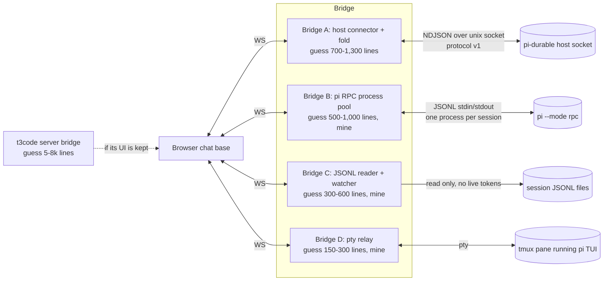
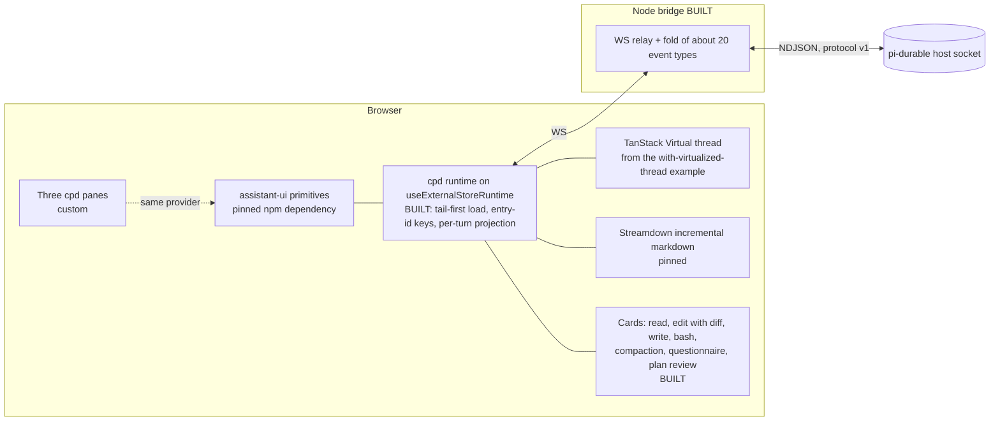
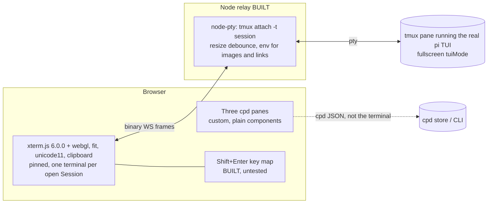
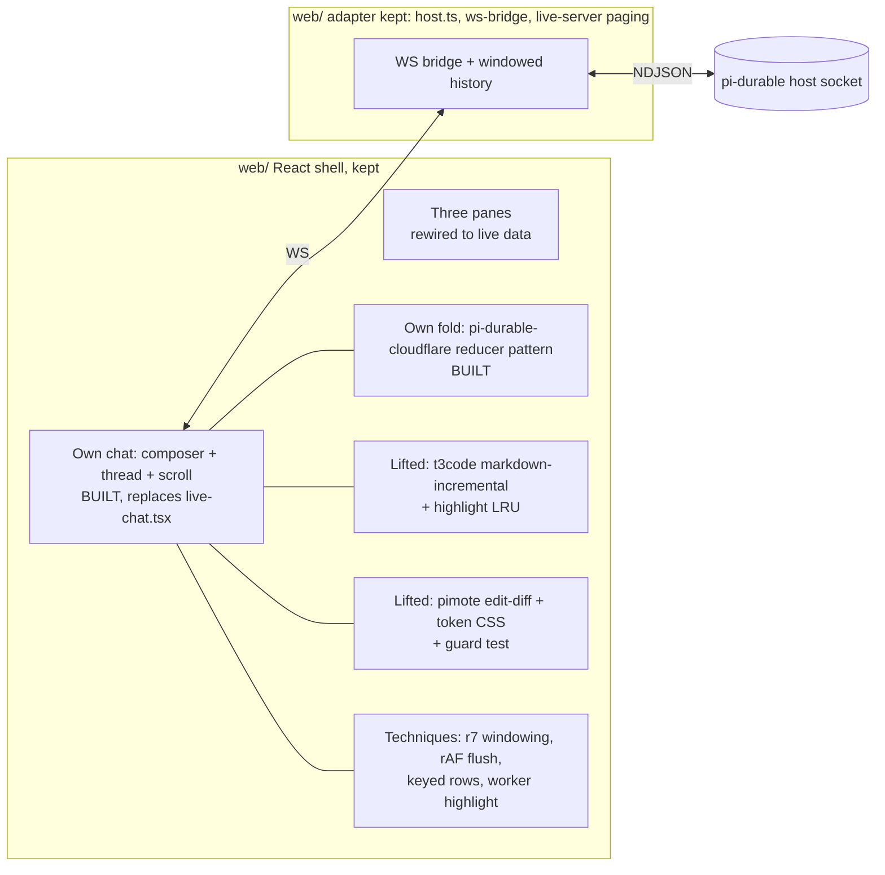
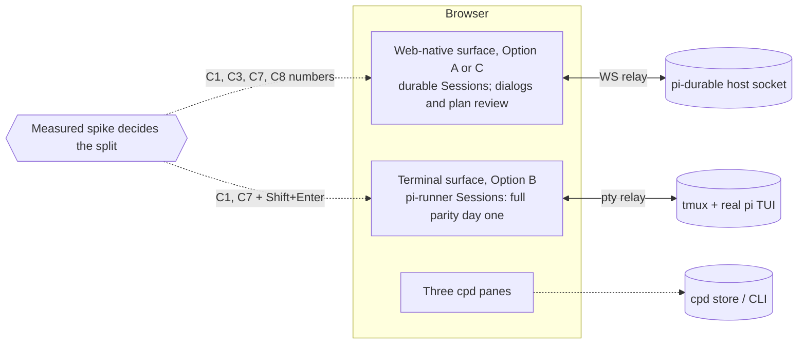

# Choosing the chat base for cpd-webui: research

## Summary

(written by the final part)

## 1. Scope, sources and labels

### 1.1 Goal

Find which existing open-source chat should be the base of cpd-webui, so the chat itself is reused and only a cosmetic layer plus three simple custom panes (Context tree, Plan view, Attention Inbox) are built around it. This mirrors how `cpd tui` reuses pi's terminal chat inside tmux. This part (A) states the method, the yardsticks, how a browser can reach pi, and the field of candidates. It makes no recommendation.

### 1.2 User decisions

| Key | Decision | Source |
|---|---|---|
| pro-d1 | The repo's `web/` custom chat is a first attempt judged too costly. The stack is open. The User wants an OSS chat base, preferably from the pi community, with full chat capability out of the box and only cosmetic customisation. | Plan chat-research, Context cpd-webui |
| pro-d2 | The layout is the cockpit's and secondary. The chat is the primary decision. The three cpd surfaces are simple custom panes. | same |
| pro-n1 | Top priority is chat speed and performance, and parity with pi's terminal chat. | same |
| pro-d4 | Not restated in the Job brief that produced this part; the Job names pro-d1..pro-d4 but only pro-d1, pro-d2 and pro-n1 are written out. Unverified: its content. | Job brief |

### 1.3 Out of scope

- Any recommendation (the final part writes it).
- Candidate deep dives (section 5, written by the next part).
- Code, and any file other than this report.
- Running or benchmarking anything. This is desk research from source and docs.

### 1.4 Labels

| Label | Meaning in this report |
|---|---|
| `read` | A source file, doc or URL was opened by a finding. The claim cites the finding key and its own `file:line` or URL. |
| `measured` | A number from a real run. Used only where the finding says it was measured, with the finding's command or source. |
| `inferred` / `guess` | Reasoning or an estimate (a size, a judgement). Never upgraded: a claim a finding marks unverified stays unverified here. |
| `unverified` | The finding says it did not check it. |

### 1.5 Findings and what each answered

The keys below are machine-local findings from Plan chat-research. They are source material, not committed to the repo, and not copied here (see the appendix when the final part adds it). Each finding was written 2026-11-03 EST on one machine. The numbers in the findings were read or measured there. Nothing was run for this report, except where a finding says `measured`.

| Key | Question it answered |
|---|---|
| `s1-pi-rpc` | What pi's RPC mode, SDK and session JSONL expose to a web client. |
| `s2-durable-host` | What the pi-durable host socket protocol v1 offers a browser chat client. |
| `s3-parity-checklist` | What pi's terminal chat, as customised by cpd, shows and does (59 rows, P01-P59). |
| `s4-web-current` | What `web/` already has, what is measured, how big real transcripts are. |
| `r1-pi-webuis` | Which web UIs exist for pi (218 npm rows surveyed). |
| `r3-opencode` | Whether OpenCode's web UI can be a base. |
| `r4-agent-webuis` | Which OSS web UIs exist for terminal coding agents beyond pi. |
| `r5-chat-libs` | Which embeddable chat libraries exist for a custom backend. |
| `r6-term-in-web` | Whether a browser terminal (xterm.js) can be the chat. |
| `r7-chat-perf` | How to keep a 5,000+ message streaming chat fast in a browser (12-item checklist). |
| `r2-pi-web-ui-src` | What `@earendil-works/pi-web-ui` contains and whether it can drive a remote pi. |

Sections 2 to 4 draw on `s1`, `s2`, `s3`, `s4`, `r1`, `r4`, `r5`, `r7`. `r2`, `r3` and `r6` appear only for survey rows (4.1) and their one-line verdicts; their deep dives are section 5.

## 2. The yardsticks

### 2.1 Parity checklist (condensed from s3-parity-checklist)

`s3-parity-checklist` lists 59 rows, P01-P59, each with a `path:line` source in the cpd repo. Priority there: **must** = in nearly every turn or the base look; **should** = in many chats or on a common dialog; **could** = opt-in, rare or cosmetic. Labels in s3: verified, derived, UNVERIFIED. All rows below are `read` from s3 unless marked.

| Group | Rows | What it covers | Priority |
|---|---|---|---|
| G1 Frame and colour | P01-P04 | Chat pad (1 blank row above and below, 1 blank column each side); indexed SGR colours only (slots 0-15, never RGB); italic under theme `dango` (P03, could); pills (powerline caps, reversed text, meanings plain/in_progress/review/done/failed/planning/nothing/focus) | must (P03 could) |
| G2 Input box | P05-P07 | Rounded walls; border index 6 while working, 12 with focus, else 15; blinking cursor (500 ms, indices 5, 7, 2); `↑ N more` scroll hint | P05 must, P06 should, P07 could |
| G3 Working state | P08-P11 | Working pill in the input's top border (loader frame + words); words `Thinking…`, `Responding…`, `Preparing tools…`, `Processing results…`, `Compacting…`; per-tool words (`Reading file…`, `Running command…`, `Using <name>…`); italic only for `Thinking…` | P08, P09 must; P10 should; P11 could |
| G4 Keys and mouse | P12-P13 | Ctrl+O expands every tool row; Ctrl+T cycles thinking; left click toggles any fold; wheel and selection are pi's | must |
| G5 Balloons and thinking | P14-P16 | User balloon grey at right, no time; assistant balloon at left with machine-local `HH:MM` on the bottom border; thinking block: grey `Thinking…` pill, folded at start, Ctrl+T cycles summary, detail, summary-after-detail, hidden | must |
| G6 Tool rows | P17-P23 | Status dot + pill + one-line argument; status colours (running cyan 6, done green 2, failed red 1, `ask_user_question` waiting magenta 5); durations (`0.123s`, `1m 5s`, `1h 2m 3s`); closing row `╰` + fold glyph + label + `HH:MM` + metadata; running closing row with a 28-frame moon loader at 50 ms; `╰ choose` for the open dialog; terminator for a call that can no longer get a result | P17-P21 must; P22 must when used; P23 should |
| G7 Tool results | P24-P30 | First 10 rows then `… N more lines`; read result as numbered code; write result as numbered code; edit result as a diff with gutter and `(+N -N)`; grep/find/ls `N lines`; bash row title as a plain summary (`Run tests`, `Install dependencies`) plus `+ N more steps`; bash output rows, failure headline `Command exited with code N` | P24, P25, P27, P29, P30 must; P26, P28 should |
| G8 Styles and grouping | P31-P35 | Claude style, Codex style, read/search/list groups, thinking-only turns folded, style `off`. Default style is `compact`, which draws no groups (`compact-tools-grouping.ts:327-328`) | could |
| G9 Compaction | P36-P37 | Done fold (`╭─` + `compaction` pill, `Compacted from N tokens`, summary on `│` rails); running row `Compacting…` | should |
| G10 cpd messages | P38-P39, P54 | Custom messages (`cpd`, `cpd-context`, `cpd-plan-decision`, `cpd-plan-summary`, `cpd-skills`) fold with a `φ` pill, head cut at 60 characters; Session/Plan/Context id mentions painted magenta italic; plan-review entries restored after `/reload` | P38 should; P39, P54 could |
| G11 Modes and commands | P40-P41, P55-P57 | Silent mode (`ctrl+'`, `/silent`): hides tool rows, intermediate turns, thinking, notices; activity animator; slash commands `/silent`, `/compact-tools`, `/plan-review`; `/quit` marker; steer vs follow-up delivery (`pr-feedback` and `escalation` are steered) | P55 `/silent` and `/compact-tools` must; P40, P57, `/plan-review` should; rest could |
| G12 `ask_user_question` | P42-P49 | Call row shows no argument (derived, not run); dialog with tabs and a Submit tab; side-by-side preview at 100+ columns; keys; placement in the editor slot; result envelope; never-hang outcomes; notifier events | P43, P45, P47 must when used; P42, P44, P46 should; P48, P49 could |
| G13 `cpd_plan_review` | P50-P53 | Call row with `title` (at most 72 characters); summary message always open; Approve/Change dialog; decision message | P52 must when a plan is in review; P50, P51, P53 should |
| G14 pi-native | P58-P59 | Footer contents, model picker, token and cost display, image attachments, `@file`, pi's own slash commands and keys. s3 did not read pi-core, so these rows are UNVERIFIED | should |

All 59 rows are covered: P01-P04, P05-P07, P08-P11, P12-P13, P14-P16, P17-P23, P24-P30, P31-P35, P36-P37, P38-P39 + P54, P40-P41 + P55-P57, P42-P49, P50-P53, P58-P59. (Count: 4+3+4+2+3+7+7+5+2+3+5+8+4+2 = 59.) The grouping into 14 is this report's; s3 itself is a flat table.

#### The cpd-specific look (read, s3-parity-checklist)

- **Colours are not read from `dango.json`.** compact-tools paints hard-coded palette indices (`compact-tools-indices.ts:52-66`); the JSON is used only by pi's own Theme. Example: `accent` is 4 in the JSON and 6 in code; `mdLink` is 15 in the JSON and 4 in code. A new UI must port the index map, not the JSON (s3, Answer 3). The hex value behind each of the 16 slots is in `docs/contract.md` section 6.1.1, which s3 did not read. No hex value is stated in this report.
- **Balloons:** user at the right, text wrapped at width minus 7; assistant at the left, wrapped at width minus 8, `HH:MM` on the bottom border. Drawn in both normal and silent modes (P14, P15).
- **Thinking fold:** folded at the start of every block; Ctrl+T cycles four views; a click toggles (P16).
- **Tool rows:** status dot, name pill, one-line argument; closing row `╰` with a toggle glyph, label, `HH:MM`, metadata; preview of 10 lines (P17-P24).
- **Compact-tools grouping rules:** under the default style (`compact`) there are no read/search/list groups. Groups exist only for styles `claude` and `codex`: `Searched for 2 patterns, read 3 files` with `(click to expand)`, thinking-only turns folded between calls (P33, P34, `compact-tools-grouping.ts:327-328`). Whether a candidate that groups calls (see `r1-pi-webuis`) matches this look is unverified in r1.
- **Working pill:** loader frame plus words, in the input's top border (P08, P09).
- **State-coloured input:** border 6 while working, 12 with focus, else 15 (P05).

#### The two dialogs (read, s3-parity-checklist, "Dialog data shapes")

**`ask_user_question`** (`pi/ask-user-question/tool/types.ts`):

| Field | Type and limits |
|---|---|
| `questions` | array, 1 to 4 items (`MAX_QUESTIONS` 4; `types.ts:5, 83-91`) |
| `questions[].question` | string, by convention ends with a question mark |
| `questions[].header` | string, at most 16 characters |
| `questions[].options` | array, 2 to 4 items; an automatic `Type something.` row is added; a `Next` row spans questions; a Submit tab |
| `questions[].options[].label` | string, at most 60 characters |
| `questions[].options[].description` | string |
| `questions[].options[].preview` | optional Markdown string, single-select only; shown side by side when the terminal and pane are both 100 columns or wider, stacked otherwise (P44) |
| `questions[].multiSelect` | optional boolean, default false |
| Answer | `{questionIndex, question, kind: "option" \| "custom" \| "multi", answer, selected?, notes?, preview?}` (`types.ts:109-124`) |
| Result | `{answers[], cancelled, globalNote?, unanswered?, error?}`; tool text `User has answered your questions: "Q"="A". …` or `User declined to answer questions` (`response-envelope.ts`) |

Reserved labels: `Other`, `Type something.`, `Next`. Keys (P45): up and down, Tab/Shift+Tab or left/right for tabs, Enter submits, Esc cancels, `n` opens notes, Ctrl+] collapses.

**`cpd_plan_review`** (`pi/lib/review.ts`, durable variant `pi/durable-host/tools.ts`):

- Input is `{title: string}`, at most 72 characters, `additionalProperties: false`. The model-only tool refuses outside a Plan Lead's session.
- Open flow: the summary file `summary-<review>.md` is sent as a `cpd-plan-summary` message, a `cpd-plan-review` entry is recorded `{plan, review, surface, status: "pending"}`, then pi's `select` opens with the title `Plan review <id>: <title>` and options **Approve** and **Change**. Change opens an `editor` titled `What should change?`; an empty note returns to the select (P52).
- Decision message `cpd-plan-decision`: `Plan review <id> was APPROVED|REJECTED.` plus feedback and next step; details `{plan, review, approved, current, feedback?, decided_elsewhere?}` (P53).

**Schema mismatch s3 found (read):** the lib variant enforces the 72-character limit only in the tool description (`pi/lib/review.ts:175-182`); the durable-host variant enforces `maxLength: 72` in its TypeBox schema (`pi/durable-host/tools.ts:121`). Which one pi registers at runtime was not traced (s3, open item 3). `s2-durable-host` adds that the durable `cpd_plan_review` tool opens no dialog itself (`tools.ts:116-133`); the dialog is created elsewhere and its wire shape is unknown to s2.

#### Open items in s3 that bind the parity yardstick

- Hex values for the 16 palette slots: not in the paths s3 read.
- P57-P59 (footer, model picker, steer/follow-up queue view, `@file`, images, pi's keys) need pi-core sources: UNVERIFIED.
- P42 is derived from code, not run.
- `compact-tools.ts:700-996` (session wiring, style switching) was not read.

### 2.2 Speed checklist (r7-chat-perf, verbatim)

The twelve items below are r7-chat-perf section 8 ("R4 checklist: pass/fail tests for a candidate chat base"), copied verbatim. They are to be run against a fixture of at least 5,000 messages and at least 25 MB with a mix of long markdown, big code blocks, diffs, tool rows and thinking blocks. Pass means the threshold is met; record the number. The thresholds are r7's own targets (guess in r7: none is a published benchmark). Nothing here was run.

| ID | Check (verbatim from r7-chat-perf §8) |
|---|---|
| C1 | **Cold open of a 25 MB, 5,000+ message session**: first paint of the last messages ≤ 500 ms, main thread never blocked > 100 ms (Performance trace long-task count = 0 > 100 ms). Fail if it parses/renders all messages before first paint. |
| C2 | **Windowed DOM**: with 5,000 messages loaded, live message DOM subtrees ≤ ~100 (window + overscan), and DOM node count does not grow with total N (count at N=500 vs N=5,000 within 10%). |
| C3 | **Per-token cost independent of N**: stream 200 tok/s into the last message at N=500 and N=5,000; per-frame scripting time p95 ≤ 8 ms and within 20% between the two N. Fail if cost grows with N (the cpd TUI failure mode: 0.097 ms/component). |
| C4 | **Streaming markdown is incremental**: DevTools/Profiler shows only the last open block re-renders per token (earlier blocks of the same message, and all other messages, do not re-render). Fail if the whole message re-parses each token. |
| C5 | **Bottom-anchoring**: pinned at the end while streaming (no visible jitter, drift ≤ 1 px/s); scrolling up by one screen stops following and does not move even as the last row grows; returning within threshold re-pins. |
| C6 | **Prepend stability**: load older page while reading mid-history; the visible message moves ≤ 1 px; stable message ids (not indexes) as keys. |
| C7 | **Typing responsiveness during streaming**: input keydown→paint p95 ≤ 50 ms while streaming at 200 tok/s with N=5,000 (cpd baseline to beat: TUI 54 ms median on 24 MB). |
| C8 | **Instant session switch**: switching between two cached sessions paints last messages ≤ 100 ms (warm) / ≤ 500 ms (cold) with no scroll jump (measured-height cache or equivalent). |
| C9 | **Highlighting off the hot path**: open code fences render plain; completed fences highlight once, cached, not re-run on re-render, and not on the main thread during streaming (worker or idle); no shiki full-bundle import (check bundle: fine-grained langs, JS engine option). |
| C10 | **Virtualisation escape hatches**: (a) in-app search across all messages that jumps to a hit outside the window; (b) selected/focused/streaming row is kept mounted (`keepMounted` equivalent) so selection and the live row survive scrolling; (c) expand/collapse state survives unmount (stored by message id). |
| C11 | **Heavy rows are bounded**: a 5,000-line diff or 1 MB tool output in a row does not freeze scrolling (internal windowing like `@pierre/diffs` Virtualized*, or `maxHeight` + lazy expand); long-task budget as in #1. |
| C12 | **Hooks exposed by the base** (API inspection, pass if all present): custom row renderer per message/tool type; custom markdown/code renderer slot; stable item key; event stream input that accepts raw token/event deltas (not whole-message replacement); imperative scrollToIndex/scrollToEnd/prepend; a way to supply pre-parsed nodes (worker parsing); theme via CSS variables (Dango v3 cosmetic-only). |

r7's own caveat (read, r7 §9): no published per-token ms exists for TanStack Virtual, virtua, Virtuoso, Legend List, Streamdown or markstream; r7 ranks virtualisers by documented chat contract, not measured speed. r7 forbade synthetic benchmarks, so the checklist is unrun for every candidate.

### 2.3 cpd's own sizes

| Fact | Value | Label and source |
|---|---|---|
| Largest session the TUI work measured | 24 MB = 7,655 entries; 364-445 pi-tui components after the compaction cut | read, r7-chat-perf §6, citing `docs/research/chat-render-cost.md` (measured there; single runs, load average 5-26) |
| TUI render cost | 0.097 ms CPU per component per frame, intercept 11.6 ms, r² 0.97 | measured by others, read via r7 §6 and s3 "Cost facts"; not re-run |
| TUI frame, 24 MB copy, bash row animating | 43-62 ms with the pad, 13-18 ms after `basis: 0`, 7-17 ms with no pad; CPU 85% to 31-36% to 12-23% | measured by others, r7 §6 |
| TUI typing latency | 54.2 ms median on the 24 MB copy vs 21.5 ms on a 10-row session | measured by others, r7 §6 |
| Extrapolation to a naive DOM chat | 5,000 always-live components at the TUI slope would be about 0.5 s per frame | inferred in r7 §6, not measured |
| Footer `getSessionName` scan | 3.1 ms per frame on the 24 MB session | measured by others, r7 §6 and s3 |

**Real transcript distribution on this machine (read, s4-web-current §4):** 2,170 pi session files, 883.0 MB, 178,446 JSONL lines. Sizes come from `stat`, lines from `wc -l`. File contents were not read.

| Measure | min | p50 | p75 | p90 | p95 | p99 | max |
|---|---|---|---|---|---|---|---|
| File size, MB | 0.013 | 0.128 | 0.332 | 0.722 | 1.125 | 5.905 | 25.591 |
| JSONL lines | 5 | 37 | 80 | 153 | 235 | 778 | 7,359 |

- 27 files are 5 MB or larger, 9 are 10 MB or larger, 16 have 1,000 or more lines, 1 has 5,000 or more lines, and exactly 1 is in the 20-30 MB band (25.6 MB, 7,359 lines).
- Lines are JSONL records, not messages. The docs' ratio is 0.51-0.59 messages per line, so the largest file is about 3,750-4,350 messages. That is an estimate, unverified on this machine (s4 §4). The 5,000-message goal is probably met by none of the local sessions (s4 Answer 3, estimate).
- The median session is tiny. The speed yardstick is about the long tail: the p99 file is 5.9 MB and 778 lines.

**The TUI figure the web must beat:** 0.097 ms per component per frame (read, s3 and r7). The web analogue r7 gives is a per-row memo keyed by (message id, revision, width) plus one rAF flush per frame (r7 §6, inferred from pi's `tui.md:108-110`).

## 3. Connection architecture

A browser cannot spawn pi, open a unix socket or read the session directory. Every route needs a bridge. This section lists what each backend offers and what it lacks.

### 3.1 pi RPC (s1-pi-rpc, pi 1.3.0, docs only)

`s1-pi-rpc` read the pi docs only. No process was started and no `.d.ts` was read (s1 §0), so every claim below is a doc claim.

- **Transport:** `pi --mode rpc`, JSONL on stdin/stdout, split on LF only (`docs/rpc.md:50-54`). Commands take an optional `id` that the response repeats. Stdout must be drained continuously because pi honours backpressure (`docs/rpc.md:56`). Close stdin to shut down (`docs/rpc.md:91-93`).
- **One process, one session.** No command carries a session selector, and events carry no session id (`docs/json.md:52-124`). N live sessions means N child processes (s1 gap G2, inferred; the cost is not measured).
- **33 commands** (s1 §2.3): `prompt`, `steer`, `follow_up`, `abort`, `clear_queue`, `new_session`; `get_state`, `get_messages`; `set_model`, `cycle_model`, `get_available_models`; `set_thinking_level`, `cycle_thinking_level`, `get_available_thinking_levels`; `set_steering_mode`, `set_follow_up_mode`; `compact`, `set_auto_compaction`; `set_auto_retry`, `abort_retry`; `bash`, `abort_bash`; `get_session_stats`, `export_html`, `switch_session`, `fork`, `clone`, `get_fork_messages`, `get_entries`, `get_tree`, `get_last_assistant_text`, `set_session_name`; `get_commands`.
- **Events** (s1 §2.2, 24 rows in its table): `agent_start`, `agent_end`, `agent_settled`, `turn_start/end`, `message_start`, `message_update` (delta only; `assistantMessageEvent.type` is one of `text_*`, `thinking_*`, `toolcall_*`), `message_end` (authoritative; replace the reconstruction), `tool_execution_start/update/end`, `queue_update`, `entry_appended`, `session_info_changed`, `thinking_level_changed`, `compaction_start/end`, `auto_retry_start/end`, `summarization_retry_*`, plus the RPC-only `bash_execution_update` and `extension_error`.
- **Extension UI sub-protocol** (`docs/rpc-extension-ui.md`): request/response methods `select` (`title`, string `options[]`), `confirm` (`title`, `message`), `input`, `editor` (`prefill`); fire-and-forget `notify`, `setStatus`, `setWidget` (string lines only), `setTitle`, `set_editor_text`. A reply is `extension_ui_response` with the same `id`, with `value`, `confirmed` or `cancelled`. A dialog without a `timeout` blocks the run until answered.
- **What is not drivable over RPC** (s1 §3.2, §4, §7.1): `custom()` returns `undefined`; footer, header, autocomplete, editor component, working indicator and `setToolsExpanded` are no-ops; `getEditorText()` returns `""`; themes are not exposed; `@file` is rejected; built-in TUI slash commands are not in `get_commands` and do not run via `prompt`; `select` has no multi-select and no per-option description; no tree navigation; no label writes.
- **What rides, with caveats (s1 §3.4, conditional because s1 did not read the cpd schemas):** `ask_user_question` as a single-choice `select`/`input` is a yes; with a Markdown preview it is only partial (a plain-text preview can ride on `confirm.message`, or on `setWidget` lines with weak pairing). `cpd_plan_review` is partial: Approve/Change rides on `select`; a long plan body needs `setWidget` or `notify`.
- **Session gaps (s1 §7.1, selected):** no transport other than a child process (G1); no session list command, the client scans the sessions directory (G3); `get_messages` has no paging, `get_entries` has a `since` cursor but includes abandoned branches (G5); the `edit` result's diff schema is undocumented (G13, unverified); cwd is fixed at launch (G15, unverified for `switch_session`); no latency, memory or cold-start numbers (G16).

### 3.2 pi SDK and session JSONL (s1-pi-rpc)

- **SDK:** in-process Node or Bun only (`docs/sdk.md:3-5`): `createAgentSession()`, `session.prompt()`, `session.subscribe()`. The wire's event vocabulary is the same, but SDK `message_update` carries cumulative snapshots (`docs/json.md:200-201`). `AgentSessionRuntime` holds one active session; whether several SDK sessions can run in one process at once is unverified (s1 §5).
- **JSONL:** `~/.pi/agent/sessions/--<path>--/<timestamp>_<session-id>.jsonl` (`docs/session-format.md:8-14`). Line 1 is the header; entries have `type`, `id`, `parentId`, `timestamp`. The file is described as an append-only tree (`docs/rpc-commands.md:691`).
- **Limits of the file as a source:** in-flight tokens are never written (`docs/message-types.md:145`); no entry records the active leaf (`docs/session-format.md:78-207`), so the file alone cannot show which branch is active after a `/tree` move (inferred); byte-offset tailing of a live file is unverified.
- **Entry types:** `message`, `model_change`, `thinking_level_change`, `usage`, `compaction` (`summary`, `firstKeptEntryId`, `tokensBefore`), `context_edit`, `branch_summary`, `custom`, `custom_message`, `label`, `session_info`.

### 3.3 The pi-durable host socket, protocol v1 (s2-durable-host)

`s2-durable-host` read `pi/durable-host/protocol.ts` (257 lines), `server.ts` (270 lines), `dialogs.ts` and `tools.ts`. It did not read `ring.ts`, `net.ts`, `held.ts`, `main.ts` or `sockets.ts`, so facts that depend on those are unverified there.

**Message types (read, s2 §1).** Client to host, 14 types: `hello`, `attach`, `submit`, `compact`, `configure`, `list_models`, `fork`, `history`, `abort`, `abort_submission`, `ping`, `detach`, `reload`, `ui_response` (`protocol.ts:39-53`). Host to client, 13 types: `welcome`, `attached`, `snapshot`, `events`, `result`, `error`, `host_state`, `ui_request`, `ui_resolved`, `notice`, `status`, `pong`, `bye` (`protocol.ts:82-99`). `ui_request` has five method variants: `select`, `confirm`, `input`, `editor`, `questionnaire`; purposes are `ask_user_question`, `secret_approve`, `host_approve`, `plan_review`, `mcp_login`, `other`.

**Payloads (read, s2 Answer 2, §2).** `snapshot` and `events` payloads are typed `unknown` in the protocol and forwarded unchanged. They are pi-durable's own `AgentEvent` and `SnapshotEvent`, not pi-coding-agent's types and not a cpd rewrap. pi-ai `Message` objects sit verbatim inside them (`message_start.message`, `EntryRecord.model`). Event names echo pi's, but fields differ: `message_update` carries `changes[]` deltas, `message_end` carries a stored `entry`, tool events use camelCase ids plus task ids, and tool output is a `trimStart`/`append` window edit. A pi-style renderer needs an adapter for the delta, tool, entry and inbox events (s2 §2 verdict). The forward-unchanged decision is recorded in `docs/research/durable-leads.md:1171-1181`, and the code that forwards it (`ring.ts`) was not read.

**Attach and speed (read, s2).** `attach` always sends the whole transcript. There is no window on `attach` (`protocol.ts:41`). `history` pages only after attach (`server.ts:137-141`, `:161-165`), so it cannot avoid the full snapshot. A snapshot is one NDJSON line with no chunking. Tokens arrive in batches on a 100 ms commit cadence (`PD/README.md:406`), and a short answer has no deltas at all. A mid-stream attach on a 30-entry spike measured 25 frames, 17,303 bytes, in 0.9 ms (measured by a doc, s2 §3.1); a real large snapshot was not measured.

**The gaps for a browser, numbered (read, s2 §8).** The Job brief said 16; `s2-durable-host` §8 lists 23. All 23 are kept, in s2's own order (highest impact on chat speed first). D1-D16 are those that block or slow the chat core; D17-D23 are the panes, limits and unverified items.

| # | Gap | Evidence (s2) | Label |
|---|---|---|---|
| D1 | No browser transport: NDJSON over a unix socket only, so a bridge is needed | `protocol.ts:251-253`; `durable-leads.md:343` | read |
| D2 | No window on attach: every attach and session switch re-sends the whole transcript | `protocol.ts:41`; `server.ts:124-125`; `durable-leads.md:1191` | read |
| D3 | `history` cannot precede attach, so a windowed first paint is not possible on the current order | `server.ts:137-141` vs `:161-165` | read |
| D4 | One snapshot is one line; `LIMITS.hostLine` (64 MiB) is declared and not referenced in `server.ts` or `protocol.ts` | `protocol.ts:4` | read |
| D5 | Possible slow-client loop: a snapshot over 8 MiB may trip the drop-and-reconnect rule | `server.ts:81-85` (needs `net.ts`) | unverified |
| D6 | A rebase re-sends the whole snapshot to every viewer (over 256 frames at run end, or 4,096) | `durable-leads.md:383` (design); `ring.ts` unread | unverified (design) |
| D7 | Token latency floor is the 100 ms commit interval; short answers have no deltas | `PD/README.md:406`; `durable-leads.md:639` | read; spike timings measured by a doc |
| D8 | Queued message text is not in the stream (items carry `id` and `mode` only) | `PD/dist/harness/events.d.ts:9-12, 60` | read |
| D9 | No message for slash commands, `/new`, `/plan-review`, `/mcp`, `/tree`, `/clone`, `/resume`, `/name`, `/session`, `/import`, `/settings`, `/login`, `/logout`, skills, templates, `!cmd`, `@file` | s2 §5; `durable-leads.md:238-256` | read |
| D10 | `configure` takes one field per message; the model string format is not defined | `protocol.ts:44, 196, 14` | read |
| D11 | Type drift for agent state: protocol `model_id` and required `thinking_level` vs pi-durable `modelId` and optional `thinkingLevel` | `protocol.ts:14`; `types.d.ts:347-352` | unverified which the wire carries |
| D12 | Dialog linkage and type gaps: `tool_call_id` never set; `timeout` declared never sent (use `expires_at`); `questionnaire` is a hand copy; the answer is opaque | `tools.ts:52, 89, 109`; `dialogs.ts:54`; `protocol.ts:65-70, 153-156` | read |
| D13 | `cpd_plan_review` wire shape is not in the listed code | `tools.ts:116-133`; `durable-leads.md:169` | unverified |
| D14 | `ui_resolved` with outcome `aborted` is not broadcast in the listed code | `dialogs.ts:66-68`; `durable-leads.md:404` | unverified |
| D15 | No viewer role and no command ACL: any attached client may send any command | `server.ts:138-186`; `durable-leads.md:1135` | read |
| D16 | No auth in the protocol; socket mode is the only control and its check was not read | `protocol.ts:39-40`; `sockets.ts` unread; `web-client-api.md:102` | read; mode check unverified |
| D17 | No Session, Plan, Context or Inbox data: none of the three custom panes has a message | `web-socket-audit.md:21` (doc) | read (doc) |
| D18 | Image limits: 4 per submit, 786,432 base64 characters in total, four mime types | `protocol.ts:19-21, 139` | read |
| D19 | Context-window fill is not carried (usage per model is in the snapshot; window size only in `list_models`) | `usage.d.ts:5-10`; `server.ts:31`; `durable-leads.md:275` | read |
| D20 | Notices and statuses are live only and lost while detached | `durable-leads.md:387`; `server.ts:98-100` | read |
| D21 | Error code mapping for `busy`, `ui_unknown`, `refused`, `storage_failed` is in `main.ts`; other throws become `internal` | `server.ts:89-92` | unverified |
| D22 | Whether `edit` results carry a diff in `details` is not in the listed files | `types.d.ts:106-118` | unverified |
| D23 | Doc drift: several research docs cite stale line numbers or wrong claims; use the code as truth | s2 §0 | read |

Other s2 facts a bridge needs (read): the socket path is `$CPD_HOME/run/host/<session>.sock` (a design fact, `durable-leads.md:343`, the building code not read); any number of viewers may attach and each gets a serialised copy of every frame; a viewer is dropped at 8 MiB buffered with `bye slow_client, reconnect:true`; the first `ui_response` wins and the others get `ui_unknown`; held UI requests replay on attach with `replayed: true`. A relay needs a host connector per Session (with cursor reconnect), NDJSON framing up to 64 MiB, `req` correlation, fan-out and Host/Origin/token auth. s2 estimates the relay at 400-700 non-test lines and the TypeScript fold of about 20 event types at 300-600 lines (both **guess**, s2 §7).

### 3.4 What `web/` already has (s4-web-current)

`web/` is 88 files and 14,583 lines (`wc -l`, including tests, docs and config). It is a dev-only live adapter, mounted only with `CPD_WEB_LIVE=1` (`web/vite.config.ts:355-358`), bolted to a React shell. No measurement of the web chat exists (s4 Answer 2).

**Reusable, regardless of the chat base (read, s4 §1):**

| Piece | Where | Flag |
|---|---|---|
| Host socket client: `hello`, `welcome`, `attach` with cursor, NDJSON; reconnect 100 ms doubling to 1 s over 30 s; one-shot `submit` | `web/src/api/host.ts` (238 lines) | reusable as is for reads and submit; its frame allowlist drops `ui_request`, `ui_resolved`, `notice`, `status`, `result`, so held approvals never reach the browser |
| pi JSONL parser (text, thinking, tool with args/output/state/duration, image; `ask_user_question` questions and answers) | `web/src/transcript.ts:298` (465 lines, pure) | reusable as is; output shape is cpd-specific, so a base needs a mapping layer |
| WS upgrade with token check before the 101, and per-session bridge | `web/vite.config.ts:289-353`, `web/src/api/ws-bridge.ts` (180 lines) | reusable with change: keep the upgrade, token gate and host wiring |
| Snapshot tail, paging and send policy (newest 40 turns and 1 MB per frame; `/transcript?limit&before`; send validation) | `web/src/api/live-server.ts:111-138, 187-248` | reusable with change |
| Live-edge scroll follow | `web/src/hooks/use-thread-scroll.ts` (90 lines) | reusable as is |
| Wire types (`ToClient`, `UiRequest`, questionnaire with `preview?`) | `web/src/api/types.ts` (323 lines) | reusable as is for types |
| The three cpd panes and shell (Context tree, Plan, Inbox, Logs) | `web/src/views/*`, `app-sidebar.tsx` and others | reusable with change: rewire to live data and the Dango palette |
| Contract and adapter tests | `transcript.test.ts`, `live-server.test.ts`, `ws-bridge.test.ts`, `host.test.ts` | reusable as spec |

**Throwaway (read, s4 §1):** the chat view `web/src/views/live-chat.tsx` (526 lines; text-only send, no steer, abort, model, cost, slash, `@file` or attachment input), the older mock-fed `chat.tsx`, `translate.ts` (drops thinking and tool blocks, ignores `message_update`), `fold.ts`, `mock.ts`, the CLI-spawn read layer (every list, plan, inbox, context and show is a CLI spawn at 13.6-16.3 ms each, `vite.config.ts:174-285`), and the vendored chat primitives if the base brings its own chat. Several code comments are stale (s4 §6).

**Facts that bound the bridge (read, s4):** the reconnect cursor is sent by the browser and never read by the server, so every reconnect is a full snapshot; a changed pi JSONL tick on the 29.6 MB file costs 209.1 ms (read 80.6, parse 127.2; measured on host `hs` by a doc, single run); a CLI call is about 34 to 180 times a socket round trip (measured by a doc); the host `submit` path uses `followUp` only and no abort, steer or reject route exists.

### 3.5 Candidate topologies

The diagram shows the four ways a browser can reach pi. Bridge sizes are **guess** labels: the first two come from the findings (s2 §7 for the durable relay and fold; the t3code figure is the Job brief's own guess), the rest are not in any finding and are this report's guesses.

| Topology | Live tokens | Dialogs | Windowing | Main cost or risk |
|---|---|---|---|---|
| A. Host socket | yes, 100 ms batches (D7) | yes: `ui_request` incl. `questionnaire` | no on attach (D2, D3) | adapter from pi-durable events to the base's model; D1-D23 |
| B. pi RPC | yes, delta only | partial: strings only, no preview (s1 §3.3) | no: `get_messages` unpaged | one process per session; no session list (s1 G2, G3) |
| C. JSONL | no: tokens are never written (`docs/message-types.md:145`) | no | by file offset only (unverified) | read-only; leaf not persisted |
| D. tmux pty | yes, exact | native pi dialogs | pi owns the viewport | fidelity of keys and graphics; no web-native chat (`r6-term-in-web`) |

Source for the table: s1 §2-§7, s2 §3-§8, `r6-term-in-web` verdict (read). The bridge sizes above are guesses. The pi-RPC, JSONL and pty rows have no size in any finding.

## 4. The field

### 4.1 Survey table

One row per candidate that `r1-pi-webuis`, `r4-agent-webuis` or `r5-chat-libs` names as worth a look, plus the three deep-dive subjects from the other findings (`r2`, `r3`, `r6`). "Last activity" is the date the finding read (GitHub `pushed_at` or npm release); all rows were read on 2026-11-03 EST. Class: **component** (separable chat package), **app** (chat usable only inside it), **library**, **reference** (read for ideas, not reuse). Deep dive = shortlisted for section 5. Stars and licences are `read` from the finding named in the last column.

| Name | URL | License | Last activity | Stack | Backend transport | Class | Deep dive | Finding |
|---|---|---|---|---|---|---|---|---|
| `@earendil-works/pi-web-ui` (ex `@mariozechner`) | npm (source removed from earendil-works/pi 2026-05-20) | MIT | npm 0.75.3, 2026-05-18; old name 0.73.1 deprecated 2026-05-07 | Lit web components (inferred, unverified now) | browser-direct LLM via pi-ai (no server) | library | yes | r1, r2 |
| OpenCode (sst/opencode, now anomalyco/opencode), `session-ui` | https://github.com/sst/opencode | MIT | push 2026-11-03; v2.2.5 2026-10-30; 224,294 stars | SolidJS + Kobalte; Effect server | HTTP + SSE (`/api/event`) to the OpenCode server | component (`session-ui` is `private: true`, not on npm) | yes | r3 |
| t3code | https://github.com/pingdotgg/t3code | MIT | push 2026-11-03; v0.1.6 2026-10-31; 43.8k stars | React + Vite + Tailwind 4, `@legendapp/list`, `@pierre/diffs`, tiptap, Effect | WebSocket to a local server that spawns `pi --mode rpc` | app (chat not packaged) | yes | r4 |
| `@assistant-ui/react-pi` (assistant-ui) | https://github.com/assistant-ui/assistant-ui | MIT | release 0.0.32 2026-10-19; pkg commit 2026-11-02; 12,926 stars (monorepo) | React, headless primitives, Tailwind/shadcn tokens | `PiClient` interface (HTTP+SSE client shipped; any transport) | component | yes | r1, r5 |
| `@jmfederico/pi-web` | https://github.com/jmfederico/pi-web | MIT | release 1.202610.9 2026-10-30; push 2026-10-31; 923 stars | Lit 3, Vite 8, Fastify 5 | WebSocket + HTTP to a Node server embedding the pi SDK | app (plugin panels, themes) | yes | r1 |
| `@pimote/pimote` | https://github.com/alennartz/pimote | MIT | release 0.15.5 2026-10-30; push 2026-10-30; 0 stars | Svelte 5, Tailwind 4 | WebSocket to a Node server using the pi SDK | app | yes | r1 |
| `pi-pocket` | https://github.com/TannerMidd/pi-pocket | MIT | release 0.27.0 2026-10-30; push 2026-11-03; 761 stars | vanilla JS (no build step), Node server on pi-durable and chord | HTTP/WS to its own server on pi-durable | app | yes | r1 |
| terminal-in-web: xterm.js 6.0.0 (+ webgl, fit, serialize addons) | npm `@xterm/xterm` (r6, `npm view`) | MIT | release 6.0.0 2025-12-22; addons modified 2026-10-29 | JS terminal emulator | PTY over WebSocket to a tmux pane running pi | library (fallback) | yes | r6 |
| `@agegr/pi-web` | https://github.com/agegr/pi-web | MIT | release 0.15.0 2026-11-03; 8,012 stars | Next.js 16, React 19, Tailwind 4 | Next route handlers embedding the pi SDK; fetch/SSE | app | no | r1 |
| `@blackbelt-technology/pi-agent-dashboard` | https://github.com/BlackBeltTechnology/pi-agent-dashboard | MIT | release 0.11.0 2026-10-26; push 2026-11-03; 340 stars | React + Vite (inferred), Node server, Electron option | bridge extension inside each pi process, WebSocket to a dashboard server | app | no | r1 |
| `@hachej/boring-ui-kit` | https://github.com/hachej/boring-ui | MIT | release 0.4.51 2026-11-03; 49 stars | React, shadcn registry blocks; pi-durable on the server | `useRemoteChat` to `/api/chat`; pi-durable Harness | component (designed to embed) | no | r1 |
| `pi-outpost` / `@pi-outpost/embed` | https://github.com/laurentftech/pi-outpost | MIT | release 0.58.0 2026-11-02; 26 stars | React, Node 24+ Fastify + WS | WebSocket to a Node process with a bundled pi SDK; Shadow-DOM embed widget | component (widget) | no | r1 |
| `xing-shuyin/pi-web-ui` | https://github.com/xing-shuyin/pi-web-ui | MIT | release 0.115.0 2026-11-02; 363 stars | React 19, Vite 8, Express 5 + ws, Electron | WebSocket to Express serving the pi SDK and DeepSeek Harness | app (performance reference) | no | r1 |
| `earendil-works/pi-durable-cloudflare` | https://github.com/earendil-works/pi-durable-cloudflare | MIT | push 2026-10-31 | React 19, Vite 8, Cloudflare Durable Object | WebSocket (partysocket) to a Durable Object running pi-durable | reference (~870-line sample) | no | r1 |
| `pi-studio` (omaclaren) | https://github.com/omaclaren/pi-studio | none (GitHub shows no licence) | release 0.11.10 2026-11-03; 211 stars | JS; two-pane prompt/document editor | pi extension serving a browser page | app (not chat-first) | no | r1 |
| OpenHands Agent Canvas | https://github.com/OpenHands/OpenHands | MIT | push 2026-11-03; v1.34.0 2026-10-27; 92.6k stars | React 19, react-router 7, Tailwind 4, HeroUI, zustand | REST + events to an Agent Server that spawns ACP agent CLIs over stdio | app | no | r4 |
| Goose desktop + `@aaif/goose-acp-client` | https://github.com/aaif-goose/goose | Apache-2.0 | push 2026-11-03; v1.57.0 2026-10-28; 56.2k stars | Electron, React 19, Tailwind 4, Radix | `@agentclientprotocol/sdk` 1.5.0 to `goose serve` | app (ACP client lib is a component for transport only) | no | r4 |
| vibe-kanban `web-core/workspace-chat` | https://github.com/BloopAI/vibe-kanban | Apache-2.0 | push 2026-11-03; v0.1.44 2026-04-24; README: sunsetting | Rust server + React 18, TanStack Virtual, `@pierre/diffs` | Rust executors normalise CLIs; WS/SSE (inferred) | reference (sunset) | no | r4 |
| Kilo Code (`session-ui`, `kilo-ui`) | https://github.com/Kilo-Org/kilocode | MIT | push 2026-11-03; v7.8.18 2026-10-26; 27.9k stars | opencode fork: SolidJS | opencode-style HTTP/SSE server | reference (overlaps r3) | no | r4 |
| chrome-acp | https://github.com/Areo-Joe/chrome-acp | MIT | push 2026-10-25; 193 stars | React 19, Tailwind 4; Hono + ws proxy | WebSocket to a proxy that spawns the ACP agent over stdio | app (small; chat internals unverified) | no | r4 |
| Panda | https://github.com/lukaisluka/Panda | Apache-2.0 | push 2026-09-09; 3 stars | React + TS, Tauri | ACP over WebSocket or stdio | app (README claims only) | no | r4 |
| codeg | https://github.com/spacering-net/codeg | Apache-2.0 | push 2026-11-03; v0.41.4 2026-11-02; 4.3k stars | Next.js 16, React 19, AI-Elements-style components; Rust backend | Rust ACP client; WebSocket server mode (inferred) | app | no | r4 |
| `svkozak/pi-acp` | https://github.com/svkozak/pi-acp | MIT | npm 0.0.34 2026-09-24; last commit 2026-10-06; 758 stars | Node; ACP over stdio | spawns `pi --mode rpc` | library (adapter) | no | r4 |
| `@ai-sdk/harness-pi` (vercel/ai) | https://github.com/vercel/ai | Apache-2.0 | release 1.0.176 2026-11-03; 27,707 stars | adapts pi to the AI SDK `HarnessV1` | AI SDK | library (route to AI-SDK chat UIs; unverified with a UI) | no | r1 |
| assistant-ui core `@assistant-ui/react` | https://github.com/assistant-ui/assistant-ui | MIT | 0.15.32; core 0.3.32 released 2026-10-28; push 2026-11-03 | React 18/19, Radix, Tailwind | `useExternalStoreRuntime`, local runtime, AI SDK, AG-UI, ACP and pi adapters | library | with react-pi | r5 |
| Vercel AI Elements | https://github.com/vercel/ai-elements | Apache-2.0 (npm; GitHub SPDX NOASSERTION) | `ai-elements@1.9.1`; last commit 2026-10-14; deprecated end of Nov 2026 | React, shadcn registry | AI SDK `UIMessage` parts | library | no | r5 |
| prompt-kit | https://github.com/ibelick/prompt-kit | MIT | 0.1.0, no releases; push 2026-09-28; 3.1k stars | Next 15, React 19, shadcn registry | none (UI only) | library | no | r5 |
| CopilotKit `@copilotkit/react-core` | https://github.com/CopilotKit/CopilotKit | MIT | 1.84.0 2026-11-03; 38.5k stars | React, Angular, Vue | AG-UI to a CopilotKit runtime | library | no | r5 |
| Streamdown | https://github.com/vercel/streamdown | Apache-2.0 | 2.7.1 modified 2026-10-19; push 2026-11-03; 5.7k stars | React; `marked` block split, `remend` | none (markdown renderer) | library | no (a part under any React base) | r5, r7 |
| llm-ui | https://github.com/richardgill/llm-ui | MIT | npm 0.13.3 2025-02-11; push 2026-09-29; 1.75k stars | React, headless, shiki | none | library | no | r5 |
| TanStack Virtual (`@tanstack/virtual-core` 3.19.11) | https://github.com/TanStack/virtual | MIT | npm 2026-11-03 (r7's `npm view` date) | framework-agnostic core with adapters | none (list virtualiser) | library | no (a part) | r7 |

Count: 31 rows, 8 deep-dive rows and 23 other rows that r1, r4, r5 or r7 name as worth a look. The 218 npm rows in `r1-pi-webuis` Appendix A are the long tail; they are not repeated here (see 4.2 for the patterns).

Observations that explain the table (read unless marked):

- **No pi web chat is a drop-in base.** The Job brief's headline, to verify against the findings: each candidate is parts or reference. The findings agree on the pieces below but none of them tested a candidate end to end. This is not yet a recommendation.
- **Most pi web UIs are forks of two bases:** `agegr/pi-web` (Next.js, 8,012 stars) and `jmfederico/pi-web` (Lit, 923 stars), with dozens of plugins for the latter (r1 §5).
- **Upstream ships no maintained web chat.** `@mariozechner/pi-web-ui` is deprecated, the web-ui workspace was removed from `earendil-works/pi` on 2026-05-20, and `@earendil-works/pi-web-ui` is frozen at 0.75.3 (r1 §1, r2 §0). `@earendil-works/pi-server`, `pi-client` and `pi-protocol` (1.1.0, 2026-10-07, "experimental", CBOR) exist as plumbing; r1 did not locate their source (guess: private).
- **Highest-risk cpd fact in r1:** pi-pocket runs its own extension system on pi-durable and "Pi's own extensions are not supported" (README:110), so `ask_user_question` and `cpd_plan_review` would need porting there.
- **Speed is unmeasured for every candidate** (r1 §8, r4, r5 §7). Only `xing-shuyin/pi-web-ui` has explicit windowing plus `content-visibility: auto` (grep, `r1` §1); `agegr/pi-web` and `jmfederico/pi-web` page history; t3code uses `@legendapp/list` (r4); assistant-ui's default thread uses CSS `content-visibility: auto`, with a virtualised route in an example (r5 §3.1).
- **cpd `ask_user_question` previews and `cpd_plan_review`** are unknown beyond generic dialog claims for most candidates (r1 §8). t3code handles pi `select`, `confirm`, `input`, `editor`; rich previews and `cpd_plan_review` are not handled (r4); assistant-ui's react-pi covers confirm/select/input/editor and needs a custom renderer for previews (r5).

### 4.2 Dismissed, one line each

| Candidate | Licence, last activity | Why dismissed |
|---|---|---|
| `tau-mirror` / `deflating/tau` | MIT, 1.0.9 2026-06-22 | README: "Project status: retired" (r1 §3 row 17). |
| `pi-tau-mux`, `pi-tau-mux-server` | MIT, 2026-03-26 | Abandoned: over 6 months idle (r1 §5). |
| `@malinamnam/pi-phone`, `@noahsaso/pi-remote`, `@q.roy/pi-remote` | none/MIT, 2026-03 | Abandoned: over 6 months idle (r1 §5). |
| `@ifi/pi-web-*` | MIT, 0.5.1 2026-04-28 | Abandoned by r1's rule (npm release and push before 2026-05-03). |
| `@dimko33/pi-web` | MIT, 2026-04-03 | Abandoned; a minimal installer. |
| `@mariozechner/pi-web-ui` | MIT, 0.73.1 2026-05-07 | Deprecated in favour of the earendil-works package (which is itself frozen). |
| `@earendil-works/bundled-ui` | none stated | Prebuilt bundles of a private app; no source (r1 §3 row 13). |
| `earendil-works/pi-durable-cloudflare` | MIT | A sample, "intentionally has no authentication"; about 870 lines; no markdown, diff, slash, `@file` or steer UI found (r1). |
| `@earendil-works/pi-chat` (Discord/Telegram) | Apache-2.0, 2026-06-05 | Not a web UI (r1 row 18). |
| `siteboon/claudecodeui` (CloudCLI) | **AGPL-3.0**, 14.4k stars | AGPL; no pi path (r4). |
| `winfunc/opcode` | **AGPL-3.0**, 22.4k stars | AGPL; Tauri desktop; claude only (r4). |
| `@alivault/pico`, `@larose/pi-web`, `@narumitw/pi-web`, `@timqi/pier`, `wherever-dev` | **AGPL-3.0** | AGPL web UIs for pi (r1 Appendix A). |
| `@khimaros/pi-webui` | **GPL-3.0-or-later**, 2026-06-18 | Copyleft (r1 Appendix A). |
| `sugyan/claude-code-webui` | MIT, 1.1k stars | Archived, "no longer maintained"; claude only (r4). |
| Roo Code | Apache-2.0, 24.3k stars | Archived; VS Code webview (r4). |
| Crystal / Nimbalyst | MIT, 2026-02-26 | Deprecated, replaced by a closed product (r4). |
| Cline webview-ui | Apache-2.0, 71.3k stars | VS Code postMessage coupled; own agent (r4). |
| Happy (slopus/happy) | MIT, 24.5k stars | React Native / Expo: components are not DOM components (r4). |
| `remote-pi` (Dart/Flutter, 480 stars) | MIT | Flutter mobile app, not a web chat (r1 §5). |
| Zed agent panel | mixed GPL/AGPL/Apache, 92.6k stars | Native (GPUI), not web (r4). |
| acp-ui | MIT, 505 stars | Vue 3; poor fit for a React base (r4). |
| casper | MIT, 8 stars | kiro only (r4). |
| Chainlit | Apache-2.0, 12.5k stars | Repo **archived** (`archived: true`); Python-driven (r5). |
| LobeChat / LobeHub | LobeHub Community License | Derivative works for distribution need a commercial licence; a full Next.js app (r5, LICENSE read). |
| Open WebUI | Open WebUI License (BSD-3 style + branding clause), 157.7k stars | Branding-preservation clause; Svelte; not embeddable beside React panes (r5, LICENSE lines 23-33). |
| `@virtuoso.dev/message-list` | Commercial | Commercial licence conflicts with "OSS base" (r7, a guess about the User's constraint). |
| `react-window` | not stated | No reverse scroll, no dynamic row height without extra work (r7, from a third-party table). |
| CopilotKit | MIT | App-copilot framework needing a runtime; no pi or coding-agent parts found (r5 §4). |
| Vercel AI Elements (as a dependency) | Apache-2.0 | Deprecated end of Nov 2026; no diff, no virtualisation (measured greps in r5). Still a source for individual components. |
| llm-ui | MIT | Headless markdown only; last npm release 2025-02-11 (r5). |
| prompt-kit | MIT | Parts only, lowest parity per line (r5). |
| The rest of r1's 218 rows | various | Forks, installers, chat bridges (Telegram, Discord and so on) and toy-sized repos (GitHub size 500 KB or less, a proxy, inferred). Not examined beyond metadata (r1 Appendix A). |

Not examined by any finding: AionUi, agentrq, zacp, Superlite, tlbx, VibeAround, Happier, Fello, Open Walnut (ACP clients page, r4), and GitHub-only projects missed by the npm search (r1 §7 coverage limits).

### 4.3 Chat libraries, ranking (r5-chat-libs §5)

r5 ranks by parity per adapter line. Adapter sizes are r5's estimates (inferred) unless noted.

| Rank | Library | r5's reasoning | Caveat |
|---|---|---|---|
| 1 | assistant-ui + `@assistant-ui/react-pi` | First-party pi adapter; event union uses pi's own `AgentSessionEvent` names (`types.ts:486-542`); streaming, thinking, tool cards, grouping (about 40 consumer lines), steer/follow-up/abort, model and thinking pickers, context usage, images, host-UI dialogs. A cpd adapter is a `PiClient` over the host socket, 150-300 lines (inferred, not built). | 0.0.x; no transcript paging in react-pi (grep `loadEarlier` = 0, measured); no slash commands or skills; no per-item queue editing; diffs, `@file`, slash popovers, compaction renderer and cost UI exist in core or ui but are not wired by react-pi; `messageProjection` per-token cost not verified. |
| 2 | Vercel AI Elements (+ Streamdown) | Presentational React parts tied to AI SDK `UIMessage`; you own the store, grouping, scroll, queue and pi mapping: est. 300-600 lines. | Deprecated end of Nov 2026; no diff; no virtualisation. |
| 3 | prompt-kit | Parts only. | 3,099 lines for 21 components; no runtime. |
| 4 | CopilotKit | Server runtime and AG-UI. | Poor fit. |
| 5 | llm-ui, Chainlit, LobeChat, Open WebUI | Not applicable. | Headless markdown only, archived, licence, framework. |

r5's decision-critical open item: measure react-pi plus `createThreadRowsSelector` plus `@tanstack/react-virtual` on a real 20-30 MB pi session (a probe, not a synthetic benchmark). r5 also notes the whole transcript arrives as one snapshot (`PiClient.subscribe` snapshot-first), a large JSON parse on every session switch (inferred).

The virtualiser ranking behind this (r7 §2, read; no library has a published streaming-chat benchmark, so it ranks by documented chat contract): 1) TanStack Virtual 3.19 (MIT, `anchorTo:'end'`, `followOnAppend`), 2) virtua 0.54.1 (MIT, reverse scroll and `shift`; its benchmark section reads "WIP"), 3) react-virtuoso 4.18 (MIT) with the commercial Message List, 4) Legend List 3.7.1 (MIT, React Native first). For incremental markdown r7 ranks Streamdown 2.7.1 (block split plus memo, React only) and markstream-react 2.0.23 (worker-parse hook); neither was measured.

### 4.4 The ACP route: pi-acp and its losses (r4-agent-webuis)

- **What it is (read, r4):** `svkozak/pi-acp` (MIT, 758 stars, npm `pi-acp` 0.0.34 modified 2026-09-24, last commit 2026-10-06). It spawns `pi --mode rpc` and speaks the Agent Client Protocol over stdio.
- **What is lost (read, r4, pi-acp README "Limitations"):** no separate thought stream (`agent_message_chunk` only), no fs or terminal delegation, MCP not wired, queue is client-side.
- **Extension UI has no carrier in ACP (read, r4):** `ask_user_question` and `cpd_plan_review` cannot ride, so ACP is lossy for pi. This is r4's conclusion; r4 did not test a pi-acp session.
- **ACP web clients that exist (read, r4):** OpenHands Agent Canvas (React, MIT, drives pi through pi-acp), chrome-acp, Panda, acp-ui (Vue), codeg (Next.js), Goose's `@aaif/goose-acp-client`, t3code's own `provider-acp`. Which of them render pi well is unverified in r4 (parity cells there come from file names and dependencies).
- **The comparison r4 draws (fit for pi):** pi RPC direct has the highest fidelity (thinking, steer, follow-up, compaction, `extension_ui_request`), as t3code's `provider-pi` shows; ACP via `pi-acp` is lossy; Claude and Codex SDK UIs have no pi path.
- **Net for the yardsticks (inferred):** ACP fails parity rows P16 (thinking fold), P43-P45 and P52 (dialogs) at the protocol, before any UI choice.

## 5. Candidate deep dives

Eight candidates were read to source or docs. **No candidate is a drop-in base.** The Job's headline holds against the findings: five are **parts** (`r2`, `r3`, `d1`, `d2`, `r6`) and three are **reference** (`d3`, `d4`, `d6`); none is **base**. Each subsection below ends with its verdict word. Nothing was run in a browser, so every speed cell is read from code unless a line says `measured`. Where a finding has no r7 table (`r2`, `r3`, `r6`), the C1..C12 cells are this report's mapping of that finding's own reads, labelled `inferred`. Sizes marked guess are the findings' guesses.

### 5.1 `@earendil-works/pi-web-ui` (r2-pi-web-ui-src)

- **Connection contract and bridge size.** A browser-direct LLM chat. The entry is a fake `Agent`: `ChatPanel.setAgent(agent)` and `AgentInterface.session: Agent` (read, r2 §4; `ChatPanel.ts:56`, `AgentInterface.ts:21`). No remote-agent transport exists in the package (read, r2 §4, grep: none). It also needs a stubbed IndexedDB `AppStorage` and a provider key check (`AgentInterface.ts:222-233`). Bridge: `RemoteAgent` + event reducer + transport + storage stub + renderers + dialogs + editor extras + a virtual list, **about 1,400-2,200 lines, 2-3 weeks (guess, r2 §9)**.
- **Parity.** Of r2's 15 parity rows: 5 yes (streaming and thinking, bash output, code blocks, abort, cost), 1 yes but wrong catalogue (model picker lists pi-ai's static catalog), 1 partial (images), 8 no (grouped tools, diffs, read/write cards, compaction, slash and `@file`, steer and follow-up, `ask_user_question` and `cpd_plan_review`, remote session) (read, r2 §7). Only `bash` has a tool renderer (`tools/index.ts:10`). Unknown roles are silently skipped (`MessageList.ts:75-78`).
- **Speed (r7 C1..C12).** r2 has no r7 table; mapping from r2 §6 (inferred, nothing run): C1 fail (all messages rendered, `MessageList.ts:83-92`), C2 fail, C3 fail (O(n) loops and a new `Map` every token), C4 fail (whole-message `marked.parse`, `unsafeHTML`), C5 unknown, C6 unknown (keys are indexes, `msg:${index}`), C7 unknown (likely fail, r2 §6), C8 fail (r2: instant switching "not achievable" without a rewrite of `MessageList`), C9 fail (every `code-block` re-highlighted per frame, `CodeBlock.js:58-60`), C10 unknown, C11 unknown, C12 partial (registries exist, no delta input). **6 fail, 1 partial, 5 unknown.**
- **Theming and density.** Lit light DOM, CSS variables on `:root` in oklch (mini-lit `default.css`, 102 lines, measured by r2). A Dango palette is a variable override of a few dozen lines (inferred, r2 §5). Density is not a token: hard-coded Tailwind classes (`max-w-3xl mx-auto p-4`, `AgentInterface.ts:348-352`); compact needs CSS overrides or a fork (read). `ChatPanel` is not pane-aware (uses `window.innerWidth`, `ChatPanel.ts:15,27-30`); `AgentInterface` alone fills a pane (`display:flex; height:100%`).
- **Maintenance and bus factor.** Abandoned. The workspace was deleted from the pi repo on 2026-05-20 (commit `b141e1fa`, measured by r2 via `gh api`); the last npm release is 0.75.3 (2026-05-18); the old name is deprecated. Of the last 100 commits touching it, 89 are by one author (measured, r2 §8, capped at 100). It pins `pi-ai ^0.75.3`, which in 0.x semver is `<0.76.0`, so against pi 1.3.0 npm installs a second copy; whether it typechecks is unverified (r2 §5).
- **Liftable parts (MIT).** The `ToolRenderer` registry (`tools/renderer-registry.ts`, `tools/types.ts`, `tools/index.ts`, about 150 lines), the `MessageRenderer` registry by role (`components/message-renderer-registry.ts`), `ThinkingBlock.ts`, the `StreamingMessageContainer` rAF idea (`:47`), `formatUsage` (`utils/format.ts`), and mini-lit `markdown-block`, `code-block`, `Diff` (guess: wrap them so only the tail block re-parses) (r2 §9).
- **Main reason.** It is not a coding-agent chat, it has no virtualisation, and nobody maintains it; the adapter would cost as much as a fresh transcript renderer and still inherit the missing windowing (r2 §9).

**Verdict: parts.**

### 5.2 OpenCode `session-ui` (r3-opencode)

- **Connection contract and bridge size.** HTTP plus SSE to an Effect `HttpApi` server: 139 paths and 170 operations, 497 schemas (measured by r3, `openapi.json`); `GET /api/event` SSE with about 100 event types, "volatile by contract: a slow consumer overflows and fails the stream" (read, `protocol/src/groups/event.ts:55-72`). History is paged (`/message` with `limit`, `order`, `cursor`). The stock reducer is `client/src/solid/data.ts` (2,157 lines). Two bridges (r3 §2): (a) emulate the server so the stock app runs, **2-4k lines plus a long tail of schema fixes (guess)**; (b) mount `SessionTimeline` only and feed it `SessionDocument` (`session-ui/src/document.ts:3-8`), **about 1k lines (inferred)**, but then the composer and the speed host must be rebuilt. Neither maps onto pi-durable's tree sessions, steer versus follow-up or `cpd_plan_review` (r3).
- **Parity.** Strong: streaming text (patchmark, worker), per-tool cards (about 14 renderers, `tool-renderer.tsx:1153-1166`), grouped tool calls (`PartGroup`, `timeline-row.ts:3-22`), virtualised diffs (`@pierre/diffs`), code in a worker. Have, but inside `app` and so not reusable: `@file`, slash commands, model picker, image attach, steer queue (`/inbox`), compaction rows, transcript search. Gaps: forms carry `{value,label,description}` and **no preview pane**, so `ask_user_question` and `cpd_plan_review` need a schema extension; no per-session cost meter found (grep only, unverified) (read, r3 §3).
- **Speed (C1..C12), mapped by this report from r3 §4 (inferred; the authors' own e2e suite of about 30 specs exists and was not run).** C1 pass by design (paged history), C2 pass (`@tanstack/solid-virtual`, `overscan: 2`, `virtualizer.tsx:191`), C3 likely pass (keyed row projection, `session-timeline.tsx:43-50`), C4 pass (patchmark stream), C5 pass (1,120 lines of anchoring and tail reserve), C6 unknown, C7 unknown, C8 pass by design (`createTimelineCache`, `cache.ts:14-60`; benchmark requires zero message requests on a warm switch), C9 pass (Pierre highlights in a worker), C10 partial (`search-controller.ts`; keep-mounted not read), C11 pass (`VirtualizedFileDiff`), C12 unknown. **8 pass by design, 1 partial, 3 unknown; none measured.** The speed host is inside the 140k-line `app`, not `session-ui` (read, r3 §1).
- **Theming and density.** A JSON theme (`DesktopTheme`: `neutral, ink, primary, success, warning, error, info`, optional `diffAdd`, `diffDelete`, plus `overrides` such as `syntax-keyword`), resolved to CSS variables (`theme/resolve.ts:4`, `:557`); 35 shipped themes. A Dango theme is one JSON file once the 16 hex slots are chosen (r3 §5). Density is CSS-file level (`--line-height-compact` 16 px, 13 px transcript, `session-ui/AGENTS.md`); fine density means editing `session-ui/src/**/*.css`.
- **Maintenance and bus factor.** Excellent upkeep: pushed 2026-11-03, v2.2.1 to v2.2.5 between 2026-10-29 and 10-30, 224,294 stars, 3,964 open issues, at least 100 commits in 30 days for each of `app`, `session-ui`, `ui` (measured, GitHub API, r3 §7). But the v2 rewrite is recent and the internal API is a moving target; `session-ui` and `app` are not on npm (E404, measured) and the npm `@opencode-ai/*` 1.19.5 packages are the old lineage and do not match the source (r3 head). A pinned vendored monorepo is the only way to take it. SolidJS, Kobalte, Effect, Bun.
- **Liftable parts, by name.** `patchmark` (`packages/patchmark/src/stream.ts`, framework-free, MIT), `session-ui/src/components/markdown-stream.ts`, `markdown.worker.ts`, `markdown-worker-queue.ts`, `timeline/projection.ts`, `app/src/session/timeline/virtualizer.tsx` and `cache.ts` as reading material, `@pierre/diffs` and `@pierre/highlights` as pinned npm dependencies, and the theme JSON format.
- **Main reason.** The reusable half (render) lacks the speed host and composer, which live in the 140k-line `app`; the contract is a 139-path server and a linear-session model that does not match pi (r3 verdict). It is a credible path only if the stack is SolidJS: `session-ui` plus our own composer and a pi to `SessionMessageInfo` mapper.

**Verdict: parts.**

### 5.3 t3code (d1-t3code)

- **Connection contract and bridge size.** The browser does not speak pi. Chain: `pi --mode rpc` → `packages/provider-pi/src/server/adapter.ts` → Effect, event-sourced SQLite orchestration server → Effect-RPC over WebSocket plus HTTP history pages → `client-runtime` atoms → React (read, d1 §2). The UI consumes `OrchestrationV2ThreadStreamItem` snapshots and events (`orchestrationV2.ts:3884-3907`), not provider events. Keeping the UI unchanged means cloning the server side: **about 5,000-8,000 lines plus a maintained fork of a nightly-moving app (guess, d1 §8)**. The t3code server's pi provider is already mapped to `pi --mode rpc` (adapter 3,479 lines); the durable host protocol is unknown to it.
- **Parity.** Yes: streaming, thinking, bash and edit/write cards, the best grouped work rows seen (`MessagesTimeline.logic.ts`, 2,569 lines), diffs (`DiffPanel.tsx` on `@pierre/diffs`), highlighting, compaction, slash (`get_commands`), `@file` (tiptap), steer, abort, model and thinking pickers, context meter, images, select/confirm/input/editor dialogs (in the composer). Generic only: `read`, `grep`, `find`, `ls` (`dynamic_tool`). No: pi `follow_up` (T3 has its own queued runs). Partial: the contract carries `option.preview` but **no component renders it**, and the pi adapter maps only `select`, not `questionnaire` (about 100-200 lines to fix, guess). `cpd_plan_review` works by composition (select then editor with `initialAnswer`) (read, d1 §3).
- **Speed (C1..C12), from d1 §4's own table (all read or inferred, none measured).** C1 pass by design (first snapshot 77 rows, 10 user turns, 1 MiB; but from T3's SQLite, not a pi file), C2 pass (inferred), C3 partial (50 ms server flush and incremental row patch, but O(loaded rows) per update), C4 pass, C5 pass (read), C6 pass (read), C7 unknown (tiptap composer, risk), C8 unknown or likely partial, C9 fail (partial: open fences highlight incrementally on the main thread), C10 pass, C11 pass (read), C12 fail overall (no public row or markdown slot; input is a whole-thread projection). **7 pass, 2 partial (C3, C9 counted as a partial fail by d1), 2 unknown, 1 fail; only 4 proven from code.**
- **Theming and density.** Role-based palette of about 50 roles (`themePalettes.ts:23-80`), custom themes are a first-class feature (`useCustomThemes.ts`); Dango's ANSI indexes must be translated into about 50 roles in light and dark, **100-200 lines (guess)**. Hard-coded colours (measured by d1): 59 literals in chat files, 193 lines in `index.css`, 10 palette-named classes. No density switch: compact means class edits across `Timeline*Row.tsx` (inferred).
- **Maintenance and bus factor.** MIT, 43,787 stars, 4,634 open issues, nightly releases about every 6 hours, stable v0.1.6 (2026-10-31); `juliusmarminge` 3,864 and `t3dotgg` 1,057 contributions, a core of about two people; every package is `private: true`; LegendList carries a 2,552-line patch (measured, d1 §6). It targets pi >= 0.80.5 (`status.ts:66`); 1.3.0 compatibility is inferred only.
- **Liftable parts, by name.** `markdown-incremental.ts` (cited by d1 as `markdown-incremental.ts:1-60`, small, remark-only; its directory is not given in d1), the highlight LRU and `createHighlightCacheKey` pattern in `MarkdownCodeBlock.tsx:35,286-360`, `MessagesTimeline.logic.ts` ideas (`getItemType` length bucketing, `replaceStreamingMessageRows`), `threadHistoryPaging.ts` (10 user turns, 75 items, 1 MiB), `ContextWindowMeter.logic.ts`, and `provider-pi/src/server/{rpc.ts,commands.ts,thinkingCapabilities.ts}`. Take as pinned dependencies where upstream owns them: `@legendapp/list`, `@pierre/diffs`, `shiki`, `react-markdown`.
- **Main reason.** The chat is the client half of an Effect and SQLite orchestration server, not a component; embedding it beside three panes costs more than the custom chat it replaces (d1 verdict).

**Verdict: parts.**

### 5.4 assistant-ui + `@assistant-ui/react-pi` (d2-assistant-ui-pi, r5-chat-libs)

- **Connection contract and bridge size.** Transport-neutral. `usePiRuntime({ client: PiClient, ... })` builds `useExternalStoreRuntime` (read, d2 §1.2; `usePiRuntime.ts:237-390`, `:529`). `PiClient` has 14 methods plus `subscribe` (15 members; d2 §2.1 notes the Job's "14" counts `subscribe` separately; `types.ts:588-640`). It consumes 24 event types in an envelope `{threadId, seq}` (`types.ts:486-542`). The reducer replaces the streaming message with `event.message` rather than applying deltas (`threadState.ts:270-300`), so a durable bridge must rebuild partial messages. The HTTP+SSE client shipped (`httpClient.ts`, 294 lines) is one implementation of the contract. **Bridge: r5 says a `PiClient` over the host socket is 150-300 lines (inferred, not built); d2 §8 sizes the whole job at about 2,400-3,000 new lines (guess)**, of which about 900 is the bridge and `PiClient` and about 1,000 the speed-critical runtime and virtual thread. The two estimates are not in conflict: r5 counts the adapter only.
- **Parity.** d2's 14 rows: 8 yes (streaming and thinking, grouped tools via `groupPartByType`, code highlighting, collapsible thinking, steer/follow-up/abort, model and thinking pickers, images, basic dialogs), 5 partial (diffs: `diff-viewer.tsx` exists but is not wired to pi `edit`; compaction renderer; slash and `@file` through `unstable_` adapters; cost), **1 no** (per-tool cards: `ToolFallback` is one generic JSON card). `ask_user_question` with previews is **not representable**: `PiHostUiRequest` is a closed union of four kinds with no preview field (`types.ts:407-444`); the answer is a `QuestionnaireCard` of about 150-250 lines plus a type cast or fork (guess, d2 §3.6). `cpd_plan_review` renders through the existing `select` plus `editor` card, but the real dialog shape is unverified (s2 §4.2) (read).
- **Speed (C1..C12), d2 §4.2 (inferred from read code; no timing).** C1 **fail** (whole snapshot, whole projection, all rows mounted), C2 **fail** on the pi path (pass-capable in the separate `VirtualizedThread.tsx` example, about 280 lines, which uses a fake 500-message store), C3 **fail, strict** (O(N) pointer scans per flush and O(run length) deep re-projection of the whole agent run, `messageProjection.ts:532-541`, `:676-690`), C4 partial or fail (whole-message re-parse, DOM re-render limited to changed nodes), C5 pass (example only), C6 **fail** (ids are `pi-msg:${index}`, `messageProjection.ts:64`; `onLoadEarlier` is never used in `react-pi/src`, grep measured 0), C7 unverified, C8 partial (controller registry caches state, all rows re-mount), C9 pass (read; fine-grained `shiki/core`, JS engine, plain while streaming; main thread), C10 fail, C11 partial, C12 partial (5 of 6). **Tally: 2 pass (C5, C9), 4 partial (C4, C8, C11, C12), 5 fail (C1, C2, C3, C6, C10), 1 unverified (C7); 0 clean pass on the with-pi path** (d2 §4.2).
- **Theming and density.** shadcn semantic CSS variables (`examples/with-pi/app/globals.css:36-84`). Measured by d2: 1,843 semantic-token uses against **430 palette-named Tailwind colours in 74 files** plus 10 hex literals in the shipped kit; the diff viewer has its own `--diff-add-*` and `--diff-del-*` hooks. Syntax colours are a Shiki theme (`light-dark()`), so Dango also needs a TextMate or Shiki theme built from its `syntax*` indexes (inferred). Density is not a token: hard-coded utilities in the copied components (`gap-y-8`, `px-4`, `thread.tsx:92-100`). Verdict from d2: cosmetic-only is feasible for chat colour, not for density or syntax; budget "edit copied source" for both. The copied set (about 3.3k lines, measured `wc -l`) becomes cpd's source.
- **Maintenance and bus factor.** `react-pi` is `0.0.x`: 31 releases in 128 days, last 2026-10-19 (measured, `npm view ... time`); `react` has 461 versions since 2024-05-07; heavy `unstable_` API in what cpd would use (`unstable_useSlashCommandAdapter`, `unstable_useMentionAdapter`). The last 100 commits touching `packages/react-pi`: Kinfe123 26, okisdev 25, bots 31, Yonom 8 (measured), so two active humans; company-backed (AgentbaseAI Inc.), 12,926 stars, 45 open issues. Not from the pi community. The browser entry imports nothing from pi, so the 1.3.0 versus 1.5.0 split touches only message shapes (unverified whether 1.5.0 changes them).
- **Liftable parts, by name.** As pinned dependencies: `@assistant-ui/react`, `@assistant-ui/core`, `@assistant-ui/store`, `@assistant-ui/react-markdown` or `react-streamdown`. As reading or copy: `react-pi/src/types.ts`, `runtime/threadState.ts` (442 lines) and `messageProjection.ts` (920 lines) as the model for a cpd runtime; `examples/with-virtualized-thread/app/VirtualizedThread.tsx`; `core/src/react/utils/threadRows.ts` (`createThreadRowsSelector`); the shadcn registry copies (`thread.tsx`, `tool-group.aui.tsx`, `reasoning.aui.tsx`, `diff-viewer.tsx`, `shiki-highlighter.tsx`). `ThreadPrimitive.LoadEarlier` and `ExternalStoreAdapter.hasEarlier` and `onLoadEarlier` exist in core (`external-store-adapter.ts:130-143`) but react-pi does not use them.
- **Embeds beside other panes.** Yes (read, d2 §1.2; inferred for multi-pane use): a provider plus any `Thread` subtree; `usePiRuntimeExtras()`, `usePiThreadState(selector)` and `usePiHostUiRequests()` can feed side panes. d2 flags the cost: each pane that wants pi state depends on the same provider and runtime, not "one component with five props".
- **Main reason.** The pi path fails the User's top priority as shipped: no windowing, whole-transcript load, per-run re-projection. The fix lives in `usePiRuntime` and `ThreadController`, the `0.0.x` part, so cpd would write its own runtime on `useExternalStoreRuntime` and keep the primitives (d2 §7). If cpd refuses to patch, treat the whole as reference.

**Verdict: parts.**

### 5.5 `@jmfederico/pi-web` (d3-jmfederico-pi-web)

- **Connection contract and bridge size.** REST (about 45 routes, `sessionRoutes.ts`) plus three WebSockets to a Fastify server that embeds the pi SDK in process (`createAgentSessionRuntime`, `piSessionService.ts:769`); the browser consumes 23 `SessionUiEvent` types (`apiTypes.ts:1462-1491`). Two ways in (d3 §2): (A) emulate its server API so the full client runs, about **4-6k lines (guess)** and keeps its project, workspace and machine shell; (B) reuse `<chat-view>` (about 45 `@property` inputs, `ChatView.ts:118-173`) and write a new controller, **about 3-5k new lines plus a fork of about 8k lifted lines (guess)**. The state that `chat-view` needs lives in `PiWebApp.ts` (4,633 lines) and `sessionController.ts` (2,722 lines) (measured, `wc -l`).
- **Parity.** Yes: streaming and thinking, plain unified diffs (no highlight), thinking and compaction collapsibles, slash (`/`, its own command set), `@file`, steer and follow-up and abort, model picker, context percent and cost, images. Partial: one generic tool card (special-cased only for `edit`), consecutive technical parts folded into one `
` group (not cpd's one-line rows, inferred). **No:** `ask_user_question` previews (its own `ask_user` tool, option `detail` is plain text, `AskUserCard.ts:257`) and `cpd_plan_review` (dialogs are confirm/select/input only). A live blocking prompt needs a new `dialog.opened` kind and a fork of core files, not a plugin point (inferred) (read, d3 §3).
- **Speed (C1..C12), d3 §4 (read or inferred, none measured).** C1 fail (inferred; first page 100 messages but the server parses the whole branch per snapshot), C2 **fail** (read: `repeat` over every loaded group, `ChatView.ts:361`), C3 **fail** (read: `groupChatMessages` and key reconcile over all N per flush), C4 **fail** (read: whole-message `marked.parse`, an LRU of 300 keyed by full text), C5 pass (read, untested), C6 pass (read; anchors by entry id), C7 unknown (likely fail), C8 fail (inferred; DOM rebuilt, new socket), C9 partial (deferred, visibility-gated highlight.js, 100,000-character cap, no worker), C10 n/a (nothing virtualised; expand state survives by entry key), C11 partial, C12 partial (custom renderers and theme variables yes; raw delta input and pre-parsed nodes no). **2 pass, 3 partial, 5 fail, 1 unknown, 1 n/a.**
- **Theming and density.** CSS-first: `--pi-*` custom properties in a `pi-web-base` cascade layer, themes as CSS files in package metadata (read, `docs/plugins.md:794-872`); about 40 colour tokens, 56 distinct `var(--pi-...)` names used and only 17 hard-coded hex or `rgb()` literals in client and plugin sources (measured by d3). A Dango theme is a theme-only package, **about half a day (guess)**, once the hex values are known (d3: not in `dango.json`, unverified). Density is not a token; compact would be overriding shadow-root component CSS, which d3 calls brittle (`docs/plugins.md:796`).
- **Maintenance and bus factor.** Bus factor 1: `jmfederico` 1,772 commits, the next four contributors 5-7 each (measured, API); 41 npm versions in six months, 10 between 2026-10-20 and 10-30; 923 stars, 61 open issues; plugin API v5 with removals; dev dependencies `^1.4.0` and peers `*` against cpd's 1.3.0 (whether 1.3.0 exports the SDK internals the server calls is unverified).
- **Liftable parts, by name.** `toClientEvent` (`piSessionService.ts:6055-6100`), disclosure memory by key (`chatDisclosure.ts`), scroll anchor by entry id (`ChatScrollFlows.ts`, `ChatView.ts:48-72`), the `@` and `/` trigger parser (`promptCompletions.ts`), the CSS-first theme layer idea. d3 judges these easier to re-derive than to extract.
- **Embeds beside other panes.** No. Plugin panels are workspace or application tabs, not slots around the chat (read, `docs/plugins.md:126-128`; whether a side panel can stay open next to chat on desktop was not read, unverified). cpd's panes could be written as panel plugins but would live in pi-web's `projects → workspaces → sessions` model.
- **Main reason.** The chat is not a liftable component and its speed architecture is the opposite of the priority: fixing it means rewriting `ChatView`'s render path, which is the thing being reused (d3 §7).

**Verdict: reference.**

### 5.6 `@pimote/pimote` (d4-pimote)

- **Connection contract and bridge size.** One WebSocket `/ws` to a Node server that runs the pi SDK in process, with its own protocol (`shared/src/protocol.ts`, 1,455 lines): commands carry `id` and `sessionId`, events carry a monotone `cursor` (`protocol.ts:880-895`). Chat state lives in module singletons (`sessionRegistry.viewed`, `connection`); the only injection seam is `MessageList`'s `source` prop (`MessageList.svelte:18-29`), and `InputBar` and `StatusBar` have none (inferred). **Bridge about 1.5k lines (guess)** (`ws-gateway.ts`, `durable-client.ts`, `event-map.ts`, `message-map.ts`, `state.ts`, `commands.ts`, `ui-bridge.ts`, `sessions.ts`) **plus 1,000-3,000 lines of client changes** to cut folders, hubs, voice, push, login and add a virtual list, paging, grouping and dialogs (guess).
- **Parity.** Yes: streaming, thinking, per-tool cards (`isEdit`, `isWrite`, `isBash`), streaming edit diff (`EditDiffBlock.svelte`, `edit-diff.ts`), highlighting (highlight.js core, 12 languages), slash, `@file`, steer, follow-up, abort, model and thinking pickers, cost popover, images, basic dialogs. **No:** grouped compact tool calls (one `<ToolCall>` per block). Partial: compaction (mapped to plain text). `ask_user_question` previews: `ctx.ui.custom()` resolves `undefined` in its bridge (`extension-ui-bridge.ts:177-179`), so cpd's own RPC fallback runs (sequential `select`/`input`, previews folded into the title) (read, d4 §3, and cpd's `pi/ask-user-question/rpc-fallback.ts:1-20`). No plan-review component.
- **Speed (C1..C12), d4 §4 (read, inferred, none measured).** C1 fail (whole `get_messages`, `ws-handler.ts:1534`), C2 fail (plain keyed `{#each}`, `MessageList.svelte:251-258`), C3 partial (token path touches one block; message end is O(N)), C4 **pass** (suffix-only into `streaming-markdown`, `TextBlock.svelte:25-31`), C5 partial (80 px pin threshold), C6 fail or n/a (nothing paged), C7 inferred fail risk, C8 fail (all rows destroyed and re-created), C9 partial (highlight.js, throttled 100 ms, main thread, re-highlights the full buffer), C10 fail (expand state is local `$state`), C11 partial (`BoundedOutput`, `maxCollapsedLines=10`), C12 fail (only CSS-variable theme passes). **1 pass, 4 partial, 6 fail, 1 inferred fail risk.**
- **Theming and density.** The best token discipline seen: `routes/layout.css` with 124 variable declarations, and `color-token-guard.test.ts:1-30` fails the build on any hex or `oklch(` outside two files; measured by d4: 110 literal hits in `client/src`, 92 in `layout.css`, 18 in `highlight-theme.css`, 0 elsewhere. A few Tailwind palette classes remain (`StatusBar.svelte:43`). Dango is a one-file job (inferred). Density: no setting; `max-width: 884px; padding: 16px 16px 24px` is hard-coded (`MessageList.svelte:333-337`); medium effort, tens of places (guess).
- **Maintenance and bus factor.** Bus factor 1 (0 stars, 1 fork, 0 open issues; created 2026-03-30); 34 versions, five releases from 2026-10-26 to 10-30 (measured); pins and **patches** `@earendil-works/pi-coding-agent` 1.4.0 (`patches/...1.4.0.patch`) against cpd's 1.3.0; wire protocol is an internal contract at 0.15.
- **Liftable parts, by name (inferred from imports; each needs a check).** `smd-renderer.ts` with `TextBlock.svelte` (incremental markdown), `code-highlight.ts` (throttled; add a cache), `edit-diff.ts` with `write-content.ts` (streaming edit and write arguments), `auto-collapse.ts`, the `layout.css` token structure with its guard test, and the `extension-ui-bridge.ts` method list. Svelte: only the ideas carry to a React base.
- **Embeds beside other panes.** Svelte components compose and pimote has a right-side `Panel` (`+layout.svelte:327,336`), but the chat drags `sessionRegistry` and `connection` with it (inferred).
- **Main reason.** The perf architecture is the opposite of the priority (no virtualisation, full-snapshot load, DOM rebuild on switch) and the chat is welded to a one-person 0.x protocol; chat is 7,997 of about 39.5k lines (measured) (d4 §7).

**Verdict: reference.**

### 5.7 pi-pocket, with the pi-durable-cloudflare reducer (d6-pi-pocket)

- **Connection contract and bridge size.** SSE (`EventSource('/api/events')`, long-poll fallback) from pi-pocket's own server; writes are plain `fetch`. The `view` event carries `{full, conversation, entries, order, live, agent, stats, approvals, ...}` (`room.ts:533-720`). That server embeds the pi-durable Harness in process and never opens the cpd host socket (read, d6 §0). To use the client a bridge must **be** a pi-pocket server: SSE events, REST actions, a `Room.push` diff, a fake people and roles layer (`canSteer()` gates every card). **About 2,500-4,000 lines plus a pinned fork of `web/` (guess, d6 §7.3)**, larger than the chat it saves. `Transcript()` takes no props and reads a global `store` (`transcript.js:2922`).
- **Parity.** Mostly yes, and the closest to cpd's compact look: grouped one-line summaries ("Thought, searched, read 2 files, ran 1 command", `turns.js:235-300`), per-tool branches for bash, write, edit, side-by-side or unified diffs (`diff.js`, 1,646 lines), thinking and compaction rows, slash (its own set, never sent to pi), `@file`, steer and follow-up and interrupt, model picker, cost and context stats, images. Partial: own 480-line regex highlighter, about 30 languages. **Partial or no:** `ask_user_question` shows choices but **no preview** (editing `AskChoices`, about 45 lines); `cpd_plan_review` needs a new card (about 60 lines plus a server field type) (read, d6 §3). README:110 says pi's own extensions are not supported; d6 argues this blocks cpd only if cpd's tools ran inside a pi-pocket server, which they do not (the durable host already emits `questionnaire` requests) (inferred).
- **Speed (C1..C12), d6 §4.4 (read, inferred, none measured).** C1 unverified (client paints at most 80 light rows; the server projects all N and holds the full view), C2 partial (60 rows at open, up to 120 while following, unbounded after "Show earlier"), C3 fail on the server (O(N) per 90 ms push, `room.ts:549-589`) and pass on the client, C4 pass (`liveBlocks`), C5 pass, C6 pass (`keepPlace`, entry-id keys), C7 unverified, C8 fail (view reset, new `EventSource`, full view), C9 partial, C10 mixed (search jump pass, keep-mounted trivially pass, expand state partial), C11 pass (clips 1,500 / 8,000 / 4,000 characters), C12 partial. d6's tally: **5 pass, 3 partial, 2 fail, 2 unverified.**
- **Theming and density.** The strongest: `@layer pocket, palette, theme;`, 17 Omarchy colours mixed into about 45 tokens, themes as folders; **density is built in** (`comfortable`, `compact`, `tight`, `theme.js:53-54`). Measured by d6: 41 hex literals and 8 `rgb(` lines against 2,588 `var(--` uses in `style.css`. Dango is a `colors.toml` of about 25 lines (guess) plus the italic and pad conventions that CSS can express only roughly.
- **Maintenance and bus factor.** 1,815 commits in 30 days, 92% by TannerMidd; 58 releases in 30 days; 761 stars, 26 open issues (measured); web client and server protocol are internal ("all other code and data can change in any release"); pi-durable, chord, pi-ai and coding-agent pinned to exactly 1.4.0, and 1.4.0 migrated the SQLite schema so older Durable cannot open it (`docs/architecture.md`).
- **The pi-durable event reducer.** The reusable fold of raw durable `AgentEvent`s is not pi-pocket's but pi-durable-cloudflare's `src/client/session-state.ts` (669 lines, MIT, `reduceAgentEvent` at `:218-316`; events at `:223-310`). Caveats (read, d6): `appendEntry` is O(N) per entry (`:430-440`), `snapshotConversation` maps all entries (`:318`); the sample's client is 2,694 lines (d6 corrects r1's "about 870"); it renders everything with no windowing and has no markdown, diffs, slash, `@file` or images.
- **Liftable parts, by name (ideas more than code).** `projection.ts` light-first entries (`lightEntry`, `firstEntries`, `liveMessageDelta`, `projection.ts:95-152`, `:681`), `web/live.js`, `turns.js:136-165,235-300` as a model for a cpd compact-tool line, the Ask card field model, server-side clipping with expand on demand (`projection.ts:283-346`), theme-as-folder. Vendoring `projection.ts` (about 600-1,000 lines) would violate "never vendor" (d6 §7.3).
- **A note on boring-ui.** d6 read only its contract: `PiChat` is a real embeddable React component (`registry/pi-chat/pi-chat.tsx`, prop `controller`), fed by `useRemoteChat` with `ConversationView` Chord ops, with paged history (`PAGE_FIRST=60`, `PAGE_MORE=40`) and a `content-visibility:auto` scroller; generic JSON tool cards, no diffs, question options without preview (read, d6 §7.2). d6 calls it a closer parts candidate than pi-pocket; **it was not deep-dived** and is listed in section 9.
- **Main reason.** The chat is not separable, the server it needs is what cpd would replace, and there is no component to lift, only functions easier to re-derive than extract (d6 §7.2).

**Verdict: reference.**

### 5.8 terminal-in-web: xterm.js on the real pi TUI (r6-term-in-web)

- **Connection contract and bridge size.** A WebSocket per session to a small Node server that runs `node-pty` executing `tmux attach -t <session>`, so pi lives in tmux as it does under `cpd tui`, survives browser disconnects and can be shared with the tmux TUI (read, r6 §7). The browser loads `@xterm/xterm` 6.0.0 with `addon-webgl`, `addon-fit`, `addon-unicode11`, `addon-clipboard`. r6 gives no line count; this report's guess for the relay is **150-300 lines** (section 3.5, mine) plus a page of a few hundred lines (guess). Resize needs debouncing: each resize triggers a full pi repaint (r6 §5).
- **Parity.** Exact by construction: the real pi TUI runs, so P01-P59 are whatever pi draws (read, r6 verdict; inferred as a P-row statement, not run). Known breaks (read r6 §3): pi's `tui.input.newLine` defaults are `shift+enter` and `ctrl+j` (`keybindings.js:74`); xterm.js 6.0.0 has no Kitty keyboard and no modifyOtherKeys (measured: `grep -rli kitty src` finds nothing), so Shift+Enter sends `\r` and only `ctrl+j` inserts a newline; `ctrl+shift+g` (`keybindings.js:132`) is affected too. A page-level map of Shift+Enter to `\x1b[13;2u` is untested (r6 §3). No Kitty graphics (image attachments become text placeholders); under tmux pi sets `images:null` (`terminal-image.js:44`). OSC 52 copy needs `addon-clipboard`. **A pi-durable session cannot be attached with a terminal**: pi-durable shipped an interface API but its TUI and client stack were removed (commit `7472cda0`, 2026-10-12, read by r6 in `docs/research/pi-durable.md:52-66`), so durable sessions would need a separate `pi` front end (r6 §7, inferred).
- **Speed.** The transcript is pi's, not the browser's: pi 1.3.0 defaults to `tuiMode: "fullscreen"`, owns the alternate screen, scroll, selection and copy (`settings-defaults.js:61`, `tui-alt-screen.js:12-18`), so a 25 MB session costs what it costs in the tmux TUI today (inferred, r6 §2). Measured by r6: headless `@xterm/headless` 6.0.0 parsed 20.0 MB of truecolor, italic and CJK lines in 193 ms, **103.7 MB/s** on node v22.22.2, **parser only, no paint**. No paint, WebGL or input-latency number exists (r6 "Not verified"). DEC 2026 synchronized output: xterm.js 6.0.0 holds paints until a block ends and open issue #6071 reports about 1 fps for continuous full-screen animation inside a block (read; whether pi's spinner plus tokens trips it is inferred, unmeasured). C1..C12 do not apply to the web layer: C2, C6, C10 and C12 are n/a by construction, and C1 and C7 (the TUI's own baseline: 54.2 ms median typing on the 24 MB copy, measured by others) are the numbers to take in the spike (inferred).
- **Theming and density.** xterm `ITheme` takes foreground, background, cursor, selection and the 16 ANSI colours, plus font family, size and line height. Cells only: no CSS on chat parts, no proportional text, no per-block styling; density and layout are what `pi/lib/pad.ts` produces in cells (read, r6 §6). **Contradiction on colour:** r6 says pi paints Dango in truecolor so it "already looks right with zero work"; s3 found cpd's compact-tools use palette indices 0-15 and never RGB (`compact-tools-indices.ts:52-66`). If s3 is right, the 16 hex values of `ITheme` are exactly the missing hex map (section 6.1); if r6 is right nothing is needed. Unverified which holds in the pty.
- **Maintenance and bus factor.** xterm.js 6.0.0 released 2025-12-22 (addons modified 2026-10-29), MIT; Kitty keyboard merged on master (PRs #5791, #5794) but milestone 7.0.0 is open (11 open issues) with open bugs (#5882, #5819, #6112 IME commits dropped when Kitty is on) (read, r6 §3). ghostty-web 0.4.0 is pre-1.0 and canvas-only; ttyd bundles xterm 5.5; wetty is ssh-oriented (r6 table). Large upstream (VS Code), so bus factor is not the risk.
- **Liftable parts, by name.** The libraries themselves, taken pinned: `@xterm/xterm`, `@xterm/addon-webgl`, `addon-fit`, `addon-unicode11`, `addon-clipboard`, `addon-serialize` (headless screen snapshot on reconnect, inferred design), plus `node-pty`.
- **Embeds beside other panes.** Yes, trivially: a terminal is one element and the three panes sit around it as plain web components talking to cpd, not to the terminal (r6 architecture).
- **What the web cannot do here (read, r6 §8).** Clickable tool blocks as DOM, native web dialogs for `ask_user_question` and `cpd_plan_review`, browser find, accessibility beyond the visible grid, mobile-first input (no Esc, Ctrl, Tab or arrows on a phone; IME bugs #6112, #6289), native selection and copy buttons.
- **Main reason.** Exact parity at the price of owning none of the chat: the page is a window onto a TUI (r6 verdict: "a fallback for rare cases, not the base"). In this report's terms it is a **part** (a library taken as the fallback or first surface), never a base.

**Verdict: parts.**

### 5.9 Matrix

Labels are those of sections 5.1-5.8. Speed is the count of C1..C12 cells by label; "unk" = unknown or unverified; every cell is read or inferred and **none is measured**. Bridge sizes are the findings' guesses (the terminal row is this report's guess).

| Candidate | Verdict | Parity (P-rows or finding's own list) | C1..C12 score | Bridge size (guess) | Embeddable beside panes | Theming ease | Maintenance |
|---|---|---|---|---|---|---|---|
| pi-web-ui (r2) | parts | 5 yes, 1 yes-wrong-catalogue, 1 partial, 8 no of 15 | 0 pass, 1 partial, 6 fail, 5 unk (mapped, inferred) | 1,400-2,200 lines | `AgentInterface` yes; `ChatPanel` no (window width) | variables easy; density awkward | abandoned; 89 of 100 commits by one author |
| OpenCode (r3) | parts | strong render; composer, `@file`, slash, model picker in `app`; no preview | 8 pass by design, 1 partial, 3 unk (mapped, inferred) | 2-4k (emulate server) or about 1k (mapper) | Solid islands only; plugin pane slots unverified | one JSON theme; density in CSS files | daily releases; moving v2 API; not on npm |
| t3code (d1) | parts | 17 yes, generic `read`, no `follow_up`, preview unrendered | 7 pass, 2 partial, 2 unk, 1 fail | 5-8k lines + a fork | no (whole shell; no package exports it) | about 50 roles, 100-200 lines; no density | nightly; about 2 core authors; `0.1.x` |
| assistant-ui + react-pi (d2, r5) | parts | 8 yes, 5 partial, 1 no of 14; `questionnaire` not representable | 2 pass, 4 partial, 5 fail, 1 unk | about 900 bridge + `PiClient`; 2,400-3,000 total | yes (provider + `Thread`) | semantic variables; 430 palette-named colours; density by editing copied source | `0.0.x`; 31 releases in 128 days; 2 active humans |
| `@jmfederico/pi-web` (d3) | reference | generic cards, no preview, no plan review | 2 pass, 3 partial, 5 fail, 1 unk, 1 n/a | 3-5k + 8k fork, or 4-6k | no (tabs, own shell) | CSS layer, about half a day; density brittle | bus factor 1; 41 versions in 6 months |
| pimote (d4) | reference | no grouping; preview falls back; no plan review | 1 pass, 4 partial, 6 fail, 1 inferred fail risk | about 1.5k + 1,000-3,000 client | Svelte; singletons | best token guard; density tens of places | bus factor 1; pins and patches pi 1.4.0 |
| pi-pocket (d6) | reference | closest compact look; no preview, no plan review | 5 pass, 3 partial, 2 fail, 2 unk | 2,500-4,000 + fork | no (global store, own server) | strong layers; density built in | 92% one author; pins pi-durable 1.4.0 |
| terminal-in-web (r6) | parts | exact by construction; Shift+Enter, images, durable sessions break | n/a to the web layer; C1, C7 to take from pi's TUI | 150-300 relay (this report's guess) | yes, trivially | 16-colour `ITheme` only; density is pi's | xterm 6.0.0 (2025-12-22); Kitty keyboard in unreleased 7.0.0 |

## 6. Theming and the three cpd panes

### 6.1 The Dango v3 mapping

**What s3 found (read, s3-parity-checklist, answer 3).** The cpd look is not read from `dango.json`. compact-tools paints with hard-coded palette indices (`compact-tools-indices.ts:52-66`); `pi/themes/dango.json` feeds only pi's own Theme. Example: `accent` is 4 in the JSON and 6 in code; `mdLink` is 15 in the JSON and 4 in code. The 16 slots have no hex in the paths s3 read; the hex values are in `docs/contract.md` section 6.1.1, which no finding read, so **no hex value appears in this report**.

**What that implies (inferred).**

1. A web chat cannot "load Dango". It needs a **hex map of the 16 palette slots**, written once, plus a **port of the index map** in `compact-tools-indices.ts` (which meaning uses which slot) and the `pill-spec.json` meanings the TUI already shares (`tui/src/palette.rs:113-128`, read, s5). The hex map is one small file; the index map is the real work, because it decides the colour of every dot, pill, status and balloon.
2. The web shell already hard-codes four Dango values as CSS variables (`--dango-mizu #67ada7`, `--dango-anko #e17f6e`, `--dango-plain #aba3af`, `--dango-dim #87808c`, `web/src/index.css:119-122`, read, s5), so two palettes already exist in the repo. The hex map should become the single source (DRY) and feed both.
3. Colour is the cheap half. Shape is the expensive half: the pad, rounded input with state colour (P05), balloons with `HH:MM` on the border (P14, P15), pills with powerline caps (P04), the `╰` closing rows (P20, P21), and the moon loader (P22) are character-grid decisions. In CSS they are re-drawn, not mapped (inferred).
4. The contradiction on indexed versus truecolour (5.8) matters only for the terminal option: if the pty carries indices, the 16 `ITheme` hex values are the whole theme; the same hex map serves both.

**Per candidate, how hard** (labels as in section 5):

| Candidate | Mechanism | Dango effort | Density |
|---|---|---|---|
| pi-web-ui | CSS variables on `:root` in oklch (102 lines) | variable override of a few dozen lines (inferred) | not a token; overrides or fork |
| OpenCode | `DesktopTheme` JSON, `palette` plus `overrides` | one JSON file; syntax via `overrides` | CSS-file edits in `session-ui` |
| t3code | about 50 palette roles, custom themes first-class | 100-200 lines of mapping (guess); plus a Shiki or `@pierre` theme | none; class edits across `Timeline*Row.tsx` |
| assistant-ui | shadcn variables; 430 palette-named colours in 74 files | variables plus edits to copied files; plus a Shiki theme | not a token; edit copied components |
| jmfederico | `--pi-*` in a cascade layer; 17 hex literals | about half a day (guess) | no token; brittle shadow-root overrides |
| pimote | `layout.css` tokens with a build-failing guard | one file plus an 18-line highlight theme | no setting; tens of places (guess) |
| pi-pocket | layers plus `colors.toml`, 41 hex in `style.css` | about 25-line `colors.toml` (guess) | **built in** (`comfortable`, `compact`, `tight`) |
| xterm.js | `ITheme`: 16 ANSI plus fg, bg, cursor, selection | 16 hex values | pi's own; cells only |

**Density, summarised (read).** Only pi-pocket ships a density setting; every React or Svelte candidate except it hard-codes spacing in components. For a cockpit chat that wants pad and balloon-level density, expect to edit component source in any web-native option (assistant-ui's copied files are the designed place, d2 §5.1). The terminal option gets density free, because it is pi's.

### 6.2 What the three panes need (s5-three-panes)

**Where data comes from today (read, s5 §0).** The TUI reads the SQLite store in process (`tui/src/read/mod.rs:1-25`), is woken by a commit watcher on `cpd.db` and `cpd.db-wal` (`tui/src/read/watch.rs:11-51`) with a 2 s safety read (`tui/src/pump.rs:19`), and follows an Event cursor (`tui/src/read/follow.rs:59-89`). Every action is a `cpd` subprocess followed by the watcher (`tui/src/tree/actions.rs:1-3`). The web reads `/__cpd/*` JSON routes that shell out to `cpd` (13.6-16.3 ms each, `vite.config.ts:174-285`, read, s4), **once on mount with no timer** (`web/src/app/App.tsx:155-198`), so a stale rail stays stale until reload (inferred), and has no POST for any pane action (`web/src/api/actions.ts:9-35`).

**Pane 1: Context tree.**

| Aspect | Facts (read, s5 §1) |
|---|---|
| Data | Contexts, their Plans, their Lead Sessions, side forks (`tui/src/read/tree.rs:1-4`); Context dot is the live Manager's, or Stopped; Plan row: Lead dot, id, four Job counters (planned = draft + queued, active = running + merging, failed, merged; cancelled not counted, `read/shared.rs:130-159`); cost; Standing section of Permanent Contexts; Archive section; the dot shows the most urgent open Inbox item (`read/dot.rs:37-59`) |
| Commands | `cpd context list`; `cpd plan list [--context] [--phase]`; `cpd session list [--context] [--plan] [--role] [--state] [--archived]` |
| Refresh | TUI: commit watcher or Event, 2 s safety. Web: once on mount |
| Actions | Open Session (`session open`), open a Context's Manager (`context manager --by-user`), park, close, new Plan, fork, archive and unarchive, rename, delete, resume, history, copy id (`tui/src/tree/actions.rs:161-244`). Web: select a Session only |
| Gaps in `web/` | No Standing or Archive section, no Inbox-urgency dot, no Context cost, the Manager's `asleep_at` never reaches the Context dot (`app-sidebar.tsx:410`) |

**Pane 2: Plan view.**

| Aspect | Facts (read, s5 §2) |
|---|---|
| Data | The Plan of the Lead in the chat slot (Event `session-moved` with `place: "chat"`, `tui/src/read/flow.rs:769-800`); one box per Workflow (key, repo, base, PR number and state, elapsed, cost); Job pills with tier and attempt; `needs` edges reduced transitively; escalations; review; Pulse (a separate read) |
| Commands | `cpd plan show [--plan <id>]`, shape `{plan, prs, jobs, escalations, review, counts, tamper, events_cursor}` (`readmodel.ts:35-58`); no `/__cpd/plan` route exists |
| Refresh | TUI: snapshot at most once per frame after a commit or a relevant Event. Web: the view is **not mounted** (`web/src/views/plan.tsx`, only its test imports it) |
| Actions | Open a Lead (tab, Pulse row, PR link), merge a PR (`cpd pr merge`), post a Workflow (`post --workflow --plan`). **Retry a failed Job (`cpd job retry --tier <T> <key>`) is in neither UI.** Job pills are not clickable |

**Pane 3: Attention Inbox.**

| Aspect | Facts (read, s5 §3) |
|---|---|
| Data | Item fields `id`, `kind`, `urgency`, `subject`, `label`, `url`, `context`, `plan`, `job`, `session`, `record`, `event`, timestamps (`tui/src/read/tree.rs:110-130`); 18 kinds (inferred from an exhaustive match, the enum was not read); six urgency colours (`palette.rs:457-470`); `engine-down` first when no engine runs |
| Commands | `cpd inbox list [--context] [--all] [--closed] [--limit]`, shape `{ok, engine:{running}, items, hidden, events_cursor}`; `cpd inbox show|snooze|dismiss|claim|approve` |
| Refresh | TUI: commit or safety poll, at most one read per frame. Web: once on mount |
| Actions | Click by kind (open Session, Manager, Lead; `session resume`; ensure the engine; copy url). Right-click: Approve (Deploy), Claim (ReviewRequested), Snooze 15 min / 1 h / tomorrow, Dismiss, Merge or Post and Go to Lead for PR items (`tui/src/widgets/inbox.rs:353-452`). Web: read-only; the `ApprovalDialog` exists but is not rendered (`App.tsx:35-47`) |
| Unresolved | `id` is `string \| null` in the web (`readmodel.ts:101`) and an integer, with `engine-down` as `0`, in the TUI (`tui/src/read/tree.rs:31-32`, `widgets/inbox.rs:380`); `cpd inbox list` was not run (unverified) |

**What the panes need from a base (inferred).** They are three ordinary read-and-act views over `cpd` JSON, with no streaming and no virtualisation need. A React or any component shell serves them. The new work is the live refresh (a pull on an Event cursor or the commit signal, instead of once on mount), the action POSTs, and the stale `web/` code (s5 §4 lists 14 discrepancies, including an unvalidated cast at the read-model boundary, `readmodel.ts:133-141`). None of it depends on the chat base, which is why the layout stays secondary (pro-d2).

**The minimal chat-to-shell contract (s5 §5, read; "Today" is the state of `web/`).**

| Name | Direction | Type | Why the shell needs it | Today |
|---|---|---|---|---|
| `session` | shell → chat (prop) | `{id, role, runner: "pi" \| "durable", name?, state?, asleep_at?, context?}` | one selected Session; `runner` picks the transport | present (`live-chat.tsx:66`) |
| `api` | shell → chat (prop) | `subscribe(id, onFrame)`, `send(id, text)`, `history?(id, before?, limit?)` | injected transport | present (`live.ts:13-31`) |
| session change | shell → chat (effect) | re-subscribe and clear | opening a Session is a state change | present (`live-chat.tsx:363-372`) |
| `onState` | chat → shell | `{id, busy, pendingUi}` | Tree dot and Inbox need working or waiting per Session | **missing** |
| `onFocus` | chat → shell | `{id}` | keyboard and highlight routing (TUI: tmux `select-pane`) | **missing** |
| `send(text)` | chat → api | text plus `when_busy: followUp \| steer \| reject` | steer and follow-up | partial (`when_busy` unwired) |
| `abort` | chat → api | `abort(id)` | stop button | **missing** |
| errors | chat → shell | `{id, error}` | a failed send is dropped silently today (`live-chat.tsx:416-417`) | **missing** |

(`openSession(id)` is deliberately not on the chat: the shell owns selection, as `session open` does in the TUI.) A terminal chat satisfies this table at the tmux level: the shell selects a Session by attaching a different pane, and `onState` comes from cpd's own data (the Tree dot), not from the terminal.

**Which candidate lets the chat sit as a component beside the panes** (from section 5):

| Candidate | Beside three custom panes? |
|---|---|
| assistant-ui + react-pi | **yes**: provider plus any `Thread` subtree; hooks feed side panes (read, d2 §1.2; multi-pane use inferred) |
| xterm.js terminal | **yes**: one element; panes are siblings (r6) |
| pi-web-ui | `AgentInterface` yes, `ChatPanel` no (r2 §5) |
| OpenCode | `SessionTimeline` only, as a Solid island; the app shell is not embeddable; plugin pane slots unverified (r3 §6) |
| t3code | no, not without its shell, router, atoms and WebSocket RPC (d1 §1) |
| jmfederico pi-web | no: plugin panels are tabs (d3 §1) |
| pimote | only with its singleton stores and protocol (d4 §1) |
| pi-pocket | no: panes would be pocket browser modules on its server (d6 §1.3) |

## 7. Options

**Stated plainly: no candidate is an out-of-the-box base.** Five are parts and three are reference (section 5). The only candidate that gives the whole pi chat with no chat code is the terminal (5.8), and it gives up everything web-native. **What this changes against pro-d1:** the User asked for an OSS chat base with full chat capability out of the box and only cosmetic customisation, mirroring `cpd tui`. For a web-native chat that cannot be met by any existing project: someone writes a pi runtime, a bridge, per-tool cards, the two dialogs and the cockpit look (A and C below, 2,400-4,500 lines, guess). For the terminal it can be met almost literally, but only for sessions that run inside tmux, and with a keyboard defect, a weak phone story and no web-owned dialogs. The choice is therefore between **reuse the TUI** and **build a thin web-native layer on pinned parts**; pro-d1's wording ("only cosmetic") holds for the first and not for the second. Sizes in this section are guesses built from the findings' own estimates (cited); PR counts are this report's guesses. The panes (6.2) are common to all four options and are not counted in them.

### 7.1 Option A: assistant-ui core plus an own pi and durable adapter

- **Built versus taken.** Taken, pinned: `@assistant-ui/react`, `core`, `store`, `react-markdown` or `react-streamdown`, `@tanstack/react-virtual`, Streamdown, `@pierre/diffs`, `shiki/core`. Copied (the designed shadcn path, about 3.3k lines, d2 §5.1): `thread.tsx` and the card sources, which then become cpd's. Built: the relay and fold (400-700 and 300-600 lines, s2 §7, guess), `PiClient` (150-300, r5, inferred), the runtime replacement (400-600), `VirtualThread` (about 350), cards (about 400), `QuestionnaireCard` (150-250), slash and `@file` adapters (about 120, plus server routes the host lacks, D9), theme (about 150 lines of CSS plus edits) (d2 §8, guess).
- **Cost (guess).** About **2,400-3,000 new lines** (d2 §8) in about **8-12 PRs** (this report's guess); in the repo's web/ the chat view being replaced is 526 lines (read, s4).
- **Speed risk: medium, unmeasured.** The shipped react-pi path fails C1, C2, C3 and C6 (5.4); the own runtime and virtual thread must pass them, and that is untested. Whole-message markdown parse (C4) is solved by swapping in Streamdown (inferred, r5). The attach still sends the whole transcript (D2, D3), so C1 needs a windowed attach asked of durable-leads.
- **Parity risk: medium.** Per-tool cards, compaction, slash, `@file` and both dialogs are cpd-written; the slash and mention adapters are `unstable_`; the cockpit's balloons, pills and `╰` rows are re-drawn in CSS (6.1).
- **What the User gets first.** A streaming chat with thinking, grouped tool calls, steer, follow-up and abort, model and thinking pickers, context usage, images and the four basic host dialogs (read, d2 §3: the YES rows), sitting beside the panes in one React tree. Not first: windowed load, previews, plan review.

### 7.2 Option B: terminal chat, xterm.js on the real pi TUI over tmux

- **Built versus taken.** Taken, pinned: `@xterm/xterm` and its addons, `node-pty`, tmux and the real pi. Built: the relay (150-300 lines, this report's guess), the page (a few hundred lines, guess), the Shift+Enter map to `\x1b[13;2u` (untested, r6), the resize debounce, the `PI_IMAGE_PROTOCOL` and `PI_HYPERLINKS` environment (r6 §3).
- **Cost (guess).** About **500-900 lines in 2-4 PRs**; the least of the four.
- **Speed risk: low in the web layer, unmeasured end to end.** pi holds the transcript, so cost is the tmux TUI's own (54.2 ms median typing on the 24 MB copy, measured by others, r7 §6); the web adds one WS hop and the paint (no number exists, r6). The unknown is xterm's paint of a pi fullscreen frame, including the DEC 2026 behaviour (#6071).
- **Parity risk: low for pi-runner Sessions, a hole for durable ones.** Exact by construction, except Shift+Enter (without Kitty keyboard only `ctrl+j` inserts a newline), images, OSC 52 without an addon, and the fact that **a pi-durable session cannot be attached with a terminal** (5.8). Mobile is poor (no Esc or Ctrl, IME bugs). The web owns no dialog.
- **What the User gets first.** The real chat of any pi-runner Session, at 59 of 59 parity rows (inferred), in a browser, the first day.

### 7.3 Option C: evolve `web/`, lifting named parts

- **Built versus taken.** Kept from `web/` (read, s4 §1): `host.ts` (238 lines), `transcript.ts` (465), `ws-bridge.ts` (180), the paging in `live-server.ts`, `use-thread-scroll.ts` (90), wire types. Lifted as small MIT modules: t3code `markdown-incremental.ts` and the highlight LRU (`MarkdownCodeBlock.tsx:35,286-360`), pimote `edit-diff.ts`, `write-content.ts` and the `layout.css` token structure with its guard test, the pi-durable-cloudflare `reduceAgentEvent` pattern (with its O(N) `appendEntry` fixed), plus pinned dependencies `@tanstack/react-virtual`, `@pierre/diffs`, `shiki/core`. Built: everything in A's list except the assistant-ui primitives, so also the composer, the thread and scroll primitives and the message grouping.
- **Cost (guess).** A's 2,400-3,000 lines plus the primitives A takes from a library, about **3,000-4,500 lines** in about **12-18 PRs**. The extra 600-1,500 is this report's guess; no finding sizes it.
- **Speed risk: lowest ceiling, highest effort.** Every C1..C12 item is cpd's to pass by construction (windowing, keyed rows, tail-only markdown, worker highlight), with no foreign runtime to fight. It is also the path the User judged too costly (pro-d1).
- **Parity risk: medium.** Same dialogs and cards as A, plus own grouping. Lifted code carries each upstream's version skew (t3code `>= 0.80.5`, pimote on pi 1.4.0).
- **What the User gets first.** What `web/` can already do (read-only live transcript, 40-turn tail, reconnect), then each parity row as a PR; the slowest to full parity.

### 7.4 Option D: hybrid, B first, A or C where the web must own the interaction

- **Built versus taken.** B whole, then the part of A or C that the spike justifies. The natural first web-native pieces are the ones where a terminal cannot work: `ask_user_question` with previews and `cpd_plan_review` as web components (about 150-250 lines for the card, guess, d2 §3.6), fed by the host's `ui_request` (a side channel that exists for durable Sessions, `questionnaire` and `purpose: plan_review`, s2). For a pi-runner Session in tmux no such side channel is known (r6 §8: a hybrid is possible only if the extension also exposes the dialog's data separately), so those dialogs stay terminal-native there (inferred).
- **Cost (guess).** B's 500-900 lines plus 600-1,200 for the dialog surfaces; the full A or C is added only if the spike says so. About **2-4 PRs first, then 4-8**.
- **Speed risk: low first, then as A or C for the web-native surface.** Parity risk: B's keyboard and durable gaps remain until the web-native surface covers durable Sessions.
- **What the User gets first.** The B result, the first day, with the rest decided by numbers instead of by this report's reading of code. Two surfaces to maintain is the price.
- **A caveat on D (inferred).** A split by session runner doubles the chat code paths; the alternative split (terminal as an opt-in "debug view" of the exact TUI, r6's own fallback role) keeps A or C as the one chat and B as a small escape hatch. The spike's numbers choose between the two shapes.

### 7.5 Comparison

| | A assistant-ui + own adapter | B terminal | C evolve `web/` | D hybrid |
|---|---|---|---|---|
| New lines (guess) | 2,400-3,000 | 500-900 | 3,000-4,500 | B + 600-1,200, then A or C |
| PRs (guess) | 8-12 | 2-4 | 12-18 | 2-4, then 4-8 |
| Make it work (parity) | partial until cards and dialogs land | exact for pi-runner Sessions; durable Sessions not covered | partial until each row lands | exact for pi-runner at once; web dialogs next |
| Make it fast | unmeasured; shipped path fails C1, C2, C3, C6 | pi's own speed; paint unmeasured | by construction, effort | as B, then as A or C |
| Make it good (web-native, mobile, Dango) | good for web-native; Dango by CSS | poor: cells, phone, no web dialogs | best | mixed |
| First delivery | chat in a pane | the real chat | today's `web/` | the real chat |
| Still true after | | | | pro-d1 only half met |

## 8. Recommendation

**Recommended: Option D, the hybrid, started by a measured spike.** Take the terminal (B) for pi-runner Sessions only if the spike passes, build the web-native surface (A) only where a terminal cannot work or the spike fails, and do not start C. The recommendation is conditional on numbers that do not exist yet; it is a plan for getting them, not a verdict that D is the end state.

### 8.1 Reasons, in the User's axiom order

**1. Make it work (parity first).**

- Only B reaches 59 of 59 parity rows with no chat code, because the real pi TUI runs (read, r6 verdict; the P-row statement is inferred, not run). Every web-native option leaves per-tool cards, compaction, slash, `@file` and two dialogs to be written (5.1-5.7), and no candidate renders `ask_user_question` previews out of the box (t3code carries the field and renders nothing; assistant-ui cannot represent it; pi-pocket and jmfederico have no preview).
- B has two real holes, and they are why B alone is not the recommendation: Shift+Enter is broken without Kitty keyboard (5.8), and **a pi-durable session cannot be attached with a terminal** (r6 §7). cpd has both runners today (`runner: "pi" | "durable"`, s5 §5). Durable Sessions therefore need the web-native path whatever else is decided.
- A is the best fit for durable Sessions: a `PiClient` over the host socket is the smallest adapter any candidate offered (150-300 lines, r5, inferred) and its `ui_request` mapping is one to one for `select`, `confirm`, `input` and `editor` (d2 §2.2).

**2. Make it fast (the User's top priority, pro-n1).**

- B's speed is pi's speed: the transcript lives in pi, so the web cost does not grow with N (inferred, r6 §2). Its baseline is the TUI's measured 54.2 ms median typing on a 24 MB copy (r7 §6, by others), which is the number the User wants to beat.
- No existing web chat passes the speed list as shipped: assistant-ui's pi path fails C1, C2, C3 and C6; jmfederico, pimote and pi-pocket render all or a growing set of messages (5.4-5.7); OpenCode and t3code pass by design but cannot be embedded (5.2, 5.3). The web-native path must therefore pass the list with its own runtime, which is exactly what the spike measures.
- The durable attach always sends the whole transcript (D2, D3); a windowed first paint needs a protocol change in durable-leads whichever web-native option is chosen.

**3. Make it good (web-native, mobile, Dango).**

- Web-native is better on every "good" axis: clickable tool blocks, native dialogs with previews and a plan-review view, find, accessibility, phone input, density as CSS. B is the worst on all of them (5.8). This is the last tiebreak and it does not outrank parity or speed.
- The look cost is the same for A and C (the index map and the shapes, 6.1); B gets the look free because it is pi's.

**Why not each alternative.** A alone: speed unproven and durable-only; it would delay the first usable chat. C: the same lines as A plus the primitives, the path already judged too costly. B alone: leaves durable Sessions and web-owned dialogs unsolved. D is the only option that gets the first chat soonest and keeps the door to web-native open without paying for it before a number says so.

### 8.2 The open facts and the first spike

Nothing here was measured except where section 2.3 or a finding says so. The findings leave four facts unmeasured, and the spike is the cheapest thing that settles them. Thresholds are the r7 yardsticks (section 2.2); thresholds that r7 does not give are marked guess. The spike runs against real sessions: the local 25.6 MB, 7,359-line file is the only one in the 20-30 MB band (s4, section 2.3), and it is estimated at about 3,750-4,350 messages, so the 5,000-message fixture of C1 needs a longer real session or two joined (a spike-time decision, guess).

| # | Unmeasured fact | Where it came from | Probe | Pass | Fail |
|---|---|---|---|---|---|
| S1 | **xterm paint throughput with pi fullscreen on a 25 MB session** | r6: only the headless parser was measured, 103.7 MB/s; no paint, WebGL or latency number | xterm.js 6.0.0 + webgl + fit over `node-pty` + `tmux attach`, pi in fullscreen `tuiMode` on the 25.6 MB session, streaming at 200 tok/s for 60 s | **C7**: keydown to paint p95 ≤ 50 ms (the TUI's own 54.2 ms must at least be matched); **C1**: no main-thread long task > 100 ms in the 60 s; **C3**: per-frame scripting p95 ≤ 8 ms and within 20% between a 500-message and a 5,000-message session | any of the three missed; or frames stalled at about 1 s (xterm #6071) while the spinner and tokens run together |
| S2 | **react-pi on a real 20-30 MB session** (and the cpd runtime that would replace its projection) | r5 and d2: every speed cell is read from code | react-pi `PiClient` over a recorded session, `createThreadRowsSelector` + `@tanstack/react-virtual`, then the same with a tail-first runtime on `useExternalStoreRuntime` | **C1**: first paint of the last messages ≤ 500 ms; **C2**: ≤ about 100 live message subtrees, and the DOM count at N=500 versus N=5,000 within 10%; **C3**: per-frame scripting p95 ≤ 8 ms and within 20% across N; **C6**: ≤ 1 px visible shift on prepend; **C8**: warm switch ≤ 100 ms, cold ≤ 500 ms | any miss for the own runtime; a miss for stock react-pi is expected (d2 §4.2) and is not a fail of A, it is the confirmation that the runtime must be replaced |
| S3 | **Durable attach cost** | s2 §3.1: one 30-entry spike, 25 frames, 17,303 bytes, 0.9 ms (measured by a doc); no large snapshot ever measured | attach to a durable Session with a real 20-30 MB transcript through a minimal relay; record snapshot bytes, line parse time and the browser's long tasks | **C1**: first paint ≤ 500 ms and no long task > 100 ms from attach; the snapshot frame stays under the 8 MiB slow-client threshold (D5) so the viewer is not dropped | the viewer is dropped with `bye slow_client` (D5, unverified until tried), or the parse blocks the main thread > 100 ms; either means a windowed attach (D2, D3) is a hard dependency, not an option |
| S4 | **Shift+Enter without Kitty keyboard** | r6 §3: the page map to `\x1b[13;2u` is untested; pi might need negotiation | the S1 page, a key handler mapping Shift+Enter, 20 trials each in Chrome and Safari (the browsers are a spike-time choice) | pi inserts a newline in 20 of 20 trials in each browser (threshold is this report's guess), and plain Enter still submits | any trial sends `\r`; then the fix is a proxy that answers the Kitty query (r6 §3c), which is a build, or waiting for xterm.js 7.0.0 |

Fixture rules for S2 and S3 (r7 §8, read): at least 5,000 messages and at least 25 MB, a mix of long markdown, big code blocks, diffs, tool rows and thinking blocks, and the other C items (C4, C5, C9-C12) recorded from the same run. Sections of S2 that need a browser trace (long-task count, scripting time) use the Performance panel; no synthetic benchmark is written (r7's rule).

**What each result decides.**

- S1 and S4 pass: build B for pi-runner Sessions, then the web-native surface for durable Sessions and dialogs only.
- S1 passes, S4 fails: B still ships if the Kitty proxy is accepted as a build (a decision for the User, D1).
- S1 fails: drop B as the chat; keep it as the exact-TUI escape hatch (r6's own fallback role) and make A the one chat.
- S2 own runtime passes and S3 passes: A is viable as built; if S3 fails, request the windowed attach first (see 8.3).
- S2 own runtime fails twice: reopen C, and ask the User whether the cost is acceptable (pro-d1).

### 8.3 Follow-up Plans (named, sizes are guesses)

| Plan (proposed name) | What it does | Size (guess) | Depends on |
|---|---|---|---|
| `chat-spike` | S1-S4 above: a throwaway `node-pty` relay, an xterm page, a react-pi page, a minimal host relay; numbers recorded in a finding. No product code kept. | 3-5 Jobs, 300-600 throwaway lines | none; the User's answer to D4 |
| `webui-panes` | The three panes on live data: refresh by Event cursor or commit signal instead of once on mount, the action POSTs, retry-Job, the kind and urgency of Inbox items, the `onState`, `onFocus`, `abort` and error events; fixes the s5 §4 discrepancies (inbox id type, unvalidated read-model cast, unmounted views) | 6-9 PRs, 1,500-2,500 lines | none (independent of the chat base; pro-d2) |
| `webui-theme` | The hex map of the 16 slots and the index map from `compact-tools-indices.ts`, one source for the shell and any chat; density tokens | 2-3 PRs, 200-400 lines | reading `docs/contract.md` section 6.1.1 |
| `webui-terminal-chat` | Option B: relay, page, Shift+Enter map (or Kitty proxy), resize debounce, environment for images and links, one terminal per open Session | 2-4 PRs, 500-900 lines | `chat-spike` S1, S4 pass |
| `durable-windowed-attach` | The change on the durable-leads side: a window on `attach`, `history` usable before attach, a chunked or capped snapshot, a viewer role (D2, D3, D4, D15) | 2-3 PRs in durable-leads (guess); the User decides who owns it | S3 result |
| `webui-host-relay` | The WS relay and fold for the host socket: connector with cursor reconnect, `req` correlation, fan-out, Host, Origin and token auth, and the fold of about 20 event types; reuses `web/src/api/host.ts` and `ws-bridge.ts` | 3-5 PRs, 700-1,300 lines (s2 §7 estimates, guess) | `durable-windowed-attach` for first paint |
| `webui-native-chat` | Option A: `PiClient`, the cpd runtime, the virtual thread, cards, compaction, `QuestionnaireCard`, plan review, slash and `@file`; passes the C list in a repeatable trace | 8-12 PRs, 2,400-3,000 lines (d2 §8, guess) | `webui-host-relay`, S2 |

The order that follows from the ranked reasons: `chat-spike` and `webui-panes` first (both are unconditional and independent), then `webui-theme`, then `webui-terminal-chat` or `webui-host-relay` and `webui-native-chat` as the spike decides.

## 9. Risks and unverified

Everything here is a risk to the recommendation or a fact a finding marked unverified. Items keep their finding's label.

### 9.1 Nothing was measured

- **No candidate was built, run or profiled** (r2, r3, d1, d2, d3, d4, d6, r5; r6 ran only a headless parser). Every C1..C12 cell in 5.9 is read or inferred. The only measured numbers in the whole report are cpd's own (section 2.3, from `chat-render-cost.md`, single runs at load average 5-26, and a doc's 209.1 ms JSONL tick on a 29.6 MB file, single run on host `hs`), the r6 parser run (103.7 MB/s, parser only), and counts from `wc -l`, `grep`, `npm view` and the GitHub API.
- r7 forbade synthetic benchmarks, no virtualiser, markdown or highlighter has a published per-token number, and r7 could not extract framework numbers from the krausest benchmark page (JS-rendered). Rankings are by documented chat contract, not by speed.
- The 5,000-message fixture probably does not exist locally: the largest file is about 3,750-4,350 messages (estimate, s4 §4).

### 9.2 Contradictions and drift between findings

| # | Item | Detail | Label |
|---|---|---|---|
| R1 | `cpd_plan_review` schema mismatch | The lib variant enforces the 72-character title limit only in the description (`pi/lib/review.ts:175-182`); the durable-host variant enforces `maxLength: 72` (`pi/durable-host/tools.ts:121`). Which one pi registers was not traced (s3 open item 3). s2: the durable tool opens no dialog itself; the dialog's wire shape is unknown (D13) | read; runtime unverified |
| R2 | Inbox id: string or integer | The web types `id` as `string \| null` with `engine-down` as `null` (`readmodel.ts:101`, `views/inbox.tsx:3`); the TUI uses an integer with `engine-down` as 0 (`tui/src/read/tree.rs:31-32`, `widgets/inbox.rs:380`). `cpd inbox list` was never run | read; unresolved (s5 §4.4) |
| R3 | Indexed versus truecolour | s3: cpd paints indices 0-15, never RGB. r6: pi paints Dango in truecolour so the terminal "needs zero work". Opposite consequences for the hex map (5.8, 6.1) | read; unresolved |
| R4 | pi-durable-cloudflare size | Part A's survey row says about 870 lines (r1). d6 measured the client at 2,694 lines (r1's 870 = `Transcript.tsx` 334 + `ChatSession.tsx` 535 only). Part A is unchanged; d6's figure is the later one. d6's own header also gives package `0.87.1` and §6 gives `1.4.0` | read; d6 later |
| R5 | Method counts | `PiClient` has 14 methods plus `subscribe` (d2 §2.1); the Job brief said 14; s2 §8 lists 23 host gaps where the Job brief said 16 (section 3.3) | read |
| R6 | Adapter size | r5: a `PiClient` is 150-300 lines (inferred). d2 §8: 2,400-3,000 lines for the whole job (guess). Not a conflict, different scope, but the smaller number must not be quoted alone | guess |
| R7 | t3code commit | d1 downloaded a tarball with no `.git`; the API reported `12ec17ce...` four minutes earlier; same or one commit newer is a guess | unverified |
| R8 | OpenCode npm lineage | npm `@opencode-ai/*` 1.19.5 is the old lineage and does not match the v2 source; `session-ui` and `app` return E404 (measured, r3) | measured |
| R9 | s5's stale comments | Several `web/` comments and docs are stale (`App.tsx:3-4`, `plan.tsx:1-2`, `app-sidebar.tsx:15-16`, `tui/src/tree/rows.rs:5`) and `web/src/api/readmodel.ts:133-141` casts without validating (s5 §4); s2 §0 says several research docs cite stale line numbers: use the code as truth | read |

### 9.3 Unread or unverified source material

- **`dist` `.d.ts` files were not read** by s1 (docs only, no process started): every pi RPC claim is a doc claim; the `edit` result's diff schema is undocumented (s1 G13, unverified) and whether the wire carries `details.diff` is not opened (r5, d2).
- **Host internals unread by s2:** `ring.ts`, `net.ts`, `held.ts`, `main.ts`, `sockets.ts`. Unverified because of that: the slow-client loop for a snapshot over 8 MiB (D5), the full-snapshot rebase to all viewers (D6), the `ui_resolved` outcome `aborted` broadcast (D14), the error-code mapping (D21), the socket mode check (D16), and the code that forwards payloads unchanged.
- **Hex for the 16 Dango slots** (`docs/contract.md` section 6.1.1), the P57-P59 rows (pi-core sources), `compact-tools.ts:700-996`, and P42 (derived, not run) (s3 open items).
- **pi version skew.** cpd runs pi 1.3.0 and upstream is 1.5.0. Candidates target elsewhere: pimote pins and patches 1.4.0; pi-pocket pins exactly 1.4.0 and its schema migration blocks older Durable; jmfederico dev dependencies `^1.4.0`; assistant-ui peer `>=0.80.8`, example `^1.4.0`; t3code floor 0.80.5; pi-web-ui `^0.75.3` (0.x semver, `<0.76.0`). None was tested against 1.3.0; for the assistant-ui browser entry it touches only message shapes, whether 1.5.0 changes them is unverified (d2 §6).
- **r4's parity cells** come from file names and dependencies, not from running; which ACP web clients render pi well is unverified.
- **Not read in depth:** t3code `useTimelineFollow.ts`, `ChatComposer.tsx`, the LegendList patch, the `guest` page, whether visited threads stay hot (d1); pimote's Android wrapper, `PerSessionState`, density, PWA caching (d4); pi-pocket `pi-sessions.ts` (so the import cost of a big pi JSONL is unknown), and the search for grouping and transcript search in pimote is a grep, not exhaustive (d6, d4); OpenCode's plugin pane slots, per-session cost meter and custom-element build (r3); whether jmfederico's shell can keep a side panel next to chat on desktop (d3).
- **boring-ui was not deep-dived** though d6 judges it a closer parts candidate than pi-pocket (an embeddable React `PiChat` with paged history); it needs the host to emit `ConversationView` Chord ops. It is the one candidate this report skipped that the findings point at.
- **Shadcn/ui's replacement of AI Elements** was unverified (JS-rendered docs, r5); AI Elements deprecates at the end of November 2026.
- **pi-durable has no TUI client.** r6 read this from `docs/research/pi-durable.md:52-66`; it is the fact that makes B a partial answer, and it was not re-read here.

### 9.4 Bus factor and churn

| Candidate | Fact (measured by the finding) |
|---|---|
| jmfederico pi-web | bus factor 1: 1,772 commits by one author, the next four 5-7 each; 41 versions in six months |
| pimote | bus factor 1: single author, 0 stars; five releases in five days |
| pi-pocket | 92% of 1,815 commits by one author; 58 releases in 30 days; internal protocol |
| pi-web-ui | 89 of 100 commits by one author who then removed it |
| assistant-ui react-pi | two active humans; `0.0.x`; 31 releases in 128 days; `unstable_` APIs |
| t3code | about two core authors; nightly releases about every 6 hours; every package private |
| OpenCode | very active, but a v2 rewrite with a moving internal API; unpublished `session-ui` |

A fork of any of these diverges within days to weeks (d1, d3, d6). Pinning an exact version is not enough for the ones that publish nothing stable.

### 9.5 Risks to the recommendation itself

1. **The spike may not be run, or may use a weak fixture.** The thresholds are only as good as the session and the trace; S2 and S3 need a longer real transcript than any local file (9.1).
2. **A split by runner doubles the chat code** (7.4); the alternative shape needs the spike to choose.
3. **A windowed attach is a change in another Plan's protocol** (durable-leads) and is on the critical path of every web-native option for first paint (D2, D3, section 3.3).
4. **Shift+Enter** may need a proxy that answers the Kitty query: a build, not a configuration (r6 §3).
5. **Dialogs in a tmux Session have no side channel** (r6 §8): for pi-runner Sessions the previews and the plan review stay terminal-native until the extension exposes the dialog's data separately (inferred).
6. **The cost estimates are guesses of guesses.** Each size in sections 7 and 8 is a finding's guess or this report's; none was built.

## 10. Decisions for the User

Each decision lists its options with the recommended one first. They are asks, not conclusions; the recommendation of section 8 stands or falls with D1 and D4.

**D1. Terminal-first or web-native chat?**

1. **Hybrid, terminal first for pi-runner Sessions, decided by the spike (Option D).** The real chat on day one; web-native only where a terminal cannot work. Accepts that pro-d1's "only cosmetic" is met for the terminal surface and not beyond it.
2. Web-native only (Option A). Slower to a usable chat, best for dialogs, phone and look; durable-first.
3. Terminal only (Option B). Cheapest; leaves durable Sessions, previews and plan review unsolved.
4. Evolve `web/` (Option C). The most control and the most lines; the path already judged too costly.

**D2. React or another stack?**

1. **React.** `web/` is a React shell today (s4); assistant-ui, TanStack Virtual, Streamdown and the best parts are React (section 4.3); the findings' "parts" almost all carry to React and carry badly across frameworks (pimote is Svelte, OpenCode is Solid, jmfederico is Lit).
2. SolidJS, only if OpenCode `session-ui` is adopted as vendored parts (r3's one credible path); gives up the React parts and the `web/` code.
3. Lit or Svelte: no finding supports it for the chat; only the ideas transfer.

**D3. Vendoring and pinning policy.**

1. **Take npm dependencies at exact versions; copy only small MIT leaf modules with a header naming the source and commit; never fork an app.** Matches the "take the dependency" axiom; assistant-ui's shadcn copies (about 3.3k lines) are the one designed exception, and they are cpd's source afterwards (d2 §5.1).
2. Vendor whole candidates (pi-pocket's `projection.ts`, jmfederico's `chat-view`): d6 and d3 say this violates "never vendor" and ties cpd to a one-person protocol.
3. Take nothing pre-1.0 unpinned: a stricter rule that excludes `react-pi` 0.0.x as a dependency (keep it as a reading source only).

**D4. Run the spike before committing to any option?**

1. **Yes: one Plan, `chat-spike`, S1-S4 of section 8.2, before any chat code is kept.** About 3-5 Jobs; it replaces this report's reading of code with numbers for the User's top priority.
2. No: commit to Option A now and treat the measurements as the first PRs of that Plan. Faster, and it risks building on react-pi's failing path.
3. No: commit to Option B now. Cheapest, and it leaves the durable hole open.

**D5. What to do with the existing `web/` adapter and chat?**

1. **Keep the adapter pieces (`host.ts`, `transcript.ts`, `ws-bridge.ts`, the paging in `live-server.ts`, `use-thread-scroll.ts`, the wire types) and throw away the chat view `live-chat.tsx`, `translate.ts`, `fold.ts`, `mock.ts` and the CLI-spawn read layer** (s4 §1). The three panes keep their shell and are rewired (6.2).
2. Keep everything until the base is chosen. Leaves stale views mounted or unmounted as today (s5 §4).
3. Delete `web/` and start clean. Loses 14,583 lines (`wc -l`, s4) of which a part is reusable regardless of the base.

**D6. How much does a phone matter, and when?**

1. **Desktop browser first; phone after the desktop chat works.** The terminal option is weak on a phone (no Esc, Ctrl, Tab or arrow keys, IME bugs, r6 §4); the web-native options can be made mobile-first later.
2. Phone first. Rules out Option B as the main chat unless an on-screen key bar is built (r6 §4), and favours A.
3. No phone requirement. Keeps B fully viable.

**D7. How faithful must the Dango look be?**

1. **Palette (the 16-slot hex map) plus the structural parts that carry meaning: pills, status dots and colours, user and assistant balloons, tool rows with their closing row, the input's state border. Not glyph-level or cell-level fidelity.** Needs the index map ported (6.1) and `docs/contract.md` section 6.1.1 read.
2. Palette only (colours, fonts, density tokens). Cheapest; the chat looks like a generic shadcn chat.
3. Pixel and cell parity with the TUI. Only the terminal option gives it for free; a web-native chat can approximate and no finding sizes the cost.

**D8. Who owns the windowed attach on the durable host?**

1. **Ask durable-leads for a window on `attach`, `history` usable before attach, a capped or chunked snapshot and a viewer role (D2, D3, D4, D15), as a Plan that precedes the web-native relay.** Without it, first paint of a 20-30 MB session cannot meet C1 (section 3.3).
2. Work around it in the relay (a server-side window over the host's snapshot): the relay would parse the whole line anyway, and the cost lands in the bridge (inferred).
3. Do not support large durable Sessions in the web at first, and accept the loss.

## Appendix A. Sources

### A.1 The findings

The keys below are **machine-local findings of Plan chat-research**, written 2026-11-03 EST on one machine under `/Users/Clayton.Duarte/.cpd/run/chat-research/explore/`. They are read-only source material, **not committed to the repo and not copied here**; this report cites them by their short key. A reader without that machine cannot open them; the upstream URLs in A.2 are the public evidence.

| Key | What it is |
|---|---|
| `s1-pi-rpc` | pi 1.3.0 RPC, SDK and session JSONL, from the docs only (no `.d.ts` read, nothing run) |
| `s2-durable-host` | pi-durable host socket protocol v1: `protocol.ts`, `server.ts`, `dialogs.ts`, `tools.ts`; 23 gaps for a browser (D1-D23) |
| `s3-parity-checklist` | 59 rows P01-P59 of pi's terminal chat as customised by cpd, with dialog data shapes and the colour finding |
| `s4-web-current` | what `web/` already has, what is throwaway, the local transcript size distribution |
| `s5-three-panes` | data, commands, refresh and actions of the Context tree, Plan view and Attention Inbox; 14 discrepancies; the chat-to-shell contract |
| `r1-pi-webuis` | survey of web UIs for pi (218 npm rows) |
| `r2-pi-web-ui-src` | source read of `@earendil-works/pi-web-ui` 0.75.3 |
| `r3-opencode` | OpenCode web and desktop UI as a chat base |
| `r4-agent-webuis` | OSS web UIs for terminal coding agents beyond pi; the ACP route |
| `r5-chat-libs` | embeddable chat libraries for a custom backend; assistant-ui and AI Elements |
| `r6-term-in-web` | xterm.js, ghostty-web, ttyd and wetty as the chat for the real pi TUI |
| `r7-chat-perf` | keeping a 5,000+ message streaming chat fast; the 12-item checklist C1-C12 |
| `d1-t3code` | deep dive of pingdotgg/t3code |
| `d2-assistant-ui-pi` | deep dive of assistant-ui and `@assistant-ui/react-pi` |
| `d3-jmfederico-pi-web` | deep dive of `@jmfederico/pi-web` |
| `d4-pimote` | deep dive of `@pimote/pimote` |
| `d6-pi-pocket` | deep dive of pi-pocket, with boring-ui and pi-durable-cloudflare read for their contracts |

### A.2 Upstream URLs, versions and commits pinned by each deep dive

All as the finding recorded them on 2026-11-03 EST. A "commit" is what the finding read; none was rebuilt for this report.

| Deep dive | Source | Pinned version or commit |
|---|---|---|
| 5.1 pi-web-ui (r2) | `npm pack @earendil-works/pi-web-ui@0.75.3`; `@mariozechner/mini-lit@0.2.1`; https://github.com/earendil-works/pi | npm 0.75.3, `gitHead` `a7d8dd3d5db7d66aa5cc6886e32768b1196ce91f` ("Release v0.75.3"); removal commit `b141e1fa` (2026-05-20) |
| 5.2 OpenCode (r3) | https://github.com/sst/opencode (redirects to `anomalyco/opencode`, repo id 975734319), branch `dev` | commit `1e322a3a0132b01200c824b609785ebe616fc35e`, v2.2.5 (tag 2026-10-30); `@opencode/ui` and `@opencode/client` 2.2.5 on npm |
| 5.3 t3code (d1) | https://github.com/pingdotgg/t3code, `main` tarball from `codeload.github.com` | API `commits/main` `12ec17ce4c6481a8ea1049dedd78d0e56bc48aec` (2026-11-03 12:24 EST); tarball fetched about four minutes later, equality unverified (R7); `apps/web` 0.1.6; `react 19.3.0`, `effect 4.1.2`, `@legendapp/list 3.3.5`, `@pierre/diffs 1.6.1` (workspace catalog) |
| 5.4 assistant-ui (d2, r5) | https://github.com/assistant-ui/assistant-ui | commit `a96e62f89da310602b716821dd91b9525f94cbb5` (2026-11-03); `@assistant-ui/react` 0.15.32, `core` 0.3.32, `react-pi` 0.0.32; r5 also read `vercel/ai-elements` `ca8be60` (`ai-elements@1.9.1`), `ibelick/prompt-kit` `5a94966`, `streamdown@2.7.1` |
| 5.5 jmfederico (d3) | https://github.com/jmfederico/pi-web | commit `8646931f1e19` (2026-10-31); `@jmfederico/pi-web` 1.202610.9 (npm 2026-10-30) |
| 5.6 pimote (d4) | https://github.com/alennartz/pimote | commit `1f876abc97144b76d88c8bec76786edcdb258797` (2026-10-30), `@pimote/pimote` 0.15.5 |
| 5.7 pi-pocket (d6) | https://github.com/TannerMidd/pi-pocket; https://github.com/hachej/boring-ui; https://github.com/earendil-works/pi-durable-cloudflare | pi-pocket `db1e531` (main, 2026-10-30, 0.27.0); boring-ui `e383519` (2026-11-03, 0.4.51); pi-durable-cloudflare `fc596b2` (2026-10-31; d6 gives package `0.87.1` in its header and `1.4.0` in §6, R4) |
| 5.8 terminal-in-web (r6) | npm `@xterm/xterm`, `ghostty-web`; https://github.com/tsl0922/ttyd; https://github.com/butlerx/wetty | `@xterm/xterm` 6.0.0 (2025-12-22), `addon-webgl` 0.19.0, `addon-fit` 0.11.0, `addon-serialize` 0.14.0, `addon-unicode11` 0.9.0, `addon-image` 0.9.0, `addon-search` 0.16.0; `ghostty-web` 0.4.0; ttyd 1.7.7; wetty 4.2.1; measured with `@xterm/headless` 6.0.0 on node v22.22.2 |
| Speed techniques (r7) | https://github.com/TanStack/virtual, https://github.com/inokawa/virtua, https://github.com/LegendApp/legend-list, https://github.com/vercel/streamdown, https://github.com/pierrecomputer (`@pierre/diffs`), https://github.com/shikijs/shiki | `@tanstack/virtual-core` 3.19.11, virtua 0.54.1, `@legendapp/list` 3.7.1, Streamdown 2.7.1, markstream-react 2.0.23, `@pierre/diffs` 1.6.3, shiki 4.6.0, marked 18.1.3 |

URLs not given in a finding (the ttyd, wetty, virtua, Legend, Pierre and shiki repository addresses above) are this report's best identification of the project the finding names by npm name; the finding's own `npm view` or tarball is the evidence. Unverified as URLs.

### A.3 Report-internal ids

C1-C12 are the speed checklist (section 2.2); P01-P59 the parity rows (2.1); D1-D23 the durable host gaps (3.3) and, in section 10, **D1-D8 are the decisions**; the two uses of "D" are told apart by context (host gaps are quoted as "D2, D3" with a section reference; decisions are headed "D1." to "D8." in section 10). S1-S4 are the spike probes (8.2); R1-R9 the contradictions (9.2).
