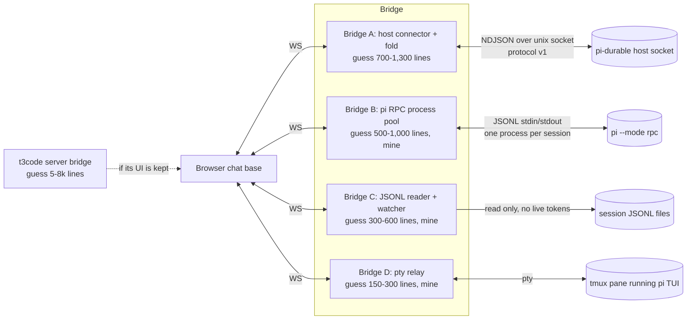

# Choosing the chat base for cpd-webui: research

## Summary

(written by the final part)

## 1. Scope, sources and labels

### 1.1 Goal

Find which existing open-source chat should be the base of cpd-webui, so the chat itself is reused and only a cosmetic layer plus three simple custom panes (Context tree, Plan view, Attention Inbox) are built around it. This mirrors how `cpd tui` reuses pi's terminal chat inside tmux. This part (A) states the method, the yardsticks, how a browser can reach pi, and the field of candidates. It makes no recommendation.

### 1.2 User decisions

| Key | Decision | Source |
|---|---|---|
| pro-d1 | The repo's `web/` custom chat is a first attempt judged too costly. The stack is open. The User wants an OSS chat base, preferably from the pi community, with full chat capability out of the box and only cosmetic customisation. | Plan chat-research, Context cpd-webui |
| pro-d2 | The layout is the cockpit's and secondary. The chat is the primary decision. The three cpd surfaces are simple custom panes. | same |
| pro-n1 | Top priority is chat speed and performance, and parity with pi's terminal chat. | same |
| pro-d4 | Not restated in the Job brief that produced this part; the Job names pro-d1..pro-d4 but only pro-d1, pro-d2 and pro-n1 are written out. Unverified: its content. | Job brief |

### 1.3 Out of scope

- Any recommendation (the final part writes it).
- Candidate deep dives (section 5, written by the next part).
- Code, and any file other than this report.
- Running or benchmarking anything. This is desk research from source and docs.

### 1.4 Labels

| Label | Meaning in this report |
|---|---|
| `read` | A source file, doc or URL was opened by a finding. The claim cites the finding key and its own `file:line` or URL. |
| `measured` | A number from a real run. Used only where the finding says it was measured, with the finding's command or source. |
| `inferred` / `guess` | Reasoning or an estimate (a size, a judgement). Never upgraded: a claim a finding marks unverified stays unverified here. |
| `unverified` | The finding says it did not check it. |

### 1.5 Findings and what each answered

The keys below are machine-local findings from Plan chat-research. They are source material, not committed to the repo, and not copied here (see the appendix when the final part adds it). Each finding was written 2026-11-03 EST on one machine. The numbers in the findings were read or measured there. Nothing was run for this report, except where a finding says `measured`.

| Key | Question it answered |
|---|---|
| `s1-pi-rpc` | What pi's RPC mode, SDK and session JSONL expose to a web client. |
| `s2-durable-host` | What the pi-durable host socket protocol v1 offers a browser chat client. |
| `s3-parity-checklist` | What pi's terminal chat, as customised by cpd, shows and does (59 rows, P01-P59). |
| `s4-web-current` | What `web/` already has, what is measured, how big real transcripts are. |
| `r1-pi-webuis` | Which web UIs exist for pi (218 npm rows surveyed). |
| `r3-opencode` | Whether OpenCode's web UI can be a base. |
| `r4-agent-webuis` | Which OSS web UIs exist for terminal coding agents beyond pi. |
| `r5-chat-libs` | Which embeddable chat libraries exist for a custom backend. |
| `r6-term-in-web` | Whether a browser terminal (xterm.js) can be the chat. |
| `r7-chat-perf` | How to keep a 5,000+ message streaming chat fast in a browser (12-item checklist). |
| `r2-pi-web-ui-src` | What `@earendil-works/pi-web-ui` contains and whether it can drive a remote pi. |

Sections 2 to 4 draw on `s1`, `s2`, `s3`, `s4`, `r1`, `r4`, `r5`, `r7`. `r2`, `r3` and `r6` appear only for survey rows (4.1) and their one-line verdicts; their deep dives are section 5.

## 2. The yardsticks

### 2.1 Parity checklist (condensed from s3-parity-checklist)

`s3-parity-checklist` lists 59 rows, P01-P59, each with a `path:line` source in the cpd repo. Priority there: **must** = in nearly every turn or the base look; **should** = in many chats or on a common dialog; **could** = opt-in, rare or cosmetic. Labels in s3: verified, derived, UNVERIFIED. All rows below are `read` from s3 unless marked.

| Group | Rows | What it covers | Priority |
|---|---|---|---|
| G1 Frame and colour | P01-P04 | Chat pad (1 blank row above and below, 1 blank column each side); indexed SGR colours only (slots 0-15, never RGB); italic under theme `dango` (P03, could); pills (powerline caps, reversed text, meanings plain/in_progress/review/done/failed/planning/nothing/focus) | must (P03 could) |
| G2 Input box | P05-P07 | Rounded walls; border index 6 while working, 12 with focus, else 15; blinking cursor (500 ms, indices 5, 7, 2); `↑ N more` scroll hint | P05 must, P06 should, P07 could |
| G3 Working state | P08-P11 | Working pill in the input's top border (loader frame + words); words `Thinking…`, `Responding…`, `Preparing tools…`, `Processing results…`, `Compacting…`; per-tool words (`Reading file…`, `Running command…`, `Using <name>…`); italic only for `Thinking…` | P08, P09 must; P10 should; P11 could |
| G4 Keys and mouse | P12-P13 | Ctrl+O expands every tool row; Ctrl+T cycles thinking; left click toggles any fold; wheel and selection are pi's | must |
| G5 Balloons and thinking | P14-P16 | User balloon grey at right, no time; assistant balloon at left with machine-local `HH:MM` on the bottom border; thinking block: grey `Thinking…` pill, folded at start, Ctrl+T cycles summary, detail, summary-after-detail, hidden | must |
| G6 Tool rows | P17-P23 | Status dot + pill + one-line argument; status colours (running cyan 6, done green 2, failed red 1, `ask_user_question` waiting magenta 5); durations (`0.123s`, `1m 5s`, `1h 2m 3s`); closing row `╰` + fold glyph + label + `HH:MM` + metadata; running closing row with a 28-frame moon loader at 50 ms; `╰ choose` for the open dialog; terminator for a call that can no longer get a result | P17-P21 must; P22 must when used; P23 should |
| G7 Tool results | P24-P30 | First 10 rows then `… N more lines`; read result as numbered code; write result as numbered code; edit result as a diff with gutter and `(+N -N)`; grep/find/ls `N lines`; bash row title as a plain summary (`Run tests`, `Install dependencies`) plus `+ N more steps`; bash output rows, failure headline `Command exited with code N` | P24, P25, P27, P29, P30 must; P26, P28 should |
| G8 Styles and grouping | P31-P35 | Claude style, Codex style, read/search/list groups, thinking-only turns folded, style `off`. Default style is `compact`, which draws no groups (`compact-tools-grouping.ts:327-328`) | could |
| G9 Compaction | P36-P37 | Done fold (`╭─` + `compaction` pill, `Compacted from N tokens`, summary on `│` rails); running row `Compacting…` | should |
| G10 cpd messages | P38-P39, P54 | Custom messages (`cpd`, `cpd-context`, `cpd-plan-decision`, `cpd-plan-summary`, `cpd-skills`) fold with a `φ` pill, head cut at 60 characters; Session/Plan/Context id mentions painted magenta italic; plan-review entries restored after `/reload` | P38 should; P39, P54 could |
| G11 Modes and commands | P40-P41, P55-P57 | Silent mode (`ctrl+'`, `/silent`): hides tool rows, intermediate turns, thinking, notices; activity animator; slash commands `/silent`, `/compact-tools`, `/plan-review`; `/quit` marker; steer vs follow-up delivery (`pr-feedback` and `escalation` are steered) | P55 `/silent` and `/compact-tools` must; P40, P57, `/plan-review` should; rest could |
| G12 `ask_user_question` | P42-P49 | Call row shows no argument (derived, not run); dialog with tabs and a Submit tab; side-by-side preview at 100+ columns; keys; placement in the editor slot; result envelope; never-hang outcomes; notifier events | P43, P45, P47 must when used; P42, P44, P46 should; P48, P49 could |
| G13 `cpd_plan_review` | P50-P53 | Call row with `title` (at most 72 characters); summary message always open; Approve/Change dialog; decision message | P52 must when a plan is in review; P50, P51, P53 should |
| G14 pi-native | P58-P59 | Footer contents, model picker, token and cost display, image attachments, `@file`, pi's own slash commands and keys. s3 did not read pi-core, so these rows are UNVERIFIED | should |

All 59 rows are covered: P01-P04, P05-P07, P08-P11, P12-P13, P14-P16, P17-P23, P24-P30, P31-P35, P36-P37, P38-P39 + P54, P40-P41 + P55-P57, P42-P49, P50-P53, P58-P59. (Count: 4+3+4+2+3+7+7+5+2+3+5+8+4+2 = 59.) The grouping into 14 is this report's; s3 itself is a flat table.

#### The cpd-specific look (read, s3-parity-checklist)

- **Colours are not read from `dango.json`.** compact-tools paints hard-coded palette indices (`compact-tools-indices.ts:52-66`); the JSON is used only by pi's own Theme. Example: `accent` is 4 in the JSON and 6 in code; `mdLink` is 15 in the JSON and 4 in code. A new UI must port the index map, not the JSON (s3, Answer 3). The hex value behind each of the 16 slots is in `docs/contract.md` section 6.1.1, which s3 did not read. No hex value is stated in this report.
- **Balloons:** user at the right, text wrapped at width minus 7; assistant at the left, wrapped at width minus 8, `HH:MM` on the bottom border. Drawn in both normal and silent modes (P14, P15).
- **Thinking fold:** folded at the start of every block; Ctrl+T cycles four views; a click toggles (P16).
- **Tool rows:** status dot, name pill, one-line argument; closing row `╰` with a toggle glyph, label, `HH:MM`, metadata; preview of 10 lines (P17-P24).
- **Compact-tools grouping rules:** under the default style (`compact`) there are no read/search/list groups. Groups exist only for styles `claude` and `codex`: `Searched for 2 patterns, read 3 files` with `(click to expand)`, thinking-only turns folded between calls (P33, P34, `compact-tools-grouping.ts:327-328`). Whether a candidate that groups calls (see `r1-pi-webuis`) matches this look is unverified in r1.
- **Working pill:** loader frame plus words, in the input's top border (P08, P09).
- **State-coloured input:** border 6 while working, 12 with focus, else 15 (P05).

#### The two dialogs (read, s3-parity-checklist, "Dialog data shapes")

**`ask_user_question`** (`pi/ask-user-question/tool/types.ts`):

| Field | Type and limits |
|---|---|
| `questions` | array, 1 to 4 items (`MAX_QUESTIONS` 4; `types.ts:5, 83-91`) |
| `questions[].question` | string, by convention ends with a question mark |
| `questions[].header` | string, at most 16 characters |
| `questions[].options` | array, 2 to 4 items; an automatic `Type something.` row is added; a `Next` row spans questions; a Submit tab |
| `questions[].options[].label` | string, at most 60 characters |
| `questions[].options[].description` | string |
| `questions[].options[].preview` | optional Markdown string, single-select only; shown side by side when the terminal and pane are both 100 columns or wider, stacked otherwise (P44) |
| `questions[].multiSelect` | optional boolean, default false |
| Answer | `{questionIndex, question, kind: "option" \| "custom" \| "multi", answer, selected?, notes?, preview?}` (`types.ts:109-124`) |
| Result | `{answers[], cancelled, globalNote?, unanswered?, error?}`; tool text `User has answered your questions: "Q"="A". …` or `User declined to answer questions` (`response-envelope.ts`) |

Reserved labels: `Other`, `Type something.`, `Next`. Keys (P45): up and down, Tab/Shift+Tab or left/right for tabs, Enter submits, Esc cancels, `n` opens notes, Ctrl+] collapses.

**`cpd_plan_review`** (`pi/lib/review.ts`, durable variant `pi/durable-host/tools.ts`):

- Input is `{title: string}`, at most 72 characters, `additionalProperties: false`. The model-only tool refuses outside a Plan Lead's session.
- Open flow: the summary file `summary-<review>.md` is sent as a `cpd-plan-summary` message, a `cpd-plan-review` entry is recorded `{plan, review, surface, status: "pending"}`, then pi's `select` opens with the title `Plan review <id>: <title>` and options **Approve** and **Change**. Change opens an `editor` titled `What should change?`; an empty note returns to the select (P52).
- Decision message `cpd-plan-decision`: `Plan review <id> was APPROVED|REJECTED.` plus feedback and next step; details `{plan, review, approved, current, feedback?, decided_elsewhere?}` (P53).

**Schema mismatch s3 found (read):** the lib variant enforces the 72-character limit only in the tool description (`pi/lib/review.ts:175-182`); the durable-host variant enforces `maxLength: 72` in its TypeBox schema (`pi/durable-host/tools.ts:121`). Which one pi registers at runtime was not traced (s3, open item 3). `s2-durable-host` adds that the durable `cpd_plan_review` tool opens no dialog itself (`tools.ts:116-133`); the dialog is created elsewhere and its wire shape is unknown to s2.

#### Open items in s3 that bind the parity yardstick

- Hex values for the 16 palette slots: not in the paths s3 read.
- P57-P59 (footer, model picker, steer/follow-up queue view, `@file`, images, pi's keys) need pi-core sources: UNVERIFIED.
- P42 is derived from code, not run.
- `compact-tools.ts:700-996` (session wiring, style switching) was not read.

### 2.2 Speed checklist (r7-chat-perf, verbatim)

The twelve items below are r7-chat-perf section 8 ("R4 checklist: pass/fail tests for a candidate chat base"), copied verbatim. They are to be run against a fixture of at least 5,000 messages and at least 25 MB with a mix of long markdown, big code blocks, diffs, tool rows and thinking blocks. Pass means the threshold is met; record the number. The thresholds are r7's own targets (guess in r7: none is a published benchmark). Nothing here was run.

| ID | Check (verbatim from r7-chat-perf §8) |
|---|---|
| C1 | **Cold open of a 25 MB, 5,000+ message session**: first paint of the last messages ≤ 500 ms, main thread never blocked > 100 ms (Performance trace long-task count = 0 > 100 ms). Fail if it parses/renders all messages before first paint. |
| C2 | **Windowed DOM**: with 5,000 messages loaded, live message DOM subtrees ≤ ~100 (window + overscan), and DOM node count does not grow with total N (count at N=500 vs N=5,000 within 10%). |
| C3 | **Per-token cost independent of N**: stream 200 tok/s into the last message at N=500 and N=5,000; per-frame scripting time p95 ≤ 8 ms and within 20% between the two N. Fail if cost grows with N (the cpd TUI failure mode: 0.097 ms/component). |
| C4 | **Streaming markdown is incremental**: DevTools/Profiler shows only the last open block re-renders per token (earlier blocks of the same message, and all other messages, do not re-render). Fail if the whole message re-parses each token. |
| C5 | **Bottom-anchoring**: pinned at the end while streaming (no visible jitter, drift ≤ 1 px/s); scrolling up by one screen stops following and does not move even as the last row grows; returning within threshold re-pins. |
| C6 | **Prepend stability**: load older page while reading mid-history; the visible message moves ≤ 1 px; stable message ids (not indexes) as keys. |
| C7 | **Typing responsiveness during streaming**: input keydown→paint p95 ≤ 50 ms while streaming at 200 tok/s with N=5,000 (cpd baseline to beat: TUI 54 ms median on 24 MB). |
| C8 | **Instant session switch**: switching between two cached sessions paints last messages ≤ 100 ms (warm) / ≤ 500 ms (cold) with no scroll jump (measured-height cache or equivalent). |
| C9 | **Highlighting off the hot path**: open code fences render plain; completed fences highlight once, cached, not re-run on re-render, and not on the main thread during streaming (worker or idle); no shiki full-bundle import (check bundle: fine-grained langs, JS engine option). |
| C10 | **Virtualisation escape hatches**: (a) in-app search across all messages that jumps to a hit outside the window; (b) selected/focused/streaming row is kept mounted (`keepMounted` equivalent) so selection and the live row survive scrolling; (c) expand/collapse state survives unmount (stored by message id). |
| C11 | **Heavy rows are bounded**: a 5,000-line diff or 1 MB tool output in a row does not freeze scrolling (internal windowing like `@pierre/diffs` Virtualized*, or `maxHeight` + lazy expand); long-task budget as in #1. |
| C12 | **Hooks exposed by the base** (API inspection, pass if all present): custom row renderer per message/tool type; custom markdown/code renderer slot; stable item key; event stream input that accepts raw token/event deltas (not whole-message replacement); imperative scrollToIndex/scrollToEnd/prepend; a way to supply pre-parsed nodes (worker parsing); theme via CSS variables (Dango v3 cosmetic-only). |

r7's own caveat (read, r7 §9): no published per-token ms exists for TanStack Virtual, virtua, Virtuoso, Legend List, Streamdown or markstream; r7 ranks virtualisers by documented chat contract, not measured speed. r7 forbade synthetic benchmarks, so the checklist is unrun for every candidate.

### 2.3 cpd's own sizes

| Fact | Value | Label and source |
|---|---|---|
| Largest session the TUI work measured | 24 MB = 7,655 entries; 364-445 pi-tui components after the compaction cut | read, r7-chat-perf §6, citing `docs/research/chat-render-cost.md` (measured there; single runs, load average 5-26) |
| TUI render cost | 0.097 ms CPU per component per frame, intercept 11.6 ms, r² 0.97 | measured by others, read via r7 §6 and s3 "Cost facts"; not re-run |
| TUI frame, 24 MB copy, bash row animating | 43-62 ms with the pad, 13-18 ms after `basis: 0`, 7-17 ms with no pad; CPU 85% to 31-36% to 12-23% | measured by others, r7 §6 |
| TUI typing latency | 54.2 ms median on the 24 MB copy vs 21.5 ms on a 10-row session | measured by others, r7 §6 |
| Extrapolation to a naive DOM chat | 5,000 always-live components at the TUI slope would be about 0.5 s per frame | inferred in r7 §6, not measured |
| Footer `getSessionName` scan | 3.1 ms per frame on the 24 MB session | measured by others, r7 §6 and s3 |

**Real transcript distribution on this machine (read, s4-web-current §4):** 2,170 pi session files, 883.0 MB, 178,446 JSONL lines. Sizes come from `stat`, lines from `wc -l`. File contents were not read.

| Measure | min | p50 | p75 | p90 | p95 | p99 | max |
|---|---|---|---|---|---|---|---|
| File size, MB | 0.013 | 0.128 | 0.332 | 0.722 | 1.125 | 5.905 | 25.591 |
| JSONL lines | 5 | 37 | 80 | 153 | 235 | 778 | 7,359 |

- 27 files are 5 MB or larger, 9 are 10 MB or larger, 16 have 1,000 or more lines, 1 has 5,000 or more lines, and exactly 1 is in the 20-30 MB band (25.6 MB, 7,359 lines).
- Lines are JSONL records, not messages. The docs' ratio is 0.51-0.59 messages per line, so the largest file is about 3,750-4,350 messages. That is an estimate, unverified on this machine (s4 §4). The 5,000-message goal is probably met by none of the local sessions (s4 Answer 3, estimate).
- The median session is tiny. The speed yardstick is about the long tail: the p99 file is 5.9 MB and 778 lines.

**The TUI figure the web must beat:** 0.097 ms per component per frame (read, s3 and r7). The web analogue r7 gives is a per-row memo keyed by (message id, revision, width) plus one rAF flush per frame (r7 §6, inferred from pi's `tui.md:108-110`).

## 3. Connection architecture

A browser cannot spawn pi, open a unix socket or read the session directory. Every route needs a bridge. This section lists what each backend offers and what it lacks.

### 3.1 pi RPC (s1-pi-rpc, pi 1.3.0, docs only)

`s1-pi-rpc` read the pi docs only. No process was started and no `.d.ts` was read (s1 §0), so every claim below is a doc claim.

- **Transport:** `pi --mode rpc`, JSONL on stdin/stdout, split on LF only (`docs/rpc.md:50-54`). Commands take an optional `id` that the response repeats. Stdout must be drained continuously because pi honours backpressure (`docs/rpc.md:56`). Close stdin to shut down (`docs/rpc.md:91-93`).
- **One process, one session.** No command carries a session selector, and events carry no session id (`docs/json.md:52-124`). N live sessions means N child processes (s1 gap G2, inferred; the cost is not measured).
- **33 commands** (s1 §2.3): `prompt`, `steer`, `follow_up`, `abort`, `clear_queue`, `new_session`; `get_state`, `get_messages`; `set_model`, `cycle_model`, `get_available_models`; `set_thinking_level`, `cycle_thinking_level`, `get_available_thinking_levels`; `set_steering_mode`, `set_follow_up_mode`; `compact`, `set_auto_compaction`; `set_auto_retry`, `abort_retry`; `bash`, `abort_bash`; `get_session_stats`, `export_html`, `switch_session`, `fork`, `clone`, `get_fork_messages`, `get_entries`, `get_tree`, `get_last_assistant_text`, `set_session_name`; `get_commands`.
- **Events** (s1 §2.2, 24 rows in its table): `agent_start`, `agent_end`, `agent_settled`, `turn_start/end`, `message_start`, `message_update` (delta only; `assistantMessageEvent.type` is one of `text_*`, `thinking_*`, `toolcall_*`), `message_end` (authoritative; replace the reconstruction), `tool_execution_start/update/end`, `queue_update`, `entry_appended`, `session_info_changed`, `thinking_level_changed`, `compaction_start/end`, `auto_retry_start/end`, `summarization_retry_*`, plus the RPC-only `bash_execution_update` and `extension_error`.
- **Extension UI sub-protocol** (`docs/rpc-extension-ui.md`): request/response methods `select` (`title`, string `options[]`), `confirm` (`title`, `message`), `input`, `editor` (`prefill`); fire-and-forget `notify`, `setStatus`, `setWidget` (string lines only), `setTitle`, `set_editor_text`. A reply is `extension_ui_response` with the same `id`, with `value`, `confirmed` or `cancelled`. A dialog without a `timeout` blocks the run until answered.
- **What is not drivable over RPC** (s1 §3.2, §4, §7.1): `custom()` returns `undefined`; footer, header, autocomplete, editor component, working indicator and `setToolsExpanded` are no-ops; `getEditorText()` returns `""`; themes are not exposed; `@file` is rejected; built-in TUI slash commands are not in `get_commands` and do not run via `prompt`; `select` has no multi-select and no per-option description; no tree navigation; no label writes.
- **What rides, with caveats (s1 §3.4, conditional because s1 did not read the cpd schemas):** `ask_user_question` as a single-choice `select`/`input` is a yes; with a Markdown preview it is only partial (a plain-text preview can ride on `confirm.message`, or on `setWidget` lines with weak pairing). `cpd_plan_review` is partial: Approve/Change rides on `select`; a long plan body needs `setWidget` or `notify`.
- **Session gaps (s1 §7.1, selected):** no transport other than a child process (G1); no session list command, the client scans the sessions directory (G3); `get_messages` has no paging, `get_entries` has a `since` cursor but includes abandoned branches (G5); the `edit` result's diff schema is undocumented (G13, unverified); cwd is fixed at launch (G15, unverified for `switch_session`); no latency, memory or cold-start numbers (G16).

### 3.2 pi SDK and session JSONL (s1-pi-rpc)

- **SDK:** in-process Node or Bun only (`docs/sdk.md:3-5`): `createAgentSession()`, `session.prompt()`, `session.subscribe()`. The wire's event vocabulary is the same, but SDK `message_update` carries cumulative snapshots (`docs/json.md:200-201`). `AgentSessionRuntime` holds one active session; whether several SDK sessions can run in one process at once is unverified (s1 §5).
- **JSONL:** `~/.pi/agent/sessions/--<path>--/<timestamp>_<session-id>.jsonl` (`docs/session-format.md:8-14`). Line 1 is the header; entries have `type`, `id`, `parentId`, `timestamp`. The file is described as an append-only tree (`docs/rpc-commands.md:691`).
- **Limits of the file as a source:** in-flight tokens are never written (`docs/message-types.md:145`); no entry records the active leaf (`docs/session-format.md:78-207`), so the file alone cannot show which branch is active after a `/tree` move (inferred); byte-offset tailing of a live file is unverified.
- **Entry types:** `message`, `model_change`, `thinking_level_change`, `usage`, `compaction` (`summary`, `firstKeptEntryId`, `tokensBefore`), `context_edit`, `branch_summary`, `custom`, `custom_message`, `label`, `session_info`.

### 3.3 The pi-durable host socket, protocol v1 (s2-durable-host)

`s2-durable-host` read `pi/durable-host/protocol.ts` (257 lines), `server.ts` (270 lines), `dialogs.ts` and `tools.ts`. It did not read `ring.ts`, `net.ts`, `held.ts`, `main.ts` or `sockets.ts`, so facts that depend on those are unverified there.

**Message types (read, s2 §1).** Client to host, 14 types: `hello`, `attach`, `submit`, `compact`, `configure`, `list_models`, `fork`, `history`, `abort`, `abort_submission`, `ping`, `detach`, `reload`, `ui_response` (`protocol.ts:39-53`). Host to client, 13 types: `welcome`, `attached`, `snapshot`, `events`, `result`, `error`, `host_state`, `ui_request`, `ui_resolved`, `notice`, `status`, `pong`, `bye` (`protocol.ts:82-99`). `ui_request` has five method variants: `select`, `confirm`, `input`, `editor`, `questionnaire`; purposes are `ask_user_question`, `secret_approve`, `host_approve`, `plan_review`, `mcp_login`, `other`.

**Payloads (read, s2 Answer 2, §2).** `snapshot` and `events` payloads are typed `unknown` in the protocol and forwarded unchanged. They are pi-durable's own `AgentEvent` and `SnapshotEvent`, not pi-coding-agent's types and not a cpd rewrap. pi-ai `Message` objects sit verbatim inside them (`message_start.message`, `EntryRecord.model`). Event names echo pi's, but fields differ: `message_update` carries `changes[]` deltas, `message_end` carries a stored `entry`, tool events use camelCase ids plus task ids, and tool output is a `trimStart`/`append` window edit. A pi-style renderer needs an adapter for the delta, tool, entry and inbox events (s2 §2 verdict). The forward-unchanged decision is recorded in `docs/research/durable-leads.md:1171-1181`, and the code that forwards it (`ring.ts`) was not read.

**Attach and speed (read, s2).** `attach` always sends the whole transcript. There is no window on `attach` (`protocol.ts:41`). `history` pages only after attach (`server.ts:137-141`, `:161-165`), so it cannot avoid the full snapshot. A snapshot is one NDJSON line with no chunking. Tokens arrive in batches on a 100 ms commit cadence (`PD/README.md:406`), and a short answer has no deltas at all. A mid-stream attach on a 30-entry spike measured 25 frames, 17,303 bytes, in 0.9 ms (measured by a doc, s2 §3.1); a real large snapshot was not measured.

**The gaps for a browser, numbered (read, s2 §8).** The Job brief said 16; `s2-durable-host` §8 lists 23. All 23 are kept, in s2's own order (highest impact on chat speed first). D1-D16 are those that block or slow the chat core; D17-D23 are the panes, limits and unverified items.

| # | Gap | Evidence (s2) | Label |
|---|---|---|---|
| D1 | No browser transport: NDJSON over a unix socket only, so a bridge is needed | `protocol.ts:251-253`; `durable-leads.md:343` | read |
| D2 | No window on attach: every attach and session switch re-sends the whole transcript | `protocol.ts:41`; `server.ts:124-125`; `durable-leads.md:1191` | read |
| D3 | `history` cannot precede attach, so a windowed first paint is not possible on the current order | `server.ts:137-141` vs `:161-165` | read |
| D4 | One snapshot is one line; `LIMITS.hostLine` (64 MiB) is declared and not referenced in `server.ts` or `protocol.ts` | `protocol.ts:4` | read |
| D5 | Possible slow-client loop: a snapshot over 8 MiB may trip the drop-and-reconnect rule | `server.ts:81-85` (needs `net.ts`) | unverified |
| D6 | A rebase re-sends the whole snapshot to every viewer (over 256 frames at run end, or 4,096) | `durable-leads.md:383` (design); `ring.ts` unread | unverified (design) |
| D7 | Token latency floor is the 100 ms commit interval; short answers have no deltas | `PD/README.md:406`; `durable-leads.md:639` | read; spike timings measured by a doc |
| D8 | Queued message text is not in the stream (items carry `id` and `mode` only) | `PD/dist/harness/events.d.ts:9-12, 60` | read |
| D9 | No message for slash commands, `/new`, `/plan-review`, `/mcp`, `/tree`, `/clone`, `/resume`, `/name`, `/session`, `/import`, `/settings`, `/login`, `/logout`, skills, templates, `!cmd`, `@file` | s2 §5; `durable-leads.md:238-256` | read |
| D10 | `configure` takes one field per message; the model string format is not defined | `protocol.ts:44, 196, 14` | read |
| D11 | Type drift for agent state: protocol `model_id` and required `thinking_level` vs pi-durable `modelId` and optional `thinkingLevel` | `protocol.ts:14`; `types.d.ts:347-352` | unverified which the wire carries |
| D12 | Dialog linkage and type gaps: `tool_call_id` never set; `timeout` declared never sent (use `expires_at`); `questionnaire` is a hand copy; the answer is opaque | `tools.ts:52, 89, 109`; `dialogs.ts:54`; `protocol.ts:65-70, 153-156` | read |
| D13 | `cpd_plan_review` wire shape is not in the listed code | `tools.ts:116-133`; `durable-leads.md:169` | unverified |
| D14 | `ui_resolved` with outcome `aborted` is not broadcast in the listed code | `dialogs.ts:66-68`; `durable-leads.md:404` | unverified |
| D15 | No viewer role and no command ACL: any attached client may send any command | `server.ts:138-186`; `durable-leads.md:1135` | read |
| D16 | No auth in the protocol; socket mode is the only control and its check was not read | `protocol.ts:39-40`; `sockets.ts` unread; `web-client-api.md:102` | read; mode check unverified |
| D17 | No Session, Plan, Context or Inbox data: none of the three custom panes has a message | `web-socket-audit.md:21` (doc) | read (doc) |
| D18 | Image limits: 4 per submit, 786,432 base64 characters in total, four mime types | `protocol.ts:19-21, 139` | read |
| D19 | Context-window fill is not carried (usage per model is in the snapshot; window size only in `list_models`) | `usage.d.ts:5-10`; `server.ts:31`; `durable-leads.md:275` | read |
| D20 | Notices and statuses are live only and lost while detached | `durable-leads.md:387`; `server.ts:98-100` | read |
| D21 | Error code mapping for `busy`, `ui_unknown`, `refused`, `storage_failed` is in `main.ts`; other throws become `internal` | `server.ts:89-92` | unverified |
| D22 | Whether `edit` results carry a diff in `details` is not in the listed files | `types.d.ts:106-118` | unverified |
| D23 | Doc drift: several research docs cite stale line numbers or wrong claims; use the code as truth | s2 §0 | read |

Other s2 facts a bridge needs (read): the socket path is `$CPD_HOME/run/host/<session>.sock` (a design fact, `durable-leads.md:343`, the building code not read); any number of viewers may attach and each gets a serialised copy of every frame; a viewer is dropped at 8 MiB buffered with `bye slow_client, reconnect:true`; the first `ui_response` wins and the others get `ui_unknown`; held UI requests replay on attach with `replayed: true`. A relay needs a host connector per Session (with cursor reconnect), NDJSON framing up to 64 MiB, `req` correlation, fan-out and Host/Origin/token auth. s2 estimates the relay at 400-700 non-test lines and the TypeScript fold of about 20 event types at 300-600 lines (both **guess**, s2 §7).

### 3.4 What `web/` already has (s4-web-current)

`web/` is 88 files and 14,583 lines (`wc -l`, including tests, docs and config). It is a dev-only live adapter, mounted only with `CPD_WEB_LIVE=1` (`web/vite.config.ts:355-358`), bolted to a React shell. No measurement of the web chat exists (s4 Answer 2).

**Reusable, regardless of the chat base (read, s4 §1):**

| Piece | Where | Flag |
|---|---|---|
| Host socket client: `hello`, `welcome`, `attach` with cursor, NDJSON; reconnect 100 ms doubling to 1 s over 30 s; one-shot `submit` | `web/src/api/host.ts` (238 lines) | reusable as is for reads and submit; its frame allowlist drops `ui_request`, `ui_resolved`, `notice`, `status`, `result`, so held approvals never reach the browser |
| pi JSONL parser (text, thinking, tool with args/output/state/duration, image; `ask_user_question` questions and answers) | `web/src/transcript.ts:298` (465 lines, pure) | reusable as is; output shape is cpd-specific, so a base needs a mapping layer |
| WS upgrade with token check before the 101, and per-session bridge | `web/vite.config.ts:289-353`, `web/src/api/ws-bridge.ts` (180 lines) | reusable with change: keep the upgrade, token gate and host wiring |
| Snapshot tail, paging and send policy (newest 40 turns and 1 MB per frame; `/transcript?limit&before`; send validation) | `web/src/api/live-server.ts:111-138, 187-248` | reusable with change |
| Live-edge scroll follow | `web/src/hooks/use-thread-scroll.ts` (90 lines) | reusable as is |
| Wire types (`ToClient`, `UiRequest`, questionnaire with `preview?`) | `web/src/api/types.ts` (323 lines) | reusable as is for types |
| The three cpd panes and shell (Context tree, Plan, Inbox, Logs) | `web/src/views/*`, `app-sidebar.tsx` and others | reusable with change: rewire to live data and the Dango palette |
| Contract and adapter tests | `transcript.test.ts`, `live-server.test.ts`, `ws-bridge.test.ts`, `host.test.ts` | reusable as spec |

**Throwaway (read, s4 §1):** the chat view `web/src/views/live-chat.tsx` (526 lines; text-only send, no steer, abort, model, cost, slash, `@file` or attachment input), the older mock-fed `chat.tsx`, `translate.ts` (drops thinking and tool blocks, ignores `message_update`), `fold.ts`, `mock.ts`, the CLI-spawn read layer (every list, plan, inbox, context and show is a CLI spawn at 13.6-16.3 ms each, `vite.config.ts:174-285`), and the vendored chat primitives if the base brings its own chat. Several code comments are stale (s4 §6).

**Facts that bound the bridge (read, s4):** the reconnect cursor is sent by the browser and never read by the server, so every reconnect is a full snapshot; a changed pi JSONL tick on the 29.6 MB file costs 209.1 ms (read 80.6, parse 127.2; measured on host `hs` by a doc, single run); a CLI call is about 34 to 180 times a socket round trip (measured by a doc); the host `submit` path uses `followUp` only and no abort, steer or reject route exists.

### 3.5 Candidate topologies

The diagram shows the four ways a browser can reach pi. Bridge sizes are **guess** labels: the first two come from the findings (s2 §7 for the durable relay and fold; the t3code figure is the Job brief's own guess), the rest are not in any finding and are this report's guesses.

| Topology | Live tokens | Dialogs | Windowing | Main cost or risk |
|---|---|---|---|---|
| A. Host socket | yes, 100 ms batches (D7) | yes: `ui_request` incl. `questionnaire` | no on attach (D2, D3) | adapter from pi-durable events to the base's model; D1-D23 |
| B. pi RPC | yes, delta only | partial: strings only, no preview (s1 §3.3) | no: `get_messages` unpaged | one process per session; no session list (s1 G2, G3) |
| C. JSONL | no: tokens are never written (`docs/message-types.md:145`) | no | by file offset only (unverified) | read-only; leaf not persisted |
| D. tmux pty | yes, exact | native pi dialogs | pi owns the viewport | fidelity of keys and graphics; no web-native chat (`r6-term-in-web`) |

Source for the table: s1 §2-§7, s2 §3-§8, `r6-term-in-web` verdict (read). The bridge sizes above are guesses. The pi-RPC, JSONL and pty rows have no size in any finding.

## 4. The field

### 4.1 Survey table

One row per candidate that `r1-pi-webuis`, `r4-agent-webuis` or `r5-chat-libs` names as worth a look, plus the three deep-dive subjects from the other findings (`r2`, `r3`, `r6`). "Last activity" is the date the finding read (GitHub `pushed_at` or npm release); all rows were read on 2026-11-03 EST. Class: **component** (separable chat package), **app** (chat usable only inside it), **library**, **reference** (read for ideas, not reuse). Deep dive = shortlisted for section 5. Stars and licences are `read` from the finding named in the last column.

| Name | URL | License | Last activity | Stack | Backend transport | Class | Deep dive | Finding |
|---|---|---|---|---|---|---|---|---|
| `@earendil-works/pi-web-ui` (ex `@mariozechner`) | npm (source removed from earendil-works/pi 2026-05-20) | MIT | npm 0.75.3, 2026-05-18; old name 0.73.1 deprecated 2026-05-07 | Lit web components (inferred, unverified now) | browser-direct LLM via pi-ai (no server) | library | yes | r1, r2 |
| OpenCode (sst/opencode, now anomalyco/opencode), `session-ui` | https://github.com/sst/opencode | MIT | push 2026-11-03; v2.2.5 2026-10-30; 224,294 stars | SolidJS + Kobalte; Effect server | HTTP + SSE (`/api/event`) to the OpenCode server | component (`session-ui` is `private: true`, not on npm) | yes | r3 |
| t3code | https://github.com/pingdotgg/t3code | MIT | push 2026-11-03; v0.1.6 2026-10-31; 43.8k stars | React + Vite + Tailwind 4, `@legendapp/list`, `@pierre/diffs`, tiptap, Effect | WebSocket to a local server that spawns `pi --mode rpc` | app (chat not packaged) | yes | r4 |
| `@assistant-ui/react-pi` (assistant-ui) | https://github.com/assistant-ui/assistant-ui | MIT | release 0.0.32 2026-10-19; pkg commit 2026-11-02; 12,926 stars (monorepo) | React, headless primitives, Tailwind/shadcn tokens | `PiClient` interface (HTTP+SSE client shipped; any transport) | component | yes | r1, r5 |
| `@jmfederico/pi-web` | https://github.com/jmfederico/pi-web | MIT | release 1.202610.9 2026-10-30; push 2026-10-31; 923 stars | Lit 3, Vite 8, Fastify 5 | WebSocket + HTTP to a Node server embedding the pi SDK | app (plugin panels, themes) | yes | r1 |
| `@pimote/pimote` | https://github.com/alennartz/pimote | MIT | release 0.15.5 2026-10-30; push 2026-10-30; 0 stars | Svelte 5, Tailwind 4 | WebSocket to a Node server using the pi SDK | app | yes | r1 |
| `pi-pocket` | https://github.com/TannerMidd/pi-pocket | MIT | release 0.27.0 2026-10-30; push 2026-11-03; 761 stars | vanilla JS (no build step), Node server on pi-durable and chord | HTTP/WS to its own server on pi-durable | app | yes | r1 |
| terminal-in-web: xterm.js 6.0.0 (+ webgl, fit, serialize addons) | npm `@xterm/xterm` (r6, `npm view`) | MIT | release 6.0.0 2025-12-22; addons modified 2026-10-29 | JS terminal emulator | PTY over WebSocket to a tmux pane running pi | library (fallback) | yes | r6 |
| `@agegr/pi-web` | https://github.com/agegr/pi-web | MIT | release 0.15.0 2026-11-03; 8,012 stars | Next.js 16, React 19, Tailwind 4 | Next route handlers embedding the pi SDK; fetch/SSE | app | no | r1 |
| `@blackbelt-technology/pi-agent-dashboard` | https://github.com/BlackBeltTechnology/pi-agent-dashboard | MIT | release 0.11.0 2026-10-26; push 2026-11-03; 340 stars | React + Vite (inferred), Node server, Electron option | bridge extension inside each pi process, WebSocket to a dashboard server | app | no | r1 |
| `@hachej/boring-ui-kit` | https://github.com/hachej/boring-ui | MIT | release 0.4.51 2026-11-03; 49 stars | React, shadcn registry blocks; pi-durable on the server | `useRemoteChat` to `/api/chat`; pi-durable Harness | component (designed to embed) | no | r1 |
| `pi-outpost` / `@pi-outpost/embed` | https://github.com/laurentftech/pi-outpost | MIT | release 0.58.0 2026-11-02; 26 stars | React, Node 24+ Fastify + WS | WebSocket to a Node process with a bundled pi SDK; Shadow-DOM embed widget | component (widget) | no | r1 |
| `xing-shuyin/pi-web-ui` | https://github.com/xing-shuyin/pi-web-ui | MIT | release 0.115.0 2026-11-02; 363 stars | React 19, Vite 8, Express 5 + ws, Electron | WebSocket to Express serving the pi SDK and DeepSeek Harness | app (performance reference) | no | r1 |
| `earendil-works/pi-durable-cloudflare` | https://github.com/earendil-works/pi-durable-cloudflare | MIT | push 2026-10-31 | React 19, Vite 8, Cloudflare Durable Object | WebSocket (partysocket) to a Durable Object running pi-durable | reference (~870-line sample) | no | r1 |
| `pi-studio` (omaclaren) | https://github.com/omaclaren/pi-studio | none (GitHub shows no licence) | release 0.11.10 2026-11-03; 211 stars | JS; two-pane prompt/document editor | pi extension serving a browser page | app (not chat-first) | no | r1 |
| OpenHands Agent Canvas | https://github.com/OpenHands/OpenHands | MIT | push 2026-11-03; v1.34.0 2026-10-27; 92.6k stars | React 19, react-router 7, Tailwind 4, HeroUI, zustand | REST + events to an Agent Server that spawns ACP agent CLIs over stdio | app | no | r4 |
| Goose desktop + `@aaif/goose-acp-client` | https://github.com/aaif-goose/goose | Apache-2.0 | push 2026-11-03; v1.57.0 2026-10-28; 56.2k stars | Electron, React 19, Tailwind 4, Radix | `@agentclientprotocol/sdk` 1.5.0 to `goose serve` | app (ACP client lib is a component for transport only) | no | r4 |
| vibe-kanban `web-core/workspace-chat` | https://github.com/BloopAI/vibe-kanban | Apache-2.0 | push 2026-11-03; v0.1.44 2026-04-24; README: sunsetting | Rust server + React 18, TanStack Virtual, `@pierre/diffs` | Rust executors normalise CLIs; WS/SSE (inferred) | reference (sunset) | no | r4 |
| Kilo Code (`session-ui`, `kilo-ui`) | https://github.com/Kilo-Org/kilocode | MIT | push 2026-11-03; v7.8.18 2026-10-26; 27.9k stars | opencode fork: SolidJS | opencode-style HTTP/SSE server | reference (overlaps r3) | no | r4 |
| chrome-acp | https://github.com/Areo-Joe/chrome-acp | MIT | push 2026-10-25; 193 stars | React 19, Tailwind 4; Hono + ws proxy | WebSocket to a proxy that spawns the ACP agent over stdio | app (small; chat internals unverified) | no | r4 |
| Panda | https://github.com/lukaisluka/Panda | Apache-2.0 | push 2026-09-09; 3 stars | React + TS, Tauri | ACP over WebSocket or stdio | app (README claims only) | no | r4 |
| codeg | https://github.com/spacering-net/codeg | Apache-2.0 | push 2026-11-03; v0.41.4 2026-11-02; 4.3k stars | Next.js 16, React 19, AI-Elements-style components; Rust backend | Rust ACP client; WebSocket server mode (inferred) | app | no | r4 |
| `svkozak/pi-acp` | https://github.com/svkozak/pi-acp | MIT | npm 0.0.34 2026-09-24; last commit 2026-10-06; 758 stars | Node; ACP over stdio | spawns `pi --mode rpc` | library (adapter) | no | r4 |
| `@ai-sdk/harness-pi` (vercel/ai) | https://github.com/vercel/ai | Apache-2.0 | release 1.0.176 2026-11-03; 27,707 stars | adapts pi to the AI SDK `HarnessV1` | AI SDK | library (route to AI-SDK chat UIs; unverified with a UI) | no | r1 |
| assistant-ui core `@assistant-ui/react` | https://github.com/assistant-ui/assistant-ui | MIT | 0.15.32; core 0.3.32 released 2026-10-28; push 2026-11-03 | React 18/19, Radix, Tailwind | `useExternalStoreRuntime`, local runtime, AI SDK, AG-UI, ACP and pi adapters | library | with react-pi | r5 |
| Vercel AI Elements | https://github.com/vercel/ai-elements | Apache-2.0 (npm; GitHub SPDX NOASSERTION) | `ai-elements@1.9.1`; last commit 2026-10-14; deprecated end of Nov 2026 | React, shadcn registry | AI SDK `UIMessage` parts | library | no | r5 |
| prompt-kit | https://github.com/ibelick/prompt-kit | MIT | 0.1.0, no releases; push 2026-09-28; 3.1k stars | Next 15, React 19, shadcn registry | none (UI only) | library | no | r5 |
| CopilotKit `@copilotkit/react-core` | https://github.com/CopilotKit/CopilotKit | MIT | 1.84.0 2026-11-03; 38.5k stars | React, Angular, Vue | AG-UI to a CopilotKit runtime | library | no | r5 |
| Streamdown | https://github.com/vercel/streamdown | Apache-2.0 | 2.7.1 modified 2026-10-19; push 2026-11-03; 5.7k stars | React; `marked` block split, `remend` | none (markdown renderer) | library | no (a part under any React base) | r5, r7 |
| llm-ui | https://github.com/richardgill/llm-ui | MIT | npm 0.13.3 2025-02-11; push 2026-09-29; 1.75k stars | React, headless, shiki | none | library | no | r5 |
| TanStack Virtual (`@tanstack/virtual-core` 3.19.11) | https://github.com/TanStack/virtual | MIT | npm 2026-11-03 (r7's `npm view` date) | framework-agnostic core with adapters | none (list virtualiser) | library | no (a part) | r7 |

Count: 31 rows, 8 deep-dive rows and 23 other rows that r1, r4, r5 or r7 name as worth a look. The 218 npm rows in `r1-pi-webuis` Appendix A are the long tail; they are not repeated here (see 4.2 for the patterns).

Observations that explain the table (read unless marked):

- **No pi web chat is a drop-in base.** The Job brief's headline, to verify against the findings: each candidate is parts or reference. The findings agree on the pieces below but none of them tested a candidate end to end. This is not yet a recommendation.
- **Most pi web UIs are forks of two bases:** `agegr/pi-web` (Next.js, 8,012 stars) and `jmfederico/pi-web` (Lit, 923 stars), with dozens of plugins for the latter (r1 §5).
- **Upstream ships no maintained web chat.** `@mariozechner/pi-web-ui` is deprecated, the web-ui workspace was removed from `earendil-works/pi` on 2026-05-20, and `@earendil-works/pi-web-ui` is frozen at 0.75.3 (r1 §1, r2 §0). `@earendil-works/pi-server`, `pi-client` and `pi-protocol` (1.1.0, 2026-10-07, "experimental", CBOR) exist as plumbing; r1 did not locate their source (guess: private).
- **Highest-risk cpd fact in r1:** pi-pocket runs its own extension system on pi-durable and "Pi's own extensions are not supported" (README:110), so `ask_user_question` and `cpd_plan_review` would need porting there.
- **Speed is unmeasured for every candidate** (r1 §8, r4, r5 §7). Only `xing-shuyin/pi-web-ui` has explicit windowing plus `content-visibility: auto` (grep, `r1` §1); `agegr/pi-web` and `jmfederico/pi-web` page history; t3code uses `@legendapp/list` (r4); assistant-ui's default thread uses CSS `content-visibility: auto`, with a virtualised route in an example (r5 §3.1).
- **cpd `ask_user_question` previews and `cpd_plan_review`** are unknown beyond generic dialog claims for most candidates (r1 §8). t3code handles pi `select`, `confirm`, `input`, `editor`; rich previews and `cpd_plan_review` are not handled (r4); assistant-ui's react-pi covers confirm/select/input/editor and needs a custom renderer for previews (r5).

### 4.2 Dismissed, one line each

| Candidate | Licence, last activity | Why dismissed |
|---|---|---|
| `tau-mirror` / `deflating/tau` | MIT, 1.0.9 2026-06-22 | README: "Project status: retired" (r1 §3 row 17). |
| `pi-tau-mux`, `pi-tau-mux-server` | MIT, 2026-03-26 | Abandoned: over 6 months idle (r1 §5). |
| `@malinamnam/pi-phone`, `@noahsaso/pi-remote`, `@q.roy/pi-remote` | none/MIT, 2026-03 | Abandoned: over 6 months idle (r1 §5). |
| `@ifi/pi-web-*` | MIT, 0.5.1 2026-04-28 | Abandoned by r1's rule (npm release and push before 2026-05-03). |
| `@dimko33/pi-web` | MIT, 2026-04-03 | Abandoned; a minimal installer. |
| `@mariozechner/pi-web-ui` | MIT, 0.73.1 2026-05-07 | Deprecated in favour of the earendil-works package (which is itself frozen). |
| `@earendil-works/bundled-ui` | none stated | Prebuilt bundles of a private app; no source (r1 §3 row 13). |
| `earendil-works/pi-durable-cloudflare` | MIT | A sample, "intentionally has no authentication"; about 870 lines; no markdown, diff, slash, `@file` or steer UI found (r1). |
| `@earendil-works/pi-chat` (Discord/Telegram) | Apache-2.0, 2026-06-05 | Not a web UI (r1 row 18). |
| `siteboon/claudecodeui` (CloudCLI) | **AGPL-3.0**, 14.4k stars | AGPL; no pi path (r4). |
| `winfunc/opcode` | **AGPL-3.0**, 22.4k stars | AGPL; Tauri desktop; claude only (r4). |
| `@alivault/pico`, `@larose/pi-web`, `@narumitw/pi-web`, `@timqi/pier`, `wherever-dev` | **AGPL-3.0** | AGPL web UIs for pi (r1 Appendix A). |
| `@khimaros/pi-webui` | **GPL-3.0-or-later**, 2026-06-18 | Copyleft (r1 Appendix A). |
| `sugyan/claude-code-webui` | MIT, 1.1k stars | Archived, "no longer maintained"; claude only (r4). |
| Roo Code | Apache-2.0, 24.3k stars | Archived; VS Code webview (r4). |
| Crystal / Nimbalyst | MIT, 2026-02-26 | Deprecated, replaced by a closed product (r4). |
| Cline webview-ui | Apache-2.0, 71.3k stars | VS Code postMessage coupled; own agent (r4). |
| Happy (slopus/happy) | MIT, 24.5k stars | React Native / Expo: components are not DOM components (r4). |
| `remote-pi` (Dart/Flutter, 480 stars) | MIT | Flutter mobile app, not a web chat (r1 §5). |
| Zed agent panel | mixed GPL/AGPL/Apache, 92.6k stars | Native (GPUI), not web (r4). |
| acp-ui | MIT, 505 stars | Vue 3; poor fit for a React base (r4). |
| casper | MIT, 8 stars | kiro only (r4). |
| Chainlit | Apache-2.0, 12.5k stars | Repo **archived** (`archived: true`); Python-driven (r5). |
| LobeChat / LobeHub | LobeHub Community License | Derivative works for distribution need a commercial licence; a full Next.js app (r5, LICENSE read). |
| Open WebUI | Open WebUI License (BSD-3 style + branding clause), 157.7k stars | Branding-preservation clause; Svelte; not embeddable beside React panes (r5, LICENSE lines 23-33). |
| `@virtuoso.dev/message-list` | Commercial | Commercial licence conflicts with "OSS base" (r7, a guess about the User's constraint). |
| `react-window` | not stated | No reverse scroll, no dynamic row height without extra work (r7, from a third-party table). |
| CopilotKit | MIT | App-copilot framework needing a runtime; no pi or coding-agent parts found (r5 §4). |
| Vercel AI Elements (as a dependency) | Apache-2.0 | Deprecated end of Nov 2026; no diff, no virtualisation (measured greps in r5). Still a source for individual components. |
| llm-ui | MIT | Headless markdown only; last npm release 2025-02-11 (r5). |
| prompt-kit | MIT | Parts only, lowest parity per line (r5). |
| The rest of r1's 218 rows | various | Forks, installers, chat bridges (Telegram, Discord and so on) and toy-sized repos (GitHub size 500 KB or less, a proxy, inferred). Not examined beyond metadata (r1 Appendix A). |

Not examined by any finding: AionUi, agentrq, zacp, Superlite, tlbx, VibeAround, Happier, Fello, Open Walnut (ACP clients page, r4), and GitHub-only projects missed by the npm search (r1 §7 coverage limits).

### 4.3 Chat libraries, ranking (r5-chat-libs §5)

r5 ranks by parity per adapter line. Adapter sizes are r5's estimates (inferred) unless noted.

| Rank | Library | r5's reasoning | Caveat |
|---|---|---|---|
| 1 | assistant-ui + `@assistant-ui/react-pi` | First-party pi adapter; event union uses pi's own `AgentSessionEvent` names (`types.ts:486-542`); streaming, thinking, tool cards, grouping (about 40 consumer lines), steer/follow-up/abort, model and thinking pickers, context usage, images, host-UI dialogs. A cpd adapter is a `PiClient` over the host socket, 150-300 lines (inferred, not built). | 0.0.x; no transcript paging in react-pi (grep `loadEarlier` = 0, measured); no slash commands or skills; no per-item queue editing; diffs, `@file`, slash popovers, compaction renderer and cost UI exist in core or ui but are not wired by react-pi; `messageProjection` per-token cost not verified. |
| 2 | Vercel AI Elements (+ Streamdown) | Presentational React parts tied to AI SDK `UIMessage`; you own the store, grouping, scroll, queue and pi mapping: est. 300-600 lines. | Deprecated end of Nov 2026; no diff; no virtualisation. |
| 3 | prompt-kit | Parts only. | 3,099 lines for 21 components; no runtime. |
| 4 | CopilotKit | Server runtime and AG-UI. | Poor fit. |
| 5 | llm-ui, Chainlit, LobeChat, Open WebUI | Not applicable. | Headless markdown only, archived, licence, framework. |

r5's decision-critical open item: measure react-pi plus `createThreadRowsSelector` plus `@tanstack/react-virtual` on a real 20-30 MB pi session (a probe, not a synthetic benchmark). r5 also notes the whole transcript arrives as one snapshot (`PiClient.subscribe` snapshot-first), a large JSON parse on every session switch (inferred).

The virtualiser ranking behind this (r7 §2, read; no library has a published streaming-chat benchmark, so it ranks by documented chat contract): 1) TanStack Virtual 3.19 (MIT, `anchorTo:'end'`, `followOnAppend`), 2) virtua 0.54.1 (MIT, reverse scroll and `shift`; its benchmark section reads "WIP"), 3) react-virtuoso 4.18 (MIT) with the commercial Message List, 4) Legend List 3.7.1 (MIT, React Native first). For incremental markdown r7 ranks Streamdown 2.7.1 (block split plus memo, React only) and markstream-react 2.0.23 (worker-parse hook); neither was measured.

### 4.4 The ACP route: pi-acp and its losses (r4-agent-webuis)

- **What it is (read, r4):** `svkozak/pi-acp` (MIT, 758 stars, npm `pi-acp` 0.0.34 modified 2026-09-24, last commit 2026-10-06). It spawns `pi --mode rpc` and speaks the Agent Client Protocol over stdio.
- **What is lost (read, r4, pi-acp README "Limitations"):** no separate thought stream (`agent_message_chunk` only), no fs or terminal delegation, MCP not wired, queue is client-side.
- **Extension UI has no carrier in ACP (read, r4):** `ask_user_question` and `cpd_plan_review` cannot ride, so ACP is lossy for pi. This is r4's conclusion; r4 did not test a pi-acp session.
- **ACP web clients that exist (read, r4):** OpenHands Agent Canvas (React, MIT, drives pi through pi-acp), chrome-acp, Panda, acp-ui (Vue), codeg (Next.js), Goose's `@aaif/goose-acp-client`, t3code's own `provider-acp`. Which of them render pi well is unverified in r4 (parity cells there come from file names and dependencies).
- **The comparison r4 draws (fit for pi):** pi RPC direct has the highest fidelity (thinking, steer, follow-up, compaction, `extension_ui_request`), as t3code's `provider-pi` shows; ACP via `pi-acp` is lossy; Claude and Codex SDK UIs have no pi path.
- **Net for the yardsticks (inferred):** ACP fails parity rows P16 (thinking fold), P43-P45 and P52 (dialogs) at the protocol, before any UI choice.

## 5. Candidate deep dives

