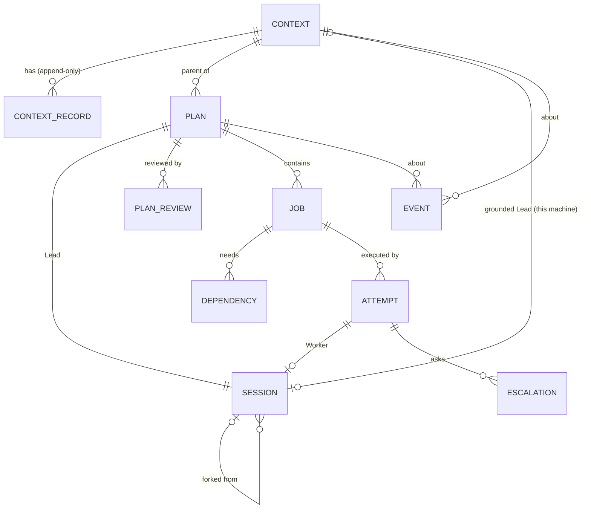
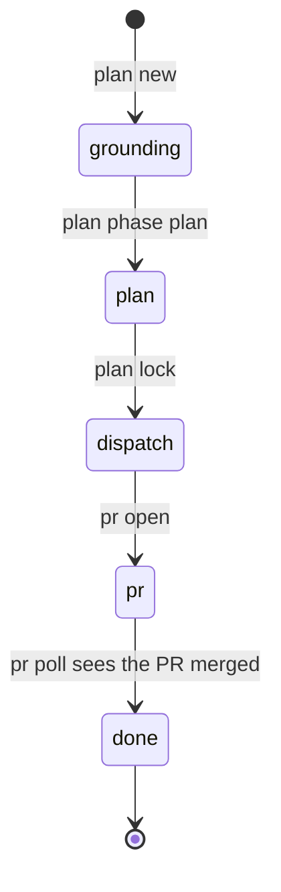
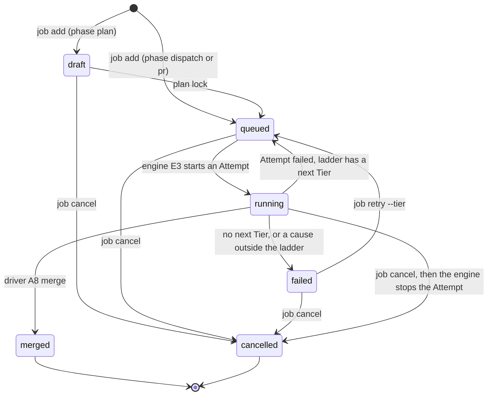
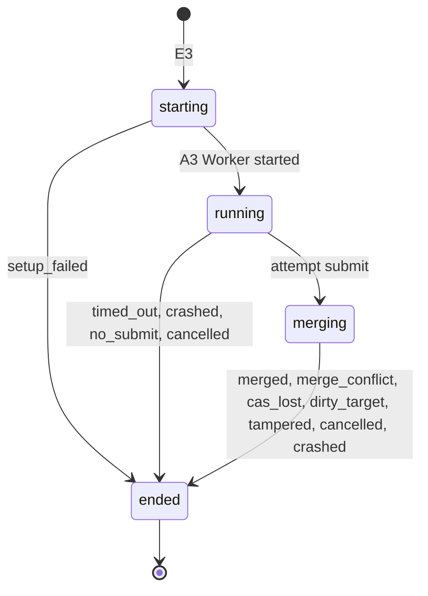

# cpd 2: contract (core)

Status: **normative for every cpd 2 implementation Job.** Vocabulary: [CONTEXT.md](CONTEXT.md). Command-by-command reference (synopses, flags, every refusal, JSON examples, the pi adapter protocol, the Worker contract, what the TUI reads): `docs/v2/commands.md`, written by Job `contract-commands` after this document. Where the two disagree, this document wins and `commands.md` is fixed.

Sources: the User's decisions R1–R14 and R19–R20 (applied by Job `contract-gate-pr`, §10) and the approved outline with D1–D5 (`~/.cpd/plans/cpd-rust/`), ADR-0009 to ADR-0012 (`docs/adr/`), the cockpit vision and research (`~/.cpd/plans/cpd-ui/`). cpd 1 (`docs/cli-contract.md`, cited below as "cpd 1 §n") is reference only: where its behaviour is kept, the section is cited; where it changes, the change and its reason are stated.

Evidence labels, as in the research notes: **verified** means run on the homeserver on 2026-10-14 (tmux 3.4, git 2.43.0, gh 2.45.0, pi 1.2.0, worktrunk 0.80.0); **docs** means read in the named tool's documentation; **unverified** means a design assumption the implementation Job must check.

## Contents

1. [Principles](#1-principles)
2. [Model and identifiers](#2-model-and-identifiers)
3. [State machines](#3-state-machines)
4. [Storage](#4-storage)
5. [Events](#5-events)
6. [The tmux host](#6-the-tmux-host)
7. [git and the Gate](#7-git-and-the-gate)
8. [Configuration](#8-configuration)
9. [Tiers](#9-tiers)
10. [Traceability](#10-traceability)

## 1. Principles

### 1.1 What cpd 2 is

- **CLI first.** Every capability is a command. Agents, the pi adapter, scripts and the TUI all use the same commands; the TUI (`cpd2 tui`) is the human view onto them, never a second way to change state.
- **One binary, written in Rust.** The Cargo workspace at the root of the repo has `cli/` (the binary) next to `tui/` (R6). During development the binary is installed as **`cpd2`** and `cpd` keeps meaning the TypeScript cpd (R12). This contract writes every command as `cpd2 …`; at the switch-over, `cpd2` becomes `cpd` everywhere, including in rendered Specs and the pi adapter.
- **System dependencies:** `git`, `tmux`, `pi` and, for pull requests only, `gh`. No `bd`, no `wt` (worktrunk), no `herdr`, and no Node.js of cpd's own. pi brings its own Node runtime; cpd uses it only to read pi's model catalog (§9).
- **State in SQLite inside the binary** (R1): one database per machine, `$CPD_HOME/cpd.db`, in WAL mode, with SQLite bundled into the binary (no system SQLite). Reads never wait for writers. Every write is recorded in the append-only `history` table (§4).
- **Context knowledge in git.** A Context's records (decisions, notes, questions and answers, Plans) live in an append-only JSONL store in a git repository per Context, shared across the User's machines; SQLite holds a rebuildable index of them (ADR-0012, §4.6).
- **tmux is the only host.** Leads run in the cockpit; Workers and the engine run in a hidden session of the same tmux server (§6).
- **The repo owns its setup and its Gate,** in `.config/wt.toml`, read by cpd itself so that repos set up for worktrunk work unchanged (R4, R5, §7).
- **Events are the single channel** to Leads, the TUI and agent states (D4, §5). There are no queue directories, no cache directories and no tmux user options carrying state.
- **One engine per machine** (D5): one `cpd2 watch` schedules every Plan under one concurrency limit.
- **Kept from cpd 1:** the vocabulary (Job, Spec, Dependency, Attempt, Escalation, Tier, Gate, Lead Branch, Merged, Locked); the roles User, Lead and Worker (cpd 1's Reviewer is removed by R19, §10); Workers write all the code; the Lead never writes code.

### 1.2 Output: one JSON value (D1)

Every command prints exactly one JSON value on stdout, always, except the three that own their terminal (below); there is no `--json` flag and no human format.

- Success: `{"ok": true, …}`, with the command's fields at the top level.
- Failure: `{"ok": false, "error": {"code": "<snake_case>", "message": "<one sentence>", "details": {…}}}`.
- Progress and debug text goes to stderr only.
- **The one streaming command** is `cpd2 events follow`: it prints one complete JSON value per line, each line an Event (§5.4), as the approved outline specifies. If it fails, its last line is a failure value as above.
- **Commands that own their terminal** print no JSON value on success: `cpd2 session run` and `cpd2 tui view` (internal) run pi or draw a ratatui view in their pane, and `cpd2 tui --attach` replaces itself with `tmux attach` (the outline's "builds and attaches the cockpit"). If one fails before taking the terminal, it prints the failure value and exits with its code. `cpd2 tui` without `--attach` prints one JSON value like every command.

Exit codes (kept from cpd 1 §2):

| Exit | Meaning | Examples of codes |
|---|---|---|
| `0` | ok | |
| `1` | failure: an external tool or something unexpected | `git_failed`, `tmux_failed`, `store_tampered`, `store_failed` (the database cannot be opened, is not cpd's, or a statement fails through a bug; Escalation `rs-store-a1-q1`), `config_invalid` |
| `2` | usage error | `usage`, `plan_required`, `invalid_plan_id` |
| `3` | refused by an invariant: Locked, an illegal transition, a precondition | `job_locked`, `illegal_transition`, `dirty_tree`, `cas_lost` |
| `4` | not found | `plan_not_found`, `job_not_found`, `session_not_found` |
| `5` | timeout | `store_busy`, `lock_timeout`, `ask_timeout` |

`commands.md` introduces more codes, most of them cpd 1's (cpd 1 §11 and its `src/`); each is specified at the command that returns it, under the same exit meanings:

| Exit | Codes |
|---|---|
| `1` | `gate_error`, `context_store_invalid`, `watch_start_failed`, `spawn_failed`, `session_malformed`, `driver_lock_missing`, `doctor_failed`, `pi_not_found`, `catalog_failed` |
| `2` | `context_required`, `session_required`, `invalid_review_id`, `invalid_session_id`, `invalid_record_id`, `spec_invalid`, `tier_invalid`, `nothing_to_edit`, `file_unreadable`, `invalid_name` |
| `3` | `context_exists`, `question_answered`, `not_a_git_repo`, `plan_exists`, `illegal_phase`, `no_draft_jobs`, `review_decided`, `dependency_cycle`, `worktree_exists`, `job_key_exists`, `needs_unknown`, `needs_unavailable`, `job_merged`, `job_not_failed`, `job_not_ready`, `attempt_not_running`, `jobs_not_done`, `gate_failed`, `rebase_conflict`, `not_a_lead`, `grounded_lead`, `no_cockpit`, `wrong_pane`, `cursor_ahead`, `not_a_terminal` |
| `4` | `base_not_found` |

### 1.3 Conventions every command follows

- **Selecting a Plan.** `--plan <id>`, else the environment variable `CPD_PLAN`, else usage error `plan_required` (exit 2). cpd sets `CPD_PLAN` in every pane it starts for a Plan (§6.5). This replaces cpd 1's `--wf` / `CPD_WF`.
- **Validation at the boundary.** Every external input (arguments, `config.toml`, Spec files, `.config/wt.toml`, `.config/cpd.toml`, Context record files, `gh` and `git` output, pi session lines) is parsed into types once, at the edge. Unknown flags and unknown config keys are errors. Nothing falls back silently.
- **Subprocesses** run from argv arrays (never a shell string, except the repo's own hook commands, which are shell by definition, §7.3), with stdin from `/dev/null` unless stated, an explicit `cwd` and an explicit environment. The exit code is checked before any output is parsed.
- **Times** are RFC 3339 UTC strings with milliseconds, `2026-10-14T21:10:00.000Z`.
- **Idempotence.** A command that finds its effect already in place returns `ok` with `"already": true` instead of failing, unless `commands.md` says otherwise for that command.

### 1.4 `$CPD_HOME`

`$CPD_HOME` defaults to `~/.cpd`. cpd 1 uses the same directory; cpd 2 never reads or writes cpd 1's files (`config.json`, `leads/`, `slots/`, `workflows/`, `locks/merge-*.lock`), and none of its own names collide with them.

```
$CPD_HOME/
  config.toml                     machine config (§8)
  cpd.db, cpd.db-wal, cpd.db-shm  the database (§4)
  contexts/<context>/             one git repository per Context (§4.6)
  locks/
    watch.lock                    held by the one `cpd2 watch` (§6.6)
    repo-<sha1>.lock              per-repo lock: merges, `pr open`, `pr rebase` (§7.4, §7.6); sha1 of the repo's git common dir realpath
    attempt-<plan>--<attempt>.lock  the driver lock: taken by the Attempt's starter, inherited by its driver (§3.4)
    context-<context>.lock        held while writing or syncing a Context store (§4.6)
  run/
    watch.log                     the engine's stderr
    <plan>/plan.md                the last `plan render`
    <plan>/lead-message.md        the Lead's first message, written by `plan new`
    <plan>/plan-<review>.md       the Plan review's content, written by `plan review`, opened in plannotator by the pi adapter
    <plan>/messages/<session>.md  a forked Session's first message, copied by `session fork --message-file`
    <plan>/specs/<attempt>.md     rendered Worker Spec
    <plan>/logs/attempt-<attempt>.log      the Attempt driver's stderr
    <plan>/logs/<attempt>.<hook>.log       full output of a hook run (§7.3)
    <plan>/logs/pr.pre-merge.log           full output of the last Gate run by `pr open` or `pr rebase` (§7.6)
    <plan>/logs/lead.<hook>.log            full output of a hook run in the Lead worktree: `pre-start` at `plan lock` (§7.2)
```

Locks are `flock(2)` locks on these files: the kernel releases them when the holder dies, so there are no stale-lock takeovers (a change from cpd 1 §4, whose pid files needed them).

## 2. Model and identifiers

### 2.1 Identifiers

| Thing | Format | Unique within | Example |
|---|---|---|---|
| Context id | `^[a-z][a-z0-9-]{1,39}$` | all machines (it names a git repo) | `building-cpd` |
| Machine name | `^[a-z][a-z0-9]{0,7}$`, set in `config.toml` (§8) | the User's machines | `hs` |
| Context record id | `<machine>-<letter><n>`; letter `d` decision, `n` note, `q` question, `a` answer, `p` plan; `n` from 1, sequential per machine, Context and letter | the Context | `hs-d3` |
| Plan id | `^[a-z][a-z0-9-]{1,23}$` (cpd 1's Workflow id) | the machine; `plan new` also refuses an id whose Lead Branch already exists in the repo (`branch_exists`), so cpd 1 Workflows and cpd 2 Plans on one repo never share a branch | `pay-4521` |
| Job key | `^[a-z][a-z0-9-]{0,31}$` | the Plan | `api-schema` |
| Attempt id | `<job>-a<n>`, `n` from 1 per Job | the Plan | `api-schema-a2` |
| Escalation id | `<attempt>-q<k>`, `k` from 1 per Attempt | the Plan | `api-schema-a2-q1` |
| Plan review id | `r<k>`, `k` from 1 per Plan | the Plan | `r3` |
| Session id | pi's session id. cpd chooses it for every session it starts (`pi --session-id`): a lowercase UUID v4. Accepted on input: `^[A-Za-z0-9][A-Za-z0-9_-]{0,127}$` | the machine | `596d007f-6775-4134-b77a-b356cc523842` |
| Event id | positive integer, assigned by SQLite, strictly increasing in commit order, never reused | the machine | `48213` |
| Lead Branch | `cpd/<plan>` | the repo | `cpd/pay-4521` |
| Attempt branch | `cpd/<plan>--<attempt>` (flat: git cannot hold `cpd/<plan>` and `cpd/<plan>/…`; t3) | the repo | `cpd/pay-4521--api-schema-a2` |
| Lead worktree | `<repo-parent>/<repo-name>.<plan>` | the filesystem | `~/projects/pay.pay-4521` |
| Attempt worktree | `<repo-parent>/<repo-name>.<plan>--<attempt>` | the filesystem | `~/projects/pay.pay-4521--api-schema-a2` |

Within a Plan, Jobs, Attempts and Escalations are addressed by their id plus the Plan; across Plans, by the pair. An invalid id is a usage error (`invalid_<thing>_id`, exit 2).

### 2.2 Objects

Types: `text`, `int`, `bool`, `time` (§1.3), `json` (a JSON value of the stated shape), `?` = nullable. The storage of each field is the DDL in §4.4.

#### Context

The knowledge several Plans share, optionally a Jira Epic. Not a session (ADR-0011).

| Field | Type | Meaning |
|---|---|---|
| `id` | text | Context id (§2.1) |
| `title` | text | |
| `jira` | text? | Jira Epic key, stored only |
| `created_at`, `created_on` | time, text | when and on which machine `context new` ran |
| `lead_session` | text? | this machine's **grounded Lead**: a Session that every new Plan of this Context forks (D2). Null until a first Plan of the Context has been grounded on this machine |
| `grounded_seq` | int? | the Context record index position (`context_records.seq`) at the moment the grounded Lead was forked; set together with `lead_session` |
| `sync_failing` | bool | the last `context sync` failed (so the failure is reported once, §4.6) |
| records | [Context record] | append-only, below |

#### Context record

One typed, append-only entry of a Context's store (ADR-0012). Written only by `cpd2 context …` commands and by `plan new` (the `plan` kind).

| Field | Type | Meaning |
|---|---|---|
| `id` | text | `<machine>-<letter><n>` (§2.1) |
| `kind` | text | `decision`, `note`, `question`, `answer` or `plan` |
| `at`, `machine` | time, text | when and where it was written |
| `by` | json `{session: text?, plan: text?}` | the writing Session (`CPD_SESSION`, else `PI_SESSION_ID`, else null) and its Plan |
| `text` | text | the decision, note, question or answer; for `plan`, the Plan's title |
| `supersedes` | text? | `decision` only: the id of the decision it replaces (must exist) |
| `question` | text? | `answer` only, required: the id of the question it answers (must exist) |
| `plan` | json? | `plan` only, required: `{id, machine, repo, jira?}`; references the Plan by id and machine |

A decision is **active** unless a later decision supersedes it. A question is **open** until an answer names it. The rendering Leads read (`context show`) lists, in order: title and Jira key; Plans; active decisions; superseded decisions, each naming its successor; open questions; answered questions with their answers; notes. Each item shows its id and date. Commands (detail in `commands.md`): `context new`, `list`, `show`, `decide`, `note`, `ask`, `answer`, `sync`.

#### Plan

One deliverable: one repo, one Lead Branch, one PR, optionally a Jira task. This was cpd 1's Workflow (D3).

| Field | Type | Meaning |
|---|---|---|
| `id` | text | Plan id |
| `context` | text | its Context (required: every Plan belongs to one) |
| `title`, `jira` | text, text? | |
| `repo` | text | realpath of the repo's main worktree |
| `base` | text | the branch the PR targets; default the repo's `origin` HEAD branch, else `main` (cpd 1 §11 `workflow init`) |
| `lead_branch` | text | `cpd/<id>` |
| `lead_worktree` | text? | set by `plan lock` |
| `phase` | text | `grounding`, `plan`, `dispatch`, `pr`, `done` (§3.1) |
| `lead_session` | text | the Plan's Lead Session |
| `pr` | json? | `{number, url, opened_at}`, set by `pr open` |
| `pr_seen` | json | `{checks: {<name>: <conclusion>}, reviewIds: [string], commentIds: [string], closed?: true}`: what `pr poll` has already reported (ids are gh's node ids as printed, or the decimal string of a number; `closed` is set when a closure without a merge was reported, and removed when the PR is open again) (replaces cpd 1's `pr-state.json`, §13) |
| `all_merged_at` | time? | when `all-merged` was appended (it is appended once) |
| `created_at`, `locked_at`, `done_at` | time, time?, time? | |

#### Plan review

One request for the User's approval of the draft Jobs, through plannotator (cpd 1 §11 `plan decision`, §15).

| Field | Type | Meaning |
|---|---|---|
| `plan`, `id` | text | `r<k>` |
| `fingerprint` | text | the plan fingerprint (§2.3) the review was rendered from |
| `status` | text | `pending`, `approved`, `rejected` |
| `feedback` | text? | the User's feedback |
| `requested_at`, `decided_at` | time, time? | |

#### Job and Spec

A self-contained unit of work. Its **Spec** is the fields `goal`, `context`, `touches`, `acceptance` and `out_of_scope`; with `title`, `tier` and the Job's Dependencies, they are the Job's **Locked fields**.

| Field | Type | Meaning |
|---|---|---|
| `plan`, `key` | text | |
| `seq` | int | machine-wide creation order (scheduling order, §3.2) |
| `title` | text | |
| `tier` | text | Tier (§9) |
| `goal`, `context` | text | Spec |
| `touches` | json [text], ≥ 1 | Spec: files or globs the Job may touch |
| `acceptance` | json [text], ≥ 1 | Spec: checks that must hold |
| `out_of_scope` | json [text] | Spec |
| `status` | text | §3.2 |
| `appended` | bool | added after `plan lock` |
| `fingerprint` | text? | Locked-Job fingerprint (§2.3); null exactly while `draft` (and for a draft that was cancelled) |
| `retry_tier` | text? | the Tier `job retry` chose for the next Attempt |
| `cancel_reason`, `cancel_requested_at` | text?, time? | set by `job cancel` |
| `failed_cause` | text? | the cause that failed the Job (§3.4); set exactly while `failed` |
| `merged_sha` | text? | the Lead Branch commit after the merge; set exactly when `merged` |
| `created_at` | time | |

#### Dependency

`(plan, job, needs)`: Job `job` may start only after Job `needs` is Merged. Both are in the same Plan; the graph is acyclic; `needs` may not be `cancelled` or `failed` when the Dependency is created (cpd 1 §11 `job add`). Dependencies are Locked with their Job.

#### Attempt

One execution of a Job by one fresh Worker session, in its own worktree.

| Field | Type | Meaning |
|---|---|---|
| `plan`, `id`, `job`, `number` | text, text, text, int | `id = <job>-a<number>` |
| `tier` | text | §9 |
| `origin` | text | `ladder` (created by the engine) or `retry` (after `job retry`) |
| `status` | text | §3.4 |
| `outcome`, `cause` | text?, text? | set together, exactly when `status = ended` (§3.4) |
| `branch`, `worktree` | text | §2.1 |
| `base_sha` | text? | Lead Branch HEAD the worktree was cut from |
| `driver_pid` | int? | pid of `cpd2 attempt run` |
| `worker_session` | text? | the Worker's Session |
| `spec_path` | text? | rendered Worker Spec |
| `submitted_sha`, `submitted_at` | text?, time? | set by `attempt submit` |
| `check_tail` | text? | last 60 lines of the quick check at submit (§7.3) |
| `merged_sha` | text? | set exactly when the outcome is `merged` |
| `nudged` | bool | the "you ended your turn without submitting" message was sent (§3.4) |
| `stop_request` | text? | `timed_out` or `cancelled`, set by the engine for the driver to act on |
| `metrics` | json? | cpd 1 §14, kept: `{turns, tokens_in, tokens_out, cache_read, cache_write, cost_usd, duration_s, model, thinking_level, stop_reason}` |
| `started_at`, `ended_at` | time, time? | |

#### Escalation

A question from a Worker to its Lead (`cpd2 ask`).

| Field | Type | Meaning |
|---|---|---|
| `plan`, `id`, `attempt`, `number` | | `id = <attempt>-q<number>` |
| `question` | text | |
| `status` | text | `open`, `answered`, `expired` (§3.5) |
| `answer` | text? | set exactly when `answered` |
| `asker_pid` | int | pid of the blocking `cpd2 ask` |
| `asked_at`, `answered_at`, `expired_at` | time, time?, time? | |

#### Session

A pi session cpd knows about: every Lead and Worker is one.

| Field | Type | Meaning |
|---|---|---|
| `id` | text | pi session id |
| `role` | text | `lead`, `worker` |
| `context` | text | every Session belongs to a Context (vision: "a new session must belong to a Context") |
| `plan` | text? | null only for a Context's grounded Lead |
| `attempt` | text? | set exactly for Workers |
| `name` | text | pi display name (`-n`); 1–80 characters, no control characters |
| `file` | text? | absolute path of the session JSONL, known once pi has created it |
| `forked_from` | text? | the Session it was forked from |
| `cwd`, `tier` | text | |
| `tmux_pane` | text? | `%<n>` pane id on the cpd tmux server; null when it has no pane |
| `state` | text | `working`, `blocked`, `idle`, `stopped` (§3.6) |
| `state_label` | text? | why it is blocked (for example `cpd: Worker question`); set only while `blocked` |
| `state_at`, `created_at` | time | |

#### Event

An append-only record of something that happened (D4, §5).

| Field | Type | Meaning |
|---|---|---|
| `id` | int | §2.1 |
| `at` | time | |
| `kind` | text | §5.2 |
| `context`, `plan`, `job`, `attempt`, `session` | text? | what it is about; which are set depends on the kind |
| `text` | text | one short paragraph for the Lead, ending with the exact `cpd2` command(s) it may want to run (cpd 1 §10, kept) |
| `data` | json object | kind-specific fields (§5.2) |

### 2.3 Fingerprints

- **Locked-Job fingerprint:** `sha256` of the canonical JSON (keys sorted, no whitespace) of `{goal, tier, context, touches, acceptance, out_of_scope, needs}` with `needs` sorted. Stored at `plan lock` and at append. Every engine step that reads a Job recomputes it; a mismatch is `locked_job_tampered` (exit 3) and the Job is not scheduled (cpd 1 §8, kept).
- **Plan fingerprint:** `sha256` of the canonical JSON array of the Locked fields of every `draft` Job, ordered by key (cpd 1 §11 `plan render`, kept). `plan lock` requires the latest Plan review to be `approved` for the current plan fingerprint.

### 2.4 Relations



- A Context has many Plans; a Plan has exactly one Context and one Lead Session.
- A new Plan's Lead is a **fork** of its Context's grounded Lead when there is one (D2), else a fresh Lead that starts by grounding (§3.1).
- A Job belongs to one Plan; Dependencies link Jobs of the same Plan; a Job has zero or more Attempts, at most one of them not `ended`.
- An Attempt has one Worker Session. An Escalation belongs to one Attempt.
- Every Event about a Context or a Plan names the Context, and the Plan, Job, Attempt or Session it is about, when there is one. Events about neither, such as `watch-started` and `watch-stopped`, name no Context (§5.2).

## 3. State machines

Every transition below is the only way its state changes. Anything else is refused with `illegal_transition` (exit 3) by the command, and also by a trigger in the database (§4.4), so a bug cannot write it either. "Engine" steps are those of `cpd2 watch` (§3.7, E1–E6) and of the Attempt driver `cpd2 attempt run` (§3.4, A1–A9). Each row names the Event its transaction appends (§5.2).

### 3.1 Plan phases



| From | To | Moved by | Preconditions | Event |
|---|---|---|---|---|
| (none) | `grounding` | `plan new --context X` | Context exists; Plan id free; Lead Branch absent from the repo | `plan-created`, `session-registered` |
| `grounding` | `plan` | `plan phase plan` (the Lead) | none | `plan-phase`. If the Context has no grounded Lead on this machine, the same transaction also registers one (below): `session-registered` and `context-grounded`. The pi fork itself runs after the commit |
| `plan` | `dispatch` | `plan lock` | latest Plan review `approved` for the current plan fingerprint (`plan_not_approved`); at least one `draft` Job; acyclic graph | `plan-phase`. All `draft` Jobs become `queued` with their fingerprints; the Lead worktree is created (§7.2); `watch` is started if it is not running (§6.6) |
| `dispatch` | `pr` | `pr open` | every Job `merged` or `cancelled`, at least one `merged` | `plan-phase` |
| `pr` | `done` | engine E5 (`pr poll`) | `gh` reports the PR merged | `plan-done` |

**Grounding.** The phase in which the Lead grounds itself on the Context: it reads the rendered Context records, the material the User gives, and interviews the User (cpd 1 requirements §2 "Context", kept). The phase is always entered; a Lead forked from an already grounded Lead (D2) adds to the Context with `context decide`, `note` or `ask` if it learns something, or moves on to `plan` at once. That is how "skipped or appended to" (ADR-0011) is represented: one phase name, `grounding`, and no special case.

**The Context's grounded Lead** (the Lead's answer to Escalation `contract-core-a1-q1`, consistent with D2 and ADR-0011):
- `plan new` when the Context **has** a grounded Lead on this machine: forks it (`session fork`, §6.7). The fork's first message is the Plan's brief plus every Context record whose index position is after `grounded_seq`, so later Plans inherit what was recorded after the snapshot.
- `plan new` when the Context **has no** grounded Lead: starts a fresh Lead whose first message is the brief plus all of the Context's records.
- At that Plan's `grounding → plan`, if the Context still has no grounded Lead on this machine, this Plan's Lead becomes the source of one. The write transaction of `plan phase plan` (§4.2) holds exactly these writes and no external work:
  1. `plans.phase = 'plan'`;
  2. the compare-and-swap `UPDATE contexts SET lead_session = :new, grounded_seq = (SELECT coalesce(max(seq), 0) FROM context_records WHERE context = :context) WHERE id = :context AND lead_session IS NULL`, so two Plans grounding at once produce one grounded Lead;
  3. only if step 2 changed a row: the new Session row (`role = lead`, `plan = null`, `forked_from` = this Plan's Lead, `state = stopped`, `file` and `tmux_pane` null);
  4. the Events `plan-phase`, and, only with step 3, `session-registered` and `context-grounded`.

  If step 2 changed nothing (another Plan grounded the Context first), the transaction writes only the phase and `plan-phase`.
- **After the commit**, `plan phase plan` creates the window `ctx-<context>` running `cpd2 session run <new id>` and appends `session-moved` in a second transaction, as `session fork` does (§6.7). So the tmux window exists only after the commit, and the pi fork happens only inside `session run`, which waits until this Plan's Lead is idle (fork-when-idle, §6.7; the Lead that ran `plan phase plan` is still in its turn), then runs `pi --fork` with no first message, so the grounded Lead never takes a turn. pi writes the fork's session file at once, before any message (read in pi 1.2.0's `SessionManager.forkFrom`). Records the source Lead writes between the commit and the fork are in the fork and also after `grounded_seq`; later Plans then receive them twice, which is harmless, and none is missed.
- **A second `plan new` before that fork exists** forks the grounded Lead as usual (`session fork`, §6.7): the Session is registered, so the command succeeds at once. Its own `session run` waits in step 1 until the grounded Lead's session file exists and the grounded Lead is idle, then forks it.
- The grounded Lead is never typed into again. Replacing it (re-grounding a Context) is later work, not in this contract.

### 3.2 Job statuses



| From | To | Moved by | Event |
|---|---|---|---|
| (none) | `draft` | `job add` in phase `plan` | `job-added` |
| (none) | `queued` | `job add` in phase `dispatch` or `pr`: an **appended** Job, fingerprint stored at once (cpd 1 §11 `job add`, kept) | `job-added` |
| `draft` | `draft` | `job edit` (Locked fields may change only here) | `job-edited` |
| `draft` | `queued` | `plan lock` | `plan-phase` (one Event for the whole lock) |
| `queued` | `running` | engine E3, or `job dispatch` by hand: creates the Attempt (§3.4) | `attempt-started` |
| `running` | `merged` | driver A8: the merge succeeded; or R (§7.4) when the driver died after A8's compare-and-swap | `job-merged` |
| `running` | `queued` | driver or engine: the Attempt ended `failed` with a ladder cause (§3.4), the ladder has a next Tier and the automatic Attempts are fewer than `1 + retry_cap` (§9) | `attempt-retry` |
| `running` | `failed` | driver or engine: no next Tier, the cap is reached, or the cause is outside the ladder | `job-failed` |
| `failed` | `queued` | `job retry <job> --tier <T>` (the Lead's decision; sets `retry_tier`) | `job-retried` |
| `draft`, `queued`, `failed` | `cancelled` | `job cancel --reason` with no active Attempt | `job-cancelled` |
| `running` | (unchanged; `cancel_requested_at` set) | `job cancel --reason` with an active Attempt | `job-cancel-requested` |
| `running` | `cancelled` | engine E2 or the driver honours the request at its next safe point (§3.4) | `job-cancelled` |

A Job stays `running` from the start of its Attempt until it is `merged`, `queued` again, `failed` or `cancelled`; the Attempt's status (§3.4) says whether it is still being worked on or is being merged. Change (R19): there is no Job status `in_review`, because there is no Job-level review.

**Ready.** A `queued` Job whose every Dependency is `merged`, in a Plan whose phase is `dispatch` or `pr`.

**Locked.** Every Job that is not `draft` is Locked: its Locked fields and Dependencies can never change. It can only be re-attempted (the ladder, `job retry`) or cancelled, and new Jobs can be appended (ADR-0003, cpd 1 requirements §2, kept). `job edit` on a Locked Job is refused with `job_locked` (exit 3); a database trigger refuses the same write (§4.4).

**Cancel.** Kept from cpd 1 §11 `job cancel`, with one change: a cancel request is honoured even after the Worker submitted, up to the compare-and-swap of the merge; after it, the Job is Merged and the request is reported as too late in `job-merged`'s data (`cancel_too_late: true`). (cpd 1 could not cancel an Attempt once it was approved for merge: Workflow lead-fork's `session-rename-2` and `review-off-lead` stayed in cpd 1's `in_review` and were merged by hand with the Gate bypassed; `~/.cpd/plans/cpd-ui/fork-note.md`.) Dependents of a `cancelled` or `failed` Job stay blocked.

`merged` and `cancelled` are terminal.

### 3.3 Escalations in the Job's life

While an Escalation of the active Attempt is `open`, the Attempt's timeout clock is paused (§3.4) and the Worker Session is `blocked` (§3.6).

### 3.4 Attempt statuses, outcomes and causes

Statuses: `starting` → `running` → `merging` → `ended`. Outcome and cause are set exactly when the status becomes `ended`. Outcomes: `merged`, `failed`, `cancelled`. Change (R19): the statuses `reviewing` and `awaiting_lead`, the outcome `rejected` and the cause `review_rejected` are gone, and the success outcome is named `merged` (it was `approved`), because nothing approves an Attempt any more: a submitted Attempt goes straight to the merge.



| From | To | Outcome / cause | Moved by | Event |
|---|---|---|---|---|
| (none) | `starting` | | E3 or `job dispatch`: takes the driver lock, inserts the Attempt with its Tier (§9), and starts the driver `cpd2 attempt run` detached, handing it the lock (below) | `attempt-started` |
| `starting` | `running` | | A3: Worker pane started | `attempt-status` |
| `starting` | `ended` | `failed` / `setup_failed` | A1–A2: worktree creation or `pre-start` failed (cpd 1 §12 step 2, kept: no ladder) | `job-failed` |
| `running` | `merging` | | `attempt submit` passes its preconditions (§7.3) | `attempt-status` |
| `running` | `ended` | `failed` / `timed_out` | A5 after E2 set `stop_request = timed_out` (cpd 1 §12 step 7, kept: no ladder) | `job-failed` |
| `running` | `ended` | `failed` / `crashed` | A5: the Worker pane is dead, or pi stopped with a last assistant `stopReason` other than `stop` | `attempt-retry` or `job-failed` |
| `running` | `ended` | `failed` / `no_submit` | A5: the Worker went idle without submitting, was nudged once (`attempt-nudge`), and went idle again without submitting (cpd 1 §12 step 7, kept) | `attempt-retry` or `job-failed` |
| `merging` | `ended` | `merged` / `merged` | A8: compare-and-swap succeeded | `job-merged` |
| `merging` | `ended` | `failed` / `merge_conflict` | A8: rebase conflict | `attempt-retry` or `job-failed` |
| `merging` | `ended` | `failed` / `cas_lost`, `dirty_target`, `tampered` | A8 (§7.4) | `job-failed` |
| any but `ended` | `ended` | `cancelled` / `cancel_requested` | the driver at its next safe point (before A3, before A8's rebase, before A8's compare-and-swap); or, when the driver is dead, E2 (any status but `merging`) or the merge recovery R (`merging`, commits not on the Lead Branch, §7.4) | `job-cancelled` |
| any but `ended` and `merging` | `ended` | `failed` / `crashed` | E2: the driver's lock is free (the driver died) | `attempt-retry` or `job-failed` |
| `merging` | `ended` | `merged` / `merged` | R (§7.4): the driver's lock is free and the Attempt branch's tip is already on the Lead Branch (the driver died after A8's compare-and-swap); `merged_sha` = that tip | `job-merged` |
| `merging` | `ended` | `failed` / `crashed` | R (§7.4): the driver's lock is free and the tip is not on the Lead Branch | `attempt-retry` or `job-failed` |

**Ladder causes** are `crashed`, `no_submit` and `merge_conflict`: the next Attempt starts from the newer Lead Branch HEAD and its Spec carries the previous outcome and the conflict list. Every other cause fails the Job, and the Lead decides (`job retry`, `job cancel`). Change (R19): the merge runs no Gate, so `gate_failed` and `gate_error` are no longer Attempt causes; the Gate runs at `pr open` and `pr rebase` (§7.6), and a failure there is fixed by Jobs the Lead appends.

**The driver, `cpd2 attempt run`** (internal; started detached by E3 or `job dispatch` with `setsid`, stderr to `run/<plan>/logs/attempt-<attempt>.log`; holds the driver lock, below, for its whole life). Steps, adapted from cpd 1 §12:

| Step | What it does |
|---|---|
| A1 | Check that fd 3 is the driver lock (below); load the Attempt and Job; recompute the Locked-Job fingerprint (§2.3) |
| A2 | Create the worktree from the Lead Branch HEAD and run `pre-start` (§7.2, §7.3); record `base_sha` |
| A3 | Render the Worker Spec to `run/<plan>/specs/<attempt>.md` (content: `commands.md`); start the Worker in the hidden session (§6.5); register its Session |
| A4 | Wait. Active time is wall time minus time with an `open` Escalation. |
| A5 | Decide the end of `running`: submitted (the Attempt is `merging`) → A8; `stop_request` → end; pane dead or bad stop reason → `crashed`; Worker `idle` without a submit → append `attempt-nudge` once, then `no_submit` if idle again without a submit. A Worker's idleness is read from its Session state and confirmed from its session file (the last assistant `stopReason`), never from the state alone (t1 F7, kept) |
| A6 | Removed by R19 (no Job-level Reviewer). |
| A7 | Removed by R19 (no Job-level Reviewer). |
| A8 | Merge (§7.4) |
| A9 | End: record `metrics` (parsed from the Worker's session file, cpd 1 §14) in the transaction that ends the Attempt; kill the Attempt's tmux window; on `merged`, remove the worktree and branch; otherwise keep them for debugging until the Plan is `done` (cpd 1 requirements §2, kept) |

**The driver lock** `locks/attempt-<plan>--<attempt>.lock` is held without a gap from before the Attempt row exists until its driver exits, so a free lock always means a dead driver, and E2 never ends a healthy Attempt whose driver has not started running yet. Chosen fix: the starter takes the lock and hands it to the driver at the spawn. Rejected alternative: an E2 grace period for young `starting` Attempts, which rests on a timing guess and needs a new key.

1. The starter (E3 or `job dispatch`) opens the lock file and takes `flock(LOCK_EX | LOCK_NB)` **before** the transaction that inserts the `starting` Attempt. If the lock is held, another starter is creating the same Attempt: `cas_lost`.
2. It commits the insert, then spawns the driver with that descriptor inherited as fd 3 (not close-on-exec).
3. It closes its own copy, without `LOCK_UN`. A `flock` lock belongs to the open file description, which the driver now shares, so the lock stays held by the driver with no gap; an explicit unlock on any copy would release it for both (docs: flock(2)).
4. At A1 the driver checks that fd 3 is that file (same device and inode as the path), else it exits at once without writing, and E2 ends the Attempt `crashed`.

If the insert fails (`no_slot`, `cas_lost`), the starter closes the descriptor and no Attempt exists. If the spawn fails, the starter ends the Attempt `failed` / `crashed` itself, as E2 would, and then closes the descriptor. E2 probes a lock by opening the file afresh and trying `flock(LOCK_EX | LOCK_NB)`.

The concurrency slot is implicit: an Attempt holds one from `starting` until `ended`. E3 and `job dispatch` insert an Attempt only inside a write transaction that counts the Attempts not `ended` on the machine and refuses at `concurrency` (`no_slot`, exit 3). This replaces cpd 1's slot files (§9).

### 3.5 Escalation states

| From | To | Moved by | Event |
|---|---|---|---|
| (none) | `open` | `cpd2 ask <attempt> <question>` (the Worker; blocks, polling the row) | `escalation` |
| `open` | `answered` | `cpd2 answer <escalation> <answer>` (the Lead) | `escalation-answered` |
| `open` | `expired` | `cpd2 ask` itself at `ask_minutes` (exit 5 `ask_timeout`), or engine E1 when `asker_pid` is no longer alive | `escalation-expired` |

`answered` and `expired` are terminal; ids are never reused (cpd 1 §11 "Escalation", kept). `answer` on a non-`open` Escalation is refused: `escalation_answered` or `escalation_expired` (exit 3).

### 3.6 Session states

`working`, `blocked`, `idle`, `stopped`. A Session is created `stopped` (registered, pi not yet running).

| From | To | Moved by | Event |
|---|---|---|---|
| (none) | `stopped` | `plan new`, `session fork`, A3: the Session is registered before pi starts | `session-registered` |
| `stopped` | `idle` | `session state idle`, called by the pi adapter at pi's `session_start` | `session-state` |
| `idle`, `blocked` | `working` | `session state working`, at pi's `agent_start` (and from `blocked` when the last blocking reason closes while a turn runs) | `session-state` |
| `working`, `blocked` | `idle` | `session state idle`, at pi's `agent_settled` with pi idle (and from `blocked` when the last blocking reason closes while idle) | `session-state` |
| `working`, `idle` | `blocked` | `session state blocked --label <text>` by the adapter while any blocking reason is open (a dialog to the User, a pending Plan review, an open Escalation to this Lead); `cpd2 ask` for the asking Worker's own Session, which `cpd2 ask` sets back to `working` when it returns | `session-state` |
| any | `stopped` | `session state stopped` at pi's `session_shutdown`; or engine E2 when the Session's pane is dead or gone | `session-state` |

The adapter counts blocking reasons and reports `blocked` while the count is above zero, the model of `tmux-agent-state.ts` (spike, verified), now written to the database instead of tmux options. `session state` writes nothing and appends nothing when the state and label are unchanged.

### 3.7 The engine, `cpd2 watch`

One per machine (D5). Every `tick_seconds`:

| Step | What it does |
|---|---|
| E1 | **Escalations:** expire `open` Escalations whose `asker_pid` is dead |
| E2 | **Liveness:** for every Attempt not `ended` whose driver lock is free (the driver died; §3.4): in `merging`, run the merge recovery R (§7.4), which ends it `merged` when its commits are already on the Lead Branch, and otherwise `cancelled` if a cancel was requested, else `crashed`; in any other status, end it `cancelled` if a cancel was requested, else `crashed`. For every Attempt with a live driver: active time over `attempt_minutes` → set `stop_request = timed_out`; Job `cancel_requested_at` set → set `stop_request = cancelled`. For every Session not `stopped`: pane dead or missing (`tmux list-panes -a`) → `stopped` |
| E3 | **Scheduling:** for each Ready Job, by `jobs.seq` across all Plans, while a slot is free: verify the fingerprint, take the driver lock, create the Attempt, start its driver with the lock inherited (§3.4) |
| E4 | **Completion:** for each Plan in `dispatch` with no Job `queued` or `running`, at least one `merged`, and `all_merged_at` null: append `all-merged` and set `all_merged_at` |
| E5 | **PR:** for each Plan in `pr`, every `pr_poll_seconds`: run `cpd2 pr poll --plan <id>` as a subprocess (a process boundary, cpd 1 §11 step 5) |
| E6 | **Contexts:** every `context_sync_seconds`, `context sync` each Context that has a remote (§4.6) |

`watch` holds `locks/watch.lock` (a second one exits with `watch_running`, exit 3), appends `watch-started` and `watch-stopped`, and never exits on its own: unlike cpd 1, it serves every Plan.

## 4. Storage

### 4.1 The database

- One file per machine: `$CPD_HOME/cpd.db` (R1), created on first use with `PRAGMA journal_mode = WAL` (persistent) and `PRAGMA application_id = 1668310066` (`0x63706432`, "cpd2").
- Every connection sets `PRAGMA foreign_keys = ON`, `PRAGMA synchronous = FULL`, `PRAGMA busy_timeout = <store_busy_ms>`, and registers the SQL function `cpd_txn()` (§4.3) before it runs any statement. The function must not be flagged `SQLITE_DIRECTONLY`, because triggers call it.
- SQLite is bundled into the binary (rusqlite's `bundled` feature), at least 3.45, so `STRICT` tables and the JSON functions are always present.
- Nothing is ever deleted (§4.4). The database grows; there is no pruning in this contract.

### 4.2 Transactions and concurrency

- **Who writes:** any `cpd2` process: commands, `watch`, Attempt drivers, `ask`. Nothing else can (§4.3).
- **Readers never block.** Reads run in deferred read transactions on the WAL snapshot and never wait for a writer. A reader keeps its transaction short (one query or one command's reads), so checkpoints are not starved; `events follow` opens a new read transaction for every poll (§5.4).
- **Writers** begin with `BEGIN IMMEDIATE`, so at most one write transaction is open on the machine at any moment. A writer that cannot get the write lock within `store_busy_ms` fails with `store_busy` (exit 5).
- **One command, one write transaction** for its state change, its `history` rows and its Events: all three commit together or not at all.
- **No external work inside a write transaction.** git, the Gate, tmux, pi and `gh` run outside. A step reads, acts, then writes with a compare-and-swap on the state it read (`UPDATE … WHERE status = :expected`); zero rows changed is `cas_lost` (exit 3), and the step re-reads and decides again.
- **Ordering.** Because writers are serialised, Event ids and history ids increase in commit order: a reader that has seen id N never later sees a new id below N.

### 4.3 Writes only through cpd: `txns` and `cpd_txn()`

Every write transaction starts by inserting its row into `txns` with an explicit id, `(SELECT coalesce(max(id), 0) + 1 FROM txns)`, after setting the connection's `cpd_txn()` to return that id. Triggers on every table call `cpd_txn()`:
- a connection that is not a `cpd2` process (for example the `sqlite3` shell) has no such function, so any write it attempts fails with "no such function: cpd_txn" (SQLite resolves trigger functions when the outer statement is prepared; verified by `cli/tests/store.rs`; a delete from an append-only table fails with its `append_only` error instead);
- a write whose `cpd_txn()` does not match its transaction's `txns` row is refused by the triggers on `txns`, `events` and `history`.

The **schema check**: at open, cpd hashes `SELECT type, name, sql FROM sqlite_schema WHERE name NOT LIKE 'sqlite_%' ORDER BY type, name` and compares it with the hash the binary embeds for the current `user_version`. A mismatch means someone dropped or changed a trigger or table: write commands refuse with `store_tampered` (exit 1); read commands still work and report it in their `tamper` field. This plus the history replaces cpd 1's `bd history` actor check (§8).

The **tamper report** (`plan show`'s `tamper` list, `doctor`): the schema check; every Locked Job whose recomputed fingerprint differs from the stored one; any `history` row whose `txn` has no `txns` row. The threat is an agent writing the Ledger outside cpd, as in cpd 1; a local user who drops the triggers, edits and recreates them exactly is out of scope (in cpd 1 the beads database could be edited the same way).

### 4.4 DDL

Migration 1 creates the following. Check constraints that need regular expressions are enforced in the binary at the boundary (§2.1), and the database checks shapes and lengths.

```sql
-- ---------- audit ----------
CREATE TABLE txns (
  id      INTEGER PRIMARY KEY,               -- explicit: max(id) + 1 under BEGIN IMMEDIATE
  at      TEXT    NOT NULL,
  command TEXT    NOT NULL,                  -- e.g. 'job add', 'watch', 'attempt run', 'migrate'
  pid     INTEGER NOT NULL,
  session TEXT,                              -- CPD_SESSION or PI_SESSION_ID of the caller, if any
  cwd     TEXT    NOT NULL
) STRICT;

CREATE TABLE history (
  id     INTEGER PRIMARY KEY AUTOINCREMENT,
  txn    INTEGER NOT NULL REFERENCES txns(id),
  tbl    TEXT    NOT NULL,
  pk     TEXT    NOT NULL CHECK (json_valid(pk) AND json_type(pk) = 'array'),
  op     TEXT    NOT NULL CHECK (op IN ('insert', 'update', 'delete')),
  before TEXT    CHECK (before IS NULL OR json_valid(before)),
  after  TEXT    CHECK (after  IS NULL OR json_valid(after)),
  CHECK ((op = 'insert') = (before IS NULL)),
  CHECK ((op = 'delete') = (after IS NULL))
) STRICT;
CREATE INDEX history_tbl_pk ON history(tbl, pk);
CREATE INDEX history_txn ON history(txn);

-- ---------- Contexts ----------
CREATE TABLE contexts (
  id            TEXT PRIMARY KEY CHECK (length(id) BETWEEN 2 AND 40),
  title         TEXT NOT NULL CHECK (length(title) >= 1),
  jira          TEXT,
  created_at    TEXT NOT NULL,
  created_on    TEXT NOT NULL,
  lead_session  TEXT REFERENCES sessions(id) DEFERRABLE INITIALLY DEFERRED,
  grounded_seq  INTEGER,
  sync_failing  INTEGER NOT NULL DEFAULT 0 CHECK (sync_failing IN (0, 1)),
  CHECK ((lead_session IS NULL) = (grounded_seq IS NULL))
) STRICT;

CREATE TABLE context_records (               -- index of the git store (§4.6); rebuildable
  seq          INTEGER PRIMARY KEY AUTOINCREMENT,   -- local index position
  context      TEXT NOT NULL REFERENCES contexts(id),
  id           TEXT NOT NULL,
  kind         TEXT NOT NULL CHECK (kind IN ('decision', 'note', 'question', 'answer', 'plan')),
  at           TEXT NOT NULL,
  machine      TEXT NOT NULL,
  by_session   TEXT,
  by_plan      TEXT,
  text         TEXT NOT NULL CHECK (length(text) >= 1),
  supersedes   TEXT,
  question     TEXT,
  plan_id      TEXT,
  plan_machine TEXT,
  plan_repo    TEXT,
  plan_jira    TEXT,
  UNIQUE (context, id),
  CHECK (supersedes IS NULL OR kind = 'decision'),
  CHECK ((question IS NOT NULL) = (kind = 'answer')),
  CHECK ((plan_id IS NOT NULL) = (kind = 'plan')),
  CHECK ((plan_id IS NULL) = (plan_machine IS NULL) AND (plan_id IS NULL) = (plan_repo IS NULL))
) STRICT;

-- ---------- Plans ----------
CREATE TABLE plans (
  id            TEXT PRIMARY KEY CHECK (length(id) BETWEEN 2 AND 24),
  context       TEXT NOT NULL REFERENCES contexts(id),
  title         TEXT NOT NULL CHECK (length(title) >= 1),
  jira          TEXT,
  repo          TEXT NOT NULL,
  base          TEXT NOT NULL,
  lead_branch   TEXT NOT NULL UNIQUE CHECK (lead_branch = 'cpd/' || id),
  lead_worktree TEXT,
  phase         TEXT NOT NULL CHECK (phase IN ('grounding', 'plan', 'dispatch', 'pr', 'done')),
  lead_session  TEXT NOT NULL REFERENCES sessions(id) DEFERRABLE INITIALLY DEFERRED,
  pr_number     INTEGER,
  pr_url        TEXT,
  pr_opened_at  TEXT,
  pr_seen       TEXT NOT NULL DEFAULT '{"checks":{},"reviewIds":[],"commentIds":[]}' CHECK (json_valid(pr_seen)),
  pr_polled_at  TEXT,
  all_merged_at TEXT,
  created_at    TEXT NOT NULL,
  locked_at     TEXT,
  done_at       TEXT,
  CHECK ((phase IN ('grounding', 'plan')) = (lead_worktree IS NULL)),
  CHECK ((phase IN ('grounding', 'plan')) = (locked_at IS NULL)),
  CHECK ((phase IN ('pr', 'done')) = (pr_number IS NOT NULL)),
  CHECK ((pr_number IS NULL) = (pr_url IS NULL) AND (pr_number IS NULL) = (pr_opened_at IS NULL)),
  CHECK ((phase = 'done') = (done_at IS NOT NULL))
) STRICT;

CREATE TABLE plan_reviews (
  plan         TEXT NOT NULL REFERENCES plans(id),
  id           TEXT NOT NULL,
  number       INTEGER NOT NULL CHECK (number >= 1),
  fingerprint  TEXT NOT NULL CHECK (length(fingerprint) = 64),
  status       TEXT NOT NULL CHECK (status IN ('pending', 'approved', 'rejected')),
  feedback     TEXT,
  requested_at TEXT NOT NULL,
  decided_at   TEXT,
  PRIMARY KEY (plan, id),
  UNIQUE (plan, number),
  CHECK (id = 'r' || number),
  CHECK ((status = 'pending') = (decided_at IS NULL))
) STRICT;

-- ---------- Jobs ----------
CREATE TABLE jobs (
  seq                 INTEGER PRIMARY KEY AUTOINCREMENT,
  plan                TEXT NOT NULL REFERENCES plans(id),
  key                 TEXT NOT NULL CHECK (length(key) BETWEEN 1 AND 32),
  title               TEXT NOT NULL CHECK (length(title) >= 1),
  tier                TEXT NOT NULL CHECK (length(tier) = 2 AND substr(tier, 1, 1) IN ('O', 'S', 'H') AND substr(tier, 2, 1) BETWEEN '0' AND '5'),
  goal                TEXT NOT NULL CHECK (length(goal) >= 1),
  context             TEXT NOT NULL,
  touches             TEXT NOT NULL CHECK (json_valid(touches) AND json_type(touches) = 'array' AND json_array_length(touches) >= 1),
  acceptance          TEXT NOT NULL CHECK (json_valid(acceptance) AND json_type(acceptance) = 'array' AND json_array_length(acceptance) >= 1),
  out_of_scope        TEXT NOT NULL CHECK (json_valid(out_of_scope) AND json_type(out_of_scope) = 'array'),
  status              TEXT NOT NULL CHECK (status IN ('draft', 'queued', 'running', 'merged', 'failed', 'cancelled')),
  appended            INTEGER NOT NULL CHECK (appended IN (0, 1)),
  fingerprint         TEXT CHECK (fingerprint IS NULL OR length(fingerprint) = 64),
  created_txn         INTEGER NOT NULL REFERENCES txns(id),
  retry_tier          TEXT,
  cancel_reason       TEXT,
  cancel_requested_at TEXT,
  failed_cause        TEXT,
  merged_sha          TEXT,
  created_at          TEXT NOT NULL,
  UNIQUE (plan, key),
  CHECK (status <> 'draft' OR fingerprint IS NULL),
  CHECK (status IN ('draft', 'cancelled') OR fingerprint IS NOT NULL),
  CHECK ((status = 'merged') = (merged_sha IS NOT NULL)),
  CHECK ((status = 'failed') = (failed_cause IS NOT NULL)),
  CHECK ((cancel_reason IS NULL) = (cancel_requested_at IS NULL)),
  CHECK (status <> 'cancelled' OR cancel_reason IS NOT NULL)
) STRICT;

CREATE TABLE dependencies (
  plan  TEXT NOT NULL,
  job   TEXT NOT NULL,
  needs TEXT NOT NULL,
  PRIMARY KEY (plan, job, needs),
  FOREIGN KEY (plan, job)   REFERENCES jobs(plan, key),
  FOREIGN KEY (plan, needs) REFERENCES jobs(plan, key),
  CHECK (job <> needs)
) STRICT;

-- ---------- Attempts ----------
CREATE TABLE attempts (
  plan             TEXT NOT NULL,
  id               TEXT NOT NULL,
  job              TEXT NOT NULL,
  number           INTEGER NOT NULL CHECK (number >= 1),
  tier             TEXT NOT NULL CHECK (length(tier) = 2),
  origin           TEXT NOT NULL CHECK (origin IN ('ladder', 'retry')),
  status           TEXT NOT NULL CHECK (status IN ('starting', 'running', 'merging', 'ended')),
  outcome          TEXT CHECK (outcome IN ('merged', 'failed', 'cancelled')),
  cause            TEXT CHECK (cause IN ('merged', 'cancel_requested', 'setup_failed', 'timed_out',
                                         'crashed', 'no_submit', 'merge_conflict',
                                         'cas_lost', 'dirty_target', 'tampered')),
  branch           TEXT NOT NULL CHECK (branch = 'cpd/' || plan || '--' || id),
  worktree         TEXT NOT NULL,
  base_sha         TEXT,
  driver_pid       INTEGER,
  worker_session   TEXT REFERENCES sessions(id) DEFERRABLE INITIALLY DEFERRED,
  spec_path        TEXT,
  submitted_sha    TEXT,
  submitted_at     TEXT,
  check_tail       TEXT,
  merged_sha       TEXT,
  nudged           INTEGER NOT NULL DEFAULT 0 CHECK (nudged IN (0, 1)),
  stop_request     TEXT CHECK (stop_request IN ('timed_out', 'cancelled')),
  metrics          TEXT CHECK (metrics IS NULL OR json_valid(metrics)),
  started_at       TEXT NOT NULL,
  ended_at         TEXT,
  PRIMARY KEY (plan, id),
  UNIQUE (plan, job, number),
  FOREIGN KEY (plan, job) REFERENCES jobs(plan, key),
  CHECK (id = job || '-a' || number),
  CHECK ((status = 'ended') = (outcome IS NOT NULL)),
  CHECK ((outcome IS NULL) = (cause IS NULL)),
  CHECK ((status = 'ended') = (ended_at IS NOT NULL)),
  CHECK ((outcome = 'merged') = (cause = 'merged')),
  CHECK ((outcome = 'cancelled') = (cause = 'cancel_requested')),
  CHECK ((outcome = 'merged') = (merged_sha IS NOT NULL)),
  CHECK ((submitted_sha IS NULL) = (submitted_at IS NULL)),
  CHECK (status <> 'merging' OR submitted_sha IS NOT NULL)
) STRICT;
CREATE UNIQUE INDEX attempts_one_active ON attempts(plan, job) WHERE status <> 'ended';
CREATE INDEX attempts_active ON attempts(status) WHERE status <> 'ended';

-- ---------- Escalations ----------
CREATE TABLE escalations (
  plan        TEXT NOT NULL,
  id          TEXT NOT NULL,
  attempt     TEXT NOT NULL,
  number      INTEGER NOT NULL CHECK (number >= 1),
  question    TEXT NOT NULL CHECK (length(question) >= 1),
  status      TEXT NOT NULL CHECK (status IN ('open', 'answered', 'expired')),
  answer      TEXT,
  asker_pid   INTEGER NOT NULL,
  asked_at    TEXT NOT NULL,
  answered_at TEXT,
  expired_at  TEXT,
  PRIMARY KEY (plan, id),
  UNIQUE (plan, attempt, number),
  FOREIGN KEY (plan, attempt) REFERENCES attempts(plan, id),
  CHECK (id = attempt || '-q' || number),
  CHECK ((status = 'answered') = (answer IS NOT NULL)),
  CHECK ((status = 'answered') = (answered_at IS NOT NULL)),
  CHECK ((status = 'expired') = (expired_at IS NOT NULL))
) STRICT;

-- ---------- Sessions ----------
CREATE TABLE sessions (
  id          TEXT PRIMARY KEY CHECK (length(id) BETWEEN 1 AND 128),
  role        TEXT NOT NULL CHECK (role IN ('lead', 'worker')),
  context     TEXT NOT NULL REFERENCES contexts(id),
  plan        TEXT REFERENCES plans(id) DEFERRABLE INITIALLY DEFERRED,
  attempt     TEXT,
  name        TEXT NOT NULL CHECK (length(name) BETWEEN 1 AND 80),
  file        TEXT,
  forked_from TEXT REFERENCES sessions(id),
  cwd         TEXT NOT NULL,
  tier        TEXT NOT NULL CHECK (length(tier) = 2),
  tmux_pane   TEXT CHECK (tmux_pane IS NULL OR tmux_pane GLOB '%[0-9]*'),
  state       TEXT NOT NULL CHECK (state IN ('working', 'blocked', 'idle', 'stopped')),
  state_label TEXT,
  state_at    TEXT NOT NULL,
  created_at  TEXT NOT NULL,
  FOREIGN KEY (plan, attempt) REFERENCES attempts(plan, id) DEFERRABLE INITIALLY DEFERRED,
  CHECK ((role = 'lead') = (attempt IS NULL)),
  CHECK (role = 'lead' OR plan IS NOT NULL),
  CHECK ((state = 'blocked') = (state_label IS NOT NULL))
) STRICT;
CREATE INDEX sessions_plan ON sessions(plan);

-- ---------- Events ----------
CREATE TABLE events (
  id      INTEGER PRIMARY KEY AUTOINCREMENT,
  txn     INTEGER NOT NULL REFERENCES txns(id),
  at      TEXT    NOT NULL,
  kind    TEXT    NOT NULL CHECK (kind IN (
            'context-created', 'context-record', 'context-grounded',
            'plan-created', 'plan-phase', 'plan-review', 'plan-done',
            'job-added', 'job-edited', 'job-merged', 'job-failed', 'job-retried',
            'job-cancel-requested', 'job-cancelled',
            'attempt-started', 'attempt-status', 'attempt-retry', 'attempt-nudge',
            'all-merged', 'pr-feedback',
            'escalation', 'escalation-answered', 'escalation-expired',
            'session-registered', 'session-state', 'session-moved', 'session-renamed',
            'watch-started', 'watch-stopped', 'error')),
  context TEXT    REFERENCES contexts(id),
  plan    TEXT    REFERENCES plans(id),
  job     TEXT,
  attempt TEXT,
  session TEXT    REFERENCES sessions(id),
  text    TEXT    NOT NULL,
  data    TEXT    NOT NULL CHECK (json_valid(data) AND json_type(data) = 'object'),
  CHECK (plan IS NULL OR context IS NOT NULL)
) STRICT;
CREATE INDEX events_plan ON events(plan, id);
CREATE INDEX events_context ON events(context, id);
CREATE INDEX events_session ON events(session, id);

-- ---------- Tier catalog cache (§9) ----------
CREATE TABLE tier_catalog (
  pi_version TEXT NOT NULL,
  letter     TEXT NOT NULL CHECK (letter IN ('O', 'S', 'H')),
  model      TEXT NOT NULL,
  efforts    TEXT NOT NULL CHECK (json_valid(efforts) AND json_type(efforts) = 'array'),
  read_at    TEXT NOT NULL,
  PRIMARY KEY (pi_version, letter, model)
) STRICT;
```

**Triggers.** For each table `T` in `contexts`, `context_records`, `plans`, `plan_reviews`, `jobs`, `dependencies`, `attempts`, `escalations`, `sessions` and `tier_catalog`, migration 1 creates three triggers, generated from the column list (shown for `escalations`; the others differ only in table name, primary key and columns):

```sql
CREATE TRIGGER escalations_hist_ins AFTER INSERT ON escalations BEGIN
  INSERT INTO history(txn, tbl, pk, op, before, after) VALUES (cpd_txn(), 'escalations',
    json_array(NEW.plan, NEW.id), 'insert', NULL,
    json_object('plan', NEW.plan, 'id', NEW.id, 'attempt', NEW.attempt, 'number', NEW.number,
                'question', NEW.question, 'status', NEW.status, 'answer', NEW.answer,
                'asker_pid', NEW.asker_pid, 'asked_at', NEW.asked_at,
                'answered_at', NEW.answered_at, 'expired_at', NEW.expired_at));
END;
CREATE TRIGGER escalations_hist_upd AFTER UPDATE ON escalations BEGIN
  INSERT INTO history(txn, tbl, pk, op, before, after) VALUES (cpd_txn(), 'escalations',
    json_array(NEW.plan, NEW.id), 'update',
    json_object('plan', OLD.plan, 'id', OLD.id, 'attempt', OLD.attempt, 'number', OLD.number,
                'question', OLD.question, 'status', OLD.status, 'answer', OLD.answer,
                'asker_pid', OLD.asker_pid, 'asked_at', OLD.asked_at,
                'answered_at', OLD.answered_at, 'expired_at', OLD.expired_at),
    json_object('plan', NEW.plan, 'id', NEW.id, 'attempt', NEW.attempt, 'number', NEW.number,
                'question', NEW.question, 'status', NEW.status, 'answer', NEW.answer,
                'asker_pid', NEW.asker_pid, 'asked_at', NEW.asked_at,
                'answered_at', NEW.answered_at, 'expired_at', NEW.expired_at));
END;
CREATE TRIGGER escalations_no_delete BEFORE DELETE ON escalations BEGIN
  SELECT RAISE(ABORT, 'append_only: escalations');
END;
```

The store Job generates these triggers from the table definitions above (primary key: `id` for `contexts`, `plans` and `sessions`; `seq` for `context_records` and `jobs`; the declared `PRIMARY KEY` for the others), and a test asserts that every column of every table appears in its `json_object` calls.

The one exception to "never delete": a Dependency of a `draft` Job may be deleted (that is how `job edit --needs` changes a draft):

```sql
CREATE TRIGGER dependencies_no_delete BEFORE DELETE ON dependencies
WHEN (SELECT status FROM jobs WHERE plan = OLD.plan AND key = OLD.job) <> 'draft'
BEGIN SELECT RAISE(ABORT, 'job_locked'); END;
CREATE TRIGGER dependencies_hist_del AFTER DELETE ON dependencies BEGIN
  INSERT INTO history(txn, tbl, pk, op, before, after) VALUES (cpd_txn(), 'dependencies',
    json_array(OLD.plan, OLD.job, OLD.needs), 'delete',
    json_object('plan', OLD.plan, 'job', OLD.job, 'needs', OLD.needs), NULL);
END;
```

Locked, in the database:

```sql
CREATE TRIGGER jobs_locked BEFORE UPDATE OF title, tier, goal, context, touches, acceptance, out_of_scope, plan, key ON jobs
WHEN OLD.status <> 'draft'
BEGIN SELECT RAISE(ABORT, 'job_locked'); END;

CREATE TRIGGER dependencies_locked BEFORE INSERT ON dependencies
WHEN (SELECT status FROM jobs WHERE plan = NEW.plan AND key = NEW.job) <> 'draft'
 AND (SELECT created_txn FROM jobs WHERE plan = NEW.plan AND key = NEW.job) <> cpd_txn()
BEGIN SELECT RAISE(ABORT, 'job_locked'); END;
```

Legal transitions, in the database (the tables of §3 as data):

```sql
CREATE TRIGGER plans_phase BEFORE UPDATE OF phase ON plans
WHEN OLD.phase <> NEW.phase AND (OLD.phase || '>' || NEW.phase) NOT IN
  ('grounding>plan', 'plan>dispatch', 'dispatch>pr', 'pr>done')
BEGIN SELECT RAISE(ABORT, 'illegal_transition'); END;

CREATE TRIGGER jobs_status BEFORE UPDATE OF status ON jobs
WHEN OLD.status <> NEW.status AND (OLD.status || '>' || NEW.status) NOT IN
  ('draft>queued', 'queued>running', 'running>merged',
   'running>queued', 'running>failed', 'failed>queued',
   'draft>cancelled', 'queued>cancelled', 'failed>cancelled', 'running>cancelled')
BEGIN SELECT RAISE(ABORT, 'illegal_transition'); END;

CREATE TRIGGER attempts_status BEFORE UPDATE OF status ON attempts
WHEN OLD.status <> NEW.status AND (OLD.status || '>' || NEW.status) NOT IN
  ('starting>running', 'starting>ended', 'running>merging', 'running>ended', 'merging>ended')
BEGIN SELECT RAISE(ABORT, 'illegal_transition'); END;

CREATE TRIGGER attempts_ended BEFORE UPDATE ON attempts
WHEN OLD.status = 'ended'
BEGIN SELECT RAISE(ABORT, 'illegal_transition'); END;   -- metrics are written in the transaction that ends the Attempt

CREATE TRIGGER escalations_status BEFORE UPDATE OF status ON escalations
WHEN OLD.status <> NEW.status AND (OLD.status || '>' || NEW.status) NOT IN ('open>answered', 'open>expired')
BEGIN SELECT RAISE(ABORT, 'illegal_transition'); END;

CREATE TRIGGER context_records_immutable BEFORE UPDATE ON context_records
BEGIN SELECT RAISE(ABORT, 'append_only: context_records'); END;
```

Append-only audit tables and writes only through cpd:

```sql
CREATE TRIGGER txns_own BEFORE INSERT ON txns WHEN NEW.id IS NOT cpd_txn()
BEGIN SELECT RAISE(ABORT, 'txns.id must be cpd_txn()'); END;
CREATE TRIGGER events_own BEFORE INSERT ON events WHEN NEW.txn IS NOT cpd_txn()
BEGIN SELECT RAISE(ABORT, 'events.txn must be cpd_txn()'); END;
CREATE TRIGGER history_own BEFORE INSERT ON history WHEN NEW.txn IS NOT cpd_txn()
BEGIN SELECT RAISE(ABORT, 'history.txn must be cpd_txn()'); END;
CREATE TRIGGER txns_no_update    BEFORE UPDATE ON txns    BEGIN SELECT RAISE(ABORT, 'append_only: txns'); END;
CREATE TRIGGER txns_no_delete    BEFORE DELETE ON txns    BEGIN SELECT RAISE(ABORT, 'append_only: txns'); END;
CREATE TRIGGER history_no_update BEFORE UPDATE ON history BEGIN SELECT RAISE(ABORT, 'append_only: history'); END;
CREATE TRIGGER history_no_delete BEFORE DELETE ON history BEGIN SELECT RAISE(ABORT, 'append_only: history'); END;
CREATE TRIGGER events_no_update  BEFORE UPDATE ON events  BEGIN SELECT RAISE(ABORT, 'append_only: events'); END;
CREATE TRIGGER events_no_delete  BEFORE DELETE ON events  BEGIN SELECT RAISE(ABORT, 'append_only: events'); END;
```

`events` are not copied into `history`: the table is itself append-only and carries its `txn`.

### 4.5 Schema versions and migrations

- The schema version is `PRAGMA user_version`. The binary embeds an ordered list of migrations `1..N` (SQL scripts) and, for each version, the schema hash of §4.3.
- At start-up every `cpd2` process opens the database and reads `user_version`:
  - equal to N: check the schema hash and continue;
  - below N: `BEGIN IMMEDIATE`, re-read `user_version` inside the transaction (another process may have migrated meanwhile), apply each missing migration in order, set `user_version`, insert one `txns` row with `command = 'migrate'`, commit. A migration that fails rolls back entirely and the command fails with `migration_failed` (exit 1);
  - above N: refuse with `store_too_new` (exit 1): an older binary never writes a newer schema.
- A migration that adds or renames columns drops and recreates the history triggers of that table, so the triggers always list every column.
- No migration from cpd 1's beads Ledgers (R7): running Workflows finish on cpd 1.

### 4.6 The Context store

Decided by ADR-0012 and the Lead's answer to Escalation `contract-core-a1-q1`: the source of truth for a Context's records is append-only JSONL in a git repository; SQLite holds an index.

```
$CPD_HOME/contexts/<context>/        a git repository, branch main; remote origin (private) added by the User
  context.json                       {"v": 1, "id", "title", "jira", "created_at", "created_on"}; written once by context new
  records/<machine>.jsonl            append-only; only that machine ever writes its file
  .gitattributes                     records/*.jsonl merge=union
  .gitignore                         *.tmp
```

- **One record per line**, the JSON of §2.2 "Context record" with `"v": 1`. Each machine appends only to its own file, so two machines never edit the same file and merges are trivial; the union driver is a second guard.
- **A write** (`context decide`, `note`, `ask`, `answer`, and `plan new`'s `plan` record) holds `locks/context-<id>.lock`, validates (`supersedes` names an existing decision, `question` an existing question; else `record_not_found`, exit 3), appends the line, runs `git add` and `git commit -q -m "<kind> <id>: <first 60 characters>"`, then inserts the index row and appends `context-record` in one database transaction. Rendering is on demand (`context show`); no rendered file is stored, so nothing generated can conflict.
- **The index** (`contexts`, `context_records`) is rebuildable: `context sync` and start-up of `watch` re-import every record file and insert the records whose `(context, id)` is not yet indexed, appending `context-record` for each. A crash between the commit and the index insert is repaired by that import. Import is idempotent.
- **Sync** (`context sync`, and engine E6 for Contexts with a remote), under the Context lock:
  1. no `origin` remote: no-op, `{synced: false, reason: "no_remote"}`;
  2. `git fetch origin`, then `git merge --no-edit origin/main`. Record files merge cleanly. A conflict can only come from `context.json` (two machines created the same id): `git merge --abort`, nothing changes, the result is `context_sync_conflict` (exit 3) naming the files, and the User resolves it by hand;
  3. `git push origin main`; rejected because the remote moved: repeat from step 2, at most 3 times, then `context_sync_failed` (exit 1);
  4. import new records into the index (above).
  
  A sync failure from E6 appends one `error` Event for the Context and sets `sync_failing`; later failures append nothing until a sync succeeds and clears it. A network failure is a sync failure.
- **Grounded Lead and index positions are machine-local**: `contexts.lead_session` and `grounded_seq` are not in the git store.

## 5. Events

### 5.1 Rules

- **Every state change appends at least one Event, in the same transaction** (§4.2). The tables of §3 name the kind for each transition. Rows written only to record data (metrics, `pr_seen`) append no Event of their own; they belong to the transition that wrote them.
- Events are the single channel (D4): to Leads (through the pi adapter), to the TUI, and for agent states. Nothing else carries messages: no queue directories (cpd 1 §10), no tmux user options for state (spike), no cache directories (TUI spike).
- `text` is written for the Lead and ends with the `cpd2` command(s) it may run, for every kind delivered as a message; for silent kinds it is a one-line description.

### 5.2 Kinds

Common fields on every Event: `id`, `at`, `kind`, `context`, `plan`, `job`, `attempt`, `session`, `text`, `data`. The table lists which of `plan`/`job`/`attempt`/`session` are set and the fields of `data`.

| Kind | Appended when | Set | `data` |
|---|---|---|---|
| `context-created` | `context new`; or import of a Context first seen on sync | context | `{title, jira, created_on}` |
| `context-record` | a record is written or imported (§4.6) | context | `{record, kind, machine, seq}` |
| `context-grounded` | the Context gets its grounded Lead (§3.1) | context, session | `{seq, forked_from}` |
| `plan-created` | `plan new` | plan | `{title, repo, base, jira, lead_session, forked_from}` |
| `plan-phase` | `grounding → plan`, `plan → dispatch` (also moves every draft Job to `queued`), `dispatch → pr` | plan | `{from, to, jobs?: [key]}` (`jobs` at lock), `{pr?: {number, url}}` at `pr` |
| `plan-review` | a Plan review is requested or decided | plan | `{review, fingerprint, status, feedback?}` |
| `plan-done` | `pr → done` (cpd 1's `workflow-done`) | plan | `{pr: {number, url}, merged_at}` |
| `job-added` | `job add` | plan, job | `{status, appended, tier, needs}` |
| `job-edited` | `job edit` | plan, job | `{fields: [name]}` |
| `job-merged` | Job → `merged` | plan, job, attempt | `{sha, tier, cancel_too_late?: true}` |
| `job-failed` | Job → `failed` | plan, job, attempt? | `{cause, detail, tier, attempts}` |
| `job-retried` | `job retry` (`failed → queued`) | plan, job | `{tier}` |
| `job-cancel-requested` | `job cancel` with an active Attempt | plan, job, attempt | `{reason}` |
| `job-cancelled` | Job → `cancelled` | plan, job, attempt? | `{reason}` |
| `attempt-started` | Attempt inserted (`queued → running`) | plan, job, attempt | `{number, tier, origin}` |
| `attempt-status` | an Attempt status change not covered by another kind | plan, job, attempt | `{from, to}` |
| `attempt-retry` | Attempt ended with a ladder cause and the Job went back to `queued` | plan, job, attempt | `{outcome, cause, next_tier, feedback?}` |
| `attempt-nudge` | A5 (the Worker ended its turn without submitting) | plan, job, attempt, session | `{prompt}` |
| `all-merged` | E4 | plan | `{merged: [key], cancelled: [key]}` |
| `pr-feedback` | `pr poll` found new failing checks, reviews or comments, or the PR was closed unmerged | plan | `{checks: [{name, conclusion}], reviews: [{id, author, state, body}], comments: [{id, author, path?, body}], state}` |
| `escalation` | `ask` | plan, job, attempt | `{escalation, question}` |
| `escalation-answered` | `answer` | plan, job, attempt | `{escalation}` |
| `escalation-expired` | timeout or dead asker | plan, job, attempt | `{escalation, reason}` |
| `session-registered` | a Session row is created | context, plan?, session | `{role, name, forked_from, tier}` |
| `session-state` | a Session's state or label changes | context, plan?, session | `{from, to, label}` |
| `session-moved` | the Session's pane is created, moved into the chat slot, parked or gone (§6.4) | context, plan?, session | `{pane, window, place}`, `place` is `chat`, `parked`, `work` or `none` |
| `session-renamed` | `session rename` (cpd 1's `rename`, User decision 7 in the vision) | context, plan?, session | `{name}` |
| `watch-started`, `watch-stopped` | the engine starts or stops | (none) | `{pid}` |
| `error` | `watch`, a driver or a sync hit an unexpected failure | context?, plan?, … | `{source, code, message, details}` |

### 5.3 Delivery by the pi adapter

The pi adapter (TypeScript in `pi/`, loaded in every pi session cpd starts, §6.5) follows the Events **for its Session**:
- for the Session that is Plan P's `lead_session` (Context C): Events with `plan = P`; Events with `plan IS NULL AND context = C`; Events with `session` = itself;
- for any other Session (a Worker, a side fork of a Lead, a grounded Lead): Events with `session` = itself (for a Worker only `attempt-nudge` and `session-renamed` are ever addressed so).

It delivers a message with `pi.sendMessage({customType: "cpd", content: text, display: true, details: event}, {triggerTurn, deliverAs: "followUp"})` (cpd 1 §15, kept). It never types into a pane.

| Kind | Lead | Worker |
|---|---|---|
| `job-merged` | message, **turn** | |
| `attempt-retry` | message, no turn | |
| `job-failed` | message, **turn** | |
| `escalation` | message, **turn**; opens a blocking reason (`cpd: Worker question`) | |
| `escalation-answered`, `escalation-expired` | no message; closes that blocking reason | |
| `all-merged` | message, **turn** | |
| `pr-feedback` | message, **turn** | |
| `plan-done` | message, **turn** | |
| `plan-review` with `status: pending` | opens plannotator in the Plan Lead's adapter; no message | |
| `error` | message, **turn** | |
| `job-cancelled` | message, no turn (it may come from the engine, after a request) | |
| `session-renamed` (own session) | no message, no turn: `pi.setSessionName(name)` and a one-line notice (cpd 1 §10, kept) | same |
| `attempt-nudge` (own session) | | message, **turn** (replaces cpd 1's `herdr agent prompt`) |
| every other kind | ignored | ignored |

The turn column is cpd 1 §10's table, kept; the renamed kinds are `workflow-done` → `plan-done` and `rename` → `session-renamed`.

**No loss, no duplicates.** The adapter's cursor is the highest Event id it has delivered, which it reads back at `session_start` from its own session file (the `details.id` of the last `cpd` custom message whose `details.delivered_to` is this Session), else the `id` of the Session's `session-registered` Event, whichever is greater. The adapter adds `delivered_to` (the Session's id) to the `details` of every message it delivers, so the cursor counts only messages delivered to this Session and never one at or below its `session-registered` Event: a fork's session file starts with its source's messages, whose Event ids belong to the source's stream. It runs `cpd2 events follow --session <id> --since <cursor>` and restarts it with the latest cursor if it exits. The exact protocol (activation, errors, the Plan review through plannotator) is in `commands.md`.

### 5.4 `cpd2 events follow`

- **Selection:** `--plan <id>`, `--context <id>`, `--session <id>` (the rule of §5.3: the Plan's `lead_session` follows its Plan, its Context and itself; any other Session only Events addressed to itself) or none (every Event); `--kind <k>` may repeat.
- **Since:** `--since <id>` is exclusive: the first line printed is the first matching Event with an id greater than it. Without `--since`, it starts after the current highest id (only new Events). `--since 0` replays everything.
- **Order:** strictly increasing `id`, which is commit order (§4.2). Each line is one Event as JSON (the fields of §5.2, `data` as an object).
- **Mechanism: polling, no notification channel.** Every `events_poll_ms` the follower reads `PRAGMA data_version`; when it has changed since the last read, it runs `SELECT … FROM events WHERE id > :cursor AND <filter> ORDER BY id LIMIT 500` in a fresh read transaction, prints each row, flushes, and advances the cursor. It repeats the query at once while it returns a full batch. `data_version` costs no I/O when nothing has changed, so an idle follower is cheap (docs: SQLite `PRAGMA data_version`).
- **Back-pressure:** writes to stdout are blocking. A slow reader slows the follower, which reads the next batch only after the previous one is written; nothing is buffered beyond one batch and nothing is dropped, because the database is the buffer. A reader that falls behind or restarts resumes with `--since <last id it processed>`.
- **End:** it runs until killed or until stdout closes (EPIPE), and then exits 0. With `--until-idle` it exits 0 once it has printed everything committed when it started (for scripts and tests).
- `cpd2 events list` takes the same selection and prints one JSON value `{ok, events: [...], next: <id>}`, at most `--limit` (default 500) Events.

## 6. The tmux host

### 6.1 The server

- One tmux server per machine: `tmux -L <tmux.socket>`, default socket name **`cpd`**. cpd starts it when it is not running, with `-f /dev/null` (the User's own tmux config is not read, so behaviour is the same everywhere) and then sets the options below. Every tmux call cpd makes passes `-L <socket>` and runs with `TMUX` and `TMUX_PANE` removed from its environment.
- Global options cpd sets (from the spike's `tmux.conf`, verified in daily use with tmux 3.4):

| Option | Value | Why |
|---|---|---|
| `mouse` | `on` | clicks in the ratatui panes |
| `default-terminal` | `tmux-256color` | |
| `extended-keys` | `on` | pi's keys (verified by the User) |
| `terminal-features` | append `xterm*:extkeys,xterm-ghostty:extkeys` | |
| `escape-time` | `10` | |
| `status` | `off` | the cockpit draws its own bars |
| `pane-border-status` | `top` | |
| `pane-border-lines` | `heavy` | |
| `remain-on-exit` | `on` | a dead pane stays, so cpd can read `#{pane_dead_status}` |

The pane border format and column titles belong to the TUI (`tui/`), not to this contract.

### 6.2 Sessions, windows and panes

| tmux session | Window | Panes | What runs |
|---|---|---|---|
| `cpd` (the cockpit; `tmux.cockpit_session`) | `main` | the tree (left), the plan view (centre top), the **chat slot** (centre bottom), the widgets (right); optionally the read-only Worker view beside the chat | `cpd2 tui` views; the chat slot holds one Lead Session's pane |
| `cpd` | `park-<label>` (one per Lead Session not in the chat slot) | one pane | a Lead (`cpd2 session run <id>`) |
| `cpd` | `ctx-<context>` | one pane | a Context's grounded Lead (`cpd2 session run <id>`) |
| `cpd-work` (hidden; `tmux.work_session`) | `watch` | one pane | `cpd2 watch` (D5) |
| `cpd-work` | `<plan>--<attempt>` (one per Attempt) | one pane, the Worker | `pi` |

- `<label>` is the Session's Plan id, or the first 8 characters of its id when it has no Plan. tmux targets are always pane ids (`%<n>`) or window ids (`@<n>`), never names; names are labels for people.
- **Pane options** identify panes, never state: `@cpd_session` (Session id) on every pane that runs a Session, and `@cpd_view` (`tree`, `plan`, `widgets`, `worker`, `chat`) on the TUI's panes. The chat slot is the pane of `cpd:main` that has `@cpd_session` **or** `@cpd_view = chat`. The value `chat` marks the **placeholder**: the pane running `cpd2 tui view chat`, text `No Lead here: pick a Plan in the session tree`, which holds the slot while no Lead is there. At most one placeholder exists, and only ever in the slot. Pane options move with the pane on `swap-pane`, which is why the chat slot is found by that rule and not by a fixed option.
- The User attaches with `tmux -L cpd attach -t cpd` (locally or `ssh -t <host> …`). Several clients may attach at once. The User never needs to look at `cpd-work`.

### 6.3 tmux commands cpd uses

| Purpose | Command (all with `-L <socket>`) |
|---|---|
| server and sessions | `has-session -t =<name>`; `new-session -d -s <name> -n <window> -x 215 -y 62 -c <dir> [command]` |
| options | `set -g <option> <value>`; `set -p -t <pane> @cpd_session <id>` |
| a new parked window or Attempt window | `new-window -d -t =<session>: -n <name> -c <cwd> -e K=V … -P -F '#{window_id} #{pane_id}' -- <argv…>` (several arguments run without a shell, docs: tmux(1)) |
| bring a Lead into the chat slot | `swap-pane -d -s <parked pane> -t <chat slot pane>` (verified: both processes keep their pids, the slot keeps its size), then `rename-window -t <window id> park-<label>` for the window that now holds the displaced Lead |
| liveness | `list-panes -a -F '#{pane_id} #{window_id} #{session_name} #{pane_dead} #{pane_dead_status} #{pane_pid} #{@cpd_session}'` |
| a dead pane of the cockpit's layout | `respawn-pane` |
| closing | `kill-pane -t <pane>`; `kill-window -t <window id>` |

### 6.4 Where everything runs

| Who | Where | Started by |
|---|---|---|
| A Plan's Lead | the cockpit: a `park-<label>` window, or the chat slot of `cpd:main` | `plan new` (§3.1); `session open` resumes a `stopped` one |
| A Context's grounded Lead | the cockpit, window `ctx-<context>`; never moved into the chat slot (it is never typed into) | `plan phase plan` (§3.1) |
| A Worker | `cpd-work`, window `<plan>--<attempt>`, its only pane, cwd = Attempt worktree | driver A3 |
| `cpd2 watch` | `cpd-work`, window `watch` | `plan lock`, `cpd2 tui` and `cpd2 watch --ensure`: each starts it when `locks/watch.lock` is free |
| Attempt drivers | detached processes (`setsid`), not in tmux; logs in `run/<plan>/logs/` | E3 |

`session open <id>` brings a Lead into the chat slot; `session park <id>` moves the Lead in the chat slot back into a parked window: it creates a new `park-<label>` window holding a placeholder, then `swap-pane`s the Lead and the placeholder. When a Lead takes the slot, `session open` kills the placeholder pane it displaced, with its window. Each appends `session-moved` for every Session whose place changed.

### 6.5 How cpd starts pi

| Role | argv (after `pi`) | Environment added |
|---|---|---|
| Lead (fresh) | `--model <tiers[L]>:<level of lead_tier> [-e …] --session-id <id> -n <name> -- <first message>` | `CPD_HOME`, `CPD_SESSION=<id>`, `CPD_PLAN=<plan>`, `PLANNOTATOR_DATA_DIR=$CPD_HOME/run/<plan>/plannotator`, `PLANNOTATOR_UPDATE_CHECK=0`, and `PLANNOTATOR_PORT` and `PLANNOTATOR_REMOTE` from cpd's own environment when set (passed with `-e`, so several Plan reviews can be open at once) |
| Lead (fork) | `--fork <source file>` added to the above (§6.7) | same |
| Lead (resume) | `--session <file>` and the `[-e …]` arguments, no first message | same |
| Lead (grounded, no Plan) | as a fresh, forked or resumed Lead (a Context's grounded Lead is a fork with no first message, §3.1) | `CPD_HOME`, `CPD_SESSION=<id>`, `PLANNOTATOR_UPDATE_CHECK=0`; no `CPD_PLAN` and no other `PLANNOTATOR_*` (it has no Plan and is never typed into) |
| Worker | `--approve --no-skills --exclude-tools ask_user_question,cpd_plan_review,plannotator,plannotator_mark_done,plannotator_submit_plan,plannotator_inbox [-e …] --model <model:level> --session-id <id> -n "<plan> <job> a<n>" -- "Read <spec path> and follow it exactly. Your attempt id is <attempt>."` | `CPD_HOME`, `CPD_SESSION`, `CPD_PLAN`, `CPD_ATTEMPT` |

- The excluded tools and `--approve` are kept from cpd 1 §12 step 5 and requirements §5.
- `<adapter>` is the `pi/` package installed beside the binary (§8 `pi_adapter`).
- **`[-e …]`, the extension arguments.** The candidates are `<adapter>` for every role, plus each `lead_pi_packages` entry for a Lead. cpd passes `-e <candidate>` only for a candidate that the pi settings do not already declare. It reads the `packages` of the global settings `<agent dir>/settings.json` (`PI_CODING_AGENT_DIR`, default `~/.pi/agent`) and of the project settings `<cwd>/.pi/settings.json`; an entry is a source string or an object with `source`. Candidates and entries are compared by package identity, the way pi identifies packages (docs: pi `packages.md`, "Understand scope and identity"):
  - an npm spec by its package name without the version (`npm:@plannotator/pi-extension@0.28.17` is `@plannotator/pi-extension`);
  - a git source by its repository URL without the ref;
  - a local path by its resolved absolute path, a relative path resolving from the directory of the settings file that declares it.

  Each skipped candidate is logged on stderr (for a driver, in its log), with the settings file that declares it. Why: passing an installed package again with `-e` loads a second copy, and pi refuses to start (`Tool "plannotator_mark_done" conflicts …`, the same for `plannotator_submit_plan`, `ask_user_question` and the flag `--plan`; verified 2026-10-13, `~/.cpd/plans/cpd-v1/jobs/lead-start.json`). The User's machines install the cpd Lead packages globally, so there both default `lead_pi_packages` are skipped. For `-e <adapter>`, the same conflict is inferred, not verified, when the globally declared adapter is a different path: `-e` of the identical path was seen not to conflict.
- **Tests and Gates** that start pi with explicit `-e` flags also pass `--no-extensions`, which disables discovered and configured extensions while explicit `-e` paths still load (docs: pi `cli.md`), so a machine's global install cannot break them. cpd's own launches of Leads and Workers do not pass it.
- The Session's `file` is found after start as `~/.pi/agent/sessions/*/*_<id>.jsonl` (the pattern `fork-lead.sh` uses, verified), honouring `PI_CODING_AGENT_SESSION_DIR` when set.

### 6.6 The engine's place (D5)

One `cpd2 watch` per machine, in `cpd-work:watch`. It is not tied to any Lead's pane (vision decision 6). Change from cpd 1: one engine instead of one per Workflow, so one concurrency limit covers every Plan and nothing has to be started per Plan.

### 6.7 `session fork`: fork when idle

`cpd2 session fork <source> [--plan <id>] [--name <n>] [--message-file <f>]` registers a new Session (`stopped`, `forked_from = source`), creates its parked window running `cpd2 session run <new id>`, appends `session-registered` and `session-moved`, and returns at once with the new id. The waiting happens in the new pane, not in the command. `cpd2 session run <id>` (internal) then:

1. **Waits until the source is idle:** its session file exists, **and** its Session state is `idle` or `stopped`, **and** the last `message` entry of its session file is an assistant message with `stopReason` `stop`, **and** the file has not been modified for `fork_quiet_seconds` (default 5). A source that is registered but has no session file yet (a grounded Lead whose own `session run` has not forked yet, §3.1) is waited for, not refused. It checks every 2 seconds and shows `Waiting for the source Lead to finish its turn, then forking it as "<name>"…`. Rule from `fork-lead.sh` (verified 2026-10-14); the Session-state and file-exists conditions are new: the first only makes the check earlier, the second covers a source that has not started.
2. Runs `pi … --fork <source file> --session-id <id> -n <name> -- <first message>` (§6.5); without `--message-file` there is no first message and no `--` (the grounded Lead, §3.1).
3. When pi exits: reports `stopped`, prints `pi exited. Press Enter to resume <name> here.`, and on Enter runs `pi --session <file>` again. If the session file already exists when `session run` starts, it resumes instead of forking (idempotent restart, as `fork-lead.sh`).

The fork never copies a half-done turn, and the source is never interrupted.

## 7. git and the Gate

cpd runs git itself (R4); there is no worktrunk. Every git call is `git -C <dir> …` with argv, `GIT_TERMINAL_PROMPT=0`, and stdin from `/dev/null`.

### 7.1 Worktrees and branches

| What | Path | Branch | Created by |
|---|---|---|---|
| Lead worktree | `<repo-parent>/<repo-name>.<plan>` | `cpd/<plan>` | `plan lock` |
| Attempt worktree | `<repo-parent>/<repo-name>.<plan>--<attempt>` | `cpd/<plan>--<attempt>` | driver A2 |

The repo's main checkout is never touched; Lead and Attempt worktrees are siblings of it (t3, kept).

### 7.2 Creating worktrees

- **Lead worktree** (`plan lock`): `git -C <repo> fetch origin <base>`; `git -C <repo> worktree add -b cpd/<plan> <path> origin/<base>` (or `<base>` when the repo has no `origin`); then `pre-start` in it (§7.3). On failure: `git worktree remove --force <path>`, `git branch -D cpd/<plan>`, and `plan lock` fails with `setup_failed` (exit 1); nothing in the database changed.
- **Attempt worktree** (A2): read `L = git rev-parse refs/heads/cpd/<plan>`; `git -C <lead worktree> worktree add -b cpd/<plan>--<attempt> <path> L`; record `base_sha = L`; run `pre-start` in it, blocking, so the Worker never starts before setup has finished (requirements §5, kept). On failure: remove the worktree and branch as above, outcome `failed` / `setup_failed`.
- **Removal** after a Merged Attempt (A9): `git worktree remove <path>` then `git branch -d cpd/<plan>--<attempt>` (`-d`, not `-D`: git refuses unless the branch is merged into HEAD of the Lead worktree, a native guard; t3 F9). Failed and cancelled Attempts keep theirs until the Plan is `done`.

### 7.3 Hooks from `.config/wt.toml`

cpd reads `<worktree>/.config/wt.toml` from the worktree it is about to run the hook in, at the moment it runs it, never from a cached copy. Behaviour matches worktrunk 0.80.0 so that repos set up for wt behave the same (docs: `wt hook --help`; the points marked verified were run with `wt` 0.80.0 on 2026-10-14).

**Tables cpd reads:**

| Hook | Used for | When |
|---|---|---|
| `pre-start` | setup | after a Lead or Attempt worktree is created (§7.2); blocking |
| `pre-commit` | the **quick check** | at `attempt submit`, in the Attempt worktree. When the file has no `pre-commit` table, there is no quick check: it passes, and `pre-merge` does **not** run instead (R20; this replaces outline §6's fallback). This is cpd's own use: worktrunk runs `pre-commit` before the commits it makes, which cpd does not make |
| `pre-merge` | **the Gate** | at `pr open`, before it pushes, and at `pr rebase`, after the rebase and before it pushes: in the Lead worktree, on the Lead Branch, under the per-repo lock (§7.6). Never per Job (R19) |

Every other table (`post-*`, `pre-switch`, `pre-remove`, aliases, `[list]` and so on) is ignored. A missing file or a missing table means no commands, and the hook passes (wt prints "No pre-merge hooks configured" and exits 0; verified).

**Forms and order** (same as worktrunk):

| TOML shape | Meaning | Order |
|---|---|---|
| `pre-merge = "cmd"` | one unnamed command | |
| `[pre-merge]` with `name = "cmd"` keys | named commands | **concurrent**: all start together and all are waited for, even after one fails (verified: a failing `fast` did not stop `slow`) |
| `[[pre-merge]]` blocks | a pipeline | blocks run in file order; keys within a block run concurrently; a failing block stops the pipeline (verified) |

The hook's result is the first failing command's exit code in file order, or 0. Output lines of concurrent commands are prefixed `<name> │ ` as wt does, and the whole output is written to `run/<plan>/logs/<attempt>.<hook>.log`; results carry its last 60 lines.

**How each command runs:**
- `sh -c <command>` (verified: wt runs `sh`), cwd = the worktree root.
- stdin: the hook's template variables as one JSON object (verified: wt passes the JSON context on stdin).
- Environment: cpd's own environment, minus `TMUX`, `TMUX_PANE`, every `PI_*` and every `CPD_*` variable, so a test suite run by the Gate cannot reach the real cockpit, pi session or cpd database. wt adds no variables of its own (verified), and neither does cpd.
- Templates: `{{ … }}` and `` are rendered before running, with the variables `branch`, `worktree_path`, `worktree_name`, `commit`, `short_commit`, `repo`, `repo_path`, `primary_worktree_path`, `default_branch`, `remote`, `remote_url`, `cwd`, `hook_type`, `hook_name`, `args` (`[]`), plus `base` and `base_worktree_path` for `pre-start`, `target` and `target_worktree_path` for `pre-commit` (the Lead Branch and Lead worktree), and `target` and `target_worktree_path` for `pre-merge` (the Plan's `base`, and the worktree that has it checked out; when none has, `target_worktree_path` is undefined, as in wt). Their values follow wt's table (docs). worktrunk's own filters and functions (`sanitize`, `sanitize_db`, `sanitize_hash`, `hash`, `hash_port`, `codename`, `worktree_path_of_branch`) and `vars.*` are not provided: a command that uses one, or an undefined variable, fails before anything runs with `hook_invalid`. User hooks in `~/.config/worktrunk/config.toml` are not run: the repo owns its setup and Gate (R5), and a machine-local hook would make Gates differ between machines. There are no approvals (cpd behaves as `wt --yes`).
- Timeout: `setup_minutes` for `pre-start`, `gate_minutes` for `pre-commit` and `pre-merge`. At the limit cpd kills the command's process group.

**What each result means:**

| Result | `pre-start` | quick check at submit | Gate at `pr open` and `pr rebase` |
|---|---|---|---|
| exit 0 (or no commands) | setup done | submit continues | the command continues to its push |
| exit non-zero | `setup_failed` | refused `check_failed` (exit 3) with the tail; the Worker fixes and submits again | refused `gate_failed` (exit 3) with the tail; nothing is pushed; the Lead appends fix Jobs |
| killed at the timeout, killed by a signal, `sh` not startable, or `hook_invalid` | `setup_failed` | refused `check_error` (exit 1) | refused `gate_error` (exit 1) with the tail; nothing is pushed; the Lead decides |

Change from cpd 1: exit code 64 is no longer special. cpd 1 needed `verify = "./verify.sh || exit 64"` to tell a Gate failure from worktrunk's own errors; cpd 2 runs the commands itself, so any non-zero exit is a failed check. Repos that keep `|| exit 64` still work.

**`attempt submit` preconditions**, in order, each refused with exit 3 and a code the Worker can act on (cpd 1 §11, kept except the check; R20 keeps exactly these at submit):
1. the caller's cwd is inside the Attempt worktree, which is on the Attempt branch (`wrong_worktree`);
2. clean tree, untracked files included (`dirty_tree`);
3. at least one commit ahead of `base_sha` (`no_commits`);
4. the tamper check passes (`gate_tampered`, §7.5);
5. the quick check passes (`check_failed`, or `check_error` exit 1); with no `pre-commit` table it passes without running anything, and `check_tail` stays null.

On success the Attempt becomes `merging` with `submitted_sha` and `check_tail`, and the output tells the Worker to stop.

### 7.4 The merge (driver step A8)

All of it runs under the **per-repo lock** `locks/repo-<sha1>.lock` (sha1 of the realpath of `git rev-parse --git-common-dir`), held from step 1 until the step-10 Ledger transaction has committed. The same lock serialises `pr open` and `pr rebase` (§7.6), which run the Gate and push. The driver waits for the lock without a limit; `pr open` and `pr rebase` wait at most `lock_wait_seconds`, then `lock_timeout` (exit 5). Every process, right after taking the lock, first runs R (below) for orphaned merges.

1. **Cancel check.** If the Job has a cancel request: end `cancelled`.
2. **Snapshot** `old = git rev-parse refs/heads/cpd/<plan>`.
3. **Lead worktree clean** (`git status --porcelain` empty), else `dirty_target` (t3 F8: checked first, before any work in the Attempt worktree).
4. **Tamper check** of `old...<attempt branch>` (§7.5), else `tampered`.
5. **Rebase** in the Attempt worktree: `git -C <attempt worktree> rebase old`. On a conflict: record `git diff --name-only --diff-filter=U`, run `git rebase --abort`, and end `merge_conflict` with the file list in the feedback. The rebase never happens in the Lead worktree (t3 F6).
6. Removed by R19 (no Job-level Gate): the merge runs no Gate; the Gate runs at `pr open` and `pr rebase` (§7.6). The step keeps its number so that steps 7–10 keep theirs.
7. **Cancel check** again (the last safe point).
8. **Fast-forward with a compare-and-swap:** `new = git -C <attempt worktree> rev-parse HEAD`; verify `git merge-base --is-ancestor old new`; then `git update-ref -m "cpd2: merge <plan>/<attempt>" refs/heads/cpd/<plan> new old`. git applies it only if the ref still equals `old` (t3 F7). If it fails because the ref moved (someone outside cpd moved it, since cpd holds the lock): back to step 2, at most 3 times, then `cas_lost`.
9. **Sync the Lead worktree** to the new commit: `git -C <lead worktree> read-tree -m -u old new` (the tree was clean at step 3, so this cannot conflict with local edits). If it fails (for example an untracked file in the way), the merge stands, because the ref has moved, and cpd appends `error` with code `lead_worktree_stale` and the command that fixes it.
10. End the Attempt `merged` / `merged` with `merged_sha = new`, and the Job `merged`, in one transaction (`job-merged`). Once it has committed, release the lock.

**R: recovering an interrupted merge.** The ref moves at step 8, but the Ledger records the merge only at step 10. A driver that dies in between leaves an Attempt in `merging` whose commits are already on the Lead Branch; ending it `crashed` would make the ladder re-run a Merged Job. So an Attempt in `merging` whose driver lock is free is ended only by R, which runs under the per-repo lock:

- **R1.** `tip = git -C <repo> rev-parse refs/heads/cpd/<plan>--<attempt>`, then `git -C <repo> merge-base --is-ancestor <tip> refs/heads/cpd/<plan>`.
- **R2. Exit 0: the merge happened.** If the Lead worktree is stale (below), finish step 9. Then run the step-10 transaction with `merged_sha = tip` and A9's `metrics` (`job-merged`, with `cancel_too_late: true` if the Job has a cancel request), then the rest of A9.
- **R3. Exit 1: no merge.** End the Attempt `cancelled` / `cancel_requested` if the Job has a cancel request, else `failed` / `crashed` (a ladder cause, §3.4).
- **R4. Any other result** (git failed) proves nothing either way: R changes nothing and appends `error` with code `merge_check_failed` the first time it fails for that Attempt; it is run again at the next occasion below.

The Lead worktree is **stale** when its index and working tree agree with each other but not with `HEAD`: `git -C <lead worktree> diff --quiet` exits 0 and `git -C <lead worktree> diff --cached --quiet HEAD` exits 1. It then still holds the tree of `old`, which R does not know, so R finishes step 9 with that tree in place of `old`: `T = git -C <lead worktree> write-tree`, then `git -C <lead worktree> read-tree -m -u T HEAD` (unverified; the merge Job tests it). A Lead worktree with other changes is left alone, and R appends `error` `lead_worktree_stale` as step 9 does.

Who runs R:
- **E2**, for every Attempt in `merging` whose driver lock is free (§3.7). It tries the per-repo lock without waiting; if the lock is held, E2 tries again at its next tick, and the next process to take the lock runs R anyway (next point).
- **Every holder of the per-repo lock**, right after taking it (A8 before step 1, `pr open` and `pr rebase` before their step 1): R for each Attempt in `merging` of a Plan on the same repo whose driver lock is free. A driver waiting for the lock is the likeliest to get it when another driver dies; this way it never meets the dead driver's stale Lead worktree (which step 3 would report as `dirty_target`), and `pr open` and `pr rebase` never gate or push a Lead Branch with a merge the Ledger has not recorded.
- **Nothing restarts a driver at A8.** A dead driver's Attempt is ended by R or E2, never resumed; an implementation that adds a restart at A8 must run R first, so a merge is never done twice.

**No Gate at the merge** (R19). A merge is checked by the Attempt's quick check at submit (§7.3), the tamper check (step 4) and a clean rebase (step 5); the Gate runs on the whole Lead Branch, at `pr open` and `pr rebase` (§7.6), and a failure there is fixed by Jobs the Lead appends. cpd 1 ran the Gate on the rebased Attempt and again on the Lead (cpd 1 §12 step 11); both runs are dropped. The tamper check still guards the Gate's own files (§7.5), so an Attempt cannot weaken the Gate that later runs on its commits.

### 7.5 The tamper check

A diff, computed as `git diff --name-only --no-renames <base>...<branch>` (so renaming a protected file away still shows its old path; cpd 1 `gate.ts`, kept), may not touch:
- `.config/wt.toml` (the hooks) and `.config/cpd.toml` (this list);
- anything under `.cpd/`;
- each path in the repo's own protected list: `protected = ["verify.sh", "scripts/ci/"]` in `.config/cpd.toml`, read from the Lead Branch's tree (`git show cpd/<plan>:.config/cpd.toml`), never from the Attempt's. An entry ending in `/` is a directory prefix; any other entry is an exact path. The file is optional; unknown keys are `config_invalid`.

The list lives in its own file, not in `.config/wt.toml`, because worktrunk warns about unknown tables in its file on every run (verified: "Project config has unknown field cpd (will be ignored)"). cpd 1 hard-coded `verify.sh`; now the repo names it. It runs at `attempt submit` (refusal `gate_tampered`) and again at merge (outcome `tampered`).

### 7.6 Pull requests and the PR rebase

- **`pr open`**, under the per-repo lock (§7.4) and after running R there, held until the push has finished:
  1. the Lead worktree must be clean (`dirty_target`, exit 3);
  2. **the Gate** (R19): `pre-merge` from `<lead worktree>/.config/wt.toml`, run in the Lead worktree on the Lead Branch (§7.3), its whole output in `run/<plan>/logs/pr.pre-merge.log`. A failure is refused `gate_failed` (exit 3), an error `gate_error` (exit 1), both with the last 60 lines in `details.tail` and the log's path in `details.log`. Nothing is pushed, the phase stays `dispatch`, and the Lead appends fix Jobs (`job add`, queued at once, §3.2), then runs `pr open` again once they are Merged;
  3. `git -C <lead worktree> push -u origin cpd/<plan>`, then `gh pr create --base <base> --head cpd/<plan> --title <title> --body <summary>` (cpd 1 §11, kept).

  The hooks come from the tree under test, the Lead Branch's own `.config/wt.toml`, which the tamper check keeps every Attempt from changing (§7.5); this is what fixes v0's stale-hook incident.
- **`pr poll`:** `gh pr view <n> --json state,mergedAt,statusCheckRollup,reviews,comments` and `gh api repos/{owner}/{repo}/pulls/<n>/comments`, compared with `pr_seen` (cpd 1 §11 and §13, kept). New failing checks, reviews or comments, or `state = CLOSED` without a merge: one `pr-feedback`. Merged: phase `done` (`plan-done`).
- **`pr rebase`** onto the base, under the per-repo lock (§7.4) and after running R there, so no merge interleaves and none is left unrecorded:
  1. `git -C <lead worktree> fetch origin <base>`; the Lead worktree must be clean (`dirty_target`, exit 3);
  2. `git merge-tree --write-tree --name-only origin/<base> cpd/<plan>`: exit 1 means a conflict; return `rebase_conflict` (exit 3) with the file list and change nothing (t3 F10; the Lead decides, for example by appending a Job);
  3. `old = rev-parse cpd/<plan>`; `git -C <lead worktree> rebase origin/<base>`; on an unexpected conflict, `git rebase --abort` and `rebase_conflict`;
  4. **the Gate** (R19) on the rebased Lead Branch, exactly as `pr open` step 2: a failure is refused `gate_failed` (exit 3), an error `gate_error` (exit 1), with the tail and the log. Nothing is pushed; the rebased Lead Branch stays in the Lead worktree, the Lead appends fix Jobs, which build on it, and runs `pr rebase` again once they are Merged;
  5. `git -C <lead worktree> push --force-with-lease=cpd/<plan>:<remote sha before> origin cpd/<plan>`.
  
  If the base has not moved, the rebase is a no-op and only the Gate and the push happen; this is also how Jobs Merged in phase `pr` reach the PR (cpd 1 §11, kept). Active Attempts based on the old Lead SHA are unaffected; they rebase at their own merge (t3 F10).

## 8. Configuration

### 8.1 File and format

The machine config is **`$CPD_HOME/config.toml`**, managed by the User's dotfiles (requirements §6, kept).

TOML, because:
- it allows comments, and every configured value that deviates from a default should say why next to it;
- repos already describe their setup and Gate in TOML (`.config/wt.toml`), so the User reads one format;
- Rust parses it into typed structs with unknown keys rejected (serde `deny_unknown_fields`).

cpd 1 used JSON (`config.json`), which has no comments; the two files coexist in `$CPD_HOME` until the switch-over.

Rules:
- The file is required, because `machine` has no default; a missing file is `config_missing` (exit 1).
- Every other key has the default below, built into the binary. The file holds only `version`, `machine` and real deviations.
- Unknown keys, wrong types or out-of-range values are `config_invalid` (exit 1), with the key path in `details`.
- `cpd2 config` prints the effective configuration (defaults merged with the file), with each value's source.

### 8.2 Keys

```toml
version = 1                  # required; the schema of this file
machine = "hs"               # required; names this machine in Context record ids (§2.1)

concurrency = 3              # Attempts not ended, machine-wide (§3.4)
retry_cap = 2                # automatic Attempts are capped at 1 + retry_cap (§9)
lead_tier = "O3"
lead_pi_packages = ["npm:@plannotator/pi-extension@0.28.17", "npm:@juicesharp/rpiv-ask-user-question@2.13.8"]
pi_adapter = ""              # "" = <dir of the cpd2 binary>/../share/cpd2/pi

[tiers]                      # pi model per Tier letter, "<provider>/<model-id>"
O = "github-copilot/claude-opus-5.5"
S = "github-copilot/claude-sonnet-5.5"
H = "github-copilot/claude-haiku-4.5"

[timeouts]
attempt_minutes = 30         # active time per Attempt (§3.4)
ask_minutes = 60             # an Escalation expires after this
setup_minutes = 15           # pre-start
gate_minutes = 30            # pre-commit and pre-merge
lock_wait_seconds = 900      # pr rebase waiting for the per-repo lock
store_busy_ms = 5000         # SQLite busy timeout (§4.2)
fork_quiet_seconds = 5       # fork-when-idle (§6.7)

[watch]
tick_seconds = 5
pr_poll_seconds = 120
context_sync_seconds = 300

[events]
poll_ms = 200                # events follow (§5.4)

[tmux]
socket = "cpd"               # tmux -L <socket>: the cockpit's server
cockpit_session = "cpd"
work_session = "cpd-work"    # the hidden session for Workers and watch
```

| Key | Type | Default | Constraint |
|---|---|---|---|
| `version` | int | required | `1` |
| `machine` | text | required | `^[a-z][a-z0-9]{0,7}$` |
| `concurrency` | int | `3` | ≥ 1 |
| `retry_cap` | int | `2` | ≥ 0 |
| `lead_tier` | Tier | `O3` | valid Tier (§9) |
| `lead_pi_packages` | [text] | the two packages above | non-empty strings |
| `pi_adapter` | path | `""` (beside the binary) | must contain `package.json` |
| `tiers.O`, `tiers.S`, `tiers.H` | text | above | `^[^/\s]+/\S+$` |
| `timeouts.*` | int | above | ≥ 1 |
| `watch.*` | int | above | ≥ 1 |
| `events.poll_ms` | int | `200` | 20–10000 |
| `tmux.socket`, `tmux.cockpit_session`, `tmux.work_session` | text | above | `^[A-Za-z0-9_-]{1,32}$`; the two sessions differ |

Removed by R19: `default_review_tier` and `review_mode` (there is no Reviewer). Removed from cpd 1 §5: `herdrSession` (herdr is dropped) and `askTimeoutMinutes`, `attemptTimeoutMinutes`, `tickSeconds`, `prPollSeconds`, which moved into tables. `CPD_HOME` stays an environment variable, not a key.

## 9. Tiers

Kept from cpd 1 §7, with one change in how pi's catalog is read.

- **Syntax** `^(O|S|H)([0-5])$`. Effort to pi level: `0` off, `1` low, `2` medium, `3` high, `4` xhigh, `5` max. pi argument: `--model <tiers[L]>:<level>`. `minimal` is never used.
- **Valid efforts per model** come from pi's own catalog, never from a table kept by hand (requirements §3; pi silently clamps unsupported levels, so cpd rejects invalid Tiers itself):
  - locate pi as cpd 1 does: realpath of `pi` on `PATH`, then `<agentDir>/install/current-version`, then `<agentDir>/install/releases/<version>/node_modules/@earendil-works/{pi-coding-agent,pi-ai}/dist/index.js`;
  - **change:** cpd 2 has no Node of its own, so it runs a small embedded ES module with **pi's Node**, the one pi's launcher uses: `${XDG_DATA_HOME:-~/.local/share}/pi-node/current/bin/node` when it exists, else `node` on `PATH` (verified in the launcher script of pi 1.2.0). The module calls `ModelRuntime.create({allowModelNetwork: false})`, `getModel(provider, id)` and pi-ai's `getSupportedThinkingLevels`, and prints JSON;
  - the result is cached in `tier_catalog` per pi version and refreshed when `current-version` changes; an unknown model is `tier_model_unknown`.
- **Ladder** `next(t)`: the same model at effort + 1 if valid; otherwise the next model in `H → S → O` at the lowest valid effort ≥ the current one; otherwise none. Examples: `H1→H2`, `H3→S3`, `S4→S5`, `S5→O5`, `O4→O5`, `O5→none`.
- **Attempt Tier:** Attempt 1 uses the Job's Tier; each automatic Attempt n uses `next` applied n − 1 times from the Job's Tier. Automatic Attempts are capped at `1 + retry_cap` and stop early when `next` is none. `job retry --tier <T>` sets an explicit Tier for the next Attempt (`origin = retry`), and the ladder continues from it, with a fresh cap.
- **Defaults:** Lead `O3` (`lead_tier`); the contract Jobs ran at `O3` (R13). There is no review Tier (R19).
- `cpd2 tiers` prints `{ok, pi_version, tiers: {O: {model, efforts: [..]}, S: …, H: …}}`.

## 10. Traceability

| Decision | Where it is implemented |
|---|---|
| R1 SQLite inside the binary; reads without a lock; own history for the tamper check | §1.1, §4.1–§4.4 (`history`, triggers, schema check, tamper report), §5.4 |
| R2 rewrite with a new contract; CLI first with JSON output | this document; §1.1, §1.2; changes from cpd 1 stated where they occur |
| R3 v1 stopped for good; its work is reference only | §1.4 (cpd 1's files untouched); nothing here depends on `cpd/v1` |
| R4 drop worktrunk; cpd uses git directly | §7.1, §7.2, §7.4, §7.6 |
| R5 the repo defines setup and Gate in `.config/wt.toml` | §7.3, §7.5 |
| R6 Cargo workspace: `cli/` next to `tui/` | §1.1 |
| R7 running Workflows finish on TypeScript cpd; no Ledger migration | §1.4, §4.5 |
| R8 outline agreed, then the full contract written by a Worker | this document and `commands.md` (Job `contract-commands`) |
| R9 the Gate extends `npm run verify` with cargo | §7.3 (the Gate is whatever `pre-merge` runs; the repo's `pre-merge` stays `npm run verify`, which follow-up 1 extends) |
| R10 outline approved with D1–D5 | §1–§9; D1–D5 below |
| R11 one big Plan, one PR | §2.2 Plan (one repo, one PR), §3.1 |
| R12 the binary is installed as `cpd2` during development | §1.1; every command in this document is written `cpd2` |
| R13 the full contract at Tier O3, review S4 | §9 (defaults); the Job that wrote this. Its review Tier no longer exists in cpd 2 (R19) |
| R14 the Plan starts from `main` after lead-fork's PR | §3.1 (`plan lock` creates the Lead Branch from `origin/<base>`), §7.2 |
| R15 Contexts follow ADR-0011 and ADR-0012: the grounded Lead is a fork taken at the first Plan's `grounding → plan`, parked and never typed into; later forks get the newer records; the Context store is typed JSONL records in git, indexed by SQLite | §2.2 Context and Context record, §3.1, §4.6, §6.7 |
| R17 a Reviewer is a fork of the Lead | **superseded for cpd 2 by R19**: cpd 2 has no Reviewer, so nothing implements it |
| R19 no Job-level Gate or Reviewer: the Gate runs only at the Plan level, before the PR opens (`pr open`) and before `pr rebase` pushes; the review is the PR's own, on GitHub | §1.1, §1.2, §1.4, §2.2–§2.4, §3.2 (no `in_review`), §3.4 (no review statuses, outcomes or causes; A6–A7 removed; outcome `merged`), §3.6, §3.7, §4.4, §5.1–§5.3, §6.2–§6.5, §7.3, §7.4 (step 6 removed), §7.6, §8.2, §9; `commands.md` §20 lists every changed section |
| R20 at submit: the mechanical checks plus the quick check, the `pre-commit` hook; no `pre-commit` table means no quick check, with no fallback to `pre-merge` | §7.3 (hook table, `attempt submit` preconditions) |
| D1 every command prints one JSON value; exit codes | §1.2 |
| D2 `plan new --context X` forks the Context's grounded Lead | §2.2 Context, §3.1 (grounded Lead), §6.7 |
| D3 `workflow` becomes `plan` | §1.3 (`--plan`, `CPD_PLAN`), §2.2 Plan, CONTEXT.md |
| D4 Events are the single channel | §5, §3.6 (agent states as Events), §6.2 (no state in tmux options) |
| D5 one `cpd watch` per machine | §3.7, §6.4, §6.6 |
| ADR-0011 Contexts and Plans; a new Plan forks the Context's grounded Lead | §2.2, §3.1 |
| ADR-0012 the Context store: typed records in a git repository, rendered for Leads | §2.2 Context record, §4.6 |
