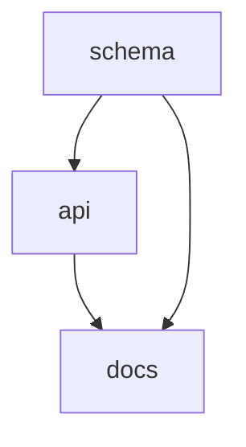

# Plan: Workflow render

Phase: `plan`

## Jobs

| Key | Title | Tier | Needs | Touches |
|---|---|---|---|---|
| `schema` | Define the schema | S3 | none | `src/schema.ts`, `test/schema.test.ts` |
| `api` | Payments API \| v1 | S3 | `schema` | `src/api.ts`, `test/api.test.ts` |
| `docs` | Document the API | H3 | `api`, `schema` | `docs/api.md` |

## Dependencies



## `schema`: Define the schema

Status: `draft` · Tier: `S3` · Review Tier: `S4` · Needs: none

### Goal

Add the zod schema for payments.

### Context

The API job builds on this.

See `docs/payments.md`.

### Files it touches

- `src/schema.ts`
- `test/schema.test.ts`

### Acceptance

- `npm test -- test/schema.test.ts` passes
- `src/schema.ts` exports `Payment`

### Out of scope

- Any HTTP code

## `api`: Payments API | v1

Status: `draft` · Tier: `S3` · Review Tier: `S4` · Needs: `schema`

### Goal

Expose `POST /payments` using the schema.

### Context

Follow the existing handler style.

### Files it touches

- `src/api.ts`
- `test/api.test.ts`

### Acceptance

- `npm test` passes
- `curl -s -X POST localhost:3000/payments -d '{}'` returns 400

### Out of scope

- Auth
- Rate limiting

## `docs`: Document the API

Status: `draft` · Tier: `H3` · Review Tier: `S3` · Needs: `api`, `schema`

### Goal

Write the docs.

Use &lt;b>bold&lt;/b> sparingly and cite sources\[^1].

```html
<div>kept as is</div>
```

### Context

Inline `<code>` stays too.

### Files it touches

- `docs/api.md`

### Acceptance

- `docs/api.md` mentions every route

### Out of scope

None.
